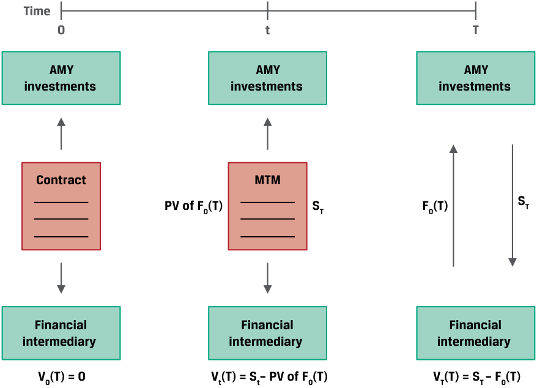
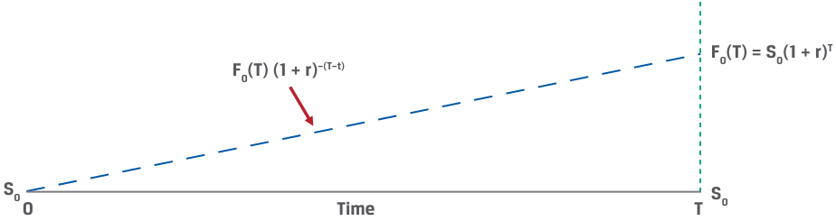
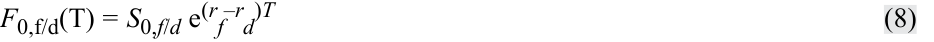
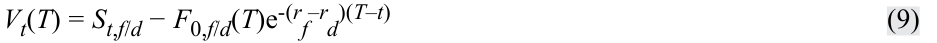
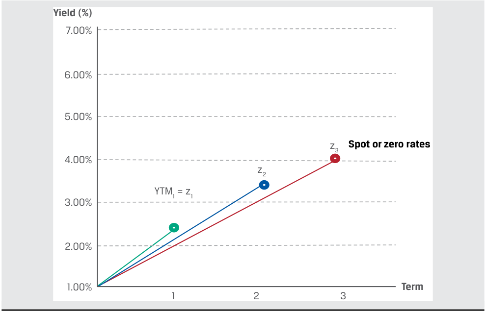
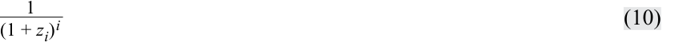
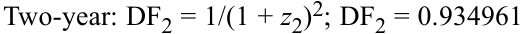
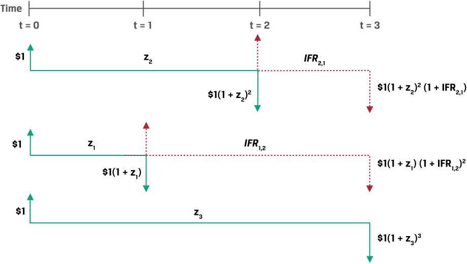
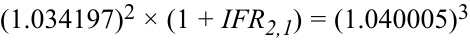
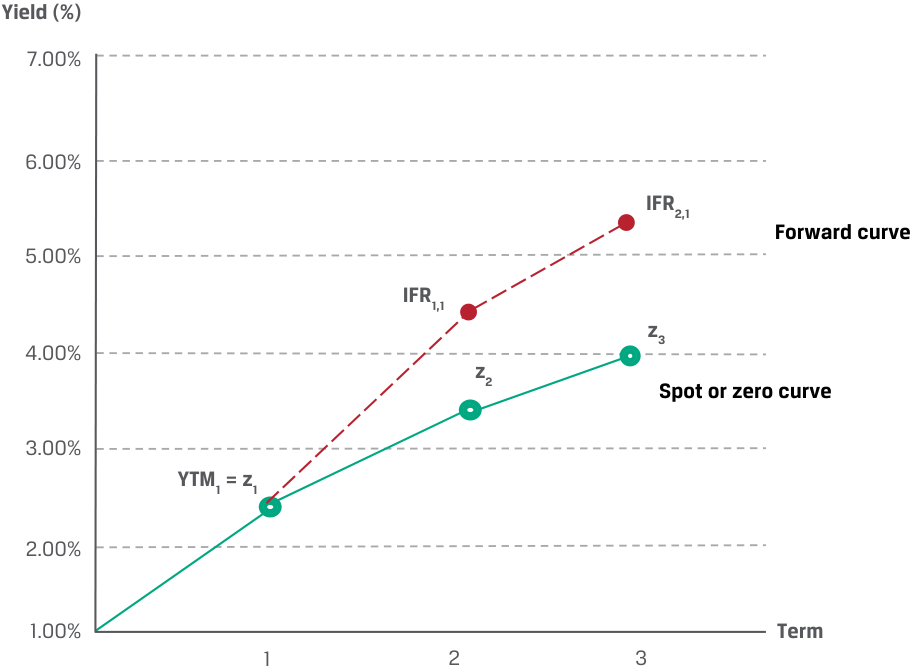

# Tập 7: Công cụ Phái sinh (Derivatives)
## Learning Module 5 Pricing and Valuation of Forward Contracts and for an Underlying with Varying Maturities (Trang PDF 107–136)

---

# Tập 7: Công cụ Phái sinh (*Derivatives*)
## Học phần 5: Định giá và Xác định Giá trị Hợp đồng Kỳ hạn và đối với Tài sản Cơ sở có Kỳ hạn Khác nhau (*Pricing and Valuation of Forward Contracts and for an Underlying with Varying Maturities*)
### Phần 1/2: Giới thiệu (*Introduction*) (Trang PDF 107–120)

---

<!-- PDF Page 107 -->

#### H Ọ C P H Ầ N

# **<mark>5</mark>**

### **Định giá và Xác định Giá trị Hợp đồng Kỳ hạn và đối với Tài sản Cơ sở có Kỳ hạn Khác nhau (*Pricing and Valuation of Forward Contracts and for an Underlying with Varying Maturities*)**

###### **<mark>MỤC TIÊU HỌC TẬP (*LEARNING OUTCOMES*)</mark>**

|**_Mức độ Thành thạo (*Mastery*)_** **_Ứng viên cần có khả năng:_**|
|---|
|Giải thích cách thức giá trị (*value*) và mức giá (*price*) của một hợp đồng kỳ hạn được xác định tại thời điểm khởi tạo (*at initiation*), trong suốt vòng đời của hợp đồng (*during the life of the contract*), và tại thời điểm đáo hạn (*at expiration*).|
|Giải thích cách thức lãi suất kỳ hạn (*forward rates*) được xác định đối với các hợp đồng kỳ hạn lãi suất (*interest rate forward contracts*) và mô tả các ứng dụng của những lãi suất kỳ hạn này.|

##### **GIỚI THIỆU (*INTRODUCTION*)**

## **<mark>1</mark>**

Các bài học trước đã giới thiệu những đặc điểm của cam kết kỳ hạn (*forward commitments*), cấu trúc lợi nhuận khi đáo hạn (*payoff profiles*), và các khái niệm được sử dụng trong việc định giá những công cụ phái sinh này. Cụ thể, mối quan hệ giữa giá giao ngay và giá cam kết kỳ hạn đã được xác lập chính là chi phí cơ hội của việc sở hữu tài sản cơ sở (được đại diện bởi lãi suất phi rủi ro) cũng như bất kỳ chi phí hoặc lợi ích bổ sung nào gắn liền với việc nắm giữ tài sản cơ sở đó. Mối quan hệ giá này vừa ngăn chặn hoạt động kinh doanh chênh lệch giá (*arbitrage*) vừa cho phép một cam kết kỳ hạn được mô phỏng (*replicated*) bằng cách sử dụng các giao dịch trên thị trường giao ngay kết hợp với việc đi vay hoặc cho vay phi rủi ro.

Trong bài học đầu tiên, chúng ta khám phá việc định giá (*pricing*) và xác định giá trị (*valuation*) của các cam kết kỳ hạn trên cơ sở định giá theo thị trường (*mark-to-market* – MTM) kể từ khi khởi tạo cho đến khi đáo hạn. Phân tích này đóng vai trò thiết yếu đối với cả các tổ chức phát hành, nhà đầu tư cũng như các định chế tài chính trung gian nhằm đánh giá giá trị của bất kỳ danh mục tài sản hay nợ phải trả nào có bao gồm những công cụ này. Bài học thứ hai đề cập đến việc định giá kỳ hạn đối với trường hợp đặc biệt của các tài sản cơ sở có những kỳ hạn khác nhau chẳng hạn như lãi suất (*interest rates*), chênh lệch tín dụng (*credit spreads*), và độ biến động (*volatility*). Mức giá của những cam kết kỳ hạn này xuyên suốt cái gọi là cấu trúc kỳ hạn (*term structure*) là một cấu phần nền tảng quan trọng để định giá hợp đồng hoán đổi (*swaps*) và các công cụ liên quan trong những bài học sau.

<!-- PDF Page 108 -->

###### **TỔNG QUAN HỌC PHẦN (*LEARNING MODULE OVERVIEW*)**

- Mức giá cam kết kỳ hạn được thỏa thuận tại thời điểm khởi tạo hợp đồng sẽ giữ nguyên cố định và thiết lập cơ sở mà dựa vào đó tài sản cơ sở (hoặc tiền mặt) sẽ được trao đổi trong tương lai so với mức giá giao ngay tại ngày đáo hạn.

- Đối với một tài sản cơ sở không tạo ra dòng tiền, giá trị của một cam kết mua kỳ hạn (*long forward commitment*) trước khi đáo hạn bằng mức giá giao ngay hiện tại của tài sản cơ sở trừ đi giá trị hiện tại của mức giá kỳ hạn được chiết khấu theo lãi suất phi rủi ro. Điều ngược lại áp dụng cho một cam kết bán kỳ hạn (*short forward commitment*). Ngoại hối đại diện cho một trường hợp đặc biệt trong đó giá giao ngay so với giá kỳ hạn là một hàm số phụ thuộc vào *mức chênh lệch* (*difference*) giữa lãi suất phi rủi ro của các đồng tiền.

- Đối với một tài sản cơ sở có thêm các chi phí và lợi ích, giá trị định giá theo thị trường (*mark-to-market* – MTM) của hợp đồng kỳ hạn được điều chỉnh bằng tổng giá trị hiện tại của tất cả các dòng tiền bổ sung cho đến ngày đáo hạn.

- Các tài sản cơ sở có cấu trúc kỳ hạn (*term structure*), chẳng hạn như lãi suất, có các mức lãi suất hoặc mức giá khác nhau cho các khoảng thời gian đến khi đáo hạn khác nhau. Những lãi suất không trả lãi định kỳ (*zero rates*) hay lãi suất giao ngay (*spot rates*) và lãi suất kỳ hạn (*forward rates*) này được suy ra từ các trái phiếu trả lãi định kỳ (*coupon bonds*) cùng các lãi suất tham chiếu thị trường (*market reference rates*) và thiết lập nên các cấu phần nền tảng cho việc định giá công cụ phái sinh lãi suất.

- Lãi suất kỳ hạn ngầm định (*implied forward rates*) đại diện cho mức lãi suất tái đầu tư hòa vốn (*breakeven reinvestment rate*) liên kết các trái phiếu không trả lãi định kỳ ngắn hạn và dài hạn trong một khoảng thời gian cụ thể.

- Hợp đồng kỳ hạn lãi suất (*forward rate agreement* – FRA) là một hợp đồng trong đó các đối tác đồng ý áp dụng một mức lãi suất cụ thể cho một kỳ trong tương lai.

###### **TỰ ĐÁNH GIÁ HỌC PHẦN (*LEARNING MODULE SELF-ASSESSMENT*)**

Các câu hỏi ban đầu này nhằm mục đích giúp bạn tự đánh giá mức độ hiểu biết hiện tại của mình về học phần này.

1. Hãy ghép nối các tình huống sau đây với phần xác định giá trị hợp đồng kỳ hạn tương ứng của chúng đối với một tài sản không có thêm chi phí hay lợi ích nào.

|Tình huống|Xác định giá trị hợp đồng kỳ hạn|
|---|---|
|1. Tại thời điểm $t = 0$, giá giao ngay của tài sản cơ sở tăng lên tức thời và các tham số thị trường khác giữ nguyên không đổi.|A. Bên mua hợp đồng kỳ hạn có một khoản lãi MTM (*MTM gain*).|
|2. Tại thời điểm $t$, giá trị hiện tại của mức giá kỳ hạn được chiết khấu theo lãi suất phi rủi ro ($r$) bằng với mức giá giao ngay hiện tại ($S_t$).|B. Bên bán hợp đồng kỳ hạn có một khoản lãi MTM (*MTM gain*).|
|3. Tại thời điểm $T$, mức giá của hợp đồng kỳ hạn, $F_0(T)$, lớn hơn mức giá giao ngay hiện tại, $S_T$.|C. Giá trị MTM của hợp đồng kỳ hạn bằng không.|

###### **Lời giải:**

1. A là đáp án đúng. Để thỏa mãn điều kiện không có kinh doanh chênh lệch giá, mức giá giao ngay ban đầu, $S_0$ tại thời điểm $t = 0$, phải bằng giá trị hiện tại của mức giá kỳ hạn được chiết khấu theo lãi suất phi rủi ro, $r$. Sự gia tăng tức thời của giá giao ngay lên mức $S_0^+ > S_0$ dẫn đến một khoản lãi MTM cho bên mua kỳ hạn.

<!-- PDF Page 109 -->

2. C là đáp án đúng. Tại bất kỳ thời điểm $t$ nào, giá trị MTM, $V_t(T)$, bằng phần chênh lệch giữa giá giao ngay hiện tại, $S_t$, và giá trị hiện tại của mức giá kỳ hạn được chiết khấu theo lãi suất phi rủi ro, $r$, hay $F_0(T)(1 + r)^{-(T-t)}$. Khi $S_t = F_0(T)(1 + r)^{-(T-t)}$, thì $V_t(T) = 0$.

3. B là đáp án đúng. Giá trị MTM đối với bên bán hợp đồng kỳ hạn khi tất toán tại thời điểm $T$ bằng với giá trị thanh toán là $F_0(T) - S_T$ (vì $F_0(T) > S_T$ nên bên bán có lãi MTM dương).

2. Sự gia tăng của lãi suất phi rủi ro, $r$, sau thời điểm khởi tạo của một hợp đồng kỳ hạn sẽ gây ra điều nào sau đây đối với giá trị MTM của hợp đồng kỳ hạn xét dưới góc độ của bên bán kỳ hạn nếu các tham số khác giữ nguyên không đổi?
   - **A.** Giá trị MTM của hợp đồng kỳ hạn đối với bên bán kỳ hạn sẽ không thay đổi.
   - **B.** Giá trị MTM của hợp đồng kỳ hạn đối với bên bán kỳ hạn sẽ tăng lên.
   - **C.** Giá trị MTM của hợp đồng kỳ hạn đối với bên bán kỳ hạn sẽ giảm xuống.

   **Lời giải:**
   C là đáp án đúng. Giá trị định giá theo thị trường (*mark-to-market*) xét dưới góc độ của bên bán kỳ hạn bằng $V_t(T)$ trong phương trình sau đây:
   $$V_t(T) = F_0(T)(1 + r)^{-(T-t)} - S_t$$
   Sự gia tăng của lãi suất phi rủi ro, $r$, sau khi khởi tạo hợp đồng kỳ hạn sẽ khiến cho giá trị hiện tại của mức giá kỳ hạn, $F_0(T)$, giảm xuống, và điều này sẽ làm giảm giá trị MTM xét dưới góc độ của bên bán hợp đồng.

3. Giá trị nào sau đây gần nhất với mức lãi suất không trả lãi định kỳ kỳ hạn hai năm (*two-year zero rate*) khi biết một trái phiếu trả lãi hàng năm $3\%$ được định giá ở mức $99$ trên $100$ mệnh giá, nếu một trái phiếu trả lãi hàng năm kỳ hạn một năm của cùng tổ chức phát hành có lợi suất đáo hạn (*yield-to-maturity*) là $2.50\%$?
   - **A.** $3.5266\%$
   - **B.** $3.5000\%$
   - **C.** $3.5422\%$

   **Lời giải:**
   C là đáp án đúng. Lợi suất đáo hạn và lãi suất zero đối với một trái phiếu chỉ có một dòng tiền duy nhất khi đáo hạn sau một kỳ là hoàn toàn giống nhau, vì vậy lãi suất zero một năm, $z_1$, bằng $2.50\%$. Giải tìm lãi suất zero hai năm ($z_2$) trong phương trình sau đây:
   $$99 = \frac{3}{1.025} + \frac{103}{(1 + z_2)^2}$$
   Giải tìm $z_2$ ta thu được $3.5422\%$. A không đúng vì $3.5266\%$ là tỷ suất hoàn vốn nội bộ ($\text{IRR}$) giải từ các dòng tiền $-99$ tại $t = 0$, $3$ tại $t = 1$, và $103$ tại $t = 2$. Đáp án này giả định cấu trúc kỳ hạn phẳng (*flat term structure*), vốn không phải là một giả định đúng dựa trên đề bài. B không đúng vì đáp án này ngụ ý rằng chúng ta có thể tìm ra câu trả lời đúng bằng cách giả định lãi suất coupon là trung bình cộng giản đơn của lãi suất zero một năm và hai năm.

4. Phát biểu nào sau đây là mô tả đúng về lãi suất kỳ hạn `2y3y` (*2y3y forward rate*)?
   - **A.** Lãi suất hai năm ngầm định bắt đầu sau ba năm nữa tính từ hiện tại.
   - **B.** Lãi suất ba năm ngầm định bắt đầu sau hai năm nữa tính từ hiện tại.
   - **C.** Lãi suất một năm ngầm định bắt đầu sau hai năm nữa tính từ hiện tại.

   **Lời giải:**
   B là đáp án đúng. Trong thuật ngữ về lãi suất kỳ hạn, con số đầu tiên phản ánh mốc thời gian mà tại đó lãi suất kỳ hạn bắt đầu có hiệu lực; do đó, lãi suất kỳ hạn nêu trên phản ánh một mức lãi suất bắt đầu sau *hai* năm nữa tính từ hiện tại. Con số thứ hai

<!-- PDF Page 110 -->

   phản ánh kỳ hạn (*maturity/tenor*) của mức lãi suất đó. Vì vậy, lãi suất kỳ hạn `2y3y` phản ánh một mức lãi suất kỳ hạn ba năm bắt đầu sau hai năm nữa. A không đúng vì đây là mô tả của lãi suất kỳ hạn `3y2y`. C không đúng vì đây là mô tả của lãi suất kỳ hạn `2y1y`.

## **<mark>2</mark>**

##### **ĐỊNH GIÁ VÀ XÁC ĐỊNH GIÁ TRỊ CỦA HỢP ĐỒNG KỲ HẠN (*PRICING AND VALUATION OF FORWARD CONTRACTS*)**

*Giải thích cách thức giá trị và mức giá của một hợp đồng kỳ hạn được xác định tại thời điểm khởi tạo, trong suốt vòng đời của hợp đồng, và tại thời điểm đáo hạn.*

###### **Định giá so với Xác định Giá trị của Hợp đồng Kỳ hạn (*Pricing versus Valuation of Forward Contracts*)**

Khi các đối tác tham gia vào hợp đồng kỳ hạn (*forward*), hợp đồng tương lai (*futures*), hoặc hợp đồng hoán đổi (*swap*) với nhau, những hợp đồng này có giá trị ban đầu bằng không (nếu bỏ qua chi phí giao dịch cũng như rủi ro tín dụng đối tác). Mặc dù các cam kết kỳ hạn không đòi hỏi phải chi trả tiền mặt ngay khi khởi tạo, nhưng mức giá của chúng kết hợp cả chi phí cơ hội của một vị thế mua bằng tiền mặt được đo lường bởi lãi suất phi rủi ro. Giá kỳ hạn (*forward price*) hoặc lãi suất kỳ hạn (*forward rate*) được thiết lập khi khởi tạo sẽ giữ nguyên cố định và quyết định cơ sở mà dựa vào đó tài sản cơ sở (hoặc tiền mặt) sẽ được trao đổi trong tương lai so với mức giá giao ngay tại ngày đáo hạn.

Khi thời gian trôi qua và/hoặc giá giao ngay của tài sản cơ sở cùng các tham số khác thay đổi, giá trị (*value*) của hợp đồng kỳ hạn sẽ thay đổi theo. Giá trị định giá theo thị trường (*mark-to-market value* – MTM) này của một hợp đồng phản ánh sự thay đổi trong giá tài sản cơ sở và các yếu tố khác mà sẽ dẫn đến một khoản lãi hoặc lỗ cho một đối tác nếu hợp đồng kỳ hạn đó được tất toán ngay lập tức. Khoản lãi MTM của bên bán kỳ hạn sẽ bằng đúng khoản lỗ MTM của bên mua kỳ hạn và ngược lại. Hãy nhớ lại rằng sự khác biệt cốt lõi giữa hợp đồng tương lai giao dịch trên sàn (*exchange-traded futures*) và hợp đồng kỳ hạn phi tập trung (*over-the-counter forwards*) là trung tâm thanh toán bù trừ hợp đồng tương lai sẽ tất toán những thay đổi MTM này bằng tiền mặt hàng ngày, trong khi việc thanh toán hợp đồng kỳ hạn thường chỉ diễn ra vào ngày đáo hạn.

###### **_Định giá và Xác định Giá trị Hợp đồng Kỳ hạn tại Thời điểm Khởi tạo (Pricing and Valuation of Forward Contracts at Initiation)_**

Học phần trước đã xác lập rằng một hợp đồng kỳ hạn được ký kết tại thời điểm $t = 0$ diễn ra tại một mức giá kỳ hạn, $F_0(T)$, thỏa mãn các điều kiện không có kinh doanh chênh lệch giá đối với giá giao ngay của tài sản cơ sở ($S_0$), tỷ suất sinh lợi phi rủi ro ($r$), và bất kỳ chi phí hay lợi ích bổ sung nào gắn liền với quyền sở hữu tài sản cơ sở cho đến khi hợp đồng kỳ hạn đáo hạn tại thời điểm $T$. Trong một ví dụ trước, AMY Investments đã đồng ý mua $1,000$ cổ phiếu Airbus (AIR) giao dịch tại mức giá giao ngay ($S_T$) vào ngày đáo hạn với mức giá kỳ hạn đã thỏa thuận trước, $F_0(T)$, là $\text{EUR}30$ mỗi cổ phiếu, như được thể hiện trong Bảng minh họa 1.

<!-- PDF Page 111 -->

###### **Bảng minh họa 1: Giá trị Hợp đồng Kỳ hạn tại Thời điểm Khởi tạo (*Forward Contract Value at Initiation*)**

> **Chú thích hình ảnh:**
> Tại thời điểm $t = 0$: AMY Investments ký Hợp đồng (*Contract*) với Định chế tài chính trung gian (*Financial intermediary*) nhận $S_T$ và trả $F_0(T)$. Giá trị khởi tạo: $V_0(T) = 0$.

Nếu chúng ta giả sử $S_0 = \text{EUR}29.70$, $r = 1.00\%$ và $T$ là một năm, thì mức $F_0(T)$ bằng $\text{EUR}30$ thỏa mãn điều kiện không có kinh doanh chênh lệch giá tại thời điểm $t = 0$ (bỏ qua chi phí giao dịch). Hợp đồng kỳ hạn này không phải là một tài sản cũng không phải là một khoản nợ phải trả đối với AMY Investments (bên mua) hay định chế tài chính trung gian (bên bán) và do đó có giá trị bằng không đối với cả hai bên:

$$V_0(T) = 0 \tag{1}$$

###### **_Định giá và Xác định Giá trị Hợp đồng Kỳ hạn tại Thời điểm Đáo hạn (Pricing and Valuation of Forward Contracts at Maturity)_**

Hãy nhớ lại từ bài học trước rằng một cam kết kỳ hạn có cấu trúc lợi nhuận đối xứng. Nghĩa là, tại thời điểm $T$, một hợp đồng kỳ hạn được tất toán dựa trên phần chênh lệch giữa giá kỳ hạn, $F_0(T)$, và giá giao ngay của tài sản cơ sở, $S_T$, hay $S_T - F_0(T)$, xét dưới góc độ của bên mua, như được thể hiện trong Bảng minh họa 2.

<!-- PDF Page 112 -->

**Bảng minh họa 2: Giá trị Hợp đồng Kỳ hạn tại Thời điểm Đáo hạn (*Forward Contract Value at Maturity*)**

> **Chú thích hình ảnh:**
> - **Thời điểm $t = 0$:** AMY Investments ký hợp đồng với Định chế tài chính trung gian (nhận $S_T$, trả $F_0(T)$) $\rightarrow$ $V_0(T) = 0$.
> - **Thời điểm $t = T$:** AMY Investments nhận giá trị thanh toán $S_T$ và trả $F_0(T)$ cho Định chế tài chính trung gian $\rightarrow$ $V_T(T) = S_T - F_0(T)$.

|**Kết quả (*Outcome*)**|**$V_T(T)$ (vị thế mua – *long position*)**|**$V_T(T)$ (vị thế bán – *short position*)**|
|---|---|---|
|$S_T > F_0(T)$|$S_T - F_0(T) > 0$|$F_0(T) - S_T < 0$|
|$S_T < F_0(T)$|$S_T - F_0(T) < 0$|$F_0(T) - S_T > 0$|
|$S_T = F_0(T)$|$S_T - F_0(T) = 0$|$F_0(T) - S_T = 0$|

AMY phải trả mức giá đã thỏa thuận trước là $F_0(T)$ để đổi lấy tài sản cơ sở đang có mức giá giao ngay hiện tại là $S_T$. Vì hợp đồng được tất toán khi đáo hạn, nên *giá trị* (*value*) của nó vào ngày đáo hạn bằng đúng số tiền thanh toán xét dưới góc độ của từng đối tác. Ví dụ, tại thời điểm $t = T$, giá trị của hợp đồng kỳ hạn khi đáo hạn, $V_T(T)$, xét dưới góc độ của AMY (bên mua kỳ hạn) bằng:

$$V_T(T) = S_T - F_0(T) \tag{2}$$

###### **VÍ DỤ 1 (*EXAMPLE 1*)**

###### **Giá trị của các Vị thế Kỳ hạn Cổ phiếu Biomian tại Thời điểm Đáo hạn (*Value of Biomian Forward Positions at Maturity*)**

Văn phòng Quản lý Tài sản Gia đình Viswan (VFO) hiện đang sở hữu $10,000$ cổ phiếu phổ thông không trả cổ tức của Biomian Limited, một công ty công nghệ sinh học có trụ sở tại Mumbai, ở mức giá giao ngay là $\text{INR}295$ mỗi cổ phiếu. VFO đồng ý bán kỳ hạn $1,000$ cổ phiếu Biomian cho một định chế tài chính trung gian với giá $\text{INR}300.84$ mỗi cổ phiếu sau sáu tháng. Hãy tính giá trị hợp đồng khi đáo hạn, $V_T(T)$, xét dưới góc độ của cả bên mua lẫn bên bán nếu giá giao ngay khi đáo hạn ($S_T$) là:

- (1) $S_T = \text{INR}287$
- (2) $S_T = \text{INR}312$

<!-- PDF Page 113 -->

###### **Lời giải:**

Khi khởi tạo hợp đồng, VFO tham gia vào một hợp đồng kỳ hạn với một định chế tài chính trung gian để bán cổ phiếu Biomian ở mức giá $F_0(T) = \text{INR}300.84$. Giá trị hợp đồng kỳ hạn tại thời điểm khởi tạo đối với cả VFO và định chế tài chính trung gian, $V_0(T)$, đều bằng không.

(1) $S_T = \text{INR}287$ và $F_0(T) = \text{INR}300.84$. Giá trị hợp đồng trên mỗi cổ phiếu khi đáo hạn bằng với giá trị tất toán của nó xét dưới góc độ của cả định chế tài chính trung gian (bên mua) và VFO (bên bán), như sau:

- Bên mua (vị thế mua kỳ hạn – *long forward position*): $V_T(T) = S_T - F_0(T)$
  $$V_T(T) = -\text{INR}13.84 = 287 - 300.84$$
- Văn phòng Gia đình Viswan (vị thế bán kỳ hạn – *short forward position*): $V_T(T) = F_0(T) - S_T$
  $$V_T(T) = \text{INR}13.84 = 300.84 - 287$$

(2) $S_T = \text{INR}312$ và $F_0(T) = \text{INR}300.84$. Giá trị hợp đồng trên mỗi cổ phiếu khi đáo hạn bằng với giá trị tất toán của nó xét dưới góc độ của cả định chế tài chính trung gian (bên mua) và VFO (bên bán), như sau:

- Bên mua (vị thế mua kỳ hạn – *long forward position*): $V_T(T) = S_T - F_0(T)$
  $$V_T(T) = \text{INR}11.16 = 312 - 300.84$$
- Văn phòng Gia đình Viswan (vị thế bán kỳ hạn – *short forward position*): $V_T(T) = F_0(T) - S_T$
  $$V_T(T) = -\text{INR}11.16 = 300.84 - 312$$

###### **_Định giá và Xác định Giá trị Hợp đồng Kỳ hạn trong Suốt Vòng đời của Hợp đồng (Pricing and Valuation of Forward Contracts during the Life of the Contract)_**

Một khi hợp đồng kỳ hạn được khởi tạo giữa hai đối tác, sự trôi qua của thời gian và những biến động trong giá giao ngay của tài sản cơ sở, cùng với các yếu tố khác, sẽ làm cho giá trị của hợp đồng kỳ hạn thay đổi. Giá trị định giá theo thị trường (*mark-to-market value*) của một hợp đồng tại bất kỳ thời điểm nào từ khi khởi tạo cho đến khi đáo hạn, $V_t(T)$, phản ánh mối quan hệ giữa giá giao ngay hiện tại ở thời điểm $t$ ($S_t$) và giá trị hiện tại của mức giá kỳ hạn ở thời điểm $t$ được chiết khấu theo lãi suất phi rủi ro hiện hành. Bảng minh họa 3 thể hiện mối quan hệ này đối với ví dụ hợp đồng kỳ hạn cổ phiếu Airbus xét dưới góc độ của AMY Investments (vị thế mua kỳ hạn).

**Bảng minh họa 3: Giá trị Hợp đồng Kỳ hạn khi Khởi tạo, theo Thời gian, và khi Đáo hạn (*Forward Contract Value at Inception, over Time, and at Maturity*)**

> **Chú thích hình ảnh:**
> - **Thời điểm $0$ (Khởi tạo - *Contract*):** $V_0(T) = 0$.
> - **Thời điểm $t$ (Định giá theo thị trường - *MTM*):** Giữa $S_t$ và $\text{PV}$ của $F_0(T)$ $\rightarrow$ $V_t(T) = S_t - \text{PV của } F_0(T)$.
> - **Thời điểm $T$ (Đáo hạn):** Giữa $S_T$ và $F_0(T)$ $\rightarrow$ $V_T(T) = S_T - F_0(T)$.

<!-- PDF Page 114 -->

Hãy nhớ lại rằng dưới các điều kiện không có kinh doanh chênh lệch giá, mức giá kỳ hạn của một tài sản cơ sở không có thêm chi phí hay lợi ích sở hữu nào sẽ bằng với giá trị tương lai của mức giá giao ngay tính theo lãi suất phi rủi ro, $r$:

$$F_0(T) = S_0(1 + r)^T \tag{3}$$

Tại bất kỳ thời điểm $t$ nào trong suốt vòng đời của hợp đồng mà $t < T$, chúng ta có thể biểu diễn giá trị hiện tại của mức giá kỳ hạn, $F_0(T)$, tại thời điểm $t$ như sau:

$$\text{PV}_t\text{ của }F_0(T) = F_0(T)(1 + r)^{-(T-t)} \tag{4}$$

Nếu $S_t$ là giá giao ngay của tài sản cơ sở tại thời điểm $t$, Phương trình 5 thể hiện giá trị MTM của hợp đồng kỳ hạn tại thời điểm $t$, $V_t(T)$, xét dưới góc độ của vị thế mua kỳ hạn:

$$V_t(T) = S_t - F_0(T)(1 + r)^{-(T-t)} \tag{5}$$

Bảng minh họa 4 thể hiện mối quan hệ giữa giá giao ngay, giá kỳ hạn, và giá trị hiện tại của giá kỳ hạn, $F_0(T)(1 + r)^{-(T-t)}$, theo thời gian như được biểu diễn bằng đường nét đứt. Độ dốc của đường nét đứt bằng với lãi suất $r$.

**Bảng minh họa 4: Giá trị Hiện tại của Giá Kỳ hạn theo Thời gian (*Present Value of the Forward Price over Time*)**

> **Chú thích hình ảnh:**
> Đường nét đứt nối từ mức giá giao ngay $S_0$ tại thời điểm $0$ qua giá trị hiện tại của giá kỳ hạn $F_0(T)(1+r)^{-(T-t)}$ tại thời điểm $t$ đến mức giá kỳ hạn $F_0(T) = S_0(1+r)^T$ tại thời điểm $T$.

Chúng ta sẽ khám phá những mối quan hệ này, cũng như tác động MTM của một sự thay đổi tức thời trong giá giao ngay ($S_0$), trong ví dụ sau đây.

###### **VÍ DỤ 2 (*EXAMPLE 2*)**

###### **Lãi suất Phi rủi ro Ngầm định và Giá trị MTM của Hợp đồng Kỳ hạn Biomian (*Implied Risk-Free Rate and Biomian Forward Contract MTM*)**

Giống như trong Ví dụ 1, VFO tham gia vào một hợp đồng kỳ hạn sáu tháng với một định chế tài chính trung gian để bán cổ phiếu Biomian ở mức giá $F_0(T) = \text{INR}300.84$ mỗi cổ phiếu. Giá giao ngay hiện tại là $\text{INR}295$ mỗi cổ phiếu.

**1.** Tính lãi suất phi rủi ro ngầm định từ giá giao ngay và giá kỳ hạn.

**2.** Tính giá trị MTM của hợp đồng kỳ hạn xét dưới góc độ của VFO nếu giá cổ phiếu của Biomian tăng vọt tức thời lên mức $\text{INR}325$ ngay khi khởi tạo hợp đồng ($t = 0$).

###### **Lời giải:**

**1.** Chúng ta có thể sử dụng Phương trình 3 — với $S_0 = 295$, $F_0(T) = 300.84$, và $T = 0.5$ — để giải tìm lãi suất phi rủi ro, $r$:

$$F_0(T) = S_0(1 + r)^T$$

$$300.84 = 295(1 + r)^{0.5}$$

$$r = 0.04 \text{ hay } 4\%$$

<!-- PDF Page 115 -->

**2.** Với tư cách là bên bán hợp đồng kỳ hạn, chúng ta phải sắp xếp lại Phương trình 5 để giải tìm giá trị MTM của hợp đồng xét dưới góc độ của VFO như sau:

$$V_t(T) = F_0(T)(1 + r)^{-(T-t)} - S_t$$

Lưu ý rằng nếu $t = 0$, biểu thức $F_0(T)(1 + r)^{-(T-t)}$ rút gọn thành $F_0(T)(1 + r)^{-T} = S_0$, vì vậy giá trị hợp đồng xét dưới góc độ của VFO có thể được biểu diễn một cách đơn giản là:

$$V_t(T) = S_0 - S_t$$

$$-\text{INR}30 = \text{INR}295 - \text{INR}325$$

Nếu chúng ta coi mức giá cao hơn mới của Biomian là $S_0^+ = \text{INR}325$, chúng ta có thể biểu diễn sự thay đổi MTM này trong sơ đồ dưới đây:

> **Chú thích hình ảnh:**
> Khi giá giao ngay tại thời điểm $0$ nhảy vọt từ $S_0$ lên $S_0^+$, đường giá trị hiện tại tương ứng dịch chuyển lên cao hơn từ đường nối $S_0 \rightarrow F_0(T)$ sang đường nối $S_0^+ \rightarrow F_0^+(T)$.

Sự kết hợp giữa những biến động của giá giao ngay trong suốt vòng đời của một hợp đồng kỳ hạn và sự trôi qua của thời gian khiến cho giá trị MTM của hợp đồng kỳ hạn biến động theo thời gian, đại diện cho một khoản lãi hoặc lỗ đối với các bên tham gia hợp đồng chừng nào $S_t \neq F_0(T)(1 + r)^{-(T-t)}$. Bảng minh họa 5 thể hiện mối quan hệ này, với giả định lãi suất phi rủi ro không đổi trong suốt vòng đời của hợp đồng đối với các vị thế mua và bán hợp đồng kỳ hạn.

**Bảng minh họa 5: Giá trị MTM của Hợp đồng Kỳ hạn (*Forward Contract MTM*)**

|**Biểu đồ Thời gian ($0 \rightarrow t \rightarrow T$)**|**So sánh tại thời điểm $t$: $S_t$ so với $F_0(T)(1 + r)^{-(T-t)}$**|
|---|---|
|$S_0$ tại thời điểm $0$|Tiến tới $F_0(T)$ tại thời điểm $T$|

|**Kết quả (*Outcome*)**|**$V_t(T)$ (vị thế mua – *long position*)**|**$V_t(T)$ (vị thế bán – *short position*)**|
|---|---|---|
|$S_t > F_0(T)(1 + r)^{-(T-t)}$|Lãi MTM (*MTM gain*)|Lỗ MTM (*MTM loss*)|
|$S_t < F_0(T)(1 + r)^{-(T-t)}$|Lỗ MTM (*MTM loss*)|Lãi MTM (*MTM gain*)|
|$S_t = F_0(T)(1 + r)^{-(T-t)}$|Không lãi cũng không lỗ MTM (*No MTM gain or loss*)|Không lãi cũng không lỗ MTM (*No MTM gain or loss*)|

Ví dụ 3 minh họa những tác động kết hợp này đối với hợp đồng kỳ hạn cổ phiếu Biomian của VFO và xem xét tác động của sự thay đổi trong lãi suất phi rủi ro.

<!-- PDF Page 116 -->

###### **VÍ DỤ 3 (*EXAMPLE 3*)**

###### **Giá trị MTM của Hợp đồng Kỳ hạn Biomian theo Thời gian và Khi Thay đổi Lãi suất Phi rủi ro (*Biomian Forward Contract MTM over Time and Changes in Risk-Free Rate*)**

Giống như trong các ví dụ trước, VFO tham gia vào một hợp đồng kỳ hạn sáu tháng với một định chế tài chính trung gian để bán cổ phiếu Biomian tại mức giá $F_0(T) = \text{INR}300.84$ mỗi cổ phiếu. Giá giao ngay tại thời điểm $t = 0$ là $\text{INR}295$ mỗi cổ phiếu và lãi suất phi rủi ro là $4\%$.

**1.** Tính giá trị MTM của hợp đồng kỳ hạn xét dưới góc độ của VFO sau ba tháng ($t = 0.25$) nếu giá giao ngay của Biomian ($S_t$) giảm xuống mức $\text{INR}285$ mỗi cổ phiếu.

**2.** Hãy cho biết giá trị MTM của hợp đồng kỳ hạn xét dưới góc độ của VFO ở Câu hỏi (1) nếu lãi suất phi rủi ro tăng gấp đôi từ $4\%$ lên $8\%$, và diễn giải kết quả thu được.

###### **Lời giải:**

(1) Xét dưới góc độ của VFO là bên bán hợp đồng kỳ hạn, sắp xếp lại Phương trình 5 để giải tìm giá trị MTM của hợp đồng như sau:

$$V_t(T) = F_0(T)(1 + r)^{-(T-t)} - S_t$$

Giải tìm $V_t(T)$ trong đó $F_0(T) = 300.84$, $r = 0.04$, $T = 0.5$, $t = 0.25$, và $S_t = 285$:

$$V_t(T) = 300.84(1.04)^{-(0.25)} - 285$$

$$V_t(T) = \text{INR}12.90 \text{ (Khoản lãi MTM)}$$

(2) Giải tìm $V_t(T)$ bằng cách sử dụng cùng phương trình và các dữ liệu đầu vào như ở Câu hỏi (1) ngoại trừ việc thay $r = 0.08$:

$$V_t(T) = F_0(T)(1 + r)^{-(T-t)} - S_t$$

Giải tìm $V_t(T)$ trong đó $F_0(T) = 300.84$, $r = 0.08$, $T = 0.5$, $t = 0.25$, và $S_t = 285$:

$$V_t(T) = 300.84(1.08)^{-(0.25)} - 285$$

$$V_t(T) = \text{INR}10.11 \text{ (Khoản lãi MTM)}$$

Khoản lãi MTM của VFO trên hợp đồng đã giảm đi $\text{INR}2.79$ ($12.90 - 10.11$). Mức lãi suất phi rủi ro *cao hơn* làm tăng chi phí cơ hội của một vị thế tiền mặt và *làm giảm* giá trị hiện tại của mức giá kỳ hạn, qua đó *làm giảm* khoản lãi MTM của VFO, $V_t(T)$, được biểu thị bằng giá trị hiện tại của $F_0(T)$ trừ đi $S_t$.

###### **_Định giá và Xác định Giá trị Hợp đồng Kỳ hạn khi có Thêm Chi phí hoặc Lợi ích (Pricing and Valuation of Forward Contracts with Additional Costs or Benefits)_**

Việc định giá và xác định giá trị của các hợp đồng kỳ hạn từ đầu bài học đến giờ đều giả định rằng không có dòng tiền nào gắn liền với tài sản cơ sở. Chúng ta đã chứng minh rằng giá trị MTM của hợp đồng tại bất kỳ thời điểm $t$ nào bằng phần chênh lệch giữa giá giao ngay hiện tại và giá trị hiện tại của mức giá kỳ hạn được chiết khấu theo lãi suất phi rủi ro. Bây giờ chúng ta chuyển sự chú ý sang cách thức mà chi phí lưu giữ (*cost of carry*), hay giá trị ròng của tất cả các chi phí và lợi ích liên quan đến việc sở hữu một tài sản cơ sở hoặc chỉ số, tác động đến việc xác định giá trị của một hợp đồng kỳ hạn. Hãy nhớ lại mối quan hệ giữa giá giao ngay và giá kỳ hạn đối với các tài sản cơ sở có lợi ích hoặc thu nhập từ quyền sở hữu ($I$) hoặc chi phí ($C$), được biểu thị dưới dạng giá trị hiện tại ở thời điểm $t = 0$ theo phương pháp ghép lãi rời rạc:

$$F_0(T) = (S_0 - \text{PV}_0(I) + \text{PV}_0(C))(1 + r)^T \tag{6}$$

Phương trình 6 kết hợp chi phí lưu giữ và thỏa mãn điều kiện không có kinh doanh chênh lệch giá tại thời điểm $t = 0$ (bỏ qua chi phí giao dịch). Một hợp đồng kỳ hạn tại mức giá $F_0(T)$ có kết hợp những chi phí và lợi ích đã biết này không phải là một tài sản cũng không phải là một khoản nợ phải trả đối với bên mua hay bên bán khi khởi tạo: $V_0(T) = 0$. Ngoài ra, vì mức giá kỳ hạn, $F_0(T)$, đã kết hợp chi phí lưu giữ, nên giá trị khi đáo hạn, $V_T(T)$, bằng phần chênh lệch giữa giá giao ngay ($S_T$) vào ngày đáo hạn và mức giá kỳ hạn ban đầu, $F_0(T)$.

<!-- PDF Page 117 -->

Tại bất kỳ thời điểm $t$ nào trong suốt vòng đời của hợp đồng, giá trị MTM của hợp đồng kỳ hạn, $V_t(T)$, sẽ phụ thuộc vào phần chênh lệch giữa giá giao ngay hiện tại đã được điều chỉnh cho bất kỳ chi phí hoặc lợi ích còn lại nào tính từ thời điểm $t$ cho đến ngày đáo hạn, $S_t - \text{PV}_t(I) + \text{PV}_t(C)$, và giá trị hiện tại của mức giá kỳ hạn, $\text{PV}_t F_0(T) = F_0(T)(1 + r)^{-(T-t)}$. Kết quả này được thể hiện trong Phương trình 7 xét dưới góc độ của đối tác nắm giữ vị thế mua kỳ hạn:

$$V_t(T) = (S_t - \text{PV}_t(I) + \text{PV}_t(C)) - F_0(T)(1 + r)^{-(T-t)} \tag{7}$$

###### **VÍ DỤ 4 (*EXAMPLE 4*)**

###### **Xác định Giá trị Hợp đồng Kỳ hạn Cổ phiếu của Hightest (*Hightest Equity Forward Valuation*)**

Trong một ví dụ trước, Hightest Capital đã đồng ý chuyển giao $1,000$ cổ phiếu Unilever (UL) cho một định chế tài chính trung gian sau sáu tháng theo một hợp đồng kỳ hạn với mức giá $\text{EUR}50,631.10$, hay $\text{EUR}50.6311$ mỗi cổ phiếu. Unilever trả cổ tức hàng quý là $\text{EUR}0.30$ vào thời điểm ba tháng sau khi khởi tạo hợp đồng và vào thời điểm $T$, đồng thời lãi suất phi rủi ro ($r$) là $5\%$. Hãy tính mức giá hòa vốn (*breakeven price*) của hợp đồng kỳ hạn, $S_t$, nơi $V_t(T) = \text{MTM} = 0$ vào thời điểm bốn tháng sau khi khởi tạo hợp đồng nếu lãi suất phi rủi ro, $r$, giữ nguyên không đổi ở mức $5\%$.

Sử dụng Phương trình 7 với $\text{PV}_t(C) = 0$ để giải phương trình $V_t(T) = 0$ vào thời điểm bốn tháng sau khi khởi tạo hợp đồng:

$$V_t(T) = (S_t - \text{PV}_t(I)) - F_0(T)(1 + r)^{-(T-t)}$$

Trước tiên, giải tìm giá trị hiện tại của cổ tức trên mỗi cổ phiếu, $\text{PV}_t(I)$, khi biết rằng đợt cổ tức thứ hai sẽ được chi trả sau hai tháng nữa (tính từ tháng thứ 4 đến tháng thứ 6):

$$\text{PV}_t(I) = \text{EUR}0.30(1.05)^{-0.167} = \text{EUR}0.2976$$

> **Chú thích hình ảnh:**
> - Trục thời gian: $0 \rightarrow t = 4\text{m} \rightarrow T = 6\text{m}$.
> - Chiết khấu $2\text{ tháng}$ từ $T = 6\text{m}$ về $t = 4\text{m}$ bằng hệ số $(1.05)^{-2/12}$:
>   - Cổ tức $I = €0.30$ tại $T = 6\text{m}$ $\rightarrow$ $\text{PV}_t(I) = €0.2976$ tại $t = 4\text{m}$.
>   - Giá kỳ hạn $F_0(T) = €50.6311$ tại $T = 6\text{m}$ $\rightarrow$ $\text{PV}_t(F_0(T)) = €50.2202$ tại $t = 4\text{m}$.
>   - Mức giá giao ngay “Hòa vốn” (*“Breakeven” $S_t$*) tại $t = 4\text{m}$: $S_t = €50.5178$.

Thay $\text{PV}_t(I) = \text{EUR}0.2976$ vào Phương trình 7 để giải tìm $S_t$ khi $V_t(T) = 0$:

$$0 = (S_t - 0.2976) - 50.6311(1.05)^{-0.167}$$

$$S_t = \text{EUR}50.2202 + \text{EUR}0.2976 = \text{EUR}50.5178$$

Do đó, mức giá giao ngay hòa vốn của Hightest Capital, $S_t$ (tức là nơi $V_t(T) = 0$), vào thời điểm bốn tháng sau khi khởi tạo hợp đồng kỳ hạn là $\text{EUR}50.5178$ mỗi cổ phiếu.

Các cam kết kỳ hạn trên những chỉ số cơ sở chẳng hạn như chỉ số cổ phiếu (*equity indexes*) hoặc chỉ số hàng hóa (*commodity indexes*) chủ yếu là các hợp đồng tương lai chỉ số được giao dịch trên sàn (*exchange-traded index futures contracts*). Một bài học trước đã sử dụng *tỷ suất sinh lợi* trong suốt vòng đời của hợp đồng theo phương pháp ghép lãi liên tục để thiết lập mối quan hệ giữa định giá giao ngay và kỳ hạn đối với những công cụ này. Việc xác định giá trị của hợp đồng tương lai chỉ số và các hợp đồng tương lai khác sẽ được đề cập trong một bài học sau.

<!-- PDF Page 118 -->

Hãy nhớ lại rằng đối với một hợp đồng kỳ hạn ngoại hối, cả mức giá giao ngay ($S_{0,f/d}$) lẫn mức giá kỳ hạn ($F_{0,f/d}(T)$) đều được biểu thị theo số đơn vị của *đồng tiền định giá* (*price currency* — $f$ hay đồng ngoại tệ) trên *một* đơn vị của *đồng tiền cơ sở* (*base currency* — $d$ hay đồng nội tệ). Mối quan hệ giữa giá giao ngay so với giá kỳ hạn phản ánh *mức chênh lệch* giữa lãi suất phi rủi ro của đồng ngoại tệ, $r_f$, và lãi suất phi rủi ro của đồng nội tệ, $r_d$, như được thể hiện trong Phương trình 8:

$$F_{0,f/d}(T) = S_{0,f/d} e^{(r_f - r_d)T} \tag{8}$$

Tại thời điểm khởi tạo giao dịch ở $t = 0$, đồng tiền có mức lãi suất phi rủi ro thấp hơn cho kỳ hạn đó được gọi là giao dịch ở mức gia tăng kỳ hạn (*forward premium*) — nghĩa là cần ít đơn vị đồng tiền đó hơn để mua một đơn vị của đồng tiền kia — trong khi đồng tiền có mức lãi suất phi rủi ro cao hơn được giao dịch ở mức chiết khấu kỳ hạn (*forward discount*).

Tại bất kỳ thời điểm $t$ nhất định nào, giá trị MTM của hợp đồng kỳ hạn ngoại hối (xét dưới góc độ vị thế mua kỳ hạn) là phần chênh lệch giữa mức giá ngoại hối giao ngay *hiện tại* ($S_{t,f/d}$) và giá trị hiện tại của mức giá kỳ hạn được chiết khấu theo mức chênh lệch lãi suất phi rủi ro *hiện tại* ($r_f - r_d$) cho khoảng thời gian còn lại tính đến ngày đáo hạn, như được thể hiện trong Phương trình 9:

$$V_t(T) = S_{t,f/d} - F_{0,f/d}(T) e^{-(r_f - r_d)(T - t)} \tag{9}$$

Những thay đổi trong mức chênh lệch lãi suất ($r_f - r_d$) đại diện cho một sự thay đổi trong chi phí cơ hội *tương đối* giữa các đồng tiền. Như đã mô tả trong bài học trước, sự thay đổi giá của một đồng tiền tính theo một đồng tiền khác được gọi là *tăng giá* (*appreciation*) hoặc *giảm giá* (*depreciation*). Ví dụ, nếu cần ít USD hơn để mua một EUR, thì tỷ giá hối đoái USD/EUR giảm xuống và đồng USD được gọi là *tăng giá* (*appreciate*) so với đồng EUR.

Một mức chênh lệch lãi suất lớn hơn — nghĩa là sự gia tăng trong ($r_f - r_d$) — khiến cho đồng tiền định giá, hay ngoại tệ, giảm giá xét trên cơ sở kỳ hạn và đồng tiền cơ sở, hay nội tệ, tăng giá. Ví dụ sau đây minh họa tác động của một sự thay đổi lãi suất lên giá trị MTM của hợp đồng kỳ hạn ngoại hối.

###### **VÍ DỤ 5 (*EXAMPLE 5*)**

###### **Giá trị MTM của Hợp đồng Kỳ hạn Ngoại hối tại Rook Point Investors LLC (*Rook Point Investors LLC FX Forward MTM*)**

Rook Point Investors LLC đã tham gia vào một hợp đồng mua kỳ hạn USD/EUR (*long USD/EUR forward contract*) kỳ hạn một năm. Nghĩa là, công ty đã đồng ý mua $\text{EUR}1,000,000$ để đổi lấy việc bán $\text{USD}1,201,000$ sau một năm. Tại thời điểm $t = 0$ khi hợp đồng được khởi tạo, tỷ giá hối đoái giao ngay USD/EUR là $1.192$ (tức là $\text{USD}1.192 = \text{EUR}1$), lãi suất phi rủi ro một năm của đồng USD là $0.50\%$, và lãi suất phi rủi ro một năm của đồng EUR là $-0.25\%$.

Hãy mô tả tác động MTM lên hợp đồng kỳ hạn ngoại hối xét dưới góc độ của Rook Point nếu lãi suất phi rủi ro một năm của đồng USD tăng vọt tức thời thêm $0.25\%$ ngay sau khi hợp đồng vừa được khởi tạo, với các thông tin chi tiết khác giữ nguyên không đổi.

Sự gia tăng tức thời của lãi suất phi rủi ro đồng USD thêm $0.25\%$ (từ $0.5\%$ lên $0.75\%$) làm tăng mức chênh lệch giữa lãi suất phi rủi ro của đồng ngoại tệ và đồng nội tệ ($r_f - r_d$), qua đó *làm tăng* lãi suất chiết khấu được sử dụng để tính giá trị hiện tại của tỷ giá kỳ hạn, $F_{0,f/d}(T)$. Vì $S_{0,f/d} > F_{0,f/d}(T)e^{-(r_f - r_d)(T-t)}$, nên $V_0(T) > 0$ xét dưới góc độ của Rook Point và công ty hiện thực hóa một khoản lãi MTM.

Chúng ta có thể giải tìm giá trị MTM tại thời điểm $t = 0$ bằng cách viết lại Phương trình 9 trước tiên:

$$V_t(T) = S_{0,\text{USD/EUR}} - F_{0,\text{USD/EUR}}(T)e^{-(r_{\text{USD}} - r_{\text{EUR}})T}$$

Giải tìm $V_t(T)$ xét dưới góc độ của Rook Point, với $S_{0,f/d} = 1.192\text{ USD/EUR}$, $F_{0,f/d} = 1.201\text{ USD/EUR}$, $r_f = 0.75\%$, $r_d = -0.25\%$, và $T = 1$:

$$= 1.192 - 1.201e^{-(0.0075 + 0.0025)} = 0.00295\text{ USD/EUR}$$

Lưu ý rằng mức chênh lệch tỷ giá hối đoái dương $0.00295\text{ USD/EUR}$ này có thể được biểu diễn trong Phương trình 9 nếu thay vào đó chúng ta thế số lượng USD cần thiết để mua $\text{EUR}1,000,000$ nhằm tính ra giá trị hợp đồng bằng đồng USD:

<!-- PDF Page 119 -->

$$= \text{USD}1,192,000 - \text{USD}1,201,000e^{-(0.0075 + 0.0025)} = \text{USD}2,950.15 \text{ (Khoản lãi MTM)}$$

Trong ví dụ này và các ví dụ khác có liên quan đến lãi suất, chúng ta đã giả định lãi suất phi rủi ro là hằng số không đổi cả theo thời gian lẫn giữa các kỳ hạn. Trong bài học tiếp theo, chúng ta sẽ khám phá cách thức giá giao ngay và giá kỳ hạn thay đổi đối với các biến số có mức giá khác nhau giữa các kỳ hạn.

###### **BỘ CÂU HỎI (*QUESTION SET*)**

###### **Định giá và Xác định Giá trị của Hợp đồng Kỳ hạn (*Pricing and Valuation of Forward Contracts*)**

1. Hãy xác định tình huống MTM nào tương ứng với mối quan hệ giữa giá kỳ hạn so với giá giao ngay nào đối với một tài sản cơ sở không có thêm chi phí hay lợi ích nào.

|Mối quan hệ Giá Kỳ hạn so với Giá Giao ngay|Tình huống MTM|
|---|---|
|1. Tại thời điểm $t = 0$ ngay sau khi mức giá kỳ hạn được thỏa thuận, giá giao ngay của tài sản cơ sở lập tức giảm xuống và các tham số thị trường khác giữ nguyên không đổi.|A. Bên bán hợp đồng kỳ hạn chịu một khoản lỗ MTM.|
|2. Tại thời điểm $T$, mức giá hợp đồng kỳ hạn, $F_0(T)$, bằng với mức giá giao ngay hiện tại, $S_T$.|B. Bên bán hợp đồng kỳ hạn có một khoản lãi MTM.|
|3. Tại thời điểm $T$, mức giá hợp đồng kỳ hạn, $F_0(T)$, thấp hơn mức giá giao ngay hiện tại, $S_T$.|C. Giá trị MTM của hợp đồng kỳ hạn bằng không.|

###### **Lời giải:**

   1. B là đáp án đúng. Để thỏa mãn điều kiện không có kinh doanh chênh lệch giá, mức giá giao ngay ban đầu, $S_0$ tại thời điểm $t = 0$, phải bằng giá trị hiện tại của mức giá kỳ hạn được chiết khấu theo lãi suất phi rủi ro, $r$. Do đó, sự sụt giảm tức thời của giá giao ngay xuống mức $S_0^- < S_0$ dẫn đến một khoản lãi MTM cho bên bán hợp đồng kỳ hạn.

   2. C là đáp án đúng. Tại thời điểm $T$, giá trị MTM, $V_T(T)$, bằng với giá trị tất toán hợp đồng, hay phần chênh lệch giữa $F_0(T)$ và $S_T$, mà trong trường hợp này là bằng không.

   3. A là đáp án đúng. Giá trị MTM đối với bên bán kỳ hạn khi tất toán tại thời điểm $T$ bằng $F_0(T) - S_T$, vì vậy bên bán sẽ chịu một khoản lỗ nếu $F_0(T) < S_T$.

2. Hãy xác định phát biểu sau đây là đúng hay sai và giải thích câu trả lời của bạn:

Tại thời điểm $t$, một hợp đồng kỳ hạn không có thêm các dòng tiền bổ sung có giá trị bằng phần chênh lệch giữa giá giao ngay hiện tại và giá trị hiện tại của mức giá kỳ hạn. Do đó, giá trị MTM của hợp đồng kỳ hạn xét dưới góc độ của bên bán là $S_t - \text{PV của } F_0(T)$.

###### **Lời giải:**

Phát biểu này là sai. Mặc dù giá trị MTM của hợp đồng kỳ hạn bằng phần chênh lệch giữa giá giao ngay hiện tại và giá trị hiện tại của mức giá kỳ hạn, nhưng giá trị MTM của hợp đồng kỳ hạn xét dưới góc độ của bên bán là $\text{PV của } F_0(T) - S_t$ (chứ không phải $S_t - \text{PV của } F_0(T)$).

3. Giả sử rằng Hightest Capital tham gia vào một hợp đồng kỳ hạn sáu tháng để mua cổ phiếu Unilever (UL) tại mức giá $\text{EUR}51.23$. Cổ phiếu UL không trả cổ tức, và lãi suất phi rủi ro ở mọi kỳ hạn là $5\%$. Hãy tính giá trị MTM của hợp đồng kỳ hạn

<!-- PDF Page 120 -->

xét dưới góc độ của Hightest sau thời gian ba tháng nếu mức giá giao ngay hiện tại của UL, $S_t$, là $\text{EUR}50.50$ và lãi suất phi rủi ro không thay đổi.

###### **Lời giải:**

Sử dụng Phương trình 5 để giải tìm giá trị hợp đồng kỳ hạn sau ba tháng xét dưới góc độ của Hightest (bên mua kỳ hạn):

$$V_t(T) = S_t - F_0(T)(1 + r)^{-(T-t)}$$

Nếu $S_t = \text{EUR}50.50$, $F_0(T) = \text{EUR}51.23$, $r = 5\%$, và $T - t = 0.25$:

$$V_t(T) = \text{EUR}50.50 - (\text{EUR}51.23)(1.05)^{-0.25} = -\text{EUR}0.1089$$

- Do đó, Hightest chịu một khoản lỗ MTM là $\text{EUR}0.11$ trên mỗi cổ phiếu trong hợp đồng kỳ hạn sau thời gian ba tháng.

4. Hãy ghép nối các phát biểu sau đây với tình huống MTM tương ứng của chúng đối với một tài sản cơ sở có thêm các chi phí và lợi ích (xét dưới góc độ vị thế mua kỳ hạn).

|Phát biểu về Chi phí và Lợi ích tại thời điểm $t$|Tình huống MTM|
|---|---|
|1. Tại thời điểm $t$, giá trị hiện tại của những lợi ích từ việc sở hữu tài sản cơ sở *lớn hơn* giá trị hiện tại của các chi phí.|A. Hợp đồng kỳ hạn có giá trị MTM *bằng với* phần chênh lệch giữa giá giao ngay hiện tại và giá trị hiện tại của mức giá kỳ hạn.|
|2. Tại thời điểm $t$, giá trị hiện tại của những lợi ích từ việc sở hữu tài sản cơ sở *bằng với* giá trị hiện tại của các chi phí.|B. Hợp đồng kỳ hạn có giá trị MTM *lớn hơn* phần chênh lệch giữa giá giao ngay hiện tại và giá trị hiện tại của mức giá kỳ hạn.|
|3. Tại thời điểm $t$, giá trị hiện tại của những lợi ích từ việc sở hữu tài sản cơ sở *nhỏ hơn* giá trị hiện tại của các chi phí.|C. Hợp đồng kỳ hạn có giá trị MTM *nhỏ hơn* phần chênh lệch giữa giá giao ngay hiện tại và giá trị hiện tại của mức giá kỳ hạn.|

###### **Lời giải:**

Hãy nhớ lại giá trị MTM của hợp đồng kỳ hạn, $V_t(T)$, đối với các tài sản cơ sở có thêm chi phí và lợi ích xét dưới góc độ của đối tác nắm giữ vị thế mua kỳ hạn trong Phương trình 7:

$$V_t(T) = (S_t - \text{PV}_t(I) + \text{PV}_t(C)) - F_0(T)(1 + r)^{-(T-t)}$$

1. C là đáp án đúng. Giá trị hiện tại của những lợi ích từ việc sở hữu tài sản cơ sở cao hơn so với giá trị hiện tại của các chi phí sẽ làm giảm giá trị MTM xuống thấp hơn mức chênh lệch giữa giá giao ngay hiện tại và giá trị hiện tại của mức giá kỳ hạn. Đối với Phương trình 7, nếu $\text{PV}_t(C) - \text{PV}_t(I) < 0$, thì:
   $$V_t(T) < S_t - F_0(T)(1 + r)^{-(T-t)}$$

2. A là đáp án đúng. Nếu giá trị hiện tại của những lợi ích và chi phí còn lại từ việc sở hữu tài sản cơ sở bù trừ lẫn nhau, thì giá trị MTM của hợp đồng kỳ hạn *bằng với* phần chênh lệch giữa giá giao ngay hiện tại và giá trị hiện tại của mức giá kỳ hạn. Đối với Phương trình 7, nếu $\text{PV}_t(C) - \text{PV}_t(I) = 0$, thì:
   $$V_t(T) = S_t - F_0(T)(1 + r)^{-(T-t)}$$

3. B là đáp án đúng. Giá trị hiện tại của những lợi ích từ việc sở hữu tài sản cơ sở thấp hơn so với giá trị hiện tại của các chi phí sẽ làm tăng giá trị MTM vượt lên trên mức chênh lệch giữa giá giao ngay hiện tại và giá trị hiện tại của mức giá kỳ hạn. Đối với Phương trình 7, nếu $\text{PV}_t(C) - \text{PV}_t(I) > 0$, thì:
   $$V_t(T) > S_t - F_0(T)(1 + r)^{-(T-t)}$$

5. Rook Point Investors LLC đã tham gia vào một hợp đồng kỳ hạn ngoại hối sáu tháng trong đó công ty đồng ý bán đồng rand Nam Phi (ZAR) và mua đồng EUR tại

---

# Tập 7: Công cụ Phái sinh (*Derivatives*)
## Học phần 5: Định giá và Xác định Giá trị Hợp đồng Kỳ hạn và đối với Tài sản Cơ sở có Kỳ hạn Khác nhau (*Pricing and Valuation of Forward Contracts and for an Underlying with Varying Maturities*)
### Phần 2/2: Định giá và Xác định Giá trị của Hợp đồng Kỳ hạn Lãi suất (*Pricing and Valuation of Interest Rate Forward Contracts*) (Trang PDF 121–136)

---

<!-- PDF Page 121 -->

mức tỷ giá kỳ hạn ZAR/EUR là $17.2506$ sau sáu tháng. Tỷ giá giao ngay ZAR/EUR là $16.909$, lãi suất phi rủi ro sáu tháng của Nam Phi là $3.5\%$, và lãi suất phi rủi ro sáu tháng của đồng EUR là $-0.5\%$. Hãy mô tả tác động MTM của hợp đồng kỳ hạn ngoại hối xét dưới góc độ của Rook Point khi tỷ giá ZAR/EUR tăng giá tức thời (tức đồng ZAR tăng giá so với EUR) về mức $16.5$ nếu các tham số khác giữ nguyên không đổi.

###### **Lời giải:**

Sự tăng giá tức thời của đồng ZAR trong tỷ giá giao ngay ZAR/EUR ngay sau khi khởi tạo hợp đồng (tỷ giá ZAR/EUR giảm xuống $16.5$, nhưng lưu ý trong hợp đồng này Rook Point đồng ý *bán ZAR và mua EUR*, tức nắm vị thế mua đồng tiền cơ sở EUR / bán đồng tiền định giá ZAR; tuy nhiên lời giải gốc của CFA Institute xét dưới góc độ người bán kỳ hạn cặp tỷ giá ZAR/EUR như công thức dưới đây):

Giá trị MTM của hợp đồng kỳ hạn ngoại hối xét dưới góc độ người bán kỳ hạn bằng giá trị hiện tại của mức giá kỳ hạn được chiết khấu theo mức chênh lệch lãi suất giữa đồng ngoại tệ và đồng nội tệ trừ đi mức giá giao ngay:

$$V_0(T) = F_{0,f/d}(T) e^{-(r_f - r_d)T} - S_{0,f/d}$$

Lưu ý rằng ZAR là đồng tiền định giá, hay ngoại tệ, và EUR là đồng tiền cơ sở, hay nội tệ, vì vậy chúng ta có thể viết lại phương trình thành:

$$V_0(T) = F_{0,\text{ZAR/EUR}}(T) e^{-(r_{\text{ZAR}} - r_{\text{EUR}})T} - S_{0,\text{ZAR/EUR}}$$

Nếu mức giá ZAR ($S_{0,\text{ZAR/EUR}}$) tăng giá từ $16.909$ về $16.5$ (cần ít ZAR hơn để đổi 1 EUR, nên nếu Rook Point là bên bán ZAR để mua EUR ở tỷ giá cố định $17.2506$ thì việc ZAR tăng giá làm Rook Point chịu thiệt hại tương đương mức chênh lệch $0.4090\text{ ZAR/EUR}$), chúng ta có thể biểu diễn mức chênh lệch $0.4090$ như sau:

$$V_t(T) = 17.2506 e^{-(0.035 - (-0.005)) \times (0.5)} - 16.5$$

$$= 16.909 - 16.5 = 0.4090$$

### **ĐỊNH GIÁ VÀ XÁC ĐỊNH GIÁ TRỊ CỦA HỢP ĐỒNG KỲ HẠN LÃI SUẤT (*PRICING AND VALUATION OF INTEREST RATE FORWARD CONTRACTS*)**

## **<mark>3</mark>**

*Giải thích cách thức lãi suất kỳ hạn được xác định đối với các hợp đồng kỳ hạn lãi suất và mô tả các ứng dụng của những lãi suất kỳ hạn này.*

#### **Hợp đồng Kỳ hạn Lãi suất (*Interest Rate Forward Contracts*)**

Mối quan hệ giữa giá giao ngay và giá kỳ hạn của các tài sản cơ sở sử dụng một mức lãi suất phi rủi ro không đổi làm chi phí cơ hội của việc sở hữu tài sản cơ sở đó. Không giống như cổ phiếu và hàng hóa đã được đề cập trước đó, lãi suất được đặc trưng bởi một cấu trúc kỳ hạn (*term structure*) — nghĩa là tồn tại các mức lãi suất khác nhau cho các khoảng thời gian đến khi đáo hạn khác nhau. Mặc dù bài học này tập trung vào lãi suất, nhưng những nguyên tắc tương tự cũng được áp dụng cho các biến số cơ sở khác có cấu trúc kỳ hạn, bao gồm chênh lệch tín dụng (*credit spreads*) và độ biến động ngầm định (*implied volatility*) cũng như ngoại hối, nơi có sự tham gia của hai cấu trúc kỳ hạn lãi suất.

###### **_Lãi suất Giao ngay và Hệ số Chiết khấu (Spot Rates and Discount Factors)_**

Mối quan hệ giữa lãi suất giao ngay (*spot interest rates*) và lãi suất kỳ hạn (*forward interest rates*), vốn đã được thiết lập trong các bài học về thu nhập cố định trước đây, là những cấu phần nền tảng then chốt cho việc định giá công cụ phái sinh lãi suất. Những cấu phần nền tảng này thường dựa trên một mức lãi suất chuẩn của chính phủ (*government benchmark rate*) hoặc lãi suất tham chiếu thị trường (*market reference rate* – MRR). Mặc dù hầu hết các công cụ thu nhập cố định đều có các dòng tiền lãi coupon trước khi đáo hạn,

<!-- PDF Page 122 -->

nhưng việc định giá và xác định giá trị công cụ phái sinh lãi suất lại dựa trên mức giá và lợi suất của các dòng tiền đơn lẻ vào một ngày trong tương lai. Quá trình chuyển đổi những dòng tiền này từ dạng này sang dạng khác là bước đầu tiên trong quy trình, như được minh họa trong ví dụ sau đây.

###### **VÍ DỤ 6 (*EXAMPLE 6*)**

#### **Lãi suất Không trả lãi định kỳ / Lãi suất Giao ngay (*Zero Rate*)**

Giả sử chúng ta quan sát thấy ba trái phiếu chính phủ trả lãi cố định hàng năm vừa mới được phát hành gần đây nhất, với mức lãi suất coupon và giá như sau:

|**Số năm đến khi Đáo hạn (*Years to Maturity*)**|**Lãi suất Coupon Hàng năm (*Annual Coupon*)**|**Giá trị Hiện tại – PV (trên 100 Mệnh giá – FV)**|
|---|---|---|
|1|$1.50\%$|$99.125$|
|2|$2.50\%$|$98.275$|
|3|$3.25\%$|$98.000$|

*Lưu ý rằng mỗi trái phiếu đều được giao dịch ở mức chiết khấu ($\text{PV} < \text{FV}$). Ở bước đầu tiên, chúng ta giải tìm lợi suất đáo hạn ($\text{YTM}$) của từng trái phiếu bằng cách sử dụng hàm RATE trong Excel (`=RATE(nper, pmt, pv, [fv], [type])`). Ví dụ, đối với trái phiếu kỳ hạn ba năm, chúng ta sử dụng `nper = 3`, `pmt = 3.25`, `pv = -98`, `fv = 100`, và `type = 0` (biểu thị thanh toán vào cuối kỳ) để giải tìm $\text{YTM}$ của trái phiếu ba năm là $3.9703\%$.*

|**Số năm đến khi Đáo hạn (*Years to Maturity*)**|**Lãi suất Coupon Hàng năm (*Annual Coupon*)**|**PV (trên 100 FV)**|**Lợi suất Đáo hạn (*YTM*)**|
|---|---|---|---|
|1|$1.50\%$|$99.125$|$2.3960\%$|
|2|$2.50\%$|$98.275$|$3.4068\%$|
|3|$3.25\%$|$98.000$|$3.9703\%$|

Chúng ta có thể sử dụng các lợi suất đáo hạn của trái phiếu chính phủ này để giải tìm một chuỗi các lợi suất đáo hạn trên những trái phiếu không trả lãi định kỳ (*zero-coupon bonds*), hay còn gọi là lãi suất zero (*zero rates*: $z_1, \dots, z_N$), trong đó $z_i$ là lãi suất zero cho kỳ thứ $i$.

Bắt đầu với trái phiếu kỳ hạn một năm, vốn chỉ bao gồm một dòng tiền duy nhất khi đáo hạn, chúng ta có thể giải tìm lãi suất zero một năm ($z_1$) như sau:

Kỳ hạn một năm:

$$99.125 = \frac{101.5}{(1 + z_1)^1}; \quad z_1 = 2.3960\%$$

Lợi suất đáo hạn và lãi suất zero đối với một trái phiếu có một dòng tiền duy nhất khi đáo hạn sau một kỳ là hoàn toàn giống nhau. Vì tất cả các dòng tiền tại thời điểm $t = 1$ đều được chiết khấu theo lãi suất $z_1$, nên chúng ta có thể thế $z_1$ vào phép tính trái phiếu trả lãi cố định kỳ hạn hai năm để giải tìm lãi suất không trả lãi định kỳ vào cuối kỳ thứ hai ($z_2$):

Kỳ hạn hai năm:

$$98.275 = \frac{2.5}{1.02396} + \frac{102.5}{(1 + z_2)^2}; \quad z_2 = 3.4197\%$$

Sau đó, chúng ta thế cả $z_1$ và $z_2$ vào phương trình trái phiếu kỳ hạn ba năm để giải tìm lãi suất chiết khấu dòng tiền không trả lãi định kỳ vào cuối năm thứ ba ($z_3$):

Kỳ hạn ba năm:

$$98.00 = \frac{3.25}{1.02396} + \frac{3.25}{(1.034197)^2} + \frac{103.25}{(1 + z_3)^3}; \quad z_3 = 4.0005\%$$

Các mức lãi suất zero được tóm tắt trong sơ đồ dưới đây:

<!-- PDF Page 123 -->

> **Chú thích hình ảnh:**
> Đồ thị Lợi suất (*Yield (%)*} theo Kỳ hạn (*Term* 1, 2, 3 năm) biểu diễn các mức lãi suất giao ngay hay lãi suất zero (*Spot or zero rates*): $\text{YTM}_1 = z_1$ tại năm 1, $z_2$ tại năm 2, và $z_3$ tại năm 3.

Quy trình suy ra các mức lãi suất zero hay lãi suất giao ngay từ những trái phiếu trả lãi định kỳ bằng phương pháp thế tiến (*forward substitution*), như được thể hiện trong Ví dụ 6, đôi khi được gọi là phương pháp nội suy cuốn chiếu (*bootstrapping*). Đại lượng tương đương về mặt *giá* (*price equivalent*) của một mức lãi suất zero là giá trị hiện tại của một đơn vị tiền tệ vào một ngày trong tương lai, được gọi là **hệ số chiết khấu (*discount factor*)**. Hệ số chiết khấu cho kỳ thứ $i$ ($\text{DF}_i$) là:

$$\text{DF}_i = \frac{1}{(1 + z_i)^i} \tag{10}$$

Đối với mỗi mức lãi suất zero được trình bày trong Ví dụ 6, một hệ số chiết khấu tương đương có thể được suy ra như sau:

$$\text{Một năm: } \text{DF}_1 = \frac{1}{1 + z_1}; \quad \text{DF}_1 = 0.976601$$

$$\text{Hai năm: } \text{DF}_2 = \frac{1}{(1 + z_2)^2}; \quad \text{DF}_2 = 0.934961$$

$$\text{Ba năm: } \text{DF}_3 = \frac{1}{(1 + z_3)^3}; \quad \text{DF}_3 = 0.888982$$

Một hệ số chiết khấu cũng có thể được hiểu là mức giá của một dòng tiền hoặc một trái phiếu không trả lãi định kỳ (có mệnh giá bằng 1 đơn vị tiền tệ). Chúng ta có thể sử dụng hệ số chiết khấu cho bất kỳ kỳ nào để chứng minh cùng một điều kiện không có kinh doanh chênh lệch giá từ bài học trước — cụ thể là một tài sản có mức giá tương lai đã biết bắt buộc phải được giao dịch ở mức giá trị hiện tại của giá tương lai đó khi được xác định bằng cách sử dụng một lãi suất chiết khấu phù hợp.

Ví dụ, giả sử lãi suất zero phi rủi ro kỳ hạn hai năm của đồng GBP ($z_2$) là $3.42\%$ và một trái phiếu không trả lãi định kỳ kỳ hạn hai năm có mệnh giá $\text{GBP}100$ đang được giao dịch ở mức giá $\text{GBP}92.45$. Mức giá không có kinh doanh chênh lệch giá của trái phiếu không trả lãi định kỳ này bằng $\text{GBP}93.4955$: $\text{GBP}100 / (1.0342)^2$. Để kiếm một khoản lợi nhuận kinh doanh chênh lệch giá phi rủi ro, chúng ta có thể thực hiện các bước sau đây, như được thể hiện trong Bảng minh họa 6.

<!-- PDF Page 124 -->

###### **Bảng minh họa 6: Tài sản có Giá Tương lai Đã biết Không Giao dịch tại Giá trị Hiện tại của Nó (*Asset with Known Future Price Does Not Trade at Its Present Value*)**

|Tại thời điểm $0$: $S_0 < S_T(1 + z_T)^{-T}$|Tại thời điểm $T$: $S_0(1 + z_T)^T < S_T$|
|---|---|
|Vay $S_0$ ở mức lãi suất $z_T$ và Mua $S_0$, Nắm giữ đến ngày đáo hạn ($T$). Cụ thể: Vay $£92.45$ ở mức lãi suất $3.42\%$ và Mua trái phiếu zero kỳ hạn hai năm ($S_0$). Dòng tiền: $CF_0 = 0$.|Sử dụng số tiền thu được khi đáo hạn để hoàn trả $S_0(1 + z_T)^T$. Cụ thể: Nhận $£100$ tại thời điểm $T$ ($S_T$) và Hoàn trả $S_0(1 + z_T)^T = £98.88$. Lợi nhuận phi rủi ro là $£1.12$. Dòng tiền: $CF_T = (£100 - £98.88) > 0$.|

- Tại thời điểm $t = 0$:
  - Vay $\text{GBP}92.45$ ở mức lãi suất phi rủi ro là $3.42\%$.
  - Mua trái phiếu không trả lãi định kỳ kỳ hạn hai năm với giá $\text{GBP}92.45$.
- Tại thời điểm $t = T$ (sau hai năm):
  - Nhận $\text{GBP}100$ vào ngày đáo hạn của trái phiếu không trả lãi định kỳ.
  - Hoàn trả khoản vay $\text{GBP}98.88$ — tức $\text{GBP}92.45 \times (1.0342)^2$ — và kiếm được khoản lợi nhuận kinh doanh chênh lệch giá phi rủi ro là $\text{GBP}1.12$.

###### **_Lãi suất Kỳ hạn (Forward Rates)_**

Giống như trường hợp của các tài sản cơ sở khác, thị trường kỳ hạn đối với lãi suất liên quan đến một ngày chuyển giao nằm xa hơn ngày thanh toán thông thường trên thị trường tiền mặt. Với cấu trúc kỳ hạn gồm các mức lãi suất khác nhau cho các kỳ hạn khác nhau, một hợp đồng kỳ hạn lãi suất quy định cả *độ dài* của khoảng thời gian kỳ hạn (*length of the forward period*) lẫn kỳ hạn của lãi suất cơ sở (*tenor of the underlying rate*).

Ví dụ, một hợp đồng kỳ hạn hai năm tham chiếu đến một mức lãi suất cơ sở kỳ hạn ba năm (bắt đầu vào cuối năm thứ hai và đáo hạn vào cuối năm thứ năm) được gọi là lãi suất kỳ hạn “`2y3y`”, mà chúng ta sẽ ký hiệu là $F_{2,3}$. Các lãi suất tham chiếu thị trường (*market reference rates* – MRRs) ngắn hạn thường tham chiếu đến một lãi suất kỳ hạn tính theo tháng — chẳng hạn, $F_{3\text{m},6\text{m}}$ tham chiếu đến một lãi suất MRR kỳ hạn sáu tháng bắt đầu sau ba tháng nữa và đáo hạn sau chín tháng tính từ ngày hôm nay.

Mức lãi suất tái đầu tư hòa vốn (*breakeven reinvestment rate*) liên kết một trái phiếu không trả lãi định kỳ ngắn hạn và một trái phiếu không trả lãi định kỳ dài hạn chính là **lãi suất kỳ hạn ngầm định (*implied forward rate* – IFR)**. Nghĩa là, lãi suất kỳ hạn ngầm định là mức lãi suất cho một giai đoạn trong tương lai mà tại đó nhà đầu tư kiếm được cùng một mức sinh lợi từ:

**1.** việc đầu tư trong một khoảng thời gian kể từ ngày hôm nay cho đến ngày bắt đầu kỳ hạn (*forward start date*) và tái đầu tư (*rolling over*) số tiền thu được ở mức lãi suất kỳ hạn ngầm định, hoặc

**2.** việc đầu tư ngay từ ngày hôm nay cho đến tận ngày đáo hạn cuối cùng của lãi suất kỳ hạn đó.

Việc hai chiến lược này có mức sinh lợi bằng nhau thiết lập nên điều kiện không có kinh doanh chênh lệch giá cho lãi suất kỳ hạn ngầm định. Ví dụ sau đây minh họa cách thức các lãi suất giao ngay có thể được sử dụng để suy ra lãi suất kỳ hạn.

###### **VÍ DỤ 7 (*EXAMPLE 7*)**

#### **Lãi suất Kỳ hạn Ngầm định ($\text{IFR}_{1,1}$) (*Implied Forward Rate*)**

Chúng ta quay trở lại ví dụ trước đó về ba trái phiếu chính phủ trả lãi cố định hàng năm vừa mới được phát hành gần đây nhất, với mức lãi suất coupon và giá cũng như lợi suất đáo hạn và lãi suất zero hay lãi suất giao ngay như sau:

<!-- PDF Page 125 -->

|**Số năm đến khi Đáo hạn (*Years to Maturity*)**|**Lãi suất Coupon Hàng năm (*Annual Coupon*)**|**PV (trên 100 FV)**|**Lợi suất Đáo hạn (*YTM*)**|
|---|---|---|---|
|1|$1.50\%$|$99.125$|$2.3960\%$|
|2|$2.50\%$|$98.275$|$3.4068\%$|
|3|$3.25\%$|$98.000$|$3.9703\%$|

|**Số năm đến khi Đáo hạn (*Years to Maturity*)**|**Lãi suất Zero (*Zero Rate*)**|
|---|---|
|1|$2.3960\%$|
|2|$3.4197\%$|
|3|$4.0005\%$|

Bằng cách sử dụng lãi suất zero một năm và hai năm từ ví dụ trước, một nhà đầu tư đứng trước các lựa chọn đầu tư sau đây trong khoảng thời gian hai năm:

**1.** Đầu tư $\text{USD}100$ trong một năm kể từ ngày hôm nay ở mức lãi suất zero ($z_1$) là $2.396\%$ và tái đầu tư số tiền thu được là $\text{USD}102.40$ ở mức lãi suất một năm sau thời gian một năm nữa, hay còn gọi là lãi suất kỳ hạn ngầm định “`1y1y`” ($\text{IFR}_{1,1}$).

**2.** Đầu tư $\text{USD}100$ trong hai năm ở mức lãi suất zero hai năm ($z_2$) là $3.4197\%$ để nhận về $\text{USD}100(1 + z_2)^2$, tương đương $\text{USD}106.96$.

> **Chú thích hình ảnh:**
> - **Chiến lược 1 (trên):** Đầu tư $\$100$ tại $t = 0$ theo lãi suất 1 năm $z_1 \rightarrow$ nhận $\$100(1+z_1) = \$102.40$ tại $t = 1 \rightarrow$ tái đầu tư theo lãi suất kỳ hạn ngầm định $\text{IFR}_{1,1}$ đến $t = 2 \rightarrow$ nhận $102.396(1 + \text{IFR}_{1,1})$.
> - **Chiến lược 2 (dưới):** Đầu tư $\$100$ tại $t = 0$ theo lãi suất 2 năm $z_2 \rightarrow$ nhận $\$100(1+z_2)^2 = \$106.96$ tại $t = 2$.

Để đạt được cùng một mức sinh lợi cho hai lựa chọn đầu tư 1) và 2), chúng ta cho chúng bằng nhau và giải tìm $\text{IFR}_{1,1}$ như sau:

$$\text{USD}100 \times (1 + z_1) \times (1 + \text{IFR}_{1,1}) = \text{USD}100 \times (1 + z_2)^2$$

$$\text{USD}100 \times (1.02396) \times (1 + \text{IFR}_{1,1}) = \text{USD}100 \times (1.034197)^2$$

$$\text{IFR}_{1,1} = 4.4536\%$$

Chúng ta có thể chứng minh rằng mức $\text{IFR}_{1,1}$ bằng $4.4536\%$ tạo ra mức sinh lợi giống hệt nhau cho chiến lược thứ nhất và chiến lược thứ hai bằng cách tính mức sinh lợi của chiến lược thứ nhất như sau:

$$\text{USD}100 \times (1.02396) \times (1.044536) = \text{USD}106.96$$

Một cách tổng quát, giả sử một trái phiếu ngắn hạn hơn đáo hạn sau $A$ kỳ và một trái phiếu dài hạn hơn đáo hạn sau $B$ kỳ. Lợi suất đáo hạn trên mỗi kỳ của những trái phiếu này được ký hiệu là $z_A$ và $z_B$. Trái phiếu thứ nhất là một trái phiếu không trả lãi định kỳ kỳ hạn $A$ kỳ được giao dịch trên thị trường tiền mặt. Trái phiếu thứ hai là một trái phiếu không trả lãi định kỳ kỳ hạn $B$ kỳ trên thị trường tiền mặt. Lãi suất kỳ hạn ngầm định giữa kỳ $A$ và kỳ $B$ được ký hiệu là $\text{IFR}_{A,B-A}$. Đó là một mức lãi suất kỳ hạn trên một trái phiếu bắt đầu tại kỳ $A$ và kết thúc tại kỳ $B$. Kỳ hạn (*tenor*) của nó là $B - A$ kỳ.

Phương trình 11 là công thức tổng quát cho mối quan hệ giữa hai lãi suất giao ngay ($z_A, z_B$) và lãi suất kỳ hạn ngầm định ($\text{IFR}_{A,B-A}$):

<!-- PDF Page 126 -->

$$(1 + z_A)^A \times (1 + \text{IFR}_{A,B-A})^{B-A} = (1 + z_B)^B \tag{11}$$

Bảng minh họa 7 thể hiện các mức lãi suất kỳ hạn ngầm định có thể có trong phạm vi ba kỳ.

**Bảng minh họa 7: Ví dụ về Lãi suất Kỳ hạn Ngầm định (*Implied Forward Rate Example*)**

> **Chú thích hình ảnh:**
> - **Nhánh 1:** Đầu tư $\$1$ trong 2 năm theo lãi suất $z_2$ nhận $\$1(1+z_2)^2$ tại $t = 2$, sau đó tái đầu tư 1 năm theo $\text{IFR}_{2,1}$ đến $t = 3$ nhận $\$1(1+z_2)^2(1+\text{IFR}_{2,1})$.
> - **Nhánh 2:** Đầu tư $\$1$ trong 1 năm theo lãi suất $z_1$ nhận $\$1(1+z_1)$ tại $t = 1$, sau đó tái đầu tư 2 năm theo $\text{IFR}_{1,2}$ đến $t = 3$ nhận $\$1(1+z_1)(1+\text{IFR}_{1,2})^2$.
> - **Nhánh 3:** Đầu tư $\$1$ trong 3 năm theo lãi suất $z_3$ nhận $\$1(1+z_3)^3$ tại $t = 3$.

Bằng cách sử dụng Phương trình 11, chúng ta có thể giải tìm mức lãi suất một kỳ bắt đầu sau hai kỳ nữa ($\text{IFR}_{2,1}$) như sau:

$$(1 + z_2)^2 \times (1 + \text{IFR}_{2,1})^1 = (1 + z_3)^3$$

$$(1.034197)^2 \times (1 + \text{IFR}_{2,1}) = (1.040005)^3$$

$$\text{IFR}_{2,1} = 5.1719\%$$

Một chuỗi các lãi suất kỳ hạn có thể được sử dụng để xây dựng một đường cong kỳ hạn (*forward curve*) gồm các mức lãi suất có cùng khung thời gian được ngầm định bởi các giao dịch trên thị trường tiền mặt hoặc có thể được quan sát thấy trên thị trường công cụ phái sinh lãi suất. Bảng minh họa 8 tóm tắt mối quan hệ giữa lãi suất giao ngay hay lãi suất zero và đường cong kỳ hạn đối với các mức lãi suất kỳ hạn một năm từ ví dụ trái phiếu chính phủ trước đó.

<!-- PDF Page 127 -->

###### **Bảng minh họa 8: Đường cong Lãi suất Giao ngay (hoặc Lãi suất Zero) và Đường cong Kỳ hạn (*Interest Rate Spot or Zero Curve and Forward Curve*)**

> **Chú thích hình ảnh:**
> - Đường cong giao ngay hay đường cong zero (*Spot or zero curve*): nối các điểm $\text{YTM}_1 = z_1$ (năm 1), $z_2$ (năm 2), $z_3$ (năm 3).
> - Đường cong kỳ hạn (*Forward curve*): nằm phía trên đường cong giao ngay (khi đường cong giao ngay dốc lên), nối từ $\text{YTM}_1 = z_1$ (năm 1) lên $\text{IFR}_{1,1}$ (năm 2) và $\text{IFR}_{2,1}$ (năm 3).

Mặc dù các ví dụ của chúng ta cho đến nay đều tập trung vào các mức lãi suất chuẩn của chính phủ, nhưng giờ đây chúng ta chuyển sự chú ý sang các lãi suất tham chiếu thị trường (*market reference rates* – MRRs) ngắn hạn. Ví dụ, giả sử rằng ngày hôm nay chúng ta quan sát thấy lãi suất MRR kỳ hạn ba tháng hiện tại là $1.25\%$ và lãi suất MRR kỳ hạn sáu tháng hiện tại là $1.75\%$. Làm thế nào chúng ta có thể giải tìm lãi suất MRR kỳ hạn ngầm định kỳ hạn ba tháng bắt đầu sau ba tháng nữa ($\text{IFR}_{3\text{m},3\text{m}}$)?

Để áp dụng Phương trình 11 trong trường hợp này, trước hết chúng ta phải đảm bảo rằng khung thời gian, hay định kỳ ghép lãi (*periodicities*), của các mức lãi suất là giống nhau. Ở đây, lãi suất sáu tháng có hai kỳ mỗi năm và lãi suất ba tháng có bốn kỳ mỗi năm. Hãy nhớ lại từ bài học thu nhập cố định trước đây rằng chúng ta có thể chuyển đổi một mức lãi suất phần trăm hàng năm cho $m$ kỳ mỗi năm, ký hiệu là $\text{APR}_m$, sang mức lãi suất phần trăm hàng năm cho $n$ kỳ mỗi năm, $\text{APR}_n$, như sau:

$$\left(1 + \frac{\text{APR}_m}{m}\right)^m = \left(1 + \frac{\text{APR}_n}{n}\right)^n \tag{12}$$

Trước tiên, chúng ta phải chuyển đổi mức lãi suất MRR bán niên $1.75\%$ sang mức lãi suất ghép lãi theo quý:

$$\left(1 + \frac{\text{APR}_4}{4}\right)^4 = \left(1 + \frac{0.0175}{2}\right)^2 \implies \text{APR}_4 = 1.74619\%$$

Chúng ta có thể sử dụng kết quả này để giải Phương trình 11 tìm $\text{IFR}_{3\text{m},3\text{m}}$:

$$\left(1 + \frac{z_{3\text{m}}}{4}\right) \times \left(1 + \frac{\text{IFR}_{3\text{m},3\text{m}}}{4}\right) = \left(1 + \frac{z_{6\text{m}}}{4}\right)^2$$

$$\left(1 + \frac{0.0125}{4}\right) \times \left(1 + \frac{\text{IFR}_{3\text{m},3\text{m}}}{4}\right) = \left(1 + \frac{0.0174619}{4}\right)^2$$

$$\text{IFR}_{3\text{m},3\text{m}} = 2.24299\%$$

Kết quả của chúng ta có thể được xác nhận bằng cách chỉ ra rằng khoản tiền $\text{CNY}100,000,000$ được đầu tư tại:

**1.** mức lãi suất $1.25\%$ trong ba tháng và tái đầu tư ở mức $2.24299\%$ cho ba tháng tiếp theo, hoặc

**2.** mức lãi suất $1.75\%$ trong sáu tháng

<!-- PDF Page 128 -->

sẽ đều mang lại tổng số tiền là $\text{CNY}100,875,000$ sau sáu tháng:

**1.** $\text{CNY}100,875,000 = \text{CNY}100,000,000 \times (1 + 0.0125/4) \times (1 + 0.0224299/4)$

**2.** $\text{CNY}100,875,000 = \text{CNY}100,000,000 \times (1 + 0.0175/2)$

Như chúng ta sẽ thấy trong phần tiếp theo, mức lãi suất tái đầu tư hòa vốn này giữa các lãi suất zero có kỳ hạn khác nhau sẽ thiết lập nên một mức giá không có kinh doanh chênh lệch giá cho một hợp đồng kỳ hạn lãi suất đơn kỳ.

###### **_Hợp đồng Kỳ hạn Lãi suất (Forward Rate Agreements – FRAs)_**

Một hợp đồng phái sinh OTC trong đó các đối tác đồng ý áp dụng một mức lãi suất cụ thể cho một giai đoạn trong tương lai được gọi là **hợp đồng kỳ hạn lãi suất (*forward rate agreement* – FRA)**. Tài sản cơ sở là một khoản tiền gửi giả định với một giá trị gốc danh nghĩa (*notional amount*) trong tương lai theo một mức lãi suất tham chiếu thị trường mà được ấn định cố định ngay khi khởi tạo hợp đồng ($t = 0$). Bên mua FRA (*FRA buyer*), hay vị thế mua (*long position*), đồng ý trả khoản tiền lãi tiền gửi dựa trên mức lãi suất cố định đã thỏa thuận trước và nhận về khoản tiền lãi tiền gửi dựa trên mức lãi suất tham chiếu thị trường bắt đầu tại kỳ $A$ và kết thúc tại kỳ $B$ (với kỳ hạn là $B - A$ kỳ) và được xác định vào đúng hoặc ngay trước ngày thanh toán kỳ hạn tại thời điểm $t = A$.

Bảng minh họa 9 thể hiện cơ chế hoạt động của FRA tại thời điểm $t = 0$ và việc tất toán tại thời điểm $A$.

**Bảng minh họa 9: Cơ chế Hoạt động của Hợp đồng Kỳ hạn Lãi suất (*Forward Rate Agreement (FRA) Mechanics*)**

> **Chú thích hình ảnh:**
> - **Thời điểm $t = 0$:** Ấn định lãi suất cố định $\text{Fixed rate} = \text{IFR}_{A,B-A}$. Bên trả lãi suất cố định (*Fixed rate payer*) ký hợp đồng với Bên trả lãi suất thả nổi (*Floating rate payer*) trên cơ sở $\text{MRR}_{B-A} \times \text{Notional} \times \text{Period}$ đổi lấy $\text{IFR}_{A,B-A} \times \text{Notional} \times \text{Period}$.
> - **Thời điểm $t = A$:** Ấn định lãi suất thả nổi $\text{Floating rate} = \text{MRR}_{B-A}$. Hợp đồng FRA được tất toán bằng tiền mặt trên cơ sở giá trị hiện tại ($\text{PV}$) ngay tại thời điểm $t = A$ (chiết khấu khoản thanh toán ròng từ thời điểm $t = B$ về $t = A$).

Nếu Bảng minh họa 9 trông có vẻ quen thuộc, thì đó là bởi vì FRA chính là phiên bản một kỳ (*one-period version*) của hợp đồng hoán đổi lãi suất (*interest rate swap*) đã được giới thiệu như một *chuỗi* các giao dịch trao đổi trong một bài học trước. Tương tự như hợp đồng hoán đổi, các khoản thanh toán cố định so với thả nổi trên một hợp đồng FRA diễn ra trên cơ sở bù trừ ròng (*net basis*) và giá trị gốc danh nghĩa (*notional*) không được trao đổi mà chỉ được sử dụng thuần túy cho việc tính toán tiền lãi. Các mức lãi suất kỳ hạn ngầm định được trình bày trong phần trước đại diện cho mức lãi suất cố định của FRA cho một kỳ nhất định nơi không tồn tại các cơ hội kiếm lợi nhuận phi rủi ro. Mức lãi suất không có kinh doanh chênh lệch giá này đảm bảo rằng, tương tự như các hợp đồng kỳ hạn khác, hợp đồng kỳ hạn lãi suất có giá trị bằng không ($V_0(T) = 0$) đối với cả hai bên khi khởi tạo. Việc tất toán FRA và các chi tiết khác được minh họa rõ nhất bằng cách mở rộng ví dụ về lãi suất kỳ hạn ngầm định trước đó của chúng ta.

<!-- PDF Page 129 -->

###### **VÍ DỤ 8 (*EXAMPLE 8*)**

#### **Hợp đồng Kỳ hạn Lãi suất Đồng Nhân dân tệ (*CNY Forward Rate Agreement*)**

Trong một ví dụ trước, chúng ta đã giải tìm được mức lãi suất MRR kỳ hạn ngầm định kỳ hạn ba tháng bắt đầu sau ba tháng nữa ($\text{IFR}_{3\text{m},3\text{m}}$) là $2.24299\%$. Ngân hàng Yangzi (*Yangzi Bank*) tham gia vào một thỏa thuận để trả mức lãi suất ba tháng sau thời gian ba tháng nữa và nhận về lãi suất MRR như trong Bảng minh họa 9. Ngân hàng Yangzi sử dụng hợp đồng FRA này để bù trừ hoặc phòng ngừa rủi ro cho một khoản nợ phải trả cơ sở phát sinh sau ba tháng nữa mà ngân hàng sẽ phải trả lãi theo MRR.

Hãy xem xét bảng điều khoản (*term sheet*) FRA sau đây:

###### **Bảng Điều khoản Hợp đồng Kỳ hạn Lãi suất Đồng CNY của Ngân hàng Yangzi (*Yangzi Bank CNY Forward Rate Agreement Term Sheet*)**

|**Ngày Bắt đầu (*Start Date*):**|[Hôm nay]|
|---|---|
|**Ngày Đáo hạn (*Maturity Date*):**|[Ba tháng kể từ Ngày Bắt đầu]|
|**Vốn gốc Danh nghĩa (*Notional Principal*):**|$\text{CNY } 100,000,000$|
|**Bên Trả Lãi suất Cố định (*Fixed-Rate Payer*):**|Ngân hàng Yangzi (*Yangzi Bank*)|
|**Lãi suất Cố định (*Fixed Rate*):**|$2.24299\%$ tính theo quý trên cơ sở số ngày thực tế/360 (*quarterly actual/360 basis*)|
|**Bên Trả Lãi suất Thả nổi (*Floating-Rate Payer*):**|[Định chế Tài chính Trung gian]|
|**Lãi suất Thả nổi (*Floating Rate*):**|Lãi suất MRR đồng CNY kỳ hạn ba tháng tính theo quý trên cơ sở thực tế/360|
|**Ngày Thanh toán (*Payment Date*):**|Ngày Đáo hạn (*Maturity Date*)|
|**Ngày Làm việc (*Business Days*):**|Thượng Hải (*Shanghai*)|
|**Tài liệu Pháp lý (*Documentation*):**|Hợp đồng Khung ISDA (*ISDA Agreement*) và các điều khoản tín dụng được cả hai bên chấp thuận|

Tương tự như các hợp đồng kỳ hạn đối với những tài sản cơ sở khác, số tiền tất toán FRA là một hàm số phụ thuộc vào phần chênh lệch giữa $F_0(T)$ (ở đây là mức lãi suất kỳ hạn, $\text{IFR}_{A,B-A}$) và $S_T$ (lãi suất tham chiếu thị trường $\text{MRR}_{B-A}$, hay lãi suất MRR cho $B - A$ kỳ, kết thúc tại thời điểm $B$). Trong ví dụ của chúng ta, $\text{MRR}_{3\text{m}}$ là lãi suất tham chiếu thị trường kỳ hạn ba tháng, được ấn định sau thời gian ba tháng nữa. Các hợp đồng FRA thường được tất toán bằng tiền mặt ngay vào thời điểm bắt đầu của kỳ mà lãi suất tham chiếu được áp dụng. Chúng ta tính toán số tiền thanh toán ròng xét dưới góc độ của Ngân hàng Yangzi (bên mua FRA hay bên trả lãi suất cố định) vào thời điểm *cuối* kỳ tính lãi như sau:

$$\text{Khoản thanh toán ròng (Net Payment)} = (\text{MRR}_{B-A} - \text{IFR}_{A,B-A}) \times \text{Vốn gốc Danh nghĩa} \times \text{Kỳ hạn}$$

Nếu $\text{MRR}_{B-A}$ sau thời gian ba tháng nữa được ấn định ở mức $2.15\%$ và chúng ta giả định kỳ tính lãi là $90\text{ ngày}$, chúng ta tính toán khoản thanh toán ròng vào cuối kỳ như sau:

$$\text{Khoản thanh toán ròng} = (\text{MRR}_{B-A} - \text{IFR}_{A,B-A}) \times \text{Vốn gốc Danh nghĩa} \times \text{Kỳ hạn}$$

$$= (2.15\% - 2.24299\%) \times \text{CNY}100,000,000 \times \frac{90}{360} = -\text{CNY}23,247.50$$

Đây là số tiền thanh toán ròng vào thời điểm cuối tháng thứ sáu. Tuy nhiên, hợp đồng FRA được tất toán vào thời điểm *bắt đầu* thay vì thời điểm *kết thúc* của kỳ tính lãi, tức là vào thời điểm ba tháng trong ví dụ của chúng ta. Do đó, chúng ta phải tính *giá trị hiện tại* ($\text{PV}$) của số tiền thanh toán về thời điểm bắt đầu của kỳ mà lãi suất tham chiếu được áp dụng, bằng cách sử dụng $\text{MRR}_{B-A}$ làm lãi suất chiết khấu:

$$\text{Tất toán bằng tiền mặt (PV)}: \quad -\text{CNY}23,123.21 = \frac{-\text{CNY}23,247.50}{1 + 0.0215/4}$$

<!-- PDF Page 130 -->

> **Chú thích hình ảnh:**
> - **Tại $t = 0$:** Ấn định $\text{IFR}_{A,B-A} = 2.24299\%$.
> - **Tại $t = A$ ($3\text{ tháng}$):** Ấn định $\text{MRR}_{B-A} = 2.15\%$. Tất toán bằng tiền mặt theo giá trị hiện tại ($\text{PV}$): $\frac{-¥23,247.50}{1 + 0.0215/4} = -¥23,123.21$.
> - **Tại $t = B$ ($6\text{ tháng}$):** Khoản thanh toán ròng cuối kỳ tương đương $-¥23,247.50$.

Trong trường hợp này, vì $\text{MRR}_{B-A}$ được ấn định ở mức thấp hơn lãi suất cố định, nên với tư cách là bên trả lãi suất cố định và bên nhận lãi suất thả nổi ($\text{MRR}_{B-A}$), Ngân hàng Yangzi phải thực hiện một khoản thanh toán tất toán ròng cho định chế tài chính trung gian. Bởi vì Ngân hàng Yangzi đã sử dụng hợp đồng FRA để bù trừ hoặc phòng ngừa rủi ro cho một khoản nợ phải trả cơ sở mà ngân hàng phải trả lãi theo MRR, nên khoản thanh toán tất toán ròng mà ngân hàng thực hiện trên hợp đồng FRA được bù đắp bởi khoản trả lãi MRR thấp hơn trên khoản nợ phải trả của mình.

Hợp đồng kỳ hạn lãi suất hầu như chỉ được sử dụng bởi các định chế tài chính trung gian nhằm quản lý các tài sản hoặc nợ phải trả nhạy cảm với lãi suất trên bảng cân đối kế toán của họ. Hợp đồng kỳ hạn lãi suất và công cụ tương đương của nó là hợp đồng hoán đổi đơn kỳ (*single-period swap*) được tất toán vào cuối kỳ tính lãi tạo thành những cấu phần nền tảng cơ bản cho các hợp đồng hoán đổi lãi suất (*interest rate swaps*), vốn được các tổ chức phát hành và nhà đầu tư sử dụng thường xuyên hơn để quản lý rủi ro lãi suất.

###### **BỘ CÂU HỎI (*QUESTION SET*)**

#### **Hợp đồng Kỳ hạn Lãi suất (*Interest Rate Forward Contracts*)**

1. Xác định các từ đúng để hoàn thành những câu sau đây: Lợi suất đáo hạn và lãi suất zero đối với một trái phiếu có một dòng tiền duy nhất khi đáo hạn sau một kỳ là \_\_\_\_\_\_\_\_\_. Đại lượng tương đương về mặt *giá* của một mức lãi suất zero là giá trị hiện tại của một đơn vị tiền tệ vào một ngày trong tương lai, được gọi là một \_\_\_\_\_\_\_\_\_\_\_\_\_\_\_.

###### **Lời giải:**

Lợi suất đáo hạn và lãi suất zero đối với một trái phiếu có một dòng tiền duy nhất khi đáo hạn sau một kỳ là *hoàn toàn giống nhau* (*identical*). Đại lượng tương đương về mặt *giá* của một mức lãi suất zero là giá trị hiện tại của một đơn vị tiền tệ vào một ngày trong tương lai, được gọi là một *hệ số chiết khấu* (*discount factor*).

2. Một nhà phân tích quan sát thấy các trái phiếu chính phủ chuẩn không trả lãi định kỳ kỳ hạn ba năm và bốn năm được định giá lần lượt ở mức $93$ và $90$ trên $100$ mệnh giá. Hãy tính $\text{IFR}_{3,1}$ (lãi suất kỳ hạn một năm ngầm định bắt đầu sau ba năm nữa).

   - **Lời giải:**

Trước tiên, sử dụng các hệ số chiết khấu kỳ hạn ba năm ($\text{DF}_3$) và bốn năm ($\text{DF}_4$) được cung cấp trên mỗi đơn vị tiền tệ để suy ra lãi suất zero kỳ hạn ba năm ($z_3$) và bốn năm ($z_4$), có thể được tính như sau:

<!-- PDF Page 131 -->

$$\text{DF}_i = \frac{1}{(1 + z_i)^i}$$

Do đó:

- $0.93 = \frac{1}{(1 + z_3)^3} \implies z_3 = 2.4485\%$
- $0.90 = \frac{1}{(1 + z_4)^4} \implies z_4 = 2.6690\%$

Giải tìm $\text{IFR}_{3,1}$ như sau:

$$(1 + z_3)^3 \times (1 + \text{IFR}_{3,1}) = (1 + z_4)^4$$

$$(1.024485)^3 \times (1 + \text{IFR}_{3,1}) = (1.02669)^4 \implies \text{IFR}_{3,1} = 3.3333\%$$

3. Hãy ghép nối các mô tả sau đây với cấu phần nền tảng công cụ phái sinh lãi suất tương ứng của chúng.

|Cấu phần Nền tảng|Mô tả|
|---|---|
|A. Hợp đồng kỳ hạn lãi suất (*Forward rate agreement*)|1. Lãi suất tái đầu tư hòa vốn liên kết một trái phiếu không trả lãi định kỳ ngắn hạn và dài hạn|
|B. Lãi suất kỳ hạn ngầm định (*Implied forward rate*)|2. Giá trị hiện tại của một đơn vị tiền tệ vào một ngày trong tương lai|
|C. Hệ số chiết khấu (*Discount factor*)|3. Một công cụ phái sinh trong đó các đối tác đồng ý áp dụng một mức lãi suất cụ thể cho một khoảng thời gian trong tương lai|

###### **Lời giải:**

1. B là đáp án đúng. Lãi suất tái đầu tư hòa vốn liên kết một trái phiếu không trả lãi định kỳ ngắn hạn và dài hạn chính là lãi suất kỳ hạn ngầm định (*implied forward rate*).

2. C là đáp án đúng. Đại lượng tương đương về mặt giá của một mức lãi suất zero là giá trị hiện tại của một đơn vị tiền tệ vào một ngày trong tương lai, được gọi là hệ số chiết khấu (*discount factor*).

3. A là đáp án đúng. Hợp đồng kỳ hạn lãi suất (*forward rate agreement*) là một công cụ phái sinh trong đó các đối tác đồng ý áp dụng một mức lãi suất cụ thể cho một giai đoạn trong tương lai.

4. Một nhà giao dịch quan sát thấy các trái phiếu không trả lãi định kỳ kỳ hạn một năm và hai năm có lợi suất lần lượt là $4\%$ và $5\%$, và muốn tự bảo vệ mình trước sự gia tăng của lãi suất kỳ hạn một năm vào thời điểm một năm sau tính từ bây giờ. Hãy giải thích vị thế mà cô ấy nên thiết lập trong hợp đồng FRA để đạt được mục tiêu này cùng với mức lãi suất kỳ hạn mà cô ấy nên kỳ vọng trên hợp đồng.

###### **Lời giải:**

Một hợp đồng kỳ hạn lãi suất liên quan đến một khoản tiền gửi tương lai giả định cơ sở tại mức lãi suất tham chiếu thị trường được ấn định cố định khi khởi tạo hợp đồng ($t = 0$). Để bảo vệ trước rủi ro lãi suất tăng cao hơn, nhà giao dịch nên tham gia vào một hợp đồng FRA với tư cách là bên trả lãi suất cố định (*fixed-rate payer FRA*) nhằm hiện thực hóa một khoản lãi nếu lãi suất giao ngay kỳ hạn một năm vào thời điểm một năm sau tính từ bây giờ vượt quá mức lãi suất kỳ hạn hiện tại. Một vị thế mua FRA (*long FRA position*), hay bên trả lãi suất cố định, đồng ý trả tiền lãi dựa trên mức lãi suất cố định và nhận tiền lãi dựa trên mức lãi suất tham chiếu thị trường biến đổi được xác định khi tất toán. Hợp đồng FRA được định giá dựa trên lãi suất kỳ hạn ngầm định, hay lãi suất tái đầu tư hòa vốn giữa một mức lãi suất zero ngắn hạn hơn và dài hạn hơn. Chúng ta có thể giải tìm $\text{IFR}_{1,1}$ như sau:

$$(1 + z_1) \times (1 + \text{IFR}_{1,1}) = (1 + z_2)^2$$

$$(1.04) \times (1 + \text{IFR}_{1,1}) = (1.05)^2 \implies \text{IFR}_{1,1} = 6.0096\%$$

<!-- PDF Page 132 -->

5. Một đối tác đồng ý trở thành bên nhận lãi suất cố định trong hợp đồng FRA (*FRA fixed-rate receiver*) đối với lãi suất MRR đồng AUD kỳ hạn một tháng bắt đầu sau ba tháng nữa dựa trên số vốn gốc danh nghĩa là $\text{AUD}150,000,000$. Nếu $\text{IFR}_{3\text{m},1\text{m}}$ khi khởi tạo hợp đồng là $0.50\%$ và lãi suất MRR đồng AUD kỳ hạn một tháng được ấn định ở mức $0.35\%$ để tất toán hợp đồng, hãy tính số tiền tất toán và diễn giải kết quả.

###### **Lời giải:**

Một vị thế bán FRA (*short FRA position*), hay bên nhận lãi suất cố định (*fixed-rate receiver*), đồng ý trả tiền lãi dựa trên lãi suất tham chiếu thị trường được xác định khi tất toán và nhận tiền lãi dựa trên mức lãi suất cố định đã thỏa thuận trước, chính là lãi suất kỳ hạn ngầm định ($\text{IFR}_{3\text{m},1\text{m}}$). Vì lãi suất $\text{MRR}_{B-A}$ của đồng AUD khi tất toán thấp hơn mức lãi suất cố định đã thỏa thuận trước, nên bên nhận lãi suất cố định FRA hiện thực hóa một khoản lãi và nhận được khoản thanh toán ròng dựa trên phép tính sau đây:

$$\text{Khoản thanh toán ròng} = (\text{IFR}_{A,B-A} - \text{MRR}_{B-A}) \times \text{Vốn gốc Danh nghĩa} \times \text{Kỳ hạn}$$

$$= (0.50\% - 0.35\%) \times \text{AUD}150,000,000 \times \left(\frac{1}{12}\right) = \text{AUD}18,750 \text{ vào cuối kỳ}$$

Giải tìm giá trị hiện tại của khoản tất toán khi biết hợp đồng được tất toán vào đầu kỳ, bằng cách sử dụng $\text{MRR}_{B-A}$ làm lãi suất chiết khấu:

$$\text{Tất toán bằng tiền mặt (PV)} = \frac{\text{AUD}18,750.00}{1 + 0.35\% / 12} = \text{AUD}18,744.53$$

<!-- PDF Page 133 -->

# **BÀI TẬP THỰC HÀNH (*PRACTICE PROBLEMS*)**

## **Thông tin sau đây liên quan đến các câu hỏi từ 1 đến 6**

Baywhite Financial là một công ty môi giới - tự doanh (*broker-dealer*) và quản lý gia sản chuyên giúp đỡ khách hàng quản lý danh mục đầu tư của họ bằng cách sử dụng các chiến lược công cụ phái sinh độc lập. Một nhà phân tích mới của Baywhite được yêu cầu đánh giá các tình huống khách hàng sau đây.

**1.** Hãy ghép nối các định nghĩa sau đây với cấu phần định giá hoặc xác định giá trị kỳ hạn tương ứng của chúng.

|Định nghĩa|Cấu phần Định giá hoặc Xác định Giá trị Kỳ hạn|
|---|---|
|1. Bằng phần chênh lệch giữa giá giao ngay hiện tại (đã được điều chỉnh theo các chi phí và lợi ích còn lại cho đến khi đáo hạn) và giá trị hiện tại của mức giá kỳ hạn|A. Giá trị MTM của hợp đồng kỳ hạn khi khởi tạo, $V_0(T)$|
|2. Giá trị tương lai của mức giá giao ngay của tài sản cơ sở ($S_0$) được ghép lãi theo lãi suất phi rủi ro có kết hợp giá trị hiện tại của các chi phí và lợi ích từ quyền sở hữu tài sản|B. Giá trị MTM của hợp đồng kỳ hạn giữa thời điểm khởi tạo và đáo hạn, $V_t(T)$|
|3. Dưới các điều kiện không có kinh doanh chênh lệch giá đối với một mức giá giao ngay của tài sản cơ sở cho trước, $S_0$, đã điều chỉnh theo các chi phí và lợi ích, lãi suất phi rủi ro ($r$), và giá kỳ hạn, $F_0(T)$, đại lượng này phải bằng không (bỏ qua chi phí giao dịch).|C. Giá kỳ hạn, $F_0(T)$|

**2.** Một khách hàng của Baywhite hiện đang sở hữu $5,000$ cổ phiếu phổ thông không trả cổ tức của Vivivyu Inc. (VIVU), một công ty truyền thông kỹ thuật số, tại mức giá giao ngay là $\text{USD}173$ mỗi cổ phiếu. Khách hàng này tham gia vào một cam kết kỳ hạn để bán một nửa vị thế VIVU của mình sau sáu tháng tại mức giá $\text{USD}175.58$. Sự kiện thị trường nào sau đây có khả năng cao nhất dẫn đến khoản lãi lớn nhất trong giá trị MTM của hợp đồng kỳ hạn VIVU xét dưới góc độ của khách hàng?

   - **A.** Sự gia tăng của lãi suất phi rủi ro

   - **B.** Sự sụt giảm tức thời của giá giao ngay cổ phiếu VIVU ngay sau khi khởi tạo hợp đồng

   - **C.** Sự gia tăng đều đặn của giá giao ngay cổ phiếu VIVU theo thời gian

**3.** Một khách hàng của Baywhite đã tham gia vào một hợp đồng mua kỳ hạn ngoại hối MXN/USD (*long MXN/USD FX forward contract*) kỳ hạn sáu tháng — nghĩa là một thỏa thuận bán đồng MXN và mua đồng USD. Tỷ giá hối đoái giao ngay MXN/USD khi khởi tạo là $19.8248$ ($\text{MXN}19.8248 = \text{USD}1$), lãi suất phi rủi ro sáu tháng của đồng MXN là $4.25\%$, và lãi suất phi rủi ro sáu tháng của đồng USD là $0.5\%$. Chuyên gia chiến lược thị trường của Baywhite dự đoán rằng ngân hàng trung ương Mexico (Banco de Mexico) sẽ gây bất ngờ cho thị trường bằng việc cắt giảm lãi suất ngắn hạn $50\text{ bp}$ ($0.50\%$) tại cuộc họp sắp tới. Phát biểu nào sau đây mô tả đúng nhất cách thức hợp đồng kỳ hạn ngoại hối hiện hành của khách hàng sẽ bị tác động nếu dự đoán này trở thành hiện thực và các tham số khác giữ nguyên không đổi?

   - **A.** Mức chênh lệch lãi suất thấp hơn giữa đồng MXN và đồng USD sẽ khiến cho tỷ giá kỳ hạn trong hợp đồng MXN/USD được điều chỉnh giảm xuống.

<!-- PDF Page 134 -->

   - **B.** Khách hàng sẽ hiện thực hóa một khoản lãi MTM trên hợp đồng kỳ hạn ngoại hối do sự sụt giảm trong mức chênh lệch lãi suất giữa MXN so với USD.

   - **C.** Mức chênh lệch lãi suất thấp hơn giữa đồng MXN và đồng USD sẽ khiến cho khách hàng hiện thực hóa một khoản lỗ MTM trên hợp đồng kỳ hạn MXN/USD.

**4.** Một khách hàng đang tìm kiếm lời khuyên về danh mục đầu tư thu nhập cố định của mình quan sát thấy mức giá và lợi suất đáo hạn của các trái phiếu chính phủ chuẩn trả lãi hàng năm kỳ hạn một năm ($r_1$) và hai năm ($r_2$) hiện đang có sẵn trên thị trường. Phát biểu nào sau đây mô tả đúng nhất cách thức nhà phân tích có thể xác định mức lãi suất tái đầu tư hòa vốn sau thời gian một năm nữa nhằm giúp quyết định xem nên đầu tư ngay bây giờ cho kỳ hạn một năm hay hai năm?

   - **A.** Vì lãi suất hai năm có liên quan đến các dòng tiền trung gian, hãy lấy căn bậc hai của $(1 + r_2)$ chia cho $(1 + r_1)$ rồi trừ đi $1$ để tìm ra mức lãi suất tái đầu tư hòa vốn cho kỳ hạn một năm bắt đầu sau một năm nữa.

   - **B.** Vì tiền lãi của năm đầu tiên được ghép lãi trong năm thứ hai, hãy đặt $(1 + r_1)$ nhân với ($1$ cộng lãi suất tái đầu tư hòa vốn) bằng với $(1 + r_2)^2$ và giải tìm lãi suất tái đầu tư hòa vốn.

   - **C.** Vì việc tái đầu tư hòa vốn liên quan đến một dòng tiền không trả lãi định kỳ, trước hết hãy thế mức lãi suất một năm ($r_1$) vào phương trình giá trái phiếu hai năm để giải tìm lãi suất giao ngay hay lãi suất zero hai năm ($z_2$), sau đó đặt $(1 + r_1) \times (1 + \text{lãi suất tái đầu tư hòa vốn}) = (1 + z_2)^2$ và giải tìm lãi suất tái đầu tư hòa vốn.

**5.** Baywhite Financial tìm cách giành lợi thế cạnh tranh bằng việc cấp các khoản cho vay ký quỹ (*margin loans*) với lãi suất cố định lên tới $60\text{ ngày}$ cho các khách hàng đầu tư của mình. Vì Baywhite đi vay ở mức lãi suất tham chiếu thị trường kỳ hạn một tháng biến đổi để tài trợ cho các khoản vay khách hàng này, nên công ty tham gia vào các hợp đồng FRA kỳ hạn một tháng dựa trên lãi suất MRR một tháng nhằm phòng ngừa rủi ro lãi suất cho sổ cho vay ký quỹ của mình. Phát biểu nào sau đây mô tả đúng nhất rủi ro lãi suất của Baywhite và vị thế FRA mà công ty nên thiết lập để phòng ngừa rủi ro đó?

   - **A.** Baywhite đối mặt với rủi ro lãi suất MRR một tháng *tăng lên* trong vòng $30\text{ ngày}$ tới, vì vậy công ty nên tham gia vào hợp đồng FRA với tư cách là *bên trả* lãi suất cố định (*fixed-rate payer*) để hưởng lợi từ sự gia tăng của lãi suất MRR một tháng vượt lên trên lãi suất FRA và bù đắp cho chi phí đi vay cao hơn của mình.

   - **B.** Baywhite đối mặt với rủi ro lãi suất MRR một tháng *tăng lên* trong vòng $30\text{ ngày}$ tới, vì vậy công ty nên tham gia vào hợp đồng FRA với tư cách là *bên nhận* lãi suất cố định (*fixed-rate receiver*) để hưởng lợi từ sự gia tăng của lãi suất MRR một tháng vượt lên trên lãi suất FRA và bù đắp cho chi phí đi vay cao hơn của mình.

   - **C.** Baywhite đối mặt với rủi ro lãi suất MRR một tháng *giảm xuống* trong vòng $30\text{ ngày}$ tới, vì vậy công ty nên tham gia vào hợp đồng FRA với tư cách là *bên nhận* lãi suất cố định (*fixed-rate receiver*) để hưởng lợi từ sự gia tăng của lãi suất MRR một tháng vượt lên trên lãi suất FRA và bù đắp cho chi phí đi vay cao hơn của mình.

**6.** Baywhite quan sát thấy lãi suất MRR một tháng là $1.2\%$ và lãi suất MRR hai tháng là $1.5\%$. Mức lãi suất nào sau đây gần nhất với lãi suất kỳ hạn mà Baywhite sẽ kỳ vọng trên một hợp đồng kỳ hạn lãi suất `1m1m` (*1m1m forward rate agreement*)?

   - **A.** $1.80\%$

   - **B.** $1.35\%$

<!-- PDF Page 135 -->

   - **C.** $3.55\%$

<!-- PDF Page 136 -->

# **LỜI GIẢI (*SOLUTIONS*)**

1. **1. B là đáp án đúng.** Giá trị MTM của hợp đồng kỳ hạn giữa thời điểm khởi tạo và đáo hạn, $V_t(T)$, bằng phần chênh lệch giữa giá giao ngay hiện tại (đã được điều chỉnh theo các chi phí và lợi ích cho đến khi đáo hạn) và giá trị hiện tại của mức giá kỳ hạn.
   **2. C là đáp án đúng.** Giá kỳ hạn, $F_0(T)$, là giá trị tương lai của mức giá giao ngay của tài sản cơ sở ($S_0$) được ghép lãi theo lãi suất phi rủi ro có kết hợp giá trị hiện tại của các chi phí và lợi ích từ quyền sở hữu tài sản.
   **3. A là đáp án đúng.** Dưới các điều kiện không có kinh doanh chênh lệch giá đối với một mức giá giao ngay của tài sản cơ sở cho trước, $S_0$, đã điều chỉnh theo các chi phí và lợi ích, lãi suất phi rủi ro ($r$), và giá kỳ hạn, $F_0(T)$, giá trị MTM của hợp đồng kỳ hạn khi khởi tạo, $V_0(T)$, phải bằng không (bỏ qua chi phí giao dịch).

2. **B là đáp án đúng.** Mức giá giao ngay ban đầu của VIVU ($S_0$) tại thời điểm $t = 0$ phải bằng giá trị hiện tại của mức giá kỳ hạn được chiết khấu theo lãi suất phi rủi ro, vì vậy sự sụt giảm tức thời của giá giao ngay xuống mức $S_0^- < S_0$ dẫn đến một khoản lãi MTM cho bên bán hợp đồng kỳ hạn. A không đúng, vì lãi suất phi rủi ro cao hơn sẽ làm giảm giá trị MTM của hợp đồng xét dưới góc độ của khách hàng bằng cách làm giảm $\text{PV}$ của $F_0(T)$, trong khi C cũng sẽ làm giảm giá trị MTM của hợp đồng kỳ hạn xét dưới góc độ của bên bán.

3. **C là đáp án đúng.** Sự sụt giảm trong mức chênh lệch lãi suất giữa đồng MXN và đồng USD sẽ khiến cho khách hàng hiện thực hóa một khoản lỗ MTM trên hợp đồng kỳ hạn MXN/USD, trong khi B lại nêu rằng sự sụt giảm này sẽ dẫn đến một khoản lãi MTM. A không đúng vì mức giá kỳ hạn đã ký kết, $F_0(T)$, không được điều chỉnh trong suốt vòng đời của hợp đồng. Cụ thể, tỷ giá hối đoái kỳ hạn MXN/USD ban đầu khi khởi tạo bằng $20.20$ ($= 19.8248 e^{(0.0425 - 0.005) \times 0.5}$). Nếu lãi suất đồng MXN giảm đi $50\text{ bps}$ ngay sau khi hợp đồng được ký kết, một hợp đồng kỳ hạn MXN/USD mới sẽ có tỷ giá hối đoái kỳ hạn là $20.15$ ($= 19.8248 e^{(0.0375 - 0.005) \times 0.5}$). (Xét theo lời giải gốc: vì người bán MXN / mua USD đã khóa tỷ giá mua USD ở mức $20.20\text{ MXN/USD}$ cao hơn so với mức tỷ giá kỳ hạn mới trên thị trường là $20.15\text{ MXN/USD}$, nên khoản lỗ MTM của khách hàng bằng $0.05\text{ MXN}$ trên mỗi USD, hay $\text{MXN}50,000$ trên mỗi $1,000,000$ đơn vị danh nghĩa ($= 0.05 \times 1,000,000$)).

4. **C là đáp án đúng.** Mức lãi suất hàng năm kỳ hạn một năm bằng với lãi suất zero một năm, vì nó chỉ liên quan đến một dòng tiền duy nhất khi đáo hạn ($z_1 = r_1$). Vì lãi suất tái đầu tư hòa vốn liên quan đến một dòng tiền duy nhất khi đáo hạn, trước hết hãy thế mức lãi suất một năm ($r_1$) vào phương trình giá trái phiếu hai năm để giải tìm $z_2$, sau đó đặt $(1 + r_1) \times (1 + \text{lãi suất tái đầu tư hòa vốn}) = (1 + z_2)^2$ và giải tìm lãi suất tái đầu tư hòa vốn ($\text{IFR}_{1,1}$).

5. **A là đáp án đúng.** Vì Baywhite đối mặt với rủi ro lãi suất MRR một tháng tăng lên trong vòng $30\text{ ngày}$ tới, công ty nên tham gia vào hợp đồng FRA với tư cách là bên trả lãi suất cố định (*fixed-rate payer*) để hưởng lợi từ sự gia tăng của lãi suất MRR một tháng vượt lên trên lãi suất FRA và bù đắp cho chi phí đi vay cao hơn của mình. Cả B và C đều không đúng, vì *bên nhận* lãi suất cố định (*fixed-rate receiver*) trong một hợp đồng FRA không được hưởng lợi mà trái lại sẽ phải thực hiện khoản thanh toán cao hơn khi tất toán nếu lãi suất MRR tăng lên.

6. **A là đáp án đúng.** Lãi suất $\text{APR}$ của mức lãi suất hai tháng được quy đổi sang ghép lãi hàng tháng là $1.499\%$. Lấy $(1 + 0.01499/12)^2$ chia cho $(1 + 0.012/12)$ được $1.001499$. Trừ đi $1$ rồi nhân với $12$ cho ra kết quả $1.7982\%$. Do đó, mức lãi suất kỳ hạn xấp xỉ là $1.80\%$. B không đúng vì đây là trung bình cộng giản đơn của hai mức lãi suất giao ngay. C không đúng vì kết quả này được suy ra từ việc chỉ đơn giản lấy $(1.01499/12)$ chia cho $(1.012/12)$, sau đó trừ đi $1$ rồi nhân với $12$.
