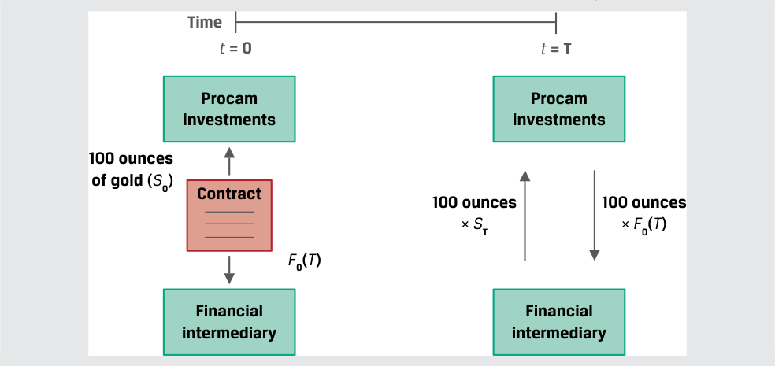
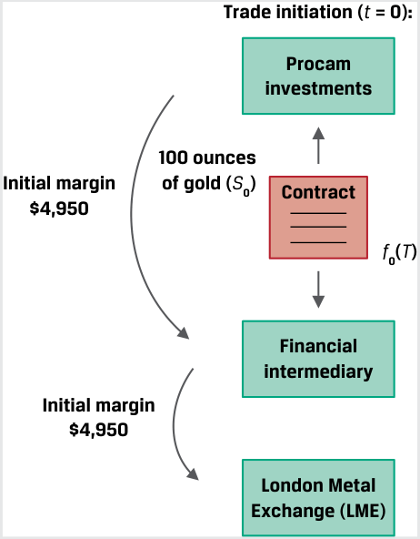
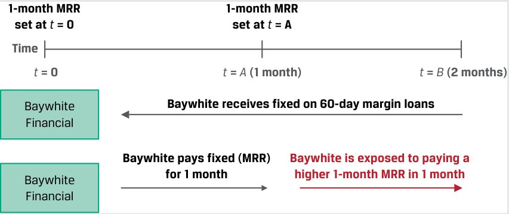

# Tập 7: Công cụ Phái sinh (Derivatives)
## Learning Module 6 Pricing and Valuation of Futures Contracts (Trang PDF 137–156)

---

# Tập 7: Công cụ Phái sinh (*Derivatives*)
## Học phần 6: Định giá và Xác định Giá trị của Hợp đồng Tương lai (*Pricing and Valuation of Futures Contracts*)
### Phần 1/2: Giới thiệu (*Introduction*) (Trang PDF 137–150)

---

<!-- PDF Page 137 -->

#### H Ọ C P H Ầ N

# **<mark>6</mark>**

### **Định giá và Xác định Giá trị của Hợp đồng Tương lai (*Pricing and Valuation of Futures Contracts*)**

###### **<mark>MỤC TIÊU HỌC TẬP (*LEARNING OUTCOMES*)</mark>**

|**_Mức độ Thành thạo (*Mastery*)_** **_Ứng viên cần có khả năng:_**|
|---|
|So sánh giá trị (*value*) và mức giá (*price*) của hợp đồng kỳ hạn (*forward contracts*) và hợp đồng tương lai (*futures contracts*).|
|Giải thích tại sao giá kỳ hạn (*forward prices*) và giá tương lai (*futures prices*) lại khác nhau.|

##### **GIỚI THIỆU (*INTRODUCTION*)**

## **<mark>1</mark>**

Nhiều nguyên tắc định giá và xác định giá trị gắn liền với các cam kết kỳ hạn (*forward commitments*) đều được áp dụng chung cho cả hợp đồng kỳ hạn (*forward contracts*) và hợp đồng tương lai (*futures contracts*). Ví dụ, các bài học trước đã chứng minh rằng các cam kết kỳ hạn có một mức giá giúp ngăn chặn những người tham gia thị trường kiếm lợi nhuận phi rủi ro thông qua hoạt động kinh doanh chênh lệch giá (*arbitrage*). Chúng ta cũng đã thấy rằng các cam kết mua và bán kỳ hạn có thể được mô phỏng (*replicated*) bằng cách sử dụng sự kết hợp giữa các vị thế mua hoặc bán trên thị trường tiền mặt cùng với việc đi vay hoặc cho vay ở mức lãi suất phi rủi ro. Cuối cùng, việc định giá và xác định giá trị của cả hợp đồng kỳ hạn lẫn hợp đồng tương lai đều kết hợp chi phí lưu giữ (*cost of carry*), hay những lợi ích và chi phí của việc sở hữu một tài sản cơ sở trong suốt vòng đời của một hợp đồng phái sinh.

Giờ đây, chúng ta chuyển sự chú ý sang các hợp đồng tương lai (*futures contracts*). Chúng ta thảo luận về những điểm giúp phân biệt chúng với các cam kết kỳ hạn khác và cách thức chúng được sử dụng bởi các tổ chức phát hành cũng như các nhà đầu tư. Chúng ta mở rộng nội dung về cơ chế thanh toán hàng ngày (*daily settlement*) đối với các khoản lãi và lỗ của hợp đồng tương lai đã được giới thiệu trước đó, đồng thời giải thích những điểm khác biệt giữa hợp đồng kỳ hạn và hợp đồng tương lai. Chúng ta cũng đề cập và phân biệt thị trường hợp đồng tương lai lãi suất (*interest rate futures market*) cùng vai trò của nó trong các hợp đồng phái sinh lãi suất.

###### **TỔNG QUAN HỌC PHẦN (*LEARNING MODULE OVERVIEW*)**

- Hợp đồng tương lai (*futures*) là các công cụ phái sinh được chuẩn hóa, giao dịch trên sàn (*exchange-traded derivatives* – ETDs) có giá trị ban đầu bằng không và có một mức giá tương lai $f_0(T)$ được thiết lập ngay khi khởi tạo. Giá tương lai, $f_0(T)$, bằng mức giá giao ngay được ghép lãi theo lãi suất phi rủi ro giống như trong trường hợp của một hợp đồng kỳ hạn.

- Sự khác biệt cơ bản nhất giữa việc xác định giá trị hợp đồng kỳ hạn và hợp đồng tương lai là cơ chế thanh toán hàng ngày (*daily settlement*) các khoản lãi và lỗ của hợp đồng tương lai thông qua một tài khoản ký quỹ (*margin account*). Việc thanh toán hàng ngày thiết lập lại (*resets*) giá trị của hợp đồng tương lai về bằng không tại mức giá tương lai hiện hành $f_t(T)$. Quy trình này tiếp diễn cho đến khi hợp đồng đáo hạn và giá tương lai hội tụ về mức giá giao ngay, $S_T$.

Viện CFA (CFA Institute) xin gửi lời cảm ơn tới Tiến sĩ Don Chance, CFA, vì những đóng góp của ông cho phần này, trong đó bao gồm nội dung được trích xuất từ tài liệu xuất hiện trong phần *Thị trường và Công cụ Phái sinh* (*Derivative Markets and Instruments*), nằm trong chương trình giảng dạy CFA® Program năm 2022.

<!-- PDF Page 138 -->

- Khoản lãi hoặc lỗ định giá theo thị trường (*mark-to-market* – MTM) đã thực hiện tích lũy (*cumulative realized MTM gain or loss*) trên một hợp đồng tương lai xấp xỉ bằng với khoản lãi hoặc lỗ trên một hợp đồng kỳ hạn tương đương.

- Cơ chế thanh toán hàng ngày và các yêu cầu ký quỹ làm phát sinh những cấu trúc dòng tiền khác nhau giữa hợp đồng tương lai và hợp đồng kỳ hạn, dẫn đến sự khác biệt về định giá giữa hai loại hợp đồng này. Mức chênh lệch phụ thuộc vào cả độ biến động của lãi suất (*interest rate volatility*) lẫn mối tương quan giữa lãi suất và giá hợp đồng tương lai (*correlation between interest rates and futures prices*).

- Giá hợp đồng tương lai đối với hợp đồng tương lai lãi suất ngắn hạn (*short-term interest rate futures*) được xác định bởi công thức $(100 - \text{lợi suất})$, trong đó lợi suất (*yield*) được biểu thị theo đơn vị phần trăm. Có một sự chênh lệch giá giữa hợp đồng tương lai lãi suất và hợp đồng kỳ hạn lãi suất (*forward rate agreements* – FRAs) do độ lệch lồi (*convexity bias*).

- Sự ra đời của cơ chế bù trừ trung tâm (*central clearing*) đối với công cụ phái sinh đã đưa các yêu cầu ký quỹ giống như hợp đồng tương lai vào áp dụng cho các công cụ phái sinh phi tập trung (*over-the-counter* – OTC), chẳng hạn như hợp đồng kỳ hạn. Thỏa thuận này đã làm giảm bớt sự khác biệt trong tác động dòng tiền giữa các công cụ phái sinh giao dịch trên sàn (ETDs) và công cụ phái sinh OTC, đồng thời thu hẹp mức chênh lệch giá giữa hợp đồng tương lai so với hợp đồng kỳ hạn.

###### **TỰ ĐÁNH GIÁ HỌC PHẦN (*LEARNING MODULE SELF-ASSESSMENT*)**

Các câu hỏi ban đầu này nhằm mục đích giúp bạn tự đánh giá mức độ hiểu biết hiện tại của mình về học phần này.

1. Đáp án nào sau đây gần nhất với mức giá tương lai kỳ hạn một năm của một cổ phiếu có giá giao ngay ($S_0$) là $€125$ và trả cổ tức hàng năm là $€2.50$ vào ngày đáo hạn nếu lãi suất phi rủi ro là $1\%$?

   - **A.** $€123.75$

   - **B.** $€122.50$

   - **C.** $€126.25$

   - **Lời giải:**

A là đáp án đúng. Mức giá tương lai không có kinh doanh chênh lệch giá đối với một tài sản cơ sở có các lợi ích đã biết, chẳng hạn như cổ tức, có thể được xác định bằng phương trình sau đây:

$$f_0(T) = [S_0 - \text{PV}_0(I)](1 + r)^T$$

Trước tiên, giải tìm giá trị hiện tại của khoản cổ tức $\text{PV}_0(I)$ như sau: $€2.48 = (€2.50 / 1.01)$.

Thay $\text{PV}_0(I)$ vào phương trình ban đầu để giải tìm $f_0(T)$:

$$f_0(T) = €123.75 = (€125 - €2.48)(1.01)$$

2. Phát biểu nào sau đây liên quan đến các khoản lãi hoặc lỗ của một vị thế mua hợp đồng kỳ hạn (*long forward contract position*) so với một vị thế mua hợp đồng tương lai (*long futures contract position*) là đúng nhất? Giả sử rằng tài sản cơ sở là giống hệt nhau trên cả hai hợp đồng và cả hai hợp đồng có cùng khoảng thời gian cho đến khi đáo hạn.

   - **A.** Khoản lãi hoặc lỗ đã thực hiện hàng ngày (*daily realized gain or loss*) của vị thế hợp đồng kỳ hạn và vị thế hợp đồng tương lai là tương đương nhau.

   - **B.** Trước khi các hợp đồng đáo hạn, các khoản lãi hoặc lỗ đã thực hiện tích lũy (*cumulative realized gains or losses*) của vị thế hợp đồng kỳ hạn và vị thế hợp đồng tương lai là tương đương nhau.

<!-- PDF Page 139 -->

   - **C.** Khi hợp đồng đáo hạn, các khoản lãi hoặc lỗ đã thực hiện tích lũy của vị thế hợp đồng kỳ hạn và vị thế hợp đồng tương lai là xấp xỉ tương đương nhau.

###### **Lời giải:**

C là đáp án đúng. Hai hợp đồng này tương tự nhau về mọi mặt ngoại trừ tần suất mà các hợp đồng được định giá theo thị trường (*marked to market*). Do đó, khoản lãi hoặc lỗ tích lũy là xấp xỉ như nhau khi các hợp đồng đáo hạn. A không đúng vì tính năng định giá theo thị trường (MTM) hàng ngày của hợp đồng tương lai tạo ra các khoản lãi hoặc lỗ đã thực hiện hàng ngày, trong khi các khoản lãi hoặc lỗ của hợp đồng kỳ hạn chỉ được hiện thực hóa khi hợp đồng đáo hạn. B không đúng vì đáp án này đề cập đến các khoản lãi hoặc lỗ *đã thực hiện* (*realized*), mà các hợp đồng lại chưa đáo hạn. Vì vậy, hợp đồng kỳ hạn vẫn chưa tạo ra bất kỳ khoản lãi hay lỗ đã thực hiện nào.

3. Hãy xác định tình huống nào sau đây dẫn đến mối quan hệ nào giữa giá kỳ hạn và giá tương lai đối với các hợp đồng cam kết kỳ hạn có các điều khoản khác hoàn toàn giống hệt nhau.

|Tình huống|Mối quan hệ giữa Giá Kỳ hạn và Giá Tương lai|
|---|---|
|1. Giá hợp đồng tương lai có tương quan *dương* (*positively correlated*) với lãi suất, và lãi suất thay đổi trong suốt kỳ hạn hợp đồng.|A. Giá kỳ hạn cao hơn giá tương lai: $F_0(T) > f_0(T)$.|
|2. Giá hợp đồng tương lai có tương quan *âm* (*negatively correlated*) với lãi suất, và lãi suất thay đổi trong suốt kỳ hạn hợp đồng.|B. Giá kỳ hạn và giá tương lai bằng nhau: $F_0(T) = f_0(T)$.|
|3. Lãi suất giữ nguyên không đổi trong suốt kỳ hạn của hợp đồng cam kết kỳ hạn.|C. Giá tương lai cao hơn giá kỳ hạn: $f_0(T) > F_0(T)$.|

###### **Lời giải:**

1. C là đáp án đúng. Nếu giá hợp đồng tương lai có tương quan dương với lãi suất, thì mức giá cao hơn sẽ dẫn đến các khoản lợi nhuận từ hợp đồng tương lai được tái đầu tư ở mức lãi suất đang tăng lên, và mức giá thấp hơn sẽ dẫn đến các khoản lỗ có thể được tài trợ ở mức lãi suất thấp hơn (làm cho vị thế mua tương lai hấp dẫn hơn mua kỳ hạn).

2. A là đáp án đúng. Nếu giá hợp đồng tương lai có tương quan âm với lãi suất, thì mức giá cao hơn sẽ dẫn đến các khoản lợi nhuận từ hợp đồng tương lai phải tái đầu tư ở mức lãi suất thấp hơn, và mức giá thấp hơn sẽ dẫn đến các khoản lỗ phải được tài trợ ở mức lãi suất cao hơn.

3. B là đáp án đúng. Nếu lãi suất giữ nguyên không đổi trong suốt kỳ hạn của hợp đồng cam kết kỳ hạn, thì giá kỳ hạn và giá tương lai là bằng nhau.

4. Phát biểu nào sau đây mô tả đúng nhất một sự phát triển đã giúp làm giảm bớt sự khác biệt trong tác động dòng tiền giữa hợp đồng kỳ hạn và hợp đồng tương lai?

   - **A.** Các sở giao dịch hợp đồng tương lai đã chuyển dịch rời bỏ việc ghi nhận lãi và lỗ định giá theo thị trường hàng ngày trên các hợp đồng tương lai.

   - **B.** Các công cụ phái sinh OTC ngày càng phải chịu các yêu cầu bù trừ trung tâm (*central clearing requirements*).

   - **C.** Độ biến động thấp hơn trên các thị trường đã làm giảm quy mô của các khoản lãi và lỗ trong cả hai loại hợp đồng.

###### **Lời giải:**

B là đáp án đúng. Dưới khuôn khổ bù trừ trung tâm đối với các công cụ phái sinh OTC, các định chế tài chính trung gian đóng vai trò làm đối tác bị bắt buộc phải nộp khoản ký quỹ hàng ngày (*daily margin*) hoặc tài sản thế chấp đủ điều kiện cho đối tác trung tâm (*central counterparty* – CCP) theo một quy trình rất giống với cơ chế ký quỹ của hợp đồng tương lai. Do đó, các nhà tạo lập thị trường (*dealers*) thường áp đặt những yêu cầu tương tự lên những người sử dụng cuối cùng của công cụ phái sinh (*derivatives end users*). A không đúng vì không có sự

<!-- PDF Page 140 -->

thay đổi nào như vậy diễn ra trên các thị trường hợp đồng tương lai giao dịch trên sàn. C không đúng vì những thay đổi về độ biến động theo thời gian rất khó để phân loại cố định là cao hơn hay thấp hơn.

## **<mark>2</mark>**

##### **ĐỊNH GIÁ HỢP ĐỒNG TƯƠNG LAI KHI KHỞI TẠO (*PRICING OF FUTURES CONTRACTS AT INCEPTION*)**

*So sánh giá trị và mức giá của hợp đồng kỳ hạn và hợp đồng tương lai.*

Khi một cam kết kỳ hạn được khởi tạo, không có khoản tiền mặt nào được trao đổi và hợp đồng không phải là một tài sản cũng không phải là một khoản nợ phải trả đối với bên mua hay bên bán. Giá trị của cả hợp đồng kỳ hạn lẫn hợp đồng tương lai tại thời điểm khởi tạo đều bằng không:

$$V_0(T) = 0 \tag{1}$$

Một tài sản cơ sở không có chi phí hay lợi ích nào sẽ có mức giá tương lai $f_0(T)$ tại thời điểm $t = 0$ là:

$$f_0(T) = S_0(1 + r)^T \tag{2}$$

trong đó $r$ là lãi suất phi rủi ro và $T$ là thời gian cho đến khi đáo hạn. Giống như trong trường hợp của một hợp đồng kỳ hạn, giá hợp đồng tương lai chính là mức giá giao ngay được ghép lãi theo lãi suất phi rủi ro trong suốt vòng đời của hợp đồng. Điều này được thể hiện trong Bảng minh họa 1, trong đó độ dốc của đường biểu diễn bằng với lãi suất phi rủi ro, $r$.

###### **Bảng minh họa 1: Giá Hợp đồng Tương lai tại Thời điểm Khởi tạo (*Futures Price at Initiation*)**

> **Chú thích hình ảnh:**
> Đồ thị biểu diễn đường giá tăng dần từ mức giá giao ngay $S_0$ tại thời điểm $0$ lên mức giá tương lai $f_0(T) = S_0(1 + r)^T$ tại thời điểm $T$.

Giống như đối với hợp đồng kỳ hạn, chúng ta sử dụng phương pháp ghép lãi rời rạc như trong Phương trình 2 đối với hợp đồng tương lai trên từng tài sản cơ sở riêng lẻ. Tuy nhiên, đối với các tài sản cơ sở được cấu thành từ một danh mục đầu tư — chẳng hạn như chỉ số cổ phiếu, thu nhập cố định, hàng hóa, hoặc tín dụng — hoặc khi tài sản cơ sở liên quan đến ngoại hối với lãi suất được định danh bằng hai đồng tiền khác nhau, ghép lãi liên tục là phương pháp được ưu tiên sử dụng, như được thể hiện trong Phương trình 3:

$$f_0(T) = S_0 e^{rT} \tag{3}$$

###### **VÍ DỤ 1 (*EXAMPLE 1*)**

###### **Procam Investments – Hợp đồng Tương lai Vàng (*Procam Investments - Gold Futures Contract*)**

Như đã trình bày trong một bài học trước, Procam Investments mua một hợp đồng tương lai vàng quy mô $100\text{ ounce}$. Giá giao ngay hiện tại là $\$1,770.00$ mỗi ounce, lãi suất phi rủi ro là $2.0\%$, và chúng ta giả định vàng có thể được lưu kho mà không tốn chi phí. Hãy tính mức giá tương lai không có kinh doanh chênh lệch giá, $f_0(T)$, để thanh toán sau $91\text{ ngày}$ ($T = 91/365$ hay $0.24932$).

<!-- PDF Page 141 -->

###### **Lời giải:**

Sử dụng Phương trình 2: $f_0(T) = S_0(1 + r)^T$

$$\$1,778.76 \text{ mỗi ounce} = \$1,770.00 \times (1.02)^{0.24932}$$

$$\text{Giá hợp đồng (Contract price)} = \$177,876.04 \quad (= 100 \times \$1,778.76)$$

Mức giá tương lai, $f_0(T)$, hoàn toàn giống hệt với mức giá kỳ hạn từ bài học trước.

Giống như trong trường hợp của một hợp đồng kỳ hạn, đối với các tài sản cơ sở có lợi ích hoặc thu nhập từ quyền sở hữu ($I$) hoặc chi phí ($C$) được biểu thị dưới dạng một số tiền đã biết tính theo giá trị hiện tại ở thời điểm $t = 0$, mối quan hệ giữa giá giao ngay so với giá tương lai sử dụng phương pháp ghép lãi rời rạc được thể hiện trong Phương trình 4 và Bảng minh họa 2:

$$f_0(T) = [S_0 - \text{PV}_0(I) + \text{PV}_0(C)](1 + r)^T \tag{4}$$

###### **Bảng minh họa 2: Giá Hợp đồng Tương lai khi Tài sản Cơ sở có Chi phí và Lợi ích (*Futures Prices with Underlying Asset Costs and Benefits*)**

> **Chú thích hình ảnh:**
> Xuất phát từ giá giao ngay $S_0$ tại thời điểm $0$ đến thời điểm $T$:
> - Đường cơ sở (chỉ có lãi suất $r$): tiến tới $f_0(T)$.
> - Khi Chi phí $>$ Lợi ích (*Cost > Benefit*): đường giá tương lai dịch chuyển lên cao hơn tới mức $f_0^+(T)$.
> - Khi Lợi ích $>$ Chi phí (*Benefit > Cost*): đường giá tương lai dịch chuyển xuống thấp hơn tới mức $f_0^-(T)$.

###### **VÍ DỤ 2 (*EXAMPLE 2*)**

###### **Hợp đồng Tương lai Vàng của Procam khi có Chi phí Lưu kho (*Procam’s Gold Futures Contract with Storage Costs*)**

Procam đã mua một hợp đồng tương lai vàng trong Ví dụ 1 tại mức giá $f_0(T)$ là $\$177,876.04$ (hay $\$1,778.76$ mỗi ounce) với $S_0$ bằng $\$1,770$ mỗi ounce. Giá $f_0(T)$ sẽ thay đổi như thế nào để thỏa mãn điều kiện không có kinh doanh chênh lệch giá nếu có khoản chi phí lưu kho và bảo hiểm vàng là $\$2$ mỗi ounce phải trả vào thời điểm kết thúc hợp đồng?

Mức giá tương lai đối với một hàng hóa có số tiền chi phí lưu kho đã biết có thể được xác định bằng cách sử dụng Phương trình 4, trong đó $\text{PV}_0(I) = 0$:

$$f_0(T) = [S_0 + \text{PV}_0(C)](1 + r)^T$$

Trước tiên, giải tìm giá trị hiện tại của chi phí lưu kho trên mỗi ounce, $\text{PV}_0(C)$, như sau:

$$\text{PV}_0(C) = \$1.99 = [\$2(1.02)^{-0.24982}]$$

Thay $\text{PV}_0(C) = \$1.99$ vào Phương trình 4 để giải tìm $f_0(T)$:

$$f_0(T) = (\$1,770.00 + \$1.99)(1.02)^{0.24982} = \$1,780.78 \text{ mỗi ounce}$$

Việc bổ sung thêm chi phí lưu kho và bảo hiểm làm gia tăng khoản chênh lệch giữa giá giao ngay và giá tương lai. Cuối cùng, giống như trong trường hợp của hợp đồng kỳ hạn, một mức giá tương lai, $f_0(T)$, nằm *thấp hơn* đáng kể so với mức giá không có kinh doanh chênh lệch giá (đã tính đến các chi phí và lợi ích bằng tiền mặt) có thể là dấu hiệu cho thấy sự hiện diện của lợi suất tiện ích (*convenience yield*).

<!-- PDF Page 142 -->

## **<mark>3</mark>**

##### **XÁC ĐỊNH GIÁ TRỊ THEO THỊ TRƯỜNG (MTM): HỢP ĐỒNG KỲ HẠN SO VỚI HỢP ĐỒNG TƯƠNG LAI (*MTM VALUATION: FORWARDS VERSUS FUTURES*)**

*So sánh giá trị và mức giá của hợp đồng kỳ hạn và hợp đồng tương lai.*

Ví dụ 1 và 2 cho thấy những điểm tương đồng giữa giá kỳ hạn và giá tương lai tại thời điểm khởi tạo hợp đồng. Theo thời gian, các đặc điểm khác nhau của hợp đồng kỳ hạn và hợp đồng tương lai dẫn đến các giá trị MTM khác nhau đối với những hợp đồng có cùng tài sản cơ sở và các chi tiết khác hoàn toàn giống hệt nhau. Ví dụ 3 chỉ ra cách thức mà việc thanh toán hàng ngày (*daily settlement*) đối với các khoản lãi và lỗ làm phát sinh sự khác biệt này.

###### **VÍ DỤ 3 (*EXAMPLE 3*)**

###### **Định giá và Xác định Giá trị Hợp đồng Kỳ hạn so với Hợp đồng Tương lai của Procam (*Procam Forward versus Futures Pricing and Valuation*)**

Chúng ta mở rộng ví dụ trước đó để so sánh việc định giá và xác định giá trị của hợp đồng kỳ hạn và hợp đồng tương lai. Trong cả hai trường hợp, Procam Investments tham gia vào một cam kết kỳ hạn được tất toán bằng tiền mặt (*cash-settled*) để mua $100\text{ ounce}$ vàng tại mức giá ($f_0(T) = F_0(T)$) là $\$1,778.76$ mỗi ounce sau $91\text{ ngày}$, với lãi suất phi rủi ro là $2\%$ và không có chi phí lưu kho vàng.

###### **Hợp đồng Kỳ hạn (*Forward Contract*)**

Giá kỳ hạn là $F_0(T) = \$1,778.76$ mỗi ounce. Không có khoản tiền mặt nào được trao đổi hoặc ký quỹ khi khởi tạo, và giá trị hợp đồng khi khởi tạo, $V_0(T)$, bằng không.

> **Chú thích hình ảnh:**
> - **Thời điểm $t = 0$:** Procam Investments ký Hợp đồng (*Contract*) với Định chế tài chính trung gian đối với $100\text{ ounce}$ vàng ($S_0$) tại mức giá $F_0(T)$.
> - **Thời điểm $t = T$:** Tất toán giữa $100\text{ ounce} \times S_T$ và $100\text{ ounce} \times F_0(T)$.

Theo thời gian, mức giá kỳ hạn, $F_0(T)$, không thay đổi, và giá trị MTM tại bất kỳ thời điểm nào, $V_t(T)$, bằng phần chênh lệch giữa giá giao ngay hiện tại, $S_t$, và giá trị hiện tại của mức giá kỳ hạn, $\text{PV}_t\text{ của }F_0(T)$, được biểu diễn dưới góc độ của Procam (bên mua kỳ hạn):

$$V_t(T) = S_t - F_0(T)(1 + r)^{-(T-t)}$$

Ví dụ, giả sử $71\text{ ngày}$ đã trôi qua và còn lại $20\text{ ngày}$ cho đến khi đáo hạn, $T - t = 20/365$ hay $0.0548$. Nếu giá vàng giao ngay, $S_t$, đã giảm $\$50$ kể từ khi khởi tạo xuống còn $\$1,720$ mỗi ounce, ta giải tìm $V_t(T)$ như sau:

$$V_t(T) = \$1,720 - \$1,778.76(1.02)^{-0.0548}$$

$$= -\$56.83 \text{ mỗi ounce, hay khoản lỗ MTM là } \$5,683 \quad (= -\$56.83 \times 100\text{ ounce})$$

Theo các điều khoản của hợp đồng kỳ hạn, không có việc thanh toán số tiền MTM nào diễn ra cho đến tận khi đáo hạn. Quy trình thiết lập lại giá trị hợp đồng về bằng không mỗi ngày ở hợp đồng tương lai khiến cho hợp đồng tương lai rất khó có khả năng chạm tới một mức giá trị MTM tích lũy lớn tương tự như vậy tại một thời điểm.

<!-- PDF Page 143 -->

###### **Hợp đồng Tương lai (*Futures Contract*)**

Giá hợp đồng tương lai, $f_0(T)$, là $\$1,778.76$ mỗi ounce. Theo quy tắc thanh toán hàng ngày của sở giao dịch hợp đồng tương lai, bên mua và bên bán hợp đồng phải nộp một khoản ký quỹ ban đầu (*initial margin*) bằng tiền mặt là $\$4,950$ cho mỗi hợp đồng vàng ($100\text{ ounce}$) và duy trì mức ký quỹ duy trì (*maintenance margin*) là $\$4,500$ cho mỗi hợp đồng. Nếu số dư ký quỹ giảm xuống dưới mức $\$4,500$, đối tác sẽ nhận được lệnh gọi ký quỹ bổ sung (*margin call*) và phải lập tức nộp thêm tiền để đưa tài khoản của mình quay trở lại mức ký quỹ ban đầu $\$4,950$.

> **Chú thích hình ảnh:**
> Khởi tạo giao dịch ($t = 0$): Procam Investments và Định chế tài chính trung gian ký hợp đồng $100\text{ ounce}$ vàng ($S_0$) tại giá $f_0(T)$, đồng thời mỗi bên đều nộp Ký quỹ ban đầu (*Initial margin*) là $\$4,950$ cho Sở Giao dịch Kim loại Luân Đôn (*London Metal Exchange – LME*).

Hãy xem xét ngày giao dịch đầu tiên, trong đó giá vàng giao ngay, $S_0$, là $\$1,770$ mỗi ounce và giá mở cửa của hợp đồng tương lai vàng, $f_0(T)$, là $\$1,778.76$ mỗi ounce.

- Giả sử rằng giá hợp đồng tương lai vàng, $f_1(T)$, giảm $\$5$ vào ngày giao dịch đầu tiên xuống còn $\$1,773.76$ và giá giao ngay, $S_1$, kết thúc ngày giao dịch ở mức giá tương đương không có kinh doanh chênh lệch giá là $\$1,765.12$ ($= \$1,773.76(1.02)^{-90/365}$).

- Procam hiện thực hóa một khoản lỗ MTM là $\$500$ ($= \$5\text{ mỗi ounce} \times 100\text{ ounce}$) bị khấu trừ trực tiếp vào tài khoản ký quỹ của mình, khiến số dư của Procam còn lại $\$4,450$.

- Giá trị MTM của hợp đồng tương lai của Procam được thiết lập lại về mức $0$ tại mức giá đóng cửa hợp đồng tương lai là $\$1,773.76$ mỗi ounce.

- Vì số dư tài khoản ký quỹ của Procam đã giảm xuống thấp hơn mức duy trì $\$4,500$, nên công ty phải nộp thêm $\$500$ để đưa số dư quay trở lại mức ký quỹ ban đầu $\$4,950$.

###### **Giá và Giá trị của Hợp đồng Tương lai so với Hợp đồng Kỳ hạn theo Thời gian (*Futures versus Forward Price and Value over Time*)**

Sử dụng cùng các thông tin chi tiết trên, chúng ta so sánh mức giá và giá trị của hợp đồng tương lai và hợp đồng kỳ hạn qua hai ngày giao dịch. Giả sử rằng phiên giao dịch ngày thứ hai mở cửa tại mức giá giao ngay và giá tương lai đóng cửa của ngày thứ nhất. Bảng dưới đây thể hiện sự so sánh:

###### **Đầu Ngày Giao dịch Thứ 2 (*Beginning of Day 2 Trading*)**

|**Loại Hợp đồng (*Contract Type*)**|**Giá Hợp đồng (*Contract Price*)**|**Giá trị MTM của Hợp đồng (*Contract MTM*)**|**MTM Đã thực hiện (*Realized MTM*)**|**Tiền Ký quỹ (*Margin Deposit*)**|
|---|---|---|---|---|
|**Kỳ hạn (*Forward*)**|$F_0(T) = \$177,876$|$-\$498$|$\$0$|$\$0$|
|**Tương lai (*Futures*)**|$f_1(T) = \$177,376$|$\$0$|$-\$500$|$\$4,950$|

Giá trị hợp đồng MTM kỳ hạn, $V_t(T)$, bằng phần chênh lệch giữa giá giao ngay hiện tại, $S_1 = \$1,765.12$, và giá trị hiện tại của mức giá kỳ hạn ban đầu, $\text{PV}_t[F_0(T)]$, ở đây còn lại $90\text{ ngày}$ cho đến khi đáo hạn, $T - t = 90/365$ hay $0.24657$:

<!-- PDF Page 144 -->

$$V_t(T) = \$1,765.12 - \$1,778.76(1.02)^{-0.24657} = -\$4.98 \text{ mỗi ounce (hay } -\$498 \text{ cho cả hợp đồng)}$$

Mở rộng ví dụ của chúng ta sang thời điểm đầu ngày thứ ba (tại mức giá đóng cửa của ngày hôm trước), giả sử giá hợp đồng tương lai vàng giảm thêm $\$4$ mỗi ounce vào ngày thứ hai, $f_2(T)$, xuống còn $\$1,769.76$ và giá giao ngay tương đương không có kinh doanh chênh lệch giá giảm xuống mức $S_2$ là $\$1,761.24$ ($= \$1,769.76[1.02]^{-89/365}$). Bảng dưới đây thể hiện tóm tắt vào đầu ngày thứ ba:

###### **Đầu Ngày Giao dịch Thứ 3 (*Beginning of Day 3 Trading*)**

|**Loại Hợp đồng (*Contract Type*)**|**Giá Hợp đồng (*Contract Price*)**|**Giá trị MTM của Hợp đồng (*Contract MTM*)**|**MTM Đã thực hiện trong ngày (*Realized MTM*)**|**Tiền Ký quỹ (*Margin Deposit*)**|
|---|---|---|---|---|
|**Kỳ hạn (*Forward*)**|$F_0(T) = \$177,876$|$-\$895$|$\$0$|$\$0$|
|**Tương lai (*Futures*)**|$f_2(T) = \$176,976$|$\$0$|$-\$400$|$\$4,550$|

Giá trị hợp đồng MTM kỳ hạn, $V_t(T)$, bằng phần chênh lệch giữa giá giao ngay hiện tại, $S_2 = \$1,761.24$, và giá trị hiện tại của mức giá kỳ hạn ban đầu, $\text{PV}_t[F_0(T)]$, ở đây còn lại $89\text{ ngày}$ cho đến khi đáo hạn, $T - t = 89/365$ hay $0.24384$:

$$V_t(T) = \$1,761.24 - \$1,778.76(1.02)^{-0.24384} = -\$8.95 \text{ mỗi ounce (hay } -\$895 \text{ cho cả hợp đồng)}$$

Ví dụ 3 chứng minh những điểm khác biệt cốt lõi về mức giá và giá trị của hợp đồng kỳ hạn và hợp đồng tương lai theo thời gian. Mức giá của hợp đồng kỳ hạn, $F_0(T)$, giữ nguyên cố định cho đến khi hợp đồng đáo hạn. Những thay đổi trong giá trị MTM của hợp đồng kỳ hạn được phản ánh qua phần chênh lệch giữa giá giao ngay hiện tại, $S_t$, và giá trị hiện tại của mức giá kỳ hạn, $\text{PV}_t[F_0(T)]$. Giá trị MTM của hợp đồng kỳ hạn này không được thanh toán cho đến khi đáo hạn, làm phát sinh rủi ro tín dụng đối tác (*counterparty credit risk*) theo thời gian vì không có khoản tiền mặt nào được trao đổi kể từ khi khởi tạo hợp đồng cho đến khi nó đáo hạn hoặc hết hiệu lực. Ngược lại, giá hợp đồng tương lai biến động hàng ngày dựa trên những thay đổi của thị trường. Cơ chế thanh toán hàng ngày thiết lập lại giá trị MTM của hợp đồng tương lai về mức không, và khoản ký quỹ biến đổi (*variation margin*) được trao đổi để tất toán phần chênh lệch, qua đó làm giảm thiểu rủi ro tín dụng đối tác. Khoản lãi hoặc lỗ MTM đã thực hiện *tích lũy* (*cumulative*) trên một hợp đồng tương lai xấp xỉ bằng với một hợp đồng kỳ hạn tương đương. Chúng ta sẽ khám phá những điểm khác biệt này trong bài học tiếp theo sau khi chuyển sự chú ý sang các hợp đồng kỳ hạn và hợp đồng tương lai dựa trên lãi suất tham chiếu thị trường trước tiên.

## **<mark>4</mark>**

##### **HỢP ĐỒNG TƯƠNG LAI LÃI SUẤT SO VỚI HỢP ĐỒNG KỲ HẠN LÃI SUẤT (*INTEREST RATE FUTURES VERSUS FORWARD CONTRACTS*)**

*So sánh giá trị và mức giá của hợp đồng kỳ hạn và hợp đồng tương lai.*

Trong một bài học trước về hợp đồng kỳ hạn lãi suất, các mức lãi suất zero được suy ra từ những trái phiếu trả lãi định kỳ đã được sử dụng để tính ra mức lãi suất hòa vốn đầu tư trong tương lai (hay lãi suất kỳ hạn ngầm định – *implied forward rate*). Lãi suất kỳ hạn ngầm định đã được chứng minh là bằng với mức lãi suất cố định không có kinh doanh chênh lệch giá trên một hợp đồng kỳ hạn lãi suất (FRA) mà theo đó các đối tác trao đổi một dòng tiền cố định lấy dòng tiền thả nổi tại một thời điểm trong tương lai.

<!-- PDF Page 145 -->

Các thị trường hợp đồng tương lai dựa trên lãi suất ngắn hạn cung cấp cho những người tham gia thị trường một công cụ thay thế được chuẩn hóa và có tính thanh khoản cao cho các hợp đồng FRA. Các hợp đồng tương lai lãi suất hiện có sẵn cho các mức lãi suất tham chiếu thị trường hàng tháng hoặc hàng quý cho các kỳ liên tiếp kéo dài tới những kỳ hạn hợp đồng cuối cùng lên đến mười năm trong tương lai. Mặc dù biến số cơ sở là lãi suất tham chiếu thị trường (MRR) trên một khoản tiền gửi giả định vào một ngày trong tương lai giống như đối với hợp đồng kỳ hạn lãi suất, nhưng hợp đồng tương lai lãi suất lại được giao dịch trên cơ sở *mức giá* (*price basis*) theo công thức tổng quát sau đây:

$$f_{A,B-A} = 100 - (100 \times \text{MRR}_{A,B-A}) \tag{5}$$

trong đó $f_{A,B-A}$ đại diện cho mức giá hợp đồng tương lai đối với một lãi suất tham chiếu thị trường cho khoảng thời gian $B - A$ kỳ bắt đầu sau $A$ kỳ ($\text{MRR}_{A,B-A}$), như được thể hiện trong Bảng minh họa 3.

**Bảng minh họa 3: Cơ chế Hoạt động của Hợp đồng Tương lai Lãi suất (*Interest Rate Futures Contract Mechanics*)**

> **Chú thích hình ảnh:**
> - **Tại $t = 0$:** Hợp đồng tương lai được khởi tạo với mức giá $f_{A,B-A}$.
> - **Tại $T = A$:** Hợp đồng tương lai được tất toán tại thời điểm $t = T = A$, là lúc kỳ tính lãi $\text{MRR}$ bắt đầu.
> - **Từ $T = A$ đến $B$:** Lãi suất $\text{MRR}$ cơ sở có kỳ hạn (*Tenor*) là $B - A$ (bắt đầu tại $A$ và kết thúc tại $B$).

Ví dụ, chúng ta có thể giải tìm mức lãi suất MRR kỳ hạn ba tháng ngầm định bắt đầu sau ba tháng nữa (trong đó $A = 3\text{m}$, $B = 6\text{m}$, $B - A = 3\text{m}$) nếu một hợp đồng tương lai lãi suất đang được giao dịch ở mức giá $98.25$ bằng cách sử dụng Phương trình 5:

$$f_{3\text{m},3\text{m}}: \quad 98.25 = 100 - (100 \times \text{MRR}_{A,B-A})$$

$$\text{MRR}_{3\text{m},3\text{m}} = 1.75\%$$

Quy ước yết giá $(100 - \text{lợi suất})$ này tạo ra mối quan hệ nghịch biến giữa giá và lợi suất nhưng *không* giống với mức giá của một trái phiếu không trả lãi định kỳ tại mức lãi suất hợp đồng đó. Một vị thế mua hợp đồng tương lai (*long futures position*) liên quan đến việc kiếm được hoặc nhận lãi suất MRR sau $A$ kỳ (tương đương người cho vay/gửi tiền), trong khi một vị thế bán (*short position*) liên quan đến việc trả lãi suất MRR sau $A$ kỳ (tương đương người đi vay). Cấu trúc rủi ro lãi suất đối với các hợp đồng tương lai mua và bán như sau:

- **Mua hợp đồng tương lai (*Long futures contract* – bên cho vay):** Có lãi khi giá hợp đồng tương lai tăng lên, tức khi lãi suất MRR tương lai giảm xuống.

- **Bán hợp đồng tương lai (*Short futures contract* – bên đi vay):** Có lãi khi giá hợp đồng tương lai giảm xuống, tức khi lãi suất MRR tương lai tăng lên.

Trong một bài học trước, Ngân hàng Yangzi đã tham gia vào một hợp đồng FRA với tư cách là bên trả lãi suất cố định để phòng ngừa rủi ro cho một khoản nợ phải trả mà ngân hàng phải trả lãi theo MRR trong tương lai, qua đó hiện thực hóa một khoản lãi trên hợp đồng FRA khi lãi suất tăng lên. Lưu ý rằng điều này sẽ tương đương với việc thiết lập một vị thế *bán* (*short position*) trên một hợp đồng tương lai lãi suất MRR đồng CNY nếu có sẵn một hợp đồng như vậy. Bảng minh họa 4 tóm tắt mối quan hệ giữa hợp đồng tương lai lãi suất và hợp đồng FRA.

<!-- PDF Page 146 -->

**Bảng minh họa 4: Hợp đồng Tương lai Lãi suất so với Hợp đồng FRA (*Interest Rate Futures versus FRAs*)**

|**Loại Hợp đồng (*Contract Type*)**|**Có Lãi khi MRR Tăng (*Gains from Rising MRR*)**|**Có Lãi khi MRR Giảm (*Gains from Falling MRR*)**|
|---|---|---|
|**Hợp đồng tương lai lãi suất (*Interest rate futures*)**|Bán hợp đồng tương lai (*Short futures contract*)|Mua hợp đồng tương lai (*Long futures contract*)|
|**Hợp đồng kỳ hạn lãi suất (*Forward rate agreement*)**|Mua FRA (*Long FRA*): Bên trả lãi suất cố định FRA (bên nhận lãi suất thả nổi FRA)|Bán FRA (*Short FRA*): Bên trả lãi suất thả nổi FRA (bên nhận lãi suất cố định FRA)|

Việc thanh toán hàng ngày của hợp đồng tương lai lãi suất diễn ra dựa trên những thay đổi về giá, được quy đổi thành **giá trị một điểm cơ bản của hợp đồng tương lai (*futures contract basis point value* – BPV)** như sau:

$$\text{BPV Hợp đồng Tương lai} = \text{Vốn gốc Danh nghĩa (Notional Principal)} \times 0.01\% \times \text{Kỳ hạn (Period)} \tag{6}$$

Ví dụ, giả sử vốn gốc danh nghĩa là $\$1,000,000$ đối với lãi suất MRR kỳ hạn ba tháng ở mức $2.21\%$ cho một quý (hay $90/360\text{ ngày}$), giá trị hợp đồng tiền gửi cơ sở sẽ là:

$$\$1,005,525 = \$1,000,000 \times [1 + (2.21\% / 4)]$$

Hãy xem xét cách thức một sự thay đổi một điểm cơ bản ($1\text{ bp} = 0.01\%$) trong lãi suất MRR tác động đến giá trị hợp đồng:

- Tăng $1\text{ bp}$ ($2.22\%$): $\$1,005,550 = \$1,000,000 \times [1 + (2.22\% / 4)]$.

- Giảm $1\text{ bp}$ ($2.20\%$): $\$1,005,500 = \$1,000,000 \times [1 + (2.20\% / 4)]$.

Cả sự gia tăng lẫn sự sụt giảm một điểm cơ bản của lãi suất MRR đều làm thay đổi BPV của hợp đồng một lượng là $\$25$. Hợp đồng tương lai lãi suất ngắn hạn được đặc trưng bởi một mối quan hệ tuyến tính cố định (*fixed linear relationship*) giữa sự thay đổi giá và sự thay đổi lợi suất. Ví dụ sau đây minh họa việc sử dụng chúng trong thực tiễn.

###### **VÍ DỤ 4 (*EXAMPLE 4*)**

###### **Hợp đồng Tương lai Lãi suất – Sổ Cho vay Ký quỹ của Baywhite (*Interest Rate Futures - Baywhite Margin Loan Book*)**

Trong một ví dụ trước, Baywhite Financial đã cung cấp các khoản cho vay ký quỹ kỳ hạn $60\text{ ngày}$ với lãi suất cố định cho khách hàng của mình và đi vay ở mức lãi suất MRR kỳ hạn một tháng biến đổi để tài trợ cho các khoản cho vay đó. Hãy mô tả rủi ro lãi suất còn lại của Baywhite và cách thức công ty có thể sử dụng hợp đồng tương lai lãi suất làm công cụ phòng ngừa rủi ro.

> **Chú thích hình ảnh:**
> - **Từ $t = 0$ đến $t = B$ ($2\text{ tháng}$):** Baywhite nhận lãi suất cố định trên các khoản cho vay ký quỹ $60\text{ ngày}$ (*receives fixed on 60-day margin loans*).
> - **Từ $t = 0$ đến $t = A$ ($1\text{ tháng}$):** Lãi suất MRR 1 tháng được ấn định tại $t = 0$; Baywhite trả lãi cố định (MRR đã biết) cho 1 tháng đầu.
> - **Từ $t = A$ ($1\text{ tháng}$) đến $t = B$ ($2\text{ tháng}$):** Lãi suất MRR 1 tháng mới được ấn định tại $t = A$; Baywhite đối mặt với rủi ro phải trả mức lãi suất MRR 1 tháng cao hơn sau 1 tháng nữa.

Sơ đồ cho thấy rằng Baywhite đối mặt với rủi ro lãi suất MRR tăng cao hơn sau thời gian một tháng nữa ($\text{MRR}_{1,1}$), điều này sẽ làm giảm mức sinh lợi trên các khoản cho vay ký quỹ lãi suất cố định của công ty. Trong ví dụ trước, Baywhite đã tham gia vào một hợp đồng FRA trong đó công ty đồng ý trả lãi suất cố định kỳ hạn một tháng và nhận lãi suất thả nổi. Nếu thay vào đó Baywhite sử dụng một hợp đồng tương lai lãi suất, công ty sẽ *bán* (*sell*) một hợp đồng tương lai dựa trên lãi suất MRR một tháng. Giá trị BPV của hợp đồng tương lai đối với số vốn gốc danh nghĩa $\$50,000,000$ là:

$$\text{BPV Hợp đồng} = \$416.67 \quad (= \$50,000,000 \times 0.01\% \times [1/12])$$

<!-- PDF Page 147 -->

Nếu Baywhite bán hợp đồng tương lai $f_{1,1}$ ở mức giá $\$98.75$ (tức $\text{MRR}_{1,1} = 1.25\%$) và tất toán khi đáo hạn ở mức giá $\$97.75$ ($\text{MRR}_{1,1} = 2.25\%$), công ty sẽ kỳ vọng thu được một khoản lãi *tích lũy* (*cumulative gain*) trên hợp đồng cho đến khi đáo hạn bằng $\$41,667$ ($= \text{BPV Hợp đồng} \times 100\text{ bps}$).

###### **BỘ CÂU HỎI (*QUESTION SET*)**

###### **Xác định Giá trị và Định giá Hợp đồng Tương lai (*Valuation and Pricing of Futures Contracts*)**

1. Hãy xác định đặc điểm nào sau đây tương ứng với loại hợp đồng cam kết kỳ hạn nào.

|Đặc điểm|Loại Hợp đồng Cam kết Kỳ hạn|
|---|---|
|1. Sự thay đổi hàng ngày của giá hợp đồng được sử dụng để xác định và tất toán giá trị MTM.|A. Hợp đồng kỳ hạn (*Forward contract*)|
|2. Việc tính gộp thêm chi phí lưu kho và bảo hiểm làm gia tăng khoản chênh lệch giữa giá giao ngay và giá hợp đồng cam kết kỳ hạn.|B. Hợp đồng tương lai (*Futures contract*)|
|3. Mức giá hợp đồng được thiết lập khi khởi tạo giữ nguyên không đổi theo thời gian.|C. Cả hợp đồng kỳ hạn lẫn hợp đồng tương lai (*Both a forward and a futures contract*)|

###### **Lời giải:**

   1. B là đáp án đúng. Sự thay đổi giá của hợp đồng tương lai vào lúc đóng cửa mỗi ngày giao dịch được sử dụng để xác định khoản thanh toán MTM hàng ngày thông qua tài khoản ký quỹ.

   2. C là đáp án đúng. Chi phí lưu kho và bảo hiểm làm tăng mức giá cam kết kỳ hạn đối với cả hợp đồng kỳ hạn lẫn hợp đồng tương lai.

   3. A là đáp án đúng. Mức giá của hợp đồng kỳ hạn, $F_0(T)$, được thiết lập tại thời điểm $t = 0$ giữ nguyên không đổi và được sử dụng để tính toán khoản thanh toán MTM khi đáo hạn.

2. Hãy tính câu trả lời đúng để điền vào chỗ trống và giải thích câu trả lời của bạn: Một nhà đầu tư đã tham gia một vị thế bán hợp đồng tương lai dầu mỏ (*short oil futures contract position*) cách đây ba tháng đối với $1,000\text{ thùng}$ dầu ở mức giá ban đầu là $\$69.00$ mỗi thùng. Lãi suất phi rủi ro không đổi là $0.50\%$. Giá dầu giao ngay và giá dầu tương lai hàng ngày trong $10\text{ ngày}$ giao dịch cuối cùng được trình bày trong bảng dưới đây. Sự thay đổi trong giá trị hợp đồng tương lai của nhà đầu tư vào ngày $T - 5$ gần nhất với \_\_\_\_\_\_\_\_\_\_\_\_\_\_\_.

|**Ngày (*Day*)**|**Giá Dầu thô Giao ngay ($)**|**Giá Dầu thô Tương lai ($)**|
|---|---|---|
|$T-10$|$69.62$|$68.69$|
|$T-9$|$69.01$|$68.11$|
|$T-8$|$66.88$|$66.15$|
|$T-7$|$65.18$|$64.77$|
|$T-6$|$66.72$|$66.02$|
|$T-5$|$68.59$|$68.01$|
|$T-4$|$68.80$|$68.08$|
|$T-3$|$68.93$|$68.32$|
|$T-2$|$69.43$|$69.15$|

<!-- PDF Page 148 -->

|**Ngày (*Day*)**|**Giá Dầu thô Giao ngay ($)**|**Giá Dầu thô Tương lai ($)**|
|---|---|---|
|$T-1$|$69.36$|$69.18$|
|$T$|$70.03$|$70.03$|

###### **Lời giải:**

Câu trả lời là $-\$1,990$ hay $\$(1,990)$. Giá trị MTM của vị thế hợp đồng tương lai của nhà đầu tư chính là sự thay đổi giá hợp đồng tương lai hàng ngày vào Ngày $T - 5$ trên mỗi thùng nhân với $1,000\text{ thùng}$:

$$V_{T-5}(T) = -[f_{T-5}(T) - f_{T-6}(T)] \times 1,000 = -(68.01 - 66.02) \times 1,000 = -\$1,990$$

Lưu ý rằng dấu âm đề cập đến vị thế bán hợp đồng tương lai (*short futures position*) của nhà đầu tư. Nhà đầu tư hiện thực hóa một khoản lỗ khi giá hợp đồng tương lai tăng lên do đang nắm giữ vị thế bán.

3. Xác định các từ đúng để hoàn thành những câu sau đây: Cơ chế thanh toán hàng ngày thiết lập lại giá trị MTM của hợp đồng tương lai về mức \_\_\_\_\_\_\_\_\_\_, và tiền ký quỹ được trao đổi để tất toán phần chênh lệch. Khoản lãi hoặc lỗ MTM đã thực hiện \_\_\_\_\_\_\_\_\_\_\_ trên một hợp đồng tương lai xấp xỉ bằng với một hợp đồng kỳ hạn tương đương.

###### **Lời giải:**

Cơ chế thanh toán hàng ngày thiết lập lại giá trị MTM của hợp đồng tương lai về mức *không* (*zero*), và tiền ký quỹ được trao đổi để tất toán phần chênh lệch. Khoản lãi hoặc lỗ MTM đã thực hiện *tích lũy* (*cumulative*) trên một hợp đồng tương lai xấp xỉ bằng với một hợp đồng kỳ hạn tương đương.

4. Hãy xác định phát biểu sau đây là đúng hay sai và giải thích câu trả lời của bạn: Một vị thế nhận lãi suất cố định (trả lãi suất thả nổi) trong hợp đồng FRA tương đương với một vị thế mua hợp đồng tương lai lãi suất dựa trên lãi suất MRR, vì cả hai vị thế đều hiện thực hóa một khoản lãi khi lãi suất MRR giảm xuống dưới mức lãi suất cố định ban đầu.

###### **Lời giải:**

Phát biểu này là đúng. Một vị thế nhận lãi suất cố định (trả lãi suất thả nổi) trong hợp đồng FRA hiện thực hóa một khoản lãi khi lãi suất MRR giảm xuống vì đối tác nhận được mức lãi suất cố định và chỉ phải trả mức lãi suất MRR thả nổi thấp hơn trong tương lai. Mức giá của một hợp đồng tương lai mua được dựa trên công thức $(100 - \text{lợi suất})$, vốn sẽ tăng lên khi lợi suất đáo hạn (MRR) giảm xuống.

5. Từ tháng 5 năm 2020 đến tháng 1 năm 2021, hợp đồng tương lai lãi suất SONIA (*Sterling Overnight Index Average* – Lãi suất Chỉ số Qua đêm Đồng Bảng Anh) kỳ hạn ba tháng đáo hạn vào tháng 6 năm 2021 đã được giao dịch ở mức giá trên $100$. Hãy mô tả kịch bản lãi suất được ngầm định bởi mức giá hợp đồng tương lai này và giải thích câu trả lời của bạn.

###### **Lời giải:**

Kịch bản lãi suất tương lai được ngầm định bởi mức giá hợp đồng tương lai lớn hơn $100$ là một mức lãi suất SONIA âm vào tháng 6 năm 2021. Ví dụ, nếu chúng ta xem xét mức giá hợp đồng tương lai đối với lãi suất SONIA kỳ hạn ba tháng bắt đầu sau một năm nữa tính tại thời điểm tháng 6 năm 2020 từ Phương trình 5:

$$f_{1\text{y},3\text{m}} = 100 - (100 \times \text{MRR}_{1\text{y},3\text{m}})$$

Nếu $f_{1\text{y},3\text{m}} > 100$, điều này ngụ ý rằng $\text{MRR}_{1\text{y},3\text{m}} < 0$.

<!-- PDF Page 149 -->

##### **SỰ KHÁC BIỆT GIỮA GIÁ KỲ HẠN VÀ GIÁ TƯƠNG LAI (*FORWARD AND FUTURES PRICE DIFFERENCES*)**

## **<mark>5</mark>**

*Giải thích tại sao giá kỳ hạn và giá tương lai lại khác nhau.*

Mặc dù có cấu trúc lợi nhuận đối xứng tương tự nhau khi đáo hạn, nhưng vẫn tồn tại những sự khác biệt giữa việc xác định giá trị và định giá của hợp đồng kỳ hạn và hợp đồng tương lai bởi vì cấu trúc dòng tiền khác nhau trong suốt vòng đời của một hợp đồng tương lai so với một hợp đồng kỳ hạn có các đặc điểm khác tương tự nhau. Những tính năng phân biệt của một hợp đồng tương lai là việc nộp ký quỹ ban đầu (*posting of initial margin*), định giá theo thị trường hàng ngày (*daily mark-to-market*), và tất toán hàng ngày các khoản lãi và lỗ.

Những tính năng này giới hạn giá trị MTM của một hợp đồng tương lai ở mức khoản lãi hoặc lỗ hàng ngày tính từ lần thanh toán của ngày hôm trước. Khi giá trị đó được chi trả trong đợt thanh toán hàng ngày thông qua tài khoản ký quỹ, giá hợp đồng tương lai được thiết lập lại về mức giá thanh toán hiện hành và giá trị MTM trở về bằng không. Mặt khác, các hợp đồng kỳ hạn liên quan đến các điều khoản tín dụng được đàm phán riêng tư (đôi khi có bao gồm tài sản thế chấp bằng tiền mặt hoặc chứng khoán) và không yêu cầu tất toán MTM bằng tiền mặt hàng ngày. Việc tất toán hợp đồng kỳ hạn diễn ra vào ngày đáo hạn trong một lần thanh toán bằng tiền mặt duy nhất đối với toàn bộ phần thay đổi tích lũy trong giá trị hợp đồng.

Các cấu trúc dòng tiền khác nhau của hợp đồng kỳ hạn và hợp đồng tương lai có thể dẫn đến sự khác biệt trong việc định giá hợp đồng kỳ hạn so với hợp đồng tương lai. Giá kỳ hạn và giá tương lai hoàn toàn giống hệt nhau dưới những điều kiện nhất định, cụ thể là:

- nếu lãi suất là hằng số không đổi (*constant*), hoặc

- nếu giá hợp đồng tương lai và lãi suất không có tương quan với nhau (*uncorrelated*).

Mặt khác, việc vi phạm những giả định này có thể làm phát sinh sự khác biệt trong định giá giữa hai loại hợp đồng này. Ví dụ, nếu giá hợp đồng tương lai có tương quan dương (*positively correlated*) với lãi suất, các hợp đồng mua tương lai (*long futures contracts*) sẽ hấp dẫn hơn so với các vị thế mua kỳ hạn (*long forward positions*) đối với cùng một tài sản cơ sở và cùng kỳ hạn. Lý do là bởi vì giá tăng lên dẫn đến các khoản lợi nhuận từ hợp đồng tương lai được đem đi tái đầu tư ngay trong những giai đoạn lãi suất đang tăng cao, và giá giảm xuống dẫn đến các khoản lỗ phát sinh trong những giai đoạn lãi suất đang giảm thấp (chi phí tài trợ thấp). Mức chênh lệch giá cũng sẽ thay đổi tùy theo độ biến động của lãi suất.

Mối tương quan âm (*negative correlation*) giữa giá hợp đồng tương lai và lãi suất dẫn đến cách diễn giải ngược lại, trong đó các vị thế mua kỳ hạn được ưa chuộng hơn so với các vị thế mua tương lai. Nhìn chung, hợp đồng nào được ưa chuộng hơn sẽ có xu hướng có mức giá cao hơn.

##### **SỰ KHÁC BIỆT GIỮA GIÁ KỲ HẠN LÃI SUẤT VÀ GIÁ TƯƠNG LAI LÃI SUẤT (*INTEREST RATE FORWARD AND FUTURES PRICE DIFFERENCES*)**

## **<mark>6</mark>**

*Giải thích tại sao giá kỳ hạn và giá tương lai lại khác nhau.*

Kỳ hạn ngắn của hầu hết các hợp đồng tương lai và khả năng của phần lớn những người tham gia thị trường trong việc đi vay ở mức gần với lãi suất phi rủi ro cho các kỳ hạn này thường dẫn đến việc có rất ít hoặc không có sự phân biệt nào giữa giá tương lai và giá kỳ hạn. Một ngoại lệ đối với điều này là cái gọi là **độ lệch lồi (*convexity bias*)**, phát sinh do sự khác biệt trong mức thay đổi giá đối với hợp đồng tương lai lãi suất so với hợp đồng kỳ hạn lãi suất, như được minh họa trong ví dụ sau đây.

<!-- PDF Page 150 -->

###### **VÍ DỤ 5 (*EXAMPLE 5*)**

###### **Hợp đồng Kỳ hạn Lãi suất so với Hợp đồng Tương lai Lãi suất (*Interest Rate Forwards versus Futures*)**

Chúng ta hãy quay trở lại một ví dụ từ bài học trước với một hợp đồng tương lai lãi suất có vốn gốc danh nghĩa $\$1,000,000$ đối với lãi suất MRR kỳ hạn ba tháng ở mức $2.21\%$ cho một quý (hay $90/360\text{ ngày}$). Hãy nhớ lại rằng giá trị hợp đồng tiền gửi cơ sở là:

$$\$1,005,525 = \$1,000,000 \times [1 + (2.21\% / 4)]$$

Giá trị BPV của hợp đồng đã được chứng minh là bằng $\$25$ ($= \$1,000,000 \times 0.01\% \times [1/4]$).

Ngược lại, hãy xem xét một hợp đồng FRA có vốn gốc danh nghĩa $\$1,000,000$ dựa trên lãi suất MRR kỳ hạn ba tháng bắt đầu sau ba tháng nữa với mức lãi suất $2.21\%$ giống hệt như vậy. Khoản thanh toán ròng trên hợp đồng FRA được dựa trên phần chênh lệch giữa lãi suất MRR và lãi suất kỳ hạn ngầm định (IFR):

$$\text{Khoản thanh toán ròng} = (\text{MRR}_{B-A} - \text{IFR}_{A,B-A}) \times \text{Vốn gốc Danh nghĩa} \times \text{Kỳ hạn}$$

Ví dụ, nếu lãi suất MRR quan sát được sau ba tháng là $2.22\%$ ($+0.01\%$), khoản thanh toán ròng *vào ngày đáo hạn* (cuối kỳ tính lãi) sẽ là $\$25$ ($= \$1,000,000 \times 0.01\% \times [1/4]$). Tuy nhiên, việc tất toán của một hợp đồng FRA lại được dựa trên giá trị hiện tại của dòng tiền cuối cùng được chiết khấu theo lãi suất MRR về đầu kỳ tính lãi, vì vậy:

$$\text{Tất toán bằng tiền mặt (PV)}: \quad \$24.86 = \frac{\$25}{1 + 0.0222 / 4}$$

Nếu chúng ta tăng quy mô biến động của lãi suất MRR khi tất toán và so sánh những thay đổi này giữa một vị thế mua hợp đồng tương lai lãi suất (*long interest rate futures position*) và một hợp đồng bán FRA nhận lãi cố định – trả lãi thả nổi (*short receive-fixed, pay-floating FRA contract*), chúng ta sẽ đi đến kết quả sau đây:

|**$\text{MRR}_{3\text{m},3\text{m}}$**|**Tất toán Tiền mặt Vị thế Bán FRA – PV (*Short FRA Cash Settlement*)**|**Tất toán Vị thế Mua Hợp đồng Tương lai (*Long Futures Settlement*)**|
|---|---|---|
|$2.01\%$|$\$497.50$|$\$500$|
|$2.11\%$|$\$248.69$|$\$250$|
|$2.21\%$|$\$0$|$\$0$|
|$2.31\%$|$(\$248.56)$|$(\$250)$|
|$2.41\%$|$(\$497.01)$|$(\$500)$|

Mặc dù các giá trị tất toán khác nhau do những quy ước khác nhau giữa các công cụ này, nhưng hãy lưu ý rằng trong khi hợp đồng tương lai có cấu trúc lợi nhuận tuyến tính cố định (*fixed linear payoff profile*) đối với một mức thay đổi điểm cơ bản nhất định, thì khoản tất toán hợp đồng FRA lại không như vậy.

Trong hợp đồng FRA ở Ví dụ 5, chúng ta thấy rằng mức thay đổi giá tính theo phần trăm (xét theo giá trị tuyệt đối) khi lãi suất MRR giảm xuống thì lớn hơn so với khi lãi suất MRR tăng lên (ví dụ: giảm $20\text{ bps}$ về $2.01\%$ mang lại khoản lãi $\$497.50$, trong khi tăng $20\text{ bps}$ lên $2.41\%$ chỉ gây ra khoản lỗ $\$497.01$). Mặc dù mức chênh lệch ở đây là rất nhỏ do kỳ hạn ngắn, nhưng hãy lưu ý rằng mối quan hệ phi tuyến tính này chính là đặc tính độ lồi (*convexity property*), vốn đặc trưng cho các công cụ thu nhập cố định từ những bài học trước, như được thể hiện trong Bảng minh họa 5.

---

# Tập 7: Công cụ Phái sinh (*Derivatives*)
## Học phần 6: Định giá và Xác định Giá trị của Hợp đồng Tương lai (*Pricing and Valuation of Futures Contracts*)
### Phần 2/2: Tác động của Cơ chế Bù trừ Trung tâm đối với Công cụ Phái sinh OTC (*Effect of Central Clearing of OTC Derivatives*) (Trang PDF 151–156)

---

<!-- PDF Page 151 -->

**Bảng minh họa 5: Độ lệch lồi (*Convexity Bias*)**

> **Chú thích hình ảnh:**
> - **Đồ thị bên trái (Giá kỳ hạn lãi suất - *Interest rate forward price*):** Đường cong biểu diễn mối quan hệ thay đổi giá/lợi suất phi tuyến tính (*Non-linear price/yield changes*) theo Lợi suất (*Yield (%)*}).
> - **Đồ thị bên phải (Giá tương lai lãi suất - *Interest rate futures price*):** Đường thẳng biểu diễn mối quan hệ thay đổi giá/lợi suất tuyến tính (*Linear price/yield changes*) theo Lợi suất (*Yield (%)*).

Tính năng chiết khấu của hợp đồng FRA, vốn không hiện diện trong hợp đồng tương lai, dẫn đến một độ lệch lồi (*convexity bias*) càng lớn đối với các kỳ chiết khấu càng dài. Bạn sẽ nhớ lại từ bài học trước rằng hệ số chiết khấu (*discount factor*) là đại lượng tương đương về mặt *giá* của một mức lãi suất zero và là giá trị hiện tại của một đơn vị tiền tệ vào một ngày trong tương lai, mà cũng có thể được hiểu là mức giá của một dòng tiền hoặc trái phiếu không trả lãi định kỳ. Sau này chúng ta sẽ chỉ ra cách thức hệ số chiết khấu này được sử dụng để định giá các hợp đồng hoán đổi lãi suất và những công cụ phái sinh khác.

#### **TÁC ĐỘNG CỦA CƠ CHẾ BÙ TRỪ TRUNG TÂM ĐỐI VỚI CÔNG CỤ PHÁI SINH OTC (*EFFECT OF CENTRAL CLEARING OF OTC DERIVATIVES*)**

# **<mark>7</mark>**

*Giải thích tại sao giá kỳ hạn và giá tương lai lại khác nhau.*

Trong những giai đoạn căng thẳng tài chính của thị trường và/hoặc của đối tác, các biến động giá lớn kết hợp với việc một đối tác phái sinh mất khả năng đáp ứng lệnh gọi ký quỹ bổ sung (*margin call*) có thể buộc phải đóng vị thế (*closeout*) của một giao dịch hợp đồng tương lai trước khi đáo hạn. Tuy nhiên, một hợp đồng kỳ hạn OTC với các điều khoản tín dụng linh hoạt hơn vẫn có thể tiếp tục được duy trì.

Sự ra đời của cơ chế bù trừ trung tâm đối với công cụ phái sinh (*derivatives central clearing*), đã được giới thiệu trong một bài học trước, đã tạo ra những yêu cầu ký quỹ giống như hợp đồng tương lai đối với các nhà tạo lập thị trường công cụ phái sinh OTC (*OTC derivative dealers*) chuyên mua và bán hợp đồng kỳ hạn với những người sử dụng cuối cùng của công cụ phái sinh (*derivatives end users*). Các nhà tạo lập thị trường bị bắt buộc phải nộp tiền mặt hoặc các chứng khoán có tính thanh khoản cao cho một đối tác trung tâm (*central counterparty* – CCP) thường áp đặt những yêu cầu tương tự lên những người sử dụng cuối cùng của công cụ phái sinh. Những yêu cầu ký quỹ từ phía nhà tạo lập thị trường này làm giảm bớt sự khác biệt trong tác động dòng tiền giữa các công cụ phái sinh giao dịch trên sàn và công cụ phái sinh OTC. Thỏa thuận này giữa các nhà tạo lập thị trường và đối tác của họ, được thể hiện trong Bảng minh họa 6, đã được bổ sung thêm vào sơ đồ bù trừ trung tâm ban đầu từ bài học trước.

**Bảng minh họa 6: Yêu cầu Ký quỹ đối với các Công cụ Phái sinh OTC Được Bù trừ Trung tâm (*Margin Requirements for Centrally Cleared OTC Derivatives*)**

> **Chú thích hình ảnh:**
> Những người sử dụng cuối cùng của công cụ phái sinh (*Derivatives end users*) nộp Ký quỹ (*Margin*) cho Định chế tài chính trung gian (*Financial intermediary*), và Định chế tài chính trung gian lại nộp Ký quỹ (*Margin*) cho Đối tác trung tâm (*Central counterparty – CCP*).

<!-- PDF Page 152 -->

Do đó, các nhà đầu tư tích cực sử dụng cả hợp đồng tương lai giao dịch trên sàn hoặc hợp đồng kỳ hạn OTC bắt buộc phải duy trì đủ lượng tiền mặt hoặc tài sản thế chấp đủ điều kiện (*eligible collateral*) để đáp ứng các yêu cầu ký quỹ hoặc thế chấp. Những người tham gia thị trường cũng phải cân nhắc đến các chi phí tài trợ (*financing*), chi phí giao dịch (*transaction*), và chi phí hành chính (*administrative costs*) của việc duy trì các vị thế này khi sử dụng công cụ phái sinh trong một danh mục đầu tư.

###### **BỘ CÂU HỎI (*QUESTION SET*)**

##### **Giá Kỳ hạn và Giá Tương lai (*Forward and Futures Prices*)**

1. Hãy xác định phát biểu sau đây là đúng hay sai và giải thích câu trả lời của bạn: Nếu giá hợp đồng tương lai có tương quan dương với lãi suất, các hợp đồng mua tương lai (*long futures contracts*) sẽ hấp dẫn hơn so với các vị thế mua kỳ hạn (*long forward positions*) đối với cùng một tài sản cơ sở và cùng kỳ hạn.

###### **Lời giải:**

Phát biểu này là đúng. Nếu giá hợp đồng tương lai tăng lên khi lãi suất tăng lên, người nắm giữ vị thế mua hợp đồng tương lai có thể tái đầu tư các khoản lợi nhuận từ hợp đồng tương lai ở các mức lãi suất cao hơn.

2. Một nhà đầu tư tìm cách phòng ngừa rủi ro lãi suất MRR kỳ hạn ba tháng trên một khoản nợ phải trả trị giá $£25,000,000$ phát sinh sau hai tháng nữa và quan sát thấy mức lãi suất kỳ hạn ngầm định ngày hôm nay ($\text{IFR}_{2\text{m},3\text{m}}$) là $2.95\%$. Hãy tính các số tiền tất toán nếu nhà đầu tư tham gia vào một vị thế mua FRA trả lãi cố định (nhận lãi thả nổi) và một vị thế bán hợp đồng tương lai (*short futures contract*), đồng thời so sánh và diễn giải kết quả nếu lãi suất $\text{MRR}_{2\text{m},3\text{m}}$ được ấn định ở mức $3.25\%$.

   - **Lời giải:**

Giải tìm giá trị Tất toán bằng tiền mặt ($\text{PV}$) của hợp đồng FRA trả lãi cố định như sau:

$$\text{Khoản thanh toán ròng} = (\text{MRR}_{B-A} - \text{IFR}_{A,B-A}) \times \text{Vốn gốc Danh nghĩa} \times \text{Kỳ hạn}$$

$$= £18,750 \quad (= [3.25\% - 2.95\%] \times £25,000,000 \times [1/4])$$

Giá trị hiện tại dựa trên lãi suất $\text{MRR}_{2\text{m},3\text{m}}$ ở mức $3.25\%$ là:

$$= £18,598.88 \quad (= £18,750 / [1 + 0.0325/4])$$

Đối với hợp đồng tương lai, giá trị BPV của hợp đồng bằng:

$$\text{BPV Hợp đồng} = £625 \quad (= £25,000,000 \times 0.01\% \times [1/4])$$

Đối với mức tăng $30\text{ điểm cơ bản}$ của lãi suất MRR ($= 3.25\% - 2.95\%$), vị thế bán hợp đồng tương lai sẽ hiện thực hóa một khoản lãi là $£18,750$ ($= £625 \times 30$). Cả hai hợp đồng đều mang lại một khoản lãi xét dưới góc độ của nhà đầu tư khi lãi suất MRR tăng lên. Tuy nhiên, khoản thanh toán của hợp đồng tương lai lớn hơn do khoản thanh toán cuối cùng của hợp đồng FRA bị chiết khấu về ngày tất toán (đầu kỳ tính lãi).

3. Hãy giải thích tại sao các hợp đồng bán tương lai (*short futures contracts*) lại hấp dẫn hơn so với các vị thế bán kỳ hạn (*short forward positions*) nếu giá hợp đồng tương lai có tương quan âm với lãi suất đối với các vị thế có cùng tài sản cơ sở và cùng kỳ hạn.

###### **Lời giải:**

Lý do khiến các hợp đồng bán tương lai hấp dẫn hơn so với các vị thế bán kỳ hạn nếu giá hợp đồng tương lai có tương quan âm với lãi suất là bởi vì mức giá giảm xuống dẫn đến các khoản lợi nhuận từ vị thế bán hợp đồng tương lai được đem đi tái đầu tư trong những giai đoạn lãi suất đang tăng cao, và mức giá tăng lên dẫn đến các khoản lỗ phát sinh trong những giai đoạn lãi suất đang giảm thấp (chi phí tài trợ thấp).

<!-- PDF Page 153 -->

4. Hãy xác định phát biểu sau đây là đúng hay sai và giải thích câu trả lời của bạn: Độ lệch lồi (*convexity bias*) giữa hợp đồng tương lai lãi suất và hợp đồng kỳ hạn lãi suất khiến cho mức thay đổi giá tính theo phần trăm (xét theo giá trị tuyệt đối) khi lãi suất MRR tăng lên thì lớn hơn so với khi nó giảm xuống đối với một hợp đồng kỳ hạn so với một hợp đồng tương lai.

###### **Lời giải:**

Phát biểu này là sai. Độ lệch lồi giữa hợp đồng tương lai lãi suất và hợp đồng kỳ hạn lãi suất khiến cho mức thay đổi giá tính theo phần trăm (xét theo giá trị tuyệt đối) khi lãi suất MRR *giảm xuống* thì lớn hơn so với khi nó *tăng lên* đối với một hợp đồng kỳ hạn, trái ngược với mối quan hệ tuyến tính của một hợp đồng tương lai.

5. Hãy giải thích cách thức mà cơ chế bù trừ trung tâm của các công cụ phái sinh làm giảm bớt sự khác biệt giữa giá tương lai và giá kỳ hạn đối với cùng một tài sản cơ sở và cùng kỳ hạn đáo hạn.

###### **Lời giải:**

Cơ chế bù trừ trung tâm của các công cụ phái sinh đã tạo ra những yêu cầu ký quỹ giống như hợp đồng tương lai đối với các nhà tạo lập thị trường công cụ phái sinh OTC chuyên mua và bán hợp đồng kỳ hạn với những người sử dụng cuối cùng của công cụ phái sinh. Các nhà tạo lập thị trường bị bắt buộc phải nộp tiền mặt hoặc các chứng khoán có tính thanh khoản cao cho một đối tác trung tâm thường áp đặt những yêu cầu tương tự lên những người sử dụng cuối cùng của công cụ phái sinh. Thỏa thuận này giữa các nhà tạo lập thị trường phái sinh và đối tác của họ sẽ làm giảm bớt sự khác biệt trong tác động dòng tiền của các công cụ phái sinh ETD và OTC. Do đó, bất kỳ sự chênh lệch giá nào giữa hợp đồng tương lai ETD và hợp đồng kỳ hạn OTC đều sẽ được thu hẹp lại.

<!-- PDF Page 154 -->

## **BÀI TẬP THỰC HÀNH (*PRACTICE PROBLEMS*)**

### **Thông tin sau đây liên quan đến các câu hỏi từ 1 đến 4**

Ace Limited là một định chế tài chính trung gian hoạt động tích cực trên cả thị trường hợp đồng tương lai lẫn thị trường hợp đồng kỳ hạn. Bạn đã được thuê làm chuyên gia tư vấn đầu tư và được yêu cầu rà soát các hoạt động của Ace cũng như trả lời những câu hỏi sau đây.

**1.** Ace đóng vai trò là một tổ chức môi giới hoa hồng hợp đồng tương lai (*futures commission merchant* – FCM) nhằm hỗ trợ một số khách hàng là các nhà tư vấn giao dịch hàng hóa (*commodity trading advisers* – CTAs) của mình trong việc bù trừ và tất toán các vị thế ký quỹ hợp đồng tương lai của họ với sở giao dịch hợp đồng tương lai. Ace đang rà soát thị trường hợp đồng tương lai đồng (*copper futures*) cho một khách hàng CTA đang cân nhắc thiết lập vị thế mua hợp đồng tương lai đồng lần đầu tiên. Thông tin chi tiết về thị trường hợp đồng tương lai đồng như sau:

|**Hợp đồng Tương lai Đồng CME (*CME Copper Futures*)**|**Đặc điểm Kỹ thuật của Hợp đồng (*Contract Specifications*)**|
|---|---|
|**Kỳ hạn Hợp đồng (*Contract Maturities*):**|Hàng tháng [từ 1 tháng đến 15 tháng]|
|**Quy mô Hợp đồng (*Contract Size*):**|$25,000\text{ pound}$|
|**Loại hình Giao hàng (*Delivery Type*):**|Tất toán bằng tiền mặt (*Cash settled*)|
|**Yết giá (*Price Quotation*):**|\$ trên mỗi pound|
|**Ký quỹ Ban đầu (*Initial Margin*):**|$\$10,000$ cho mỗi hợp đồng|
|**Ký quỹ Duy trì (*Maintenance Margin*):**|$\$6,000$ cho mỗi hợp đồng|
|**Đáo hạn Cuối cùng (*Final Maturity*):**|Ngày làm việc cuối cùng của CME trong tháng hợp đồng|
|**Tất toán Hàng ngày (*Daily Settlement*):**|Bộ phận Vận hành Giao dịch CME tính toán các giá trị thanh toán hàng ngày dựa trên quy trình đã công bố của sở|

Giá đồng giao ngay ngày hôm nay là $\$4.25$ mỗi pound, và lãi suất phi rủi ro không đổi là $1.875\%$. Mỗi hợp đồng có chi phí lưu kho là $\$10$ phải trả vào cuối tháng. Phát biểu nào sau đây mô tả đúng nhất cấu trúc rủi ro ký quỹ của khách hàng CTA của Ace nếu khách hàng này tham gia vào một hợp đồng tương lai đồng kỳ hạn một tháng?

   - **A.** Khách hàng CTA sẽ được kỳ vọng phải nộp $\$10,000$ tiền ký quỹ ban đầu và sẽ nhận được lệnh gọi ký quỹ bổ sung (*margin call*) nếu giá hợp đồng tương lai đồng lập tức giảm xuống dưới mức $\$4.10$ mỗi pound hoặc dưới mức giá $\$102,425$ cho mỗi hợp đồng.

   - **B.** Khách hàng CTA sẽ được kỳ vọng phải nộp $\$10,000$ tiền ký quỹ ban đầu và sẽ nhận được lệnh gọi ký quỹ bổ sung tại bất kỳ thời điểm nào trong suốt vòng đời của hợp đồng nếu giá hợp đồng tương lai đồng lập tức giảm xuống dưới mức $\$3.86$ mỗi pound hoặc dưới mức giá $\$96,425$ cho mỗi hợp đồng.

   - **C.** Khách hàng CTA sẽ được kỳ vọng phải nộp $\$10,000$ tiền ký quỹ ban đầu, nhưng chúng ta không thể xác định được mức giá hợp đồng tương lai chính xác mà tại đó lệnh gọi ký quỹ bổ sung sẽ xảy ra vì giá trị MTM của hợp đồng tương lai được tất toán mỗi ngày và giá trị hợp đồng được thiết lập lại về bằng không.

**2.** Một trong những khách hàng đầu tư của Ace đã tham gia vào một giao dịch mua kỳ hạn sáu tháng với Ace đối với $100$ cổ phiếu của Xenaliya (XLYA), một cổ phiếu công nghệ không trả cổ tức. Giá giao ngay trên mỗi cổ phiếu của mã này, $S_0$, là $€85$, và lãi suất phi rủi ro là hằng số $1\%$ cho mọi kỳ hạn. Ace đã phòng ngừa rủi ro cho giao dịch khách hàng này bằng một vị thế mua

<!-- PDF Page 155 -->

hợp đồng tương lai XLYA kỳ hạn sáu tháng tại mức giá $f_0(T)$ là $€85.42$ và đã nộp khoản ký quỹ ban đầu là $€1,000$. Ba tháng sau khi hợp đồng kỳ hạn và hợp đồng tương lai được khởi tạo, XLYA công bố mối quan hệ đối tác chiến lược với một tập đoàn công nghệ toàn cầu lớn, và giá cổ phiếu giao ngay của hãng tăng vọt thêm $€15$ trong ngày giao dịch đó để đóng cửa ở mức $€123$. Phát biểu nào sau đây mô tả đúng nhất tác động của phiên giao dịch ngày hôm đó lên giá trị MTM của hợp đồng kỳ hạn so với hợp đồng tương lai?

- **A.** Khách hàng của Ace hiện thực hóa một khoản lãi MTM xấp xỉ $€1,500$ ($= €15 \times 100$) trên tài khoản ký quỹ của mình, mà Ace bắt buộc phải nộp vào cuối ngày để đáp ứng lệnh gọi ký quỹ bổ sung.

- **B.** Khách hàng của Ace được hưởng lợi từ một khoản lãi MTM chưa thực hiện (*MTM unrealized gain*) trên hợp đồng kỳ hạn của mình với Ace, và Ace có một khoản lãi MTM tương ứng xấp xỉ $€1,500$ ($= €15 \times 100$) được sở giao dịch chuyển vào tài khoản ký quỹ của mình.

- **C.** Bởi vì Ace đã thiết lập một giao dịch phòng ngừa rủi ro cho vị thế mua kỳ hạn của khách hàng đối với cổ phiếu XLYA bằng cách thực hiện một hợp đồng tương lai có các điều khoản khác hoàn toàn giống hệt nhau, nên hai giá trị MTM của hợp đồng bù trừ chính xác cho nhau và không có khoản tiền mặt nào được trao đổi trên cả hai giao dịch.

**3.** Hãy xác định vị thế nào sau đây tương ứng với mô tả nào.

|Vị thế|Mô tả|
|---|---|
|1. Vị thế mua hợp đồng tương lai lãi suất (*Long interest rate futures position*)|A. Dẫn đến một khoản lãi khi lãi suất MRR được ấn định cao hơn mức lãi suất cam kết kỳ hạn ban đầu vào ngày đáo hạn|
|2. Hợp đồng FRA trả lãi cố định (nhận lãi thả nổi) (*Pay fixed (receive floating) FRA contract*)|B. Dẫn đến một khoản lỗ khi lãi suất MRR được ấn định cao hơn mức lãi suất cam kết kỳ hạn ban đầu vào ngày đáo hạn|
|3. Hợp đồng FRA nhận lãi cố định (trả lãi thả nổi) (*Receive fixed (pay floating) FRA contract*)|C. Có một mức giá cam kết kỳ hạn sẽ tăng lên khi lãi suất ngắn hạn giảm xuống|

**4.** Các khách hàng đầu tư của Ace thường sử dụng các giao dịch kỳ hạn OTC mà Ace bắt buộc phải bù trừ thông qua một đối tác trung tâm (*central counterparty*). Phát biểu nào sau đây liên quan đến tác động lên Ace từ việc bù trừ những vị thế này là chính xác nhất?

   - **A.** Nếu các đối tác của Ace tham gia vào các hợp đồng mua kỳ hạn mà giá của chúng có tương quan dương với lãi suất, Ace sẽ phải nộp nhiều tài sản thế chấp hơn cho các đối tác trung tâm so với các hợp đồng tương lai tương tự khác, vì mức giá tăng lên sẽ dẫn đến các khoản lãi MTM của đối tác được tái đầu tư ở mức lãi suất cao hơn.

   - **B.** Nếu các đối tác của Ace tham gia vào các hợp đồng bán kỳ hạn mà giá của chúng có tương quan âm với lãi suất, Ace sẽ phải nộp ít tài sản thế chấp hơn cho các đối tác trung tâm so với các hợp đồng tương lai tương tự khác, vì mức giá giảm xuống sẽ dẫn đến các khoản lãi MTM của đối tác được tái đầu tư ở mức lãi suất cao hơn.

   - **C.** Vì Ace bị bắt buộc phải nộp tài sản thế chấp (tiền mặt hoặc các chứng khoán có tính thanh khoản cao) cho đối tác trung tâm để bù trừ các giao dịch kỳ hạn của khách hàng, nên Ace sẽ phải đối mặt với các yêu cầu ký quỹ tương tự như những yêu cầu của các thị trường hợp đồng tương lai được chuẩn hóa giao dịch trên sàn.

<!-- PDF Page 156 -->

## **LỜI GIẢI (*SOLUTIONS*)**

1. **A là đáp án đúng.** Khách hàng CTA sẽ phải đối mặt với lệnh gọi ký quỹ bổ sung (*margin call*) nếu giá hợp đồng đồng giảm quá $\$4,000$ ($= \$10,000 - \$6,000$), hay $\$0.16$ ($= \$4,000 / 25,000$) trên mỗi pound. Chúng ta có thể giải tìm mức giá mà tại đó CTA nhận được lệnh gọi ký quỹ bổ sung bằng cách trước tiên giải tìm mức giá hợp đồng tương lai ban đầu, $f_0(T)$, khi khởi tạo hợp đồng như sau:

   $$f_0(T) = [S_0 + \text{PV}_0(C)](1 + r)^T$$

   Giải tìm $\text{PV}_0(C)$ cho cả hợp đồng như sau:

   $$\text{PV}_0(C) = \$9.98 \quad (= \$10[1.01875^{-(1/12)}])$$

   Thay $\text{PV}_0(C) = \$9.98$ vào Phương trình 4 để giải tìm $f_0(T)$:

   $$f_0(T) = [(\$4.25 \times 25,000) + \$9.98](1.01875^{1/12})$$

   $$f_0(T) = \$106,425 \text{ cho mỗi hợp đồng } (\approx \$4.257 \text{ mỗi pound})$$

   Vì vậy, $\$106,425 - \$4,000 = \$102,425$ cho mỗi hợp đồng, và $\$4.257 - \$0.16 = \$4.10$ mỗi pound.

   B không đúng vì nó giả định rằng không có mức ký quỹ duy trì (chỉ gọi ký quỹ khi mất hết toàn bộ $\$10,000$), và mặc dù C có thể đúng trong một số hoàn cảnh khi thời gian đã trôi qua nhiều ngày, nhưng sự thay đổi được nêu trong câu A là diễn ra tức thời (*immediately* — xảy ra ngay khi khởi tạo giao dịch).

2. **B là đáp án đúng.** Vị thế mua kỳ hạn của khách hàng đầu tư với Ace được hưởng lợi từ một khoản lãi MTM trên hợp đồng kỳ hạn với Ace, nhưng không có khoản tiền mặt nào được trao đổi cho đến khi đáo hạn. Ace nhận được một khoản tiền chuyển vào tài khoản ký quỹ hợp đồng tương lai của mình bằng đúng khoản lãi MTM hàng ngày của hợp đồng tương lai, mà nếu giá giao ngay và giá tương lai thay đổi một lượng xấp xỉ bằng nhau thì sẽ bằng $€1,500$ ($€15 \times 100$).

3. **1. C là đáp án đúng.** Giá hợp đồng tương lai lãi suất thay đổi hàng ngày dựa trên quy ước yết giá $(100 - \text{lợi suất})$, vì vậy mức giá của nó sẽ tăng lên khi lợi suất giảm xuống và ngược lại. Mức lãi suất cố định trên một hợp đồng FRA không thay đổi trong suốt vòng đời của hợp đồng.
   **2. A là đáp án đúng.** Một bên trả lãi suất cố định (nhận lãi suất thả nổi) trong hợp đồng FRA sẽ hiện thực hóa một khoản lãi trên hợp đồng khi tất toán (bằng giá trị hiện tại của phần chênh lệch giữa lãi suất MRR và lãi suất cố định nhân với vốn gốc danh nghĩa của hợp đồng trong kỳ tính lãi quy định) nếu lãi suất MRR được ấn định cao hơn mức lãi suất cố định ban đầu trên hợp đồng.
   **3. B là đáp án đúng.** Nếu lãi suất MRR được ấn định cao hơn mức lãi suất cam kết kỳ hạn ban đầu vào ngày đáo hạn, bên nhận lãi suất cố định (trả lãi suất thả nổi) trong hợp đồng FRA sẽ chịu một khoản lỗ MTM trên hợp đồng.

4. **C là đáp án đúng.** Các yêu cầu bù trừ trung tâm bắt buộc áp đặt những yêu cầu ký quỹ lên các định chế tài chính trung gian tương tự như những yêu cầu của các thị trường hợp đồng tương lai được chuẩn hóa giao dịch trên sàn, và các định chế này thường chuyển tiếp những chi phí và/hoặc yêu cầu này sang cho khách hàng của họ. Đáp án A và B không đúng, vì các khoản lãi MTM trên hợp đồng kỳ hạn truyền thống không được hiện thực hóa cho đến khi đáo hạn.
