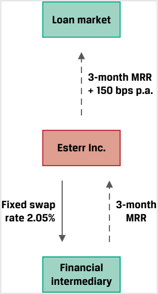
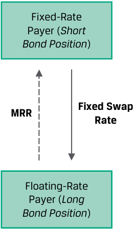

# Tập 7: Công cụ Phái sinh (*Derivatives*)
## Học phần 7: Định giá và Xác định giá trị của Hợp đồng Hoán đổi Lãi suất và Các Hợp đồng Hoán đổi Khác (*Pricing and Valuation of Interest Rates and Other Swaps*)
### Phần 1/2: Giới thiệu (Trang PDF 157–166)

---

<!-- PDF Page 157 -->

#### H Ọ C P H Ầ N

# **<mark>7</mark>** 

### **Định giá và Xác định giá trị của Hợp đồng Hoán đổi Lãi suất và Các Hợp đồng Hoán đổi Khác (*Pricing and Valuation of Interest Rates and Other Swaps*)** 

###### **<mark>MỤC TIÊU HỌC TẬP (*LEARNING OUTCOMES*)</mark>** 

|**_Mức độ thành thạo_** **_Ứng viên cần có khả năng:_**|
|---|
|mô tả cách thức các hợp đồng hoán đổi (*swap contracts*) tương đồng nhưng cũng khác biệt so với một chuỗi các hợp đồng kỳ hạn (*series of forward contracts*)|
|đối chiếu giá trị (*value*) và mức giá (*price*) của các hợp đồng hoán đổi|

##### **GIỚI THIỆU (*INTRODUCTION*)** 

## **<mark>1</mark>** 

Hợp đồng hoán đổi (*swap contracts*) đã được giới thiệu trước đó như một cam kết chắc chắn (*firm commitment*) nhằm trao đổi một chuỗi các dòng tiền trong tương lai, trong đó hợp đồng hoán đổi lãi suất (*interest rate swaps*) – nơi các dòng tiền cố định được trao đổi lấy các khoản thanh toán thả nổi – là loại phổ biến nhất. Các bài học tiếp theo đã đề cập đến việc định giá (*pricing*) và xác định giá trị (*valuation*) của các hợp đồng kỳ hạn (*forward contracts*) và hợp đồng tương lai (*futures contracts*) dọc theo cấu trúc kỳ hạn (*term structure*), vốn tạo thành các cấu phần nền tảng cho các hợp đồng hoán đổi.

Trong bài học này, chúng ta sẽ khám phá cách thức các hợp đồng hoán đổi có liên hệ với các loại cam kết kỳ hạn (*forward commitments*) khác này. Mặc dù các định chế tài chính trung gian thường sử dụng các hợp đồng kỳ hạn lãi suất (*forward rate agreements* – FRAs) hoặc các hợp đồng tương lai lãi suất ngắn hạn để quản lý rủi ro lãi suất, các tổ chức phát hành (*issuers*) và các nhà đầu tư (*investors*) thường ưa chuộng các hợp đồng hoán đổi hơn, vì chúng khớp tốt hơn với các tài sản và nợ phải trả nhạy cảm với lãi suất có dòng tiền định kỳ, chẳng hạn như trái phiếu trả lãi cố định (*fixed-coupon bonds*), các khoản vay lãi suất biến đổi (*variable-rate loans*), hoặc các cam kết trong tương lai đã biết trước. Điều quan trọng đối với những người tham gia thị trường này không chỉ là khả năng khớp các dòng tiền dự kiến trong tương lai bằng cách sử dụng hợp đồng hoán đổi mà còn phải đảm bảo rằng sự thay đổi trong giá trị của chúng nhất quán với các mức phơi nhiễm rủi ro cơ sở hiện có hoặc mong muốn. Các bài học sau đây sẽ so sánh các hợp đồng hoán đổi với các hợp đồng kỳ hạn và đối chiếu giá trị (*value*) cũng như mức giá (*price*) của các hợp đồng hoán đổi.

###### **TỔNG QUAN HỌC PHẦN (*LEARNING MODULE OVERVIEW*)** 

- Hợp đồng hoán đổi (*swap contract*) là một thỏa thuận giữa hai đối tác (*counterparties*) nhằm trao đổi một _chuỗi_ các dòng tiền trong tương lai (*series of future cash flows*), trong khi hợp đồng kỳ hạn (*forward contract*) là một lần trao đổi giá trị _duy nhất_ (*single exchange of value*) vào một ngày sau đó. 

<!-- PDF Page 158 -->

- Hợp đồng hoán đổi lãi suất (*interest rate swaps*) tương tự như hợp đồng kỳ hạn ở chỗ cả hai hợp đồng đều là các cam kết chắc chắn (*firm commitments*) với hồ sơ kết quả thanh toán đối xứng (*symmetric payoff profiles*) và không có tiền mặt nào được trao đổi tại thời điểm khởi tạo (*at inception*), nhưng chúng khác nhau ở chỗ lãi suất hoán đổi cố định (*fixed swap rate*) là không đổi (*constant*), trong khi một chuỗi các hợp đồng kỳ hạn có các mức lãi suất kỳ hạn (*forward rates*) khác nhau tại mỗi kỳ đáo hạn. 

- Một hợp đồng hoán đổi được định giá bằng cách giải tìm lãi suất hoán đổi ngang giá (*par swap rate*), tức là mức lãi suất cố định làm cho giá trị hiện tại của tất cả các dòng tiền thả nổi dự kiến trong tương lai bằng với giá trị hiện tại của tất cả các dòng tiền cố định trong tương lai. 

- Giá trị của một hợp đồng hoán đổi tại thời điểm khởi tạo bằng không (bỏ qua chi phí giao dịch và chi phí tín dụng đối tác). Vào bất kỳ ngày thanh toán (*settlement date*) nào, giá trị của một hợp đồng hoán đổi bằng giá trị thanh toán hiện tại (*current settlement value*) cộng với giá trị hiện tại của tất cả các khoản thanh toán hoán đổi trong tương lai còn lại. 

- Giá trị của một hợp đồng hoán đổi thay đổi khi thời gian trôi qua và lãi suất thay đổi. Ví dụ, sự gia tăng của lãi suất kỳ hạn dự kiến (*expected forward rates*) làm tăng giá trị hiện tại của các khoản thanh toán thả nổi, tạo ra khoản lãi định giá theo thị trường (*mark-to-market gain* – MTM gain) cho bên trả lãi cố định / bên nhận lãi thả nổi (*fixed-rate payer / floating-rate receiver*) và khoản lỗ MTM (*MTM loss*) cho bên nhận lãi cố định / bên trả lãi thả nổi (*fixed-rate receiver / floating-rate payer*). 

###### **TỰ ĐÁNH GIÁ HỌC PHẦN (*LEARNING MODULE SELF-ASSESSMENT*)** 

Những câu hỏi ban đầu này nhằm giúp bạn tự đánh giá mức độ hiểu biết hiện tại của mình về học phần này. 

1. Xác định đặc điểm nào sau đây khớp với loại hợp đồng cam kết kỳ hạn (*forward commitment contract*) nào. 

| Đặc điểm | Hợp đồng cam kết kỳ hạn |
|---|---|
| 1. Liên quan đến các khoản thanh toán định kỳ dựa trên chênh lệch giữa một mức lãi suất cố định được thiết lập riêng cho từng kỳ và lãi suất tham chiếu thị trường (*market reference rate* – MRR) | A. Cả hợp đồng hoán đổi lãi suất (*interest rate swap*) và một chuỗi các hợp đồng kỳ hạn lãi suất (*series of forward rate agreements*) |
| 2. Có hồ sơ kết quả thanh toán đối xứng (*symmetric payoff profile*) và có giá trị bằng không đối với cả hai đối tác tại thời điểm khởi tạo | B. Một chuỗi các hợp đồng kỳ hạn lãi suất (*forward rate agreements* – FRAs) |
| 3. Liên quan đến các khoản thanh toán định kỳ dựa trên chênh lệch giữa một mức lãi suất cố định không đổi (*constant fixed rate*) và lãi suất tham chiếu thị trường (MRR) | C. Hợp đồng hoán đổi lãi suất (*interest rate swap*) |

###### **Lời giải:** 

   **1.** B là đáp án đúng. Một chuỗi các hợp đồng FRA liên quan đến các khoản thanh toán định kỳ dựa trên chênh lệch giữa một mức lãi suất cố định được thiết lập cho từng kỳ và MRR. 

   **2.** A là đáp án đúng. Cả hợp đồng hoán đổi lãi suất và một chuỗi các hợp đồng kỳ hạn lãi suất đều có hồ sơ kết quả thanh toán đối xứng và có giá trị bằng không đối với cả hai đối tác tại thời điểm khởi tạo. 

   **3.** C là đáp án đúng. Hợp đồng hoán đổi lãi suất liên quan đến các khoản thanh toán định kỳ dựa trên chênh lệch giữa một mức lãi suất cố định không đổi và MRR. 

2. Giao dịch nào sau đây sẽ cho phép một nhà quản lý danh mục đầu tư thu nhập cố định (*fixed-income portfolio manager*) thu được lợi nhuận khi lãi suất giảm? 

   - **A.** Mua một trái phiếu lãi suất thả nổi (*floating-rate bond*) 

   - **B.** Tham gia vào một <u>hợp đồng hoán đổi lãi suất nhận cố định, trả thả nổi (*receive-fixed, pay-floating interest rate swap*)</u> 

<!-- PDF Page 159 -->

   - **C.** Tham gia vào một hợp đồng hoán đổi lãi suất trả cố định, nhận thả nổi (*pay-fixed, receive-floating interest rate swap*)

###### **Lời giải:**

B là đáp án đúng. Một nhà quản lý danh mục đầu tư thu nhập cố định muốn thu lợi từ việc lãi suất giảm có thể cân nhắc tham gia vào một hợp đồng hoán đổi lãi suất _nhận_ cố định, _trả_ thả nổi thay vì mua trái phiếu. Các khoản thanh toán lãi suất cố định trở nên có giá trị hơn khi lãi suất giảm. A không đúng vì các khoản thanh toán lãi của trái phiếu lãi suất thả nổi sẽ giảm khi lãi suất giảm, do đó trái phiếu không tăng giá trị. C không đúng vì các khoản thanh toán lãi suất cố định trở nên tốn kém hơn (bất lợi hơn cho bên trả cố định) khi lãi suất giảm.

3. Phát biểu nào sau đây mô tả đúng về một vị thế hợp đồng hoán đổi lãi suất trả cố định, nhận thả nổi (*pay-fixed, receive-floating interest rate swap*)?

   - **A.** Vị thế mua (*long*) một trái phiếu lãi suất thả nổi (*floating-rate note*) được định giá theo MRR và vị thế bán (*short*) một trái phiếu lãi suất cố định (*fixed-rate bond*) có lãi suất coupon bằng với lãi suất hoán đổi cố định (*fixed swap rate*)
   - **B.** Vị thế mua (*long*) một trái phiếu lãi suất cố định có lãi suất coupon bằng với lãi suất hoán đổi cố định và vị thế bán (*short*) một trái phiếu lãi suất thả nổi được định giá theo MRR
   - **C.** Vị thế mua (*long*) một trái phiếu lãi suất thả nổi được định giá theo MRR

###### **Lời giải:**

A là đáp án đúng. Một hợp đồng hoán đổi lãi suất về mặt kinh tế tương đương với một vị thế mua (*long*) và một vị thế bán (*short*) đối với các chứng khoán nợ cơ sở. Trong trường hợp của hợp đồng hoán đổi trả cố định, nhận thả nổi, dòng tiền nhận được phản ánh vị thế mua (*long*). Trong trường hợp này, bên tham gia nhận các khoản thanh toán thả nổi, vì vậy điều này giống như việc mua một trái phiếu lãi suất thả nổi. Phần trả lãi cố định của hợp đồng hoán đổi giống như việc bán một trái phiếu lãi suất cố định và trả các khoản coupon cố định cho người mua trái phiếu. B không đúng vì đáp án này về mặt kinh tế tương đương với việc tham gia vào một hợp đồng hoán đổi nhận cố định, trả thả nổi. C không đúng vì đáp án này không phản ánh vị thế bán (*short position*).

4. Một nhà đầu tư tham gia vào một hợp đồng hoán đổi kỳ hạn 10 năm, trả lãi cố định (*pay-fixed*) với vốn danh nghĩa 100 triệu EUR tại mức lãi suất 1,12% đổi lấy lãi suất MRR đồng EUR kỳ hạn 6 tháng. Giả sử lãi suất MRR đồng EUR kỳ hạn 6 tháng hôm nay được ấn định ở mức 0,25%. Giá trị nào sau đây gần nhất với kết quả tính toán đúng về giá trị thanh toán định kỳ (*periodic settlement value*) của hợp đồng hoán đổi dưới góc độ của nhà đầu tư sau thời gian 6 tháng?

   - **A.** 870.000 EUR
   - **B.** –870.000 EUR
   - **C.** –435.000 EUR

###### **Lời giải:**

C là đáp án đúng. Dưới góc độ của nhà đầu tư (bên trả lãi cố định – *fixed-rate payer*), giá trị thanh toán định kỳ của hợp đồng hoán đổi bằng:

$$\text{Giá trị thanh toán định kỳ} = (\text{MRR} - s_N) \times \text{Vốn danh nghĩa (Notional amount)} \times \text{Kỳ hạn (Period)}$$

$$= -435.000\text{ EUR} = (0,25\% - 1,12\%) \times 100\text{ triệu EUR} \times 0,5\text{ năm}.$$

Vì lãi suất MRR đồng EUR được ấn định thấp hơn lãi suất hoán đổi cố định, bên trả lãi cố định phải thực hiện một khoản thanh toán ròng (*net payment*) cho bên nhận lãi cố định vào cuối kỳ tính lãi. Cả hai đáp án A và B đều bỏ qua độ dài kỳ của hợp đồng hoán đổi (0,5 năm) nên không chính xác. A cũng không chính xác vì dấu bị đảo ngược trong câu trả lời sẽ phản ánh đúng giá trị thanh toán định kỳ của phía đối tác chứ không phải của nhà đầu tư.

<!-- PDF Page 160 -->

## **<mark>2</mark>** 

##### **HỢP ĐỒNG HOÁN ĐỔI SO VỚI HỢP ĐỒNG KỲ HẠN (*SWAPS VS. FORWARDS*)** 

mô tả cách thức các hợp đồng hoán đổi (*swap contracts*) tương đồng nhưng cũng khác biệt so với một chuỗi các hợp đồng kỳ hạn (*series of forward contracts*) 

Hợp đồng hoán đổi (*swap contract*) là một thỏa thuận giữa hai bên nhằm trao đổi một _chuỗi_ các dòng tiền trong tương lai (*series of future cash flows*), trong khi hợp đồng kỳ hạn (*forward contract*) là một thỏa thuận cho một lần trao đổi giá trị _duy nhất_ (*single exchange of value*) vào một ngày sau đó. Mặc dù bài học này tập trung vào các hợp đồng hoán đổi lãi suất (*interest rate swaps*), các nguyên tắc tương tự cũng được áp dụng cho các biến số cơ sở khác nơi một chuỗi các dòng tiền được trao đổi vào một ngày trong tương lai. 

Một bài học trước đây đã chỉ ra cách thức lãi suất kỳ hạn hàm ý (*implied forward rates* – IFR) có thể được suy ra từ lãi suất giao ngay (*spot rates*). Lãi suất kỳ hạn hàm ý cho một kỳ nhất định trong tương lai tương đương với mức lãi suất cố định của hợp đồng kỳ hạn lãi suất (*forward rate agreement* – FRA) cho cùng kỳ đó mà tại đó không tồn tại cơ hội kinh doanh chênh lệch giá phi rủi ro (*no riskless profit opportunities exist*). Dòng tiền đơn lẻ của một hợp đồng FRA tương tự như một hợp đồng hoán đổi một kỳ (*single-period swap*), như được minh họa trong Bảng 1 (*Exhibit 1*). 

###### **Bảng 1: Hồ sơ Kết quả Thanh toán của Hợp đồng Hoán đổi và FRA (*Exhibit 1: Swap and FRA Payoff Profile*)** 

<!-- Picture Text: Fixed-Rate Payer MRR × Fixed-Rate Notional × × Notional Period × Period Floating-Rate Payer  -->
> **Chú thích hình ảnh:** 
> - **Fixed-Rate Payer:** Bên trả lãi cố định
> - **Floating-Rate Payer:** Bên trả lãi thả nổi
> - Dòng tiền từ Bên trả lãi thả nổi sang Bên trả lãi cố định: $\text{MRR} \times \text{Vốn danh nghĩa (Notional)} \times \text{Kỳ hạn (Period)}$
> - Dòng tiền từ Bên trả lãi cố định sang Bên trả lãi thả nổi: $\text{Lãi suất cố định (Fixed-Rate)} \times \text{Vốn danh nghĩa (Notional)} \times \text{Kỳ hạn (Period)}$

Trong mỗi trường hợp, chênh lệch ròng (*net difference*) giữa mức lãi suất cố định được thỏa thuận tại thời điểm khởi tạo và mức lãi suất tham chiếu thị trường (MRR) được ấn định trong tương lai sẽ được sử dụng làm cơ sở để xác định khoản thanh toán bằng tiền mặt (*cash settlement*) tính trên một khoản vốn gốc danh nghĩa (*notional principal*) nhất định trong một khoảng thời gian cụ thể. Ví dụ, bên trả lãi cố định (*fixed-rate payer*) trong một hợp đồng hoán đổi hoặc FRA sẽ thực hiện một khoản lãi nếu MRR được ấn định ở mức cao hơn lãi suất cố định đã thỏa thuận và sẽ nhận được một khoản thanh toán ròng từ bên trả lãi thả nổi (*floating-rate payer*). Tuy nhiên, như chúng ta đã thấy trong bài học trước, hợp đồng FRA có một lần thanh toán duy nhất diễn ra vào _đầu_ kỳ tính lãi (*beginning of an interest period*), trong khi một hợp đồng hoán đổi tiêu chuẩn có các khoản thanh toán định kỳ diễn ra vào _cuối_ mỗi kỳ tương ứng (*end of each respective period*). 

Những điểm tương đồng khác giữa hợp đồng kỳ hạn lãi suất và hợp đồng hoán đổi lãi suất bao gồm hồ sơ kết quả thanh toán đối xứng (*symmetric payoff profile*) và thực tế là không có dòng tiền nào được trao đổi trả trước (*upfront*). Cả hợp đồng kỳ hạn lãi suất và hợp đồng hoán đổi lãi suất đều hàm chứa rủi ro tín dụng đối tác (*counterparty credit exposure*). 

Vì lãi suất có đặc trưng là cấu trúc kỳ hạn (*term structure*), các mức lãi suất cố định FRA khác nhau thường tồn tại cho các khoảng thời gian đáo hạn khác nhau. Ngược lại, một hợp đồng hoán đổi lãi suất tiêu chuẩn có mức lãi suất cố định _không đổi_ (*constant fixed rate*) trong suốt vòng đời của nó, bao gồm nhiều kỳ. Mối quan hệ này được thể hiện trực quan trong Bảng 2 (*Exhibit 2*) và bằng số liệu trong Ví dụ 1, vốn mở rộng từ một ví dụ về lãi suất giao ngay và lãi suất kỳ hạn trước đó. 

<!-- PDF Page 161 -->

**Bảng 2: Chuỗi các hợp đồng FRA so với Hợp đồng Hoán đổi Lãi suất Tiêu chuẩn (*Exhibit 2: Series of FRAs vs. Standard Interest Rate Swap*)** 

###### **Chuỗi các Hợp đồng Kỳ hạn Lãi suất (tại các Mức lãi suất Cố định Khác nhau) (*Series of Forward Rate Agreements (at Different Fixed Rates)*)** 

<!-- Picture Text: Time t  = 0 t  = 1 t  = 2 t  = 3 FRA Fixed- FRA Fixed- FRA Fixed- FRA Fixed- Rate Payer Rate Payer Rate Payer Rate Payer Contract Contract Contract FRA Floating- FRA Floating- FRA Floating- FRA Floating- Rate Payer Rate Payer Rate Payer Rate Payer  -->
> **Chú thích hình ảnh:** 
> - **Time ($t = 0, t = 1, t = 2, t = 3$):** Thời gian
> - **FRA Fixed-Rate Payer:** Bên trả lãi cố định FRA
> - **FRA Floating-Rate Payer:** Bên trả lãi thả nổi FRA
> - **Contract:** Từng hợp đồng FRA riêng lẻ cho mỗi kỳ với các mức lãi suất cố định khác nhau.

###### **Hợp đồng Hoán đổi Lãi suất Tiêu chuẩn (Tại Một Mức lãi suất Cố định Không đổi) (*Standard Interest Rate Swap (At A Constant Fixed Rate)*)** 

<!-- Picture Text: Time t  = 0 t  = 1 t  = 2 t  = 3 Swap Fixed- Swap Fixed- Swap Fixed- Swap Fixed- Rate Payer Rate Payer Rate Payer Rate Payer Contract Swap Floating- Swap Floating-  Swap Floating- Swap Floating- Rate Payer Rate Payer Rate Payer Rate Payer  -->
> **Chú thích hình ảnh:**
> - **Time ($t = 0, t = 1, t = 2, t = 3$):** Thời gian
> - **Swap Fixed-Rate Payer:** Bên trả lãi cố định của hợp đồng hoán đổi
> - **Swap Floating-Rate Payer:** Bên trả lãi thả nổi của hợp đồng hoán đổi
> - **Contract:** Một hợp đồng hoán đổi duy nhất xuyên suốt các kỳ với cùng một mức lãi suất cố định không đổi.

###### **VÍ DỤ 1 (*EXAMPLE 1*)** 

###### **Hợp đồng Hoán đổi dưới dạng Kết hợp của các Hợp đồng Kỳ hạn (*Swaps as a Combination of Forwards*)** 

Hãy nhớ lại từ bài học trước rằng ba trái phiếu chính phủ trả lãi coupon cố định hàng năm vừa mới phát hành có lãi suất coupon, giá, lợi suất đáo hạn (*yields-to-maturity* – YTM), và lãi suất zero-coupon (hay lãi suất giao ngay – *zero or spot rates*) như sau: 

|**Số năm đến khi đáo hạn** **(*Years to Maturity*)**|**Lãi suất Coupon hàng năm** **(*Annual Coupon*)**|**Giá trị hiện tại – PV** **(trên mỗi 100 mệnh giá FV)**|**Lợi suất đáo hạn** **(*YTM*)**|**Lãi suất Zero** **(*Zero Rates*)**|
|---|---|---|---|---|
|1|1,50%|99,125|2,3960%|2,3960%|
|2|2,50%|98,275|3,4068%|3,4197%|
|3|3,25%|98,000|3,9703%|4,0005%|

Chúng ta giải tìm lãi suất kỳ hạn hàm ý ($\text{IFR}_{A, B-A}$), tức là mức lãi suất tái đầu tư hòa vốn (*break-even reinvestment rate*) cho một kỳ bắt đầu trong tương lai (tại thời điểm $t = A$) giữa lãi suất zero kỳ hạn ngắn hơn ($z_A$) và lãi suất zero kỳ hạn dài hơn ($z_B$) bằng công thức sau: 

$$(1 + z_A)^A \times (1 + \text{IFR}_{A, B-A})^{B-A} = (1 + z_B)^B \tag{1}$$

Lãi suất giao ngay tương ứng tại thời điểm $t = 0$ ($\text{IFR}_{0,1}$) và các mức lãi suất kỳ hạn hàm ý sau một năm ($\text{IFR}_{1,1}$) và sau hai năm ($\text{IFR}_{2,1}$) lần lượt như sau: 

<!-- PDF Page 162 -->

$$\text{IFR}_{0,1} = 2,3960\% = (1,023960) - 1.$$

$$\text{IFR}_{1,1} = 4,4536\% = \frac{(1,034197)^2}{1,02396} - 1.$$

$$\text{IFR}_{2,1} = 5,1719\% = \frac{(1,040005)^3}{(1,034197)^2} - 1.$$

Một cách để tạo ra một cam kết kỳ hạn cho nhiều kỳ với giá trị ban đầu bằng không là sử dụng một chuỗi các hợp đồng kỳ hạn lãi suất (FRAs), trao đổi các dòng tiền dựa trên mức lãi suất kỳ hạn hàm ý tương ứng (tức là lãi suất cố định FRA) cho từng kỳ. Tuy nhiên, mức lãi suất cố định sẽ _thay đổi_ (*vary*) cho mỗi kỳ dựa trên cấu trúc kỳ hạn của lãi suất. Thay vào đó, một hợp đồng hoán đổi lãi suất tiêu chuẩn có đặc trưng là một mức lãi suất cố định _không đổi_ (*constant*) qua nhiều kỳ. Các mức lãi suất này được trình bày cho cả hai phương án dưới đây. 

<!-- Picture Text: Time t  = 0 t  = 1 t  = 2 t  = 3 FRA fixed FRA fixed FRA fixed FRA fixed rate payer rate payer rate payer rate payer Contract Contract Contract FRA floating FRA floating FRA floating FRA floating rate payer rate payer rate payer rate payer FRA fixed rate: FRA fixed rate: FRA fixed rate: 2.396% 4.4536% 5.1719% Time t  = 0 t  = 1 t  = 2 t  = 3 Swap fixed Swap fixed Swap fixed Swap fixed rate payer rate payer rate payer rate payer Contract Swap floating Swap floating Swap floating Swap floating rate payer rate payer rate payer rate payer Fixed swap rate: Fixed swap rate: Fixed swap rate: 3.9641% 3.9641% 3.9641%  -->
> **Chú thích hình ảnh:**
> - **Sơ đồ trên (Chuỗi hợp đồng FRA):** Lãi suất cố định FRA (*FRA fixed rate*) thay đổi qua từng kỳ: Kỳ 1 ($t=1$) là $2,396\%$; Kỳ 2 ($t=2$) là $4,4536\%$; Kỳ 3 ($t=3$) là $5,1719\%$.
> - **Sơ đồ dưới (Hợp đồng hoán đổi):** Lãi suất hoán đổi cố định (*Fixed swap rate*) giữ nguyên không đổi qua cả ba kỳ: Kỳ 1, Kỳ 2, Kỳ 3 đều là $3,9641\%$.

Phương pháp được sử dụng để giải tìm lãi suất hoán đổi đã được giới thiệu trong một bài học về thu nhập cố định trước đó. _Lãi suất ngang giá_ (*par rate* – PMT) đã được chứng minh là mức lãi suất cố định mà tại đó một trái phiếu trả lãi coupon cố định có giá bằng mệnh giá (*par*, hay 100) khi sử dụng một chuỗi các lãi suất zero ($z_i$ cho kỳ $i$) làm thừa số chiết khấu thị trường (*market discount factors*), như sau: 

<!-- Formula Text: 100  =    PMT _ (1 + z 1) 1  +   PMT _ (1 + z 2) 2  + ⋯  +  PMT + 100 _ (1 + z N) N . (2) -->
$$100 = \frac{\text{PMT}}{(1 + z_1)^1} + \frac{\text{PMT}}{(1 + z_2)^2} + \cdots + \frac{\text{PMT} + 100}{(1 + z_N)^N} \tag{2}$$

Một hợp đồng hoán đổi lãi suất tiêu chuẩn đại diện cho việc trao đổi các khoản thanh toán cố định (_không_ có khoản thanh toán nợ gốc cuối kỳ) tại một mức lãi suất không đổi để lấy một chuỗi các dòng tiền lãi suất thả nổi được kỳ vọng bằng với các mức lãi suất kỳ hạn hàm ý tương ứng tại thời điểm $t = 0$. Do đó, chúng ta phải điều chỉnh phép tính lãi suất trái phiếu ngang giá trong Phương trình 2 để giải tìm PMT dưới dạng **lãi suất hoán đổi ngang giá (*par swap rate*).** 

<!-- PDF Page 163 -->

###### **Bảng 3: Lãi suất Hoán đổi Ngang giá, Đường cong Lãi suất Giao ngay và Đường cong Lãi suất Kỳ hạn (*Exhibit 3: Par Swap Rate, Spot, and Forward Curve*)** 

<!-- Picture Text: Yield (%) 7.00% Forward curve 6.00% IFR2,1 5.00% IFR1,1 z 3 4.00% Par swap rate ( s 3) IFR0,1 =  z 1 z 2 3.00% Spot or zero curve 2.00% 1.00% Term 1 2 3  -->
> **Chú thích hình ảnh:**
> - **Trục tung:** Lợi suất (*Yield* – %) từ $1,00\%$ đến $7,00\%$; **Trục hoành:** Kỳ hạn (*Term*) 1, 2, 3.
> - **Forward curve:** Đường cong lãi suất kỳ hạn ($\text{IFR}_{0,1} = z_1$, $\text{IFR}_{1,1}$, $\text{IFR}_{2,1}$).
> - **Spot or zero curve:** Đường cong lãi suất giao ngay hay lãi suất zero ($z_1, z_2, z_3$).
> - **Par swap rate ($s_3$):** Lãi suất hoán đổi ngang giá kỳ hạn 3 năm (đường nằm ngang ở mức $\approx 3,9641\%$).

Lãi suất hoán đổi ngang giá (*par swap rate*) là mức lãi suất cố định làm cân bằng giá trị hiện tại của tất cả các dòng tiền thả nổi dự kiến trong tương lai với giá trị hiện tại của các dòng tiền cố định. 

$$\sum \text{PV}(\text{Các khoản thanh toán thả nổi – Floating payments}) = \sum \text{PV}(\text{Các khoản thanh toán cố định – Fixed payments}), \text{ hay}$$

<!-- Formula Text: ∑ i=1 N     IFR _ (1 + z i) i   =  ∑ i=1 N s i _ (1 + z i) i . (3) -->
$$\sum_{i=1}^{N} \frac{\text{IFR}}{(1 + z_i)^i} = \sum_{i=1}^{N} \frac{s_N}{(1 + z_i)^i} \tag{3}$$

Trong ví dụ ba kỳ của chúng ta, chúng ta sử dụng các mức lãi suất kỳ hạn hàm ý, $\text{IFR}$, để giải tìm $s_3$, hay lãi suất hoán đổi kỳ hạn 3 năm: 

<!-- Formula Text: IFR 0, 1 _ (1 + z 1)  + IFR 1, 1 _ (1 + z 2) 2  + IFR 2, 1 _ (1 + z 3) 3   = s 3 _ (1 + z 1)  + s 3 _ (1 + z 2) 2  + s 3 _ (1 + z 3) 3 . -->
$$\frac{\text{IFR}_{0,1}}{(1 + z_1)} + \frac{\text{IFR}_{1,1}}{(1 + z_2)^2} + \frac{\text{IFR}_{2,1}}{(1 + z_3)^3} = \frac{s_3}{(1 + z_1)} + \frac{s_3}{(1 + z_2)^2} + \frac{s_3}{(1 + z_3)^3}$$

Thay thế từng cấu phần nền tảng này vào Phương trình 3 để giải tìm $s_3$: 

$$0,111017 = \frac{2,396\%}{1,02396} + \frac{4,4537\%}{(1,034197)^2} + \frac{5,1719\%}{(1,040005)^3} = \frac{s_3}{1,02396} + \frac{s_3}{(1,034197)^2} + \frac{s_3}{(1,040005)^3}$$

$$0,111017 = 2,800545 \times s_3 \implies s_3 = 3,9641\%.$$

Lãi suất hoán đổi kỳ hạn 3 năm ở mức 3,9641% có thể được hiểu là mức lãi suất hòa vốn đa kỳ (*multiperiod breakeven rate*) mà tại đó một nhà đầu tư sẽ bàng quan (*indifferent*) giữa việc: 

- _trả_ lãi suất hoán đổi cố định và _nhận_ các mức lãi suất kỳ hạn tương ứng, hoặc 

- _nhận_ lãi suất hoán đổi cố định và _trả_ các mức lãi suất kỳ hạn tương ứng. 

Vì lý do này, chúng ta có thể coi lãi suất hoán đổi cố định như một tỷ suất hoàn vốn nội bộ (*internal rate of return* – IRR) đối với các mức lãi suất kỳ hạn hàm ý cho đến khi đáo hạn hợp đồng hoán đổi tính tại thời điểm $t = 0$. Bảng 3 cũng chứng minh rằng mặc dù tổng giá trị kết hợp của các hợp đồng kỳ hạn tương đương bằng không tại thời điểm $t = 0$, một số giao dịch trao đổi kỳ hạn riêng lẻ có thể có giá trị hiện tại dương và một số sẽ có giá trị hiện tại âm. Ví dụ, bên nhận lãi cố định (bên trả lãi thả nổi) trong hợp đồng hoán đổi ở Ví dụ 1 sẽ kỳ vọng dòng tiền sau đây sau thời gian một năm: 

- _Nhận_ lãi suất hoán đổi cố định ($s_3$) là 3,9641%. 

- _Trả_ lãi suất thả nổi ban đầu ($\text{IFR}_{0,1}$) là 2,396%. 

<!-- PDF Page 164 -->

- _Nhận_ một khoản thanh toán ròng là 1,5681% ($= 3,9641\% - 2,396\%$) tính trên vốn danh nghĩa cho kỳ đó. 

Những người sử dụng cuối cùng (*end users*) đối với công cụ phái sinh, chẳng hạn như các tổ chức phát hành và các nhà đầu tư, có xu hướng sử dụng hợp đồng hoán đổi thường xuyên hơn so với các hợp đồng kỳ hạn lãi suất riêng lẻ vì một số lý do. Ví dụ, khả năng khớp các dòng tiền của tài sản hoặc nợ phải trả cơ sở cho phép các tổ chức phát hành chuyển đổi hồ sơ phơi nhiễm rủi ro của họ như trong Ví dụ 2. 

###### **VÍ DỤ 2 (*EXAMPLE 2*)** 

###### **Hợp đồng Hoán đổi sang Lãi suất Cố định của Esterr Inc. (*Esterr Inc. Swap to Fixed*)** 

Hãy nhớ lại từ một bài học trước rằng Esterr Inc. có một khoản vay có kỳ hạn lãi suất thả nổi (*floating-rate term loan*) trị giá 250 triệu CAD với lãi suất bằng MRR đồng Canada kỳ hạn 3 tháng cộng 150 điểm cơ bản (*basis points* – bps), còn 3,5 năm nữa là đáo hạn và trả lãi hàng quý. Esterr tham gia vào một hợp đồng hoán đổi lãi suất trị giá 250 triệu CAD để trả lãi suất hoán đổi cố định hàng quý là 2,05% và nhận lãi suất MRR thả nổi kỳ hạn 3 tháng trên vốn gốc danh nghĩa 250 triệu CAD dựa trên các ngày thanh toán khớp với khoản vay có kỳ hạn. Mức phơi nhiễm rủi ro kết hợp của khoản vay và hợp đồng hoán đổi có thể được thể hiện như sau: 

<!-- Picture Text: Loan market 3-month MRR + 150 bps p.a. Esterr Inc. Fixed swap 3-month rate 2.05% MRR Financial intermediary  -->
> **Chú thích hình ảnh:**
> - **Loan market:** Thị trường cho vay (Esterr Inc. trả lãi suất $\text{MRR 3 tháng} + 150\text{ bps/năm}$).
> - **Esterr Inc.:** Tổ chức phát hành / Bên đi vay.
> - **Financial intermediary:** Định chế tài chính trung gian (Esterr Inc. trả lãi suất hoán đổi cố định $2,05\%$ và nhận $\text{MRR 3 tháng}$).

Theo thỏa thuận hoán đổi này, Esterr có thể cố định chi phí lãi vay (*interest expense*) cho khoản vay có kỳ hạn của mình và tránh được gánh nặng hành chính của việc quản lý nhiều hợp đồng kỳ hạn tại các mức lãi suất kỳ hạn khác nhau. Hãy xem xét các kịch bản dòng tiền sau đây đối với hợp đồng hoán đổi lãi suất và khoản vay có kỳ hạn (giả sử mỗi kỳ tính lãi là 0,25 năm): 

###### **Kịch bản 1 (*Scenario 1*):** 

Lãi suất MRR đồng CAD được ấn định ở mức 3,75%. Với tư cách là bên trả lãi cố định (*fixed-rate payer*), Esterr: 

- trả lãi suất hoán đổi cố định 2,05% và nhận MRR đồng CAD ở mức 3,75%, 

- _nhận_ một khoản thanh toán hoán đổi _ròng_ là 1,70% cho quý đó, và 

- thực hiện khoản thanh toán lãi vay có kỳ hạn là 5,25% ($= 3,75\% + 1,50\%$). 

Chi phí lãi vay của Esterr là 3,55% ($= 5,25\%\text{ trả đi} - 1,70\%\text{ nhận về}$). 

###### **Kịch bản 2 (*Scenario 2*):** 

Lãi suất MRR đồng CAD được ấn định ở mức 1,25%. Với tư cách là bên trả lãi cố định, Esterr: 

- trả lãi suất hoán đổi cố định 2,05% và nhận MRR đồng CAD ở mức 1,25%, 

- _trả_ một khoản thanh toán hoán đổi _ròng_ là 0,80% cho quý đó, và 

<!-- PDF Page 165 -->

- thực hiện khoản thanh toán lãi vay có kỳ hạn là 2,75% ($= 1,25\% + 1,50\%$). 

Chi phí lãi vay của Esterr là 3,55% ($= 2,75\%\text{ trả đi} + 0,80\%\text{ trả đi}$). Bất kể lãi suất MRR đồng CAD được ấn định ở mức nào trong mỗi kỳ, chi phí lãi vay của Esterr cho mỗi kỳ tính lãi hàng quý đều xấp xỉ 2.218.750 CAD ($= 3,55\%$ [bằng lãi suất hoán đổi 2,05% + mức chênh lệch khoản vay 1,50%] $\times 250\text{ triệu CAD} \times 0,25\text{ năm}$). 

Là một công cụ thu nhập cố định có các dòng tiền cố định định kỳ cho đến khi đáo hạn, một hợp đồng hoán đổi lãi suất được kỳ vọng sẽ có các đặc điểm rủi ro và tỷ suất sinh lợi tương tự như một trái phiếu trả lãi coupon cố định có kỳ hạn tương đương. Đặc điểm này làm cho các hợp đồng hoán đổi lãi suất trở thành một lựa chọn thay thế hấp dẫn hơn so với các hợp đồng kỳ hạn lãi suất (FRAs) đối với các nhà đầu tư trong việc quản lý mức phơi nhiễm rủi ro thu nhập cố định. Hãy xem xét bảng so sánh sau đây giữa một vị thế trái phiếu tiền mặt (*cash bond position*) với việc trả hoặc nhận lãi suất hoán đổi cố định: 

**Bảng 4: Sử dụng Hợp đồng Hoán đổi để Quản lý Phơi nhiễm Rủi ro Thu nhập Cố định (*Exhibit 4: Using Swaps to Manage Fixed-Income Exposure*)** 

<!-- Picture Text: Fixed-Rate Payer ( Short Bond Position ) Fixed Swap MRR Rate Floating-Rate Payer ( Long Bond Position )  -->
> **Chú thích hình ảnh:**
> - **Fixed-Rate Payer (Short Bond Position):** Bên trả lãi cố định (tương đương Vị thế bán trái phiếu cố định).
> - **Floating-Rate Payer (Long Bond Position):** Bên trả lãi thả nổi / nhận lãi cố định (tương đương Vị thế mua trái phiếu cố định).
> - Dòng tiền trao đổi gồm **MRR** (Lãi suất tham chiếu thị trường) và **Fixed Swap Rate** (Lãi suất hoán đổi cố định).

|**Công cụ (*Instrument*)**|**Vị thế (*Position*)**|**Lãi suất cao hơn (*Higher interest rates*)**|**Lãi suất thấp hơn (*Lower interest rates*)**|
|---|---|---|---|
|**Trái phiếu tiền mặt (*Cash bond*)**|- Mua trái phiếu cố định (*Long fixed bond*) - Bán trái phiếu lãi suất thả nổi (*Short floating-rate note*)|Lỗ (*Loss*)|Lãi (*Gain*)|
|**Hợp đồng hoán đổi lãi suất (*Interest rate swap*)**|- Nhận cố định (*Receive fixed*) - Trả thả nổi (*Pay floating*)|Lỗ (*Loss*)|Lãi (*Gain*)|
|**Trái phiếu tiền mặt (*Cash bond*)**|- Bán trái phiếu cố định (*Short fixed bond*) - Mua trái phiếu lãi suất thả nổi (*Long floating-rate note*)|Lãi (*Gain*)|Lỗ (*Loss*)|
|**Hợp đồng hoán đổi lãi suất (*Interest rate swap*)**|- Trả cố định (*Pay fixed*) - Nhận thả nổi (*Receive floating*)|Lãi (*Gain*)|Lỗ (*Loss*)|

Mặc dù bài học tiếp theo sẽ khám phá giá trị và mức giá của hợp đồng hoán đổi lãi suất một cách chi tiết hơn, Bảng 4 chứng minh sự tương đồng giữa vị thế mua (bán) trái phiếu và hợp đồng hoán đổi lãi suất nhận (trả) lãi cố định. Nhờ tính thanh khoản cao hơn và hồ sơ phơi nhiễm rủi ro chuẩn (*benchmark exposure profile*) tương tự như các vị thế trái phiếu riêng lẻ, các nhà quản lý danh mục đầu tư thu nhập cố định chủ động (*active fixed-income portfolio managers*) thường sử dụng các hợp đồng hoán đổi thay vì các chứng khoán cơ sở để điều chỉnh mức phơi nhiễm rủi ro lãi suất của họ. Ví dụ, nếu lãi suất được dự báo sẽ giảm, một nhà quản lý danh mục đầu tư có thể chọn nhận lãi cố định trên một hợp đồng hoán đổi thay vì mua các trái phiếu cơ sở để hiện thực hóa khoản lợi nhuận trong môi trường lãi suất thấp hơn. 

<!-- PDF Page 166 -->

Như đã đề cập trước đó, hợp đồng FRA chủ yếu được sử dụng bởi các định chế tài chính trung gian để quản lý các vị thế nhạy cảm với lãi suất của họ theo từng kỳ một (*period-by-period basis*). Các tổ chức phát hành và các nhà đầu tư thường lựa chọn hiệu quả cao hơn của các hợp đồng hoán đổi lãi suất để quản lý mức phơi nhiễm rủi ro lãi suất của mình. Như chúng ta sẽ thấy trong các bài học sau, tính thanh khoản cao hơn của các hợp đồng hoán đổi lãi suất cũng đã dẫn đến việc chúng được sử dụng vừa làm chuẩn mực định giá trái phiếu (*bond pricing benchmark*) vừa làm biến số cơ sở (*underlying variable*) cho các công cụ phái sinh khác. 

###### **BỘ CÂU HỎI (*QUESTION SET*)** 

###### **Hợp đồng Hoán đổi Lãi suất so với Hợp đồng Kỳ hạn (*Interest Rate Swaps vs. Forward Contracts*)** 

1. Xác định các câu trả lời đúng để điền vào chỗ trống: Bên trả lãi cố định (*fixed-rate payer*) trong một hợp đồng hoán đổi hoặc FRA sẽ thực hiện một khoản ______ nếu MRR được ấn định ở mức cao hơn lãi suất cố định đã thỏa thuận và sẽ ______ một khoản thanh toán ròng ______ bên trả lãi thả nổi (*floating-rate payer*). 

###### **Lời giải:** 

Bên trả lãi cố định trong một hợp đồng hoán đổi hoặc FRA sẽ thực hiện một khoản _lãi (gain)_ nếu MRR được ấn định ở mức cao hơn lãi suất cố định đã thỏa thuận và sẽ _nhận (receive)_ một khoản thanh toán ròng _từ (from)_ bên trả lãi thả nổi. 

2. Xác định đặc điểm nào sau đây khớp với loại hợp đồng cam kết kỳ hạn nào. 

| Đặc điểm | Hợp đồng cam kết kỳ hạn |
|---|---|
| 1. Giá của hợp đồng này là lãi suất kỳ hạn hàm ý (*implied forward rate*), hay lãi suất tái đầu tư hòa vốn (*breakeven reinvestment rate*), cho một kỳ bắt đầu trong tương lai. | A. Hợp đồng hoán đổi lãi suất (*Interest rate swap*) |
| 2. Hàm chứa rủi ro tín dụng đối tác (*counterparty credit risk*) | B. Hợp đồng kỳ hạn lãi suất (*Forward rate agreement*) |
| 3. Có một mức lãi suất cố định không đổi mà tại đó giá trị hiện tại của các giao dịch trao đổi dòng tiền cố định so với thả nổi trong tương lai bằng không | C. Cả hợp đồng hoán đổi lãi suất và hợp đồng kỳ hạn lãi suất |

###### **Lời giải:** 

**1.** B là đáp án đúng. Lãi suất tái đầu tư hòa vốn, hay lãi suất kỳ hạn hàm ý, là mức lãi suất cố định FRA không có kinh doanh chênh lệch giá (*no-arbitrage FRA fixed rate*). 

**2.** C là đáp án đúng. Cả hợp đồng hoán đổi lãi suất và hợp đồng kỳ hạn lãi suất đều hàm chứa rủi ro tín dụng đối tác. 

**3.** A là đáp án đúng. Hợp đồng hoán đổi lãi suất có một mức lãi suất cố định không đổi mà tại đó giá trị hiện tại của các giao dịch trao đổi dòng tiền cố định so với thả nổi bằng không. 
