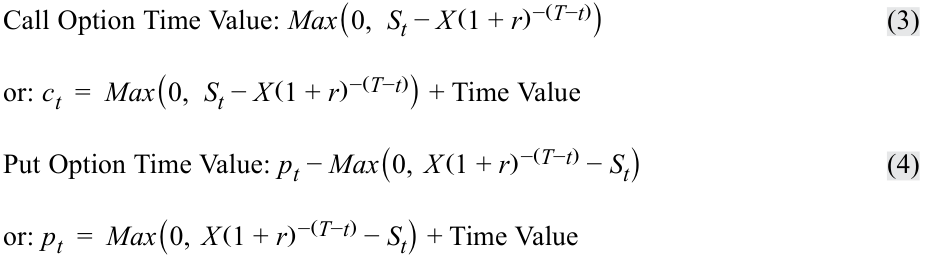
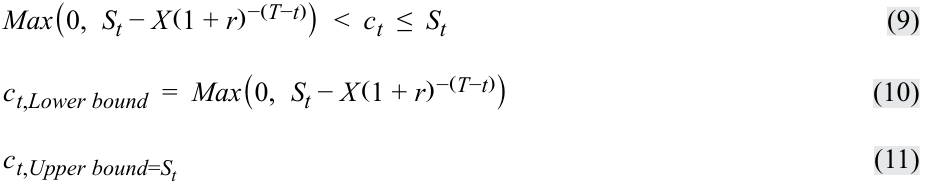
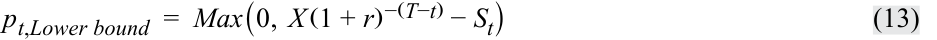
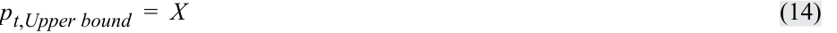
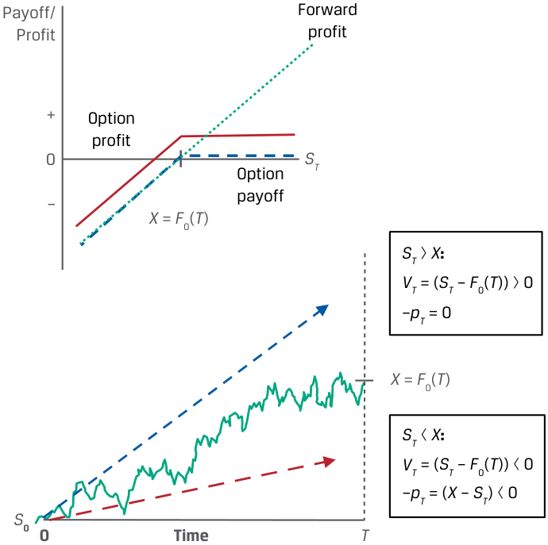

# Tập 7: Công cụ Phái sinh (*Derivatives*)
## Học phần 8: Định giá và Xác định giá trị của Quyền chọn (*Pricing and Valuation of Options*)
### Phần 1/2: Giới thiệu (Trang PDF 179–193)

---

<!-- PDF Page 179 -->

#### H Ọ C P H Ầ N

# **<mark>8</mark>** 

### **Định giá và Xác định giá trị của Quyền chọn (*Pricing and Valuation of Options*)** 

###### **<mark>MỤC TIÊU HỌC TẬP (*LEARNING OUTCOMES*)</mark>** 

|**_Mức độ thành thạo_** **_Ứng viên cần có khả năng:_**|
|---|
|giải thích giá trị thực hiện (*exercise value*), trạng thái giá trị (*moneyness*), và giá trị thời gian (*time value*) của một quyền chọn|
|đối chiếu việc sử dụng các khái niệm kinh doanh chênh lệch giá (*arbitrage*) và mô phỏng (*replication*) trong việc định giá các cam kết kỳ hạn (*forward commitments*) và các quyền đòi nợ có điều kiện (*contingent claims*)|
|xác định các nhân tố quyết định giá trị của một quyền chọn và mô tả cách thức mỗi nhân tố ảnh hưởng đến giá trị của một quyền chọn|

##### **GIỚI THIỆU (*INTRODUCTION*)** 

Hợp đồng quyền chọn (*option contracts*) là các quyền đòi nợ có điều kiện (*contingent claims*) trong đó một trong các đối tác quyết định liệu giao dịch có được thanh toán hay không và vào thời điểm nào. Không giống như một cam kết kỳ hạn (*forward commitment*) có giá trị bằng không đối với cả hai đối tác tại thời điểm khởi tạo, người mua quyền chọn trả một khoản phí quyền chọn (*premium*) cho người bán để có quyền giao dịch tài sản cơ sở (*underlying*) trong tương lai tại một mức giá đã thỏa thuận trước. Bản chất có điều kiện của quyền chọn ảnh hưởng đến mức giá cũng như giá trị của chúng theo thời gian. 

Trong bài học đầu tiên, chúng ta sẽ khám phá ba đặc điểm độc nhất của các quyền đòi nợ có điều kiện liên quan đến giá trị của quyền chọn so với giá giao ngay của tài sản cơ sở: giá trị thực hiện hay giá trị nội tại (*exercise, or intrinsic, value*); mối quan hệ giữa giá giao ngay của tài sản cơ sở và giá thực hiện của quyền chọn, được gọi là “trạng thái giá trị” (*“moneyness”*); và giá trị thời gian (*time value*). Tiếp theo, chúng ta chuyển sang tìm hiểu cách thức các khái niệm kinh doanh chênh lệch giá (*arbitrage*) và mô phỏng (*replication*) đã được giới thiệu trước đó đối với các cam kết kỳ hạn có sự khác biệt như thế nào khi được áp dụng cho các quyền đòi nợ có điều kiện với hồ sơ kết quả thanh toán bất đối xứng (*asymmetric payoff profile*). Cuối cùng, chúng ta xác định và mô tả các nhân tố quyết định giá trị của một quyền chọn. Các bài học này tập trung vào quyền chọn kiểu châu Âu (*European options*), vốn chỉ có thể được thực hiện vào ngày đáo hạn (*at expiration*). 

## **<mark>1</mark>** 

###### **TỔNG QUAN HỌC PHẦN (*LEARNING MODULE OVERVIEW*)** 

- Giá trị của một quyền chọn bao gồm giá trị thực hiện (*exercise value*) và giá trị thời gian (*time value*) của nó. Giá trị thực hiện là giá trị của quyền chọn nếu nó có thể được thực hiện _ngay lập tức_ (*immediately exercisable*), trong khi giá trị thời gian nắm bắt _khả năng_ (*possibility*) rằng sự trôi qua của thời gian và tính biến thiên của giá tài sản cơ sở sẽ làm tăng khả năng sinh lời của việc thực hiện quyền khi đáo hạn. 

<!-- PDF Page 180 -->

- Trạng thái giá trị của quyền chọn (*option moneyness*) biểu thị mối quan hệ giữa giá tài sản cơ sở (*underlying price*) và giá thực hiện (*exercise price*). Một quyền chọn bán (*put option*) hoặc quyền chọn mua (*call option*) ở trạng thái “ngang giá” (*“at the money”* – ATM) khi giá tài sản cơ sở bằng với giá thực hiện. Một quyền chọn có nhiều khả năng được thực hiện hơn nếu nó ở trạng thái “có lời” (*“in the money”* – ITM)—với giá tài sản cơ sở cao hơn (đối với quyền chọn mua) hoặc thấp hơn (đối với quyền chọn bán) so với giá thực hiện—và ít có khả năng được thực hiện hơn nếu nó ở trạng thái “lỗ” (*“out of the money”* – OTM). 

- Do hồ sơ kết quả thanh toán bất đối xứng, các quyền chọn có đặc trưng là các cận giá không có kinh doanh chênh lệch giá (*no-arbitrage price bounds*). Cận dưới (*lower bound*) là một hàm số của giá trị hiện tại của giá thực hiện và giá tài sản cơ sở, trong khi cận trên (*upper bound*) là giá tài sản cơ sở đối với quyền chọn mua và là giá thực hiện đối với quyền chọn bán. 

- Giống như trong trường hợp của các cam kết kỳ hạn, việc mô phỏng (*replication*) các hợp đồng quyền chọn sử dụng sự kết hợp của các vị thế mua (*long* – đối với quyền chọn mua) hoặc vị thế bán (*short* – đối với quyền chọn bán) trên một tài sản cơ sở cùng với việc đi vay hoặc cho vay tiền mặt. Giao dịch mô phỏng cho một quyền chọn được dựa trên một tỷ lệ của tài sản cơ sở, tỷ lệ này gắn liền mật thiết với trạng thái giá trị (*moneyness*) của quyền chọn. 

- Giá tài sản cơ sở, giá thực hiện, thời gian đến khi đáo hạn (*time to maturity*), lãi suất phi rủi ro (*risk-free rate*), độ biến động giá của tài sản cơ sở (*volatility of the underlying price*), và bất kỳ khoản thu nhập hoặc chi phí nào gắn liền với việc sở hữu tài sản cơ sở là những nhân tố then chốt quyết định giá trị của một quyền chọn. 

- Những thay đổi trong độ biến động giá của tài sản cơ sở và thời gian đến khi đáo hạn thường có tác động cùng chiều lên giá trị của cả quyền chọn bán và quyền chọn mua. Những thay đổi trong giá thực hiện, lãi suất phi rủi ro, và bất kỳ khoản thu nhập hay chi phí nào gắn liền với việc sở hữu tài sản cơ sở có tác động ngược chiều lên quyền chọn mua so với quyền chọn bán. 

###### **TỰ ĐÁNH GIÁ HỌC PHẦN (*LEARNING MODULE SELF-ASSESSMENT*)** 

Những câu hỏi ban đầu này nhằm giúp bạn tự đánh giá mức độ hiểu biết hiện tại của mình về học phần này. 

1. Phát biểu nào sau đây mô tả đúng về cận dưới (*lower bound*) đối với giá trị của một quyền chọn mua (*call option*)? 

   - **A.** Giá của tài sản cơ sở trừ đi giá trị hiện tại của giá thực hiện quyền chọn 

   - **B.** Giá của tài sản cơ sở trừ đi giá thực hiện quyền chọn hoặc bằng không, tùy theo giá trị nào lớn hơn 

   - **C.** Giá của tài sản cơ sở trừ đi giá trị hiện tại của giá thực hiện quyền chọn hoặc bằng không, tùy theo giá trị nào lớn hơn 

###### **Lời giải:** 

C là đáp án đúng. Cận dưới của giá quyền chọn mua là giá của tài sản cơ sở trừ đi giá trị hiện tại của giá thực hiện hoặc bằng không, tùy theo giá trị nào lớn hơn. A không đúng vì câu trả lời bỏ qua thực tế rằng cận dưới bằng không nếu giá của tài sản cơ sở nhỏ hơn giá trị hiện tại của giá thực hiện. B không đúng vì bỏ qua yếu tố giá trị hiện tại (*present value*). 

<!-- PDF Page 181 -->

2. Hãy ghép các phát biểu sau đây về chiến lược mô phỏng (*replication strategies*) với (các) công cụ phái sinh tương ứng của chúng:

| Phát biểu về chiến lược mô phỏng | Công cụ phái sinh tương ứng |
|---|---|
| 1. Tại thời điểm $t = 0$, cho vay ở mức lãi suất phi rủi ro và bán tài sản cơ sở tại giá $S_0$. | A. Không phải chiến lược mô phỏng quyền chọn mua cũng không phải chiến lược mô phỏng quyền chọn bán |
| 2. Chiến lược mô phỏng được thực thi tại thời điểm khởi tạo và được tất toán khi đáo hạn mà không cần điều chỉnh theo thời gian. | B. Chiến lược mô phỏng quyền chọn bán (*put option replication strategy*) |
| 3. Tại thời điểm $t = T$, bán tài sản cơ sở tại giá $S_T$ và hoàn trả khoản vay trị giá $X$. | C. Chiến lược mô phỏng quyền chọn mua (*call option replication strategy*) nếu được thực hiện |

###### **Lời giải:**

   **1.** B là đáp án đúng. Tại thời điểm $t = 0$, chiến lược mô phỏng quyền chọn bán bao gồm việc cho vay ở mức lãi suất phi rủi ro và bán tài sản cơ sở tại giá $S_0$.

   **2.** A là đáp án đúng. Vì cả quyền chọn mua và quyền chọn bán đều có hồ sơ kết quả thanh toán phi tuyến tính (*non-linear payoff profile*), chiến lược mô phỏng của chúng đòi hỏi phải có sự điều chỉnh theo thời gian khi xác suất thực hiện quyền thay đổi.

   **3.** C là đáp án đúng. Chiến lược mô phỏng quyền chọn mua nếu được thực hiện bao gồm việc hoàn trả khoản vay trị giá $X$ và bán tài sản cơ sở tại giá $S_T$ vào thời điểm $t = T$.

3. Một quyền chọn mua kiểu châu Âu (*European call option*) còn 3 tháng nữa là đáo hạn trên một cổ phiếu cơ sở không có dòng tiền bổ sung có giá thực hiện ($X$) là 50 GBP, lãi suất phi rủi ro là 2%, và giá tài sản cơ sở hiện tại ($S_t$) là 57,50 GBP. Nếu giá quyền chọn mua hiện tại là 10 GBP, phương án nào dưới đây thể hiện gần đúng nhất giá trị thực hiện (*exercise value*) và giá trị thời gian (*time value*) của quyền chọn?

   - **A.** Giá trị thực hiện = 7,50 GBP; Giá trị thời gian = 2,50 GBP
   - **B.** Giá trị thực hiện = 7,75 GBP; Giá trị thời gian = 2,25 GBP
   - **C.** Giá trị thực hiện = 0 GBP; Giá trị thời gian = 10 GBP

###### **Lời giải:**

B là đáp án đúng. Giá trị của một quyền chọn bao gồm giá trị thực hiện cộng với giá trị thời gian của nó. Giá trị thực hiện của một quyền chọn mua là $\text{Max}(0, S_t - \text{PV}(X))$ và được tính như sau:

$$\text{Giá trị thực hiện của quyền chọn mua (Call Option Exercise Value)} = \text{Max}\left(0, S_t - X(1 + r)^{-(T - t)}\right)$$

$$= \text{Max}\left(0, 57,50\text{ GBP} - 50\text{ GBP}(1,02)^{-0,25}\right) = 7,75\text{ GBP}$$

Giá trị thực hiện mang số dương vì giá tài sản cơ sở hiện tại vượt quá giá trị hiện tại của giá thực hiện. Giá trị thời gian là phần chênh lệch giữa giá quyền chọn và giá trị thực hiện, đại diện cho khả năng kết quả thanh toán của quyền chọn khi đáo hạn sẽ vượt quá giá trị thực hiện hiện tại nhờ sự biến động giá thuận lợi:

$$\text{Giá trị thời gian của quyền chọn mua (Call Option Time Value)} = c_t - \text{Max}\left(0, S_t - X(1 + r)^{-(T - t)}\right)$$

$$= 2,25\text{ GBP} \ (= 10\text{ GBP} - 7,75\text{ GBP})$$

Giá trị thời gian luôn dương và giảm dần về không khi đáo hạn ($t = T$). A không đúng vì thành phần giá trị hiện tại bị bỏ qua trong phép tính giá trị thực hiện. C không đúng vì nó hàm ý rằng quyền chọn có giá trị thực hiện bằng không.

<!-- PDF Page 182 -->

4. Hãy ghép các mối quan hệ giữa giá tài sản cơ sở và giá thực hiện sau đây với quyền chọn bán (*put option*) tương ứng của chúng: 

| Mối quan hệ giữa $S_T$ và $X$ | Trạng thái của quyền chọn bán |
|---|---|
| 1. $S_T = 100, X = 100$ | A. Quyền chọn bán ngang giá (*At-the-money put option*) |
| 2. $S_T = 110, X = 100$ | B. Quyền chọn bán có lời (*In-the-money put option*) |
| 3. $S_T = 90, X = 100$ | C. Quyền chọn bán lỗ (*Out-of-the-money put option*) |

###### **Lời giải:** 

Quyền chọn bán ở trạng thái có lời (*in the money*) khi $S_T < X$, ngang giá (*at the money*) khi $S_T = X$, và lỗ (*out of the money*) khi $S_T > X$. Do đó: 

**1.** A là đáp án đúng. Vì $S_T = X = 100$, đây là một quyền chọn bán ngang giá (*at-the-money put option*). 

**2.** C là đáp án đúng. Vì $S_T > X$, đây là một quyền chọn bán lỗ (*out-of-the-money put option*). 

**3.** B là đáp án đúng. Vì $S_T < X$, đây là một quyền chọn bán có lời (*in-the-money put option*). 

5. Hãy ghép những thay đổi sau đây của một nhân tố ảnh hưởng đến giá trị quyền chọn (giữ các nhân tố khác không đổi) với sự thay đổi giá trị quyền chọn tương ứng của chúng: 

| Thay đổi của nhân tố | Thay đổi giá trị quyền chọn |
|---|---|
| 1. Giá thực hiện ($X$) cao hơn | A. Làm giảm giá trị của cả quyền chọn mua và quyền chọn bán |
| 2. Giá tài sản cơ sở ($S_T$) cao hơn | B. Làm giảm giá trị của quyền chọn mua |
| 3. Sự sụt giảm trong độ biến động (*volatility*) của giá tài sản cơ sở | C. Làm giảm giá trị của quyền chọn bán |

###### **Lời giải:** 

   **1.** B là đáp án đúng. Giá thực hiện cao hơn làm giảm giá trị của quyền chọn mua; đối với một mức giá tài sản cơ sở nhất định khi đáo hạn ($S_T$), giá trị thanh toán của quyền chọn mua là $\text{Max}(0, S_T - X)$ sẽ giảm xuống khi $X$ cao hơn. 

   **2.** C là đáp án đúng. Giá tài sản cơ sở ($S_T$) cao hơn sẽ làm giảm giá trị của quyền chọn bán. Vì quyền chọn bán là quyền được bán một tài sản cơ sở, giá trị thanh toán của quyền chọn bán là $\text{Max}(0, X - S_T)$ sẽ giảm khi $S_T$ tăng lên. 

   **3.** A là đáp án đúng. Sự sụt giảm trong độ biến động của giá tài sản cơ sở sẽ làm giảm giá trị của cả quyền chọn mua và quyền chọn bán. Độ biến thiên giá thấp hơn của tài sản cơ sở sẽ làm giảm xác suất đạt được giá trị thực hiện dương cao hơn đối với quyền chọn mua hoặc quyền chọn bán mà không làm ảnh hưởng đến trường hợp bất lợi phía dưới nơi quyền chọn hết hạn mà không được thực hiện. 

6. Phát biểu nào sau đây mô tả đúng về cách thức giá trị của một quyền chọn mua thay đổi nếu khoản thu nhập trên tài sản cơ sở giảm xuống ngoài dự kiến, giữ tất cả các yếu tố khác không đổi? 

   - **A.** Giá trị quyền chọn mua tăng lên. 

   - **B.** Giá trị quyền chọn mua giảm xuống. 

   - **C.** Giá trị quyền chọn mua không thay đổi. 

###### **Lời giải:** 

A là đáp án đúng. Thu nhập hoặc các lợi ích phi tiền mặt khác (chẳng hạn như lợi suất thuận tiện – *convenience yield*) thuộc về người sở hữu tài sản cơ sở chứ không thuộc về người sở hữu công cụ phái sinh vốn có giá trị dựa trên tài sản cơ sở đó. Một quyền chọn mua trên một tài sản cơ sở có tạo ra thu nhập sẽ có giá trị thấp hơn so với một quyền chọn mua giống hệt trên cùng 

<!-- PDF Page 183 -->

tài sản cơ sở đó nhưng không có thu nhập. Do đó, sự sụt giảm thu nhập trên tài sản cơ sở sẽ làm tăng giá trị của quyền chọn mua. 

##### **GIÁ TRỊ QUYỀN CHỌN SO VỚI GIÁ GIAO NGAY CỦA TÀI SẢN CƠ SỞ (*OPTION VALUE RELATIVE TO THE UNDERLYING SPOT PRICE*)** 

## **<mark>2</mark>** 

giải thích giá trị thực hiện (*exercise value*), trạng thái giá trị (*moneyness*), và giá trị thời gian (*time value*) của một quyền chọn 

Như đã chỉ ra trong các bài học trước, hồ sơ kết quả thanh toán phi tuyến tính (*non-linear*) hay bất đối xứng (*asymmetric*) của một quyền chọn khiến chúng ta phải tiếp cận các công cụ phái sinh này theo cách khác với một cam kết kỳ hạn. Khi đánh giá các công cụ phái sinh này, vốn có giá trị phụ thuộc quyết định vào việc liệu giá giao ngay có vượt qua ngưỡng giá thực hiện khi đáo hạn hay không, người mua và người bán thường dựa vào ba thước đo—giá trị thực hiện (*exercise value*), trạng thái giá trị (*moneyness*), và giá trị thời gian (*time value*)—để đo lường giá trị của một quyền chọn trong suốt vòng đời của hợp đồng. Hãy nhớ lại từ bài học trước rằng quyền chọn kiểu Mỹ (*American options*) có thể được thực hiện vào bất kỳ thời điểm nào, trong khi quyền chọn kiểu châu Âu (*European options*) chỉ có thể được thực hiện khi đáo hạn. Bài học này chỉ tập trung vào các quyền chọn kiểu châu Âu không có thêm chi phí hay lợi ích nào gắn với việc sở hữu tài sản cơ sở. 

##### **GIÁ TRỊ THỰC HIỆN CỦA QUYỀN CHỌN (*OPTION EXERCISE VALUE*)** 

**<mark>3</mark>** 

giải thích giá trị thực hiện (*exercise value*), trạng thái giá trị (*moneyness*), và giá trị thời gian (*time value*) của một quyền chọn 

Người mua quyền chọn sẽ chỉ thực hiện quyền chọn mua hoặc quyền chọn bán khi đáo hạn nếu nó mang lại một kết quả thanh toán dương (*positive payoff*)—nghĩa là: 

- $(S_T - X) > 0$ đối với quyền chọn mua (*call*) 

- $(X - S_T) > 0$ đối với quyền chọn bán (*put*) 

Nếu không được thực hiện, quyền chọn sẽ hết hạn mà không có giá trị (*expires worthless*) và khoản lỗ của người mua quyền chọn bằng đúng khoản phí quyền chọn đã trả (*premium paid*). 

Tại bất kỳ thời điểm nào _trước_ khi đáo hạn ($t < T$), người mua và người bán thường đo lường giá trị của một quyền chọn bằng cách so sánh giá giao ngay của tài sản cơ sở ($S_t$) với giá thực hiện ($X$) để xác định giá trị thực hiện (*exercise value*) của quyền chọn tại thời điểm $t$. Đây là giá trị của hợp đồng quyền chọn _nếu_ quyền chọn có thể được thực hiện ngay tại thời điểm $t$. Giá trị thực hiện đối với một quyền chọn mua và một quyền chọn bán tại thời điểm $t$ có tính đến giá trị thời gian của tiền tệ là chênh lệch giữa giá giao ngay ($S_t$) và giá trị hiện tại của giá thực hiện ($\text{PV}(X)$), như sau: 

<!-- Formula Text: Call Option Exercise Value: Max(0,   S t − X (1 + r) −(T−t)) (1) Put Option Exercise Value: Max(0,  X (1 + r) −(T−t) − S t) (2) -->
$$\text{Giá trị thực hiện của quyền chọn mua (Call Option Exercise Value): } \text{Max}\left(0, S_t - X(1 + r)^{-(T - t)}\right) \tag{1}$$

$$\text{Giá trị thực hiện của quyền chọn bán (Put Option Exercise Value): } \text{Max}\left(0, X(1 + r)^{-(T - t)} - S_t\right) \tag{2}$$

Nếu chúng ta giả định mức giá thực hiện, $X$, bằng với mức giá kỳ hạn, $F_0(T)$, thì giá trị thực hiện của một quyền chọn mua sẽ _giống hệt_ như giá trị của một cam kết mua kỳ hạn (*long forward commitment*) tại thời điểm $t$ ($V_t(T)$). Cam kết kỳ hạn này đã được chứng minh trước đó là bằng $S_t - \text{PV}(F_0(T))$, _với điều kiện là_ $S_t > \text{PV}(X)$. Nghĩa là, đối với một quyền chọn mua có $F_0(T) = X$: 
Nếu $S_t > \text{PV}(X)$: $S_t - \text{PV}(F_0(T)) = \text{Max}(0, S_t - \text{PV}(X))$. 

<!-- PDF Page 184 -->

Lưu ý rằng phép so sánh này _bỏ qua_ khoản phí quyền chọn mua trả trước (*upfront call option premium*) do người mua quyền chọn trả ($c_0$ tại thời điểm $t = 0$). 

###### **VÍ DỤ 1 (*EXAMPLE 1*)** 

###### **Giá trị Thực hiện của Quyền chọn Bán (*Put Option Exercise Value*)** 

Hãy xem xét trường hợp của một quyền chọn bán kỳ hạn 1 năm có giá thực hiện ($X$) là 1.000 EUR và lãi suất phi rủi ro là 1%. Giá trị thực hiện của quyền chọn sau thời gian 6 tháng là bao nhiêu nếu giá giao ngay ($S_t$) bằng 950 EUR? 

Sử dụng Phương trình 2 để giải tìm $\text{Max}(0, \text{PV}(X) - S_t)$: 

$$X(1 + r)^{-(T - t)} - S_t = 45,04\text{ EUR} \ (= 1.000\text{ EUR}(1,01)^{-0,5} - 950\text{ EUR})$$

## **<mark>4</mark>** 

##### **TRẠNG THÁI GIÁ TRỊ CỦA QUYỀN CHỌN (*OPTION MONEYNESS*)** 

giải thích giá trị thực hiện (*exercise value*), trạng thái giá trị (*moneyness*), và giá trị thời gian (*time value*) của một quyền chọn 

Giá trị thực hiện của một quyền chọn tại bất kỳ thời điểm $t$ nào đã được chỉ ra là kết quả thanh toán hiện tại (*current payoff*) của nó. Mối quan hệ giữa giá giao ngay của tài sản cơ sở và giá thực hiện của quyền chọn biểu thị **trạng thái giá trị (*moneyness*)** của quyền chọn. Các ví dụ về quyền chọn ở trạng thái có lời (*in-the-money* – ITM) bao gồm một quyền chọn mua có giá giao ngay của tài sản cơ sở _cao hơn_ giá thực hiện ($X$) và một quyền chọn bán có giá giao ngay của tài sản cơ sở _thấp hơn_ giá thực hiện. Khi giá tài sản cơ sở _bằng_ với giá thực hiện, quyền chọn bán hoặc quyền chọn mua được gọi là ở trạng thái ngang giá (*at the money* – ATM). Khi giá tài sản cơ sở _thấp hơn_ (_cao hơn_) giá thực hiện đối với một quyền chọn _mua_ (_bán_), quyền chọn đó ít có khả năng được thực hiện hơn và được gọi là ở trạng thái lỗ (*out of the money* – OTM). 

Ngoài ra, _mức độ_ (*degree*) mà một quyền chọn đang ở trạng thái có lời (ITM) hay lỗ (OTM) cũng ảnh hưởng đến độ nhạy (*sensitivity*) của giá quyền chọn trước những thay đổi của giá tài sản cơ sở. Ví dụ, cái gọi là **quyền chọn có lời sâu (*deep-in-the-money option*)**, hay một quyền chọn có khả năng rất cao sẽ được thực hiện, thường thể hiện sự tương ứng gần như một-đổi-một (*one-to-one correspondence*) giữa biến động giá quyền chọn và biến động giá tài sản cơ sở. Một **quyền chọn lỗ sâu (*deep-out-of-the-money option*)**, vốn rất _ít có khả năng_ được thực hiện, thể hiện độ nhạy giá quyền chọn thấp hơn rất nhiều đối với một mức thay đổi giá tài sản cơ sở nhất định. Ngược lại, những thay đổi giá tương đối nhỏ của tài sản cơ sở đối với một quyền chọn ngang giá (*at-the-money option*) thường quyết định liệu quyền chọn đó có được thực hiện hay không. Trạng thái giá trị (*moneyness*) thường được sử dụng để so sánh các quyền chọn trên cùng một tài sản cơ sở nhưng có các mức giá thực hiện và/hoặc thời gian đến khi đáo hạn khác nhau. Bảng 1 (*Exhibit 1*) thể hiện trạng thái giá trị của một quyền chọn mua khi đáo hạn và tóm tắt các mối quan hệ này. 

<!-- PDF Page 185 -->

**Bảng 1: Trạng thái Giá trị của Quyền chọn Mua khi Đáo hạn (*Exhibit 1: Call Option Moneyness at Maturity*)** 

<!-- Picture Text: Payoff/ Profit St  >  X In the money Payoff at  T St =  X St  <  X At the + Out of the money money 0 ST X –  -->
> **Chú thích hình ảnh:**
> - **Payoff/Profit:** Kết quả thanh toán / Lợi nhuận; **Payoff at $T$:** Kết quả thanh toán tại thời điểm đáo hạn $T$.
> - **Out of the money ($S_t < X$):** Trạng thái lỗ (OTM).
> - **At the money ($S_t = X$):** Trạng thái ngang giá (ATM).
> - **In the money ($S_t > X$):** Trạng thái có lời (ITM).

|**Trạng thái giá trị (*Moneyness*)**|**Quyền chọn mua (*Call option* – $c_t$)**|**Quyền chọn bán (*Put option* – $p_t$)**|
|---|---|---|
|Có lời (*In the money* – ITM)|$S_t > X$|$S_t < X$|
|Ngang giá (*At the money* – ATM)|$S_t = X$|$S_t = X$|
|Lỗ (*Out of the money* – OTM)|$S_t < X$|$S_t > X$|

###### **VÍ DỤ 2 (*EXAMPLE 2*)** 

###### **Trạng thái Giá trị của Quyền chọn Bán (*Put Option Moneyness*)** 

Hãy nhớ lại trong Ví dụ 1 rằng tại thời điểm $t$, một quyền chọn bán còn 6 tháng nữa là đáo hạn có giá thực hiện ($X$) là 1.000 EUR và giá giao ngay của tài sản cơ sở ($S_t$) là 950 EUR. Hãy mô tả trạng thái giá trị (*moneyness*) của quyền chọn bán tại thời điểm $t$. 

Vì giá giao ngay của tài sản cơ sở thấp hơn giá thực hiện, nên quyền chọn bán này đang ở trạng thái có lời (*in the money*) một khoản là 50 EUR. 

##### **GIÁ TRỊ THỜI GIAN CỦA QUYỀN CHỌN (*OPTION TIME VALUE*)** 

<!-- Picture Text: 5  -->

giải thích giá trị thực hiện (*exercise value*), trạng thái giá trị (*moneyness*), và giá trị thời gian (*time value*) của một quyền chọn 

Trong khi giá trị thực hiện của một quyền chọn phản ánh kết quả thanh toán _hiện tại_ (*current payoff*) của nó, một thành phần bổ sung trong giá trị của quyền chọn được bắt nguồn từ _thời gian_ còn lại cho đến khi đáo hạn. Mặc dù các quyền chọn kiểu châu Âu chỉ có thể được thực hiện khi đáo hạn, chúng có thể được mua hoặc bán trước khi đáo hạn tại một mức giá ($c_t$ hoặc $p_t$, tương ứng cho quyền chọn mua hoặc quyền chọn bán) phản ánh kết quả thanh toán _dự kiến trong tương lai_ (*future expected payoff*) của quyền chọn. Thời gian còn lại cho đến khi đáo hạn càng dài thì thường đồng nghĩa với độ phân tán tiềm năng (*potential dispersion*) của giá tài sản cơ sở trong tương lai càng cao ứng với một mức độ biến động nhất định. 

<!-- PDF Page 186 -->

Tương tự như vậy, sự gia tăng độ biến động (*volatility*) tại một mức giá tài sản cơ sở cụ thể ứng với một khoảng thời gian đáo hạn nhất định sẽ làm tăng giá trị quyền chọn vì cùng một lý do đó. Chúng ta sẽ khám phá sâu hơn các nhân tố này trong một bài học sau. 

Giá trị thời gian (*time value*) của một quyền chọn bằng phần chênh lệch giữa giá quyền chọn hiện tại và kết quả thanh toán hiện tại (hay giá trị thực hiện) của quyền chọn đó: 

<!-- Formula Text: Call Option Time Value: Max(0,   S t − X (1 + r) −(T−t)) (3) or: c t  =  Max(0,   S t − X (1 + r) −(T−t)) + Time Value Put Option Time Value: p t − Max(0,  X (1 + r) −(T−t) − S t) (4) or: p t  =  Max(0,  X (1 + r) −(T−t) − S t) + Time Value -->
$$\text{Giá trị thời gian của quyền chọn mua (Call Option Time Value): } c_t - \text{Max}\left(0, S_t - X(1 + r)^{-(T - t)}\right) \tag{3}$$

$$\text{hoặc: } c_t = \text{Max}\left(0, S_t - X(1 + r)^{-(T - t)}\right) + \text{Giá trị thời gian (Time Value)}$$

$$\text{Giá trị thời gian của quyền chọn bán (Put Option Time Value): } p_t - \text{Max}\left(0, X(1 + r)^{-(T - t)} - S_t\right) \tag{4}$$

$$\text{hoặc: } p_t = \text{Max}\left(0, X(1 + r)^{-(T - t)} - S_t\right) + \text{Giá trị thời gian (Time Value)}$$

Nghĩa là, giá quyền chọn hiện tại bằng tổng của giá trị thực hiện và giá trị thời gian của nó. Như Bảng 2 (*Exhibit 2*) cho thấy, giá trị thời gian của một quyền chọn luôn dương nhưng giảm dần về không khi đáo hạn, một quá trình được gọi là **sự hao mòn giá trị thời gian (*time value decay*)**. 

###### **Bảng 2: Giá trị Thực hiện và Giá trị Thời gian của một Quyền chọn Mua (*Exhibit 2: Exercise Value and Time Value of a Call Option*)** 

<!-- Picture Text: St X  =  F 0( T ) Exercise value X (1+ r ) –( T – t ) S 0 0 Time t T Time value 0 Time t T Ct  = Exercise value t + Time value t  -->
> **Chú thích hình ảnh:**
> - **Biểu đồ trên:** Biểu diễn đường giá tài sản cơ sở $S_t$, đường giá trị hiện tại của giá thực hiện $X(1+r)^{-(T-t)}$ tiến dần tới $X = F_0(T)$ tại ngày đáo hạn $T$, và khoảng cách chênh lệch là **Exercise value** (Giá trị thực hiện).
> - **Biểu đồ dưới:** Biểu diễn **Time value** (Giá trị thời gian) giảm dần về $0$ tại thời điểm đáo hạn $T$ ($c_t = \text{Exercise value}_t + \text{Time value}_t$).

###### **VÍ DỤ 3 (*EXAMPLE 3*)** 

###### **Giá trị Thời gian của Quyền chọn Bán (*Put Option Time Value*)** 

Ví dụ 1 đã chỉ ra rằng một quyền chọn bán kỳ hạn 1 năm có giá thực hiện ($X$) là 1.000 EUR có giá trị thực hiện là 45,04 EUR khi còn 6 tháng nữa là đáo hạn vào lúc giá giao ngay ($S_t$) ở mức 950 EUR. Nếu chúng ta quan sát thấy mức giá quyền chọn bán hiện tại ($p_t$) là 50 EUR, thì giá trị thời gian của quyền chọn bán này là bao nhiêu? 

Sử dụng Phương trình 4 để giải tìm $p_t - \text{Max}(0, \text{PV}(X) - S_t)$: 

<!-- PDF Page 187 -->

$$p_t - \text{Max}\left(0, X(1 + r)^{-(T - t)} - S_t\right) = 4,96\text{ EUR} \ (= 50\text{ EUR} - 45,04\text{ EUR})$$

###### **BỘ CÂU HỎI (*QUESTION SET*)**
###### **Giá trị Quyền chọn so với Giá Giao ngay của Tài sản Cơ sở (*Option Value relative to Underlying Spot Price*)**

1. Mô tả những điểm tương đồng và khác biệt giữa giá trị thực hiện của một vị thế mua quyền chọn bán (*long put option position*) có giá thực hiện ($X$) bằng với giá kỳ hạn, $F_0(T)$, và kết quả thanh toán của một vị thế bán kỳ hạn (*short forward position*) khi đáo hạn có cùng các thông số tài sản cơ sở.

###### **Lời giải:**

Giá trị thực hiện của một quyền chọn bán có giá thực hiện $X = F_0(T)$ khi đáo hạn ($\text{Max}(0, X - S_T)$) là _giống hệt_ như kết quả thanh toán của một cam kết bán kỳ hạn khi đáo hạn ($F_0(T) - S_T$) _miễn là_ giá thực hiện lớn hơn giá tài sản cơ sở. Nghĩa là, với $F_0(T) = X$:
Nếu $X > S_T$: $F_0(T) - S_T = \text{Max}(0, X - S_T)$.
Các hồ sơ kết quả thanh toán này sẽ _khác nhau_ nếu $S_T > X$, bởi vì kết quả thanh toán của vị thế bán kỳ hạn khi đáo hạn sẽ đòi hỏi một khoản thanh toán từ người bán cho người mua, trong khi người sở hữu quyền chọn bán sẽ để quyền chọn hết hạn mà không thực hiện. Lưu ý rằng phép so sánh kết quả thanh toán này bỏ qua khoản phí quyền chọn trả trước do người mua quyền chọn bán trả ($p_0$) tại thời điểm $t = 0$.

2. Một quyền chọn bán kiểu châu Âu (*European put option*) còn 3 tháng nữa là đáo hạn trên một cổ phiếu cơ sở không có dòng tiền bổ sung có giá thực hiện ($X$) là 50 GBP, lãi suất phi rủi ro là 2%, và giá tài sản cơ sở hiện tại ($S_t$) là 55 GBP. Nếu giá quyền chọn bán hiện tại là 5 GBP, hãy tính giá trị thực hiện và giá trị thời gian, đồng thời diễn giải kết quả.

###### **Lời giải:**

Giá trị của một quyền chọn bao gồm giá trị thực hiện cộng với giá trị thời gian của nó. Giá trị thực hiện của một quyền chọn bán là $\text{Max}(0, \text{PV}(X) - S_t)$ và có thể được tính như sau:

$$\text{Giá trị thực hiện của quyền chọn bán (Put Option Exercise Value)} = \text{Max}\left(0, X(1 + r)^{-(T - t)} - S_t\right)$$

$$= \text{Max}\left(0, 50\text{ GBP}(1,02)^{-0,25} - 55\text{ GBP}\right) = 0$$

Giá trị thực hiện bằng không, vì giá tài sản cơ sở hiện tại vượt quá giá trị hiện tại của giá thực hiện. Giá trị thời gian là phần chênh lệch giữa giá quyền chọn và giá trị thực hiện, đại diện cho khả năng xác suất và mức sinh lời của việc thực hiện quyền khi đáo hạn có thể tăng lên nhờ một sự biến động giá thuận lợi:

$$\text{Giá trị thời gian của quyền chọn bán (Put Option Time Value)} = p_t - \text{Max}\left(0, X(1 + r)^{-(T - t)} - S_t\right)$$

<!-- PDF Page 188 -->

$$= 5\text{ GBP} \ (= 5\text{ GBP} - 0\text{ GBP})$$

Giá trị thời gian luôn dương và giảm dần về không khi đáo hạn ($t = T$). Vì quyền chọn bán đang ở trạng thái lỗ (*out of the money*), giá trị của nó _chỉ_ bao gồm giá trị thời gian. 

3. Hãy ghép các mối quan hệ giữa giá tài sản cơ sở và giá thực hiện sau đây với quyền chọn mua (*call option*) tương ứng của chúng: 

| Mối quan hệ giữa $S_T$ và $X$ | Trạng thái của quyền chọn mua |
|---|---|
| 1. $S_T = 60, X = 50$ | A. Quyền chọn mua ngang giá (*At-the-money call option*) |
| 2. $S_T = 50, X = 50$ | B. Quyền chọn mua có lời (*In-the-money call option*) |
| 3. $S_T = 40, X = 50$ | C. Quyền chọn mua lỗ (*Out-of-the-money call option*) |

###### **Lời giải:** 

Quyền chọn mua ở trạng thái có lời (*in the money*) khi $S_T > X$, ngang giá (*at the money*) khi $S_T = X$, và lỗ (*out of the money*) khi $S_T < X$. Do đó: 

   **1.** B là đáp án đúng. Vì $S_T > X$, đây là một quyền chọn mua có lời (*in-the-money call option*). 

   **2.** A là đáp án đúng. Vì $S_T = X = 50$, đây là một quyền chọn mua ngang giá (*at-the-money call option*). 

   **3.** C là đáp án đúng. Vì $S_T < X$, đây là một quyền chọn mua lỗ (*out-of-the-money call option*). 

4. Mô tả cách thức trạng thái giá trị (*moneyness*) của một quyền chọn ảnh hưởng đến mức thay đổi giá trị của quyền chọn đó ứng với một mức thay đổi nhất định trong giá của tài sản cơ sở. 

###### **Lời giải:** 

Sự gia tăng trong trạng thái giá trị (*moneyness*) của một quyền chọn sẽ làm tăng độ nhạy của giá trị quyền chọn đó trước những thay đổi trong giá tài sản cơ sở. Ví dụ, một quyền chọn có khả năng rất cao sẽ được thực hiện sẽ có mức thay đổi giá trị quyền chọn gần như theo tỷ lệ một-đổi-một ứng với một mức thay đổi nhất định trong giá tài sản cơ sở, trong khi một quyền chọn ít có khả năng được thực hiện sẽ có mức thay đổi giá trị tương đối nhỏ ứng với một mức thay đổi nhất định trong giá tài sản cơ sở. 

## **<mark>6</mark>** 

##### **KINH DOANH CHÊNH LỆCH GIÁ (*ARBITRAGE*)** 

đối chiếu việc sử dụng các khái niệm kinh doanh chênh lệch giá (*arbitrage*) và mô phỏng (*replication*) trong việc định giá các cam kết kỳ hạn (*forward commitments*) và các quyền đòi nợ có điều kiện (*contingent claims*) 

Một bài học trước đã chỉ ra rằng các cơ hội kinh doanh chênh lệch giá phi rủi ro (*riskless arbitrage opportunities*) sẽ phát sinh nếu “quy luật một giá” (*“law of one price”*) không được duy trì—nghĩa là một tài sản giống hệt nhau được giao dịch tại các mức giá khác nhau ở các nơi khác nhau vào cùng một thời điểm. Trong trường hợp của một công cụ phái sinh, chúng ta thiết lập các điều kiện không kinh doanh chênh lệch giá (*no-arbitrage conditions*) dựa trên hồ sơ kết quả thanh toán khi đáo hạn. Như đã chỉ ra trước đó, các cam kết kỳ hạn với hồ sơ kết quả thanh toán _đối xứng_ (*symmetric payoff profile*) được thanh toán dựa trên chênh lệch giữa giá kỳ hạn, $F_0(T)$, tại thời điểm khởi tạo hợp đồng ($t = 0$) và giá tài sản cơ sở, $S_T$, khi hợp đồng đáo hạn ($t = T$), hay $(S_T - F_0(T))$ đối với vị thế mua kỳ hạn. Đối với một tài sản cơ sở không có dòng tiền bổ sung, chúng ta đã chứng minh rằng các tài sản có mức giá tương lai đã biết phải có giá giao ngay bằng với giá tương lai được chiết khấu theo lãi suất phi rủi ro, $r$: $S_0 = S_T(1 + r)^{-T}$. Cho mục đích của bài học này, chúng ta bỏ qua mọi chi phí hoặc lợi ích của việc sở hữu tài sản cơ sở ngoài chi phí cơ hội (hay lãi suất phi rủi ro, $r$). 

<!-- PDF Page 189 -->

Các quyền đòi nợ có điều kiện (*contingent claims*) có đặc trưng là hồ sơ kết quả thanh toán _bất đối xứng_ (*asymmetric payoff profiles*), như đã giới thiệu trước đó. Trong trường hợp của các quyền chọn kiểu châu Âu đại diện cho quyền được mua một tài sản cơ sở (hay quyền chọn mua, $c$) hoặc quyền được bán một tài sản cơ sở (hay quyền chọn bán, $p$) tại một mức giá thực hiện nhất định ($X$) khi đáo hạn, hồ sơ kết quả thanh toán khi đáo hạn đối với người mua quyền chọn đã được chỉ ra là: 

<!-- Formula Text: cT = Max (0, ST − X) (5) -->
$$c_T = \text{Max}(0, S_T - X) \tag{5}$$

<!-- Formula Text: pT = Max (0, X − ST) (6) -->
$$p_T = \text{Max}(0, X - S_T) \tag{6}$$

**Bảng 3: Thực hiện Quyền chọn Kiểu châu Âu khi Đáo hạn (*Exhibit 3: European Option Exercise at Expiration*)** 

<!-- Picture Text: cT > 0 ST  >  X PT = 0 X ST X  >  ST PT > 0 cT = 0 S 0 0 time T  -->
> **Chú thích hình ảnh:**
> - Khi $S_T > X$: Quyền chọn mua được thực hiện ($c_T > 0$), quyền chọn bán không được thực hiện ($p_T = 0$).
> - Khi $X > S_T$: Quyền chọn bán được thực hiện ($p_T > 0$), quyền chọn mua không được thực hiện ($c_T = 0$).

Hãy nhớ lại rằng, không giống như các cam kết kỳ hạn có mức giá ban đầu bằng không, người mua quyền chọn phải trả cho người bán một khoản phí quyền chọn ($c_0$ đối với quyền chọn mua và $p_0$ đối với quyền chọn bán tại thời điểm $t = 0$), vì vậy _lợi nhuận_ (*profit*) của người mua quyền chọn khi đáo hạn đã được giới thiệu trước đó như sau (bỏ qua giá trị thời gian của tiền tệ): 

<!-- Formula Text: Π = Max (0, ST − X) − c0 (7) -->
$$\Pi = \text{Max}(0, S_T - X) - c_0 \tag{7}$$

<!-- Formula Text: Π = Max (0, X − ST) − p0 (8) -->
$$\Pi = \text{Max}(0, X - S_T) - p_0 \tag{8}$$

Phương trình 7 và 8 cho thấy điểm khác biệt then chốt giữa các cam kết kỳ hạn và các quyền đòi nợ có điều kiện xét theo mục đích kinh doanh chênh lệch giá. Người mua kỳ hạn tham gia vào hợp đồng mà không phải trả tiền mặt trả trước và có khoản lãi hoặc lỗ không giới hạn (được chặn dưới bởi số không đối với một tài sản cơ sở như cổ phiếu vốn không thể có giá âm) khi đáo hạn lúc giá tài sản cơ sở tăng hoặc giảm. Ngược lại, người mua quyền chọn sẽ chỉ thực hiện quyền chọn khi đáo hạn nếu nó ở trạng thái có lời (*in the money*). Bản chất _có điều kiện_ (*conditional nature*) này của hồ sơ kết quả thanh toán quyền chọn dẫn chúng ta đến việc thiết lập các cận giá trên và cận giá dưới không có kinh doanh chênh lệch giá (*upper and lower no-arbitrage price bounds*) tại bất kỳ thời điểm $t$ nào. 

Người mua quyền chọn mua sẽ chỉ thực hiện quyền nếu giá giao ngay ($S_T$) vượt quá giá thực hiện ($X$) khi đáo hạn. Do đó, cận _dưới_ (*lower bound*) của giá quyền chọn mua là giá của tài sản cơ sở trừ đi giá trị hiện tại của giá thực hiện hoặc bằng không, tùy theo giá trị nào lớn hơn. Nói cách khác, một quyền chọn giao dịch dưới mức giá trị thực hiện của nó sẽ vi phạm điều kiện không kinh doanh chênh lệch giá. Người mua quyền chọn mua sẽ không trả nhiều tiền hơn cho quyền được mua một tài sản cơ sở so với chính mức giá của tài sản cơ sở đó, vốn là cận _trên_ (*upper bound*): 

<!-- Formula Text: Max(0,   S t − X (1 + r) −(T−t))  <  c t  ≤  S t (9) c t,Lower bound  =  Max(0,   S t − X (1 + r) −(T−t)) (10) c t,Upper bound=S t (11) -->
$$\text{Max}\left(0, S_t - X(1 + r)^{-(T - t)}\right) < c_t \le S_t \tag{9}$$

$$c_{t,\text{Lower bound}} = \text{Max}\left(0, S_t - X(1 + r)^{-(T - t)}\right) \tag{10}$$

$$c_{t,\text{Upper bound}} = S_t \tag{11}$$

<!-- PDF Page 190 -->

Người mua quyền chọn bán sẽ chỉ thực hiện quyền nếu giá giao ngay, $S_T$, thấp hơn $X$ khi đáo hạn. Do đó, giá thực hiện, $X$, đại diện cho cận _trên_ (*upper bound*) đối với giá trị quyền chọn bán. Cận _dưới_ (*lower bound*) là giá trị hiện tại của giá thực hiện trừ đi giá giao ngay hoặc bằng không, tùy theo giá trị nào lớn hơn: 

<!-- Formula Text: Max(0,  X (1 + r) −(T−t) − S t)  <  p t  ≤  X (12) -->
$$\text{Max}\left(0, X(1 + r)^{-(T - t)} - S_t\right) < p_t \le X \tag{12}$$

<!-- Formula Text: p t,Lower bound  =  Max(0,  X (1 + r) −(T−t) − S t) (13) -->
$$p_{t,\text{Lower bound}} = \text{Max}\left(0, X(1 + r)^{-(T - t)} - S_t\right) \tag{13}$$

<!-- Formula Text: p t,Upper bound  =  X (14) -->
$$p_{t,\text{Upper bound}} = X \tag{14}$$

###### **VÍ DỤ 4 (*EXAMPLE 4*)** 

###### **Cận Trên và Cận Dưới của Quyền chọn Mua (*Call Option Upper and Lower Bounds*)** 

Hãy xem xét một quyền chọn mua kỳ hạn 1 năm có giá thực hiện, $X$, là 1.000 EUR. Tài sản cơ sở, $S_0$, giao dịch ở mức 990 EUR tại thời điểm $t = 0$ và lãi suất phi rủi ro, $r$, là 1%. Cận trên và cận dưới không kinh doanh chênh lệch giá sau thời gian 6 tháng là bao nhiêu nếu giá tài sản cơ sở, $S_t$, bằng 1.050 EUR? 

Vì người mua quyền chọn sẽ chỉ thực hiện quyền nếu $S_T > X$ tại thời điểm $t = T$, nên cận _dưới_ bằng $S_t - \text{PV}(X)$ hoặc bằng không, tùy theo giá trị nào lớn hơn: 

$$c_{t,\text{Lower bound}} = \text{Max}\left(0, S_t - X(1 + r)^{-(T - t)}\right)$$

$$c_{t,\text{Lower bound}} = \text{Max}\left(0, 1.050\text{ EUR} - 1.000\text{ EUR}(1,01)^{-0,5}\right)$$

$$c_{t,\text{Lower bound}} = \text{Max}(0, 54,96\text{ EUR}) = 54,96\text{ EUR}$$

Người mua quyền chọn mua sẽ không trả nhiều hơn $S_t$ cho quyền được mua tài sản cơ sở: 

$$c_{t,\text{Upper bound}} = S_t = 1.050\text{ EUR}$$

## **<mark>7</mark>** 

##### **MÔ PHỎNG (*REPLICATION*)** 

đối chiếu việc sử dụng các khái niệm kinh doanh chênh lệch giá (*arbitrage*) và mô phỏng (*replication*) trong việc định giá các cam kết kỳ hạn (*forward commitments*) và các quyền đòi nợ có điều kiện (*contingent claims*) 

Trong một bài học trước, chúng ta đã sử dụng phương pháp mô phỏng (*replication*) để tạo ra các dòng tiền của cam kết kỳ hạn, bằng cách tận dụng sự kết hợp giữa các vị thế mua hoặc bán trên một tài sản cơ sở cùng với việc đi vay hoặc cho vay tiền mặt. Khả năng sử dụng các chiến lược mô phỏng của những người tham gia thị trường đảm bảo rằng quy luật một giá được duy trì và không tồn tại cơ hội thu lợi nhuận kinh doanh chênh lệch giá phi rủi ro. 

Hãy nhớ lại từ bài học trước rằng một quyền chọn mua _tương tự như_ một vị thế mua kỳ hạn (*long forward position*) ở chỗ nó tăng giá trị khi giá tài sản cơ sở tăng lên nhưng _khác biệt_ ở chỗ quyền chọn mua chỉ thanh toán nếu có khoản lãi khi thực hiện quyền. Sự đối xứng bề ngoài này đối với các kết quả dương được thể hiện trong Bảng 4 (*Exhibit 4*), nơi giá thực hiện, $X$, bằng với giá kỳ hạn, $F_0(T)$. 

<!-- PDF Page 191 -->

###### **Bảng 4: Quyền chọn Mua so với Vị thế Mua Kỳ hạn (*Exhibit 4: Call Option versus Long Forward Position*)** 

<!-- Picture Text: Payoff/ Forward Profit profit + Option payoff 0 ST Option – profit X  =  F 0( T ) ST > X : VT  = ( ST  –  F 0( T )) > 0 cT  = ( ST  –  X ) > 0 X  =  F 0( T ) ST < X : VT  = ( ST  –  F 0( T )) < 0 cT  = 0 S0 0 Time T  -->
> **Chú thích hình ảnh:**
> - **Khi $S_T > X = F_0(T)$:** Cả vị thế mua kỳ hạn và quyền chọn mua đều có kết quả thanh toán dương: $V_T = (S_T - F_0(T)) > 0$ và $c_T = (S_T - X) > 0$.
> - **Khi $S_T < X = F_0(T)$:** Vị thế mua kỳ hạn bị lỗ $V_T = (S_T - F_0(T)) < 0$, trong khi kết quả thanh toán của quyền chọn mua bằng không ($c_T = 0$).

Để mô phỏng quyền chọn mua tại thời điểm khởi tạo hợp đồng ($t = 0$), chúng ta cũng phải đi vay ở mức lãi suất phi rủi ro, $r$, và sử dụng số tiền thu được để mua tài sản cơ sở tại mức giá $S_0$. Khi quyền chọn đáo hạn ($t = T$), không giống như trong trường hợp của cam kết kỳ hạn, có hai kết quả mô phỏng có thể xảy ra: 

- **Thực hiện quyền (*Exercise*)** ($S_T > X$): Bán tài sản cơ sở lấy $S_T$ và sử dụng số tiền thu được để hoàn trả khoản vay $X$. 

- **Không thực hiện quyền (*No exercise*)** ($S_T < X$): Không cần thực hiện thanh toán. 

Nếu việc thực hiện quyền là chắc chắn, chúng ta sẽ vay $X(1 + r)^{-T}$ tại thời điểm khởi tạo, giống như trong trường hợp của hợp đồng kỳ hạn. Tuy nhiên, vì việc này là không chắc chắn, thay vào đó chúng ta chỉ vay một _tỷ lệ_ (*proportion*) của $X(1 + r)^{-T}$ dựa trên _xác suất_ (*likelihood*) thực hiện quyền tại thời điểm $T$, vốn gắn liền mật thiết với trạng thái giá trị (*moneyness*) của quyền chọn. Hồ sơ kết quả thanh toán phi tuyến tính của một quyền chọn đòi hỏi giao dịch mô phỏng phải được điều chỉnh khi xác suất này thay đổi, trong khi các giao dịch mô phỏng cho một cam kết kỳ hạn vẫn giữ nguyên không đổi. Việc mô phỏng quyền chọn sẽ được đề cập chi tiết hơn trong các bài học sau. 

Bây giờ chúng ta chuyển sự chú ý sang việc mô phỏng quyền chọn bán (*put option replication*). Trước đó chúng ta đã chỉ ra rằng một vị thế _bán_ quyền chọn bán (*short put position*) có giá thực hiện bằng với giá kỳ hạn ($X = F_0(T)$) phản chiếu các kết quả của một vị thế _mua_ kỳ hạn (*long forward position*) khi giá tài sản cơ sở lúc đáo hạn _thấp hơn_ giá kỳ hạn ($S_T < X = F_0(T)$). Quyền chọn bán đã bán sẽ _giảm_ giá trị (tức tăng khoản lỗ cho người bán quyền chọn bán, hoặc quyền chọn bán tăng giá trị đối với người mua quyền chọn bán) khi giá tài sản cơ sở giảm xuống, nhưng nó chỉ được thanh toán nếu có khoản lãi khi thực hiện quyền. Mối quan hệ này được thể hiện trong Bảng 5 (*Exhibit 5*), nơi giá thực hiện ($X$) bằng với giá kỳ hạn, $F_0(T)$. 

<!-- PDF Page 192 -->

**Bảng 5: Quyền chọn Bán so với Vị thế Bán Kỳ hạn (*Exhibit 5: Put Option versus Short Forward Position*)** 

<!-- Picture Text: Payoff/ Forward Profit profit + Option profit 0 ST Option – payoff X  =  F 0( T ) ST > X : VT  = ( ST  –  F 0( T )) > 0 – pT  = 0 X  =  F 0( T ) ST < X : VT  = ( ST  –  F 0( T )) < 0 – pT  = ( X  –  ST ) < 0 S 0 0 Time T  -->
> **Chú thích hình ảnh:**
> - **Khi $S_T > X = F_0(T)$:** Vị thế mua kỳ hạn có $V_T = (S_T - F_0(T)) > 0$, vị thế bán quyền chọn bán có $-p_T = 0$.
> - **Khi $S_T < X = F_0(T)$:** Vị thế mua kỳ hạn có $V_T = (S_T - F_0(T)) < 0$, vị thế bán quyền chọn bán có $-p_T = -(X - S_T) < 0$ (và người mua quyền chọn bán nhận $p_T = X - S_T > 0$).

Để mô phỏng quyền chọn bán (vị thế mua quyền chọn bán) tại thời điểm khởi tạo hợp đồng ($t = 0$), chúng ta phải bán khống (*sell short*) tài sản cơ sở tại mức giá $S_0$ và đem số tiền thu được cho vay ở mức lãi suất phi rủi ro, $r$. Khi quyền chọn đáo hạn ($t = T$), không giống như trong trường hợp của cam kết kỳ hạn, có hai kết quả mô phỏng có thể xảy ra: 

- **Thực hiện quyền (*Exercise*)** ($S_T < X$): Mua lại tài sản cơ sở với giá $S_T$ từ số tiền thu được của khoản cho vay phi rủi ro. 

- **Không thực hiện quyền (*No exercise*)** ($S_T > X$): Không cần thực hiện thanh toán. 

Nếu việc thực hiện quyền là chắc chắn, chúng ta sẽ cho vay $X(1 + r)^{-T}$ tại thời điểm khởi tạo, giống như trong trường hợp của hợp đồng kỳ hạn. Tuy nhiên, giống như trong trường hợp của quyền chọn mua, hồ sơ kết quả thanh toán bất đối xứng đòi hỏi phải có sự điều chỉnh theo thời gian dựa trên _xác suất_ (*likelihood*) thực hiện quyền. 

Trong bài học tiếp theo, chúng ta sẽ chuyển sự chú ý sang các nhân tố thúc đẩy xác suất thực hiện quyền chọn trước khi đáo hạn. 

###### **BỘ CÂU HỎI (*QUESTION SET*)** 

###### **Kinh doanh Chênh lệch giá và Mô phỏng (*Arbitrage and Replication*)** 

1. Xác định các câu trả lời đúng để hoàn thành câu sau đây: Cận dưới của giá quyền chọn mua là giá của tài sản cơ sở ______ giá trị hiện tại của giá ________ của nó hoặc bằng không, tùy theo giá trị nào lớn hơn. 

###### **Lời giải:** 

Cận dưới của giá quyền chọn mua là giá của tài sản cơ sở _trừ đi (minus)_ giá trị hiện tại của giá _thực hiện (exercise)_ của nó hoặc bằng không, tùy theo giá trị nào lớn hơn. 

2. Một quyền chọn mua kiểu châu Âu kỳ hạn 6 tháng trên một cổ phiếu cơ sở không có dòng tiền bổ sung có giá thực hiện ($X$) <u>là 50 GBP, giá tài sản cơ sở ban đầu</u> 

<!-- PDF Page 193 -->

($S_0$) là 49,75 GBP, và lãi suất phi rủi ro là 2%. Hãy tính cận dưới của giá quyền chọn mua sau thời gian 3 tháng nếu $S_t = 65\text{ GBP}$. 

###### **Lời giải:** 

Vì người mua quyền chọn mua sẽ chỉ thực hiện quyền nếu $S_T > X$ khi đáo hạn, nên cận dưới bằng $S_t - \text{PV}(X)$ hoặc bằng không sau thời gian 3 tháng, tùy theo giá trị nào lớn hơn: 

$$c_{t,\text{Lower bound}} = \text{Max}\left(0, S_t - X(1 + r)^{-(T - t)}\right)$$

Với $S_t = 65\text{ GBP}$, $X = 50\text{ GBP}$, $r = 2\%$, và $(T - t) = 0,25$, chúng ta có thể giải tìm cận dưới của quyền chọn mua như sau: 

$$c_{t,\text{Lower bound}} = \text{Max}\left(0, 65\text{ GBP} - 50\text{ GBP}(1,02)^{-0,25}\right) = 15,25\text{ GBP}$$

3. Hãy ghép các phát biểu sau đây về chiến lược mô phỏng với (các) công cụ phái sinh tương ứng của chúng: 

| Phát biểu về chiến lược mô phỏng | Công cụ phái sinh tương ứng |
|---|---|
| 1. Tại thời điểm $t = 0$, đi vay ở mức lãi suất phi rủi ro và mua tài sản cơ sở tại giá $S_0$. | A. Chiến lược mô phỏng cả quyền chọn mua và quyền chọn bán |
| 2. Chiến lược đòi hỏi phải có sự điều chỉnh theo thời gian khi xác suất thực hiện quyền thay đổi. | B. Chiến lược mô phỏng quyền chọn mua (*call option replication strategy*) |
| 3. Tại thời điểm $t = T$, nhận tiền hoàn trả khoản cho vay và mua tài sản cơ sở tại giá $S_T$. | C. Chiến lược mô phỏng quyền chọn bán (*put option replication strategy*) nếu được thực hiện |

###### **Lời giải:** 

   **1.** B là đáp án đúng. Tại thời điểm $t = 0$, chiến lược mô phỏng quyền chọn mua bao gồm việc đi vay ở mức lãi suất phi rủi ro và mua tài sản cơ sở. 

   **2.** A là đáp án đúng. Vì cả quyền chọn mua và quyền chọn bán đều có hồ sơ kết quả thanh toán phi tuyến tính, chiến lược mô phỏng đòi hỏi phải có sự điều chỉnh theo thời gian khi xác suất thực hiện quyền thay đổi. 

   **3.** C là đáp án đúng. Chiến lược mô phỏng quyền chọn bán nếu được thực hiện bao gồm việc nhận tiền hoàn trả khoản cho vay và mua tài sản cơ sở tại giá $S_T$ vào thời điểm $t = T$. 

4. Giải thích điểm khác biệt then chốt giữa những thay đổi trong việc mô phỏng một quyền đòi nợ có điều kiện (*contingent claim*) so với một cam kết kỳ hạn (*forward commitment*) trong suốt vòng đời của hợp đồng. 

###### **Lời giải:** 

Một quyền chọn có hồ sơ kết quả thanh toán _bất đối xứng_ (*asymmetric*), bởi vì người mua quyền chọn sẽ chỉ thực hiện quyền nếu giá trị thực hiện của quyền chọn mang số dương. Vì xác suất thực hiện quyền chọn thay đổi theo thời gian, các giao dịch mô phỏng một hợp đồng quyền chọn phải được điều chỉnh theo thời gian. Một cam kết kỳ hạn có hồ sơ kết quả thanh toán _đối xứng_ (*symmetric*) chắc chắn sẽ được thanh toán vào một ngày trong tương lai, và do đó các giao dịch mô phỏng không đòi hỏi phải điều chỉnh trong suốt vòng đời của hợp đồng. 
