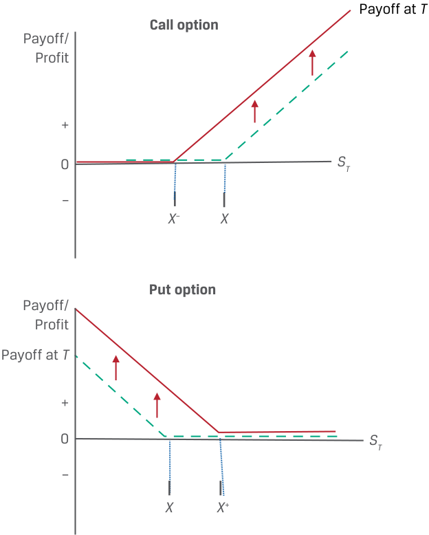

# Tập 7: Công cụ Phái sinh (*Derivatives*)
## Học phần 8: Định giá và Xác định giá trị của Quyền chọn (*Pricing and Valuation of Options*)
### Phần 2/2: Các Nhân tố Ảnh hưởng đến Giá trị Quyền chọn (Trang PDF 194–204)

---

<!-- PDF Page 194 -->

# **<mark>8</mark>** 

#### **CÁC NHÂN TỐ ẢNH HƯỞNG ĐẾN GIÁ TRỊ QUYỀN CHỌN (*FACTORS AFFECTING OPTION VALUE*)** 

xác định các nhân tố quyết định giá trị của một quyền chọn và mô tả cách thức mỗi nhân tố ảnh hưởng đến giá trị của một quyền chọn 

Bây giờ chúng ta chuyển sự chú ý sang việc xác định và mô tả các nhân tố ảnh hưởng đến giá trị của một quyền chọn. Một số nhân tố trong số này là điểm chung của cả các cam kết kỳ hạn (*forward commitments*) và các quyền chọn (*options*), và một số nhân tố là nét đặc thù riêng của các quyền đòi nợ có điều kiện (*contingent claims*). Các nhân tố quyết định giá trị của một quyền chọn bao gồm giá trị của tài sản cơ sở (*value of the underlying*), giá thực hiện (*exercise price*), thời gian đến khi đáo hạn (*time to maturity*), lãi suất phi rủi ro (*risk-free rate*), độ biến động giá của tài sản cơ sở (*volatility of the underlying price*), và bất kỳ khoản thu nhập hoặc chi phí nào gắn liền với việc sở hữu tài sản cơ sở. 

##### **Giá trị của Tài sản Cơ sở (*Value of the Underlying*)** 

Những thay đổi trong giá trị của tài sản cơ sở sẽ có tác động cùng chiều lên _quyền_ giao dịch tài sản cơ sở theo hợp đồng quyền chọn giống như tác động lên _nghĩa vụ_ giao dịch theo một cam kết kỳ hạn. Ví dụ, một quyền chọn mua (*call option*) và một vị thế mua kỳ hạn (*long forward position*) sẽ cùng _tăng giá trị_ (*appreciate*) nếu giá giao ngay của tài sản cơ sở _tăng lên_, trong khi một quyền chọn bán (*put option*) và một vị thế bán kỳ hạn (*short forward position*) sẽ cùng _tăng giá trị_ nếu giá giao ngay của tài sản cơ sở _giảm xuống_, như được minh họa trong Bảng 6 (*Exhibit 6*). 

**Bảng 6: Giá trị Quyền chọn Mua và Quyền chọn Bán so với Giá trị Tài sản Cơ sở (*Exhibit 6: Call and Put Option Value versus Underlying Value*)** 

<!-- Picture Text: Option value ( t  < T ) Payoff/ Profit Call option Payoff at  T + 0 ST – X Payoff/ Put option Profit + Option value ( t < T ) 0 ST Payoff at  T – X  -->
> **Chú thích hình ảnh:**
> - **Đồ thị trên (Call option – Quyền chọn mua):** Đường cong **Option value ($t < T$)** (Giá trị quyền chọn trước khi đáo hạn) nằm phía trên đường gấp khúc **Payoff at $T$** (Kết quả thanh toán khi đáo hạn) và dốc lên khi $S_T$ tăng.
> - **Đồ thị dưới (Put option – Quyền chọn bán):** Đường cong **Option value ($t < T$)** và đường gấp khúc **Payoff at $T$** dốc xuống khi $S_T$ tăng (tức tăng giá trị khi $S_T$ giảm).

<!-- PDF Page 195 -->

Một điểm khác biệt quan trọng giữa các cam kết kỳ hạn và các quyền đòi nợ có điều kiện là _độ lớn_ (*magnitude*) của mức thay đổi giá công cụ phái sinh ứng với một mức thay đổi nhất định trong giá trị tài sản cơ sở. Đối với một cam kết kỳ hạn, giá trị của công cụ phái sinh là một hàm _tuyến tính_ (*linear*, một-đổi-một) theo giá tài sản cơ sở, trong khi đối với một quyền chọn, đó là một mối quan hệ _phi tuyến tính_ (*non-linear*) phụ thuộc vào xác suất người mua quyền chọn sẽ thực hiện quyền trong tương lai. Khả năng người mua quyền chọn sẽ thực hiện quyền càng cao (ví dụ: khi quyền chọn đang ở trạng thái có lời – *in the money*), thì giá trị của quyền chọn càng nhạy cảm với giá tài sản cơ sở. Khả năng này phụ thuộc vào mối quan hệ giữa giá trị của tài sản cơ sở và giá thực hiện, một đặc điểm độc nhất của các hợp đồng quyền chọn mà chúng ta sẽ tìm hiểu tiếp theo. 

##### **Giá Thực hiện (*Exercise Price*)** 

Giá thực hiện (*exercise price*) là ngưỡng quyết định liệu người mua quyền chọn có lựa chọn thực hiện giao dịch khi hợp đồng đáo hạn hay không. Đối với một quyền chọn mua đại diện cho quyền được mua tài sản cơ sở, giá thực hiện đại diện cho một cận _dưới_ (*lower bound*) đối với giá trị thực hiện của quyền chọn khi đáo hạn, dẫn đến giá trị quyền chọn _cao hơn_ khi giá thực hiện _thấp hơn_. Vì các quyền chọn mua được thanh toán dựa trên $\text{Max}(0, S_T - X)$ khi đáo hạn, một mức $X$ thấp hơn sẽ làm tăng cả xác suất thực hiện quyền lẫn giá trị thanh toán nếu được thực hiện. 

Ngược lại, giá thực hiện của một quyền chọn bán là một cận _trên_ (*upper bound*) đối với giá trị thực hiện của nó khi đáo hạn. Do đó, một mức giá thực hiện _cao hơn_ mà tại đó người mua quyền chọn bán có quyền bán tài sản cơ sở sẽ _làm tăng_ giá trị của quyền chọn bán. Bảng 7 (*Exhibit 7*) thể hiện những tác động khác nhau này của sự thay đổi giá thực hiện đối với cả quyền chọn mua và quyền chọn bán. 

**Bảng 7: Giá trị Quyền chọn Mua và Quyền chọn Bán so với Giá Thực hiện (*Exhibit 7: Call and Put Option Value versus Exercise Price*)** 

<!-- Picture Text: Payoff at  T Call option Payoff/ Profit + 0 ST – X – X Put option Payoff/ Profit Payoff at  T + 0 ST – X X +  -->
> **Chú thích hình ảnh:**
> - **Đồ thị trên (Call option):** Khi giá thực hiện giảm từ $X$ xuống $X^-$, đường kết quả thanh toán và giá trị quyền chọn mua dịch chuyển sang trái (tăng giá trị).
> - **Đồ thị dưới (Put option):** Khi giá thực hiện tăng từ $X$ lên $X^+$, đường kết quả thanh toán và giá trị quyền chọn bán dịch chuyển sang phải (tăng giá trị).

<!-- PDF Page 196 -->

##### **Thời gian đến khi Đáo hạn (*Time to Expiration*)** 

Hãy nhớ lại từ bài học trước rằng giá trị thời gian (*time value*), hay phần chênh lệch giữa giá của một quyền chọn và giá trị thực hiện của nó, đại diện cho khả năng những thay đổi thuận lợi trong giá tài sản cơ sở sẽ làm tăng mức sinh lời của việc thực hiện quyền. Không giống như một vị thế mua kỳ hạn (*long forward position*) nơi người mua có khả năng ngang nhau trong việc trải qua sự tăng giá hoặc giảm giá của tài sản cơ sở trong một khoảng thời gian dài hơn, hồ sơ kết quả thanh toán một phía (hay bất đối xứng – *one-sided or asymmetric payoff profile*) của quyền chọn cho phép người mua bỏ qua bất kỳ kết quả nào mà tại đó quyền chọn hết hạn mà không được thực hiện. 

Đối với một quyền chọn mua, thời gian đến khi đáo hạn dài hơn sẽ làm tăng giá trị của quyền chọn trong _tất cả_ các trường hợp. Tiềm năng tăng giá của một tài sản cơ sở về cơ bản là không giới hạn và tăng lên qua các khoảng thời gian dài hơn, trong khi rủi ro giảm giá phía dưới được giới hạn ở mức tổn thất khoản phí quyền chọn. 

Một quyền chọn bán đại diện cho quyền được bán tài sản cơ sở cũng thường được hưởng lợi từ sự trôi qua của thời gian (khi thời gian đáo hạn dài hơn). Trong trường hợp của quyền chọn bán, thời gian đến khi đáo hạn dài hơn mang lại tiềm năng _giảm giá_ (*price depreciation*) lớn hơn xuống dưới mức giá thực hiện, trong khi khoản lỗ được giới hạn ở mức phí quyền chọn nếu giá tài sản cơ sở tăng lên. Tuy nhiên, vì người mua quyền chọn bán phải chờ đợi việc _bán_ tài sản cơ sở để nhận được $(X - S_T)$ khi thực hiện quyền, thời gian đến khi đáo hạn dài hơn sẽ _làm giảm_ giá trị hiện tại của khoản thanh toán nhận được. Mặc dù ít phổ biến hơn, trong một số trường hợp, thời gian đến khi đáo hạn dài hơn sẽ _làm giảm_ giá trị của một quyền chọn bán, đặc biệt là đối với các quyền chọn bán có lời sâu (*deep-in-the-money puts*) có thời gian đến khi đáo hạn dài hơn và mức lãi suất phi rủi ro cao hơn. 

##### **Lãi suất Phi Rủi ro (*Risk-Free Interest Rate*)** 

Một bài học trước đã chỉ ra rằng lãi suất phi rủi ro là chi phí cơ hội của việc nắm giữ một tài sản, điều này cũng được mở rộng sang việc định giá không kinh doanh chênh lệch giá đối với các công cụ phái sinh. Ví dụ, giá trị thực hiện của một quyền chọn đã được chứng minh là bằng phần chênh lệch giữa giá giao ngay và _giá trị hiện tại_ (*present value*) của giá thực hiện: 

$$\text{Giá trị thực hiện của quyền chọn mua (Call Option Exercise Value): } \text{Max}(0, (S_t - \text{PV}(X)))$$

$$\text{Giá trị thực hiện của quyền chọn bán (Put Option Exercise Value): } \text{Max}(0, (\text{PV}(X) - S_t))$$

Do đó, một mức lãi suất phi rủi ro _cao hơn_ sẽ _làm giảm_ giá trị hiện tại của giá thực hiện _với điều kiện_ quyền chọn đang ở trạng thái có lời (*in the money*). Một mức lãi suất phi rủi ro cao hơn sẽ _làm tăng_ giá trị thực hiện của một quyền chọn mua và _làm giảm_ giá trị thực hiện của một quyền chọn bán. Lưu ý rằng lãi suất phi rủi ro không ảnh hưởng trực tiếp đến giá trị thời gian của một quyền chọn. 

##### **Độ biến động của Tài sản Cơ sở (*Volatility of the Underlying*)** 

Độ biến động (*volatility*) là một thước đo về mức độ phân tán dự kiến (*expected dispersion*) của các biến động giá trong tương lai của một tài sản cơ sở. Độ biến động giá của tài sản cơ sở càng cao sẽ làm tăng khả năng đạt được một giá trị thực hiện dương cao hơn mà không làm ảnh hưởng đến trường hợp bất lợi phía dưới khi quyền chọn hết hạn mà không được thực hiện, như được minh họa trong Bảng 8 (*Exhibit 8*). Lưu ý rằng tác động này sẽ giống nhau đối với cả quyền chọn mua và quyền chọn bán. 

Ví dụ, khi độ biến động _tăng lên_, phạm vi rộng hơn của các mức giá tài sản cơ sở có thể xảy ra sẽ _làm tăng_ giá trị thời gian của quyền chọn cũng như khả năng quyền chọn sẽ kết thúc ở trạng thái có lời (*in the money*). Độ biến động _thấp hơn_ sẽ _làm giảm_ giá trị thời gian của cả quyền chọn bán và quyền chọn mua. 

<!-- PDF Page 197 -->

###### **Bảng 8: Độ biến động và Giá trị Quyền chọn (*Exhibit 8: Volatility and Option Value*)** 

<!-- Picture Text: ST ST X S 0 0 Time T  -->
> **Chú thích hình ảnh:**
> - Khi độ biến động (*volatility*) tăng lên, biên độ phân tán của giá tài sản cơ sở $S_T$ quanh giá thực hiện $X$ tại thời điểm đáo hạn $T$ mở rộng ra, làm tăng tiềm năng sinh lời khi quyền chọn ở trạng thái ITM trong khi mức lỗ tối đa khi OTM vẫn được giới hạn.

##### **Thu nhập hoặc Chi phí Liên quan đến Việc Sở hữu Tài sản Cơ sở (*Income or Cost Related to Owning Underlying Asset*)** 

Trong một bài học trước, những lợi ích và chi phí của việc sở hữu một tài sản cơ sở theo thời gian đã được chứng minh là có ảnh hưởng đến mối quan hệ giữa giá giao ngay và giá kỳ hạn. Ví dụ, thu nhập hoặc các lợi ích phi tiền mặt khác (chẳng hạn như lợi suất thuận tiện – *convenience yield*) thuộc về người sở hữu tài sản cơ sở nhưng không thuộc về người sở hữu công cụ phái sinh. Tác động này đúng với cả các cam kết kỳ hạn và các quyền đòi nợ có điều kiện. Thu nhập hoặc các lợi ích khác của quyền sở hữu sẽ _làm giảm_ giá trị của một quyền chọn mua và _làm tăng_ giá trị của một quyền chọn bán. Chi phí lưu giữ (*carry costs*, chẳng hạn như chi phí lưu kho và bảo hiểm đối với hàng hóa) có tác động ngược lại, _làm tăng_ giá trị của một quyền chọn mua và _làm giảm_ giá trị của một quyền chọn bán. Bảng tóm tắt các nhân tố ảnh hưởng đến giá trị của một quyền chọn được cung cấp trong Bảng 9 (*Exhibit 9*), với dấu trên giá trị quyền chọn đề cập đến tác động (cùng chiều dương hay ngược chiều âm) của sự _gia tăng_ trong nhân tố đó. 

**Bảng 9: Các Nhân tố Ảnh hưởng đến Giá trị của một Quyền chọn (*Exhibit 9: Factors That Affect the Value of an Option*)** 

|**Nhân tố (*Factor*) (khi tăng lên)**|**Giá trị Quyền chọn Mua (*Call Value*)**|**Giá trị Quyền chọn Bán (*Put Value*)**|
|---|---|---|
|Giá trị của tài sản cơ sở (*Value of the underlying*)|**+**|**−**|
|Giá thực hiện (*Exercise price*)|**−**|**+**|
|Thời gian đến khi đáo hạn (*Time to expiration*)|**+**|**+/−**|
|Lãi suất phi rủi ro (*Risk-free interest rate*)|**+**|**−**|
|Độ biến động của tài sản cơ sở (*Volatility of the underlying*)|**+**|**+**|
|Thu nhập/chi phí liên quan đến việc sở hữu tài sản cơ sở (*Income/cost related to owning the underlying*)|**−/+**|**+/−**|

<!-- PDF Page 198 -->

###### **BỘ CÂU HỎI (*QUESTION SET*)** 

##### **Các Nhân tố Ảnh hưởng đến Giá trị Quyền chọn (*Factors That Affect Option Value*)** 

1. Xác định các câu trả lời đúng để hoàn thành câu sau đây: Đối với một quyền chọn mua đại diện cho quyền được mua tài sản cơ sở, giá thực hiện đại diện cho một cận ______ đối với giá trị thực hiện của quyền chọn khi đáo hạn, dẫn đến giá trị quyền chọn ______ ứng với một mức giá thực hiện thấp hơn. 

###### **Lời giải:** 

Đối với một quyền chọn mua đại diện cho quyền được mua tài sản cơ sở, giá thực hiện đại diện cho một cận _dưới (lower)_ đối với giá trị thực hiện của quyền chọn khi đáo hạn, dẫn đến giá trị quyền chọn _cao hơn (higher)_ ứng với một mức giá thực hiện thấp hơn. 

2. Hãy ghép những thay đổi sau đây trong các nhân tố ảnh hưởng đến giá trị quyền chọn (giữ các nhân tố khác không đổi) với sự thay đổi giá trị quyền chọn tương ứng của chúng: 

| Thay đổi trong nhân tố | Thay đổi giá trị quyền chọn |
|---|---|
| 1. Giá thực hiện ($X$) thấp hơn | A. Làm tăng giá trị của cả quyền chọn mua và quyền chọn bán |
| 2. Giá tài sản cơ sở ($S_T$) thấp hơn | B. Làm tăng giá trị của quyền chọn mua |
| 3. Sự gia tăng trong độ biến động của giá tài sản cơ sở | C. Làm tăng giá trị của quyền chọn bán |

###### **Lời giải:** 

   **1.** B là đáp án đúng. Giá thực hiện thấp hơn làm tăng giá trị của quyền chọn mua, bởi vì ứng với một mức giá tài sản cơ sở nhất định khi đáo hạn là $S_T$, giá trị thanh toán của quyền chọn mua là $\text{Max}(0, S_T - X)$ sẽ tăng lên khi $X$ thấp hơn. 

   **2.** C là đáp án đúng. Giá tài sản cơ sở ($S_T$) thấp hơn sẽ làm tăng giá trị của quyền chọn bán. Vì quyền chọn bán là quyền được bán một tài sản cơ sở tại mức giá thực hiện ($X$), giá trị thanh toán của quyền chọn bán là $\text{Max}(0, X - S_T)$ sẽ tăng lên khi $S_T$ giảm xuống. 

   **3.** A là đáp án đúng. Sự gia tăng trong độ biến động của giá tài sản cơ sở sẽ làm tăng giá trị của cả quyền chọn mua và quyền chọn bán. Biến thiên giá lớn hơn của tài sản cơ sở sẽ làm tăng xác suất đạt được một giá trị thực hiện dương cao hơn đối với quyền chọn mua hoặc quyền chọn bán mà không làm ảnh hưởng đến trường hợp bất lợi phía dưới nơi quyền chọn hết hạn mà không được thực hiện. 

3. Xác định các câu trả lời đúng để hoàn thành các câu sau đây: Một điểm khác biệt quan trọng giữa các cam kết kỳ hạn và các quyền đòi nợ có điều kiện là __________ của mức thay đổi giá công cụ phái sinh ứng với một mức thay đổi nhất định trong giá trị tài sản cơ sở. Đối với một cam kết kỳ hạn, giá trị công cụ phái sinh là một hàm ______ theo giá tài sản cơ sở, trong khi đối với một quyền chọn thì đó là một mối quan hệ _______. 

###### **Lời giải:** 

Một điểm khác biệt quan trọng giữa các cam kết kỳ hạn và các quyền đòi nợ có điều kiện là _độ lớn (magnitude)_ của mức thay đổi giá công cụ phái sinh ứng với một mức thay đổi nhất định trong giá trị tài sản cơ sở. Đối với một cam kết kỳ hạn, giá trị công cụ phái sinh là một hàm _tuyến tính (linear)_ theo giá tài sản cơ sở, trong khi đối với một quyền chọn thì đó là một mối quan hệ _phi tuyến tính (non-linear)_. 

<!-- PDF Page 199 -->

4. Giải thích tác động của sự _sụt giảm_ trong lãi suất phi rủi ro lên giá trị của quyền chọn bán và quyền chọn mua, đồng thời giải thích lý do cho câu trả lời của bạn. 

###### **Lời giải:** 

- Sự _sụt giảm_ trong lãi suất phi rủi ro _làm tăng_ giá trị hiện tại của _giá_ thực hiện quyền chọn ($\text{PV}(X)$). Giá trị thực hiện của một _quyền chọn mua đang có lời (in-the-money call)_ sẽ giảm xuống, bởi vì $(S_t - \text{PV}(X))$ thấp hơn khi $\text{PV}(X)$ cao hơn, trong khi giá trị thực hiện của một _quyền chọn bán đang có lời (in-the-money put)_ sẽ tăng lên, bởi vì $(\text{PV}(X) - S_t)$ tăng lên khi $\text{PV}(X)$ cao hơn. Lưu ý rằng giá trị thời gian của một quyền chọn không bị ảnh hưởng trực tiếp bởi lãi suất phi rủi ro. 

<!-- PDF Page 200 -->

## **BÀI TẬP THỰC HÀNH (*PRACTICE PROBLEMS*)** 

### **Thông tin sau đây liên quan đến các câu hỏi từ 1 đến 9** 

Văn phòng Quản lý Gia sản Viswan (Viswan Family Office – VFO) sở hữu cổ phiếu không trả cổ tức của Biomian Limited hiện đang có giá ($S_0$) là 295 INR mỗi cổ phiếu. Giám đốc Đầu tư (CIO) của VFO đang cân nhắc một lời đề nghị bán cổ phiếu tại mức giá kỳ hạn ($F_0(T)$) là 300,84 INR mỗi cổ phiếu sau thời gian 6 tháng dựa trên mức lãi suất phi rủi ro là 4%. Bạn được yêu cầu tư vấn về việc mua một quyền chọn bán (*purchase of a put option*) hoặc bán một quyền chọn mua (*sale of a call option*) có giá thực hiện ($X$) bằng với giá kỳ hạn ($F_0(T)$) như những phương án thay thế cho việc bán cổ phiếu kỳ hạn. 

**1.** Phát biểu nào sau đây mô tả đúng về phí quyền chọn bán và phí quyền chọn mua dựa trên mối quan hệ giữa mức giá hiện tại 295 INR của Biomian và mức giá thực hiện bằng với giá kỳ hạn 300,84 INR? 

   - **A.** Phí quyền chọn mua chỉ bao gồm giá trị thời gian, và phí quyền chọn bán chỉ bao gồm giá trị thực hiện. 

   - **B.** Phí quyền chọn mua chỉ bao gồm giá trị thực hiện, và phí quyền chọn bán chỉ bao gồm giá trị thời gian. 

   - **C.** Phí quyền chọn mua chỉ bao gồm giá trị thời gian, và phí quyền chọn bán cũng chỉ bao gồm giá trị thời gian. 

**2.** Phát biểu nào sau đây mô tả đúng một điểm khác biệt quan trọng giữa hai chiến lược mua quyền chọn bán và bán quyền chọn mua xét về mặt sự hao mòn giá trị thời gian (*time value decay*) của quyền chọn? 

   - **A.** Sự hao mòn giá trị thời gian là một lợi ích đối với cả hai chiến lược quyền chọn. 

   - **B.** Sự hao mòn giá trị thời gian là một chi phí đối với cả hai chiến lược quyền chọn. 

   - **C.** Sự hao mòn giá trị thời gian là một lợi ích đối với việc bán quyền chọn mua và là một chi phí đối với việc mua quyền chọn bán. 

**3.** VFO đang cân nhắc việc mua quyền chọn bán để phòng ngừa rủi ro (*hedge*) trước sự sụt giảm giá cổ phiếu của Biomian. Phát biểu nào sau đây mô tả đúng nhất sự đánh đổi (*trade-off*) giữa quyền chọn bán và hợp đồng kỳ hạn dựa trên nguyên tắc định giá không kinh doanh chênh lệch giá? 

   - **A.** Khoản lãi từ việc bán kỳ hạn sẽ _bằng_ với lợi nhuận của quyền chọn bán đã mua khi đáo hạn _với điều kiện_ quyền chọn bán kết thúc ở trạng thái có lời (*in the money*) khi đáo hạn. 

   - **B.** Khoản lỗ từ việc bán kỳ hạn sẽ _vượt quá_ khoản lỗ của quyền chọn bán đã mua khi đáo hạn nếu giá cổ phiếu của Biomian vượt quá giá kỳ hạn một mức lớn hơn khoản phí quyền chọn bán ban đầu đã trả. 

   - **C.** Chúng ta không có đủ thông tin để trả lời câu hỏi này, bởi vì chúng ta không biết giá trị thời gian của quyền chọn khi đáo hạn. 

**4.** Khi đánh giá chiến lược mua quyền chọn bán (với $X = F_0(T)$), CIO đã yêu cầu bạn cân nhắc việc bán lại quyền chọn bán đó sau thời gian 3 tháng nếu giá của nó tăng lên trong khoảng thời gian đó. Phương án nào sau đây mô tả đúng nhất mức giá quyền chọn bán không kinh doanh chênh lệch giá tại 

<!-- PDF Page 201 -->

###### thời điểm đó? 

   - **A.** Vì VFO sẽ chỉ thực hiện quyền nếu giá giao ngay thấp hơn giá thực hiện, cận dưới của giá quyền chọn bán là giá trị lớn hơn giữa số không và giá trị hiện tại của giá giao ngay trừ đi giá thực hiện. 

   - **B.** Vì VFO sẽ chỉ thực hiện quyền nếu giá giao ngay thấp hơn giá thực hiện, cận trên của giá quyền chọn bán bằng giá trị hiện tại của giá thực hiện trừ đi giá giao ngay. 

   - **C.** Giá quyền chọn bán không thể lớn hơn giá kỳ hạn và không thể nhỏ hơn giá trị lớn hơn giữa số không và giá trị hiện tại của giá thực hiện trừ đi giá giao ngay. 

**5.** VFO đang cân nhắc chiến lược bán quyền chọn mua (*sold call strategy*) để tạo ra thu nhập từ việc bán quyền chọn mua. Trong phân tích kịch bản của bạn về phương án bán quyền chọn mua, VFO đã yêu cầu bạn định giá quyền chọn mua sau thời gian 3 tháng nếu giá giao ngay của Biomian là 325 INR mỗi cổ phiếu. Với mức giá quyền chọn mua ước tính là 46,41 INR vào thời điểm đó, phương án nào sau đây phản ánh đúng mối quan hệ giữa giá trị thực hiện và giá trị thời gian của quyền chọn mua? 

   - **A.** Giá trị thực hiện của quyền chọn mua là 24,16 INR, và giá trị thời gian của nó là 22,25 INR. 

   - **B.** Giá trị thực hiện của quyền chọn mua là 27,10 INR, và giá trị thời gian của nó là 19,31 INR. 

   - **C.** Giá trị thực hiện của quyền chọn mua là 20,99 INR, và giá trị thời gian của nó là 25,42 INR. 

**6.** Phát biểu nào sau đây mô tả đúng cách thức VFO có thể mô phỏng (*replicate*) việc bán một quyền chọn mua đối với cổ phiếu Biomian nếu việc thực hiện quyền là chắc chắn? 

   - **A.** Vay $X(1 + r)^{-T}$ ở mức lãi suất phi rủi ro và sử dụng số tiền thu được để mua cổ phiếu Biomian tại mức giá giao ngay hiện tại, $S_0$. Khi đáo hạn, bán cổ phiếu Biomian và sử dụng số tiền thu được để trả hết khoản vay. 

   - **B.** Bán khống (*sell short*) cổ phiếu Biomian tại mức giá giao ngay hiện tại, $S_0$, và sử dụng số tiền thu được để cho vay $X(1 + r)^{-T}$ ở mức lãi suất phi rủi ro. Khi đáo hạn, nhận $X$ từ việc hoàn trả khoản cho vay phi rủi ro và mua lại cổ phiếu Biomian. 

   - **C.** Bán khống cổ phiếu Biomian tại mức giá giao ngay hiện tại, $S_0$, và vay $X(1 + r)^{-T}$ ở mức lãi suất phi rủi ro. Khi đáo hạn, trả hết khoản vay phi rủi ro trị giá $X$ và mua lại cổ phiếu Biomian. 

**7.** Khi so sánh chiến lược bán quyền chọn mua và mua quyền chọn bán tại mức giá kỳ hạn, CIO của VFO lo ngại về việc sự gia tăng độ biến động (*volatility*) của cổ phiếu cơ sở Biomian sẽ ảnh hưởng như thế nào đến phí quyền chọn. Phát biểu nào sau đây về sự thay đổi độ biến động và tác động của nó lên chiến lược là chính xác nhất? 

   - **A.** Sự gia tăng độ biến động của cổ phiếu cơ sở có tác động _giống nhau_ lên giá trị quyền chọn mua và quyền chọn bán, vì vậy sự thay đổi này sẽ không ảnh hưởng đến quyết định lựa chọn chiến lược của VFO. 

   - **B.** Vì những thay đổi trong độ biến động của cổ phiếu cơ sở có tác động _ngược chiều_ lên quyền chọn bán so với quyền chọn mua, sự thay đổi này sẽ làm tăng sức hấp dẫn của chiến lược quyền chọn bán so với chiến lược quyền chọn mua. 

<!-- PDF Page 202 -->

   - **C.** Sự gia tăng độ biến động của cổ phiếu cơ sở sẽ làm tăng cả _chi phí_ của chiến lược mua quyền chọn bán lẫn khoản phí quyền chọn nhận được từ chiến lược bán quyền chọn mua, vì vậy sự thay đổi này sẽ làm tăng sức hấp dẫn của chiến lược quyền chọn mua so với chiến lược quyền chọn bán. 

**8.** Khi so sánh chiến lược mua quyền chọn bán và bán quyền chọn mua đối với Biomian, phát biểu nào sau đây là đúng nhất về cách thức giá trị quyền chọn mua và quyền chọn bán bị ảnh hưởng bởi những thay đổi trong các nhân tố ngoài độ biến động? 

   - **A.** Những thay đổi trong thời gian đến khi đáo hạn và lãi suất phi rủi ro có tác động cùng chiều tương tự nhau lên chiến lược quyền chọn bán và quyền chọn mua, trong khi những thay đổi trong giá thực hiện có xu hướng có tác động ngược chiều. 

   - **B.** Những thay đổi trong thời gian đến khi đáo hạn có xu hướng có tác động cùng chiều tương tự nhau lên chiến lược quyền chọn bán và quyền chọn mua, trong khi những thay đổi trong giá thực hiện và lãi suất phi rủi ro có xu hướng có tác động ngược chiều. 

   - **C.** Những thay đổi trong lãi suất phi rủi ro có tác động cùng chiều tương tự nhau lên chiến lược quyền chọn bán và quyền chọn mua, trong khi những thay đổi trong giá thực hiện và thời gian đến khi đáo hạn có xu hướng có tác động ngược chiều. 

**9.** VFO đang lo ngại về khả năng lãi suất tăng lên trong tương lai. Phát biểu nào sau đây mô tả đúng nhất về cách thức lãi suất tăng lên sau khi đã tham gia vào hai chiến lược quyền chọn sẽ ảnh hưởng đến việc định giá quyền chọn? 

   - **A.** Lãi suất phi rủi ro tăng lên sẽ làm cho chiến lược bán quyền chọn mua có lợi hơn cho VFO bởi vì quyền chọn mua tăng giá trị khi lãi suất phi rủi ro cao hơn. 

   - **B.** Lãi suất phi rủi ro tăng lên sẽ làm cho chiến lược mua quyền chọn bán có lợi hơn cho VFO bởi vì công ty đã khóa chặt (*locks in*) mức phí quyền chọn bán ở mức lãi suất thấp hơn. 

   - **C.** Lãi suất phi rủi ro tăng lên là một yếu tố bất lợi (*negative*) đối với cả hai chiến lược quyền chọn. 

<!-- PDF Page 203 -->

## **LỜI GIẢI (*SOLUTIONS*)** 

1. C là đáp án đúng. Giá trị thực hiện của cả quyền chọn mua và quyền chọn bán đều bằng không bởi vì giá trị hiện tại của giá thực hiện là 295 INR ($\text{PV}(X) = 300,84 \times (1,04)^{-0,5} = 295\text{ INR}$), tương đương với mức giá cổ phiếu hiện tại là 295 INR. Do đó, cả hai khoản phí quyền chọn đều chỉ phản ánh giá trị thời gian. A không đúng vì phát biểu này không tính đến việc chiết khấu giá thực hiện một cách hợp lý. B không đúng vì phí quyền chọn mua không phản ánh giá trị thực hiện. 

2. C là đáp án đúng. Thành phần giá trị thời gian trong phí quyền chọn giảm dần về không khi thời gian trôi dần về ngày đáo hạn. Một quyền chọn đã mua sẽ giảm giá trị, khi các yếu tố khác không đổi, do sự sụt giảm của giá trị thời gian. Một vị thế bán quyền chọn sẽ có lợi (giảm nghĩa vụ nợ), khi các yếu tố khác không đổi, nhờ sự sụt giảm của giá trị thời gian. A không đúng vì sự hao mòn giá trị thời gian là một chi phí đối với chiến lược mua quyền chọn bán, và B không đúng vì sự hao mòn giá trị thời gian là một lợi ích đối với chiến lược bán quyền chọn. 

3. Đáp án đúng là B. Khoản lỗ từ việc bán kỳ hạn sẽ lớn hơn khoản lỗ của quyền chọn bán đã mua khi đáo hạn nếu giá cổ phiếu của Biomian vượt quá giá kỳ hạn một mức lớn hơn khoản phí quyền chọn bán ban đầu. Mức lỗ phía dưới (*downside return*) của VFO được giới hạn ở khoản phí quyền chọn bán đã trả, trong khi giao dịch bán kỳ hạn có mức lỗ không giới hạn khi cổ phiếu Biomian tăng giá. A không đúng vì nó không tính đến khoản phí quyền chọn bán đã trả, trong khi C không đúng vì giá trị thời gian của một quyền chọn bằng không khi đáo hạn. 

4. Đáp án đúng là C. Giá thực hiện của quyền chọn bán, $X$ (bằng với $F_0(T)$ trong trường hợp này), đại diện cho cận _trên_ đối với giá trị quyền chọn bán, trong khi cận _dưới_ là giá trị lớn hơn giữa giá trị hiện tại của giá thực hiện trừ đi giá giao ngay và số không: 

   $$\text{Max}\left(0, X(1 + r)^{-(T - t)} - S_t\right) < p_t \le X$$

A không đúng vì cận _dưới_ của giá quyền chọn bán là giá trị lớn hơn giữa số không và giá trị hiện tại của giá thực hiện trừ đi giá giao ngay, chứ không phải giá trị hiện tại của giá giao ngay trừ đi giá thực hiện. B không đúng vì cận _dưới_, chứ không phải cận trên, của giá quyền chọn bán bằng giá trị hiện tại của giá thực hiện trừ đi giá giao ngay. 

5. Đáp án đúng là B. Giá quyền chọn bằng tổng của giá trị thực hiện và giá trị thời gian. Giá trị thực hiện của một quyền chọn mua bằng giá trị lớn hơn giữa số không và giá giao ngay trừ đi giá trị hiện tại của giá thực hiện: 

   $$\text{Max}\left(0, S_t - X(1 + r)^{-(T - t)}\right)$$

   $$= \text{Max}\left(0, 325\text{ INR} - 300,84\text{ INR}(1,04)^{-0,25}\right) = 27,10\text{ INR}$$

Giá trị thời gian bằng giá quyền chọn mua trừ đi giá trị thực hiện, hay $19,31\text{ INR} \ (= 46,41\text{ INR} - 27,10\text{ INR})$. A không đúng vì lấy giá giao ngay trừ đi giá thực hiện làm giá trị thực hiện, trong khi C tính giá trị thực hiện bằng giá trị hiện tại của giá giao ngay trừ đi giá thực hiện. 

6. B là đáp án đúng. Để mô phỏng việc bán một quyền chọn mua, hãy kết hợp việc bán khống tài sản cơ sở với việc cho vay phi rủi ro. Đây là chiến lược hoàn toàn ngược lại với việc mô phỏng mua một quyền chọn mua, trong đó tài sản cơ sở được mua bằng số tiền thu được từ việc đi vay phi rủi ro. A không đúng vì phát biểu này mô tả việc mô phỏng mua một quyền chọn mua. C không đúng vì việc bán khống và đi vay ban đầu tạo ra hai dòng tiền 

<!-- PDF Page 204 -->

vào (*cash inflows*) tại thời điểm $t = 0$ tiếp nối bởi hai dòng tiền ra (*cash outflows*) tại thời điểm $t = T$. 

7. Đáp án đúng là C. Sự gia tăng độ biến động của giá cổ phiếu cơ sở sẽ làm tăng cả khoản phí quyền chọn trả trước nhận được từ quyền chọn mua đã bán lẫn khoản phí quyền chọn phải trả cho quyền chọn bán đã mua. Do đó, vì chiến lược mua quyền chọn bán liên quan đến khoản thanh toán trả trước cao hơn do VFO phải chi trả và chiến lược bán quyền chọn mua liên quan đến khoản phí quyền chọn nhận được cao hơn, sự gia tăng độ biến động sẽ làm tăng sức hấp dẫn của chiến lược bán quyền chọn mua so với chiến lược mua quyền chọn bán. 

8. Đáp án đúng là B. Những thay đổi trong thời gian đến khi đáo hạn có xu hướng có tác động cùng chiều tương tự nhau lên chiến lược quyền chọn bán và quyền chọn mua (ngoại lệ duy nhất là các quyền chọn bán có lời sâu trong một số trường hợp), trong khi những thay đổi trong giá thực hiện và lãi suất phi rủi ro có xu hướng có tác động ngược chiều. 

9. C là đáp án đúng. Bởi vì cả hai chiến lược quyền chọn (mua một quyền chọn bán hoặc bán một quyền chọn mua) đều là các chiến lược bán khống cơ sở (*short strategies*), VFO đang trì hoãn các dòng tiền thu vào nên lãi suất phi rủi ro cao hơn là yếu tố bất lợi (khi lãi suất phi rủi ro tăng, giá quyền chọn bán giảm làm bất lợi cho người mua quyền chọn bán, đồng thời giá quyền chọn mua tăng làm bất lợi cho người bán quyền chọn mua). A không đúng vì phát biểu này mô tả tác động giá trị từ việc mua một quyền chọn mua chứ không phải từ việc bán quyền chọn mua. B không đúng vì giá trị của quyền chọn bán sẽ sụt giảm sau khi lãi suất phi rủi ro tăng lên. 
