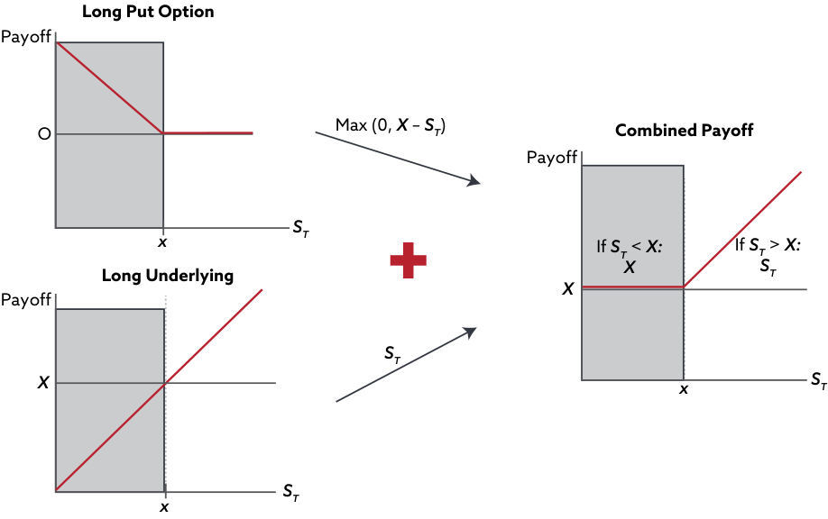
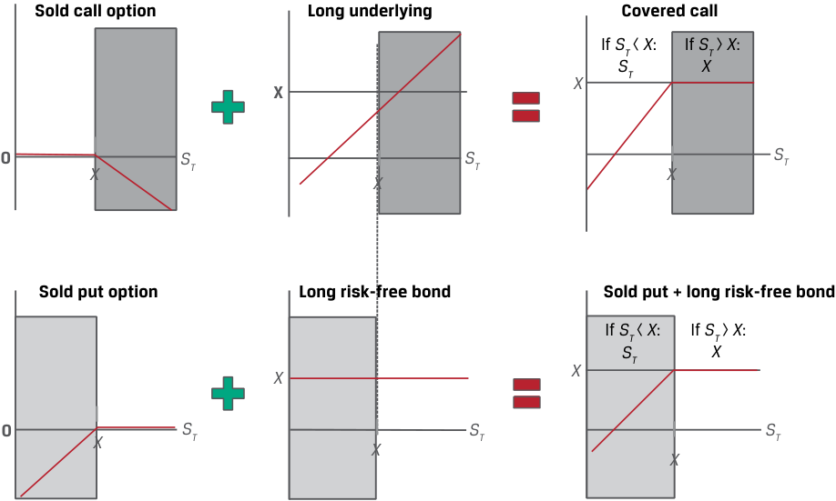
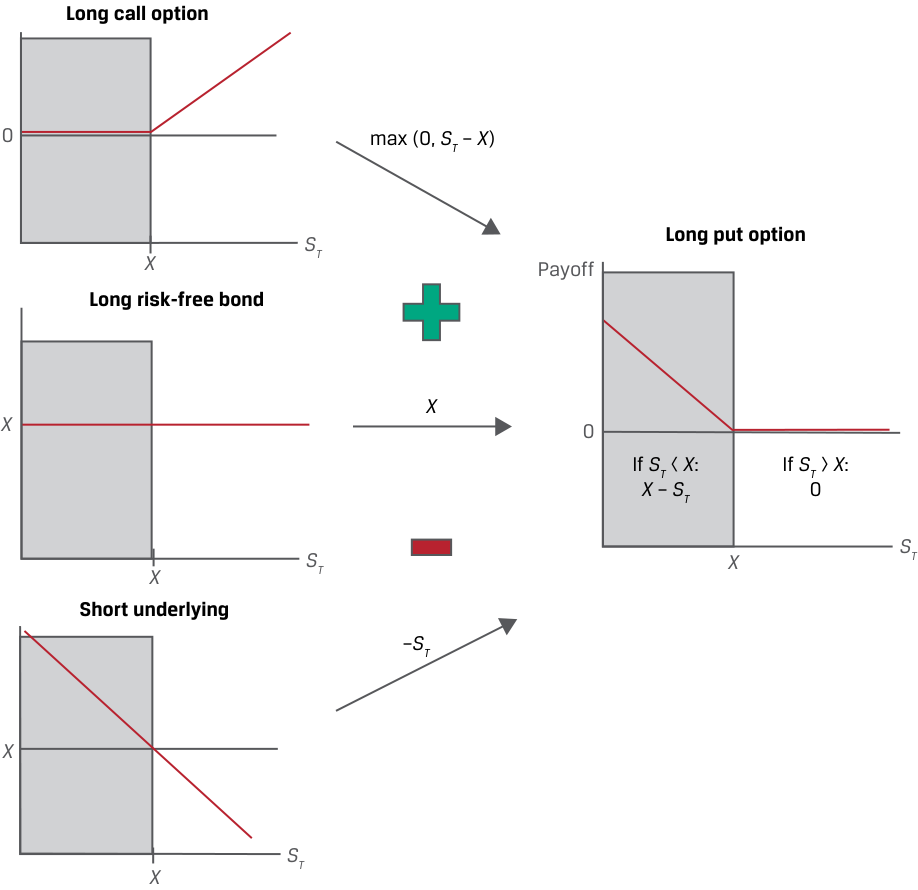
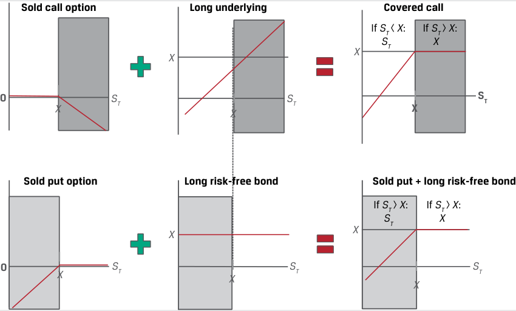

# Tập 7: Công cụ Phái sinh (*Derivatives*)
## Học phần 9: Mô phỏng Quyền chọn Sử dụng Ngang giá Quyền chọn Bán–Quyền chọn Mua (*Option Replication Using Put–Call Parity*)
### Phần 1/2: Giới thiệu (Trang PDF 205–216)

---

<!-- PDF Page 205 -->

#### H Ọ C P H Ầ N

# **<mark>9</mark>** 

### **Mô phỏng Quyền chọn Sử dụng Ngang giá Quyền chọn Bán–Quyền chọn Mua (*Option Replication Using Put–Call Parity*)** 

###### **<mark>MỤC TIÊU HỌC TẬP (*LEARNING OUTCOMES*)</mark>** 

|**_Mức độ thành thạo_** **_Ứng viên cần có khả năng:_**|
|---|
|giải thích ngang giá quyền chọn bán–quyền chọn mua (*put–call parity*) đối với quyền chọn kiểu châu Âu|
|giải thích ngang giá _kỳ hạn_ quyền chọn bán–quyền chọn mua (*put–call forward parity*) đối với quyền chọn kiểu châu Âu|

##### **GIỚI THIỆU (*INTRODUCTION*)** 

## **<mark>1</mark>** 

Các bài học trước đã xem xét hồ sơ kết quả thanh toán (*payoff*) và lợi nhuận (*profit*) của quyền chọn mua và quyền chọn bán, các cận trên và cận dưới đối với giá trị của một quyền chọn, và các nhân tố tác động đến giá trị quyền chọn. Qua đó, chúng ta đã đối chiếu tính bất đối xứng của các kết quả thanh toán quyền chọn một phía (*one-sided option payoffs*) với kết quả thanh toán tuyến tính hay đối xứng của các hợp đồng kỳ hạn và các tài sản cơ sở. 

Bây giờ chúng ta mở rộng phân tích này xa hơn để chỉ ra rằng có những cách thức _kết hợp_ các quyền chọn nhằm tạo ra kết quả thanh toán tương đương với kết quả thanh toán của tài sản cơ sở và một tài sản phi rủi ro cũng như của một cam kết kỳ hạn. Trong bài học đầu tiên, chúng ta chứng minh rằng giá trị của một quyền chọn mua kiểu châu Âu có thể được sử dụng để suy ra giá trị của một quyền chọn bán kiểu châu Âu có cùng các thông số tài sản cơ sở, và ngược lại, theo một điều kiện không kinh doanh chênh lệch giá được gọi là ngang giá quyền chọn bán–quyền chọn mua (*put–call parity*). Trong bài học thứ hai, chúng ta chỉ ra cách thức mối quan hệ này có thể được mở rộng sang các cam kết kỳ hạn và cách thức mối quan hệ ngang giá quyền chọn bán–quyền chọn mua có thể được áp dụng cho các chiến lược quyền chọn và các chiến lược đầu tư khác. Chúng ta sẽ tập trung vào các quyền chọn kiểu châu Âu trên các tài sản cơ sở không có thu nhập hay lợi ích. 

###### **TỔNG QUAN HỌC PHẦN (*LEARNING MODULE OVERVIEW*)** 

- Ngang giá quyền chọn bán–quyền chọn mua (*put–call parity*) thiết lập một mối quan hệ cho phép mức giá của một quyền chọn mua được suy ra từ mức giá của một quyền chọn bán có cùng các thông số tài sản cơ sở và ngược lại. 

- Ngang giá quyền chọn bán–quyền chọn mua áp dụng cho các quyền chọn kiểu châu Âu có cùng giá thực hiện và ngày đáo hạn, đại diện cho một mối quan hệ không kinh doanh chênh lệch giá giữa giá quyền chọn bán, giá quyền chọn mua, giá tài sản cơ sở, và giá tài sản phi rủi ro. 

- Nếu ngang giá quyền chọn bán–quyền chọn mua không được duy trì, thì các cơ hội thu lợi nhuận kinh doanh chênh lệch giá phi rủi ro (*riskless arbitrage profit opportunities*) có thể xuất hiện cho các nhà đầu tư. 

<!-- PDF Page 206 -->

- Ngang giá kỳ hạn quyền chọn bán–quyền chọn mua (*put–call forward parity*) mở rộng mối quan hệ ngang giá quyền chọn bán–quyền chọn mua sang các hợp đồng kỳ hạn dựa trên sự tương đương giữa một vị thế tài sản cơ sở và một hợp đồng mua kỳ hạn cộng với một trái phiếu phi rủi ro. 

- Theo ngang giá kỳ hạn quyền chọn bán–quyền chọn mua, chúng ta có thể chứng minh rằng một quyền chọn bán đã mua (*purchased put option*) và một quyền chọn mua đã bán (*sold call option*) tương đương với một vị thế mua trái phiếu phi rủi ro và bán kỳ hạn, còn một quyền chọn bán đã bán và một quyền chọn mua đã mua tương đương với một vị thế mua kỳ hạn và bán trái phiếu phi rủi ro. 

- Ngang giá quyền chọn bán–quyền chọn mua có thể được áp dụng vượt ra ngoài phạm vi các chiến lược dựa trên quyền chọn trong tài chính—ví dụ, để chứng minh rằng các cổ đông nắm giữ một vị thế tương đương với một quyền chọn mua đã mua (*purchased call option*) trên giá trị của doanh nghiệp với tiềm năng tăng giá không giới hạn, trong khi các chủ nợ nắm giữ một vị thế quyền chọn bán đã bán (*sold put option*) trên giá trị doanh nghiệp với tiềm năng tăng giá có giới hạn (cùng với một trái phiếu phi rủi ro). 

###### **TỰ ĐÁNH GIÁ HỌC PHẦN (*LEARNING MODULE SELF-ASSESSMENT*)** 

Những câu hỏi ban đầu này nhằm giúp bạn tự đánh giá mức độ hiểu biết hiện tại của mình về học phần này. 

1. Phát biểu nào sau đây mô tả đúng về vị thế tương đương với một vị thế mua tài sản cơ sở (*long position in an underlying*) theo ngang giá quyền chọn bán–quyền chọn mua (*put–call parity*)? 

   - **A.** Mua một quyền chọn bán trên tài sản cơ sở, bán một quyền chọn mua trên tài sản cơ sở, và mua một trái phiếu phi rủi ro 

   - **B.** Bán một quyền chọn bán trên tài sản cơ sở, mua một quyền chọn mua trên tài sản cơ sở, và mua một trái phiếu phi rủi ro 

   - **C.** Bán một quyền chọn bán trên tài sản cơ sở, mua một quyền chọn mua trên tài sản cơ sở, và bán một trái phiếu phi rủi ro 

###### **Lời giải:** 

B là đáp án đúng. Ngang giá quyền chọn bán–quyền chọn mua chứng minh rằng một vị thế mua tài sản cơ sở tương đương với một quyền chọn bán đã bán (*sold put option*), một quyền chọn mua đã mua (*purchased call option*), và một vị thế mua trái phiếu phi rủi ro (*long risk-free bond*). Điều này được thể hiện trong phương trình sau: 

$$\text{Ngang giá quyền chọn bán–quyền chọn mua (Put–call parity): } S_0 + p_0 = c_0 + X(1 + r)^{-T} \implies S_0 = -p_0 + c_0 + X(1 + r)^{-T}.$$

2. Xác định vị thế nào sau đây có cùng giá trị không kinh doanh chênh lệch giá với danh mục đầu tư nào theo ngang giá quyền chọn bán–quyền chọn mua: 

| Vị thế | Danh mục đầu tư tương đương |
|---|---|
| 1. Mua quyền chọn mua ($c_0$) | A. Mua tài sản cơ sở, bán trái phiếu phi rủi ro, và bán quyền chọn mua |
| 2. Bán trái phiếu phi rủi ro ($-X(1 + r)^{-T}$) | B. Mua tài sản cơ sở, mua quyền chọn bán, và bán trái phiếu phi rủi ro |
| 3. Bán quyền chọn bán ($-p_0$) | C. Bán tài sản cơ sở, mua quyền chọn mua, và bán quyền chọn bán |

###### **Lời giải:** 

Hãy nhớ lại rằng mối quan hệ ngang giá quyền chọn bán–quyền chọn mua có thể được biểu diễn là: 

$$S_0 + p_0 = c_0 + X(1 + r)^{-T}.$$

   1. B là đáp án đúng. Một vị thế mua quyền chọn mua là tương đương không kinh doanh chênh lệch giá với một vị thế mua tài sản cơ sở, mua quyền chọn bán, và <u>vị thế</u> bán trái phiếu phi rủi ro. 

<!-- PDF Page 207 -->

   2. C là đáp án đúng. Một vị thế bán trái phiếu phi rủi ro tương đương với một vị thế bán tài sản cơ sở, mua quyền chọn mua, và bán quyền chọn bán. 
   3. A là đáp án đúng. Một vị thế bán quyền chọn bán tương đương với một vị thế mua tài sản cơ sở, bán trái phiếu phi rủi ro, và bán quyền chọn mua. 

3. Phát biểu nào sau đây mô tả đúng về một vị thế quyền chọn bán bảo vệ tổng hợp (*synthetic protective put position*) theo ngang giá kỳ hạn quyền chọn bán–quyền chọn mua (*put–call forward parity*)? 

   - **A.** Một hợp đồng mua kỳ hạn trên tài sản cơ sở, một vị thế mua quyền chọn bán trên tài sản cơ sở, và bán một trái phiếu phi rủi ro 

   - **B.** Một hợp đồng bán kỳ hạn trên tài sản cơ sở, một vị thế mua quyền chọn bán trên tài sản cơ sở, và bán một trái phiếu phi rủi ro 

   - **C.** Một hợp đồng bán kỳ hạn trên tài sản cơ sở, một vị thế bán quyền chọn bán trên tài sản cơ sở, và bán một trái phiếu phi rủi ro 

###### **Lời giải:** 

A là đáp án đúng. Công thức cho ngang giá kỳ hạn quyền chọn bán–quyền chọn mua như sau: 

$$F_0(T)(1 + r)^{-T} + p_0 = c_0 + X(1 + r)^{-T}.$$

Lưu ý: Một vị thế quyền chọn bán bảo vệ tổng hợp (*synthetic protective put*) bao gồm mua hợp đồng kỳ hạn, mua trái phiếu phi rủi ro mệnh giá $F_0(T)$ (tức $F_0(T)(1+r)^{-T}$), và mua quyền chọn bán ($p_0$). Nếu xét phương trình $F_0(T)(1 + r)^{-T} + p_0 - X(1 + r)^{-T} = c_0$ như trong lời giải gốc của giáo trình khi biểu diễn vế trái tương đương với $c_0$, các thành phần ở vế trái gồm mua hợp đồng kỳ hạn trên tài sản cơ sở, mua quyền chọn bán trên tài sản cơ sở, và bán một trái phiếu phi rủi ro (mệnh giá $X$). 

4. Phát biểu nào sau đây mô tả đúng nhất quyền đòi nợ của cổ đông (*shareholder's claim*) xét dưới góc độ kết quả thanh toán của một quyền chọn? 

   - **A.** Kết quả thanh toán của cổ đông giống với kết quả thanh toán của một quyền chọn bán trên giá trị doanh nghiệp. 
   - **B.** Kết quả thanh toán của cổ đông giống với kết quả thanh toán của một quyền chọn mua có bảo đảm (*covered call option*) trên giá trị doanh nghiệp. 
   - **C.** Kết quả thanh toán của cổ đông giống với kết quả thanh toán của một quyền chọn mua trên giá trị doanh nghiệp. 

###### **Lời giải:** 

C là đáp án đúng. Khi xem xét quyền đòi nợ của cổ đông dưới góc độ quyền chọn, kết quả thanh toán của cổ đông giống với một quyền chọn mua trên giá trị doanh nghiệp (*call option on firm value*). 

##### **NGANG GIÁ QUYỀN CHỌN BÁN–QUYỀN CHỌN MUA (*PUT–CALL PARITY*)** 

<!-- Picture Text: 2  -->

giải thích ngang giá quyền chọn bán–quyền chọn mua (*put–call parity*) đối với quyền chọn kiểu châu Âu 

Một bài học trước đã đối chiếu các điều kiện định giá không kinh doanh chênh lệch giá và việc mô phỏng các dòng tiền đối với các cam kết kỳ hạn và các quyền đòi nợ có điều kiện. Các hợp đồng kỳ hạn có giá trị ban đầu bằng không và kết quả thanh toán _chắc chắn_ (*certain payoff*) của chúng được mô phỏng tại thời điểm khởi tạo bằng cách đi vay để mua tài sản cơ sở hoặc bán tài sản cơ sở và đem cho vay số tiền thu được từ việc bán. Người mua quyền chọn trả một khoản phí quyền chọn trả trước (*upfront premium*), và hồ sơ kết quả thanh toán _có điều kiện_ (*contingent payoff profiles*) của chúng dẫn chúng ta đến việc thiết lập các cận giá trên và cận giá dưới không có kinh doanh chênh lệch giá. Việc mô phỏng quyền chọn tương tự như của hợp đồng kỳ hạn nhưng liên quan đến việc đi vay hoặc cho vay để mua hoặc bán một _tỷ lệ_ (*proportion*) của tài sản cơ sở, tỷ lệ này được điều chỉnh khi trạng thái giá trị (*moneyness*) của quyền chọn thay đổi. Bây giờ chúng ta mở rộng phân tích này bằng cách sử dụng sự kết hợp của các vị thế. 

<!-- PDF Page 208 -->

Trong phần này, chúng ta sẽ chỉ ra cách thức việc kết hợp các công cụ tiền mặt và công cụ phái sinh vào một danh mục đầu tư theo một cách nhất định cho phép chúng ta định giá và xác định giá trị các vị thế này mà không cần trực tiếp mô hình hóa chúng bằng cách sử dụng các điều kiện không kinh doanh chênh lệch giá. Hãy xem xét một nhà đầu tư có mục tiêu là hưởng lợi từ các biến động tăng lên trong giá trị của một tài sản cơ sở nhưng lại muốn bảo vệ khoản đầu tư của mình khỏi các biến động giảm xuống trong giá trị của tài sản cơ sở đó. Hãy xem xét hai danh mục đầu tư sau đây, được thể hiện trong Bảng 1 (*Exhibit 1*): 

**1.** Tại thời điểm $t = 0$, một nhà đầu tư mua một quyền chọn mua ($c_0$) trên một tài sản cơ sở với giá thực hiện là $X$ và mua một trái phiếu phi rủi ro ngày hôm nay sẽ trả số tiền $X$ tại thời điểm $t = T$. Chi phí của chiến lược này là $c_0 + X(1 + r)^{-T}$, trong đó chúng ta giả định quyền chọn đáo hạn tại thời điểm $T$. 

**2.** Tại thời điểm $t = 0$, một nhà đầu tư mua một đơn vị tài sản cơ sở ($S_0$) và mua một quyền chọn bán trên tài sản cơ sở đó ($p_0$) với giá thực hiện là $X$ tại thời điểm $t = T$. Chi phí của chiến lược này là $p_0 + S_0$. 

Bảng 1 thể hiện kết quả thanh toán (*payoff*) của từng thành phần riêng lẻ thuộc hai danh mục đầu tư này. 

**Bảng 1: Kết quả Thanh toán tại Thời điểm $T$ đối với Hai Danh mục Đầu tư (*Exhibit 1: Payoffs at Time $T$ for Two Portfolios*)** 

<!-- Picture Text:                                 -->
> **Chú thích hình ảnh:**
> - **Danh mục 1 (bên trái):** Kết hợp giữa **Mua quyền chọn mua (*Long call option*)** có kết quả thanh toán $\max(0, S_T - X)$ và **Mua trái phiếu phi rủi ro (*Long risk-free bond*)** có kết quả thanh toán không đổi bằng $X$.
> - **Danh mục 2 (bên phải):** Kết hợp giữa **Mua quyền chọn bán (*Long put option*)** có kết quả thanh toán $\max(0, X - S_T)$ và **Mua tài sản cơ sở (*Long underlying*)** có kết quả thanh toán bằng $S_T$.

Thoạt nhìn, các danh mục đầu tư này dường như mang lại cho nhà đầu tư một cơ hội tương tự nhau để hưởng lợi từ sự tăng giá của tài sản cơ sở mà không phải chịu rủi ro khi giá tài sản cơ sở giảm xuống dưới mức giá thực hiện. 

Trong trường hợp thứ nhất (Danh mục 1), nhà đầu tư mua một quyền chọn mua có kết quả thanh toán dương nếu giá tài sản cơ sở tăng lên trên mức giá thực hiện ($S_T > X$) và đầu tư tiền mặt vào một trái phiếu phi rủi ro. Vì tài sản phi rủi ro trả số tiền $X$ tại thời điểm $T$, nhà đầu tư trả $c_0 + X(1 + r)^{-T}$ tại thời điểm $t = 0$. Sự kết hợp giữa một quyền chọn mua đã mua và một trái phiếu phi rủi ro này được gọi là **quyền chọn mua ủy thác (*fiduciary call*)** và được thể hiện trong Bảng 2 (*Exhibit 2*). 

<!-- PDF Page 209 -->

**Bảng 2: Kết quả Thanh toán của Danh mục 1 (Quyền chọn Mua Ủy thác – *Fiduciary Call*) tại Thời điểm $T$ (*Exhibit 2: Portfolio 1 (Fiduciary Call) Payoff at Time $T$*)** 

<!-- Picture Text: Long call option Payoff Combined payoff Payoff 0  max (0,  ST –  X ) If  ST  <  X : If  ST  >  X : X ST X X ST Long risk-free bond Payoff X X ST X ST X  -->
> **Chú thích hình ảnh:**
> - **Long call option:** Mua quyền chọn mua (nhận $0$ nếu $S_T < X$, nhận $S_T - X$ nếu $S_T > X$).
> - **Long risk-free bond:** Mua trái phiếu phi rủi ro (luôn nhận $X$).
> - **Combined payoff (Kết quả thanh toán kết hợp):** Nhận $X$ nếu $S_T < X$; nhận $S_T$ nếu $S_T > X$.

Trong trường hợp thứ hai (Danh mục 2) ở Bảng 1, nhà đầu tư trả $S_0 + p_0$ tại thời điểm khởi tạo và được phòng ngừa rủi ro (*hedged*) nếu giá tài sản cơ sở giảm xuống dưới mức $X$. Chiến lược nắm giữ một tài sản cơ sở và mua một quyền chọn bán trên cùng tài sản đó đôi khi được gọi là **quyền chọn bán bảo vệ (*protective put*)**. Kết quả thanh toán của Danh mục 2 tại thời điểm $T$ được thể hiện trong Bảng 3 (*Exhibit 3*). 

**Bảng 3: Kết quả Thanh toán của Danh mục 2 (Quyền chọn Bán Bảo vệ – *Protective Put*) tại Thời điểm $T$ (*Exhibit 3: Portfolio 2 (Protective Put) Payoff at Time $T$*)** 

<!-- Picture Text: Sold call option Long underlying Covered call If  ST <  X : If  ST >  X : ST X X X 0 ST ST ST X X X Sold put option Long risk-free bond Sold put + long risk-free bond If  ST <  X : If  ST >  X : ST  X X X 0 X ST X ST ST X  -->
> **Chú thích hình ảnh:**
> - Biểu đồ minh họa sự tương đương của kết quả thanh toán tại thời điểm $T$ (lưu ý: hình ảnh gốc từ PDF hiển thị biểu đồ của *Covered call* và *Sold put + long risk-free bond*, còn đối với *Protective put* thì kết quả thanh toán kết hợp của *Long put option* + *Long underlying* bằng $X$ khi $S_T < X$ và bằng $S_T$ khi $S_T > X$).

<!-- PDF Page 210 -->

Bất chấp những điểm khác biệt về cấu phần, hai danh mục đầu tư này có hồ sơ kết quả thanh toán giống hệt nhau, như được chứng minh bởi Bảng 2 và Bảng 3. Hãy nhớ lại rằng các điều kiện không kinh doanh chênh lệch giá đòi hỏi hai tài sản có các dòng tiền tương lai giống hệt nhau phải được giao dịch tại cùng một mức giá, khi bỏ qua chi phí giao dịch. Trong Bảng 4 (*Exhibit 4*), chúng ta đánh giá điều này trong trường hợp của hai danh mục đầu tư bằng cách so sánh các dòng tiền của chúng dưới tất cả các kịch bản có thể xảy ra tại thời điểm $t = T$. 

**Bảng 4: Quyền chọn Bán Bảo vệ (*Protective Put*) so với Quyền chọn Mua Ủy thác (*Fiduciary Call*) khi Đáo hạn (*Exhibit 4: Protective Put vs. Fiduciary Call at Expiration*)** 

|**Vị thế Danh mục (*Portfolio Position*)**|**Thực hiện Quyền chọn Bán ($S_T < X$)**|**Không Thực hiện ($S_T = X$)**|**Thực hiện Quyền chọn Mua ($S_T > X$)**|
|---|---|---|---|
|**Quyền chọn Bán Bảo vệ (*Protective Put*):**||||
|Tài sản cơ sở (*Underlying Asset*)|$S_T$|$S_T$|$S_T$|
|Quyền chọn bán (*Put Option*)|$X - S_T$|$0$|$0$|
|**Tổng cộng (*Total*):**|$X$|$S_T \ (= X)$|$S_T$|
|**Quyền chọn Mua Ủy thác (*Fiduciary Call*):**||||
|Quyền chọn mua (*Call Option*)|$0$|$0$|$S_T - X$|
|Tài sản phi rủi ro (*Risk-Free Asset*)|$X$|$X$|$X$|
|**Tổng cộng (*Total*):**|$X$|$X \ (= S_T)$|$S_T$|

Hai danh mục đầu tư này có các dòng tiền giống hệt nhau tại thời điểm $T$ dưới mỗi kịch bản, và mức giá của các danh mục đầu tư này phải bằng nhau tại thời điểm $t = 0$ để thỏa mãn điều kiện không kinh doanh chênh lệch giá trong một mối quan hệ thường được gọi là **ngang giá quyền chọn bán–quyền chọn mua (*put–call parity*)**: 

$$S_0 + p_0 = c_0 + X(1 + r)^{-T}.$$

Nói cách khác, theo ngang giá quyền chọn bán–quyền chọn mua, tại thời điểm $t = 0$, giá của vị thế mua tài sản cơ sở cộng với vị thế mua quyền chọn bán phải bằng với giá của vị thế mua quyền chọn mua cộng với tài sản phi rủi ro. 

###### **VÍ DỤ 1 (*EXAMPLE 1*)** 

###### **Ngang giá Quyền chọn Bán–Quyền chọn Mua đối với Cổ phiếu Biomian (*Biomian Put–Call Parity*)** 

Trong một ví dụ trước đó, Văn phòng Quản lý Gia sản Viswan (VFO) nắm giữ cổ phiếu Biomian không trả cổ tức hiện đang có giá ($S_0$) là 295 INR mỗi cổ phiếu. VFO đang cân nhắc việc mua một quyền chọn bán kỳ hạn 6 tháng trên cổ phiếu Biomian tại mức giá thực hiện, $X$, là 265 INR. Nếu giám đốc đầu tư (CIO) của VFO quan sát thấy một quyền chọn mua kỳ hạn 6 tháng đang được giao dịch ở mức giá 59 INR mỗi cổ phiếu cho cùng mức giá thực hiện 265 INR, ông ấy nên kỳ vọng trả bao nhiêu cho quyền chọn bán trên mỗi cổ phiếu nếu lãi suất phi rủi ro có liên quan là 4%? 

Từ Phương trình 1, mối quan hệ ngang giá quyền chọn bán–quyền chọn mua được thể hiện là: 

$$S_0 + p_0 = c_0 + X(1 + r)^{-T}.$$

Chúng ta có thể giải tìm giá trái phiếu phi rủi ro là $259,85\text{ INR} \ (= 265\text{ INR}(1,04)^{-0,5})$ và thay thế vào Phương trình 1: 

$$295\text{ INR} + p_0 = 59\text{ INR} + 259,85\text{ INR}.$$

$$p_0 = 23,85\text{ INR}.$$

VFO nên kỳ vọng trả mức phí quyền chọn bán kỳ hạn 6 tháng là $p_0 = 23,85\text{ INR}$. 

Các cơ hội thu lợi nhuận kinh doanh chênh lệch giá (*arbitrage profit opportunities*) sẽ phát sinh nếu các danh mục đầu tư này giao dịch tại các mức giá khác nhau. Giống như trong trường hợp của các tài sản riêng lẻ, một nhà đầu tư có khả năng đi vay và cho vay ở mức lãi suất phi rủi ro có thể kiếm được một khoản lợi nhuận phi rủi ro nếu một trong hai danh mục đầu tư bị định giá sai (*mispriced*), như được trình bày trong ví dụ sau đây. 

<!-- PDF Page 211 -->

###### **VÍ DỤ 2 (*EXAMPLE 2*)** 

###### **Cơ hội Kinh doanh Chênh lệch giá theo Ngang giá Quyền chọn Bán–Quyền chọn Mua của VFO (*VFO Put–Call Parity Arbitrage Opportunity*)** 

Giống như trong Ví dụ 1, Văn phòng Quản lý Gia sản Viswan (VFO) nắm giữ cổ phiếu Biomian không trả cổ tức tại mức giá ($S_0$) là 295 INR mỗi cổ phiếu. VFO đang cân nhắc việc mua một quyền chọn bán mà họ kỳ vọng trả 23,85 INR nhưng thay vào đó hiện đang được định giá ở mức 30 INR. Giả sử lãi suất phi rủi ro là 4%, hãy xác định cơ hội kinh doanh chênh lệch giá và các bước mà VFO có thể thực hiện để kiếm được một khoản lợi nhuận phi rủi ro. 

Từ Phương trình 1, mối quan hệ ngang giá quyền chọn bán–quyền chọn mua là: 

$$S_0 + p_0 = c_0 + X(1 + r)^{-T}.$$

Thay thế các giá trị từ Ví dụ 1 và mức giá quyền chọn bán hiện tại vào Phương trình 1 mang lại cho chúng ta kết quả sau: 

$$295\text{ INR} + 30\text{ INR} > 59\text{ INR} + 259,85\text{ INR},$$

vì vậy, $S_0 + p_0 > c_0 + X(1 + r)^{-T}$. 

Bằng cách bán quyền chọn bán và bán cổ phiếu đồng thời mua quyền chọn mua và tài sản phi rủi ro tại thời điểm $t = 0$, VFO có được một dòng tiền dương là $6,15\text{ INR} \ (= 295\text{ INR} + 30\text{ INR} - 59\text{ INR} - 259,85\text{ INR})$, hay $S_0 + p_0 - c_0 - X(1 + r)^{-T}$, như được thể hiện trong bảng dưới đây. 

|**Vị thế Kinh doanh Chênh lệch giá (*Arbitrage Position*)**|**Dòng tiền tại $t = 0$**|**Thực hiện Quyền chọn Bán ($S_T < X$)**|**Không Thực hiện ($S_T = X$)**|**Thực hiện Quyền chọn Mua ($S_T > X$)**|
|---|---|---|---|---|
|**Quyền chọn Bán Bảo vệ (*Protective Put*):**|||||
|Bán Tài sản cơ sở (*Sell Underlying Asset*)|$S_0$|$-S_T$|$-S_T$|$-S_T$|
|Bán Quyền chọn bán (*Sell Put Option*)|$p_0$|$-(X - S_T)$|$0$|$0$|
|**Tổng cộng (*Total*):**|$S_0 + p_0$|$-X$|$-S_T \ (= -X)$|$-S_T$|
|**Quyền chọn Mua Ủy thác (*Fiduciary Call*):**|||||
|Mua Quyền chọn mua (*Buy Call Option*)|$-c_0$|$0$|$0$|$(S_T - X)$|
|Mua Tài sản phi rủi ro (*Buy Risk-Free Asset*)|$-X(1 + r)^{-T}$|$X$|$X$|$X$|
|**Tổng cộng (*Total*):**|$-c_0 - X(1 + r)^{-T}$|$X$|$X \ (= S_T)$|$S_T$|
|** Danh mục Tổng thể (*Overall Portfolio*):**|$S_0 + p_0 - c_0 - X(1 + r)^{-T}$|$0$|$0$|$0$|

Lưu ý rằng các dòng tiền kết hợp của hai danh mục đầu tư bằng không dưới mỗi kịch bản tại thời điểm $t = T$, để lại cho VFO một khoản lợi nhuận kinh doanh chênh lệch giá là 6,15 INR. 

##### **CÁC CHIẾN LƯỢC QUYỀN CHỌN DỰA TRÊN NGANG GIÁ QUYỀN CHỌN BÁN–QUYỀN CHỌN MUA (*OPTION STRATEGIES BASED ON PUT–CALL PARITY*)** 

## **<mark>3</mark>** 

giải thích ngang giá quyền chọn bán–quyền chọn mua (*put–call parity*) đối với quyền chọn kiểu châu Âu 

Mối quan hệ ngang giá quyền chọn bán–quyền chọn mua được thiết lập giữa việc định giá quyền chọn mua, quyền chọn bán, tài sản cơ sở, và tài sản phi rủi ro trong phần trước cung cấp nền tảng cho việc tư duy về mô phỏng và định giá các vị thế phái sinh riêng lẻ, các vị thế tiền mặt, và các chiến lược dựa trên quyền chọn. 

<!-- PDF Page 212 -->

Ví dụ, nếu chúng ta sắp xếp lại Phương trình 1 để giải tìm phí quyền chọn bán, $p_0$, chúng ta thấy rằng nó có thể được suy ra từ sự kết hợp giữa một vị thế mua quyền chọn mua ($c_0$), một vị thế mua trái phiếu phi rủi ro ($X(1 + r)^{-T}$), và một vị thế bán trên tài sản cơ sở ($-S_0$), như được thể hiện trong Phương trình (1) dưới đây và Bảng 5 (*Exhibit 5*). 

$$p_0 = c_0 + X(1 + r)^{-T} - S_0 \tag{1}$$

Lưu ý rằng phương trình trên vừa là một phát biểu về mức giá mà quyền chọn bán nên có, vừa thiết lập một danh mục đầu tư mô phỏng (*replicating portfolio*) cho quyền chọn bán đó bằng cách sử dụng một quyền chọn mua, tài sản cơ sở, và một trái phiếu phi rủi ro, như được thể hiện trong Bảng 5. 

**Bảng 5: Quyền chọn Bán dưới dạng Mua Quyền chọn Mua, Mua Trái phiếu, và Bán Tài sản Cơ sở (*Exhibit 5: Put Option as a Long Call, Long Bond, and Short Underlying*)** 

<!-- Picture Text: Long call option 0 max (0,  ST –  X ) Long put option ST X Payoff Long risk-free bond X X 0 If  ST <  X : If  ST  >  X : X  –  ST 0 ST ST X X Short underlying – ST X ST X  -->
> **Chú thích hình ảnh:**
> - **Long call option:** Mua quyền chọn mua ($\max(0, S_T - X)$) + **Long risk-free bond:** Mua trái phiếu phi rủi ro ($X$) + **Short underlying:** Bán tài sản cơ sở ($-S_T$) = **Long put option:** Mua quyền chọn bán (nhận $X - S_T$ nếu $S_T < X$, nhận $0$ nếu $S_T > X$).

Hơn thế nữa, chúng ta cũng có thể chứng minh rằng các hồ sơ kết quả thanh toán bất đối xứng của quyền chọn bán và quyền chọn mua về thực chất triệt tiêu lẫn nhau trong một điều kiện không kinh doanh chênh lệch giá khi được kết hợp để giải tìm mức giá của tài sản cơ sở, như sau: 

$$S_0 = c_0 - p_0 + X(1 + r)^{-T} \tag{2}$$

Bảng 6 (*Exhibit 6*) tóm tắt sự tương đương của các vị thế riêng lẻ này xét về mặt các vị thế mô phỏng sử dụng các vị thế tiền mặt và phái sinh khác. 

<!-- PDF Page 213 -->

**Bảng 6: Mô phỏng các Vị thế Riêng lẻ theo Ngang giá Quyền chọn Bán–Quyền chọn Mua (*Exhibit 6: Replication of Individual Positions under Put–Call Parity*)** 

|**Vị thế cần mô phỏng (*Position*)**|**Tài sản cơ sở ($S_0$)**|**Trái phiếu phi rủi ro ($X(1 + r)^{-T}$)**|**Quyền chọn mua ($c_0$)**|**Quyền chọn bán ($p_0$)**|
|---|---|---|---|---|
|Tài sản cơ sở ($S_0$)|—|Mua (*Long*)|Mua (*Long*)|Bán (*Short*)|
|Trái phiếu phi rủi ro ($X(1 + r)^{-T}$)|Mua (*Long*)|—|Bán (*Short*)|Mua (*Long*)|
|Quyền chọn mua ($c_0$)|Mua (*Long*)|Bán (*Short*)|—|Mua (*Long*)|
|Quyền chọn bán ($p_0$)|Bán (*Short*)|Mua (*Long*)|Mua (*Long*)|—|

Các cấu phần nền tảng này không chỉ được sử dụng để tạo ra lợi nhuận phi rủi ro trong trường hợp định giá sai mà còn để tạo ra các chiến lược dựa trên quyền chọn khác, chẳng hạn như trong ví dụ sau đây. 

###### **VÍ DỤ 3 (*EXAMPLE 3*)** 

###### **Chiến lược Quyền chọn Mua Có Bảo đảm của VFO (*VFO Covered Call Strategy*)** 

Hãy nhớ lại từ một ví dụ trước rằng Văn phòng Quản lý Gia sản Viswan (VFO) nắm giữ cổ phiếu Biomian không trả cổ tức hiện đang có giá ($S_0$) là 295 INR mỗi cổ phiếu. Vì giám đốc đầu tư của VFO tin rằng giá cổ phiếu của Biomian sẽ tăng lên trong dài hạn nhưng vẫn giữ tương đối không đổi trong 6 tháng tới, ông ấy muốn _bán_ một quyền chọn mua kỳ hạn 6 tháng tại mức giá thực hiện ($X$) là 325 INR để tạo ra thu nhập ngắn hạn trong một chiến lược được gọi là quyền chọn mua có bảo đảm (*covered call strategy*). 

Sử dụng ngang giá quyền chọn bán–quyền chọn mua, làm thế nào ông ấy có thể mô phỏng vị thế này bằng cách sử dụng một trái phiếu phi rủi ro (lãi suất phi rủi ro là 4%) và một quyền chọn bán, và mức phí quyền chọn mua dự kiến là bao nhiêu nếu quyền chọn bán có giá là 56 INR? 

Chiến lược quyền chọn mua có bảo đảm (*covered call strategy*) bao gồm một vị thế _mua_ (*long*) đối với tài sản cơ sở và một vị thế _bán_ (*short*) quyền chọn mua, hay $(S_0 - c_0)$ tại thời điểm khởi tạo. Hãy nhớ lại từ Phương trình 1 rằng ngang giá quyền chọn bán–quyền chọn mua được thể hiện là: 

<!-- Formula Text: S0 + p0 = c0 + X(1 + r)–T. -->
$$S_0 + p_0 = c_0 + X(1 + r)^{-T}$$

Chúng ta có thể sắp xếp lại các số hạng này để giải tìm $(S_0 - c_0)$: 

<!-- Formula Text: S0 – c0 = X(1 + r)–T – p0. -->
$$S_0 - c_0 = X(1 + r)^{-T} - p_0$$

Do đó, vị thế quyền chọn mua có bảo đảm tương đương với một vị thế _mua_ trái phiếu phi rủi ro và một vị thế _bán_ quyền chọn bán, như được thể hiện trong sơ đồ dưới đây. 

<!-- Picture Text: Sold call option Long underlying Covered call If  ST <  X : If  ST >  X : ST X X X 0 ST ST ST X X X Sold put option Long risk-free bond Sold put + long risk-free bond If  ST >  X : If  ST >  X : ST  X X X 0 X ST X ST ST X  -->
> **Chú thích hình ảnh:**
> - **Hàng trên:** **Sold call option** (Bán quyền chọn mua) + **Long underlying** (Mua tài sản cơ sở) = **Covered call** (Quyền chọn mua có bảo đảm: nhận $S_T$ nếu $S_T < X$, nhận $X$ nếu $S_T > X$).
> - **Hàng dưới:** **Sold put option** (Bán quyền chọn bán) + **Long risk-free bond** (Mua trái phiếu phi rủi ro) = **Sold put + long risk-free bond** (nhận $S_T$ nếu $S_T < X$, nhận $X$ nếu $S_T > X$).

<!-- PDF Page 214 -->

Chúng ta có thể giải tìm mức giá quyền chọn mua không kinh doanh chênh lệch giá, $c_0$, bằng cách sử dụng ngang giá quyền chọn bán–quyền chọn mua thông qua việc thay thế các số hạng vào phương trình sau: 

$$S_0 - c_0 = X(1 + r)^{-T} - p_0.$$

$$295\text{ INR} - c_0 = 325\text{ INR}(1,04)^{-0,5} - 56\text{ INR}.$$

$$c_0 = 32,31\text{ INR}.$$

###### **BỘ CÂU HỎI (*QUESTION SET*)** 

###### **Ngang giá Quyền chọn Bán–Quyền chọn Mua (*Put–Call Parity*)** 

1. Xác định các câu trả lời đúng để hoàn thành câu sau đây: Nếu hai danh mục đầu tư có các dòng tiền ________ tại thời điểm $T$ dưới mỗi kịch bản, thì mức giá không kinh doanh chênh lệch giá của các danh mục đầu tư đó phải ________ nhau tại thời điểm $t = 0$ trong một mối quan hệ thường được gọi là ngang giá quyền chọn bán–quyền chọn mua. 

###### **Lời giải:** 

Nếu hai danh mục đầu tư có các dòng tiền _giống hệt nhau (identical)_ tại thời điểm $T$ dưới mỗi kịch bản, thì mức giá không kinh doanh chênh lệch giá của các danh mục đầu tư đó phải _bằng (equal)_ nhau tại thời điểm $t = 0$ trong một mối quan hệ thường được gọi là ngang giá quyền chọn bán–quyền chọn mua. 

2. Xác định vị thế nào sau đây có cùng giá trị không kinh doanh chênh lệch giá với danh mục đầu tư nào theo ngang giá quyền chọn bán–quyền chọn mua: 

| Vị thế | Danh mục đầu tư tương đương |
|---|---|
| 1. Bán quyền chọn mua ($-c_0$) | A. Bán tài sản cơ sở, mua trái phiếu phi rủi ro, và mua quyền chọn mua |
| 2. Mua trái phiếu phi rủi ro ($X(1 + r)^{-T}$) | B. Bán tài sản cơ sở, bán quyền chọn bán, và mua trái phiếu phi rủi ro |
| 3. Mua quyền chọn bán ($p_0$) | C. Mua tài sản cơ sở, bán quyền chọn mua, và mua quyền chọn bán |

###### **Lời giải:** 

Hãy nhớ lại rằng mối quan hệ ngang giá quyền chọn bán–quyền chọn mua có thể được biểu diễn là: 

- $S_0 + p_0 = c_0 + X(1 + r)^{-T}$. 

   1. B là đáp án đúng. Một vị thế bán quyền chọn mua là tương đương không kinh doanh chênh lệch giá với một vị thế bán tài sản cơ sở, bán quyền chọn bán, và mua trái phiếu phi rủi ro. 

   2. C là đáp án đúng. Một vị thế mua trái phiếu phi rủi ro tương đương với một vị thế mua tài sản cơ sở, bán quyền chọn mua, và mua quyền chọn bán. 

   3. A là đáp án đúng. Một vị thế mua quyền chọn bán tương đương với một vị thế bán tài sản cơ sở, mua trái phiếu phi rủi ro, và mua quyền chọn mua. 

3. Xác định câu trả lời đúng để hoàn thành câu sau đây: Sự kết hợp giữa một quyền chọn mua ________ và một vị thế trái phiếu phi rủi ro được gọi là quyền chọn mua ủy thác (*fiduciary call*). 

###### **Lời giải:** 

Sự kết hợp giữa một quyền chọn mua _đã mua (purchased)_ và một vị thế trái phiếu phi rủi ro được gọi là quyền chọn mua ủy thác (*fiduciary call*). 

<!-- PDF Page 215 -->

4. Xác định phát biểu sau đây là đúng hay sai, và giải thích câu trả lời của bạn: Chiến lược quyền chọn mua có bảo đảm (*covered call strategy*) bao gồm một vị thế mua đối với tài sản cơ sở và một vị thế mua quyền chọn mua, hay $(S_0 + c_0)$ tại thời điểm khởi tạo. 

###### **Lời giải:** 

Phát biểu này là sai. Chiến lược quyền chọn mua có bảo đảm bao gồm một vị thế _mua_ đối với tài sản cơ sở và một vị thế _bán_ quyền chọn mua, hay $(S_0 - c_0)$ tại thời điểm khởi tạo. 

##### **NGANG GIÁ KỲ HẠN QUYỀN CHỌN BÁN–QUYỀN CHỌN MUA VÀ CÁC ỨNG DỤNG QUYỀN CHỌN (*PUT–CALL FORWARD PARITY AND OPTION APPLICATIONS*)** 

## **<mark>4</mark>** 

giải thích ngang giá _kỳ hạn_ quyền chọn bán–quyền chọn mua (*put–call forward parity*) đối với quyền chọn kiểu châu Âu 

Việc mô phỏng cam kết kỳ hạn (*forward commitment replication*) đã được chỉ ra trong các bài học trước là bao gồm việc đi vay ở mức lãi suất phi rủi ro để mua tài sản cơ sở trong trường hợp vị thế mua (*long position*) hoặc bán khống tài sản cơ sở và đem số tiền thu được cho vay ở mức lãi suất phi rủi ro đối với vị thế bán (*short position*). Chúng ta cũng đã chỉ ra rằng một vị thế mua tài sản cơ sở kết hợp với một vị thế bán kỳ hạn sẽ mang lại tỷ suất sinh lợi phi rủi ro. Bây giờ chúng ta kết hợp các cấu phần nền tảng của cam kết kỳ hạn này vào mối quan hệ ngang giá quyền chọn bán–quyền chọn mua đã được trình bày trong bài học trước. 

##### **NGANG GIÁ KỲ HẠN QUYỀN CHỌN BÁN–QUYỀN CHỌN MUA (*PUT–CALL FORWARD PARITY*)** 

**<mark>5</mark>** 

giải thích ngang giá _kỳ hạn_ quyền chọn bán–quyền chọn mua (*put–call forward parity*) đối với quyền chọn kiểu châu Âu 

Trong một bài học trước, chúng ta đã học được rằng một vị thế mua tài sản cơ sở có thể được mô phỏng bằng cách tham gia vào một hợp đồng mua kỳ hạn (*long forward contract*) và mua tài sản phi rủi ro. Kết hợp tài sản tổng hợp (*synthetic asset*) này với mối quan hệ ngang giá quyền chọn bán–quyền chọn mua—nghĩa là thay thế giá trị hiện tại của $F_0(T)$ cho $S_0$ trong Phương trình 1—chúng ta có được mối quan hệ được gọi là **ngang giá kỳ hạn quyền chọn bán–quyền chọn mua (*put–call forward parity*)**: 

$$F_0(T)(1 + r)^{-T} + p_0 = c_0 + X(1 + r)^{-T} \tag{3}$$

Chúng ta có thể chứng minh ngang giá kỳ hạn quyền chọn bán–quyền chọn mua bằng cách so sánh một vị thế quyền chọn bán bảo vệ tổng hợp (*synthetic protective put position*) với vị thế quyền chọn bán bảo vệ (*protective put*) và quyền chọn mua ủy thác (*fiduciary call*). Hãy xem xét sự điều chỉnh đối với các danh mục đầu tư đã sử dụng trước đó để chứng minh ngang giá quyền chọn bán–quyền chọn mua, như sau: 

**1.** Tại thời điểm $t = 0$, một nhà đầu tư mua một hợp đồng kỳ hạn và một trái phiếu phi rủi ro có mệnh giá bằng với giá kỳ hạn, $F_0(T)$, cùng với một quyền chọn bán trên tài sản cơ sở ($p_0$) có giá thực hiện là $X$ tại thời điểm $t = T$. 

**2.** Tại thời điểm $t = 0$, một nhà đầu tư mua một quyền chọn mua ($c_0$) trên cùng tài sản cơ sở đó có giá thực hiện là $X$ và một trái phiếu phi rủi ro sẽ trả số tiền $X$ tại thời điểm $t = T$. 

Danh mục đầu tư thứ nhất đã thay thế vị thế tài sản cơ sở _tiền mặt_ (*cash underlying position*) bằng một vị thế tài sản cơ sở _tổng hợp_ (*synthetic underlying position*) sử dụng một giao dịch mua kỳ hạn và một trái phiếu phi rủi ro. Sự kết hợp giữa vị thế tài sản cơ sở tổng hợp và một quyền chọn bán đã mua trên tài sản cơ sở được gọi là **quyền chọn bán bảo vệ tổng hợp (*synthetic protective put*)**. Bảng 7 (*Exhibit 7*) chứng minh sự tương đương giữa quyền chọn bán bảo vệ và quyền chọn bán bảo vệ tổng hợp bằng cách so sánh các dòng tiền của chúng tại cả thời điểm $t = 0$ và khi hợp đồng đáo hạn, $T$. 

<!-- PDF Page 216 -->

**Bảng 7: Quyền chọn Bán Bảo vệ (*Protective Put*) so với Quyền chọn Bán Bảo vệ Tổng hợp (*Synthetic Protective Put*) (*Exhibit 7: Protective Put vs. Synthetic Protective Put*)** 

|**Vị thế (*Position*)**|**Dòng tiền chi trả tại $t = 0$**|**Thực hiện Quyền chọn Bán ($S_T < X$)**|**Không Thực hiện ($S_T \ge X$)**|
|---|---|---|---|
|**Quyền chọn Bán Bảo vệ (*Protective Put*):**||||
|Quyền chọn bán đã mua ($p_0$)|$p_0$|$X - S_T$|$0$|
|Tài sản cơ sở tiền mặt ($S_0$)|$S_0$|$S_T$|$S_T$|
|**Tổng cộng (*Total*):**|$p_0 + S_0$|$X$|$S_T$|
|**Quyền chọn Bán Bảo vệ Tổng hợp (*Synthetic Protective Put*):**||||
|Quyền chọn bán đã mua ($p_0$)|$p_0$|$X - S_T$|$0$|
|Mua kỳ hạn (*Forward Purchase*)|$0$|$S_T - F_0(T)$|$S_T - F_0(T)$|
|Trái phiếu phi rủi ro $F_0(T)(1 + r)^{-T}$|$F_0(T)(1 + r)^{-T}$|$F_0(T)$|$F_0(T)$|
|**Tổng cộng (*Total*):**|$p_0 + F_0(T)(1 + r)^{-T} \ (= p_0 + S_0)$|$X$|$S_T$|

Bảng 8 (*Exhibit 8*) so sánh các dòng tiền tương lai của quyền chọn bán bảo vệ tổng hợp với quyền chọn mua ủy thác dưới tất cả các kịch bản có thể xảy ra khi đáo hạn. 

**Bảng 8: Quyền chọn Bán Bảo vệ Tổng hợp (*Synthetic Protective Put*) so với Quyền chọn Mua Ủy thác (*Fiduciary Call*) (*Exhibit 8: Synthetic Protective Put vs. Fiduciary Call*)** 

|**Vị thế Danh mục (*Portfolio Position*)**|**Thực hiện Quyền chọn Bán ($S_T < X$)**|**Không Thực hiện ($S_T = X$)**|**Thực hiện Quyền chọn Mua ($S_T > X$)**|
|---|---|---|---|
|**Quyền chọn Bán Bảo vệ Tổng hợp (*Synthetic Protective Put*):**||||
|Quyền chọn bán đã mua ($p_0$)|$X - S_T$|$0$|$0$|
|Mua kỳ hạn (*Forward Purchase*)|$S_T - F_0(T)$|$S_T - F_0(T)$|$S_T - F_0(T)$|
|Trái phiếu phi rủi ro $F_0(T)(1 + r)^{-T}$|$F_0(T)$|$F_0(T)$|$F_0(T)$|
|**Tổng cộng (*Total*):**|$X$|$S_T \ (= X)$|$S_T$|
|**Quyền chọn Mua Ủy thác (*Fiduciary Call*):**||||
|Quyền chọn mua đã mua ($c_0$)|$0$|$0$|$S_T - X$|
|Tài sản phi rủi ro (*Risk-Free Asset*)|$X$|$X$|$X$|
|**Tổng cộng (*Total*):**|$X$|$X \ (= S_T)$|$S_T$|

Từ đó suy ra rằng chi phí của quyền chọn mua ủy thác phải bằng với chi phí của quyền chọn bán bảo vệ tổng hợp, qua đó chứng minh mối quan hệ ngang giá kỳ hạn quyền chọn bán–quyền chọn mua: 

$$F_0(T)(1 + r)^{-T} + p_0 = c_0 + X(1 + r)^{-T}.$$

Nếu chúng ta sắp xếp lại các số hạng này, chúng ta có thể chứng minh rằng một vị thế mua quyền chọn bán và bán quyền chọn mua tương đương với một vị thế mua trái phiếu phi rủi ro và bán kỳ hạn: 

$$p_0 - c_0 = [X - F_0(T)](1 + r)^{-T} \tag{4}$$

Hãy xem xét ví dụ ngang giá quyền chọn bán–quyền chọn mua trước đó nhưng sử dụng một vị thế tài sản cơ sở tổng hợp, như trong ví dụ tiếp theo ( ở Phần 2). 
