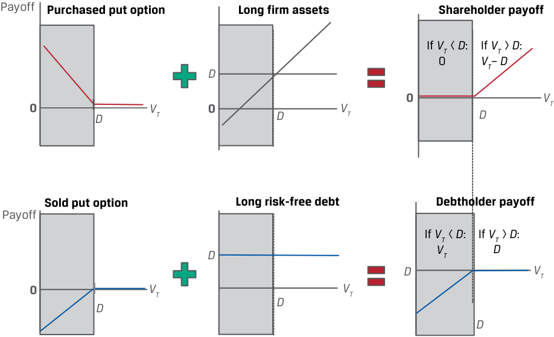

# Tập 7: Công cụ Phái sinh (*Derivatives*)
## Học phần 9: Mô phỏng Quyền chọn Sử dụng Ngang giá Quyền chọn Bán–Quyền chọn Mua (*Option Replication Using Put–Call Parity*)
### Phần 2/2: Các Ứng dụng Ngang giá Quyền chọn Bán–Quyền chọn Mua: Giá trị Doanh nghiệp (Trang PDF 217–226)

---

<!-- PDF Page 217 -->

###### **VÍ DỤ 4 (*EXAMPLE 4*)** 

##### **Ngang giá Kỳ hạn Quyền chọn Bán–Quyền chọn Mua của VFO (*VFO Put–Call Forward Parity*)** 

Hãy xem xét ví dụ về Văn phòng Quản lý Gia sản Viswan (VFO) sử dụng một hợp đồng mua kỳ hạn và một trái phiếu phi rủi ro, thay vì một vị thế tài sản cơ sở tiền mặt như trong ví dụ trước. Cổ phiếu Biomian giao dịch ở mức giá ($S_0$) là 295 INR mỗi cổ phiếu. VFO đang cân nhắc việc mua một quyền chọn bán kỳ hạn 6 tháng trên cổ phiếu Biomian tại mức giá thực hiện ($X$) là 265 INR. Nếu giám đốc đầu tư của VFO quan sát thấy một quyền chọn mua kỳ hạn 6 tháng đang giao dịch ở mức giá 59 INR mỗi cổ phiếu cho cùng mức giá thực hiện 265 INR, ông ấy nên kỳ vọng trả bao nhiêu cho quyền chọn bán trên mỗi cổ phiếu nếu lãi suất phi rủi ro có liên quan là 4%? 

Từ phương trình ngang giá kỳ hạn quyền chọn bán–quyền chọn mua, mối quan hệ là: 

$$p_0 - c_0 = [X - F_0(T)](1 + r)^{-T}.$$

Thay thế các số hạng và giải tìm $F_0(T) = 300,84\text{ INR} \ (= 295\text{ INR}(1,04)^{0,5})$: 

$$p_0 - 59\text{ INR} = (265\text{ INR} - 300,84\text{ INR})(1,04)^{-0,5}.$$

$$p_0 = 23,86\text{ INR}.$$

VFO nên kỳ vọng trả mức phí quyền chọn bán kỳ hạn 6 tháng là $p_0 = 23,86\text{ INR}$. 

#### **CÁC ỨNG DỤNG NGANG GIÁ QUYỀN CHỌN BÁN–QUYỀN CHỌN MUA: GIÁ TRỊ DOANH NGHIỆP (*OPTION PUT–CALL PARITY APPLICATIONS: FIRM VALUE*)** 

# **<mark>6</mark>** 

giải thích ngang giá quyền chọn bán–quyền chọn mua (*put–call parity*) đối với quyền chọn kiểu châu Âu 

giải thích ngang giá _kỳ hạn_ quyền chọn bán–quyền chọn mua (*put–call forward parity*) đối với quyền chọn kiểu châu Âu 

Những góc nhìn sâu sắc được thiết lập bởi mối quan hệ ngang giá quyền chọn bán–quyền chọn mua còn vượt xa các chiến lược giao dịch quyền chọn, mở rộng sang việc mô hình hóa giá trị của một doanh nghiệp nhằm mô tả lợi ích và các quyền đòi nợ tài chính (*financial claims*) của những nhà cung cấp vốn—cụ thể là những người sở hữu vốn cổ phần (*equity*) của doanh nghiệp và những người sở hữu khoản nợ (*debt*) của doanh nghiệp đó. 

Giả sử rằng tại thời điểm $t = 0$, một doanh nghiệp có giá trị thị trường là $V_0$ có khả năng tiếp cận nguồn vốn vay dưới hình thức khoản nợ zero-coupon (*zero-coupon debt*) có mệnh giá là $D$. Giá trị thị trường của các tài sản thuộc doanh nghiệp, $V_0$, bằng giá trị hiện tại của nghĩa vụ nợ đang lưu hành của nó, $\text{PV}(D)$, cộng với vốn cổ phần, $E_0$: $V_0 = E_0 + \text{PV}(D)$. 

Khi khoản nợ đáo hạn tại thời điểm $T$, khoản nợ và tài sản của doanh nghiệp được phân bổ giữa các cổ đông (*shareholders*) và các chủ nợ (*debtholders*) với hai kết quả có thể xảy ra tùy thuộc vào giá trị của doanh nghiệp tại thời điểm $T$ ($V_T$): 

**1. Có khả năng thanh toán (*Solvency* – $V_T > D$):** Nếu giá trị của doanh nghiệp ($V_T$) _vượt quá_ mệnh giá của khoản nợ, hay $V_T > D$, tại thời điểm $T$, chúng ta nói rằng doanh nghiệp _có khả năng thanh toán_ (*solvent*) và có thể hoàn trả vốn cho _cả_ các cổ đông lẫn các chủ nợ của mình. 

   - Các chủ nợ nhận được $D$ và được hoàn trả đầy đủ. 

   - Các cổ đông nhận được phần còn lại (*residual*): $E_T = V_T - D$. 

<!-- PDF Page 218 -->

**2. Mất khả năng thanh toán (*Insolvency* – $V_T < D$):** Nếu giá trị của doanh nghiệp ($V_T$) _thấp hơn_ mệnh giá của khoản nợ, hay $V_T < D$, tại thời điểm $T$, chúng ta nói rằng doanh nghiệp _mất khả năng thanh toán_ (*insolvent*). Trong trường hợp mất khả năng thanh toán, các cổ đông không nhận được gì và các chủ nợ đang được nợ nhiều hơn giá trị tài sản của doanh nghiệp. Do đó, các chủ nợ nhận được $V_T$ để thanh toán cho quyền đòi nợ trị giá $D$ của họ tại thời điểm $T$. 

   - Các chủ nợ có quyền đòi nợ ưu tiên (*priority claim*) đối với tài sản và nhận được $V_T < D$. 

   - Các cổ đông nhận được phần còn lại, $E_T = 0$. 

Không giống như trái phiếu _phi rủi ro_ được trình bày trong bài học ngang giá quyền chọn bán–quyền chọn mua trước đó, doanh nghiệp có khoản nợ _rủi ro_ (*risky debt*), bởi vì các trái chủ _chỉ_ nhận được $D$ trong trường hợp doanh nghiệp có khả năng thanh toán (khi $V_T > D$). Do đó, các chủ nợ đòi hỏi một khoản phần bù tương tự như phí quyền chọn bán (*put option premium*) từ các cổ đông để gánh chịu rủi ro mất khả năng thanh toán. 

Các cổ đông giữ được tiềm năng tăng giá _không giới hạn_ (*unlimited upside potential* – nếu doanh nghiệp duy trì được khả năng thanh toán và có thể trả hết nợ) và rủi ro tổn thất phía dưới _có giới hạn_ (*limited downside potential* – nếu doanh nghiệp mất khả năng thanh toán). Ngược lại, tiềm năng phía trên của chủ nợ bị _giới hạn_ ở việc nhận lại khoản hoàn trả nợ trong trường hợp doanh nghiệp có khả năng thanh toán, còn tiền gốc và tiền lãi đều gặp rủi ro trong sự kiện bất lợi khi doanh nghiệp mất khả năng thanh toán. 

Tiếp theo, chúng ta xem xét kỹ hơn hồ sơ kết quả thanh toán tương ứng khi đáo hạn. Tại thời điểm $t = T$: 

- kết quả thanh toán của cổ đông (*shareholder payoff*) là $\max(0, V_T - D)$ và 

- kết quả thanh toán của chủ nợ (*debtholder payoff*) là $\min(V_T, D)$. 

Hãy xem xét các hồ sơ kết quả thanh toán này dưới góc độ quyền chọn: 

- Các cổ đông nắm giữ một vị thế mua đối với tài sản cơ sở của doanh nghiệp ($V_T$) và đã mua một quyền chọn bán trên giá trị doanh nghiệp ($V_T$) với giá thực hiện là $D$; nghĩa là $\max(0, D - V_T)$. 

- Các chủ nợ nắm giữ một vị thế mua một trái phiếu phi rủi ro ($D$) và đã bán một quyền chọn bán cho các cổ đông trên giá trị doanh nghiệp ($V_T$) với giá thực hiện là $D$. 

Hồ sơ kết quả thanh toán của các cổ đông so với các chủ nợ được thể hiện trong Bảng 9 (*Exhibit 9*). 

**Bảng 9: Kết quả Thanh toán của Cổ đông và Chủ nợ tại Thời điểm $T$ (*Exhibit 9: Shareholder and Debtholder Payoff at Time $T$*)** 

##### **Xây dựng Kết quả Thanh toán của Cổ đông và Chủ nợ (*Construction of Shareholder and Debtholder Payoffs*)** 

<!-- Picture Text: Payoff Purchased put option Long firm assets Shareholder payoff If  VT <  D : If  VT >  D :     0 VT –  D D 0 VT 0 D VT 0 D VT D Sold put option Long risk-free debt Debtholder payoff Payoff If  VT <  D : If  VT >  D : D VT D D VT 0 VT VT D D D  -->
> **Chú thích hình ảnh:**
> - **Hàng trên (Cổ đông):** **Purchased put option** (Quyền chọn bán đã mua) + **Long firm assets** (Mua tài sản doanh nghiệp) = **Shareholder payoff** (Kết quả thanh toán của cổ đông: nhận $0$ nếu $V_T < D$, nhận $V_T - D$ nếu $V_T > D$).
> - **Hàng dưới (Chủ nợ):** **Sold put option** (Quyền chọn bán đã bán) + **Long risk-free debt** (Mua khoản nợ phi rủi ro) = **Debtholder payoff** (Kết quả thanh toán của chủ nợ: nhận $V_T$ nếu $V_T < D$, nhận $D$ nếu $V_T > D$).

<!-- PDF Page 219 -->

##### **Phân bổ Giá trị Doanh nghiệp Giữa Cổ đông và Chủ nợ (*Firm Value Distribution Between Shareholders and Debtholders*)** 

<!-- Picture Text: Firm value distribution between shareholders  and debtholders Shareholder  payoff If  VT  <  D : If  VT >  D : Insolvent Solvent If  VT  <  D : If  VT >  D : Shareholder 0 VT –  D payoff 0 VT D D 0 VT D Debtholder payoff If  VT <  D : If  VT >  D : Insolvent Solvent If  VT  <  D : If  VT >  D : VT D D D VT Debtholder D payoff 0 VT D  -->
> **Chú thích hình ảnh:**
> - **Insolvent ($V_T < D$):** Mất khả năng thanh toán (Cổ đông nhận $0$, Chủ nợ nhận $V_T$).
> - **Solvent ($V_T > D$):** Có khả năng thanh toán (Cổ đông nhận $V_T - D$, Chủ nợ nhận $D$).

Lưu ý rằng sự kết hợp của cổ đông giữa một quyền chọn bán đã mua và một vị thế mua đối với tài sản của doanh nghiệp tương đương với một quyền chọn _mua_ (*call option*) trên tài sản của doanh nghiệp. Khoản nợ rủi ro do các chủ nợ nắm giữ là sự kết hợp giữa khoản nợ phi rủi ro, $D$, và quyền chọn bán đã bán cho các cổ đông. 

Xem xét lại mối quan hệ ngang giá quyền chọn bán–quyền chọn mua, $S_0 + p_0 = c_0 + \text{PV}(X)$, từ Phương trình 1, chúng ta có thể thay thế giá trị của doanh nghiệp tại thời điểm 0 ($V_0$) cho tài sản cơ sở ($S_0$), thay thế khoản nợ ($D$) cho trái phiếu phi rủi ro ($X$), và giải tìm $V_0$ như sau: 

$$V_0 + p_0 = c_0 + \text{PV}(D).$$

$$V_0 = c_0 + \text{PV}(D) - p_0 \tag{5}$$

Phương trình trên (trong nguyên bản gọi là Equation 6) nắm bắt giá trị tài sản của doanh nghiệp tại thời điểm $t = 0$ dưới góc độ của cổ đông và chủ nợ. _Cổ đông_ có một vị thế với kết quả thanh toán tương tự như của một quyền chọn mua trên giá trị doanh nghiệp ($c_0$). _Chủ nợ_ có một vị thế là $\text{PV}(D) - p_0$, hay khoản nợ phi rủi ro của doanh nghiệp _cộng với_ một quyền chọn bán đã bán (*sold put option*) trên giá trị doanh nghiệp. Quyền chọn bán ($p_0$) có thể được diễn giải là _mức chênh lệch tín dụng_ (*credit spread*) đối với khoản nợ của doanh nghiệp, hay phần bù cao hơn mức lãi suất phi rủi ro mà doanh nghiệp phải trả cho các chủ nợ để họ gánh chịu rủi ro mất khả năng thanh toán. Quyền chọn bán này tăng giá trị đối với các cổ đông khi xác suất mất khả năng thanh toán tăng lên. Dưới góc độ của chủ nợ, quyền chọn bán đã bán càng có giá trị lớn thì rủi ro tín dụng hiện diện trong khoản nợ của doanh nghiệp càng nhiều. 

<!-- PDF Page 220 -->

###### **BỘ CÂU HỎI (*QUESTION SET*)** 

##### **Ngang giá Kỳ hạn Quyền chọn Bán–Quyền chọn Mua và Các Ứng dụng Quyền chọn (*Put–Call Forward Parity and Option Applications*)** 

1. Xác định phát biểu sau đây là đúng hay sai, và giải thích câu trả lời của bạn: Một mối liên kết then chốt giữa ngang giá quyền chọn bán–quyền chọn mua và ngang giá kỳ hạn quyền chọn bán–quyền chọn mua là vị thế tài sản cơ sở tiền mặt được thay thế bằng một vị thế tài sản cơ sở tổng hợp (*synthetic underlying position*) sử dụng một giao dịch mua kỳ hạn và một trái phiếu phi rủi ro. 

###### **Lời giải:** 

Phát biểu này là đúng. Việc thay thế vị thế tài sản cơ sở tiền mặt bằng một vị thế tài sản cơ sở tổng hợp sử dụng một giao dịch mua kỳ hạn và một trái phiếu phi rủi ro đã liên kết giá quyền chọn mua, giá quyền chọn bán, và giá kỳ hạn theo ngang giá kỳ hạn quyền chọn bán–quyền chọn mua (*put–call forward parity*). 

2. Xác định vị thế nào sau đây có cùng giá trị không kinh doanh chênh lệch giá với danh mục đầu tư nào theo ngang giá kỳ hạn quyền chọn bán–quyền chọn mua: 

| Vị thế | Danh mục đầu tư tương đương |
|---|---|
| 1. Mua quyền chọn mua ($c_0$) | A. Bán kỳ hạn (*forward sale*), mua trái phiếu phi rủi ro, và mua quyền chọn mua |
| 2. Mua trái phiếu phi rủi ro ($X(1 + r)^{-T}$) | B. Mua kỳ hạn (*forward purchase*), mua quyền chọn bán, và bán trái phiếu phi rủi ro |
| 3. Mua quyền chọn bán ($p_0$) | C. Mua hợp đồng kỳ hạn (*long forward purchase*), bán quyền chọn mua, và mua quyền chọn bán |

###### **Lời giải:** 

Hãy nhớ lại rằng mối quan hệ ngang giá kỳ hạn quyền chọn bán–quyền chọn mua có thể được biểu diễn là: 

   - $F_0(T)(1 + r)^{-T} + p_0 = c_0 + X(1 + r)^{-T}$. 

   1. B là đáp án đúng. Một vị thế mua quyền chọn mua là tương đương không kinh doanh chênh lệch giá với một giao dịch mua kỳ hạn, mua quyền chọn bán, và bán trái phiếu phi rủi ro. 

   2. C là đáp án đúng. Một vị thế mua trái phiếu phi rủi ro tương đương với một vị thế mua hợp đồng kỳ hạn, bán quyền chọn mua, và mua quyền chọn bán. 

   3. A là đáp án đúng. Một vị thế mua quyền chọn bán tương đương với một giao dịch bán kỳ hạn, mua trái phiếu phi rủi ro, và mua quyền chọn mua. 

3. Mô tả các dòng tiền vào thời điểm đáo hạn quyền chọn đối với một quyền chọn bán bảo vệ tổng hợp (*synthetic protective put*). 

###### **Lời giải:** 

Một quyền chọn bán bảo vệ tổng hợp là sự kết hợp giữa một vị thế tài sản cơ sở _tổng hợp_ (sử dụng một giao dịch mua kỳ hạn và một vị thế mua trái phiếu phi rủi ro có mệnh giá bằng giá kỳ hạn/giá thực hiện) và một quyền chọn bán đã mua. 

Tại thời điểm quyền chọn đáo hạn, thời điểm $T$, có hai kịch bản có thể xảy ra: 

**Quyền chọn bán được thực hiện ($X > S_T$):** Nếu quyền chọn bán được thực hiện, nhà đầu tư nhận được $(X - S_T)$. Tài sản phi rủi ro mang lại $F_0(T)$, và giao dịch mua kỳ hạn mang lại $S_T - F_0(T)$. 

Tổng số tiền thu về bằng $(X - S_T) + [S_T - F_0(T)] + F_0(T) = X$. 

**Quyền chọn bán không được thực hiện ($X \le S_T$):** Nếu quyền chọn bán không được thực hiện, nó sẽ hết hạn mà không có giá trị. Tài sản phi rủi ro mang lại $F_0(T)$, và giao dịch mua kỳ hạn mang lại <u>$S_T - F_0(T)$.</u> 

<!-- PDF Page 221 -->

Tổng số tiền thu về bằng $[S_T - F_0(T)] + F_0(T) = S_T$. 

4. Mô tả cách thức vị thế của một chủ nợ (*debtholder’s position*) có thể được coi là tương tự như việc bán một quyền chọn bán trên giá trị doanh nghiệp. 

###### **Lời giải:** 

- Nếu giá trị của doanh nghiệp ($V_T$) _thấp hơn_ mệnh giá khoản nợ đang lưu hành của nó, hay $V_T < D$ tại thời điểm $T$, chúng ta nói rằng doanh nghiệp _mất khả năng thanh toán_ (*insolvent*) và các chủ nợ nhận được ít hơn mệnh giá ($D$) để thanh toán cho quyền đòi nợ của họ. Nói cách khác, kết quả thanh toán của chủ nợ là $\min(D, V_T) = D - \max(0, D - V_T)$ và bằng mệnh giá khoản nợ ($D$) trừ đi một quyền chọn bán trên giá trị doanh nghiệp ($V_T$) với giá thực hiện là $D$, đại diện cho một quyền chọn bán _đã bán_ (*sold put*) trên giá trị doanh nghiệp. 

<!-- PDF Page 222 -->

## **BÀI TẬP THỰC HÀNH (*PRACTICE PROBLEMS*)** 

### **Thông tin sau đây liên quan đến các câu hỏi từ 1 đến 6** 

###### **South China Sprintwyck Investments (SCSI)** 

South China Sprintwyck Investments (SCSI) có một danh mục đầu tư cổ phiếu Trung Quốc đã đạt hiệu quả vượt trội trong nửa đầu năm nhờ vị thế tỷ trọng cao (*overweight position*) ở các cổ phiếu ngành chăm sóc sức khỏe. SCSI đang cân nhắc các phương án dựa trên quyền chọn cho một trong những vị thế tỷ trọng cao hiện tại của mình là ChinaWell Inc. (CWI). CWI có mức giá hiện tại ($S_0$) là 127,50 CNY và không trả cổ tức. Lãi suất phi rủi ro hiện tại là 4%. Bạn là một chuyên viên phân tích mới của SCSI được tuyển dụng để đánh giá một số phương án cho cổ phiếu CWI. 

**1.** SCSI đang cân nhắc việc bán một quyền chọn mua kỳ hạn 3 tháng trên cổ phiếu CWI. Nếu bạn quan sát thấy một mức giá quyền chọn bán đang được giao dịch có cùng các thông số tài sản cơ sở, phát biểu nào sau đây mô tả đúng nhất cách thức suy ra mức giá quyền chọn mua không kinh doanh chênh lệch giá? 

   - **A.** Sử dụng ngang giá quyền chọn bán–quyền chọn mua, giá quyền chọn mua có thể được suy ra bằng cách _lấy_ giá tài sản cơ sở trừ đi giá trị hiện tại của giá thực hiện rồi _trừ đi_ giá quyền chọn bán đang giao dịch. 

   - **B.** Sử dụng ngang giá quyền chọn bán–quyền chọn mua, giá quyền chọn mua có thể được suy ra bằng cách _cộng_ giá quyền chọn bán đang giao dịch vào phần chênh lệch giữa giá tài sản cơ sở trừ đi giá trị hiện tại của giá thực hiện. 

   - **C.** Sử dụng ngang giá quyền chọn bán–quyền chọn mua, giá quyền chọn mua có thể được suy ra bằng cách _cộng_ giá quyền chọn bán đang giao dịch vào phần chênh lệch giữa giá trị hiện tại của giá thực hiện trừ đi giá tài sản cơ sở. 

**2.** Do sự tăng vọt gần đây của giá cổ phiếu CWI, SCSI đang khuyến nghị khách hàng cân nhắc các chiến lược quyền chọn bán bảo vệ (*protective put strategies*) cho các kỳ hạn từ 3 đến 6 tháng. Nếu bạn quan sát thấy một quyền chọn mua cổ phiếu CWI kỳ hạn 6 tháng tại mức giá thực hiện 120 CNY đang giao dịch ở mức giá 22,60 CNY, đáp án nào gần nhất với mức giá bạn kỳ vọng sẽ trả cho một quyền chọn bán kỳ hạn 6 tháng có cùng các điều khoản cơ sở? 

   - **A.** 15,10 CNY 

   - **B.** 9,83 CNY 

   - **C.** 12,77 CNY 

**3.** Bạn nhận ra rằng quyền chọn bán kỳ hạn 6 tháng trên cổ phiếu CWI đang bị định giá cao (*overpriced*) so với mức giá không kinh doanh chênh lệch giá từ Câu hỏi 2. Phát biểu nào sau đây mô tả đúng nhất các bước bạn sẽ thực hiện để kiếm được một khoản lợi nhuận kinh doanh chênh lệch giá phi rủi ro dưới kịch bản này? 

   - **A.** Bán quyền chọn bán kỳ hạn 6 tháng và bán khống cổ phiếu CWI, đầu tư số tiền thu được vào một quyền chọn mua và một trái phiếu phi rủi ro. 

   - **B.** Bán quyền chọn bán kỳ hạn 6 tháng, mua một quyền chọn mua, và đi vay ở mức lãi suất phi rủi ro để mua cổ phiếu CWI. 

   - **C.** Bán quyền chọn bán kỳ hạn 6 tháng, mua một quyền chọn mua, tham gia vào một giao dịch mua kỳ hạn cổ phiếu CWI, và đầu tư vào một trái phiếu phi rủi ro. 

<!-- PDF Page 223 -->

**4.** Trong bản ghi chú nghiên cứu gần đây nhất của mình về CWI, chuyên viên phân tích cổ phiếu của SCSI đặc biệt đề cập đến sự gia tăng trong tỷ số đòn bẩy (*leverage ratio*) của CWI như một lý do cho triển vọng bi quan (*bearish outlook*) của cô ấy đối với cổ phiếu này. Áp dụng mối quan hệ ngang giá quyền chọn bán–quyền chọn mua cho giá trị của doanh nghiệp, phát biểu nào sau đây mô tả chính xác nhất triển vọng của CWI dưới góc độ định giá quyền chọn? 

   - **A.** Kết quả thanh toán của cổ đông đã được cải thiện so với các chủ nợ, bởi vì họ đã bán một quyền chọn bán trên giá trị doanh nghiệp vốn đã tăng giá trị. 

   - **B.** Kết quả thanh toán của chủ nợ đã xấu đi so với các cổ đông, bởi vì về thực chất họ đang giữ vị thế bán một quyền chọn bán trên giá trị của doanh nghiệp với giá thực hiện bằng giá trị khoản nợ, và quyền chọn bán này đã tăng giá trị. 

   - **C.** Kết quả thanh toán của cổ đông đã được cải thiện so với các chủ nợ, bởi vì các chủ nợ đã bán một quyền chọn mua trên tài sản của doanh nghiệp cho các cổ đông. 

**5.** Lựa chọn nào sau đây mô tả đúng nhất cách thức SCSI có thể mô phỏng tỷ suất sinh lợi của một vị thế mua trái phiếu phi rủi ro bằng cách sử dụng một hợp đồng kỳ hạn trên cổ phiếu CWI cùng với các quyền chọn mua và quyền chọn bán trên cổ phiếu CWI? 

   - **A.** Bán một hợp đồng kỳ hạn trên CWI, bán một quyền chọn bán trên CWI, và mua một quyền chọn mua trên CWI 

   - **B.** Mua một hợp đồng kỳ hạn trên CWI, mua một quyền chọn bán trên CWI, và bán một quyền chọn mua trên CWI 

   - **C.** Mua một hợp đồng kỳ hạn trên CWI, mua một quyền chọn bán trên CWI, và mua một quyền chọn mua trên CWI 

**6.** SCSI quan sát thấy một quyền chọn mua kỳ hạn 3 tháng trên CWI với giá thực hiện 130 CNY giao dịch ở mức phí quyền chọn là 3 CNY. Một hợp đồng kỳ hạn 3 tháng trên CWI giao dịch ở mức giá kỳ hạn là 128,76 CNY. Lựa chọn nào sau đây gần nhất với mức phí quyền chọn đúng cho một quyền chọn bán kỳ hạn 3 tháng có giá thực hiện 130 CNY trên CWI? 

   - **A.** 4,20 CNY 

   - **B.** 1,20 CNY 

   - **C.** 0,50 CNY 

<!-- PDF Page 224 -->

## **LỜI GIẢI (*SOLUTIONS*)** 

1. Đáp án đúng là B. Từ Phương trình 1, mối quan hệ ngang giá quyền chọn bán–quyền chọn mua là: 

   $$S_0 + p_0 = c_0 + X(1 + r)^{-T}.$$

   Chúng ta có thể sắp xếp lại các số hạng này để giải tìm $c_0$: $c_0 = S_0 + p_0 - X(1 + r)^{-T}$, điều này cho thấy giá quyền chọn mua có thể được suy ra bằng cách _cộng_ giá quyền chọn bán đang giao dịch vào phần chênh lệch giữa giá tài sản cơ sở trừ đi giá trị hiện tại của giá thực hiện. 

2. Đáp án đúng là C. Nếu $c_0 = 22,60\text{ CNY}$, $S_0 = 127,50\text{ CNY}$, và $\text{PV}(X) = 117,67\text{ CNY} \ (= 120(1,04)^{-0,5})$, chúng ta có thể giải tìm $p_0$ bằng cách sử dụng ngang giá quyền chọn bán–quyền chọn mua: 

   $$S_0 + p_0 = c_0 + X(1 + r)^{-T}.$$

   $$p_0 = c_0 + X(1 + r)^{-T} - S_0.$$

   $$12,77\text{ CNY} = 22,60 + 117,67 - 127,50.$$

3. Đáp án đúng là A. Vì quyền chọn bán đang bị định giá cao (*overpriced*), chúng ta sẽ bán nó để thu phần chênh lệch giữa mức giá bán và mức giá không kinh doanh chênh lệch giá. Mối quan hệ ngang giá quyền chọn bán–quyền chọn mua, từ Phương trình 1, là: 

   - $S_0 + p_0 = c_0 + X(1 + r)^{-T}$. 

   Chúng ta có thể sắp xếp lại phương trình này để chứng minh rằng giá trị quyền chọn bán tương đương với một vị thế mua quyền chọn mua, một vị thế mua trái phiếu phi rủi ro, và một vị thế bán khống cổ phiếu CWI: 

   $$p_0 = c_0 + X(1 + r)^{-T} - S_0.$$

   Đáp án A phản ánh sự kết hợp giữa mua trái phiếu phi rủi ro, mua quyền chọn mua và bán khống cổ phiếu CWI này, vốn có kết quả thanh toán tổng hợp khớp với kết quả thanh toán của quyền chọn bán khi đáo hạn, trong khi Đáp án B liên quan đến vị thế mua tiền mặt đối với CWI và Đáp án C liên quan đến vị thế mua tổng hợp (mua kỳ hạn) đối với cổ phiếu CWI. 

4. Đáp án đúng là B. Kết quả thanh toán của chủ nợ đã xấu đi so với các cổ đông, bởi vì về thực chất họ đang giữ vị thế bán một quyền chọn bán trên giá trị của doanh nghiệp với giá thực hiện bằng giá trị khoản nợ, và quyền chọn bán này đã tăng giá trị (khi đòn bẩy nợ tăng lên làm tăng rủi ro mất khả năng thanh toán). 

   - Kết quả thanh toán của chủ nợ là $\min(D, V_T) = D - \max(0, D - V_T)$ và bằng mệnh giá khoản nợ ($D$) _trừ đi_ một quyền chọn bán trên giá trị doanh nghiệp ($V_T$) với giá thực hiện là $D$. Đáp án A không đúng vì các chủ nợ, chứ không phải các cổ đông, mới là người đã bán quyền chọn bán. C không đúng vì các cổ đông sở hữu một quyền chọn mua, nhưng nó không phải do các chủ nợ bán theo cấu trúc vị thế riêng của chủ nợ. 

5. B là đáp án đúng. Sử dụng phương trình ngang giá kỳ hạn quyền chọn bán–quyền chọn mua như sau: 

   $$F_0(T)(1 + r)^{-T} + p_0 = c_0 + X(1 + r)^{-T}$$

   Và sắp xếp lại để giải tìm trái phiếu phi rủi ro mang lại kết quả sau: 

   - $F_0(T)(1 + r)^{-T} + p_0 - c_0 = X(1 + r)^{-T}$. 

   Dấu của vị thế hợp đồng kỳ hạn và vị thế quyền chọn bán đều là dấu dương, biểu thị các vị thế mua (*long positions*). Dấu âm ở quyền chọn mua biểu thị một vị thế bán (*short position*). 

6. A là đáp án đúng. Lời giải có thể được suy ra thông qua ngang giá quyền chọn bán–quyền chọn mua hoặc ngang giá kỳ hạn quyền chọn bán–quyền chọn mua. Bạn có thể chứng minh lời giải bằng cách sử dụng ngang giá kỳ hạn quyền chọn bán–quyền chọn mua: 

   - $F_0(T)(1 + r)^{-T} + p_0 = c_0 + X(1 + r)^{-T}$ 
   - $128,76(1,04)^{-0,25} + p_0 = 3 + 130(1,04)^{-0,25}$ 

<!-- PDF Page 225 -->

   - $127,50 + p_0 = 131,73 \implies p_0 = 4,23\text{ CNY}$ (gần nhất với 4,20 CNY). 

<!-- PDF Page 226 -->
