# Tập 7: Công cụ Phái sinh (*Derivatives*)
## Học phần 10: Xác định Giá trị Công cụ Phái sinh Sử dụng Mô hình Nhị thức Một Kỳ (*Valuing a Derivative Using a One-Period Binomial Model*)
### Phần 1/2: Giới thiệu (Trang PDF 227–242)

---

<!-- PDF Page 227 -->

#### H Ọ C P H Ầ N

# **<mark>10</mark>** 

### **Xác định Giá trị Công cụ Phái sinh Sử dụng Mô hình Nhị thức Một Kỳ (*Valuing a Derivative Using a One-Period Binomial Model*)** 

###### **<mark>MỤC TIÊU HỌC TẬP (*LEARNING OUTCOMES*)</mark>** 

|**_Mức độ thành thạo_** **_Ứng viên cần có khả năng:_**|
|---|
|giải thích cách xác định giá trị một công cụ phái sinh bằng cách sử dụng mô hình nhị thức một kỳ (*one-period binomial model*)|
|mô tả khái niệm trung lập với rủi ro (*risk neutrality*) trong việc định giá công cụ phái sinh|

##### **GIỚI THIỆU (*INTRODUCTION*)** 

## **<mark>1</mark>** 

Các bài học trước đã giải thích cách thức nguyên tắc không kinh doanh chênh lệch giá (*no arbitrage*) và mô phỏng (*replication*) có thể được sử dụng để xác định giá trị và định giá các công cụ phái sinh. Mối quan hệ ngang giá quyền chọn bán–quyền chọn mua (*put–call parity*) đã liên kết giá quyền chọn bán, giá quyền chọn mua, giá tài sản cơ sở, và giá tài sản phi rủi ro. Mối quan hệ này đã được mở rộng sang các hợp đồng kỳ hạn dựa trên sự tương đương giữa một vị thế tài sản cơ sở và một hợp đồng mua kỳ hạn cộng với một trái phiếu phi rủi ro. 

Các cam kết kỳ hạn (*forward commitments*) có thể được định giá mà không cần đưa ra các giả định về mức giá trong tương lai của tài sản cơ sở. Tuy nhiên, việc định giá quyền chọn và các quyền đòi nợ có điều kiện (*contingent claims*) khác đòi hỏi phải có một mô hình cho sự tiến triển của mức giá tương lai của tài sản cơ sở. Bài học đầu tiên giới thiệu mô hình nhị thức (*binomial model*) được sử dụng rộng rãi để xác định giá trị các quyền chọn bán và quyền chọn mua kiểu châu Âu. Một phiên bản một kỳ (*one-period version*) đơn giản được giới thiệu, phiên bản này có thể được mở rộng ra nhiều kỳ (*multiple periods*) và được sử dụng để xác định giá trị các quyền đòi nợ có điều kiện phức tạp hơn. Trong bài học thứ hai, chúng ta chứng minh việc sử dụng các xác suất trung lập với rủi ro (*risk-neutral probabilities*) trong định giá công cụ phái sinh. 

###### **TỔNG QUAN HỌC PHẦN (*LEARNING MODULE OVERVIEW*)** 

- Mô hình nhị thức một kỳ (*one-period binomial model*) xác định giá trị các quyền đòi nợ có điều kiện, chẳng hạn như quyền chọn, và giả định rằng tài sản cơ sở sẽ hoặc tăng lên theo hệ số $R^u$ (tỷ suất sinh lợi gộp khi giá tăng – *up gross return*) hoặc giảm xuống theo hệ số $R^d$ (tỷ suất sinh lợi gộp khi giá giảm – *down gross return*) qua một kỳ duy nhất tương ứng với thời điểm đáo hạn của hợp đồng phái sinh. 

- Mô hình nhị thức kết hợp một quyền chọn với tài sản cơ sở để tạo ra một danh mục đầu tư phi rủi ro (*risk-free portfolio*), trong đó tỷ lệ giữa quyền chọn và chứng khoán cơ sở được xác định bởi một tỷ số phòng ngừa rủi ro (*hedge ratio*). 

*Viện CFA (CFA Institute) xin gửi lời cảm ơn đến Tiến sĩ Don Chance, CFA, vì những đóng góp của ông cho phần này, bao gồm nội dung bắt nguồn từ tài liệu đã xuất hiện trong bài đọc Derivative Markets and Instruments thuộc chương trình học CFA® Program năm 2022.* 

<!-- PDF Page 228 -->

- Danh mục đầu tư đã được phòng ngừa rủi ro (*hedged portfolio*) phải thu được mức lãi suất phi rủi ro hiện hành; nếu không, các cơ hội thu lợi nhuận kinh doanh chênh lệch giá phi rủi ro sẽ xuất hiện. 

- Việc xác định giá trị một công cụ phái sinh thông qua phòng ngừa rủi ro phi rủi ro (*risk-free hedging*) tương đương với việc tính toán kết quả thanh toán kỳ vọng được chiết khấu (*discounted expected payoff*) của quyền chọn bằng cách sử dụng các xác suất _trung lập với rủi ro_ (*risk-neutral probabilities*) thay vì các xác suất thực tế (*actual probabilities*). 

- Cả xác suất thực tế (trong thế giới thực) của việc tăng hay giảm giá tài sản cơ sở lẫn tỷ suất sinh lợi kỳ vọng của tài sản cơ sở đều không cần thiết để định giá một quyền chọn. 

- Mô hình nhị thức một kỳ cũng có thể được mở rộng ra nhiều kỳ để xác định giá trị các quyền đòi nợ có điều kiện phức tạp hơn. 

###### **TỰ ĐÁNH GIÁ HỌC PHẦN (*LEARNING MODULE SELF-ASSESSMENT*)** 

Những câu hỏi ban đầu này nhằm giúp bạn tự đánh giá mức độ hiểu biết hiện tại của mình về học phần này. 

1. Phát biểu nào sau đây mô tả đúng nhất về mô hình nhị thức dùng để xác định giá trị quyền chọn? 

   - **A.** Mô hình sử dụng các xác suất thực tế gắn liền với các biến động tăng hoặc giảm giá cổ phiếu. 

   - **B.** Mô hình giả định rằng một danh mục đầu tư phi rủi ro có thể được tạo ra bằng cách kết hợp quyền chọn và tài sản cơ sở theo một tỷ số phòng ngừa rủi ro (*hedge ratio*). 

   - **C.** Mô hình tương tự như các mô hình được sử dụng để xác định giá trị các hợp đồng kỳ hạn và hợp đồng tương lai. 

###### **Lời giải:** 

B là đáp án đúng. Không giống như các cam kết kỳ hạn, các quyền đòi nợ có điều kiện, chẳng hạn như quyền chọn, đòi hỏi chúng ta phải mô hình hóa hành vi giá trong tương lai của tài sản cơ sở bởi vì không giống như hợp đồng kỳ hạn và hợp đồng tương lai, quyền chọn có kết quả thanh toán bất đối xứng (*asymmetric payoffs*). Bằng cách mô hình hóa hành vi giá trong tương lai, quyền chọn và tài sản cơ sở của nó có thể được kết hợp thành một danh mục đầu tư phi rủi ro. Chi phí của danh mục đầu tư này, nơi tỷ lệ giữa quyền chọn và tài sản cơ sở được thiết lập bởi một tỷ số phòng ngừa rủi ro, sẽ quyết định mức giá không kinh doanh chênh lệch giá của quyền chọn. A không đúng vì các xác suất thực tế của biến động giá tăng và giảm không được đưa vào mô hình. C không đúng vì quyền chọn có kết quả thanh toán bất đối xứng, nên chúng phải được mô hình hóa khác với các công cụ có kết quả thanh toán đối xứng như hợp đồng kỳ hạn và hợp đồng tương lai. 

2. Khi sử dụng mô hình nhị thức một kỳ để định giá một quyền chọn mua, sự gia tăng trong xác suất thực tế của một biến động tăng giá ở tài sản cơ sở sẽ dẫn đến giá quyền chọn mua: 

   - **A.** giảm xuống. 

   - **B.** giữ nguyên không đổi. 

   - **C.** tăng lên. 

###### **Lời giải:** 

Đáp án đúng là B. Giá quyền chọn mua sẽ giữ nguyên không đổi. Các xác suất thực tế (trong thế giới thực) của một biến động tăng hoặc giảm giá trong mô hình nhị thức không ảnh hưởng đến <u>mức giá</u> (không kinh doanh chênh lệch giá) <u>của một quyền chọn.</u> 

<!-- PDF Page 229 -->

3. Xác định sự thay đổi nhân tố nào sau đây có tác động nào lên mức giá không kinh doanh chênh lệch giá của một quyền chọn bán dựa trên mô hình nhị thức một kỳ: 

| Thay đổi của nhân tố | Tác động lên giá quyền chọn bán |
|---|---|
| 1. Xác suất thực tế của biến động tăng giá, $q$, tăng lên. | A. Giá quyền chọn bán giữ nguyên không đổi |
| 2. Độ chênh lệch (*spread*) giữa hệ số tăng và hệ số giảm, $R^u - R^d$, tăng lên. | B. Giá quyền chọn bán tăng lên |
| 3. Xác suất tăng giá trung lập với rủi ro (*risk-neutral probability*), $\pi$, tăng lên. | C. Giá quyền chọn bán giảm xuống |

###### **Lời giải:** 

   1. Đáp án đúng là A. Xác suất thực tế của biến động tăng giá, $q$, không có tác động lên giá trị trong mô hình định giá quyền chọn nhị thức một kỳ. Do đó, sự thay đổi này sẽ không có bất kỳ tác động nào lên giá của quyền chọn bán, và giá của quyền chọn bán sẽ giữ nguyên không đổi. 

   2. Đáp án đúng là B. Độ chênh lệch giữa hệ số tăng và hệ số giảm, $R^u - R^d$, làm tăng phạm vi của các mức giá tiềm năng, từ đó làm tăng khả năng quyền chọn kết thúc ở trạng thái có lời (*in the money*). Do đó, sự thay đổi này sẽ làm tăng giá của quyền chọn bán. 

   3. Đáp án đúng là C. Xác suất trung lập với rủi ro của giá, $\pi$, nắm bắt xác suất giá của tài sản cơ sở tăng lên. Khi $\pi$ tăng lên, khả năng quyền chọn bán kết thúc ở trạng thái có lời sẽ giảm xuống (vì $1 - \pi$ giảm). 

4. Một mô hình nhị thức một kỳ giả định rằng giá của tài sản cơ sở có thể thay đổi từ $16,00 ngày hôm nay lên $20,00 hoặc xuống $12,00 vào cuối kỳ. Nếu tỷ suất sinh lợi phi rủi ro trong kỳ là 5%, lựa chọn nào sau đây gần nhất với xác suất trung lập với rủi ro của một sự tăng giá? 

   - **A.** 0,50 
   - **B.** 0,60 
   - **C.** 0,625 

###### **Lời giải:** 

B là đáp án đúng. Sự tăng giá từ $16,00 lên $20,00 hoặc giảm giá từ $16,00 xuống $12,00 tương ứng với: 

$$R^u = \frac{\$20,00}{\$16,00} = 1,25 \quad \text{và} \quad R^d = \frac{\$12,00}{\$16,00} = 0,75.$$

Sử dụng công thức xác suất trung lập với rủi ro ($\pi$) của một sự tăng giá: 

$$\pi = \frac{1 + r - R^d}{R^u - R^d} = \frac{1 + 0,05 - 0,75}{1,25 - 0,75} = \frac{0,3}{0,5} = 0,60.$$

## **<mark>2</mark>**

##### **ĐỊNH GIÁ QUYỀN CHỌN NHỊ THỨC (*BINOMIAL VALUATION OF OPTIONS*)**

giải thích cách xác định giá trị một công cụ phái sinh bằng cách sử dụng mô hình nhị thức một kỳ (*one-period binomial model*) 

<!-- PDF Page 230 -->

Quy luật một giá (*law of one price*) phát biểu rằng nếu kết quả thanh toán từ hai tài sản bất kỳ (hoặc hai danh mục tài sản) tại một thời điểm nhất định trong tương lai là giống hệt nhau trong tất cả các kịch bản có thể xảy ra, thì giá trị của hai tài sản này cũng phải giống hệt nhau _ngày hôm nay_. Các cam kết kỳ hạn mang lại kết quả thanh toán đối xứng tại một mức giá đã xác định trước trong tương lai, có giá trị độc lập với hành vi giá tương lai của tài sản cơ sở. 

Hồ sơ kết quả thanh toán bất đối xứng của các quyền chọn và các quyền đòi nợ có điều kiện khác làm cho việc xác định giá trị của các công cụ này trở nên thách thức hơn. Các giả định về mức giá trong tương lai là một thành phần quan trọng trong việc xác định giá trị quyền chọn do có các kết quả thanh toán khác nhau dưới các kịch bản khác nhau mà xác suất xảy ra của chúng thay đổi theo thời gian. Do đó, việc xác định giá trị quyền chọn đòi hỏi phải xác lập một mô hình cho hành vi giá (ngẫu nhiên) trong tương lai của tài sản cơ sở của quyền chọn. 

Mô hình nhị thức (*binomial model*) là một công cụ phổ biến được sử dụng để xác định giá trị không kinh doanh chênh lệch giá của một quyền chọn. Sự đơn giản của mô hình này làm cho nó trở nên hấp dẫn, bởi vì chúng ta chỉ cần đưa ra giả định về độ lớn của các mức thay đổi giá tiềm năng theo chiều hướng tăng lên và giảm xuống của tài sản cơ sở trong một khoảng thời gian tương lai. 

## **<mark>3</mark>** 

##### **MÔ HÌNH NHỊ THỨC (*THE BINOMIAL MODEL*)** 

giải thích cách xác định giá trị một công cụ phái sinh bằng cách sử dụng mô hình nhị thức một kỳ (*one-period binomial model*) 

Mô hình nhị thức được xây dựng dựa trên một ý tưởng đơn giản: Qua một khoảng thời gian nhất định, giá của tài sản sẽ hoặc đi lên (*up* – $u$) tới mức $S_1^u > S_0$ hoặc đi xuống (*down* – $d$) tới mức $S_1^d < S_0$. Chúng ta không cần phải biết trước mức giá trong tương lai, bởi vì nó được xác định bởi kết quả của một biến ngẫu nhiên. Sự dịch chuyển từ $S_0$ lên $S_1^u$ hoặc xuống $S_1^d$ có thể được diễn giải như kết quả của một _phép thử Bernoulli (Bernoulli trial)_. 

Hãy ký hiệu $q$ là xác suất của một biến động giá đi lên và $1 - q$ là xác suất của một biến động giá đi xuống. Với chỉ hai kết quả có thể xảy ra—giá hoặc đi lên hoặc đi xuống—tổng các xác suất phải bằng 1. Chúng ta cũng sẽ thấy hữu ích khi định nghĩa tỷ suất sinh lợi gộp (*gross return*) từ một biến động giá đi lên hoặc đi xuống như sau: 

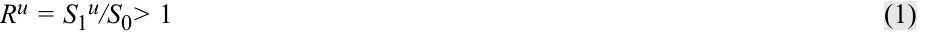

<!-- Formula Text: Ru = S1u/S0> 1 (1) -->
$$R^u = \frac{S_1^u}{S_0} > 1 \tag{1}$$

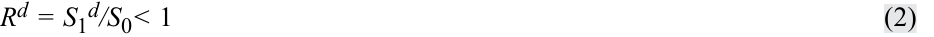

<!-- Formula Text: Rd = S1d/S0< 1 (2) -->
$$R^d = \frac{S_1^d}{S_0} < 1 \tag{2}$$

Thoạt nhìn, có vẻ như việc biết được $q$ là yếu tố sống còn trong việc xác định giá trị của một quyền chọn trên bất kỳ tài sản cơ sở nào. Tuy nhiên, việc biết $q$ là không cần thiết; chúng ta chỉ cần xác định các giá trị của $S_1^u$ và $S_1^d$. Chênh lệch giữa $S_1^u$ và $S_1^d$ đo lường “độ trải rộng” (*“spread”*) của các kết quả giá có thể xảy ra trong tương lai. Việc xác định $S_1^u$ và $S_1^d$ (hay $R^u S_0$ và $R^d S_0$) sẽ quyết định _độ biến động_ (*volatility*) của tài sản cơ sở, vốn là một nhân tố quan trọng trong việc xác định giá trị quyền chọn như đã chỉ ra trước đó. Nói một cách đơn giản, quy mô của các biến động giá đi lên và đi xuống phải khớp với độ biến động của tài sản cơ sở, như được thể hiện trong Bảng 1 (*Exhibit 1*). 

<!-- PDF Page 231 -->

###### **Bảng 1: Biến động Giá của Tài sản Cơ sở (*Exhibit 1: Price Movement for the Underlying Asset*)** 

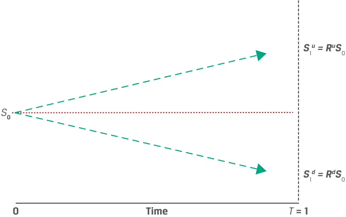

<!-- Picture Text: S 1 u = RuS 0 S 0 S 1 d = RdS 0 0 Time T  = 1  -->
> **Chú thích hình ảnh:**
> - Tại thời điểm $0$: Giá tài sản cơ sở là $S_0$.
> - Tại thời điểm $T = 1$: Giá tài sản cơ sở tăng lên $S_1^u = R^u S_0$ hoặc giảm xuống $S_1^d = R^d S_0$.

Các mô hình nhị thức có thể được mở rộng ra nhiều kỳ, nơi giá tài sản cơ sở có thể đi lên hoặc đi xuống trong mỗi kỳ. Sự mở rộng này tạo ra một cây nhị thức (*binomial tree*), một phương pháp mạnh mẽ để mô hình hóa các động thái giá thực tế hơn. Một mô hình nhị thức một kỳ đơn giản là đủ để giới thiệu phương pháp luận định giá và các bước cần thiết trong quy trình định giá quyền chọn. 

##### **ĐỊNH GIÁ QUYỀN CHỌN MUA KIỂU CHÂU ÂU (*PRICING A EUROPEAN CALL OPTION*)** 

## **<mark>4</mark>** 

giải thích cách xác định giá trị một công cụ phái sinh bằng cách sử dụng mô hình nhị thức một kỳ (*one-period binomial model*) 

Hãy xem xét một quyền chọn mua kiểu châu Âu kỳ hạn 1 năm có giá thực hiện ($X$) là €100. Giá giao ngay của tài sản cơ sở ($S_0$) là €80. Mô hình nhị thức một kỳ tương ứng với thời gian đến khi đáo hạn của quyền chọn là 1 năm. 

Mô hình nhị thức xác định các giá trị có thể có của tài sản cơ sở sau 1 năm, trong đó giá trị quyền chọn là một hàm số đã biết theo giá trị của tài sản cơ sở. Hơn nữa, chúng ta giả định rằng $S_1^d < X < S_1^u$ (tức là giá thực hiện của quyền chọn [$X = \text{€100}$] nằm giữa giá trị của tài sản cơ sở trong hai kịch bản)—ví dụ, đặt $S_1^d = \text{€60}$ và $S_1^u = \text{€110}$. Khi đó, $R^u = 1,375$ và $R^d = 0,75$. Giá trị của quyền chọn mua như sau: 

- Tại thời điểm $t = 0$, giá trị quyền chọn mua là $c_0$. 

- Tại thời điểm $t = 1$, giá trị quyền chọn mua là $c_1^u$ (nếu giá tài sản cơ sở tăng lên $S_1^u$) hoặc $c_1^d$ (nếu giá tài sản cơ sở giảm xuống $S_1^d$). 

   - **Biến động tăng lên $S_1^u$:** Quyền chọn mua kết thúc ở trạng thái _có lời (in-the-money)_ 

     $$c_1^u = \text{Max}(0, S_1^u - X) = \text{Max}(0, \text{€110} - \text{€100}) = \text{€10}.$$

   - **Biến động giảm xuống $S_1^d$:** Quyền chọn mua hết hạn ở trạng thái _lỗ (out-of-the-money)_ 

     $$c_1^d = \text{Max}(0, S_1^d - X) = \text{Max}(0, \text{€60} - \text{€100}) = 0.$$

Bảng 2 (*Exhibit 2*) tóm tắt mô hình nhị thức một kỳ cùng giá trị của tài sản cơ sở và quyền chọn mua. 

<!-- PDF Page 232 -->

###### **Bảng 2: Định giá Quyền chọn Nhị thức Một Kỳ (*Exhibit 2: One-Period Binomial Option Pricing*)** 

<!-- Picture Text: S 1 u >  X S 0 S 1 u  =  RuS 0 c 1 u  = Max(0,  S 1 u  –  X ) = Max(0, €110 – €100) = €10 c 0 S 1 d  <  X S 0 S 1 d  =  RdS 0 c 1 d  = Max(0,  S 1 d  –  X ) = Max(0, €60 – €100) = 0 0 Time T  = 1  -->
> **Chú thích hình ảnh:**
> - **Nhánh trên ($S_1^u > X$):** $S_1^u = R^u S_0 \implies c_1^u = \text{Max}(0, S_1^u - X) = \text{Max}(0, \text{€110} - \text{€100}) = \text{€10}$.
> - **Nhánh dưới ($S_1^d < X$):** $S_1^d = R^d S_0 \implies c_1^d = \text{Max}(0, S_1^d - X) = \text{Max}(0, \text{€60} - \text{€100}) = 0$.

Giá trị duy nhất chưa biết là $c_0$, có thể được xác định bằng cách sử dụng phương pháp mô phỏng và định giá không kinh doanh chênh lệch giá. Nghĩa là, giá trị của cả quyền chọn và tài sản cơ sở của nó trong từng kịch bản tương lai có thể được sử dụng để xây dựng một danh mục đầu tư phi rủi ro. Ví dụ, giả sử rằng tại thời điểm $t = 0$, chúng ta bán quyền chọn mua tại mức giá $c_0$ và mua $h$ đơn vị tài sản cơ sở. Ký hiệu giá trị của danh mục đầu tư là $V$, chúng ta có: 

<!-- Formula Text: V0= hS0 – c0 (3) V1u = hS1u – c1u = h × Ru × S0 – Max(0, S1u – X) (4) V1d = hS1d – c1d = h × Rd × S0 – Max(0, S1d – X) (5) -->
$$V_0 = h S_0 - c_0 \tag{3}$$

$$V_1^u = h S_1^u - c_1^u = h \times R^u \times S_0 - \text{Max}(0, S_1^u - X) \tag{4}$$

$$V_1^d = h S_1^d - c_1^d = h \times R^d \times S_0 - \text{Max}(0, S_1^d - X) \tag{5}$$

$V_0$ đại diện cho khoản đầu tư ban đầu vào danh mục đầu tư, còn $V_1^u$ và $V_1^d$ lần lượt đại diện cho giá trị danh mục đầu tư nếu giá tài sản cơ sở đi lên hoặc đi xuống. Chúng ta phải chọn $h$ sao cho $V_1^u = V_1^d$ (tức là giá trị danh mục đầu tư như nhau trong cả hai kịch bản). Giá trị của sự kết hợp này, $V_1$, sẽ không thay đổi khi giá tài sản cơ sở thay đổi. Đối với danh mục đầu tư $V_0$, tác động của những thay đổi như sau: 

- **Biến động đi lên từ $S_0$ tới $S_1^u$ theo hệ số $R^u$:** 

   - Giá trị tài sản thay đổi từ €80 lên €110 theo hệ số 1,375, hay tăng 37,5%. 

   - Quyền chọn mua kết thúc ở trạng thái _có lời (in-the-money)_: 

     $$c_1^u = \text{Max}(0, S_1^u - X) = \text{Max}(0, \text{€110} - \text{€100}) = \text{€10}.$$

   - Tổng giá trị danh mục đầu tư: $V_1^u = h S_1^u - c_1^u = \text{€110} \times h - \text{€10}$. 

- **Biến động đi xuống từ $S_0$ tới $S_1^d$ theo hệ số $R^d$:** 

   - Giá trị tài sản thay đổi từ €80 xuống €60 theo hệ số 0,75, hay giảm –25%. 

   - Quyền chọn mua hết hạn ở trạng thái _lỗ (out-of-the-money)_: 

     $$c_1^d = \text{Max}(0, S_1^d - X) = \text{Max}(0, \text{€60} - \text{€100}) = 0.$$

   - Tổng giá trị danh mục đầu tư: $V_1^d = h S_1^d - c_1^d = \text{€60} \times h$. 

Vì chúng ta tạo ra danh mục đầu tư tại thời điểm $t = 0$ có kết quả thanh toán giống hệt nhau ở hai trạng thái khi quyền chọn đáo hạn vào thời điểm $t = 1$, chúng ta phải giải tìm $h$, tức tỷ số giữa tài sản cơ sở, $S_0$, và quyền chọn mua, $c_0$, sao cho $V_1^u = V_1^d$, hay $h S_1^u - c_1^u = h S_1^d - c_1^d$. Giải tìm $h^*$ mang lại: 

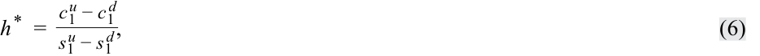

<!-- Formula Text: h *  = c 1 u − c 1 d _ s 1 u − s 1 d , (6) -->
$$h^* = \frac{c_1^u - c_1^d}{S_1^u - S_1^d} \tag{6}$$

<!-- PDF Page 233 -->

trong đó tất cả các đại lượng ở vế phải đều đã được biết tại thời điểm $t = 0$. Phương trình 6 cung cấp cho chúng ta **tỷ số phòng ngừa rủi ro (*hedge ratio*)** của quyền chọn, hay _tỷ lệ_ (*proportion*) của tài sản cơ sở sẽ bù đắp rủi ro gắn liền với một quyền chọn. Trong ví dụ bán quyền chọn mua của chúng ta: 

<!-- Formula Text: h *  = c 1 u − c 1 d _ s 1 u − s 1 d   =    €10 − €0 _ €110 − €60   =   10 _ 50   =  0.20. -->
$$h^* = \frac{c_1^u - c_1^d}{S_1^u - S_1^d} = \frac{\text{€10} - \text{€0}}{\text{€110} - \text{€60}} = \frac{10}{50} = 0,20.$$

Đối với mỗi đơn vị quyền chọn mua được bán ra, chúng ta mua 0,2 đơn vị tài sản cơ sở (hoặc đối với mỗi đơn vị tài sản cơ sở, chúng ta phải bán 5 quyền chọn mua để làm cân bằng giá trị danh mục đầu tư tại thời điểm $t = 1$). Hãy xem xét hai kịch bản như sau: 

- **Biến động đi lên từ $S_0$ tới $S_1^u$ theo hệ số $R^u$:** 

<!-- Formula Text: ● Total portfolio value: V1u = hS1u – c1u -->
$$\text{Tổng giá trị danh mục đầu tư: } V_1^u = h S_1^u - c_1^u = \text{€110} \times 0,20 - \text{€10} = \text{€22} - 10 = \text{€12}.$$

- **Biến động đi xuống từ $S_0$ tới $S_1^d$ theo hệ số $R^d$:** 

  - Tổng giá trị danh mục đầu tư: $V_1^d = h S_1^d - c_1^d = \text{€60} \times 0,20 = \text{€12}$. 

Giá trị danh mục đầu tư là như nhau, $V_1^u = V_1^d$, điều này có hai hàm ý: 

**1.** Chúng ta có thể sử dụng một trong hai kịch bản danh mục để xác định giá trị công cụ phái sinh, và 

**2.** Tỷ suất sinh lợi $V_1^u / V_0 = V_1^d / V_0$ phải bằng một cộng với lãi suất phi rủi ro ($1 + r$). 

Bảng 3 (*Exhibit 3*) tóm tắt các kết quả này. 

###### **Bảng 3: Giá trị của Danh mục Đầu tư Đã Phòng ngừa Rủi ro (*Exhibit 3: Value of the Hedged Portfolio*)** 

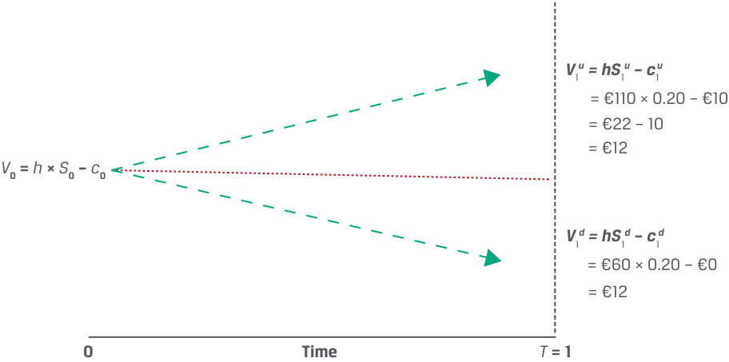

<!-- Picture Text: V 1 u = hS 1 u – c 1 u = €110 × 0.20 – €10 = €22 – 10 = €12 V 0 =  h  ×  S 0 –  c 0 V 1 d = hS 1 d – c 1 d = €60 × 0.20 – €0 = €12 0 Time T  = 1  -->
> **Chú thích hình ảnh:**
> - Tại $t = 0$: $V_0 = h \times S_0 - c_0$.
> - Tại $T = 1$: Dù giá tăng ($V_1^u = \text{€110} \times 0,20 - \text{€10} = \text{€12}$) hay giảm ($V_1^d = \text{€60} \times 0,20 - \text{€0} = \text{€12}$), danh mục đều có giá trị chắc chắn bằng $\text{€12}$.

Phương pháp tiếp cận phòng ngừa rủi ro này không chỉ dành riêng cho quyền chọn mua mà có thể được sử dụng cho bất kỳ hợp đồng phái sinh nào có giá trị hoàn toàn được xác định bởi giá trị của tài sản cơ sở tại thời điểm $t = 1$. 

Để ngăn chặn kinh doanh chênh lệch giá, giá trị danh mục đầu tư tại thời điểm $t = 1$, 

- $V_1 = h \times R^u S_0 - c_1^u = h \times R^d S_0 - c_1^d$, 

cần phải được chiết khấu theo lãi suất phi rủi ro sao cho: 

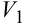

<!-- Formula Text: V 1 -->

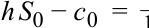

<!-- Formula Text: h S 0 − c 0  =   _ 1 -->
$$h S_0 - c_0 = \frac{V_1}{1 + r}.$$

Dựa trên nguyên tắc định giá không kinh doanh chênh lệch giá và kết quả thanh toán danh mục chắc chắn, $V_1$, giá trị của quyền chọn mua có thể được biểu diễn là: 

<!-- PDF Page 234 -->

$$c_0 = h \times S_0 - V_1(1 + r)^{-1} \tag{7}$$

Thay thế thông tin từ ví dụ trước, chúng ta đã xác lập được rằng $V_1 = \text{€12}$. Với mức lãi suất phi rủi ro hàng năm là 5%: 

$$c_0 = h \times S_0 - V_1(1 + r)^{-1}$$

<!-- Formula Text: =0.2 × €80 − €12 (1.05)−1 = €16 − €11.43 = €4.57. -->
$$= 0,2 \times \text{€80} - \text{€12}(1,05)^{-1} = \text{€16} - \text{€11,43} = \text{€4,57}.$$

Do đó, mức giá quyền chọn mua $c_0$ là €4,57. Chúng ta có thể xác nhận rằng một nhà đầu tư nắm giữ danh mục phòng ngừa rủi ro sẽ kiếm được mức lãi suất phi rủi ro ($r$) là 5% bằng cách so sánh giá trị danh mục đầu tư ban đầu $V_0$ với giá trị danh mục đầu tư sau một kỳ là $V_1$ (nhớ rằng $V_1^u = V_1^d$) bằng €12: 

$$V_0 = h \times S_0 - c_0$$

$$V_0 = \text{€11,43} = \text{€16} - \text{€4,57}$$

$$V_1 = V_0(1 + r) \tag{8}$$

$$V_1 = \text{€12} = \text{€11,43}(1 + 0,05)$$
*(Lưu ý: trong nguyên bản in nhầm là $(1 + 0.5)$, đúng ra là $(1 + 0,05)$).* 

###### **VÍ DỤ 1 (*EXAMPLE 1*)** 

###### **Hightest Capital** 

Hightest Capital tin rằng một cổ phiếu không trả cổ tức cụ thể hiện đang giao dịch ở mức giá $50 và đang cân nhắc việc bán một quyền chọn mua kiểu châu Âu kỳ hạn 1 năm tại mức giá thực hiện là $55. Hãy trả lời các câu hỏi sau đây: 

**1.** Nếu giá cổ phiếu được dự báo sẽ hoặc tăng lên hoặc giảm xuống 20% trong năm tới, mức giá mà Hightest nên kỳ vọng nhận được cho quyền chọn mua đã bán là bao nhiêu? Giả sử lãi suất phi rủi ro là 5%. 

**2.** Mức giá quyền chọn mua sẽ thay đổi như thế nào nếu giá cổ phiếu được dự báo sẽ hoặc tăng lên hoặc giảm xuống 40% trong năm tới? 

**3.** Nếu Hightest có triển vọng lạc quan hơn về giá cổ phiếu trong tương lai (tức là họ ước tính xác suất quyền chọn kết thúc ở trạng thái có lời cao hơn), thì mức giá quyền chọn mua dự kiến sẽ thay đổi như thế nào? 

**4.** Mức giá của một quyền chọn bán kỳ hạn 1 năm tại mức giá thực hiện $55 sẽ là bao nhiêu nếu giá cổ phiếu được dự báo sẽ thay đổi 20%? 40%? 

###### **Lời giải câu 1:** 

Ký hiệu mức giá ban đầu của cổ phiếu cơ sở là $S_0 = \$50$ và giá thực hiện của quyền chọn mua là $X = \$55$. Nếu giá cổ phiếu đi lên hoặc đi xuống 20%, khi đó: 

$$S_1^u = R^u S_0 = 1,2 \times \$50 = \$60.$$

<!-- Formula Text: S 1 d  =  R d S 0  =  0.8 × $50  =  $40. -->
$$S_1^d = R^d S_0 = 0,8 \times \$50 = \$40.$$

Mức giá sẽ hoặc đi lên $60 hoặc đi xuống $40. Với kết quả thanh toán của một quyền chọn mua khi đáo hạn là $\text{Max}(0, S_T - X)$: 

- $c_1^u = \text{Max}(0, S_1^u - X) = \text{Max}(0, \$60 - \$55) = \$5$. 

<!-- Formula Text: c 1 d  =  Max(0,   S 1 d − X)  =  Max(0,  $40 − $55)  =  $0. -->
$$c_1^d = \text{Max}(0, S_1^d - X) = \text{Max}(0, \$40 - \$55) = \$0.$$

Giá trị quyền chọn mua là $5 nếu cổ phiếu cơ sở tăng giá 20% và bằng không nếu nó giảm giá 20%. Tỷ số phòng ngừa rủi ro (*hedge ratio*) của quyền chọn là: 

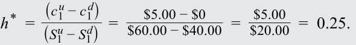

<!-- Formula Text: h *  = (c 1 u − c 1 d) _ (S 1 u − S 1 d)   = $5.00 − $0 ____________ $60.00 − $40.00   =   $5.00 _ $20.00   =  0.25. -->
$$h^* = \frac{c_1^u - c_1^d}{S_1^u - S_1^d} = \frac{\$5,00 - \$0}{\$60,00 - \$40,00} = \frac{\$5,00}{\$20,00} = 0,25.$$

<!-- PDF Page 235 -->

Để tạo ra một danh mục đầu tư phi rủi ro, chúng ta có thể bán một quyền chọn mua và mua 0,25 đơn vị tài sản cơ sở ngày hôm nay. Khi đáo hạn, giá trị danh mục đầu tư đã phòng ngừa rủi ro là: 

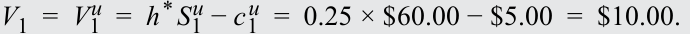

<!-- Formula Text: V 1  =  V 1 u  =  h * S 1 u − c 1 u  =  0.25 × $60.00 − $5.00  =  $10.00. -->
$$V_1 = V_1^u = h^* S_1^u - c_1^u = 0,25 \times \$60,00 - \$5,00 = \$10,00.$$

<!-- Formula Text: V 1  =  V 1 d  =  h * S 1 d − c 1 d  =  0.25 × $40.00 − $0.00  =  $10.00. -->
$$V_1 = V_1^d = h^* S_1^d - c_1^d = 0,25 \times \$40,00 - \$0,00 = \$10,00.$$

Chúng ta có thể sử dụng $V_1^u$ hoặc $V_1^d$ để tính toán giá trị chắc chắn, $V_1$, và giá trị hiện tại của vị thế đã phòng ngừa rủi ro ngày hôm nay là: 

$$V_0 = V_1(1 + r)^{-1} = \$10,00 \times 1,05^{-1} = \$9,52.$$

Giá trị quyền chọn mua là: 

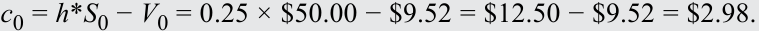

<!-- Formula Text: c0 = h*S0 − V0 = 0.25 × $50.00 − $9.52 = $12.50 − $9.52 = $2.98. -->
$$c_0 = h^* S_0 - V_0 = 0,25 \times \$50,00 - \$9,52 = \$12,50 - \$9,52 = \$2,98.$$

Mức giá không kinh doanh chênh lệch giá của quyền chọn mua phải là $2,98. Nếu không, các nhà đầu tư sẽ có thể xây dựng một tài sản phi rủi ro tổng hợp bằng cách sử dụng quyền chọn và tài sản cơ sở của nó với tỷ suất sinh lợi cao hơn mức lãi suất phi rủi ro. 

Lưu ý rằng tỷ số phòng ngừa rủi ro (0,25 đơn vị trong ví dụ này) mang dấu dương trong trường hợp này bởi vì công cụ phái sinh được bán và tài sản cơ sở được mua. Một tỷ số phòng ngừa rủi ro mang dấu âm hàm ý rằng _cả_ công cụ phái sinh và tài sản cơ sở đều được mua hoặc cùng được bán để tạo ra vị thế phòng ngừa rủi ro. Ngoài ra, mặc dù tỷ số phòng ngừa rủi ro thường được biểu thị dưới dạng một phân số của một đơn vị tài sản cơ sở, các hợp đồng quyền chọn thường được giao dịch với quy mô lớn hơn, cho phép mua hoặc bán một số nguyên tròn các tài sản cơ sở để làm công cụ phòng ngừa rủi ro. Điều quan trọng là _tỷ lệ_ (*ratio*, 4:1 trong trường hợp này) giữa số lượng quyền chọn và số lượng đơn vị tài sản cơ sở được duy trì trong danh mục đầu tư. 

###### **Lời giải câu 2:** 

Nếu giá cổ phiếu thay đổi 40%, khi đó kết quả thanh toán của quyền chọn mua lúc đáo hạn là: 

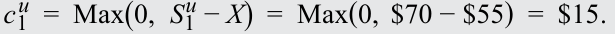

<!-- Formula Text: c 1 u  =  Max(0,   S 1 u − X)  =  Max(0,  $70 − $55)  =  $15. -->
$$c_1^u = \text{Max}(0, S_1^u - X) = \text{Max}(0, \$70 - \$55) = \$15.$$

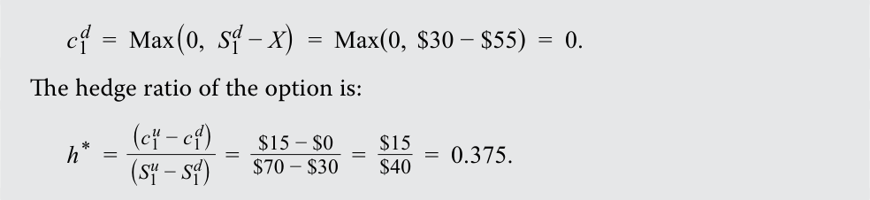

<!-- Formula Text: c 1 d  =  Max(0,   S 1 d − X)  =  Max(0,  $30 − $55)  =  0. The hedge ratio of the option is: h *  = (c 1 u − c 1 d) _ (S 1 u − S 1 d)   =   $15 − $0 _ $70 − $30   =   $15 _ $40   =  0.375. -->
$$c_1^d = \text{Max}(0, S_1^d - X) = \text{Max}(0, \$30 - \$55) = 0.$$

Tỷ số phòng ngừa rủi ro của quyền chọn là: 

$$h^* = \frac{c_1^u - c_1^d}{S_1^u - S_1^d} = \frac{\$15 - \$0}{\$70 - \$30} = \frac{\$15}{\$40} = 0,375.$$

Khi đáo hạn, danh mục đầu tư được phòng ngừa rủi ro hoàn hảo có giá trị là: 

$$V_1 = V_1^u = h^* S_1^u - c_1^u = 0,375 \times \$70 - \$15 = \$11,25.$$

$$V_1 = V_1^d = h^* S_1^d - c_1^d = 0,375 \times \$30 - \$0 = \$11,25.$$

Giá trị hiện tại của vị thế đã phòng ngừa rủi ro tại thời điểm $t = 0$ là: 

$$V_0 = V_1(1 + r)^{-1} = \$11,25 \times 1,05^{-1} = \$10,71.$$

Khi đó, giá quyền chọn mua tại thời điểm $t = 0$ là: 

$$c_0 = h^* S_0 - V_0 = 0,375 \times \$50 - \$10,71 = \$18,75 - \$10,71 = \$8,04.$$

Mức thay đổi giá dự kiến cao hơn cho thấy độ biến động (*volatility*) cao hơn. Sự gia tăng phạm vi của những thay đổi giá trong tương lai làm tăng giá trị của quyền chọn mua. 

<!-- PDF Page 236 -->

###### **Lời giải câu 3:** 

Vì các xác suất thực tế của biến động đi lên hoặc đi xuống ở tài sản cơ sở không ảnh hưởng đến giá trị không kinh doanh chênh lệch giá của quyền chọn, nên mức giá quyền chọn mà Hightest có thể tính sẽ không thay đổi. Hightest có thể bù đắp rủi ro của việc bán quyền chọn mua bằng cách mua $h^*$ đơn vị tài sản cơ sở, vì vậy bất kỳ quan điểm định hướng nào về giá cổ phiếu đều không ảnh hưởng đến vị thế phòng ngừa rủi ro. 

###### **Lời giải câu 4:** 

Sử dụng ngang giá quyền chọn bán–quyền chọn mua, $c_0 - p_0 = S_0 - X(1 + r)^{-T}$, và sắp xếp lại các số hạng để giải tìm giá quyền chọn bán, khi giá cổ phiếu thay đổi 20% và giá quyền chọn mua là $2,98, kết quả có thể được tính như sau: 

$$p_0 = c_0 - S_0 + X(1 + r)^{-T} = \$2,98 - \$50 + \$55(1 + 0,05)^{-1} = \$5,36.$$

Khi giá cổ phiếu cơ sở thay đổi 40% và giá quyền chọn mua là $8,04, giá quyền chọn bán là: 

$$p_0 = c_0 - S_0 + X(1 + r)^{-T} = \$8,04 - \$50 + \$55(1 + 0,05)^{-1} = \$10,42.$$

###### **BỘ CÂU HỎI (*QUESTION SET*)** 

###### **Định giá Quyền chọn theo Mô hình Nhị thức (*Binomial Valuation of Options*)** 

1. Xác định các câu trả lời đúng để điền vào chỗ trống: Để định giá một quyền đòi nợ có điều kiện, chẳng hạn như quyền chọn, cần phải có một mô hình cho __________ của tài sản cơ sở do bản chất ___________ trong kết quả thanh toán của hợp đồng. 

###### **Lời giải:** 

Để định giá một quyền đòi nợ có điều kiện, chẳng hạn như quyền chọn, cần phải có một mô hình cho _hành vi giá trong tương lai (future price behavior)_ của tài sản cơ sở do bản chất _bất đối xứng (asymmetric)_ trong kết quả thanh toán của hợp đồng. 

2. Mô tả sự khác biệt chính giữa việc định giá một quyền đòi nợ có điều kiện (*contingent claim*) và việc định giá một cam kết kỳ hạn (*forward commitment*). 

###### **Lời giải:** 

Bản chất đối xứng trong kết quả thanh toán của một cam kết kỳ hạn (tức là nghĩa vụ phải giao dịch khi đáo hạn) cho phép cam kết đó được mô phỏng một cách hoàn hảo mà không cần phải mô hình hóa hành vi giá tương lai của tài sản cơ sở. Tuy nhiên, bản chất bất đối xứng trong kết quả thanh toán của một quyền đòi nợ có điều kiện (tức là quyền nhưng _không_ phải nghĩa vụ giao dịch khi đáo hạn) _thực sự_ đòi hỏi phải mô hình hóa hành vi giá trong tương lai. 

3. Nếu một mô hình nhị thức một kỳ được sử dụng để định giá một quyền chọn bán ngang giá (*at-the-money put option*), phát biểu nào sau đây là _chính xác nhất_? Quyền chọn sẽ ở trạng thái: 

   - **A.** có lời (*in-the-money*) nếu giá đi lên. 

   - **B.** lỗ (*out-of-the-money*) nếu giá đi lên. 

   - **C.** ngang giá (*at-the-money*) nếu giá đi lên hoặc đi xuống. 

###### **Lời giải:** 

Đáp án đúng là B; quyền chọn sẽ ở trạng thái lỗ (*out-of-the-money*) nếu giá đi lên. Một quyền chọn bán ngang giá có giá thực hiện bằng với giá tài sản cơ sở. Do đó, sự sụt giảm giá sẽ dẫn đến việc quyền chọn bán 

<!-- PDF Page 237 -->

chuyển sang trạng thái _có lời (in the money)_, và sự gia tăng giá sẽ dẫn đến việc quyền chọn bán chuyển sang trạng thái _lỗ (out of the money)_. 

4. Giải thích việc tăng tỷ suất sinh lợi gộp khi giá lên, $R^u$, và/hoặc giảm tỷ suất sinh lợi gộp khi giá xuống, $R^d$, trong một mô hình nhị thức một kỳ sẽ ảnh hưởng như thế nào đến mức giá của quyền chọn mua và quyền chọn bán. 

###### **Lời giải:** 

Trong mô hình nhị thức một kỳ, độ biến động của tài sản cơ sở được đại diện bởi khoảng chênh lệch (*spread*) giữa tỷ suất sinh lợi gộp khi giá lên, $R^u$, và tỷ suất sinh lợi gộp khi giá xuống, $R^d$. Do đó, nếu tỷ suất sinh lợi gộp khi giá lên tăng hoặc tỷ suất sinh lợi gộp khi giá xuống giảm (hoặc cả hai), mức giá của tài sản cơ sở khi đáo hạn sẽ biến động mạnh hơn. Nếu tất cả các yếu tố khác giữ nguyên không đổi, thì giá của cả quyền chọn mua và quyền chọn bán sẽ cùng tăng lên khi tài sản cơ sở được dự báo có độ biến động cao hơn trong suốt vòng đời của quyền chọn. 

5. Một quyền chọn bán trên một cổ phiếu không trả cổ tức có giá thực hiện, $X$, là £21 và còn 6 tháng nữa là đáo hạn. Giá cổ phiếu hiện tại, $S_0$, là £20, và một nhà đầu tư tin rằng giá cổ phiếu sau thời gian 6 tháng sẽ hoặc cao hơn 10% hoặc thấp hơn 10%. 

   **a.** Mô tả cách thức nhà đầu tư có thể xây dựng một danh mục đầu tư được phòng ngừa rủi ro hoàn hảo bằng cách sử dụng quyền chọn bán và cổ phiếu cơ sở của nó. 

   **b.** Giá trị của danh mục đầu tư đã phòng ngừa rủi ro sẽ là bao nhiêu trong kịch bản giá cổ phiếu tăng lên và kịch bản giá cổ phiếu giảm xuống (giả sử lãi suất phi rủi ro là 4%)? 

   **c.** Mức giá không kinh doanh chênh lệch giá của quyền chọn bán là bao nhiêu? 

###### **Lời giải:** 

**a.** Ký hiệu mức giá ban đầu của cổ phiếu cơ sở là $S_0 = \text{£20,00}$ và giá thực hiện của quyền chọn bán là $X = \text{£21,00}$. Nếu giá cổ phiếu tăng lên 10%, khi đó: 

$$S_1^u = R^u S_0 = 1,1 \times \text{£20,00} = \text{£22,00}.$$

Nếu giá cổ phiếu giảm xuống 10%, khi đó: 

$$S_1^d = R^d S_0 = 0,9 \times \text{£20,00} = \text{£18,00}.$$

Với kết quả thanh toán của một quyền chọn bán khi đáo hạn là $\text{Max}(0, X - S_T)$: 

$$p_1^u = \text{Max}(0, X - S_1^u) = \text{Max}(0, \text{£21,00} - \text{£22,00}) = \text{£0}.$$

$$p_1^d = \text{Max}(0, X - S_1^d) = \text{Max}(0, \text{£21,00} - \text{£18,00}) = \text{£3,00}.$$

Quyền chọn bán sẽ có giá trị là £3,00 nếu cổ phiếu cơ sở giảm giá 10% và không có giá trị nếu nó tăng giá 10%. Tỷ số phòng ngừa rủi ro của quyền chọn là: 

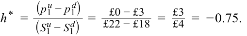

<!-- Formula Text: h *  = (p 1 u − p 1 d) _ (S 1 u − S 1 d)   =    £0 − £3 _ £22 − £18   =   £3 _ £4   =  − 0.75. -->
$$h^* = \frac{p_1^u - p_1^d}{S_1^u - S_1^d} = \frac{\text{£0} - \text{£3}}{\text{£22} - \text{£18}} = -\frac{\text{£3}}{\text{£4}} = -0,75.$$

Vì vậy, để tạo ra một danh mục đầu tư phi rủi ro, chúng ta có thể mua quyền chọn bán và mua 0,75 đơn vị tài sản cơ sở. 

**b.** Khi đáo hạn, giá trị của danh mục đầu tư được phòng ngừa rủi ro hoàn hảo là: 

$$V_1 = V_1^u = |h^*| S_1^u + p_1^u = 0,75 \times \text{£22} + \text{£0} = \text{£16,50}.$$

<!-- PDF Page 238 -->

- $V_1 = V_1^d = |h^*| S_1^d + p_1^d = 0,75 \times \text{£18} + \text{£3,00} = \text{£16,50}$. 

Chúng ta có thể sử dụng $V_1^u$ hoặc $V_1^d$ để tính toán giá trị chắc chắn, $V_1$, và giá trị hiện tại của vị thế đã phòng ngừa rủi ro ngày hôm nay là: 

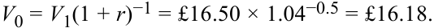

<!-- Formula Text: V0 = V1(1 + r)−1 = £16.50 × 1.04−0.5 = £16.18. -->
$$V_0 = V_1(1 + r)^{-T} = \text{£16,50} \times 1,04^{-0,5} = \text{£16,18}.$$

- **c.** Mức giá của quyền chọn bán là: 

  $$p_0 = V_0 - |h^*| S_0 = \text{£16,18} - 0,75 \times \text{£20} = \text{£16,18} - \text{£15} = \text{£1,18}.$$

  Mức giá không kinh doanh chênh lệch giá của quyền chọn bán phải là £1,18. 

6. Xác định các câu trả lời đúng để điền vào chỗ trống: Khi _______________ được áp dụng, tỷ suất sinh lợi trên tất cả các tài sản phi rủi ro (thực hoặc tổng hợp) phải bằng với __________. 

###### **Lời giải:** 

Khi _quy luật một giá (law of one price)_ được áp dụng, tỷ suất sinh lợi trên tất cả các tài sản phi rủi ro (thực hoặc tổng hợp) phải bằng với _lãi suất phi rủi ro (risk-free rate)_. 

## **<mark>5</mark> TÍNH TRUNG LẬP VỚI RỦI RO (*RISK NEUTRALITY*)** 

mô tả khái niệm trung lập với rủi ro (*risk neutrality*) trong việc định giá công cụ phái sinh 

Như đã chỉ ra trong bài học trước, giá trị của một quyền chọn không bị ảnh hưởng bởi các xác suất thực tế (trong thế giới thực) của việc giá tài sản cơ sở tăng lên hay giảm xuống. Nhận thức này đã góp phần vào việc sử dụng ngày càng rộng rãi các quyền chọn vì các bên trở nên dễ dàng thống nhất về giá trị của một quyền chọn nhất định hơn. Như chúng ta sẽ thấy trong bài học này, chỉ có độ biến động dự kiến—tức là các tỷ suất sinh lợi gộp $R^u$ và $R^d$ đã giới thiệu trước đó—chứ không phải tỷ suất sinh lợi kỳ vọng là cần thiết để định giá một quyền chọn. 

Chúng ta có thể khái quát hóa mối quan hệ giữa giá trị của một quyền chọn và giá trị của các danh mục phòng ngừa rủi ro từ bài học trước bằng cách sử dụng ví dụ về một quyền chọn mua $c_0$ như sau: 

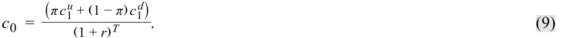

<!-- Formula Text: c 0  = (π c 1 u + (1 − π) c 1 d) _____________ (1 + r) T . (9) -->
$$c_0 = \frac{\pi c_1^u + (1 - \pi) c_1^d}{(1 + r)^T} \tag{9}$$

Giá trị của quyền chọn mua ngày hôm nay, $c_0$, được tính bằng giá trị kỳ vọng của quyền chọn khi đáo hạn, $c_1^u$ và $c_1^d$, được chiết khấu theo lãi suất phi rủi ro, $r$. Điều này cho thấy giá trị của công cụ phái sinh tương tự như bất kỳ tài sản nào khác ở chỗ nó bằng giá trị hiện tại của các dòng tiền dự kiến trong tương lai. Trong trường hợp này, các dòng tiền đó được tính trọng số theo các xác suất giả định vốn nhất quán với tỷ suất sinh lợi trung lập với rủi ro trên tài sản cơ sở. 

**Xác suất trung lập với rủi ro (*risk-neutral probability* – $\pi$)** là xác suất được tính toán sử dụng trong định giá quyền chọn nhị thức mà theo đó tổng có trọng số được chiết khấu của các giá trị kỳ vọng của quyền chọn trên tài sản cơ sở (với $S_1^u = R^u S_0$ và $S_1^d = R^d S_0$) bằng với mức giá quyền chọn hiện tại. Cụ thể, xác suất này được tính bằng cách sử dụng lãi suất phi rủi ro cùng tỷ suất sinh lợi gộp khi giá lên và tỷ suất sinh lợi gộp khi giá xuống giả định của tài sản cơ sở như trong Phương trình 10: 

<!-- Formula Text: π  =   1 + r − R d _ R u − R d  . (10) -->
$$\pi = \frac{1 + r - R^d}{R^u - R^d} \tag{10}$$

Cụ thể hơn, $\pi$ là xác suất trung lập với rủi ro của sự gia tăng trong giá tài sản cơ sở lên $S_1^u = R^u S_0$, và $(1 - \pi)$ là xác suất trung lập với rủi ro của sự sụt giảm xuống $S_1^d = R^d S_0$. 

<!-- PDF Page 239 -->

Thay thế các thông số chi tiết từ ví dụ trước đó của chúng ta, nơi $R^u S_0 = \text{€110}$, $R^d S_0 = \text{€60}$, $S_0 = \text{€80}$, và $X = \text{€100}$, $R^u = 1,375$ và $R^d = 0,75$, đồng thời giả định lãi suất phi rủi ro hàng năm là 5%: 

<!-- Formula Text: π  =   1 + r − R d _ R u − R d    =   1 + 0.05 − 0.75 ___________ 1.375 − 0.75    =  0.48. c 0  = (π c 1 u + (1 − π) c 1 d) _____________ (1 + r) T -->
$$\pi = \frac{1 + r - R^d}{R^u - R^d} = \frac{1 + 0,05 - 0,75}{1,375 - 0,75} = 0,48.$$

$$c_0 = \frac{\pi c_1^u + (1 - \pi) c_1^d}{(1 + r)^T}$$

$$= \frac{0,48 \times \text{Max}(0, \text{€110} - \text{€100}) + 0,52 \times \text{Max}(0, \text{€60} - \text{€100})}{1,05}$$

$$= \frac{\text{€4,80}}{1,05} = \text{€4,57}, \text{ khớp với kết quả trước đó của chúng ta từ bài học trước.}$$

Trong công thức trên, các xác suất trung lập với rủi ro chỉ được xác định bởi các tỷ suất sinh lợi gộp khi giá lên và xuống, $R^u$ và $R^d$, đại diện cho độ biến động của tài sản cơ sở và lãi suất phi rủi ro được sử dụng để tính giá trị hiện tại của các dòng tiền tương lai. Giá trị phái sinh không kinh doanh chênh lệch giá này được thiết lập tách biệt khỏi quan điểm của nhà đầu tư về rủi ro và được gọi là **định giá trung lập với rủi ro (*risk-neutral pricing*)**. 

Việc sử dụng định giá trung lập với rủi ro còn vượt xa cây nhị thức một kỳ đơn giản và có thể được áp dụng cho bất kỳ mô hình nào sử dụng các biến động giá tài sản cơ sở trong tương lai, như chúng ta sẽ thấy ở phần sau của chương trình học. 

###### **VÍ DỤ 2 (*EXAMPLE 2*)** 

###### **Hightest Capital (xem xét lại)** 

Xem xét lại Ví dụ 1 và quyền chọn mua kiểu châu Âu được bán bởi Hightest Capital, bây giờ chúng ta có thể khám phá mức giá quyền chọn bằng cách sử dụng phương pháp định giá trung lập với rủi ro. Hãy trả lời các câu hỏi sau đây: 

**1.** Xác suất trung lập với rủi ro của một biến động đi lên và một biến động đi xuống trong mô hình nhị thức một kỳ được mô tả ở Ví dụ 1 là bao nhiêu? 

**2.** Chứng minh cách thức xác suất trung lập với rủi ro này có thể được sử dụng để tính ra mức giá không kinh doanh chênh lệch giá của quyền chọn mua. 

**3.** Giá trị của một quyền chọn _bán_ (*put option*) kiểu châu Âu trên cùng cổ phiếu đó với cùng giá thực hiện và ngày đáo hạn sẽ là bao nhiêu? 

**4.** Xác nhận rằng giá quyền chọn mua được tính trong câu hỏi 2 và giá quyền chọn bán được tính trong câu hỏi 3 đều thỏa mãn mối quan hệ ngang giá quyền chọn bán–quyền chọn mua. 

###### **Lời giải câu 1:** 

Xác suất trung lập với rủi ro của một biến động đi lên, ký hiệu là $\pi$, bằng: 

<!-- Formula Text: π  =   1 + r − R d _ R u − R d    =   1 + 0.05 − 0.8 _ 1.2 − 0.8    =  0.625. -->
$$\pi = \frac{1 + r - R^d}{R^u - R^d} = \frac{1 + 0,05 - 0,8}{1,2 - 0,8} = 0,625.$$

Do đó, xác suất trung lập với rủi ro của một biến động đi xuống là: 

$$1 - \pi = 1 - 0,625 = 0,375.$$

###### **Lời giải câu 2:** 

Giá quyền chọn mua ngày hôm nay được cho bởi giá trị kỳ vọng (trung lập với rủi ro) của kết quả thanh toán quyền chọn khi đáo hạn, được chiết khấu theo lãi suất phi rủi ro, $r$: 

<!-- Formula Text: c 0  = (π c 1 u + (1 − π) c 1 d) _____________ (1 + r) T -->
$$c_0 = \frac{\pi c_1^u + (1 - \pi) c_1^d}{(1 + r)^T}$$

<!-- Formula Text: =[0.625 × Max(0, $60 − $55) + 0.375 × Max (0, $40 − $55)]/1.05 -->
$$= \frac{0,625 \times \text{Max}(0, \$60 - \$55) + 0,375 \times \text{Max}(0, \$40 - \$55)}{1,05}$$

<!-- PDF Page 240 -->

<!-- Formula Text: =  $3.125 _ 1.05    =  $2.98 -->
$$= \frac{\$3,125}{1,05} = \$2,98$$

khớp với giá trị trong Ví dụ 1. 

###### **Lời giải câu 3:** 

Vì công thức định giá trung lập với rủi ro có hiệu lực cho bất kỳ quyền chọn kiểu châu Âu nào, nên giá trị quyền chọn bán với giá thực hiện $55 là: 

<!-- Formula Text: p 0  = (π p 1 u + (1 − π) p 1 d) ______________ (1 + r) T -->
$$p_0 = \frac{\pi p_1^u + (1 - \pi) p_1^d}{(1 + r)^T}$$

$$= \frac{0,625 \times \text{Max}(0, \$55 - \$60) + 0,375 \times \text{Max}(0, \$55 - \$40)}{1,05}$$

$$= \frac{\$5,625}{1,05} = \$5,36.$$

Lưu ý rằng chúng ta đã sử dụng cùng xác suất trung lập với rủi ro $\pi$ như trong Câu hỏi 1 và 2, bởi vì các giá trị này là một hàm số của mô hình nhị thức cho tài sản cơ sở ứng với một độ biến động tài sản và lãi suất phi rủi ro nhất định, chứ không phụ thuộc vào quyền chọn cụ thể đang được định giá. 

###### **Lời giải câu 4:** 

Các quyền chọn mua và quyền chọn bán kiểu châu Âu có cùng giá thực hiện và ngày đáo hạn phải thỏa mãn ngang giá quyền chọn bán–quyền chọn mua được xác định bởi: 

$$S_0 + p_0 = c_0 + X(1 + r)^{-T} = \$50 + \$5,36 = \$2,98 + \$55 \times 1,05^{-1} = \$55,36,$$

qua đó xác nhận mối quan hệ này. 

###### **BỘ CÂU HỎI (*QUESTION SET*)** 

###### **Phòng ngừa Rủi ro và Tính Trung lập với Rủi ro (*Hedging and Risk Neutrality*)** 

1. Nhân tố nào sau đây ảnh hưởng đến giá trị của một mức giá quyền chọn khi sử dụng mô hình nhị thức? 

   - **A.** Tỷ suất sinh lợi phi rủi ro (*The risk-free rate of return*) 

   - **B.** Mức độ ngại rủi ro của các nhà đầu tư (*The level of investors’ risk aversion*) 

   - **C.** Xác suất thực tế của một biến động tăng giá (*The probability of an upward price move*) 

###### **Lời giải:** 

Đáp án đúng là A, tỷ suất sinh lợi phi rủi ro. Giá trị của một quyền chọn được xác định bởi kỳ vọng trung lập với rủi ro của nó được chiết khấu theo lãi suất phi rủi ro. Trong mô hình nhị thức một kỳ, các xác suất trung lập với rủi ro chỉ được xác định bởi lãi suất phi rủi ro trong suốt vòng đời của quyền chọn và độ biến động của tài sản cơ sở (được đo lường bởi các tỷ suất sinh lợi gộp khi giá lên và xuống, $R^u$ và $R^d$). Nhờ khả năng xây dựng một vị thế phòng ngừa rủi ro hoàn hảo cho quyền chọn bằng cách sử dụng tài sản cơ sở, giá của một quyền chọn độc lập với mức độ ngại rủi ro của các nhà đầu tư và xác suất thực tế của việc giá tài sản cơ sở đi lên (hoặc đi xuống). 

2. Nếu giá tài sản cơ sở trong một mô hình nhị thức một kỳ có thể tăng 15% hoặc giảm 10% trong kỳ và lãi suất phi rủi ro hiện hành 

<!-- PDF Page 241 -->

trong kỳ là 4%, thì xác suất trung lập với rủi ro của một sự sụt giảm giá tài sản là bao nhiêu? 

###### **Lời giải:** 

Nếu giá tài sản cơ sở trong mô hình nhị thức một kỳ có thể tăng 15%, thì tỷ suất sinh lợi gộp khi giá lên là $R^u = 1,15$. Tương tự, nếu giá có thể giảm 10%, thì tỷ suất sinh lợi gộp khi giá xuống là $R^d = 0,9$. Xác suất trung lập với rủi ro của một biến động giá đi lên là: 

$$\pi = \frac{1 + r - R^d}{R^u - R^d} = \frac{1 + 0,04 - 0,9}{1,15 - 0,9} = 0,56.$$

Xác suất trung lập với rủi ro của một biến động giá đi xuống là $1 - 0,56 = 0,44$. 

3. Phương án nào sau đây mô tả _đúng nhất_ cách diễn giải định giá trung lập với rủi ro của công thức định giá quyền chọn nhị thức một kỳ? 

   - **A.** Kết quả thanh toán kỳ vọng trong thế giới thực được chiết khấu theo lãi suất phi rủi ro 
   - **B.** Kết quả thanh toán kỳ vọng trung lập với rủi ro được chiết khấu theo lãi suất phi rủi ro 
   - **C.** Kết quả thanh toán kỳ vọng trung lập với rủi ro được chiết khấu theo lãi suất đã điều chỉnh rủi ro 

###### **Lời giải:** 

Đáp án đúng là B, kết quả thanh toán kỳ vọng trung lập với rủi ro được chiết khấu theo lãi suất phi rủi ro. Cách diễn giải định giá trung lập với rủi ro của công thức định giá quyền chọn phát biểu rằng giá trị của một quyền chọn ngày hôm nay là giá trị kỳ vọng trung lập với rủi ro của nó khi đáo hạn, được chiết khấu theo lãi suất phi rủi ro. 

4. Xác định các câu trả lời đúng để điền vào chỗ trống: Nếu một quyền chọn mua đang giao dịch ở mức giá cao hơn mức giá hàm ý từ mô hình nhị thức, các nhà đầu tư có thể kiếm được tỷ suất sinh lợi vượt quá lãi suất phi rủi ro bằng cách ________ ở mức lãi suất phi rủi ro, __________ quyền chọn mua, và _________ tài sản cơ sở. 

###### **Lời giải:** 

Nếu một quyền chọn mua đang giao dịch ở mức giá cao hơn mức giá hàm ý từ mô hình nhị thức, các nhà đầu tư có thể kiếm được tỷ suất sinh lợi vượt quá lãi suất phi rủi ro bằng cách _đi vay (borrowing)_ ở mức lãi suất phi rủi ro, _bán (selling)_ quyền chọn mua, và _mua (buying)_ tài sản cơ sở. Một tài sản phi rủi ro tổng hợp có thể được tạo ra bằng chiến lược này nhằm mang lại tỷ suất sinh lợi cao hơn lãi suất phi rủi ro. Việc bán quyền chọn mua đang bị định giá cao sẽ mang lại dòng tiền thu vào cao hơn mức cần thiết để tạo ra tỷ suất sinh lợi phi rủi ro. 

5. Giá của một cổ phiếu hiện đang là ¥8.000. Vào cuối một tháng khi các quyền chọn của nó đáo hạn, giá cổ phiếu hoặc tăng lên 5% hoặc giảm xuống 15%. Nếu lãi suất phi rủi ro là –0,20% cho kỳ đó, giá trị của một quyền chọn bán với giá thực hiện ¥7.950 là bao nhiêu? 

   - **A.** ¥333,67 
   - **B.** ¥299,60 
   - **C.** ¥236,93 

###### **Lời giải:** 

Đáp án đúng là B, ¥299,60. Sử dụng phương pháp định giá trung lập với rủi ro, chúng ta có thể xác định xác suất trung lập với rủi ro là: 

$$\pi = \frac{1 + r - R^d}{R^u - R^d} = \frac{1 - 0,002 - 0,85}{1,05 - 0,85} = 0,74.$$

Do đó, xác suất trung lập với rủi ro của một biến động giảm là $1 - \pi = 1 - 0,74 = 0,26$. Giá trị của một quyền chọn bán có giá thực hiện ¥7.950 là: 

<!-- PDF Page 242 -->

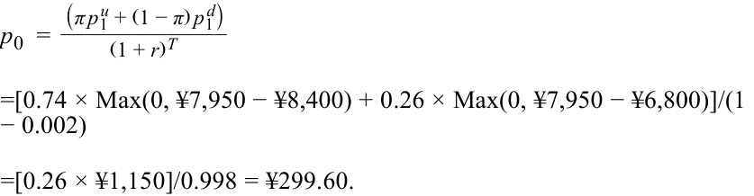

<!-- Formula Text: p 0  = (π p 1 u + (1 − π) p 1 d) ______________ (1 + r) T =[0.74 × Max(0, ¥7,950 − ¥8,400) + 0.26 × Max(0, ¥7,950 − ¥6,800)]/(1 − 0.002) =[0.26 × ¥1,150]/0.998 = ¥299.60. -->
$$p_0 = \frac{\pi p_1^u + (1 - \pi) p_1^d}{(1 + r)^T}$$

$$= \frac{0,74 \times \text{Max}(0, \text{¥7.950} - \text{¥8.400}) + 0,26 \times \text{Max}(0, \text{¥7.950} - \text{¥6.800})}{1 - 0,002}$$

$$= \frac{0,26 \times \text{¥1.150}}{0,998} = \text{¥299,60}.$$
