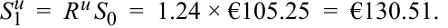
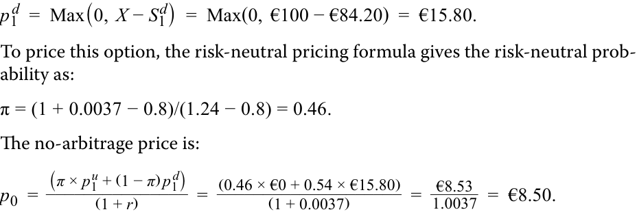

# Tập 7: Công cụ Phái sinh (*Derivatives*)
## Học phần 10: Xác định Giá trị Công cụ Phái sinh Sử dụng Mô hình Nhị thức Một Kỳ (*Valuing a Derivative Using a One-Period Binomial Model*)
### Phần 2/2: Bài tập Thực hành (Trang PDF 243–246)

---

<!-- PDF Page 243 -->

# **BÀI TẬP THỰC HÀNH (*PRACTICE PROBLEMS*)** 

## **Thông tin sau đây liên quan đến các câu hỏi từ 1 đến 4** 

Privatbank Kleinert KGaA, một công ty quản lý gia sản tư nhân tại Munich, có một số khách hàng đang nắm giữ lượng lớn cổ phần trong công ty công nghệ tài chính (*fintech*) của Đức là SparCoin AG. Chuyên viên phân tích của Kleinert lo ngại về sự sụt giảm giá cổ phiếu của SparCoin trong năm tới và đang khuyến nghị khách hàng cân nhắc việc mua một quyền chọn bán kỳ hạn 1 năm với giá thực hiện là €100. Giá giao ngay của SparCoin ($S_0$) là €105,25, và cổ phiếu này không trả cổ tức. Lãi suất phi rủi ro là 0,37%. 

**1.** Chuyên viên phân tích của Kleinert ước tính có cơ hội 50-50 rằng giá cổ phiếu SparCoin sẽ hoặc tăng 12% hoặc giảm 10% vào ngày đáo hạn của quyền chọn bán. Phát biểu nào sau đây mô tả đúng nhất mức giá quyền chọn không kinh doanh chênh lệch giá được hàm ý bởi giả định này? 

   - **A.** Vì có 50% khả năng cổ phiếu sẽ giảm xuống €94,73, nên có cơ hội 50-50 nhận được khoản thanh toán €5,27 khi thực hiện quyền và do đó quyền chọn bán không kinh doanh chênh lệch giá có giá trị là €2,64 ($= \text{€5,27} / 2$). 

   - **B.** Vì có 50% khả năng cổ phiếu sẽ giảm xuống €94,73, nên có cơ hội 50-50 nhận được khoản thanh toán €5,27 khi thực hiện quyền và với xác suất trung lập với rủi ro là 0,47, mức giá quyền chọn bán không kinh doanh chênh lệch giá là €2,48 ($= \text{€5,27} \times 0,47$). 

   - **C.** Vì có 50% khả năng cổ phiếu sẽ giảm xuống €94,73 và xác suất trung lập với rủi ro là 0,47, mức giá quyền chọn bán không kinh doanh chênh lệch giá là €2,78 ($= \text{€5,27} \times \{[1 - 0,47] / 1,0037\}$). 

**2.** Nếu khách hàng của Kleinert quan sát thấy quyền chọn bán kỳ hạn 1 năm với giá thực hiện €100 đang giao dịch ở mức €2,50, phát biểu nào sau đây mô tả đúng nhất cách thức khách hàng của Kleinert có thể tận dụng cơ hội này để kiếm được tỷ suất sinh lợi phi rủi ro cao hơn mức 0,37% trong năm đó? 

   - **A.** Kleinert nên mua quyền chọn bán và đồng thời mua xấp xỉ 0,23 cổ phiếu trên mỗi quyền chọn để khớp với tỷ số phòng ngừa rủi ro (*hedge ratio*). 

   - **B.** Kleinert nên mua quyền chọn bán và mua 50% cổ phiếu cơ sở dựa trên cơ hội 50-50 cổ phiếu sẽ giảm giá và quyền chọn bán được thực hiện. 

   - **C.** Kleinert nên mua quyền chọn bán và mua 47% cổ phiếu cơ sở để khớp với xác suất trung lập với rủi ro của việc thực hiện quyền chọn bán. 

**3.** Nếu các khoản đầu tư phi rủi ro mang lại mức lợi suất cao hơn trong năm tới, phát biểu nào sau đây mô tả đúng nhất điều này sẽ ảnh hưởng như thế nào đến giá trị không kinh doanh chênh lệch giá của quyền chọn bán trên cổ phiếu SparCoin? 

   - **A.** Sự gia tăng lãi suất phi rủi ro sẽ _không có tác động_ lên giá quyền chọn bán của SparCoin, bởi vì nó chỉ là một hàm số của xác suất và mức độ tăng hoặc giảm giá cổ phiếu khi quyền chọn đáo hạn. 

<!-- PDF Page 244 -->

   - **B.** Sự gia tăng lãi suất phi rủi ro sẽ _làm tăng_ giá trị của quyền chọn bán, bởi vì nó sẽ làm tăng xác suất trung lập với rủi ro của một sự sụt giảm giá. 

   - **C.** Sự gia tăng lãi suất phi rủi ro sẽ _làm giảm_ giá trị của quyền chọn bán, bởi vì nó sẽ vừa làm tăng xác suất trung lập với rủi ro của một sự tăng giá $\pi$ vừa làm giảm giá trị hiện tại của kết quả thanh toán quyền chọn dự kiến. 

**4.** Nếu tỷ lệ phần trăm tăng và giảm giá dự kiến của cổ phiếu SparCoin _tăng gấp đôi_, phương án nào sau đây là ước tính gần nhất cho mức giá quyền chọn bán kỳ hạn 1 năm với giá thực hiện €100? 

   - **A.** Giá quyền chọn bán kỳ hạn 1 năm sẽ tăng lên €7,90. 

   - **B.** Giá quyền chọn bán kỳ hạn 1 năm sẽ tăng lên €8,50. 

   - **C.** Giá quyền chọn bán kỳ hạn 1 năm sẽ tăng lên €7,40. 

<!-- PDF Page 245 -->

# **LỜI GIẢI (*SOLUTIONS*)** 

1. Đáp án đúng là C. Mức tăng 12% của giá cổ phiếu mang lại: 

   $$S_1^u = R^u S_0 = 1,12 \times \text{€105,25} = \text{€117,88}.$$

   Quyền chọn bán sẽ hết hạn mà không được thực hiện: 

   - $p_1^u = \text{Max}(0, X - S_1^u) = \text{Max}(0, \text{€100} - \text{€117,88}) = \text{€0}$. 

   Ngược lại, mức giảm giá 10% mang lại: 

   $$S_1^d = R^d S_0 = 0,9 \times \text{€105,25} = \text{€94,73}.$$

   Quyền chọn bán sẽ có kết quả thanh toán là: 

   $$p_1^d = \text{Max}(0, X - S_1^d) = \text{Max}(0, \text{€100} - \text{€94,73}) = \text{€5,27}.$$

   Để định giá quyền chọn này, công thức định giá trung lập với rủi ro cho biết xác suất trung lập với rủi ro $\pi$ là: 

   $$\pi = \frac{1 + 0,0037 - 0,9}{1,12 - 0,9} = 0,47.$$

   Mức giá không kinh doanh chênh lệch giá là: 

   

   <!-- Formula Text: p 0  = (π × p 1 u + (1 − π) p 1 d) _______________ (1 + r) -->
   $$p_0 = \frac{\pi \times p_1^u + (1 - \pi) p_1^d}{(1 + r)}$$

   $$p_0 = \frac{0,47 \times \text{€0} + 0,53 \times \text{€5,27}}{1 + 0,0037} = \frac{\text{€2,79}}{1,0037} = \text{€2,78}.$$

2. Đáp án đúng là A. Nếu quyền chọn bán có thể được mua với mức giá thấp hơn mức giá không kinh doanh chênh lệch giá, thì một cơ hội kinh doanh chênh lệch giá tiềm năng đang hiện hữu. Trong trường hợp này, khách hàng của Kleinert nên mua quyền chọn bán đang bị định giá thấp (*underpriced*) và mua $h^*$ đơn vị cổ phiếu của SparCoin. Tỷ số phòng ngừa rủi ro, $h^*$, được tính như sau: 

   

   <!-- Formula Text: h *  = (p 1 u − p 1 d) _ (S 1 u − S 1 d)   = €0 − €5.27 _____________ €117.88 − €94.73   =   − €5.27 _ €23.15   =  − 0.2276. -->
   $$h^* = \frac{p_1^u - p_1^d}{S_1^u - S_1^d} = \frac{\text{€0} - \text{€5,27}}{\text{€117,88} - \text{€94,73}} = \frac{-\text{€5,27}}{\text{€23,15}} = -0,2276.$$

   Lưu ý rằng tỷ số phòng ngừa rủi ro mang dấu âm hàm ý rằng cả quyền chọn bán và tài sản cơ sở đều được mua (hoặc cùng được bán) để tạo ra vị thế phòng ngừa rủi ro. Giao dịch mua ban đầu đối với quyền chọn bán và cổ phiếu này sẽ có chi phí là: 

   $$\text{€2,50} + 0,2276 \times \text{€105,25} = \text{€26,45}.$$

   Nếu giá cổ phiếu giảm xuống, giá trị của danh mục đầu tư này sẽ là: 

   $$V_1 = V_1^d = h^* S_1^d + p_1^d = 0,2276 \times \text{€94,73} + \text{€5,27} = \text{€26,83}.$$

   Chiến lược này tạo ra tỷ suất sinh lợi phi rủi ro là $(\text{€26,83} - \text{€26,45}) / \text{€26,45} = 1,44\%$, cao hơn mức lợi suất 0,37% trên các khoản đầu tư phi rủi ro hiện có khác. 

3. Đáp án đúng là C. Lãi suất tăng lên làm giảm giá trị của một quyền chọn bán. Việc tăng lãi suất phi rủi ro sẽ làm tăng xác suất trung lập với rủi ro của một sự tăng giá $\pi$ và làm giảm giá trị hiện tại của kết quả thanh toán quyền chọn dự kiến. Vì giá trị của một quyền chọn bán có mối quan hệ nghịch biến với giá của tài sản cơ sở, xác suất biến động tăng giá cao hơn sẽ làm giảm kết quả thanh toán kỳ vọng từ quyền chọn bán. Do đó, cả hai tác động này sẽ cùng làm giảm giá trị quyền chọn bán khi tỷ suất sinh lợi trên các khoản đầu tư phi rủi ro tăng lên. 

4. Đáp án đúng là B. Mức tăng 24% (trước đây là 12%) của giá cổ phiếu mang lại: 

<!-- PDF Page 246 -->

<!-- Formula Text: S 1 u  =  R u S 0  =  1.24 × €105.25  =  €130.51. -->
$$S_1^u = R^u S_0 = 1,24 \times \text{€105,25} = \text{€130,51}.$$

Quyền chọn bán sẽ hết hạn mà không được thực hiện: 

$$p_1^u = \text{Max}(0, X - S_1^u) = \text{Max}(0, \text{€100,00} - \text{€130,51}) = \text{€0}.$$

Ngược lại, mức giảm 20% (trước đây là 10%) mang lại: 

$$S_1^d = R^d S_0 = 0,8 \times \text{€105,25} = \text{€84,20}.$$

Quyền chọn bán sẽ có kết quả thanh toán là: 

<!-- Formula Text: p 1 d  =  Max(0,  X − S 1 d)  =  Max(0,  €100 − €84.20)  =  €15.80. To price this option, the risk-neutral pricing formula gives the risk-neutral prob- ability as: π = (1 + 0.0037 − 0.8)/(1.24 − 0.8) = 0.46. The no-arbitrage price is: p 0  = (π × p 1 u + (1 − π) p 1 d) _______________ (1 + r) =   (0.46 × €0 + 0.54 × €15.80) ____________________ (1 + 0.0037) =   €8.53 _ 1.0037   =  €8.50. -->
$$p_1^d = \text{Max}(0, X - S_1^d) = \text{Max}(0, \text{€100} - \text{€84,20}) = \text{€15,80}.$$

Để định giá quyền chọn này, công thức định giá trung lập với rủi ro cho biết xác suất trung lập với rủi ro là: 

$$\pi = \frac{1 + 0,0037 - 0,8}{1,24 - 0,8} = 0,46.$$

Mức giá không kinh doanh chênh lệch giá là: 

$$p_0 = \frac{\pi \times p_1^u + (1 - \pi) p_1^d}{(1 + r)} = \frac{0,46 \times \text{€0} + 0,54 \times \text{€15,80}}{1 + 0,0037} = \frac{\text{€8,53}}{1,0037} = \text{€8,50}.$$
