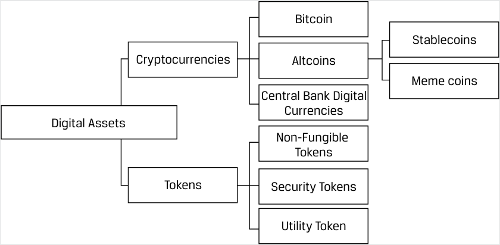
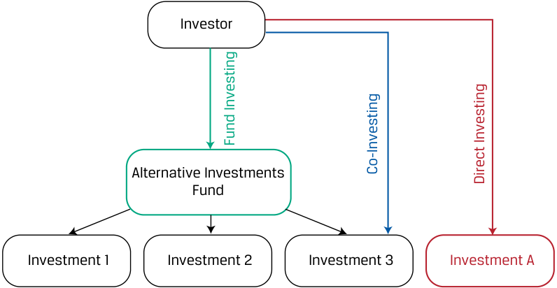
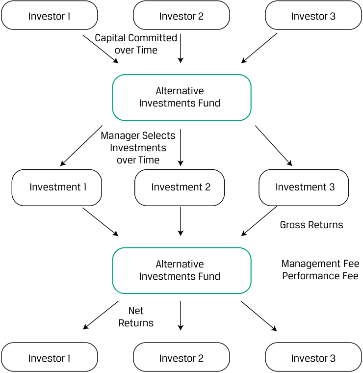
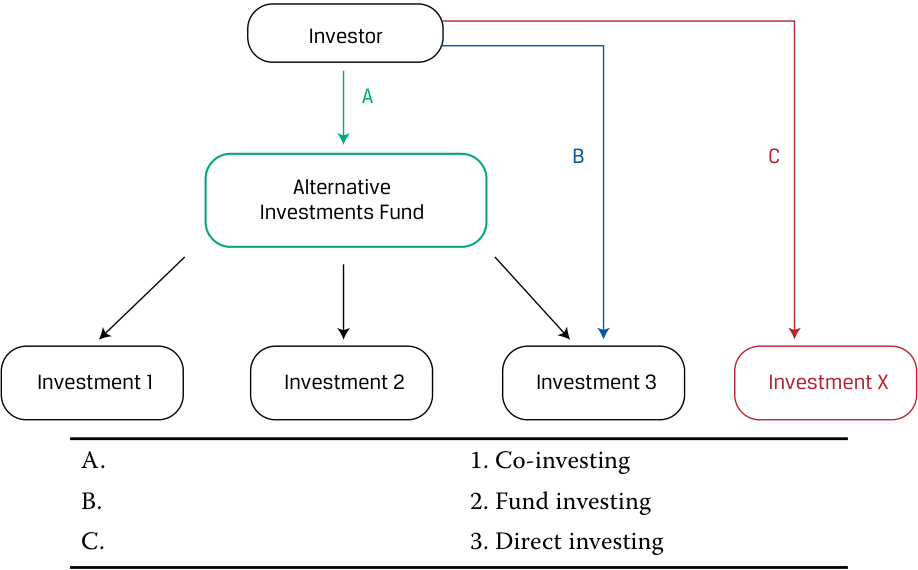

# Tập 8: Đầu tư Thay thế (Alternative Investments)
## Learning Module 1 Alternative Investment Features, Methods, and Structures (Trang PDF 11–40)

---

# Tập 8: Đầu tư Thay thế (Volume 8: Alternative Investments)
## Học phần 1: Đặc điểm, Phương thức và Cấu trúc Đầu tư Thay thế (Learning Module 1: Alternative Investment Features, Methods, and Structures)
### Phần 1/2: Giới thiệu (Introduction) (Trang PDF 11–26)

---

<!-- PDF Page 11 -->

#### H Ọ C P H Ầ N (L E A R N I N G M O D U L E)

# **<mark>1</mark>** 

### **Đặc điểm, Phương thức và Cấu trúc Đầu tư Thay thế (Alternative Investment Features, Methods, and Structures)** 

###### **<mark>MỤC TIÊU HỌC TẬP (LEARNING OUTCOMES)</mark>** 

###### **_Làm chủ kiến thức – Ứng viên cần có khả năng:_** 

- mô tả các đặc điểm và phân loại của đầu tư thay thế (*alternative investments*)
- so sánh phương thức đầu tư trực tiếp (*direct investment*), đồng đầu tư (*co-investment*) và đầu tư qua quỹ (*fund investment*) đối với các khoản đầu tư thay thế
- mô tả các cấu trúc sở hữu đầu tư và cấu trúc thù lao (*ownership and compensation structures*) thường được sử dụng trong đầu tư thay thế

##### **GIỚI THIỆU (INTRODUCTION)** 

**<mark>1</mark>** 

Các khoản đầu tư thay thế (*Alternative Investments*) được nhóm lại với nhau không phải vì chúng có những đặc điểm tương đồng, mà bởi vì chúng mang những đặc tính khác biệt so với các khoản đầu tư truyền thống (*traditional investments*). Việc đầu tư vào tài sản thay thế có thể được thực hiện thông qua đầu tư qua quỹ (*fund investing*), đồng đầu tư (*co-investing*), hoặc đầu tư trực tiếp (*direct investing*). Các khoản đầu tư thay thế thường mang lại cho nhà đầu tư mức độ đa dạng hóa lớn hơn và tỷ suất sinh lợi kỳ vọng (*expected returns*) cao hơn so với các khoản đầu tư truyền thống, nhưng thường liên quan đến các khoản đầu tư dài hạn hơn, kém thanh khoản (*illiquid*) trong các thị trường kém hiệu quả hơn (*less efficient markets*). Việc đầu tư vào các tài sản thay thế đòi hỏi kiến thức chuyên môn sâu (*specialized knowledge*). Đầu tư thay thế thường dựa vào các cấu trúc thù lao phức tạp và hậu hĩnh hơn so với đầu tư truyền thống nhằm gắn kết tốt hơn lợi ích động lực (*align incentives*) giữa nhà quản lý và nhà đầu tư trong các giai đoạn dài hạn.

###### **TỔNG QUAN HỌC PHẦN (LEARNING MODULE OVERVIEW)** 

- Đầu tư thay thế (*alternative investments*) là các khoản đầu tư ngoài quyền sở hữu đối với các loại tài sản truyền thống (cổ phiếu đại chúng, các công cụ thu nhập cố định và tiền mặt) và bao gồm vốn tư nhân (*private capital*), tài sản thực (*real assets*), và quỹ phòng hộ (*hedge funds*).

- Vốn tư nhân (*private capital*) bao gồm vốn cổ phần tư nhân (*private equity*) và nợ tư nhân (*private debt*). Tài sản thực (*real assets*) bao gồm bất động sản (*real estate*), cơ sở hạ tầng (*infrastructure*), và tài nguyên thiên nhiên (*natural resources*). Các quỹ phòng hộ (*hedge funds*) có thể đầu tư trên cả các loại tài sản truyền thống lẫn tài sản thay thế và được phân biệt bởi phương pháp tiếp cận đầu tư (*investment approach*) của chúng, vốn thường bao gồm việc sử dụng đòn bẩy (*leverage*), công cụ phái sinh (*derivatives*), hoặc các chiến lược khác.

<!-- PDF Page 12 -->

- Nhà đầu tư thường cân nhắc các khoản đầu tư thay thế nhằm theo đuổi sự đa dạng hóa danh mục đầu tư lớn hơn và/hoặc gia tăng tỷ suất sinh lợi kỳ vọng. Khi làm như vậy, họ thường phải đối mặt với thời gian đầu tư dài hơn, tính thanh khoản giảm sút, và các thị trường kém hiệu quả hơn so với các tài sản truyền thống.

- Các nhà đầu tư vào quỹ đầu tư thay thế thuê ngoài (*outsource*) toàn bộ quyền kiểm soát và quản lý các khoản đầu tư để đổi lấy mức phí tương đối cao, trong khi các phương thức đồng đầu tư (*co-investment*) và đầu tư trực tiếp (*direct investment*) đòi hỏi nỗ lực và quyền kiểm soát lớn hơn của nhà đầu tư đối với việc lựa chọn và quản lý tài sản để đổi lấy mức phí tương đối thấp hơn.

- Một loại cấu trúc đầu tư thay thế phổ biến khác là công ty hợp danh hữu hạn (*limited partnership*), trong đó trách nhiệm được phân bổ linh hoạt giữa các nhà đầu tư và nhà quản lý—với các nhà quản lý đóng vai trò là thành viên hợp danh (*general partners* – GP) và các nhà đầu tư đóng vai trò là thành viên góp vốn hữu hạn (*limited partners* – LP). Các công ty hợp danh hữu hạn thường có cấu trúc thù lao phức tạp hơn, bao gồm cả phí quản lý (*management fees*) và phí hiệu quả hoạt động (*performance fees*).

- Các cấu trúc đầu tư thay thế bổ sung bao gồm quỹ tín thác (*trusts*) và công ty trách nhiệm hữu hạn (*limited liability companies* – LLC).

###### **TỰ ĐÁNH GIÁ HỌC PHẦN (LEARNING MODULE SELF-ASSESSMENT)** 

1. Xác định lựa chọn nào sau đây _có khả năng cao nhất_ là một khoản đầu tư thay thế: 

   - **A.** Khoản đầu tư vào một quỹ phòng hộ (*hedge fund*) tập trung vào các tài sản truyền thống 

   - **B.** Cổ phiếu của một công ty sản xuất được giao dịch trên sàn giao dịch Bursa Malaysia 

   - **C.** Một hợp đồng tương lai ngoại hối đồng euro được mua trên sàn giao dịch Chicago Mercantile Exchange 

   - **Lời giải (Solution):** 

Đáp án đúng là A. Một khoản đầu tư vào quỹ phòng hộ (*hedge fund*), ngay cả khi quỹ đó mua các tài sản truyền thống được giao dịch trên sàn, vẫn được coi là một khoản đầu tư thay thế. B sai vì cổ phiếu được giao dịch trên một sàn giao dịch đại chúng, chẳng hạn như sàn Bursa Malaysia, được coi là khoản đầu tư truyền thống chứ không phải đầu tư thay thế. C sai vì hợp đồng tương lai ngoại hối đồng euro được mua trên một sàn giao dịch đại chúng, chẳng hạn như sàn Chicago Mercantile Exchange, được coi là khoản đầu tư truyền thống chứ không phải đầu tư thay thế.

2. Một lợi thế của việc đầu tư vào các khoản đầu tư thay thế _có khả năng cao nhất_ là: 

   - **A.** tính thanh khoản cao (*high liquidity*). 

   - **B.** phí đầu tư thấp (*low investment fees*). 

   - **C.** tỷ suất sinh lợi kỳ vọng cao hơn (*higher expected returns*). 

###### **Lời giải (Solution):** 

Đáp án đúng là C. Các nhà đầu tư thường bị thu hút bởi các khoản đầu tư thay thế khi tìm kiếm sự đa dạng hóa lớn hơn và/hoặc tỷ suất sinh lợi kỳ vọng cao hơn. A sai vì các nhà đầu tư thường phải đối mặt với thời gian đầu tư dài hơn, tính thanh khoản giảm sút, và các thị trường kém hiệu quả hơn khi đầu tư thay thế so với các tài sản truyền thống. B sai vì các khoản đầu tư thay thế thường đi kèm mức phí cao hơn, bao gồm cả <u>phí hiệu quả hoạt động và/hoặc phí khuyến khích (*performance and/or incentive fees*).</u>

<!-- PDF Page 13 -->

3. Các nhà đầu tư có kinh nghiệm hạn chế _có khả năng cao nhất_ sẽ tham gia vào các khoản đầu tư thay thế thông qua: 

   - **A.** đồng đầu tư (*co-investing*). 

   - **B.** đầu tư qua quỹ (*fund investing*). 

   - **C.** đầu tư trực tiếp (*direct investing*). 

   - **Lời giải (Solution):** 

Đáp án đúng là B. Các nhà đầu tư có nguồn lực và/hoặc kinh nghiệm hạn chế thường tham gia vào đầu tư thay thế thông qua hình thức đầu tư qua quỹ (*fund investing*), trong đó nhà đầu tư góp vốn vào một quỹ và quỹ đó sẽ xác định, lựa chọn và thực hiện các khoản đầu tư thay mặt cho nhà đầu tư. A sai vì đồng đầu tư (*co-investing*) phù hợp hơn với các nhà đầu tư đã có một số kinh nghiệm đầu tư vào các quỹ; trong đồng đầu tư, nhà đầu tư đầu tư vào tài sản một cách gián tiếp thông qua quỹ nhưng cũng sở hữu các quyền (được gọi là quyền đồng đầu tư – *co-investment rights*) để đầu tư trực tiếp vào cùng các tài sản đó. C sai vì đầu tư trực tiếp (*direct investing*), diễn ra khi một nhà đầu tư thực hiện khoản đầu tư trực tiếp vào một tài sản mà không sử dụng trung gian, thường chỉ dành cho các nhà đầu tư lớn hơn và am hiểu chuyên sâu hơn (*more sophisticated investors*).

4. Khi một nhà đầu tư đầu tư vào một tài sản mà không thông qua trung gian, phương thức đó được gọi là: 

   - **A.** đồng đầu tư (*co-investing*). 

   - **B.** đầu tư qua quỹ (*fund investing*). 

   - **C.** đầu tư trực tiếp (*direct investing*). 

   - **Lời giải (Solution):** 

Đáp án đúng là C. Trong đầu tư trực tiếp (*direct investing*), một nhà đầu tư thực hiện khoản đầu tư trực tiếp vào một tài sản mà không sử dụng một tổ chức trung gian. A sai vì trong đồng đầu tư (*co-investing*), một nhà đầu tư đầu tư vào các tài sản một cách gián tiếp thông qua một quỹ nhưng cũng sở hữu các quyền (được gọi là quyền đồng đầu tư – *co-investment rights*) để đầu tư trực tiếp vào cùng các tài sản đó. B sai vì đối với đầu tư qua quỹ (*fund investing*), nhà đầu tư góp vốn vào một quỹ và chính quỹ đó, chứ không phải nhà đầu tư, sẽ xác định, lựa chọn và thực hiện các khoản đầu tư thay mặt cho nhà đầu tư.

5. Phát biểu nào sau đây liên quan đến cấu trúc hợp danh (*partnership structures*) trong đầu tư thay thế là _chính xác nhất_? 

   - **A.** Nhà quản lý quỹ chịu trách nhiệm hữu hạn đối với bất kỳ sai sót hay rủi ro nào xảy ra. 

   - **B.** Nhà quản lý quỹ là thành viên góp vốn hữu hạn (*limited partner*), và các nhà đầu tư là thành viên hợp danh (*general partners*). 

   - **C.** Dòng tiền chi ra trả trước (*upfront cash outflow*) của các nhà đầu tư có thể chỉ chiếm một phần nhỏ trong tổng mức cam kết vốn của họ đối với công ty hợp danh. 

###### **Lời giải (Solution):** 

Đáp án đúng là C. Các thành viên góp vốn hữu hạn (*Limited partners* – LPs) là các nhà đầu tư bên ngoài sở hữu một phần lợi ích (*fractional interest*) trong công ty hợp danh dựa trên số tiền đầu tư ban đầu của họ và các điều khoản được quy định trong bộ hồ sơ hợp danh. Các LP cam kết cho các khoản đầu tư trong tương lai, và dòng tiền chi ra trả trước của họ có thể chỉ chiếm một phần nhỏ trong tổng cam kết vốn (*total commitment*) của họ đối với quỹ. A sai vì nhà quản lý quỹ là thành viên hợp danh (*general partner* – GP) của quỹ, người điều hành hoạt động kinh doanh và về mặt lý thuyết phải chịu trách nhiệm vô hạn (*unlimited liability*) đối với bất kỳ điều gì xảy ra sai sót. B sai vì nhà quản lý quỹ là thành viên hợp danh của quỹ, chứ không phải là thành viên góp vốn hữu hạn, và các nhà đầu tư mới là các thành viên góp vốn hữu hạn.

<!-- PDF Page 14 -->

6. Sau khi không đạt được mức tỷ suất sinh lợi tối thiểu (*hurdle rate*), khoản nào sau đây mà một thành viên hợp danh (*general partner*) vẫn _có khả năng cao nhất_ nhận được dưới dạng thù lao? 

   - **A.** Lợi ích phân chia / Phí hiệu quả (*Carried interest*) 

   - **B.** Phí quản lý (*Management fee*) 

   - **C.** Vốn cam kết (*Committed capital*) 

###### **Lời giải (Solution):** 

Đáp án đúng là B. Các quỹ đầu tư thay thế thường được cấu trúc với một khoản phí quản lý (*management fee*) thường dao động từ 1% đến 2% trên tổng tài sản đang quản lý (*assets under management* – AUM, ví dụ: đối với các quỹ phòng hộ) hoặc 1% đến 2% trên vốn cam kết (*committed capital*, ví dụ: đối với các quỹ vốn cổ phần tư nhân). (Vốn cam kết là tổng số tiền mà các thành viên góp vốn hữu hạn đã cam kết cho các khoản đầu tư tương lai của quỹ.) Phí hiệu quả hoạt động (*performance fee*, còn được gọi là phí khuyến khích – *incentive fee*, lợi ích phân chia – *carried interest*, hay *carry*) được áp dụng dựa trên phần tỷ suất sinh lợi vượt trội (*excess returns*). Thỏa thuận hợp danh thường quy định rằng phí hiệu quả hoạt động chỉ được hưởng sau khi quỹ đạt được một mức tỷ suất sinh lợi được gọi là “tỷ suất sinh lợi tối thiểu” (*hurdle rate*). Tỷ suất sinh lợi tối thiểu (*hurdle rate*) là mức tỷ suất sinh lợi tối thiểu mà thành viên hợp danh (GP) phải vượt qua để được hưởng phí hiệu quả hoạt động. A sai vì “lợi ích phân chia” (*carried interest*) là một tên gọi khác của phí hiệu quả hoạt động, vốn chỉ được hưởng sau khi quỹ đạt được mức tỷ suất sinh lợi tối thiểu (*hurdle rate*). C sai vì vốn cam kết (*committed capital*) là tổng số tiền mà các thành viên góp vốn hữu hạn đã cam kết cho các khoản đầu tư tương lai của quỹ, chứ không phải là một khoản phí trả cho thành viên hợp danh.

## **<mark>2</mark>** 

##### **ĐẶC ĐIỂM CỦA ĐẦU TƯ THAY THẾ (ALTERNATIVE INVESTMENT FEATURES)** 

mô tả các đặc điểm và phân loại của đầu tư thay thế (*alternative investments*)

Đầu tư thay thế (*alternative investments*) là các khoản đầu tư ngoài quyền sở hữu đối với chứng khoán vốn cổ phần đại chúng, các công cụ thu nhập cố định, hoặc tiền mặt vốn đại diện cho các loại tài sản truyền thống. Các khoản đầu tư này được gọi là các giải pháp thay thế cho các loại tài sản truyền thống bởi đặc tính và cách thức mà chúng được cấu trúc. Nhà đầu tư thường bị thu hút bởi các khoản đầu tư thay thế khi tìm kiếm sự đa dạng hóa lớn hơn và/hoặc tỷ suất sinh lợi kỳ vọng cao hơn để đổi lấy những khoản đầu tư thường mang tính dài hạn hơn, kém thanh khoản trong các thị trường kém hiệu quả hơn. Các đặc điểm của những khoản đầu tư này đòi hỏi các kỹ năng và thông tin chuyên biệt để đánh giá hiệu quả hoạt động của chúng và bao gồm các yếu tố đặc thù mà nhà đầu tư phải cân nhắc nếu bổ sung chúng vào danh mục đầu tư.

###### **Đầu tư Thay thế: Đặc điểm và Phân loại (Alternative Investments: Features and Categories)** 

Một số đặc điểm của đầu tư thay thế có điểm tương đồng với các chứng khoán nợ và vốn cổ phần đại chúng truyền thống, trong khi những đặc điểm khác lại khác biệt đáng kể. Các đặc điểm giúp phân biệt các khoản đầu tư thay thế bao gồm:

- Nhu cầu về kiến thức chuyên môn sâu (*specialized knowledge*) để định giá các dòng tiền và rủi ro

- Tương quan tỷ suất sinh lợi thường thấp (*low correlation of returns*) với các loại tài sản truyền thống hơn

- Tính kém thanh khoản (*illiquidity*), thời hạn đầu tư dài (*long investment time horizons*), và quy mô vốn chi ra lớn (*large capital outlays*)

Những đặc điểm này dẫn đến các đặc tính sau của đầu tư thay thế:

- Các cấu trúc đầu tư khác biệt do những thách thức của việc đầu tư trực tiếp

<!-- PDF Page 15 -->

- Các khoản phí dựa trên sự khuyến khích (*incentive-based fees*) nhằm giải quyết/giảm thiểu tình trạng bất cân xứng thông tin (*information asymmetry*) giữa nhà quản lý và nhà đầu tư

- Những thách thức trong việc thẩm định hiệu quả hoạt động (*performance appraisal challenges*)

Ví dụ, mặc dù nhiều khoản đầu tư thay thế có các đặc tính của vốn cổ phần hoặc nợ, chúng thường đòi hỏi sự cam kết tài chính lớn hơn hoặc dài hơn do vòng đời kéo dài của tài sản cơ sở hoặc do các phương thức và công cụ đầu tư khác nhau được sử dụng để gắn kết năng lực và lợi ích động lực của nhà quản lý và nhà đầu tư theo thời gian. Không giống như các chứng khoán riêng lẻ, quy mô và loại hình của một số khoản đầu tư thay thế cũng có thể quá lớn đến mức vượt quá khả năng tham gia (*prohibitively large*) đối với một số nhà đầu tư nhất định. Vì những lý do này, hầu hết các nhà đầu tư giới hạn các khoản đầu tư thay thế ở phần danh mục đầu tư được chỉ định để tài trợ cho các nghĩa vụ nợ trong nhiều năm tới trong tương lai. Các nhà đầu tư tổ chức am hiểu chuyên sâu có thời hạn đầu tư dài nhất, chẳng hạn như các quỹ hưu trí lớn (*large pension funds*), quỹ đầu tư quốc gia (*sovereign wealth funds*), và các quỹ hiến tặng phi lợi nhuận (*not-for-profit endowments*), có xu hướng phân bổ một tỷ trọng lớn hơn trong danh mục đầu tư của họ vào các tài sản này.

Các danh mục phân loại đầu tư thay thế bao gồm vốn tư nhân (*private capital*), tài sản thực (*real assets*), và quỹ phòng hộ (*hedge funds*).

###### **Vốn tư nhân (Private Capital)** 

**Vốn tư nhân (*Private Capital*)** là một thuật ngữ rộng chỉ nguồn vốn tài trợ được cung cấp cho các công ty không được huy động từ thị trường vốn cổ phần đại chúng hay thị trường nợ đại chúng. Nguồn vốn được cung cấp dưới hình thức đầu tư vốn cổ phần được gọi là vốn cổ phần tư nhân (*private equity*), trong khi nguồn vốn được cung cấp dưới dạng một khoản vay hoặc hình thức nợ khác được gọi là nợ tư nhân (*private debt*).

Vốn cổ phần tư nhân (*private equity*) và nợ tư nhân (*private debt*) là các khoản đầu tư thay thế có các đặc điểm tương tự như vốn cổ phần đại chúng và nợ đại chúng. Ví dụ, cả nhà đầu tư vốn cổ phần tư nhân và vốn cổ phần đại chúng đều là chủ sở hữu công ty với quyền truy đòi phần còn lại (*residual claims*) đối với các dòng tiền và cổ tức trong tương lai. Tuy nhiên, trong khi các nhà đầu tư vào vốn cổ phần tư nhân có thể có toàn quyền tiếp cận thông tin công ty và quyền tự chủ rộng rãi để tác động đến các quyết định quản lý hàng ngày cũng như chiến lược, thì các nhà đầu tư vào cổ phiếu giao dịch đại chúng chỉ nhận được các thông tin công khai sẵn có, chẳng hạn như báo cáo thường niên và báo cáo tài chính định kỳ, với quyền biểu quyết bị giới hạn ở các quyết định đòi hỏi sự chấp thuận của cổ đông.

**Vốn cổ phần tư nhân (*Private equity*)** đề cập đến việc đầu tư vào các công ty thuộc sở hữu tư nhân hoặc vào các công ty đại chúng với ý định hủy niêm yết để đưa chúng về thành công ty tư nhân (*take them private*). Nhìn chung, vốn cổ phần tư nhân được sử dụng trong giai đoạn vòng đời _trưởng thành (mature)_ hoặc cho các công ty đang trong giai đoạn _suy thoái (decline)_, với mua lại bằng đòn bẩy (*leveraged buyouts* – LBO) là một phương pháp tiếp cận chính. Các nhà quản lý vốn cổ phần tư nhân thường sử dụng quyền kiểm soát lớn hơn và sự linh hoạt của hình thức sở hữu tư nhân so với sở hữu đại chúng để thực hiện các thay đổi về quản lý và chiến lược, bao gồm việc đóng cửa, bán bớt, hoặc tái cấu trúc các mảng kinh doanh nhằm gia tăng khả năng sinh lời trong giai đoạn kéo dài nhiều năm. **Vốn đầu tư mạo hiểm (*Venture capital* – VC)** là một hình thức chuyên biệt của vốn cổ phần tư nhân, theo đó vốn chủ sở hữu được sử dụng cho các công ty chưa đại chúng trong giai đoạn vòng đời _ban đầu (early)_ hoặc giai đoạn _khởi nghiệp (startup)_, nơi thường mới chỉ tồn tại một ý tưởng hoặc kế hoạch kinh doanh với quy mô hoạt động hoặc tệp khách hàng còn hạn chế.

###### **VÍ DỤ 1 (EXAMPLE 1)** 

###### **Vốn đầu tư mạo hiểm so với Vốn cổ phần tư nhân (Venture Capital vs. Private Equity)** 

Heartfield Digital là một doanh nghiệp truyền thông kỹ thuật số ở giai đoạn đầu (*early-stage*) được thành lập cách đây 18 tháng. Heartfield có kế hoạch chuyển đổi các quyền bộ sưu tập âm nhạc và nghệ thuật truyền thống sang định dạng kỹ thuật số để bán và phân phối. Các nhà sáng lập của công ty đang tìm kiếm các nhà đầu tư giai đoạn đầu để tiến hành nghiên cứu thị trường, xây dựng quan hệ đối tác và bắt đầu hoạt động.

Ngược lại, Arguston Inc. là một công ty sản xuất quy mô vừa trong một ngành công nghiệp đã trưởng thành đang trải qua sự sụt giảm về khả năng sinh lời. Giá cổ phiếu của Arguston đã đình trệ, và với cấu trúc chi phí cao cùng dòng tiền hoạt động ngày càng suy giảm, Arguston thiếu quy mô để thực hiện các nâng cấp công nghệ cần thiết nhằm duy trì khả năng cạnh tranh. Một nhà đầu tư vốn cổ phần tư nhân (*private equity*) tiềm năng có thể cân nhắc một

<!-- PDF Page 16 -->

kế hoạch đầu tư nhằm tái cấu trúc các hoạt động của Arguston, mua lại một đối thủ cạnh tranh nhỏ hơn, và/hoặc tạo ra hiệu quả hoạt động, có thể bằng cách nâng cấp nhà máy và thiết bị. Trong vài năm tới, Arguston có thể nổi lên như một công ty độc lập có khả năng sinh lời cao hơn hoặc trở thành một mục tiêu mua lại hấp dẫn đối với một đối thủ cạnh tranh.

Về mặt kỹ thuật, vốn đầu tư mạo hiểm (*venture capital* – VC) là một hình thức của vốn cổ phần tư nhân (*private equity*). Sự khác biệt chính là trong khi các nhà đầu tư vốn cổ phần tư nhân ưa thích các công ty ổn định, thì các nhà đầu tư VC thường tham gia vào giai đoạn khởi nghiệp (*startup phase*). Vốn đầu tư mạo hiểm thường được cấp cho các công ty nhỏ có tiềm năng tăng trưởng khổng lồ, chẳng hạn như Heartfield Digital, trong khi các loại hình tài trợ vốn cổ phần tư nhân rộng hơn sẽ phù hợp hơn cho một công ty đã trưởng thành, chẳng hạn như Arguston.

Đối với **nợ tư nhân (*private debt*)**, ngoài các khoản vay tư nhân hoặc trái phiếu tư nhân, nợ mạo hiểm (*venture debt*) được cấp cho các công ty ở giai đoạn đầu có ít hoặc chưa có dòng tiền, trong khi nợ xấu / nợ của doanh nghiệp gặp khó khăn tài chính (*distressed debt* – được giới thiệu trong một bài học riêng về thu nhập cố định) liên quan đến các khoản nợ đại chúng hoặc nợ tư nhân của các tổ chức phát hành doanh nghiệp được cho là đang tiến gần đến hoặc đang trong tình trạng phá sản, những đơn vị có thể hưởng lợi từ các nhà đầu tư có kỹ năng tái cấu trúc vốn (*capital restructuring skills*).

###### **Tài sản thực (Real Assets)** 

Trái ngược với các tài sản tài chính (*financial assets*), **tài sản thực (*real assets*)** nhìn chung là các tài sản vật chất hữu hình (*tangible physical assets*), chẳng hạn như bất động sản (ví dụ: đất đai hoặc tòa nhà) và tài nguyên thiên nhiên, nhưng cũng bao gồm các tài sản vô hình (*intangibles*) như bằng sáng chế (*patents*), tài sản trí tuệ (*intellectual property*), và lợi thế thương mại (*goodwill*). Tài sản thực hoặc tạo ra các dòng tiền hiện tại hay kỳ vọng trong tương lai và/hoặc được coi là một phương tiện lưu giữ giá trị (*store of value*). **Bất động sản (*Real estate*)** bao gồm vốn vay hoặc vốn chủ sở hữu trong các tòa nhà hoặc đất đai. Đất đã phát triển (*developed land*) bao gồm bất động sản thương mại và công nghiệp, bất động sản nhà ở, và cơ sở hạ tầng. Bất động sản thương mại (*commercial real estate*) bao gồm đất đai và các tòa nhà nơi hoạt động kinh doanh tư nhân là nguồn tạo ra dòng tiền chính, trong khi dòng tiền của bất động sản nhà ở (*residential real estate*) bắt nguồn từ tiền thuê nhà hoặc các khoản thanh toán thế chấp của các hộ gia đình. Các hình thức bất động sản được giao dịch đại chúng bao gồm các quỹ tín thác đầu tư bất động sản (*real estate investment trusts* – REITs), vốn là các tổ chức phát hành chứng khoán vốn cổ phần, và các chứng khoán nợ đảm bảo bằng thế chấp (*mortgage-backed debt securities* – MBS), được giới thiệu và thảo luận trong một bài học về thu nhập cố định.

**Cơ sở hạ tầng (*Infrastructure*)** là một loại tài sản thực đặc biệt thường liên quan đến đất đai, tòa nhà và các tài sản cố định có thời gian sử dụng lâu dài khác được dành cho mục đích sử dụng công cộng và cung cấp các dịch vụ thiết yếu. Cầu cống và đường thu phí là những ví dụ phổ biến về tài sản cơ sở hạ tầng hữu hình. Cơ sở hạ tầng có thể được phát triển chỉ bởi chính phủ hoặc thông qua **quan hệ đối tác công – tư (*public–private partnership* – PPP)**, trong đó các nhà đầu tư tư nhân cũng có phần vốn góp. Ví dụ, một quan hệ đối tác công – tư có thể được sử dụng nhằm thu hút vốn đầu tư tư nhân dài hạn cho một dự án đầu tư internet băng thông rộng. Các tài sản cơ sở hạ tầng tạo ra dòng tiền hoặc _trực tiếp_ dưới hình thức phí, tiền cho thuê, hay các khoản đền bù khác cho quyền tiếp cận sử dụng, hoặc _gián tiếp_ bằng cách thúc đẩy tăng trưởng kinh tế và hỗ trợ khả năng của chính phủ trong việc tạo ra nguồn thu thuế gia tăng từ các hoạt động kinh tế trong tương lai. Khi có sự tham gia của các nhà đầu tư tư nhân, một hợp đồng được gọi là **thỏa thuận nhượng quyền (*concession agreement*)** thường chi phối các nghĩa vụ của nhà đầu tư trong việc xây dựng và bảo trì cơ sở hạ tầng cũng như quyền độc quyền vận hành và thu phí trong một khoảng thời gian được xác định trước.

###### **VÍ DỤ 2 (EXAMPLE 2)** 

###### **Quan hệ Đối tác Công – Tư cho các Dự án Cơ sở hạ tầng tại Indonesia (Public–Private Partnership for Infrastructure Projects in Indonesia)** 

PT Indonesia Infrastructure Finance (IIF) là một công ty quốc gia tư nhân được Chính phủ Indonesia thành lập vào năm 2010 nhằm thúc đẩy và cải thiện sự tham gia của khu vực tư nhân vào việc phát triển cơ sở hạ tầng tại Indonesia. Cùng với Ngân hàng Thế giới (World Bank), Ngân hàng Phát triển Châu Á (ADB), và các định chế khác, IIF

<!-- PDF Page 17 -->

cung cấp dịch vụ tài trợ cơ sở hạ tầng và tư vấn cho các dự án cơ sở hạ tầng có tính khả thi về mặt thương mại. Phương pháp tiếp cận này đã tạo điều kiện thuận lợi cho việc phát triển các dự án PPP, gia tăng đầu tư vốn cổ phần vào các dự án cơ sở hạ tầng của Indonesia, đồng thời nâng cao nhận thức và năng lực của các định chế trong việc thực thi các vấn đề về môi trường, sức khỏe, an toàn và xã hội. Nhìn về phía trước, IIF dự kiến nhu cầu chi tiêu 150 tỷ USD trong giai đoạn 5 năm để xây dựng các nhà máy điện và đường thu phí. Trong khi chính phủ sẽ có thể tài trợ 30% chi phí này, phần còn lại sẽ được tài trợ bởi khu vực tư nhân thông qua các dự án PPP.

**Tài nguyên thiên nhiên (*Natural resources*)** liên quan đến hoặc là đất ít phát triển hơn (*less developed land*), bản thân mảnh đất đó là nguồn tạo ra giá trị kinh tế, hoặc là các sản phẩm tiêu chuẩn hóa có sẵn trong tự nhiên được thu hoạch, khai thác, và/hoặc tinh chế. Đất ít phát triển bao gồm đất nông nghiệp (*farmland*), đất lâm nghiệp (*timberland*), hoặc đất dành cho việc thăm dò các mỏ tài nguyên thiên nhiên, chẳng hạn như khoáng sản hoặc năng lượng. Các nguồn tỷ suất sinh lợi đối với những loại đất ít phát triển này bao gồm sự tăng giá kỳ vọng (*expected price appreciation*) theo thời gian và các dòng tiền. Ví dụ, đất nông nghiệp tạo ra sản lượng cây trồng hoặc các khoản thanh toán tiền thuê đất nông nghiệp, việc thu hoạch gỗ trong tương lai tạo ra thu nhập từ đất lâm nghiệp, và quyền khai thác khoáng sản hoặc khoan thăm dò để khai thác và tinh chế tài nguyên thiên nhiên có thể mang lại thu nhập. Trong một số trường hợp, các khoản đầu tư này có thể được xem xét cho các mục đích môi trường, xã hội và quản trị (ESG)—ví dụ, khi thúc đẩy các phương pháp canh tác bền vững trong nông nghiệp hoặc tạo ra các tín chỉ bù đắp carbon (*carbon offsets*) đối với đất lâm nghiệp, như trong ví dụ dưới đây.

###### **VÍ DỤ 3 (EXAMPLE 3)** 

###### **Sử dụng Đất lâm nghiệp để Tạo ra Tín chỉ Bù đắp Carbon (Using Timberland to Create Carbon Offsets)** 

Các công ty mong muốn bù đắp lượng khí thải đang trả tiền cho những người chủ sở hữu đất lâm nghiệp để họ không đốn hạ hàng mẫu Anh rừng cây. Cây cối đang phát triển sẽ hấp thụ lượng carbon trong bầu khí quyển.

- Các công ty trả tiền cho chủ rừng để không thu hoạch gỗ sẽ nhận được các tín chỉ dưới hình thức bù đắp carbon (*carbon offsets*). Các công ty lớn, vốn không thể tránh khỏi việc tạo ra khí thải trong quá trình hoạt động kinh doanh, có thể tài trợ cho các khoản bù đắp carbon để chứng minh với các nhà đầu tư, khách hàng và các bên khác (bao gồm cả cơ quan quản lý) rằng họ thực sự nghiêm túc trong việc giảm thiểu ô nhiễm và bảo vệ môi trường.

- Đối với các chủ sở hữu đất lâm nghiệp lớn và nhỏ, việc lựa chọn không thu hoạch cũng rất hợp lý. Cây cối của họ tiếp tục phát triển, dẫn đến trữ lượng gỗ trong tương lai cao hơn, và trong thời gian chờ đợi đó họ vẫn kiếm được thu nhập ngoài gỗ (*non-timber income*).

Trong các trường hợp khác, đất chưa phát triển cũng có thể có tiềm năng trong tương lai để phát triển thương mại, nhà ở, hoặc cơ sở hạ tầng.

Các hàng hóa được tiêu chuẩn hóa và giao dịch trên thị trường được gọi là **hàng hóa thương phẩm (*commodities*)** bao gồm các sản phẩm thực vật, động vật, năng lượng và khoáng sản được sử dụng trong sản xuất hàng hóa và dịch vụ. Bản thân hàng hóa thương phẩm không tự tạo ra dòng tiền mà thay vào đó, cuối cùng sẽ được những người sản xuất hàng hóa bán cho những người tiêu dùng hàng hóa để sử dụng cho mục đích kinh tế. Các nhà đầu tư tìm cách hưởng lợi từ những biến động giá hàng hóa dựa trên giá trị sử dụng kinh tế trong tương lai của chúng cũng như mức tương quan tỷ suất sinh lợi thấp hơn so với các loại tài sản khác qua chu kỳ kinh tế. Với mức tương quan tỷ suất sinh lợi thấp hơn so với các loại tài sản khác, hàng hóa thương phẩm cũng có thể đóng vai trò là một khoản nắm giữ ngược chu kỳ (*countercyclical holding*) và là một công cụ phòng vệ lạm phát (*inflation hedge*).

<!-- PDF Page 18 -->

###### **VÍ DỤ 4 (EXAMPLE 4)** 

###### **Nhu cầu Gia tăng đối với Lithium, một Hàng hóa Thương phẩm Ngày càng Quan trọng (Rising Demand for Lithium, an Increasingly Important Commodity)** 

Nhu cầu đối với lithium đang tăng trưởng nhanh chóng khi nhu cầu về xe điện (*electric vehicles* – EVs) leo thang. Lithium được các nhà sản xuất pin ưa chuộng bởi vì, là kim loại có tỷ trọng nhẹ nhất, nó lưu trữ được một tỷ lệ năng lượng lớn so với trọng lượng của mình.

Doanh số bán xe ô tô điện chạy pin (*battery electric*) và xe điện lai sạc điện (*plug-in hybrid electric*) đã vượt mốc 2 triệu chiếc lần đầu tiên vào năm 2019. Trung Quốc thống trị thị trường này, chiếm hơn một nửa tổng doanh số bán xe điện hiện tại trên toàn thế giới. Một nguồn tin trong ngành đã dự báo rằng doanh số bán xe điện sẽ tăng từ 2,5 triệu chiếc vào năm 2020 lên khoảng 11 triệu chiếc vào năm 2025 và sẽ vượt quá 30 triệu chiếc vào năm 2030, giành được khoảng 32% tổng thị phần doanh số bán xe ô tô mới vào thời điểm đó.

Nhu cầu đối với lithium sẽ tăng lên tương ứng. Sự tăng trưởng trong nhu cầu lithium được kỳ vọng sẽ thúc đẩy hoạt động khai thác mỏ lithium mới và gia tăng sản xuất tại nhiều quốc gia hơn trên toàn thế giới.

Các tài sản thay thế thực khác bao gồm các tài sản sưu tầm hữu hình (*tangible collectible assets*), chẳng hạn như tác phẩm mỹ thuật (*fine art*), rượu vang, tiền xu quý hiếm, đồng hồ, và các tài sản quý hiếm khác, cũng như các tài sản vô hình (*intangible assets*), chẳng hạn như bằng sáng chế (*patents*), quyền kiện tụng (*litigation*), và cái gọi là **tài sản kỹ thuật số (*digital assets*)**. “Tài sản kỹ thuật số” là thuật ngữ bao trùm cho các tài sản có thể được tạo ra, lưu trữ và truyền tải bằng phương thức điện tử và có các quyền sở hữu hoặc quyền sử dụng gắn kèm.

###### **TÀI SẢN KỸ THUẬT SỐ (DIGITAL ASSETS)** 

Thuật ngữ “tài sản kỹ thuật số” (*digital assets*) bao gồm rất nhiều loại tài sản khác nhau, chẳng hạn như tiền mã hóa (*cryptocurrencies*), mã thông báo (*tokens* – bao gồm token chứng khoán và token tiện ích), và các vật phẩm sưu tầm kỹ thuật số (*digital collectables*, chẳng hạn như nghệ thuật kỹ thuật số). Sơ đồ dưới đây cung cấp một sự phân chia đơn giản về các tài sản kỹ thuật số.

###### **Sơ đồ Tài sản Kỹ thuật số (Digital Assets diagram)** 

<!-- Picture Text: Bitcoin Stablecoins Cryptocurrencies Altcoins Meme coins Central Bank Digital Currencies Digital Assets Non-Fungible Tokens Tokens Security Tokens Utility Token  -->
> **Chú thích hình ảnh:** **Tài sản kỹ thuật số (*Digital Assets*)** được chia thành hai nhánh chính:
> - **Tiền mã hóa (*Cryptocurrencies*):** Bao gồm *Bitcoin*, Tiền mã hóa ổn định (*Stablecoins*), *Altcoins* (trong đó có *Meme coins*), và Tiền kỹ thuật số của Ngân hàng Trung ương (*Central Bank Digital Currencies* – CBDC).
> - **Mã thông báo (*Tokens*):** Bao gồm Token không thể thay thế (*Non-Fungible Tokens* – NFT), Token chứng khoán (*Security Tokens*), và Token tiện ích (*Utility Token*).

Tiền mã hóa (*cryptocurrency*) và các mã thông báo (*tokens*) sử dụng mật mã học (*cryptography*), một kỹ thuật mã hóa tiên tiến giúp đảm bảo tính xác thực của các tài sản mã hóa (*crypto assets*). Sự khác biệt chính giữa hai phân lớp tài sản kỹ thuật số này là tiền mã hóa có chuỗi khối (*blockchains*) riêng của chúng, trong khi các mã thông báo tiền mã hóa (*crypto tokens*) được xây dựng trên một chuỗi khối hiện có.

Ví dụ, tiền mã hóa là tài sản gốc (*native asset*) của một chuỗi khối—chẳng hạn như Bitcoin (BTC) hoặc Ethereum (ETH). Tuy nhiên, các mã thông báo (*tokens*) được tạo ra như một phần của một nền tảng được xây dựng trên một chuỗi khối hiện có, chẳng hạn như rất nhiều mã thông báo chuẩn ERC-20 cấu thành nên hệ sinh thái Ethereum. Hệ sinh thái Ethereum được sử dụng làm mạng lưới cho các ứng dụng phi tập trung (*decentralized applications* – dApps), chẳng hạn như các sàn giao dịch mã thông báo không thể thay thế (NFT) và các dự án tài chính phi tập trung (*decentralized finance* – DeFi).

<!-- PDF Page 19 -->

Tài sản kỹ thuật số sẽ được trình bày chi tiết hơn trong một học phần đầu tư thay thế tiếp theo.

###### **Quỹ phòng hộ (Hedge Funds)** 

**Quỹ phòng hộ (*Hedge funds*)** là các phương tiện đầu tư tư nhân có thể đầu tư vào cổ phiếu đại chúng hoặc tài sản thu nhập cố định giao dịch đại chúng, vốn tư nhân, và/hoặc tài sản thực, nhưng chúng được phân biệt bởi _phương pháp tiếp cận (approach)_ đầu tư hơn là bởi chính bản thân các tài sản đầu tư. Các quỹ phòng hộ thường xuyên sử dụng đòn bẩy (*leverage*), công cụ phái sinh (*derivatives*), bán khống (*short selling*), và các chiến lược đầu tư khác, điều này thường dẫn đến một hồ sơ rủi ro và tỷ suất sinh lợi (*risk and return profile*) khác biệt đáng kể so với việc chỉ đơn thuần mua và nắm giữ các tài sản cơ sở trong một danh mục đầu tư. Nhà đầu tư cũng có thể đầu tư vào một danh mục gồm nhiều quỹ phòng hộ, thường được gọi là **quỹ của các quỹ (*fund of funds*)**.

###### **BỘ CÂU HỎI (QUESTION SET)** 

1. Các tài sản vật chất hữu hình tạo ra các dòng tiền hiện tại hoặc kỳ vọng trong tương lai và/hoặc được coi là một phương tiện lưu giữ giá trị được gọi _đúng nhất_ là: 

   - **A.** tài sản thực (*real assets*). 

   - **B.** vốn cổ phần tư nhân (*private equity*). 

   - **C.** vốn đầu tư mạo hiểm (*venture capital*). 

###### **Lời giải (Solution):** 

Đáp án đúng là A. Trái ngược với tài sản tài chính, tài sản thực (*real assets*) nhìn chung là các tài sản vật chất hữu hình tạo ra dòng tiền hiện tại hoặc kỳ vọng trong tương lai và/hoặc được coi là một phương tiện lưu giữ giá trị. Các danh mục chính của tài sản thực bao gồm bất động sản và tài nguyên thiên nhiên, cũng như các tài sản vô hình như bằng sáng chế. B sai vì vốn cổ phần tư nhân (*private equity*), được coi là một khoản đầu tư thay thế, là nguồn vốn không giao dịch đại chúng được đầu tư trực tiếp vào các công ty tư nhân (hoặc vào các công ty đại chúng đang được mua lại để đưa về tư nhân). Nó thường được sử dụng để đầu tư vào các công ty ở giai đoạn vòng đời trưởng thành hoặc đang suy thoái. C sai vì vốn đầu tư mạo hiểm (*venture capital*) là vốn chủ sở hữu được sử dụng cho các công ty chưa đại chúng trong giai đoạn vòng đời ban đầu hoặc giai đoạn khởi nghiệp của chúng.

2. Hãy đối chiếu sự khác biệt giữa vốn cổ phần tư nhân (*private equity*) và vốn đầu tư mạo hiểm (*venture capital*). 

###### **Lời giải (Solution):** 

Vốn tư nhân (*private capital*) được sử dụng ở các thời điểm khác nhau trong vòng đời của một công ty và dưới các hình thức khác nhau. Hầu hết vốn cổ phần tư nhân (*private equity*) được sử dụng trong giai đoạn vòng đời trưởng thành (*mature*) hoặc cho các công ty đang suy thoái (*in decline*). Các nhà quản lý vốn cổ phần tư nhân thường sử dụng quyền kiểm soát lớn hơn và sự linh hoạt của hình thức sở hữu tư nhân so với sở hữu đại chúng để thực hiện các thay đổi về quản lý và chiến lược, bao gồm việc đóng cửa, bán bớt, hoặc tái cấu trúc các mảng kinh doanh nhằm gia tăng khả năng sinh lời trong giai đoạn kéo dài nhiều năm. Ngược lại, vốn đầu tư mạo hiểm (*venture capital*) được sử dụng cho các công ty chưa đại chúng có tiềm năng tăng trưởng cao trong giai đoạn vòng đời ban đầu hoặc giai đoạn khởi nghiệp (*startup phase*). Vốn đầu tư mạo hiểm về bản chất là một hình thức chuyên biệt của vốn cổ phần tư nhân; nó chiếm một phần nhỏ trong toàn bộ thị trường vốn cổ phần tư nhân xét theo giá trị.

3. Xác định phát biểu nào sau đây về tài sản kỹ thuật số (*digital asset*) là _chính xác nhất_. Một tài sản kỹ thuật số: 

   - **A.** bao gồm nghệ thuật kỹ thuật số (*digital art*) nhưng không bao gồm tiền mã hóa (*cryptocurrencies*). 

<!-- PDF Page 20 -->

   - **B.** là bất cứ thứ gì có thể được lưu trữ và truyền tải bằng phương thức điện tử và có các quyền sở hữu hoặc quyền sử dụng gắn kèm. 

   - **C.** phải tuân thủ các thiết kế hoặc yêu cầu hết sức cụ thể để có thể hoạt động trong phạm vi các loại công nghệ hạn chế hỗ trợ nó. 

   - **Lời giải (Solution):** 

Đáp án đúng là B. Tài sản kỹ thuật số tiếp tục phát triển và đa dạng về mặt thiết kế cũng như ứng dụng. Tài sản kỹ thuật số có thể được hiểu là bất cứ thứ gì có thể được lưu trữ và truyền tải bằng phương thức điện tử và có các quyền sở hữu hoặc quyền sử dụng gắn kèm. A sai vì tài sản kỹ thuật số bao gồm tiền mã hóa (*cryptocurrencies*), mã thông báo (*tokens* – chứng khoán và tiện ích), và các vật phẩm sưu tầm kỹ thuật số (chẳng hạn như nghệ thuật kỹ thuật số). C sai vì tài sản kỹ thuật số có thể mang nhiều hình thức (chẳng hạn như mã thông báo kỹ thuật số và tiền ảo) và có thể sử dụng nhiều công nghệ nền tảng khác nhau. Chúng không bị giới hạn ở các thiết kế hoặc công nghệ cụ thể nào.

4. Xác định các câu trả lời đúng để điền vào chỗ trống: Các danh mục phân loại đầu tư thay thế bao gồm _______________, _________________, và ______________. **Lời giải (Solution):** Các danh mục phân loại đầu tư thay thế bao gồm _<u>vốn tư nhân (private capital)</u>_, _<u>tài sản thực (real assets)</u>_, và _<u>quỹ phòng hộ (hedge funds)</u>_.

## **<mark>3</mark>** 

##### **CÁC PHƯƠNG THỨC ĐẦU TƯ THAY THẾ (ALTERNATIVE INVESTMENT METHODS)** 

so sánh phương thức đầu tư trực tiếp (*direct investment*), đồng đầu tư (*co-investment*) và đầu tư qua quỹ (*fund investment*) đối với các khoản đầu tư thay thế

Các nhà đầu tư tìm kiếm sự đa dạng hóa lớn hơn và tỷ suất sinh lợi kỳ vọng cao hơn từ các khoản đầu tư thay thế phải cân nhắc cách thức tốt nhất để tham gia vào một khoản đầu tư như vậy. Bản chất dài hạn, kém thanh khoản của nhiều khoản đầu tư thay thế cùng với kiến thức chuyên môn sâu cần thiết trong việc đánh giá và giám sát các khoản đầu tư này khiến các nhà đầu tư phụ thuộc nhiều hơn vào các quyết định của nhà quản lý trong những khoảng thời gian dài hơn. Các nhà đầu tư lớn, am hiểu chuyên sâu có thể giải quyết vấn đề này bằng cách nắm quyền kiểm soát lớn hơn đối với quy trình đầu tư, trong khi các nhà đầu tư khác ít kinh nghiệm chuyên sâu hơn phải thuê ngoài (*outsource*) quy trình này và tìm cách gắn kết lợi ích động lực của nhà quản lý với các mục tiêu của nhà đầu tư.

###### **Các Phương thức Đầu tư Thay thế (Alternative Investment Methods)** 

Nhà đầu tư có thể tiếp cận các khoản đầu tư thay thế theo ba cách:

- Đầu tư qua quỹ (*Fund investment*, chẳng hạn như đầu tư vào một quỹ PE)

- Đồng đầu tư (*Co-investment*) vào một công ty trong danh mục đầu tư của một quỹ

- Đầu tư trực tiếp (*Direct investment*) vào một công ty hoặc dự án (chẳng hạn như cơ sở hạ tầng hoặc bất động sản)

Các nhà đầu tư tổ chức (*institutional investors*) thường bắt đầu đầu tư vào các tài sản thay thế thông qua các quỹ. Sau đó, khi họ tích lũy được kinh nghiệm, họ có thể bắt đầu đầu tư thông qua hình thức đồng đầu tư (*co-investing*) và đầu tư trực tiếp (*direct investing*). Các nhà đầu tư trực tiếp lớn nhất và am hiểu chuyên sâu nhất (chẳng hạn như một số

<!-- PDF Page 21 -->

quỹ đầu tư quốc gia – *sovereign wealth funds*) cạnh tranh với các nhà quản lý quỹ để tiếp cận những cơ hội đầu tư tốt nhất. Bảng minh họa 1 (Exhibit 1) cho thấy hình ảnh minh họa về ba phương thức đầu tư vào các tài sản thay thế. Chúng ta sẽ tham chiếu đến bảng minh họa này nhiều lần trong suốt bài học này.

**Bảng minh họa 1: Ba Phương thức Đầu tư vào Tài sản Thay thế (Exhibit 1: Three Methods of Investing in Alternative Assets)** 

<!-- Picture Text: Investor Alternative Investments Fund Investment 1 Investment 2 Investment 3 Investment A Fund Investing Co-Investing Direct Investing  -->
> **Chú thích hình ảnh:** **Nhà đầu tư (*Investor*)** có thể tiếp cận các khoản đầu tư qua 3 đường:
> - **Đầu tư qua quỹ (*Fund Investing*):** Nhà đầu tư rót vốn vào **Quỹ Đầu tư Thay thế (*Alternative Investments Fund*)**, và quỹ này đầu tư vào Khoản đầu tư 1, 2, 3 (*Investment 1, 2, 3*).
> - **Đồng đầu tư (*Co-Investing*):** Nhà đầu tư cùng tham gia đầu tư trực tiếp vào Khoản đầu tư 3 (*Investment 3*) song hành với Quỹ.
> - **Đầu tư trực tiếp (*Direct Investing*):** Nhà đầu tư rót vốn thẳng vào Khoản đầu tư A (*Investment A*) không qua quỹ trung gian.

###### **Đầu tư qua Quỹ (Fund Investment)** 

Các nhà đầu tư có nguồn lực và/hoặc kinh nghiệm hạn chế thường tham gia vào các khoản đầu tư thay thế thông qua **đầu tư qua quỹ (*fund investing*)**, trong đó nhà đầu tư góp vốn vào một quỹ và quỹ đó sẽ xác định, lựa chọn và thực hiện các khoản đầu tư thay mặt cho nhà đầu tư. Để trả cho các dịch vụ của quỹ, nhà đầu tư phải chịu một khoản phí quản lý (*management fee*), cộng với một khoản phí hiệu quả hoạt động (*performance fee*) nếu nhà quản lý quỹ mang lại kết quả vượt trội so với mức tỷ suất sinh lợi tối thiểu (*hurdle rate*) hoặc chỉ số tham chiếu (*benchmark*). Trong Bảng minh họa 1, nhà đầu tư đầu tư vào “quỹ đầu tư thay thế” (*alternative investments fund*). Bản thân quỹ này đầu tư vào ba khoản đầu tư: Khoản đầu tư 1, 2 và 3. Đầu tư qua quỹ có thể được xem là một phương thức đầu tư gián tiếp vào các tài sản thay thế.

Các nhà đầu tư vào quỹ có rất ít hoặc không có quyền tự quyết theo nghĩa là các quyết định đầu tư của họ chỉ giới hạn ở việc có đầu tư vào quỹ đó hay không. Các nhà đầu tư qua quỹ thường không có sự am hiểu chuyên sâu cũng như kinh nghiệm để tự mình đầu tư trực tiếp. Hơn nữa, các nhà đầu tư qua quỹ thường không thể tác động đến các khoản đầu tư cơ sở của quỹ. Lưu ý rằng hình thức đầu tư qua quỹ đều có sẵn cho tất cả các loại hình đầu tư thay thế chính, bao gồm quỹ phòng hộ (*hedge funds*), vốn tư nhân (*private capital*), bất động sản (*real estate*), cơ sở hạ tầng (*infrastructure*), và tài nguyên thiên nhiên (*natural resources*).

Việc phân bổ vốn vào các tài sản thay thế đòi hỏi những kỹ năng chuyên biệt rõ rệt mà nhiều nhà đầu tư có khả năng không sở hữu. Những nhà đầu tư này có thể đạt được mức độ tiếp cận (*exposure*) đó thông qua đầu tư qua quỹ, nơi một hoặc nhiều nhà đầu tư góp vốn vào một công ty quản lý đầu tư đứng ra xác định, lựa chọn, quản lý và giám sát các khoản đầu tư thay mặt cho các nhà đầu tư, như được thể hiện trong Bảng minh họa 2.

<!-- PDF Page 22 -->

**Bảng minh họa 2: Cấu trúc Quỹ Đầu tư Thay thế (Exhibit 2: Alternative Investment Fund Structure)** 

<!-- Picture Text: Investor 1 Investor 2 Investor 3 Capital Committed over Time Alternative Investments Fund Manager Selects Investments over Time Investment 1 Investment 2 Investment 3 Gross Returns Alternative Management Fee Investments Fund Performance Fee Net Returns Investor 1 Investor 2 Investor 3  -->
> **Chú thích hình ảnh:**
> - **Chiều đầu tư:** Nhà đầu tư 1, 2, 3 (*Investor 1, 2, 3*) cam kết vốn theo thời gian (*Capital Committed over Time*) vào **Quỹ Đầu tư Thay thế (*Alternative Investments Fund*)** $\rightarrow$ Nhà quản lý lựa chọn các khoản đầu tư theo thời gian (*Manager Selects Investments over Time*) vào Khoản đầu tư 1, 2, 3 (*Investment 1, 2, 3*).
> - **Chiều sinh lời:** Các khoản đầu tư tạo ra **Tỷ suất sinh lợi gộp (*Gross Returns*)** về **Quỹ Đầu tư Thay thế** $\rightarrow$ Khấu trừ **Phí quản lý (*Management Fee*)** và **Phí hiệu quả hoạt động (*Performance Fee*)** $\rightarrow$ Phần còn lại là **Tỷ suất sinh lợi ròng (*Net Returns*)** phân phối cho Nhà đầu tư 1, 2, 3.

###### **A. Các Khoản Đầu tư (A. Investments)** 

<!-- Picture Text: Investor A B C Alternative Investments Fund Investment 1 Investment 2 Investment 3 Investment X  -->
> **Chú thích hình ảnh:** Sơ đồ luồng vốn từ Nhà đầu tư (*Investor*) qua các đường A, B, C tới Quỹ Đầu tư Thay thế (*Alternative Investments Fund*) và các Khoản đầu tư 1, 2, 3, X (*Investment 1, 2, 3, X*).

<!-- PDF Page 23 -->

<!-- Picture Text: B. Returns Investment 1 Investment 2 Investment 3 A Alternative C Investments Fund B Investor 1 Investor 2 Investor 3  -->
> **Chú thích hình ảnh:** **B. Tỷ suất sinh lợi (*Returns*):** Luồng tiền sinh lời từ Khoản đầu tư 1, 2, 3 (*Investment 1, 2, 3*) qua đường A về Quỹ Đầu tư Thay thế (*Alternative Investments Fund*), trích lập phần C (phí cho nhà quản lý), và phân phối phần B (lợi nhuận ròng) cho Nhà đầu tư 1, 2, 3 (*Investor 1, 2, 3*).

Các cấu trúc đầu tư qua quỹ đối với đầu tư thay thế khác biệt đáng kể so với các khoản đầu tư vào quỹ cổ phiếu đại chúng và thu nhập cố định truyền thống hoặc quỹ ETF. Ví dụ, các quỹ đầu tư thay thế thường liên quan đến (1) việc cam kết vốn trước (*pre-commitment of funds*) khi lựa chọn khoản đầu tư và một giai đoạn kéo dài mà trong đó chứng chỉ quỹ không được phép bán lại, (2) mức phí quản lý cao hơn với cấu trúc phí phức tạp hơn, và (3) mức độ minh bạch thông tin ít thường xuyên hơn về tỷ suất sinh lợi định kỳ và các vị thế nắm giữ của quỹ so với các quỹ cổ phiếu hoặc thu nhập cố định. Do đó, các nhà đầu tư vào quỹ thay thế thường trả thù lao cho các nhà quản lý bằng cách sử dụng cấu trúc phí dựa trên hiệu quả hoạt động (*performance-based fee structure*), trái ngược với phí cố định (*flat fee*), nhằm gắn kết tốt hơn lợi ích động lực giữa nhà quản lý và nhà đầu tư trong các giai đoạn dài hạn hơn. Các điều khoản quan trọng được cung cấp trong một bản điều khoản tóm tắt (*term sheet*); một bản điều khoản tóm tắt mẫu cho việc đầu tư qua quỹ với Tenderledge Investments LLC được cung cấp trong Bảng minh họa 3. Chi tiết hơn về các điều khoản này sẽ được thảo luận trong các bài học tiếp theo.

###### **Bảng minh họa 3: Bản Điều khoản Tóm tắt Thỏa thuận Thành viên Góp vốn Hữu hạn của Quỹ Đầu tư Tenderledge VIII (Exhibit 3: Tenderledge Investment Fund VIII Limited Partner Agreement Term Sheet)** 

###### **Bản Điều khoản Tóm tắt của Tenderledge Investment Fund VIII, L.P. (Tenderledge Investment Fund VIII, L.P. Term Sheet)** 

|**Khoản mục**|**Chi tiết**|
|---|---|
|**Quỹ (*Fund*)**|Tenderledge Investment Fund VIII, L.P|
|**Thành viên Hợp danh (*General Partner*)**|Tenderledge Investment LLC|
|**Nhà Quản lý Quỹ (*Fund Manager*)**|Tenderledge Investments|
|**Quy mô Tối đa (*Maximum Size*)**|Không vượt quá 750 triệu USD|
|**Cam kết Vốn của Thành viên Hợp danh (*General Partner’s Commitment*)**|Bằng ít nhất 2% tổng mức Cam kết Vốn (*aggregate Commitments*) của các Thành viên Góp vốn Hữu hạn (*Limited Partners*)|
|**Ngày Đóng quỹ Lần đầu (*Initial Closing Date*)**|Ngày mà Thành viên Hợp danh xác định rằng tổng mức Cam kết Vốn bằng hoặc vượt quá 500 triệu USD|
|**Ngày Đóng quỹ Cuối cùng (*Final Closing Date*)**|Mười hai (12) tháng kể từ Ngày Đóng quỹ Lần đầu|
|**Thời hạn của Quỹ (*Term of the Fund*)**|Mười (10) năm kể từ Ngày Đóng quỹ Lần đầu|
|**Chính sách Đầu tư (*Investment Policy*)**|Mang lại tỷ suất sinh lợi đầu tư dài hạn, hấp dẫn từ một danh mục đa dạng hóa các khoản đầu tư thay thế|
|**ESG**|Tuân thủ theo chính sách môi trường, xã hội và quản trị (ESG) của Thành viên Hợp danh|
|**Phí Quản lý (*Management Fee*)**|1,5% mỗi năm tính trên mức vốn cam kết của mỗi thành viên góp vốn hữu hạn|
|**Tỷ suất Sinh lợi Tối thiểu (*Hurdle Rate*)**|Mức tỷ suất sinh lợi tối thiểu cứng (*hard hurdle rate*) là 10%|

<!-- PDF Page 24 -->

|**Bản Điều khoản Tóm tắt của Tenderledge Investment Fund VIII, L.P.**|**Chi tiết (tiếp theo)**|
|---|---|
|**Phí Hiệu quả Hoạt động (*Performance Fee*)**|20% trên phần tỷ suất sinh lợi của quỹ vượt quá mức tỷ suất sinh lợi tối thiểu cứng (*hard hurdle rate*) đã quy định|
|**Thư Thỏa thuận Phụ (*Side Letters*)**|Nếu bất kỳ Thư Thỏa thuận Phụ (*Side Letter*) nào cấp các quyền ưu đãi hơn cho bất kỳ Thành viên nào so với những quyền được cung cấp cho các Thành viên khác, thì các quyền ưu đãi hơn đó sẽ được cấp cho tất cả các Thành viên khác|

###### **Đồng đầu tư (Co-Investment)** 

Một khi các nhà đầu tư đã có một số kinh nghiệm đầu tư vào các quỹ, trước khi tự mình đầu tư trực tiếp, nhiều nhà đầu tư tích lũy kinh nghiệm đầu tư trực tiếp thông qua hình thức **đồng đầu tư (*co-investing*)**, trong đó nhà đầu tư đầu tư vào các tài sản một cách _gián tiếp_ thông qua quỹ nhưng cũng sở hữu các quyền (được gọi là quyền đồng đầu tư – *co-investment rights*) để đầu tư _trực tiếp_ vào cùng các tài sản đó. Thông qua đồng đầu tư, một nhà đầu tư có thể thực hiện một khoản đầu tư _song hành cùng với (alongside)_ một quỹ khi quỹ đó xác định được các thương vụ; nhà đầu tư không bị giới hạn ở việc chỉ tham gia vào thương vụ thông qua việc đầu tư vào quỹ. Bảng minh họa 1 minh họa phương thức đồng đầu tư: Nhà đầu tư đầu tư vào một thương vụ (được gắn nhãn “Khoản đầu tư 3” – *Investment 3*) một cách gián tiếp thông qua đầu tư qua quỹ đồng thời đầu tư thêm một khoản tiền trực tiếp thông qua hình thức đồng đầu tư. Đồng đầu tư cho phép các nhà đầu tư mở rộng kiến thức, kỹ năng và kinh nghiệm đầu tư vượt ra ngoài những gì họ có thể đạt được nếu chỉ áp dụng phương pháp đầu tư thuần túy qua quỹ. Đồng đầu tư cũng mang lại cho các nhà đầu tư quyền tiếp cận một cơ hội đầu tư với mức phí thấp hơn so với mức phí họ sẽ phải trả nếu chỉ là nhà đầu tư vào quỹ trong cùng tài sản đó. Các nhà đồng đầu tư (*co-investors*) có thể học hỏi từ quy trình của quỹ để cuối cùng tự mình theo đuổi các khoản đầu tư trực tiếp. Các nhà đồng đầu tư cân nhắc giữa lợi ích của quyền kiểm soát lớn hơn và mức phí thấp hơn so với chi phí giám sát (*oversight costs*) cao hơn.

Các nhà quản lý hưởng lợi từ việc lựa chọn một hoặc nhiều nhà đồng đầu tư nhằm:

- đẩy nhanh tiến độ thời gian đầu tư khi nguồn vốn sẵn có và các dòng tiền vào kỳ vọng không đủ cho một thương vụ cụ thể,

- mở rộng phạm vi của các khoản đầu tư mới sẵn có, và

- gia tăng mức độ đa dạng hóa của một nhóm các khoản đầu tư hiện có của quỹ.

###### **VÍ DỤ 5 (EXAMPLE 5)** 

###### **Cơ hội Đồng đầu tư (Co-Investment Opportunity)** 

Quỹ Hưu trí Moreton Bay (*Moreton Bay Pension Plan*) là một nhà đầu tư trong Quỹ Đầu tư Thay thế Tenderledge LLC (*Tenderledge LLC Alternatives Fund*). Tenderledge đã xác định được một giao dịch mua lại để hủy niêm yết (*take-private transaction*) tại Công ty Fancy Roofing đòi hỏi khoản đầu tư vốn là 1,5 tỷ USD. Tuy nhiên, hạn mức tập trung vốn (*concentration limit*) của quỹ chỉ cho phép Tenderledge đầu tư tối đa 1 tỷ USD vào bất kỳ một khoản đầu tư đơn lẻ nào. Tenderledge chào mời phần vốn 0,5 tỷ USD bổ sung cho Quỹ Hưu trí Moreton Bay và các nhà đầu tư khác trong quỹ dưới dạng một khoản đồng đầu tư (*co-investment*) trên cơ sở giảm phí quản lý và không tính phí hiệu quả (*no carry basis*). Trong trường hợp này, khoản đồng đầu tư cho phép Tenderledge có khả năng chốt được thương vụ đầu tư mà không cần phải đưa thêm một nhà quản lý quỹ khác vào giao dịch, và các nhà đồng đầu tư có thêm mức độ tiếp cận (*exposure*) vào Công ty Fancy Roofing với mức phí quản lý được giảm bớt và phí hiệu quả hoạt động bằng không.

###### **Đầu tư Trực tiếp (Direct Investment)** 

Các nhà đầu tư lớn nhất, am hiểu chuyên sâu nhất với đầy đủ kỹ năng và kiến thức để quản lý các khoản đầu tư thay thế riêng lẻ thường thực hiện điều đó thông qua **đầu tư trực tiếp (*direct investing*)** mà _không_ sử dụng một tổ chức trung gian, như đã được hiển thị trước đó trong Bảng minh họa 1 (được gắn nhãn “Khoản đầu tư A” – *Investment A*).

<!-- PDF Page 25 -->

Các nhà đầu tư trực tiếp giữ lại sự linh hoạt và quyền kiểm soát tối đa khi xét đến việc lựa chọn khoản đầu tư, các phương thức tài trợ vốn và thời điểm thực hiện. Trong trường hợp vốn cổ phần tư nhân (*private equity*), điều này liên quan đến việc mua một phần vốn cổ phần trực tiếp trong một công ty tư nhân mà không sử dụng một quỹ do một nhà quản lý tài sản bên ngoài hoặc thành viên hợp danh (GP) quản lý. Nó cũng đòi hỏi nhà đầu tư trực tiếp phải có nguồn lực để cung cấp kiến thức chuyên môn sâu, kỹ năng và năng lực giám sát mà việc đầu tư trực tiếp yêu cầu. Mặc dù phương pháp tiếp cận đầu tư trực tiếp thường áp dụng cho vốn tư nhân và bất động sản, một số nhà đầu tư rất lớn, chẳng hạn như các quỹ hưu trí và quỹ đầu tư quốc gia (*sovereign wealth funds*), cũng đầu tư trực tiếp vào cơ sở hạ tầng và tài nguyên thiên nhiên.

###### **VÍ DỤ 6 (EXAMPLE 6)** 

###### **Đầu tư Trực tiếp vào Năng lượng Tái tạo (Direct Investment in Renewable Energy)** 

Quỹ đầu tư quốc gia của Singapore là GIC đã công bố vào năm 2021 rằng họ sẽ đầu tư trực tiếp 240 triệu USD vào một công ty năng lượng có trụ sở tại Singapore là Arctic Green Energy, trở thành đối tác góp vốn cổ phần (*equity partner*) trong công ty này. Khoản đầu tư sẽ giúp Arctic Green Energy mở rộng hoạt động toàn cầu và gia tăng năng lực trong lĩnh vực năng lượng địa nhiệt (*geothermal energy*). Năng lượng địa nhiệt có nguồn gốc từ các suối nước nóng ngầm dưới lòng đất và là một giải pháp thay thế tái tạo, có tính cạnh tranh về mặt kinh tế và bền vững cho việc sử dụng nhiên liệu hóa thạch để sưởi ấm và làm mát. Arctic Green Energy sử dụng các nguồn tài nguyên địa nhiệt để phát điện và sản xuất nhiệt sạch. GIC đã lưu ý rằng đầu tư bền vững là một trong những nhiệm vụ ủy thác đầu tư dài hạn cốt lõi của quỹ.

###### **BỘ CÂU HỎI (QUESTION SET)** 

1. Tham chiếu đến sơ đồ dưới đây, hãy xác định nhãn tương ứng đúng nhất với ba phương thức đầu tư vào tài sản thay thế: 

<!-- Picture Text: Investor A B C Alternative Investments Fund Investment 1 Investment 2 Investment 3 Investment X A. 1. Co-investing B. 2. Fund investing C. 3. Direct investing  -->
> **Chú thích hình ảnh:** Ghép nối các đường A, B, C từ Nhà đầu tư (*Investor*) với: `1. Đồng đầu tư (Co-investing)`, `2. Đầu tư qua quỹ (Fund investing)`, `3. Đầu tư trực tiếp (Direct investing)`.

###### **Lời giải (như đã thấy trong Bảng minh họa 1 của bài học này):** 

A. 2 là đúng. Trong đầu tư qua quỹ (*fund investing*), nhà đầu tư góp vốn vào một quỹ và quỹ đó xác định, lựa chọn và thực hiện các khoản đầu tư thay mặt cho nhà đầu tư.

B. 1 là đúng. Trong đồng đầu tư (*co-investing*), nhà đầu tư đầu tư vào các tài sản một cách gián tiếp thông qua quỹ nhưng cũng sở hữu các quyền (được gọi là quyền đồng đầu tư – *co-investment rights*) để đầu tư trực tiếp vào cùng các tài sản đó.

<!-- PDF Page 26 -->

   - C. 3 là đúng. Trong đầu tư trực tiếp (*direct investing*), một nhà đầu tư thực hiện khoản đầu tư trực tiếp vào một tài sản (được gắn nhãn “Khoản đầu tư X” – *Investment X* trong sơ đồ) mà không sử dụng một tổ chức trung gian.

2. Xác định các câu trả lời đúng để điền vào chỗ trống: Bản chất ________ và ________ của nhiều khoản đầu tư thay thế cùng với _______________ cần thiết để đánh giá và giám sát các khoản đầu tư này khiến các nhà đầu tư phụ thuộc nhiều hơn vào các quyết định của nhà quản lý trong những khoảng thời gian dài hơn. 

###### **Lời giải (Solution):** 

Bản chất _<u>dài hạn (long-term)</u>_ và _<u>kém thanh khoản (illiquid)</u>_ của nhiều khoản đầu tư thay thế cùng với _<u>kiến thức chuyên môn sâu (specialized knowledge)</u>_ cần thiết để đánh giá và giám sát các khoản đầu tư này khiến các nhà đầu tư phụ thuộc nhiều hơn vào các quyết định của nhà quản lý trong những khoảng thời gian dài hơn.

3. Xác định hai lý do khiến các nhà quản lý đầu tư chào mời các cơ hội đồng đầu tư (*co-investment opportunities*) cho các nhà đầu tư. Các nhà quản lý có thể chọn bổ sung thêm các nhà đồng đầu tư vì những lý do như: 

   1. 

   2. 

###### **Lời giải (Solution):** 

Các nhà quản lý có thể chọn bổ sung thêm các nhà đồng đầu tư vì những lý do như:

   - đẩy nhanh tiến độ thời gian đầu tư khi nguồn vốn sẵn có và các dòng tiền vào kỳ vọng không đủ cho một thương vụ cụ thể.

   - mở rộng phạm vi của các khoản đầu tư mới sẵn có.

   - gia tăng mức độ đa dạng hóa của một nhóm các khoản đầu tư hiện có của quỹ.

4. Xác định một lý do khiến một nhà đầu tư lựa chọn tham gia vào từng phương thức đầu tư thay thế sau đây: 

   **1.** Đầu tư qua quỹ (*Fund investing*) 

   **2.** Đồng đầu tư (*Co-investing*) 

   **3.** Đầu tư trực tiếp (*Direct investing*) 

   **Lời giải (Solution):** 

---

# Tập 8: Đầu tư Thay thế (Volume 8: Alternative Investments)
## Học phần 1: Đặc điểm, Phương thức và Cấu trúc Đầu tư Thay thế (Learning Module 1: Alternative Investment Features, Methods, and Structures)
### Phần 2/2: Cấu trúc Đầu tư Thay thế (Alternative Investment Structures) (Trang PDF 27–40)

---

<!-- PDF Page 27 -->

|1. Đầu tư qua quỹ (*Fund investing*)|Đầu tư qua quỹ mang lại cho các nhà đầu tư có nguồn lực hoặc kinh nghiệm hạn chế một cánh cửa bước vào lĩnh vực đầu tư thay thế.|
|---|---|
|2. Đồng đầu tư (*Co-investing*)|Các nhà đầu tư có kỹ năng chuyên biệt tốt hơn và khả năng phân bổ vốn đầu tư vào các tài sản riêng lẻ lớn hơn có thể lựa chọn phương pháp tiếp cận đầu tư chủ động hơn trong khi vẫn duy trì sự tham gia của nhà quản lý quỹ. Điều này dẫn đến mức phí thấp hơn cho nhà đầu tư so với phương pháp tiếp cận thuần túy dựa trên quỹ. Ngoài ra, các nhà đồng đầu tư lựa chọn và quản lý một khoản đầu tư chung với một nhà quản lý quỹ chung, điều này có khả năng mang lại cho họ quyền kiểm soát lớn hơn và tỷ suất sinh lợi cao hơn so với mức họ có thể kiếm được trong cấu trúc chỉ đầu tư qua quỹ.|
|3. Đầu tư trực tiếp (*Direct investing*)|Đầu tư trực tiếp mang lại cho các nhà đầu tư sự linh hoạt và quyền kiểm soát khi lựa chọn các khoản đầu tư của mình, lựa chọn phương thức tài trợ vốn ưa thích và lập kế hoạch cho phương pháp tiếp cận của họ.|

## **CÁC CẤU TRÚC ĐẦU TƯ THAY THẾ (ALTERNATIVE INVESTMENT STRUCTURES)** 

**<mark>4</mark>** 

mô tả các cấu trúc sở hữu đầu tư và cấu trúc thù lao (*ownership and compensation structures*) thường được sử dụng trong đầu tư thay thế

Vượt ra ngoài phương thức đầu tư trực tiếp hay gián tiếp vào các tài sản thay thế, tính kém thanh khoản, sự phức tạp và bản chất dài hạn của các khoản đầu tư này đòi hỏi những cấu trúc phức tạp hơn nhằm thu hẹp những khoảng cách tiềm ẩn giữa lợi ích của nhà quản lý và nhà đầu tư. Các cấu trúc đầu tư thay thế có thể quy định rõ ràng cả vai trò và trách nhiệm của các nhà đầu tư lẫn các nhà quản lý để giải quyết những khoảng cách này. Ngoài ra, các cấu trúc đầu tư thay thế thiết kế riêng việc phân phối tỷ suất sinh lợi giữa hai bên nhằm gắn kết tốt hơn các động lực (hoặc lợi ích) giữa nhà quản lý và nhà đầu tư.

Ví dụ, các nhà quản lý có thể yêu cầu nhà đầu tư chịu trách nhiệm cho các khoản góp vốn trong tương lai (*future capital contributions*), trong khi các nhà đầu tư có thể đặt ra các hạn chế đối với việc lựa chọn khoản đầu tư của nhà quản lý nhằm tránh xung đột lợi ích (*conflicts of interest*) hoặc các thương vụ thâu tóm thù địch (*hostile takeovers*) cùng các tiêu chí đầu tư khác. Các cấu trúc thù lao dựa trên hiệu quả hoạt động (*performance-based compensation structures*), có thể bao gồm các yêu cầu về tỷ suất sinh lợi tối thiểu cho nhà đầu tư, chi trả thù lao trả chậm (*delayed payouts*), và/hoặc quyền thu hồi lại khoản thù lao khuyến khích (*reclaim incentive compensation*) trong trường hợp quỹ hoạt động kém hiệu quả, sẽ khuyến khích các nhà quản lý tối đa hóa tỷ suất sinh lợi vì lợi ích tốt nhất của các nhà đầu tư.

### **Cấu trúc Sở hữu và Thù lao trong Đầu tư Thay thế (Alternative Investment Ownership and Compensation Structures)** 

Trong phần này, chúng ta thảo luận về các cấu trúc sở hữu và cấu trúc thù lao của các khoản đầu tư thay thế.

### **Cấu trúc Sở hữu (Ownership Structures)** 

Các phương tiện đầu tư thay thế (*alternative investment vehicles*) thường mang hình thức công ty hợp danh (*partnerships*) nhằm tối đa hóa sự linh hoạt trong cấu trúc đầu tư để phân bổ rủi ro và tỷ suất sinh lợi kinh doanh cũng như phân phối các trách nhiệm đặc biệt giữa các nhà đầu tư và nhà quản lý theo yêu cầu. Các công ty hợp danh hữu hạn (*limited partnerships*), đã được giới thiệu trong bài học về tổ chức phát hành doanh nghiệp, bao gồm ít nhất một thành viên hợp danh

<!-- PDF Page 28 -->

(*general partner* – GP) với trách nhiệm vô hạn về mặt lý thuyết (*theoretically unlimited liability*), người chịu trách nhiệm quản lý quỹ. Các thành viên góp vốn hữu hạn (*limited partners* – LPs) là các nhà đầu tư bên ngoài sở hữu một phần lợi ích (*fractional interest*) trong công ty hợp danh dựa trên số tiền đầu tư ban đầu của họ và các điều khoản được quy định trong bộ hồ sơ hợp danh. Bảng minh họa 4 cho thấy cấu trúc GP/LP cơ bản cùng với các phương pháp tiếp cận đầu tư khác nhau (đầu tư qua quỹ, đồng đầu tư, đầu tư trực tiếp) đã được giới thiệu trước đó.

**Bảng minh họa 4: Cấu trúc GP/LP Cơ bản và Các Phương pháp Tiếp cận Đầu tư Khác nhau (Exhibit 4: Basic GP/LP Structure and Various Investment Approaches)** 

<!-- Picture Text: Fund Manager/ Investor/ General Partner (”GP”) Limited Partner (”LP”) Alternative Investments Fund Investment 1 Investment 2 Investment 3 Investment A (indirect) Direct Investing Fund Investing Co-Investing  -->
> **Chú thích hình ảnh:** **Nhà quản lý Quỹ / Thành viên Hợp danh ("GP")** và **Nhà đầu tư / Thành viên Góp vốn Hữu hạn ("LP")** cùng tham gia vào **Quỹ Đầu tư Thay thế (*Alternative Investments Fund*)** (đầu tư gián tiếp – *indirect*). Từ đó Quỹ rót vốn vào Khoản đầu tư 1, 2, 3 (*Fund Investing*). LP có thể **Đồng đầu tư (*Co-Investing*)** vào Khoản đầu tư 3, hoặc **Đầu tư trực tiếp (*Direct Investing*)** vào Khoản đầu tư A.

Các LP cam kết cho các khoản đầu tư trong tương lai, và dòng tiền chi ra trả trước (*upfront cash outflow*) có thể chỉ chiếm một phần nhỏ trong tổng mức cam kết của họ đối với quỹ. Các quỹ được thiết lập dưới dạng công ty hợp danh hữu hạn thường có giới hạn về số lượng LP được phép đầu tư vào quỹ. Các LP đóng vai trò thụ động (*passive roles*) và không tham gia vào việc quản lý quỹ (mặc dù quyền đồng đầu tư cho phép các LP thực hiện thêm các khoản đầu tư trực tiếp vào các công ty trong danh mục đầu tư); các hoạt động và quyết định của quỹ được kiểm soát hoàn toàn bởi GP.

Các thành viên góp vốn hữu hạn (LPs) có mức trách nhiệm pháp lý được giới hạn ở số tiền họ đầu tư vào công ty hợp danh, như được thể hiện trong Bảng minh họa 5.

**Bảng minh họa 5: Ví dụ về Cấu trúc Công ty Hợp danh Hữu hạn (Exhibit 5: Example Limited Partnership Structure)** 

<!-- Picture Text: Fund Manager/ Investor/ General Partner (”GP”) Limited Partners (”LPs”) $500 million Alternative Investments Fund $10 million $50 million $90 million $70 million $75 million $80 million $75 million $50 million  -->
> **Chú thích hình ảnh:** **Quỹ Đầu tư Thay thế quy mô 500 triệu USD (*$500 million Alternative Investments Fund*)** bao gồm:
> - **Nhà quản lý Quỹ / Thành viên Hợp danh ("GP"):** Góp 10 triệu USD.
> - **Các Nhà đầu tư / Thành viên Góp vốn Hữu hạn ("LPs"):** 7 nhà đầu tư LP góp lần lượt 50 triệu USD, 90 triệu USD, 70 triệu USD, 75 triệu USD, 80 triệu USD, 75 triệu USD, và 50 triệu USD.

Một số lượng hạn chế các thành viên góp vốn hữu hạn nắm giữ một phần lợi ích trong quỹ. Các nhà đầu tư LP nhìn chung phải đáp ứng một số yêu cầu tối thiểu theo quy định pháp lý về giá trị tài sản ròng (*net worth*), tư cách định chế, hoặc các yêu cầu khác, với tư cách là cái gọi là **nhà đầu tư đạt chuẩn / nhà đầu tư chuyên nghiệp (*accredited investors*)**, để được tiếp cận các khoản đầu tư này, vốn ít chịu sự điều tiết hơn so với các đợt chào bán đại chúng thông thường. GP (Tenderledge Investments LLC trong Bảng minh họa 6) đồng ý quản lý các hoạt động của quỹ theo một tiêu chuẩn cẩn trọng đã thỏa thuận (*agreed standard of care*) và thực hiện các hoạt động như mua hoặc bán tài sản, vay vốn, thiết lập các quỹ dự trữ, hoặc ký kết các hợp đồng thay mặt cho quỹ.

<!-- PDF Page 29 -->

**Bảng minh họa 6: Công ty Hợp danh Hữu hạn (Quỹ Đầu tư Tenderledge) (Exhibit 6: Limited Partnership (Tenderledge Investment Fund))** 

<!-- Picture Text: Tenderledge Investments Investor/Limited LLC/General Partner (GP) Partner (LP) Management and Fund Incentive Fees Investing (indirect) Tenderledge Investment Unlimited Liability Fund VIII, L.P. Investment 1 Investment 2 Investment 3 Investment A after Fees Share in Risk and Returns Limited Liability Direct Investing Co-Investing  -->
> **Chú thích hình ảnh:**
> - **Tenderledge Investments LLC / Thành viên Hợp danh (GP):** Chịu trách nhiệm vô hạn (*Unlimited Liability*), nhận Phí quản lý và Phí khuyến khích (*Management and Incentive Fees*) từ quỹ **Tenderledge Investment Fund VIII, L.P.**
> - **Nhà đầu tư / Thành viên Góp vốn Hữu hạn (LP):** Đầu tư qua quỹ (gián tiếp), chịu trách nhiệm hữu hạn (*Limited Liability*), và chia sẻ rủi ro cùng tỷ suất sinh lợi sau khi trừ phí (*Share in Risk and Returns after Fees*). LP cũng có thể Đồng đầu tư (*Co-Investing*) vào Khoản đầu tư 3 hoặc Đầu tư trực tiếp (*Direct Investing*) vào Khoản đầu tư A.

Một GP có thể quản lý nhiều quỹ cùng một lúc. Một **thỏa thuận hợp danh hữu hạn (*limited partnership agreement* – LPA)** thiết lập các điều khoản của một công ty hợp danh hữu hạn dưới sự chi phối của thỏa thuận hợp danh hữu hạn đó.

Các đặc điểm chính của một LPA bao gồm việc phân phối lợi nhuận và khoản lỗ (được trình bày chi tiết dưới đây); vai trò và trách nhiệm của nhà quản lý, chẳng hạn như các tiêu chí và hạn chế đầu tư; và các điều khoản chi phối việc chuyển nhượng, rút vốn và giải thể thỏa thuận.

Các điều chỉnh đối với các điều khoản LP đôi khi được thực hiện để giải quyết các yêu cầu đặc thù về pháp lý, quy định hoặc báo cáo của một nhà đầu tư cụ thể. Trong trường hợp này, một văn bản bổ sung được gọi là **thư thỏa thuận phụ (*side letter*)** được ban hành giữa một GP và một hoặc nhiều LP với các điều khoản ghi đè hoặc sửa đổi các điều khoản gốc của LPA. Các điều khoản này có thể bao gồm những đặc điểm như gia tăng khả năng của nhà đầu tư trong việc chuyển nhượng các khoản đầu tư sang một quỹ liên kết hoặc quỹ kế nhiệm; quyền ưu tiên mua trước (*first right of refusal*) và các điều khoản tương tự khác nhằm phác thảo cách thức đối xử tiềm năng (liên quan đến phí, quyền đồng đầu tư, bán thứ cấp, và có thể là các vấn đề khác) so với các LP khác; quyền từ chối thực hiện một khoản góp vốn theo hợp đồng (được gọi là quyền miễn trừ góp vốn – *excusal right*); hoặc quyền nhận thêm các báo cáo đầu tư bổ sung. Một đặc điểm của thư thỏa thuận phụ (*side letter*) có thể bao gồm điều khoản “ối huệ quốc” (*“most favored nation” clause*) đảm bảo rằng bất kỳ điều khoản ưu đãi hơn hoặc bổ sung nào được đàm phán bên ngoài LPA với các nhà đầu tư khác cũng sẽ được áp dụng cho một LP cụ thể đó. Các đặc điểm tùy chỉnh của LPA và bất kỳ thư thỏa thuận phụ nào hoàn toàn đối lập với một khế ước trái phiếu tiêu chuẩn hóa (*standardized indenture*) áp dụng cho tất cả các nhà đầu tư trái phiếu trong trường hợp chứng khoán thu nhập cố định đại chúng.

Các cấu trúc chuyên biệt khác nhau thường được áp dụng cho các khoản đầu tư thay thế khác. Ví dụ, các nhà đầu tư cơ sở hạ tầng thường xuyên tham gia vào các quan hệ đối tác công – tư (*public–private partnerships* – PPP), vốn là các thỏa thuận giữa khu vực công và khu vực tư nhân để tài trợ, xây dựng và vận hành cơ sở hạ tầng công cộng, như được thể hiện trong Bảng minh họa 7. Bảng minh họa 8 cho thấy cấu trúc PPP của PT Indonesia Infrastructure Finance (IIF), như đã thảo luận trong Ví dụ 2.

**Bảng minh họa 7: Quan hệ Đối tác Công – Tư (Exhibit 7: Public–Private Partnership)** 

<!-- Picture Text: Public Sector Provide services Exclusive access, and returns technical and assets at maturity PPP Contract legal services Project debt Project Equity Project Special Purpose Project Sponsors/ Debtholders Entity Equity Holders Returns Returns  -->
> **Chú thích hình ảnh:** **Khu vực Công (*Public Sector*)** và **Thực thể Mục đích Đặc biệt (*Special Purpose Entity* – SPE)** ký kết **Hợp đồng PPP (*PPP Contract*)**: SPE cung cấp dịch vụ và hoàn trả tài sản khi đáo hạn (*Provide services and returns assets at maturity*), còn Khu vực Công cấp quyền tiếp cận độc quyền, dịch vụ kỹ thuật và pháp lý (*Exclusive access, technical and legal services*). SPE huy động **Nợ dự án (*Project debt*)** từ **Chủ nợ dự án (*Project Debtholders*)** và **Vốn cổ phần dự án (*Project Equity*)** từ **Nhà tài trợ dự án / Chủ sở hữu vốn cổ phần (*Project Sponsors / Equity Holders*)**, sau đó chi trả **Tỷ suất sinh lợi (*Returns*)** cho cả hai bên.

<!-- PDF Page 30 -->

**Bảng minh họa 8: Cấu trúc Quan hệ Đối tác Công – Tư của IIF (Exhibit 8: Public–Private Partnership Structure of IIF)** 

<!-- Picture Text: Government of the Republic of To fund 30% of Indonesia Exclusive access, project costs technical and USD45 billion PPP Contract legal services PT Indonesia Infrastructure Finance (IIF) To fund 70% of project costs USD105 billion Private Sector Investors/ Shareholders  -->
> **Chú thích hình ảnh:** **Chính phủ Cộng hòa Indonesia (*Government of the Republic of Indonesia*)** tài trợ 30% chi phí dự án (45 tỷ USD) và cấp quyền tiếp cận độc quyền, dịch vụ kỹ thuật và pháp lý thông qua **Hợp đồng PPP (*PPP Contract*)** với **PT Indonesia Infrastructure Finance (IIF)**. **Các Nhà đầu tư / Cổ đông Khu vực Tư nhân (*Private Sector Investors/Shareholders*)** tài trợ 70% chi phí dự án (105 tỷ USD) vào IIF.

Các dự án cơ sở hạ tầng thường liên quan đến một thực thể mục đích đặc biệt (*special purpose entity* – SPE) đứng ra huy động vốn vay và vốn chủ sở hữu để xây dựng và vận hành một con đường, cây cầu, hoặc tài sản có thời gian sử dụng lâu dài cụ thể khác theo các điều khoản của một thỏa thuận nhượng quyền (*concession agreement*), sau thời hạn đó tài sản sẽ được bán hoặc hoàn trả lại cho một đơn vị thuộc khu vực công.

Các nhà đầu tư vào quỹ bất động sản hoặc tài nguyên thiên nhiên thường được phân loại là người nắm giữ chứng chỉ quỹ (*unitholders*) trong một cấu trúc được gọi là **công ty hợp danh hữu hạn đại chúng (*master limited partnership* – MLP)**, có các đặc điểm tương tự như công ty hợp danh hữu hạn đã mô tả trước đó nhưng thường là một khoản đầu tư có tính thanh khoản cao hơn và thường được giao dịch đại chúng. Các hình thức đầu tư có tính thanh khoản cao hơn khác vào tài sản thay thế là quỹ tín thác đầu tư bất động sản (*real estate investment trusts* – REITs), quỹ hàng hóa thương phẩm (*commodity funds*), và các quỹ hoán đổi danh mục (*exchange-traded funds* – ETFs) khác nhau. Trong trường hợp đầu tư bất động sản trực tiếp, liên doanh (*joint ventures*) cũng là một cấu trúc hợp tác phổ biến. Cơ sở hạ tầng và bất động sản sẽ được thảo luận sâu hơn trong một học phần đầu tư thay thế tiếp theo.

### **Cấu trúc Thù lao (Compensation Structures)** 

Sự bất cân xứng thông tin (*asymmetry in information*) giữa thành viên hợp danh (GP), người có kiến thức chuyên môn sâu và quyền kiểm soát, với các thành viên góp vốn hữu hạn (LPs) trong các khoản đầu tư thay thế đồng nghĩa với việc các cấu trúc thù lao phức tạp hơn được sử dụng để gắn kết tốt hơn lợi ích động lực giữa thành viên hợp danh và thành viên góp vốn hữu hạn. Hầu hết các quỹ sở hữu chứng khoán nợ hoặc vốn cổ phần đại chúng đều tính phí quản lý theo một tỷ lệ phần trăm cố định trên tổng tài sản đang quản lý (*assets under management* – AUM). Ngược lại, các quỹ đầu tư thay thế thường kết hợp một mức phí quản lý cao hơn (thường là 1%–2% trên tài sản đang quản lý) với một khoản **phí hiệu quả hoạt động (*performance fee*)** (còn được gọi là phí khuyến khích – *incentive fee* hoặc **lợi ích phân chia – *carried interest***) dựa trên một tỷ lệ phần trăm của tỷ suất sinh lợi định kỳ của quỹ.

Trong khi các quỹ phòng hộ (*hedge funds*) và REITs thường tính phí quản lý dựa trên tài sản đang quản lý (AUM), thì các quỹ vốn cổ phần tư nhân (*private equity funds*) thường thu khoản phí này dựa trên **vốn cam kết (*committed capital*)**, bao gồm tổng số tiền mà các LP đã hứa sẽ tài trợ cho các khoản đầu tư trong tương lai. Các quỹ vốn cổ phần tư nhân huy động vốn cam kết và giải ngân từng phần (*draw down*) trên các cam kết đó, nhìn chung trong vòng từ 3 đến 5 năm, khi họ có một khoản đầu tư cụ thể cần thực hiện. Vòng đời của một quỹ vốn cổ phần tư nhân điển hình là 10 năm. Lưu ý rằng phí quản lý thường dựa trên vốn cam kết (*committed capital*), chứ _không phải_ vốn đã đầu tư (*invested capital*); cơ sở tính phí quản lý dựa trên vốn cam kết là một điểm khác biệt quan trọng so với các quỹ phòng hộ, nơi phí quản lý được tính dựa trên tài sản đang quản lý (AUM). Việc sử dụng vốn cam kết làm cơ sở để tính phí quản lý làm giảm động cơ của các GP trong việc giải ngân vốn cam kết càng nhanh càng tốt (nhằm làm tăng phí quản lý trong ngắn hạn). Điều này cho phép các GP có tính chọn lọc khi triển khai vốn vào các cơ hội đầu tư.

<!-- PDF Page 31 -->

Ngoài ra, vì GP có ảnh hưởng rất lớn đến việc định giá giá trị của các tài sản, sẽ là không phù hợp nếu trả phí quản lý dựa trên cơ sở giá trị tài sản đang quản lý.

Phí hiệu quả hoạt động (*performance fees*) thường phải tuân theo một mức tỷ suất sinh lợi tối thiểu của quỹ hay **tỷ suất sinh lợi tối thiểu (*hurdle rate*)** (còn được gọi là “tỷ suất sinh lợi ưu đãi” – *“preferred return”*), cũng như các điều khoản sửa đổi khác, nhằm gắn kết lợi ích động lực của nhà quản lý càng sát càng tốt với lợi ích của các nhà đầu tư trong các giai đoạn đầu tư dài hạn. Các thỏa thuận về tỷ suất sinh lợi tối thiểu đôi khi phân biệt giữa **tỷ suất sinh lợi tối thiểu cứng (*hard hurdle rate*)**, nơi nhà quản lý chỉ được hưởng phí tính trên phần tỷ suất sinh lợi hàng năm vượt quá mức tỷ suất sinh lợi tối thiểu, hoặc **tỷ suất sinh lợi tối thiểu mềm (*soft hurdle rate*)**, nơi khoản phí được tính trên toàn bộ tỷ suất sinh lợi một khi vượt qua ngưỡng tỷ suất sinh lợi tối thiểu. Với mức tỷ suất sinh lợi tối thiểu mềm (*soft hurdle*), các GP có thể bắt kịp (*catch up*) phần phí hiệu quả hoạt động một khi vượt qua ngưỡng tối thiểu.

Nếu chúng ta bỏ qua phí quản lý và giả định tỷ suất sinh lợi một kỳ của quỹ là $r$, mức tỷ suất sinh lợi tối thiểu cứng (*hard hurdle rate*) là $r_h$, và phí hiệu quả hoạt động của GP ($p$) tính bằng tỷ lệ phần trăm của tổng tỷ suất sinh lợi, thì tỷ suất sinh lợi của GP ($r_{GP}$) được xác định như sau:

$$r_{GP} = \max[0, p(r - r_h)] \tag{1}$$

Ví dụ, nếu một quỹ kiếm được $r$ bằng 18% trong một kỳ và nhận mức phí hiệu quả hoạt động là 20% ($p$) trên phần tỷ suất sinh lợi vượt quá mức tỷ suất sinh lợi tối thiểu, $r_h$, là 8%, thì $r_{GP}$ bằng 2%:

$$2\% = \max[0, 20\%(18\% - 8\%)]$$

Các điều khoản sửa đổi phí hiệu quả hoạt động bao gồm việc thưởng cho các nhà quản lý khi vượt qua mức tỷ suất sinh lợi tối thiểu hoặc tạo ra tỷ suất sinh lợi trên các thương vụ cụ thể, hoặc phạt họ bằng cách giới hạn hay yêu cầu hoàn trả lại phí hiệu quả hoạt động khi hiệu quả suy giảm theo thời gian. Việc đẩy nhanh tốc độ hưởng phí hiệu quả hoạt động một khi quỹ vượt qua mức tỷ suất sinh lợi tối thiểu mềm được gọi là **điều khoản bắt kịp (*catch-up clause*)**, như được minh họa trong Bảng minh họa 9. Theo điều khoản bắt kịp sử dụng ví dụ trước đó, GP được hưởng _ngay lập tức_ 2% (tỷ suất sinh lợi bắt kịp là $r_{cu}$) một khi vượt qua ngưỡng tối thiểu, dẫn đến mức tỷ suất sinh lợi cao hơn 1,6% so với trường hợp không có tính năng bắt kịp. Nói cách khác, LP sẽ nhận 100% tất cả các khoản phân phối tiền mặt cho đến khi họ kiếm đủ mức tỷ suất sinh lợi tối thiểu là 8%. Sau đó, GP sẽ nhận 100% các khoản phân phối cho đến khi tỷ lệ phân chia lợi nhuận đạt mức 80%/20%. Các khoản phân phối còn lại sau đó sẽ được chia theo tỷ lệ 80%/20%. Tỷ suất sinh lợi của GP ($r_{GP}$) từ Phương trình 1 khi có điều khoản bắt kịp (*catch-up clause*) trở thành:

$$r_{GP} = \max[0, r_{cu} + p(r - r_h - r_{cu})] \tag{2}$$

$$3,6\% = \max[0, 2,0\% + 20\%(18\% - 8\% - 2\%)]$$

<!-- PDF Page 32 -->

**Bảng minh họa 9: Minh họa Điều khoản Bắt kịp (Exhibit 9: Catch-Up Clause Illustration)** 

<!-- Picture Text: A. GP Returns with a Catch-Up Clause 1.6% GP 3.6% 6.4% LP LP earns 14.4% 2.0% GP earns 3.6% = 8.0% 18% × 0.2 LPs GP catchup Remaining 8% split 80/20  -->
> **Chú thích hình ảnh:** **A. Tỷ suất sinh lợi của GP khi có Điều khoản Bắt kịp (*GP Returns with a Catch-Up Clause*):**
> - **8,0% đầu tiên:** Thuộc về LPs (*LPs*).
> - **2,0% tiếp theo:** Phần bắt kịp của GP (*GP catchup*).
> - **8,0% còn lại (*Remaining 8% split 80/20*):** Chia 80/20, trong đó LP nhận 6,4% và GP nhận 1,6%.
> - **Tổng cộng:** LP nhận $8,0\% + 6,4\% = 14,4\%$; GP nhận $2,0\% + 1,6\% = 3,6\% = 18\% \times 0,2$.

#### **_B. Tỷ suất sinh lợi của GP khi không có Điều khoản Bắt kịp (B. GP Returns without a Catch-Up Clause)_** 

<!-- Picture Text: 2.0% GP 2.0% 8.0% LP LP earns 16% GP earns 2.0% = 8.0% (18% – 8%) × 0.2 LPs No GP catchup Remaining 10% split 80/20  -->
> **Chú thích hình ảnh:** **B. Tỷ suất sinh lợi của GP khi không có Điều khoản Bắt kịp (*GP Returns without a Catch-Up Clause*):**
> - **8,0% đầu tiên:** Thuộc về LPs (*LPs*).
> - **Không có phần bắt kịp của GP (*No GP catchup*).**
> - **10,0% còn lại (*Remaining 10% split 80/20*):** Chia 80/20, trong đó LP nhận 8,0% và GP nhận 2,0%.
> - **Tổng cộng:** LP nhận $8,0\% + 8,0\% = 16\%$; GP nhận $2,0\% = (18\% - 8\%) \times 0,2$.

Trong các trường hợp khác, các nhà quản lý bị phạt bằng việc cắt giảm phí khi hiệu quả hoạt động kém hoặc suy giảm. Một ví dụ về điều này trong trường hợp của các quỹ phòng hộ là việc sử dụng cái gọi là **mức đỉnh giá trị (*high-water mark*)**, phản ánh giá trị đỉnh cao nhất của quỹ tính đến một ngày tính toán hiệu quả hoạt động sau khi đã trừ phí (*net of fees*). Nếu giá trị của quỹ sau đó sụt giảm xuống dưới mức đỉnh giá trị (*high-water mark*), nhà quản lý quỹ phòng hộ không được phép tính phí hiệu quả hoạt động cho đến khi giá trị của quỹ vượt qua mức đỉnh giá trị trước đó. Việc sử dụng mức đỉnh giá trị nhằm mục đích thưởng cho các nhà quản lý có hiệu quả hoạt động bền vững và bảo vệ các LP khỏi việc phải trả phí hai lần cho cùng một mức tỷ suất sinh lợi.

Ngược lại, một điều khoản **thu hồi phí (*clawback*)** thực sự trao cho các LP quyền đòi lại một phần phí hiệu quả hoạt động của GP. Các điều khoản thu hồi phí (*clawback provisions*) thường được kích hoạt khi một GP thoái vốn các thương vụ thành công ở giai đoạn đầu nhưng lại gánh chịu các khoản lỗ ở các thương vụ về sau trong vòng đời của quỹ. Đối với hầu hết các khoản đầu tư thay thế, mức đỉnh giá trị (*high-water marks*) của nhà đầu tư được chuyển sang các năm dương lịch mới, nhưng trong trường hợp của các quỹ phòng hộ, một nhà đầu tư có thể không còn thu hồi lại được các khoản phí khuyến khích đã trả cho một năm dương lịch trước đó nếu danh mục đầu tư phát sinh lỗ về sau. Do bản chất nhìn chung kém thanh khoản hơn và dài hạn hơn của các tài sản nắm giữ, các khoản đầu tư vốn cổ phần tư nhân và bất động sản có nhiều khả năng chứa đựng các điều khoản thu hồi phí (*clawback clauses*) áp dụng cho toàn bộ vòng đời của danh mục đầu tư.

Cuối cùng, giống như trong trường hợp chứng khoán đảm bảo bằng tài sản (ABS) được mô tả trong các bài học về thu nhập cố định, các khoản đầu tư thay thế thường sử dụng cấu trúc thác nước (*waterfall structure*) để xác định việc phân phối dòng tiền cho các GP và LP. Trong các khoản đầu tư thay thế, các GP thường nhận được một tỷ trọng lớn hơn không tương xứng trong tổng lợi nhuận so với khoản đầu tư ban đầu của họ, điều này tạo động lực khuyến khích họ tối đa hóa khả năng sinh lời.

<!-- PDF Page 33 -->

Có hai loại cấu trúc thác nước: thác nước _theo từng thương vụ (deal-by-deal)_ (hay kiểu _Mỹ – American_) và thác nước _trên toàn bộ quỹ (whole-of-fund)_ (hay kiểu _Châu Âu – European_).

- Cấu trúc thác nước theo từng thương vụ (*deal-by-deal waterfalls*) có lợi hơn cho GP bởi vì phí hiệu quả hoạt động được thu trên cơ sở từng thương vụ một, cho phép GP được nhận tiền trước khi các LP nhận lại đủ cả khoản đầu tư ban đầu của họ _lẫn_ mức tỷ suất sinh lợi ưu đãi của họ (tức là mức tỷ suất sinh lợi tối thiểu – *hurdle rate*) tính trên toàn bộ quỹ.

- Trong cấu trúc thác nước trên toàn bộ quỹ (*whole-of-fund waterfalls*), tất cả các khoản phân phối đều chảy về phía các LP khi các thương vụ được thoái vốn và GP không được tham gia hưởng bất kỳ khoản lợi nhuận nào cho đến khi các LP nhận lại đủ khoản đầu tư ban đầu của họ và mức tỷ suất sinh lợi tối thiểu (*hurdle rate*) đã được đáp ứng. Trái ngược với thác nước theo từng thương vụ, thác nước trên toàn bộ quỹ diễn ra ở cấp độ tổng thể toàn quỹ (*aggregate fund level*) và có lợi hơn cho các LP.

Bảng minh họa 10 và Bảng minh họa 11 minh họa cách thức dòng tiền chảy về GP khác nhau như thế nào trong cấu trúc thác nước theo từng thương vụ có điều khoản thu hồi phí (*clawback provision*) so với cấu trúc thác nước trên toàn bộ quỹ, theo thứ tự tương ứng. Trong trường hợp đầu tiên, ban đầu quỹ chi trả cho GP các khoản thanh toán là 2 triệu USD, 3 triệu USD và 8 triệu USD bởi vì các Khoản đầu tư 1, 2 và 3 tạo ra lợi nhuận khi được bán đi. Tuy nhiên, tất cả các khoản đầu tư tiếp theo hoặc chỉ hòa vốn hoặc tạo ra khoản lỗ, nghĩa là trong suốt vòng đời của quỹ, quỹ chỉ hòa vốn ở cấp độ tổng thể. Do đó, GP phải hoàn trả lại tất cả các khoản chi trả đã nhận sớm trước đó để bù đắp cho các khoản lỗ phát sinh về sau.

**Bảng minh họa 10: Ví dụ về Cấu trúc Thác nước Theo Từng Thương vụ (Kiểu Mỹ) — Có Điều khoản Thu hồi Phí (Exhibit 10: Deal-by-Deal (American) Waterfall Example—with Clawback Provision)** 

|**Khoản đầu tư số (*Investment no.*)**|**Năm Đầu tư (*Year Invested*)**|**Năm Bán (*Year Sold*)**|**Số tiền Đầu tư (*Amount Invested*, $ triệu)**|**Số tiền Bán (*Amount Sold*, $ triệu)**|**Lợi nhuận (*Profit*, $ triệu)**|**Lợi nhuận (*Profit*, %)**|**Phần của GP ở mức 20% (*GP at 20%*)**|
|---|---|---|---|---|---|---|---|
|1|1|4|$10|$20|$10|26,0%|$2|
|2|2|5|$20|$35|$15|20,5%|$3|
|3|2|7|$40|$80|$40|14,9%|$8|
|4|3|7|$20|$20|—|—|—|
|5|3|8|$35|$25|($10)|âm (*neg*)|($2)|
|6|4|9|$25|$20|($5)|âm (*neg*)|($1)|
|7|5|9|$30|$—|($30)|âm (*neg*)|($6)|
|8|5|10|$20|$—|($20)|âm (*neg*)|($4)|
|Tổng cộng (*Total*)|1|10|$200|$200|—|—|—|

Trong trường hợp thứ hai, GP sẽ không nhận được bất kỳ khoản chi trả nào cho đến khi các LP đã nhận lại đủ khoản đầu tư ban đầu của họ và mức tỷ suất sinh lợi tối thiểu (*hurdle rate*) đã được đáp ứng ở cấp độ tổng thể toàn quỹ. Vì quỹ chỉ hòa vốn ở cấp độ tổng thể, nên GP sẽ không nhận được bất kỳ khoản chi trả phí hiệu quả hoạt động nào.

**Bảng minh họa 11: Ví dụ về Cấu trúc Thác nước Trên Toàn bộ Quỹ (Kiểu Châu Âu) (Exhibit 11: Whole-of-Fund (European) Waterfall Example)** 

|**Khoản đầu tư số (*Investment no.*)**|**Năm Đầu tư (*Year Invested*)**|**Năm Bán (*Year Sold*)**|**Số tiền Đầu tư (*Amount Invested*, $ triệu)**|**Số tiền Bán (*Amount Sold*, $ triệu)**|**Lợi nhuận (*Profit*, $ triệu)**|**Lợi nhuận (*Profit*, %)**|**Phần của GP ở mức 20% (*GP at 20%*)**|
|---|---|---|---|---|---|---|---|
|1|1|4|$10|$20|$10|26,0%|—|
|2|2|5|$20|$35|$15|20,5%|—|
|3|2|7|$40|$80|$40|14,9%|—|
|4|3|7|$20|$20|—|—|—|

<!-- PDF Page 34 -->

|**Khoản đầu tư số (*Investment no.*)**|**Năm Đầu tư (*Year Invested*)**|**Năm Bán (*Year Sold*)**|**Số tiền Đầu tư (*Amount Invested*, $ triệu)**|**Số tiền Bán (*Amount Sold*, $ triệu)**|**Lợi nhuận (*Profit*, $ triệu)**|**Lợi nhuận (*Profit*, %)**|**Phần của GP ở mức 20% (*GP at 20%*)**|
|---|---|---|---|---|---|---|---|
|5|3|8|$35|$25|($10)|âm (*neg*)|—|
|6|4|9|$25|$20|($5)|âm (*neg*)|—|
|7|5|9|$30|$—|($30)|âm (*neg*)|—|
|8|5|10|$20|$—|($20)|âm (*neg*)|—|
|Tổng cộng (*Total*)|1|10|$200|$200|—|—|—|

#### **BỘ CÂU HỎI (QUESTION SET)** 

1. Các cấu trúc thù lao cho các khoản đầu tư thay thế _có khả năng cao nhất_ là: 

   - **A.** ít phức tạp hơn so với các khoản đầu tư truyền thống. 

   - **B.** phức tạp ngang bằng với các khoản đầu tư truyền thống. 

   - **C.** phức tạp hơn so với các khoản đầu tư truyền thống. 

   - **Lời giải (Solution):** 

C là đáp án đúng. Tính kém thanh khoản, sự phức tạp và bản chất dài hạn của các khoản đầu tư thay thế đòi hỏi những cấu trúc phức tạp hơn nhằm thu hẹp những khoảng cách tiềm ẩn giữa lợi ích của nhà quản lý và nhà đầu tư. Các cấu trúc đầu tư thay thế có thể quy định rõ ràng cả vai trò và trách nhiệm của các nhà đầu tư lẫn các nhà quản lý để giải quyết những khoảng cách này. Ngoài ra, các cấu trúc đầu tư thay thế thiết kế riêng việc phân phối tỷ suất sinh lợi giữa hai bên nhằm giảm thiểu sự phân kỳ về lợi ích động lực giữa nhà quản lý và nhà đầu tư. A sai vì cấu trúc thù lao cho các khoản đầu tư thay thế phức tạp hơn, chứ không phải ít phức tạp hơn, so với các khoản đầu tư truyền thống. B sai vì cấu trúc thù lao cho các khoản đầu tư thay thế phức tạp hơn, chứ không phải phức tạp ngang bằng, so với các khoản đầu tư truyền thống.

2. Xác định phát biểu sau đây là đúng (*true*) hay sai (*false*): Các thành viên góp vốn hữu hạn (LPs) tham gia vào việc quản lý quỹ đầu tư thay thế mà họ đầu tư vào; họ hỗ trợ thành viên hợp danh (GP) trong các hoạt động và quyết định của quỹ. 

   - **A.** Đúng (*True*) 

   - **B.** Sai (*False*) 

#### **Lời giải (Solution):** 

Sai (*False*). Các LP đóng vai trò thụ động và không tham gia vào việc quản lý quỹ (mặc dù quyền đồng đầu tư cho phép các LP thực hiện thêm các khoản đầu tư trực tiếp vào các công ty trong danh mục đầu tư); các hoạt động và quyết định của quỹ được kiểm soát hoàn toàn bởi GP.

3. Tính toán mức phí hiệu quả hoạt động mà thành viên hợp danh (GP) được hưởng dựa trên các điều khoản sau đây: 

|Tỷ suất sinh lợi một kỳ của quỹ (*Single-period fund rate of return*)|20%|
|---|---|
|Mức tỷ suất sinh lợi tối thiểu cứng (*Hard hurdle rate*)|10%|

<!-- PDF Page 35 -->

|Phí hiệu quả hoạt động của GP (*GP performance fee*)|18%|
|---|---|
|Điều khoản bắt kịp (*Catch-up clause*)|không có (*none*)|

- **A.** 1,6%
- **B.** 1,8%
- **C.** 2,0%

**Lời giải (Solution):** 

Đáp án đúng là B, 1,8%, được xác định như sau:

Tỷ suất sinh lợi của một GP khi không có điều khoản bắt kịp được tính bằng:

$$r_{GP} = \max[0, p(r - r_h)]$$

trong đó:

|**Ký hiệu (*Symbol*)**|**Ý nghĩa (*Stands for*)**|
|---|---|
|$r_{GP}$|Tỷ suất sinh lợi của GP (*GP’s rate of return*)|
|$p$|Phí hiệu quả hoạt động của GP (*GP’s performance fee*)|
|$r$|Tỷ suất sinh lợi một kỳ của quỹ (*Single-period fund rate of return*)|
|$r_h$|Mức tỷ suất sinh lợi tối thiểu cứng (*Hard hurdle rate*)|

Sử dụng các điều khoản đã nêu dẫn đến mức tỷ suất sinh lợi cho GP là 1,8%:

$$r_{GP} = \max[0, 18\%(20\% - 10\%)]$$

$$r_{GP} = 1,8\%$$

A sai vì nó được tính bằng cách sử dụng tỷ suất sinh lợi một kỳ của quỹ là 18%, mức tỷ suất sinh lợi tối thiểu cứng là 10%, và phí hiệu quả hoạt động của GP là 20%. C sai vì nó được tính bằng cách sử dụng tỷ suất sinh lợi một kỳ của quỹ là 18%, mức tỷ suất sinh lợi tối thiểu cứng là 8%, và phí hiệu quả hoạt động của GP là 20%.

4. Xác định các câu trả lời đúng để điền vào chỗ trống: Một **____________** đồng ý quản lý các hoạt động của quỹ theo một tiêu chuẩn cẩn trọng đã thỏa thuận và thực hiện các hoạt động như mua hoặc bán tài sản, vay vốn, thiết lập các quỹ dự trữ, hoặc ký kết các hợp đồng thay mặt cho quỹ. Một **____________________** thiết lập các điều khoản của một công ty hợp danh hữu hạn và chi phối các hành động cũng như quyết định của công ty hợp danh hữu hạn đó. 

#### **Lời giải (Solution):** 

Một _<u>thành viên hợp danh (general partner)</u>_ đồng ý quản lý các hoạt động của quỹ theo một tiêu chuẩn cẩn trọng đã thỏa thuận và thực hiện các hoạt động như mua hoặc bán tài sản, vay vốn, thiết lập các quỹ dự trữ, hoặc ký kết các hợp đồng thay mặt cho quỹ. Một _<u>thỏa thuận hợp danh hữu hạn (limited partnership agreement – LPA)</u>_ thiết lập các điều khoản của một công ty hợp danh hữu hạn và chi phối các hành động cũng như quyết định của <u>công ty hợp danh hữu hạn đó.</u>

<!-- PDF Page 36 -->

5. Xác định loại hình đầu tư mà mỗi khoản đầu tư sau đây phù hợp _nhất_. 

|**Khoản đầu tư (*Investment*)**|**Đầu tư Truyền thống (*Traditional Investment*)**|**Đầu tư Thay thế (*Alternative Investment*)**|
|---|---|---|
|A. Cổ phiếu Alibaba được giao dịch trên Sàn Giao dịch Chứng khoán Frankfurt|||
|B. Các tài sản bất động sản đang nắm giữ (*Real estate holdings*)|||
|C. Chứng chỉ quỹ phòng hộ (*Hedge fund shares*) được đầu tư vào cổ phiếu phổ thông|||
|D. Khoản đầu tư vào một dự án cơ sở hạ tầng thông qua quan hệ đối tác công – tư (*public–private partnership*)|||
|E. Phần phân lớp có mức độ ưu tiên thấp nhất (*most junior tranche*) trong một chứng khoán đảm bảo bằng tài sản (ABS)|||

#### **Lời giải (Solution):** 

|**Khoản đầu tư (*Investment*)**|**Đầu tư Truyền thống (*Traditional Investment*)**|**Đầu tư Thay thế (*Alternative Investment*)**|
|---|---|---|
|A.|Cổ phiếu vốn cổ phần được giao dịch đại chúng là một khoản đầu tư truyền thống, không phải là đầu tư thay thế.||
|B.||Bất động sản là một tài sản vật chất hữu hình, có thực sẽ tạo ra dòng tiền hiện tại và/hoặc trong tương lai.|
|C.||Các quỹ phòng hộ (*hedge funds*) là những phương tiện đầu tư tư nhân, không phải là đầu tư truyền thống, ngay cả khi chúng có thể đầu tư vào cổ phiếu đại chúng hoặc thu nhập cố định, vốn tư nhân, và/hoặc tài sản thực. Chúng được phân biệt bởi phương pháp tiếp cận đầu tư hơn là bởi các loại khoản đầu tư mà chúng thực hiện thông qua quỹ.|
|D.||Cơ sở hạ tầng là một loại tài sản thực đặc biệt thường liên quan đến đất đai, tòa nhà, và các tài sản cố định có thời gian sử dụng lâu dài khác được dành cho mục đích sử dụng công cộng và cung cấp các dịch vụ thiết yếu. Khi các nhà đầu tư tư nhân tham gia vào các dự án như vậy, họ tham gia thông qua quan hệ đối tác công – tư (PPP).|
|E.|Phần phân lớp có mức độ ưu tiên thấp nhất (*most junior tranche*) trong một chứng khoán đảm bảo bằng tài sản (ABS) vẫn là một công cụ thu nhập cố định. Các công cụ thu nhập cố định là các khoản đầu tư truyền thống.||

<!-- PDF Page 37 -->

# **BÀI TẬP THỰC HÀNH (PRACTICE PROBLEMS)** 

**1.** Tài liệu nào sau đây cung cấp các điều khoản được thiết kế riêng (*tailored terms*) cho một nhà đầu tư cụ thể? 

   - **A.** Thư thỏa thuận phụ (*A side letter*) 

   - **B.** Quyền miễn trừ góp vốn (*An excusal right*) 

   - **C.** Thỏa thuận hợp danh hữu hạn (*A limited partnership agreement*) 

**2.** Xác định phương pháp tính phí nào _trực tiếp nhất_ khuyến khích các nhà quản lý quỹ vốn cổ phần tư nhân (*private equity fund managers*) đầu tư một cách có chọn lọc, chứ không chỉ đầu tư thật nhanh. Phí quản lý (*Management fees*): 

   - **A.** dựa trên vốn cam kết (*based on committed capital*) 

   - **B.** kết hợp với một khoản phí khuyến khích (*combined with an incentive fee*) 

   - **C.** dựa trên một tỷ lệ phần trăm cố định của tài sản đang quản lý (*based on a fixed percentage of assets under management*) 

**3.** Điều khoản sửa đổi phí hiệu quả hoạt động nào trao cho các thành viên góp vốn hữu hạn (LPs) quyền đòi lại một phần phí hiệu quả hoạt động của thành viên hợp danh (GP)? 

   - **A.** Điều khoản bắt kịp (*Catch-up clause*) 

   - **B.** Mức đỉnh giá trị (*High-water mark*) 

   - **C.** Điều khoản thu hồi phí (*Clawback provision*) 

**4.** Đặc điểm nào sau đây _có khả năng cao nhất_ gắn liền với một khoản đầu tư thay thế hơn là một khoản đầu tư truyền thống? 

   - **A.** Tính kém thanh khoản (*Illiquidity*) 

   - **B.** Quy mô vốn chi ra nhỏ hơn (*Smaller capital outlays*) 

   - **C.** Thời hạn đầu tư ngắn hơn (*Shorter investment time horizons*) 

**5.** Các tài sản được phát triển thông qua quan hệ đối tác công – tư (*public–private partnership* – PPP) thường liên quan đến: 

   - **A.** các tài sản cố định có thời gian sử dụng lâu dài dành cho mục đích sử dụng công cộng. 

   - **B.** vốn chủ sở hữu được sử dụng trong giai đoạn vòng đời ban đầu của một doanh nghiệp khởi nghiệp. 

   - **C.** bất động sản thương mại nơi hoạt động kinh doanh tư nhân là nguồn tạo ra dòng tiền chính. 

<!-- PDF Page 38 -->

- **Đặc điểm, Phương thức và Cấu trúc Đầu tư Thay thế (Alternative Investment Features, Methods, and Structures)** 

<!-- Picture Text: 6. Investment 1 Investment 2 Investment 3 A Alternative C Investments Fund B Investor 1 Investor 2 Investor 3  -->
> **Chú thích hình ảnh:** Câu 6: Sơ đồ luồng tỷ suất sinh lợi từ Khoản đầu tư 1, 2, 3 (*Investment 1, 2, 3*) qua đường A về Quỹ Đầu tư Thay thế (*Alternative Investments Fund*), trích phần C, và phân phối phần B cho Nhà đầu tư 1, 2, 3 (*Investor 1, 2, 3*).

**6.** Tham chiếu đến sơ đồ trên, hãy xác định nhãn (A, B, hoặc C) tương ứng _đúng nhất_ với mỗi thước đo tài chính sau đây:

|A.|1. Phí quản lý (*Management fee*)|
|---|---|
|B.|2. Tỷ suất sinh lợi ròng (*Net return*)|
|C.|3. Tỷ suất sinh lợi gộp (*Gross return*)|

**7.** Lựa chọn nào sau đây là thứ tự xếp hạng _có khả năng cao nhất_ của các phương thức đầu tư thay thế—từ mức đáng mong muốn nhất đến ít nhất—đối với quỹ hưu trí sau đây? Một quỹ hưu trí đại học có nguồn vốn dồi dào với kiến thức, kỹ năng và năng lực giám sát nội bộ đáng kể đang tìm kiếm các khoản đầu tư thay thế để đa dạng hóa danh mục tài sản hiện có và tạo ra tỷ suất sinh lợi cao hơn so với các khoản đầu tư truyền thống đồng thời giữ lại nhiều quyền kiểm soát nhất có thể. 

   - **A.** đầu tư qua quỹ, đồng đầu tư, đầu tư trực tiếp (*fund investment, co-investment, direct investment*) 

   - **B.** đầu tư trực tiếp, đồng đầu tư, đầu tư qua quỹ (*direct investment, co-investment, fund investment*) 

   - **C.** đồng đầu tư, đầu tư trực tiếp, đầu tư qua quỹ (*co-investment, direct investment, fund investment*) 

**8.** Từ các lựa chọn sau đây, hãy xác định lý do _quan trọng nhất_ khiến các nhà đầu tư vào các quỹ thay thế trả thù lao cho các nhà quản lý bằng cách sử dụng cấu trúc phí dựa trên hiệu quả hoạt động (*performance-based fee structure*). Nhằm để: 

   - **A.** phạt các nhà quản lý vì hiệu quả hoạt động kém hoặc suy giảm theo thời gian 

   - **B.** gắn kết tốt hơn lợi ích động lực giữa nhà quản lý và nhà đầu tư trong các giai đoạn dài hạn hơn 

   - **C.** tự bảo vệ mình khỏi việc phải trả phí hai lần cho các nhà quản lý đối với cùng một mức tỷ suất sinh lợi 

<!-- PDF Page 39 -->

# **LỜI GIẢI (SOLUTIONS)** 

1. Đáp án đúng là A. Ngoài các thỏa thuận hợp danh hữu hạn (LPAs), một văn bản bổ sung được gọi là thư thỏa thuận phụ (*side letter*) cũng có thể được đàm phán. Thư thỏa thuận phụ là các thỏa thuận giữa thành viên hợp danh (GP) và một hoặc nhiều thành viên góp vốn hữu hạn (LPs) tồn tại bên ngoài LPA và có các điều khoản ghi đè hoặc sửa đổi các điều khoản gốc của thỏa thuận hợp danh hữu hạn. Một thư thỏa thuận phụ được đàm phán nhằm giải quyết các yêu cầu đặc thù về pháp lý, quy định hoặc báo cáo của một nhà đầu tư cụ thể. B sai vì quyền miễn trừ góp vốn (*excusal right*) trao cho nhà đầu tư quyền từ chối thực hiện một khoản góp vốn hoặc không tham gia vào một loại hình đầu tư cụ thể. Quyền miễn trừ góp vốn chỉ được cấp khi nó đã được quy định trong một thư thỏa thuận phụ, chứ không tồn tại độc lập như một tài liệu riêng. C sai vì thỏa thuận hợp danh hữu hạn (LPA) thiết lập và chi phối các điều khoản của một công ty hợp danh hữu hạn; các điều khoản của nó áp dụng cho tất cả các thành viên góp vốn hữu hạn, chứ không chỉ riêng cho một nhà đầu tư cụ thể cần các điều khoản thiết kế riêng.

2. Đáp án đúng là A. Các quỹ vốn cổ phần tư nhân (*private equity funds*) thường tính phí quản lý dựa trên vốn cam kết (*committed capital*), tức là tổng số tiền mà các thành viên góp vốn hữu hạn đã hứa sẽ tài trợ cho các khoản đầu tư trong tương lai, thay vì dựa trên tài sản đang quản lý (*assets under management* – AUM). Cơ sở tính phí quản lý dựa trên vốn cam kết là một điểm khác biệt quan trọng so với các quỹ phòng hộ (*hedge funds*), nơi phí quản lý thường dựa trên tài sản đang quản lý. Việc lấy vốn cam kết làm cơ sở để tính phí quản lý làm giảm động cơ của các GP trong việc giải ngân vốn cam kết càng nhanh càng tốt để mở rộng cơ sở tính phí của họ và do đó cho phép các GP có tính chọn lọc khi triển khai vốn vào các cơ hội đầu tư. B sai vì các quỹ đầu tư thay thế thường kết hợp phí quản lý với phí hiệu quả hoạt động được trả khi tỷ suất sinh lợi của quỹ vượt qua một mức tỷ suất sinh lợi tối thiểu (*hurdle rate*) quy định. Mặc dù phương pháp tính phí kết hợp này là điển hình cho các quỹ đầu tư thay thế, nhưng đó không phải là yếu tố khuyến khích các nhà quản lý đầu tư một cách có chọn lọc thay vì đầu tư vội vàng. C sai vì thông thường các quỹ phòng hộ và REITs mới tính phí quản lý dựa trên tài sản đang quản lý, trong khi các quỹ vốn cổ phần tư nhân thay vào đó thu phí quản lý dựa trên vốn cam kết.

3. C là đáp án đúng. Một điều khoản thu hồi phí (*clawback provision*) trao cho các thành viên góp vốn hữu hạn (LPs) quyền đòi lại một phần phí hiệu quả hoạt động của thành viên hợp danh (GP). Các điều khoản thu hồi phí thường được kích hoạt khi một GP thoái vốn các thương vụ thành công ở giai đoạn đầu nhưng lại gánh chịu các khoản lỗ ở các thương vụ về sau trong vòng đời của quỹ. A sai vì điều khoản bắt kịp (*catch-up clause*) cho phép một thành viên hợp danh đẩy nhanh tốc độ hưởng phí hiệu quả hoạt động một khi quỹ vượt qua một mức tỷ suất sinh lợi tối thiểu mềm (*soft hurdle rate*) đã quy định. B sai vì mức đỉnh giá trị (*high-water mark*) xác định giá trị đỉnh cao nhất của quỹ tính đến một ngày tính toán hiệu quả hoạt động sau khi đã trừ phí; bản thân nó không phải là điều khoản cho phép thu hồi lại phần phí đã trả.

4. A là đáp án đúng. Các nhà đầu tư thường bị thu hút bởi các khoản đầu tư thay thế nếu họ đang tìm kiếm sự đa dạng hóa lớn hơn và tỷ suất sinh lợi kỳ vọng cao hơn mức mà các khoản đầu tư truyền thống có thể mang lại; các khoản đầu tư thay thế thường là những khoản đầu tư dài hạn hơn, kém thanh khoản (*illiquid*) trong các thị trường kém hiệu quả hơn. B sai vì các khoản đầu tư thay thế thường đòi hỏi quy mô vốn chi ra lớn hơn, chứ không phải nhỏ hơn so với các khoản đầu tư truyền thống. C sai vì các khoản đầu tư thay thế thường đòi hỏi thời hạn đầu tư dài (*long investment time horizons*) so với các khoản đầu tư truyền thống.

5. A là đáp án đúng. Trong một quan hệ đối tác công – tư (PPP), cả chính phủ và các nhà đầu tư tư nhân đều tham gia vào việc tài trợ và hoàn thiện các tài sản cố định có thời gian sử dụng lâu dài dành cho mục đích sử dụng công cộng và/hoặc để cung cấp các dịch vụ thiết yếu. B sai vì vốn chủ sở hữu được sử dụng cho các công ty chưa đại chúng trong giai đoạn vòng đời ban đầu của một doanh nghiệp khởi nghiệp thuộc về vốn đầu tư mạo hiểm (*venture capital*), chứ không phải quan hệ đối tác công – tư. C sai vì thông thường một quan hệ đối tác công – tư được sử dụng để tài trợ và phát triển cơ sở hạ tầng (tức là các tài sản cố định có thời gian sử dụng lâu dài dành cho mục đích sử dụng công cộng và để cung cấp

<!-- PDF Page 40 -->

các dịch vụ thiết yếu), chứ không phải bất động sản thương mại phục vụ cho hoạt động kinh doanh tư nhân.

6. A. 3 là đúng. Tỷ suất sinh lợi được tạo ra bởi các khoản đầu tư của quỹ là tỷ suất sinh lợi gộp (*gross returns*). Từ khoản này, ban quản lý khấu trừ các khoản phí của mình, phần còn lại (tỷ suất sinh lợi ròng) được chi trả cho các nhà đầu tư của quỹ.

B. 2 là đúng. Trong đầu tư qua quỹ thay thế, nhà quản lý quỹ chi trả tỷ suất sinh lợi ròng (*net return* – tức tỷ suất sinh lợi gộp trừ đi các khoản phí quản lý và hiệu quả) cho các nhà đầu tư.

C. 1 là đúng. Phí quản lý (*management fees*) và phí hiệu quả hoạt động (*performance fees*) là cách thức mà các nhà quản lý quỹ thay thế được trả thù lao cho việc quản lý quỹ và các khoản đầu tư của quỹ.

7. B là đáp án đúng. Phương án này trình bày ba phương thức đầu tư thay thế theo thứ tự từ mức độ kiểm soát cao nhất đến thấp nhất. Đầu tư trực tiếp (*direct investing*) mang lại cho các nhà đầu tư sự linh hoạt và quyền kiểm soát tối đa khi xét đến việc lựa chọn khoản đầu tư, các phương thức tài trợ vốn và thời điểm thực hiện. Các nhà đồng đầu tư (*co-investors*) có được quyền kiểm soát nhiều hơn so với các nhà đầu tư chỉ đầu tư qua quỹ nhưng không nhiều bằng các nhà đầu tư trực tiếp. Các nhà đầu tư qua quỹ (*fund investors*) có ít quyền kiểm soát nhất; các quyết định của họ chỉ giới hạn ở việc có đầu tư vào quỹ đó hay không. A sai vì nó xếp hạng ba phương thức đầu tư từ mức độ kiểm soát thấp nhất đến cao nhất. C sai vì nó đặt đồng đầu tư (*co-investment*) – phương thức đầu tư thay thế có một số quyền kiểm soát nhưng không phải là cao nhất – lên trước đầu tư trực tiếp (*direct investment*), vốn mang lại quyền kiểm soát và sự linh hoạt tối đa.

8. B là đáp án đúng. Các nhà đầu tư vào các quỹ thay thế thường trả thù lao cho các nhà quản lý bằng cách sử dụng cấu trúc phí dựa trên hiệu quả hoạt động (*performance-based*), thay vì phí cố định (*flat*), nhằm gắn kết tốt hơn lợi ích động lực giữa nhà quản lý và nhà đầu tư trong các giai đoạn dài hạn hơn. A sai vì mặc dù phí hiệu quả hoạt động/cấu trúc phí có thể phạt các nhà quản lý khi hiệu quả suy giảm, nhưng đó không phải là lý do quan trọng nhất cho việc sử dụng cấu trúc phí dựa trên hiệu quả hoạt động. C sai vì mặc dù việc tính toán hiệu quả hoạt động của nhà quản lý có thể bao gồm việc tham chiếu đến giá trị đỉnh của quỹ (*high-water mark*) nhằm tránh việc trả phí hai lần cho cùng một mức tỷ suất sinh lợi, nhưng đây không phải là lý do quan trọng nhất khiến các nhà đầu tư vào các quỹ thay thế trả thù lao bằng cách sử dụng cấu trúc phí dựa trên hiệu quả hoạt động.
