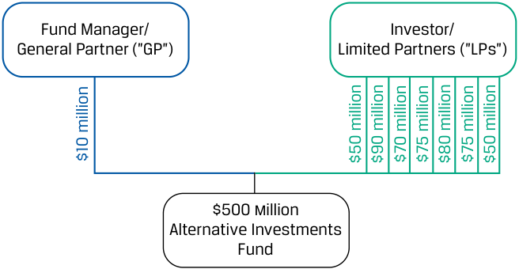
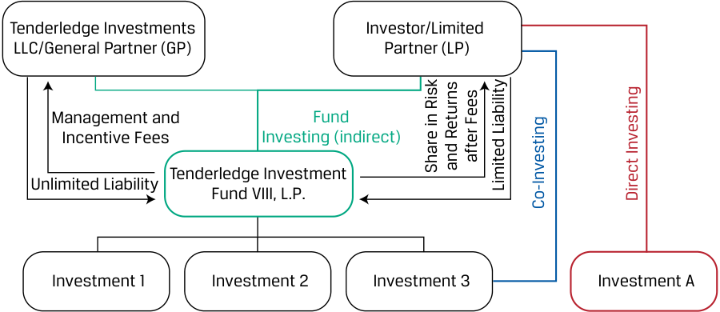
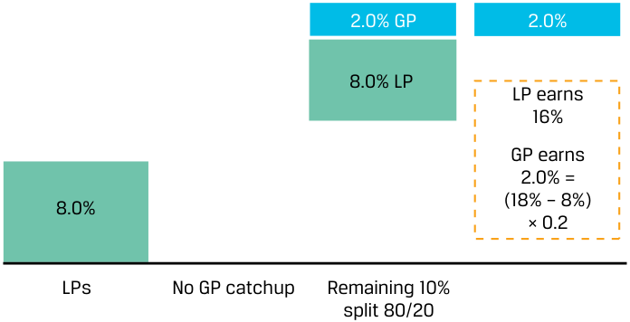
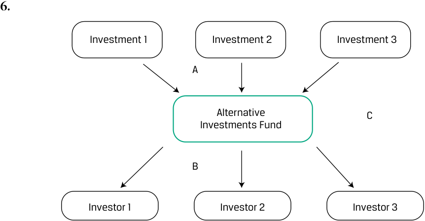

# Tập 8: Đầu tư Thay thế (Volume 8: Alternative Investments)
## Học phần 1: Đặc điểm, Phương thức và Cấu trúc Đầu tư Thay thế (Learning Module 1: Alternative Investment Features, Methods, and Structures)
### Phần 2/2: Cấu trúc Đầu tư Thay thế (Alternative Investment Structures) (Trang PDF 27–40)

---

<!-- PDF Page 27 -->

|1. Đầu tư qua quỹ (*Fund investing*)|Đầu tư qua quỹ mang lại cho các nhà đầu tư có nguồn lực hoặc kinh nghiệm hạn chế một cánh cửa bước vào lĩnh vực đầu tư thay thế.|
|---|---|
|2. Đồng đầu tư (*Co-investing*)|Các nhà đầu tư có kỹ năng chuyên biệt tốt hơn và khả năng phân bổ vốn đầu tư vào các tài sản riêng lẻ lớn hơn có thể lựa chọn phương pháp tiếp cận đầu tư chủ động hơn trong khi vẫn duy trì sự tham gia của nhà quản lý quỹ. Điều này dẫn đến mức phí thấp hơn cho nhà đầu tư so với phương pháp tiếp cận thuần túy dựa trên quỹ. Ngoài ra, các nhà đồng đầu tư lựa chọn và quản lý một khoản đầu tư chung với một nhà quản lý quỹ chung, điều này có khả năng mang lại cho họ quyền kiểm soát lớn hơn và tỷ suất sinh lợi cao hơn so với mức họ có thể kiếm được trong cấu trúc chỉ đầu tư qua quỹ.|
|3. Đầu tư trực tiếp (*Direct investing*)|Đầu tư trực tiếp mang lại cho các nhà đầu tư sự linh hoạt và quyền kiểm soát khi lựa chọn các khoản đầu tư của mình, lựa chọn phương thức tài trợ vốn ưa thích và lập kế hoạch cho phương pháp tiếp cận của họ.|

## **CÁC CẤU TRÚC ĐẦU TƯ THAY THẾ (ALTERNATIVE INVESTMENT STRUCTURES)** 

**<mark>4</mark>** 

mô tả các cấu trúc sở hữu đầu tư và cấu trúc thù lao (*ownership and compensation structures*) thường được sử dụng trong đầu tư thay thế

Vượt ra ngoài phương thức đầu tư trực tiếp hay gián tiếp vào các tài sản thay thế, tính kém thanh khoản, sự phức tạp và bản chất dài hạn của các khoản đầu tư này đòi hỏi những cấu trúc phức tạp hơn nhằm thu hẹp những khoảng cách tiềm ẩn giữa lợi ích của nhà quản lý và nhà đầu tư. Các cấu trúc đầu tư thay thế có thể quy định rõ ràng cả vai trò và trách nhiệm của các nhà đầu tư lẫn các nhà quản lý để giải quyết những khoảng cách này. Ngoài ra, các cấu trúc đầu tư thay thế thiết kế riêng việc phân phối tỷ suất sinh lợi giữa hai bên nhằm gắn kết tốt hơn các động lực (hoặc lợi ích) giữa nhà quản lý và nhà đầu tư.

Ví dụ, các nhà quản lý có thể yêu cầu nhà đầu tư chịu trách nhiệm cho các khoản góp vốn trong tương lai (*future capital contributions*), trong khi các nhà đầu tư có thể đặt ra các hạn chế đối với việc lựa chọn khoản đầu tư của nhà quản lý nhằm tránh xung đột lợi ích (*conflicts of interest*) hoặc các thương vụ thâu tóm thù địch (*hostile takeovers*) cùng các tiêu chí đầu tư khác. Các cấu trúc thù lao dựa trên hiệu quả hoạt động (*performance-based compensation structures*), có thể bao gồm các yêu cầu về tỷ suất sinh lợi tối thiểu cho nhà đầu tư, chi trả thù lao trả chậm (*delayed payouts*), và/hoặc quyền thu hồi lại khoản thù lao khuyến khích (*reclaim incentive compensation*) trong trường hợp quỹ hoạt động kém hiệu quả, sẽ khuyến khích các nhà quản lý tối đa hóa tỷ suất sinh lợi vì lợi ích tốt nhất của các nhà đầu tư.

### **Cấu trúc Sở hữu và Thù lao trong Đầu tư Thay thế (Alternative Investment Ownership and Compensation Structures)** 

Trong phần này, chúng ta thảo luận về các cấu trúc sở hữu và cấu trúc thù lao của các khoản đầu tư thay thế.

### **Cấu trúc Sở hữu (Ownership Structures)** 

Các phương tiện đầu tư thay thế (*alternative investment vehicles*) thường mang hình thức công ty hợp danh (*partnerships*) nhằm tối đa hóa sự linh hoạt trong cấu trúc đầu tư để phân bổ rủi ro và tỷ suất sinh lợi kinh doanh cũng như phân phối các trách nhiệm đặc biệt giữa các nhà đầu tư và nhà quản lý theo yêu cầu. Các công ty hợp danh hữu hạn (*limited partnerships*), đã được giới thiệu trong bài học về tổ chức phát hành doanh nghiệp, bao gồm ít nhất một thành viên hợp danh

<!-- PDF Page 28 -->

(*general partner* – GP) với trách nhiệm vô hạn về mặt lý thuyết (*theoretically unlimited liability*), người chịu trách nhiệm quản lý quỹ. Các thành viên góp vốn hữu hạn (*limited partners* – LPs) là các nhà đầu tư bên ngoài sở hữu một phần lợi ích (*fractional interest*) trong công ty hợp danh dựa trên số tiền đầu tư ban đầu của họ và các điều khoản được quy định trong bộ hồ sơ hợp danh. Bảng minh họa 4 cho thấy cấu trúc GP/LP cơ bản cùng với các phương pháp tiếp cận đầu tư khác nhau (đầu tư qua quỹ, đồng đầu tư, đầu tư trực tiếp) đã được giới thiệu trước đó.

**Bảng minh họa 4: Cấu trúc GP/LP Cơ bản và Các Phương pháp Tiếp cận Đầu tư Khác nhau (Exhibit 4: Basic GP/LP Structure and Various Investment Approaches)** 

<!-- Picture Text: Fund Manager/ Investor/ General Partner (”GP”) Limited Partner (”LP”) Alternative Investments Fund Investment 1 Investment 2 Investment 3 Investment A (indirect) Direct Investing Fund Investing Co-Investing  -->
> **Chú thích hình ảnh:** **Nhà quản lý Quỹ / Thành viên Hợp danh ("GP")** và **Nhà đầu tư / Thành viên Góp vốn Hữu hạn ("LP")** cùng tham gia vào **Quỹ Đầu tư Thay thế (*Alternative Investments Fund*)** (đầu tư gián tiếp – *indirect*). Từ đó Quỹ rót vốn vào Khoản đầu tư 1, 2, 3 (*Fund Investing*). LP có thể **Đồng đầu tư (*Co-Investing*)** vào Khoản đầu tư 3, hoặc **Đầu tư trực tiếp (*Direct Investing*)** vào Khoản đầu tư A.

Các LP cam kết cho các khoản đầu tư trong tương lai, và dòng tiền chi ra trả trước (*upfront cash outflow*) có thể chỉ chiếm một phần nhỏ trong tổng mức cam kết của họ đối với quỹ. Các quỹ được thiết lập dưới dạng công ty hợp danh hữu hạn thường có giới hạn về số lượng LP được phép đầu tư vào quỹ. Các LP đóng vai trò thụ động (*passive roles*) và không tham gia vào việc quản lý quỹ (mặc dù quyền đồng đầu tư cho phép các LP thực hiện thêm các khoản đầu tư trực tiếp vào các công ty trong danh mục đầu tư); các hoạt động và quyết định của quỹ được kiểm soát hoàn toàn bởi GP.

Các thành viên góp vốn hữu hạn (LPs) có mức trách nhiệm pháp lý được giới hạn ở số tiền họ đầu tư vào công ty hợp danh, như được thể hiện trong Bảng minh họa 5.

**Bảng minh họa 5: Ví dụ về Cấu trúc Công ty Hợp danh Hữu hạn (Exhibit 5: Example Limited Partnership Structure)** 

<!-- Picture Text: Fund Manager/ Investor/ General Partner (”GP”) Limited Partners (”LPs”) $500 million Alternative Investments Fund $10 million $50 million $90 million $70 million $75 million $80 million $75 million $50 million  -->
> **Chú thích hình ảnh:** **Quỹ Đầu tư Thay thế quy mô 500 triệu USD (*$500 million Alternative Investments Fund*)** bao gồm:
> - **Nhà quản lý Quỹ / Thành viên Hợp danh ("GP"):** Góp 10 triệu USD.
> - **Các Nhà đầu tư / Thành viên Góp vốn Hữu hạn ("LPs"):** 7 nhà đầu tư LP góp lần lượt 50 triệu USD, 90 triệu USD, 70 triệu USD, 75 triệu USD, 80 triệu USD, 75 triệu USD, và 50 triệu USD.

Một số lượng hạn chế các thành viên góp vốn hữu hạn nắm giữ một phần lợi ích trong quỹ. Các nhà đầu tư LP nhìn chung phải đáp ứng một số yêu cầu tối thiểu theo quy định pháp lý về giá trị tài sản ròng (*net worth*), tư cách định chế, hoặc các yêu cầu khác, với tư cách là cái gọi là **nhà đầu tư đạt chuẩn / nhà đầu tư chuyên nghiệp (*accredited investors*)**, để được tiếp cận các khoản đầu tư này, vốn ít chịu sự điều tiết hơn so với các đợt chào bán đại chúng thông thường. GP (Tenderledge Investments LLC trong Bảng minh họa 6) đồng ý quản lý các hoạt động của quỹ theo một tiêu chuẩn cẩn trọng đã thỏa thuận (*agreed standard of care*) và thực hiện các hoạt động như mua hoặc bán tài sản, vay vốn, thiết lập các quỹ dự trữ, hoặc ký kết các hợp đồng thay mặt cho quỹ.

<!-- PDF Page 29 -->

**Bảng minh họa 6: Công ty Hợp danh Hữu hạn (Quỹ Đầu tư Tenderledge) (Exhibit 6: Limited Partnership (Tenderledge Investment Fund))** 

<!-- Picture Text: Tenderledge Investments Investor/Limited LLC/General Partner (GP) Partner (LP) Management and Fund Incentive Fees Investing (indirect) Tenderledge Investment Unlimited Liability Fund VIII, L.P. Investment 1 Investment 2 Investment 3 Investment A after Fees Share in Risk and Returns Limited Liability Direct Investing Co-Investing  -->
> **Chú thích hình ảnh:**
> - **Tenderledge Investments LLC / Thành viên Hợp danh (GP):** Chịu trách nhiệm vô hạn (*Unlimited Liability*), nhận Phí quản lý và Phí khuyến khích (*Management and Incentive Fees*) từ quỹ **Tenderledge Investment Fund VIII, L.P.**
> - **Nhà đầu tư / Thành viên Góp vốn Hữu hạn (LP):** Đầu tư qua quỹ (gián tiếp), chịu trách nhiệm hữu hạn (*Limited Liability*), và chia sẻ rủi ro cùng tỷ suất sinh lợi sau khi trừ phí (*Share in Risk and Returns after Fees*). LP cũng có thể Đồng đầu tư (*Co-Investing*) vào Khoản đầu tư 3 hoặc Đầu tư trực tiếp (*Direct Investing*) vào Khoản đầu tư A.

Một GP có thể quản lý nhiều quỹ cùng một lúc. Một **thỏa thuận hợp danh hữu hạn (*limited partnership agreement* – LPA)** thiết lập các điều khoản của một công ty hợp danh hữu hạn dưới sự chi phối của thỏa thuận hợp danh hữu hạn đó.

Các đặc điểm chính của một LPA bao gồm việc phân phối lợi nhuận và khoản lỗ (được trình bày chi tiết dưới đây); vai trò và trách nhiệm của nhà quản lý, chẳng hạn như các tiêu chí và hạn chế đầu tư; và các điều khoản chi phối việc chuyển nhượng, rút vốn và giải thể thỏa thuận.

Các điều chỉnh đối với các điều khoản LP đôi khi được thực hiện để giải quyết các yêu cầu đặc thù về pháp lý, quy định hoặc báo cáo của một nhà đầu tư cụ thể. Trong trường hợp này, một văn bản bổ sung được gọi là **thư thỏa thuận phụ (*side letter*)** được ban hành giữa một GP và một hoặc nhiều LP với các điều khoản ghi đè hoặc sửa đổi các điều khoản gốc của LPA. Các điều khoản này có thể bao gồm những đặc điểm như gia tăng khả năng của nhà đầu tư trong việc chuyển nhượng các khoản đầu tư sang một quỹ liên kết hoặc quỹ kế nhiệm; quyền ưu tiên mua trước (*first right of refusal*) và các điều khoản tương tự khác nhằm phác thảo cách thức đối xử tiềm năng (liên quan đến phí, quyền đồng đầu tư, bán thứ cấp, và có thể là các vấn đề khác) so với các LP khác; quyền từ chối thực hiện một khoản góp vốn theo hợp đồng (được gọi là quyền miễn trừ góp vốn – *excusal right*); hoặc quyền nhận thêm các báo cáo đầu tư bổ sung. Một đặc điểm của thư thỏa thuận phụ (*side letter*) có thể bao gồm điều khoản “ối huệ quốc” (*“most favored nation” clause*) đảm bảo rằng bất kỳ điều khoản ưu đãi hơn hoặc bổ sung nào được đàm phán bên ngoài LPA với các nhà đầu tư khác cũng sẽ được áp dụng cho một LP cụ thể đó. Các đặc điểm tùy chỉnh của LPA và bất kỳ thư thỏa thuận phụ nào hoàn toàn đối lập với một khế ước trái phiếu tiêu chuẩn hóa (*standardized indenture*) áp dụng cho tất cả các nhà đầu tư trái phiếu trong trường hợp chứng khoán thu nhập cố định đại chúng.

Các cấu trúc chuyên biệt khác nhau thường được áp dụng cho các khoản đầu tư thay thế khác. Ví dụ, các nhà đầu tư cơ sở hạ tầng thường xuyên tham gia vào các quan hệ đối tác công – tư (*public–private partnerships* – PPP), vốn là các thỏa thuận giữa khu vực công và khu vực tư nhân để tài trợ, xây dựng và vận hành cơ sở hạ tầng công cộng, như được thể hiện trong Bảng minh họa 7. Bảng minh họa 8 cho thấy cấu trúc PPP của PT Indonesia Infrastructure Finance (IIF), như đã thảo luận trong Ví dụ 2.

**Bảng minh họa 7: Quan hệ Đối tác Công – Tư (Exhibit 7: Public–Private Partnership)** 

<!-- Picture Text: Public Sector Provide services Exclusive access, and returns technical and assets at maturity PPP Contract legal services Project debt Project Equity Project Special Purpose Project Sponsors/ Debtholders Entity Equity Holders Returns Returns  -->
> **Chú thích hình ảnh:** **Khu vực Công (*Public Sector*)** và **Thực thể Mục đích Đặc biệt (*Special Purpose Entity* – SPE)** ký kết **Hợp đồng PPP (*PPP Contract*)**: SPE cung cấp dịch vụ và hoàn trả tài sản khi đáo hạn (*Provide services and returns assets at maturity*), còn Khu vực Công cấp quyền tiếp cận độc quyền, dịch vụ kỹ thuật và pháp lý (*Exclusive access, technical and legal services*). SPE huy động **Nợ dự án (*Project debt*)** từ **Chủ nợ dự án (*Project Debtholders*)** và **Vốn cổ phần dự án (*Project Equity*)** từ **Nhà tài trợ dự án / Chủ sở hữu vốn cổ phần (*Project Sponsors / Equity Holders*)**, sau đó chi trả **Tỷ suất sinh lợi (*Returns*)** cho cả hai bên.

<!-- PDF Page 30 -->

**Bảng minh họa 8: Cấu trúc Quan hệ Đối tác Công – Tư của IIF (Exhibit 8: Public–Private Partnership Structure of IIF)** 

<!-- Picture Text: Government of the Republic of To fund 30% of Indonesia Exclusive access, project costs technical and USD45 billion PPP Contract legal services PT Indonesia Infrastructure Finance (IIF) To fund 70% of project costs USD105 billion Private Sector Investors/ Shareholders  -->
> **Chú thích hình ảnh:** **Chính phủ Cộng hòa Indonesia (*Government of the Republic of Indonesia*)** tài trợ 30% chi phí dự án (45 tỷ USD) và cấp quyền tiếp cận độc quyền, dịch vụ kỹ thuật và pháp lý thông qua **Hợp đồng PPP (*PPP Contract*)** với **PT Indonesia Infrastructure Finance (IIF)**. **Các Nhà đầu tư / Cổ đông Khu vực Tư nhân (*Private Sector Investors/Shareholders*)** tài trợ 70% chi phí dự án (105 tỷ USD) vào IIF.

Các dự án cơ sở hạ tầng thường liên quan đến một thực thể mục đích đặc biệt (*special purpose entity* – SPE) đứng ra huy động vốn vay và vốn chủ sở hữu để xây dựng và vận hành một con đường, cây cầu, hoặc tài sản có thời gian sử dụng lâu dài cụ thể khác theo các điều khoản của một thỏa thuận nhượng quyền (*concession agreement*), sau thời hạn đó tài sản sẽ được bán hoặc hoàn trả lại cho một đơn vị thuộc khu vực công.

Các nhà đầu tư vào quỹ bất động sản hoặc tài nguyên thiên nhiên thường được phân loại là người nắm giữ chứng chỉ quỹ (*unitholders*) trong một cấu trúc được gọi là **công ty hợp danh hữu hạn đại chúng (*master limited partnership* – MLP)**, có các đặc điểm tương tự như công ty hợp danh hữu hạn đã mô tả trước đó nhưng thường là một khoản đầu tư có tính thanh khoản cao hơn và thường được giao dịch đại chúng. Các hình thức đầu tư có tính thanh khoản cao hơn khác vào tài sản thay thế là quỹ tín thác đầu tư bất động sản (*real estate investment trusts* – REITs), quỹ hàng hóa thương phẩm (*commodity funds*), và các quỹ hoán đổi danh mục (*exchange-traded funds* – ETFs) khác nhau. Trong trường hợp đầu tư bất động sản trực tiếp, liên doanh (*joint ventures*) cũng là một cấu trúc hợp tác phổ biến. Cơ sở hạ tầng và bất động sản sẽ được thảo luận sâu hơn trong một học phần đầu tư thay thế tiếp theo.

### **Cấu trúc Thù lao (Compensation Structures)** 

Sự bất cân xứng thông tin (*asymmetry in information*) giữa thành viên hợp danh (GP), người có kiến thức chuyên môn sâu và quyền kiểm soát, với các thành viên góp vốn hữu hạn (LPs) trong các khoản đầu tư thay thế đồng nghĩa với việc các cấu trúc thù lao phức tạp hơn được sử dụng để gắn kết tốt hơn lợi ích động lực giữa thành viên hợp danh và thành viên góp vốn hữu hạn. Hầu hết các quỹ sở hữu chứng khoán nợ hoặc vốn cổ phần đại chúng đều tính phí quản lý theo một tỷ lệ phần trăm cố định trên tổng tài sản đang quản lý (*assets under management* – AUM). Ngược lại, các quỹ đầu tư thay thế thường kết hợp một mức phí quản lý cao hơn (thường là 1%–2% trên tài sản đang quản lý) với một khoản **phí hiệu quả hoạt động (*performance fee*)** (còn được gọi là phí khuyến khích – *incentive fee* hoặc **lợi ích phân chia – *carried interest***) dựa trên một tỷ lệ phần trăm của tỷ suất sinh lợi định kỳ của quỹ.

Trong khi các quỹ phòng hộ (*hedge funds*) và REITs thường tính phí quản lý dựa trên tài sản đang quản lý (AUM), thì các quỹ vốn cổ phần tư nhân (*private equity funds*) thường thu khoản phí này dựa trên **vốn cam kết (*committed capital*)**, bao gồm tổng số tiền mà các LP đã hứa sẽ tài trợ cho các khoản đầu tư trong tương lai. Các quỹ vốn cổ phần tư nhân huy động vốn cam kết và giải ngân từng phần (*draw down*) trên các cam kết đó, nhìn chung trong vòng từ 3 đến 5 năm, khi họ có một khoản đầu tư cụ thể cần thực hiện. Vòng đời của một quỹ vốn cổ phần tư nhân điển hình là 10 năm. Lưu ý rằng phí quản lý thường dựa trên vốn cam kết (*committed capital*), chứ _không phải_ vốn đã đầu tư (*invested capital*); cơ sở tính phí quản lý dựa trên vốn cam kết là một điểm khác biệt quan trọng so với các quỹ phòng hộ, nơi phí quản lý được tính dựa trên tài sản đang quản lý (AUM). Việc sử dụng vốn cam kết làm cơ sở để tính phí quản lý làm giảm động cơ của các GP trong việc giải ngân vốn cam kết càng nhanh càng tốt (nhằm làm tăng phí quản lý trong ngắn hạn). Điều này cho phép các GP có tính chọn lọc khi triển khai vốn vào các cơ hội đầu tư.

<!-- PDF Page 31 -->

Ngoài ra, vì GP có ảnh hưởng rất lớn đến việc định giá giá trị của các tài sản, sẽ là không phù hợp nếu trả phí quản lý dựa trên cơ sở giá trị tài sản đang quản lý.

Phí hiệu quả hoạt động (*performance fees*) thường phải tuân theo một mức tỷ suất sinh lợi tối thiểu của quỹ hay **tỷ suất sinh lợi tối thiểu (*hurdle rate*)** (còn được gọi là “tỷ suất sinh lợi ưu đãi” – *“preferred return”*), cũng như các điều khoản sửa đổi khác, nhằm gắn kết lợi ích động lực của nhà quản lý càng sát càng tốt với lợi ích của các nhà đầu tư trong các giai đoạn đầu tư dài hạn. Các thỏa thuận về tỷ suất sinh lợi tối thiểu đôi khi phân biệt giữa **tỷ suất sinh lợi tối thiểu cứng (*hard hurdle rate*)**, nơi nhà quản lý chỉ được hưởng phí tính trên phần tỷ suất sinh lợi hàng năm vượt quá mức tỷ suất sinh lợi tối thiểu, hoặc **tỷ suất sinh lợi tối thiểu mềm (*soft hurdle rate*)**, nơi khoản phí được tính trên toàn bộ tỷ suất sinh lợi một khi vượt qua ngưỡng tỷ suất sinh lợi tối thiểu. Với mức tỷ suất sinh lợi tối thiểu mềm (*soft hurdle*), các GP có thể bắt kịp (*catch up*) phần phí hiệu quả hoạt động một khi vượt qua ngưỡng tối thiểu.

Nếu chúng ta bỏ qua phí quản lý và giả định tỷ suất sinh lợi một kỳ của quỹ là $r$, mức tỷ suất sinh lợi tối thiểu cứng (*hard hurdle rate*) là $r_h$, và phí hiệu quả hoạt động của GP ($p$) tính bằng tỷ lệ phần trăm của tổng tỷ suất sinh lợi, thì tỷ suất sinh lợi của GP ($r_{GP}$) được xác định như sau:

$$r_{GP} = \max[0, p(r - r_h)] \tag{1}$$

Ví dụ, nếu một quỹ kiếm được $r$ bằng 18% trong một kỳ và nhận mức phí hiệu quả hoạt động là 20% ($p$) trên phần tỷ suất sinh lợi vượt quá mức tỷ suất sinh lợi tối thiểu, $r_h$, là 8%, thì $r_{GP}$ bằng 2%:

$$2\% = \max[0, 20\%(18\% - 8\%)]$$

Các điều khoản sửa đổi phí hiệu quả hoạt động bao gồm việc thưởng cho các nhà quản lý khi vượt qua mức tỷ suất sinh lợi tối thiểu hoặc tạo ra tỷ suất sinh lợi trên các thương vụ cụ thể, hoặc phạt họ bằng cách giới hạn hay yêu cầu hoàn trả lại phí hiệu quả hoạt động khi hiệu quả suy giảm theo thời gian. Việc đẩy nhanh tốc độ hưởng phí hiệu quả hoạt động một khi quỹ vượt qua mức tỷ suất sinh lợi tối thiểu mềm được gọi là **điều khoản bắt kịp (*catch-up clause*)**, như được minh họa trong Bảng minh họa 9. Theo điều khoản bắt kịp sử dụng ví dụ trước đó, GP được hưởng _ngay lập tức_ 2% (tỷ suất sinh lợi bắt kịp là $r_{cu}$) một khi vượt qua ngưỡng tối thiểu, dẫn đến mức tỷ suất sinh lợi cao hơn 1,6% so với trường hợp không có tính năng bắt kịp. Nói cách khác, LP sẽ nhận 100% tất cả các khoản phân phối tiền mặt cho đến khi họ kiếm đủ mức tỷ suất sinh lợi tối thiểu là 8%. Sau đó, GP sẽ nhận 100% các khoản phân phối cho đến khi tỷ lệ phân chia lợi nhuận đạt mức 80%/20%. Các khoản phân phối còn lại sau đó sẽ được chia theo tỷ lệ 80%/20%. Tỷ suất sinh lợi của GP ($r_{GP}$) từ Phương trình 1 khi có điều khoản bắt kịp (*catch-up clause*) trở thành:

$$r_{GP} = \max[0, r_{cu} + p(r - r_h - r_{cu})] \tag{2}$$

$$3,6\% = \max[0, 2,0\% + 20\%(18\% - 8\% - 2\%)]$$

<!-- PDF Page 32 -->

**Bảng minh họa 9: Minh họa Điều khoản Bắt kịp (Exhibit 9: Catch-Up Clause Illustration)** 

<!-- Picture Text: A. GP Returns with a Catch-Up Clause 1.6% GP 3.6% 6.4% LP LP earns 14.4% 2.0% GP earns 3.6% = 8.0% 18% × 0.2 LPs GP catchup Remaining 8% split 80/20  -->
> **Chú thích hình ảnh:** **A. Tỷ suất sinh lợi của GP khi có Điều khoản Bắt kịp (*GP Returns with a Catch-Up Clause*):**
> - **8,0% đầu tiên:** Thuộc về LPs (*LPs*).
> - **2,0% tiếp theo:** Phần bắt kịp của GP (*GP catchup*).
> - **8,0% còn lại (*Remaining 8% split 80/20*):** Chia 80/20, trong đó LP nhận 6,4% và GP nhận 1,6%.
> - **Tổng cộng:** LP nhận $8,0\% + 6,4\% = 14,4\%$; GP nhận $2,0\% + 1,6\% = 3,6\% = 18\% \times 0,2$.

#### **_B. Tỷ suất sinh lợi của GP khi không có Điều khoản Bắt kịp (B. GP Returns without a Catch-Up Clause)_** 

<!-- Picture Text: 2.0% GP 2.0% 8.0% LP LP earns 16% GP earns 2.0% = 8.0% (18% – 8%) × 0.2 LPs No GP catchup Remaining 10% split 80/20  -->
> **Chú thích hình ảnh:** **B. Tỷ suất sinh lợi của GP khi không có Điều khoản Bắt kịp (*GP Returns without a Catch-Up Clause*):**
> - **8,0% đầu tiên:** Thuộc về LPs (*LPs*).
> - **Không có phần bắt kịp của GP (*No GP catchup*).**
> - **10,0% còn lại (*Remaining 10% split 80/20*):** Chia 80/20, trong đó LP nhận 8,0% và GP nhận 2,0%.
> - **Tổng cộng:** LP nhận $8,0\% + 8,0\% = 16\%$; GP nhận $2,0\% = (18\% - 8\%) \times 0,2$.

Trong các trường hợp khác, các nhà quản lý bị phạt bằng việc cắt giảm phí khi hiệu quả hoạt động kém hoặc suy giảm. Một ví dụ về điều này trong trường hợp của các quỹ phòng hộ là việc sử dụng cái gọi là **mức đỉnh giá trị (*high-water mark*)**, phản ánh giá trị đỉnh cao nhất của quỹ tính đến một ngày tính toán hiệu quả hoạt động sau khi đã trừ phí (*net of fees*). Nếu giá trị của quỹ sau đó sụt giảm xuống dưới mức đỉnh giá trị (*high-water mark*), nhà quản lý quỹ phòng hộ không được phép tính phí hiệu quả hoạt động cho đến khi giá trị của quỹ vượt qua mức đỉnh giá trị trước đó. Việc sử dụng mức đỉnh giá trị nhằm mục đích thưởng cho các nhà quản lý có hiệu quả hoạt động bền vững và bảo vệ các LP khỏi việc phải trả phí hai lần cho cùng một mức tỷ suất sinh lợi.

Ngược lại, một điều khoản **thu hồi phí (*clawback*)** thực sự trao cho các LP quyền đòi lại một phần phí hiệu quả hoạt động của GP. Các điều khoản thu hồi phí (*clawback provisions*) thường được kích hoạt khi một GP thoái vốn các thương vụ thành công ở giai đoạn đầu nhưng lại gánh chịu các khoản lỗ ở các thương vụ về sau trong vòng đời của quỹ. Đối với hầu hết các khoản đầu tư thay thế, mức đỉnh giá trị (*high-water marks*) của nhà đầu tư được chuyển sang các năm dương lịch mới, nhưng trong trường hợp của các quỹ phòng hộ, một nhà đầu tư có thể không còn thu hồi lại được các khoản phí khuyến khích đã trả cho một năm dương lịch trước đó nếu danh mục đầu tư phát sinh lỗ về sau. Do bản chất nhìn chung kém thanh khoản hơn và dài hạn hơn của các tài sản nắm giữ, các khoản đầu tư vốn cổ phần tư nhân và bất động sản có nhiều khả năng chứa đựng các điều khoản thu hồi phí (*clawback clauses*) áp dụng cho toàn bộ vòng đời của danh mục đầu tư.

Cuối cùng, giống như trong trường hợp chứng khoán đảm bảo bằng tài sản (ABS) được mô tả trong các bài học về thu nhập cố định, các khoản đầu tư thay thế thường sử dụng cấu trúc thác nước (*waterfall structure*) để xác định việc phân phối dòng tiền cho các GP và LP. Trong các khoản đầu tư thay thế, các GP thường nhận được một tỷ trọng lớn hơn không tương xứng trong tổng lợi nhuận so với khoản đầu tư ban đầu của họ, điều này tạo động lực khuyến khích họ tối đa hóa khả năng sinh lời.

<!-- PDF Page 33 -->

Có hai loại cấu trúc thác nước: thác nước _theo từng thương vụ (deal-by-deal)_ (hay kiểu _Mỹ – American_) và thác nước _trên toàn bộ quỹ (whole-of-fund)_ (hay kiểu _Châu Âu – European_).

- Cấu trúc thác nước theo từng thương vụ (*deal-by-deal waterfalls*) có lợi hơn cho GP bởi vì phí hiệu quả hoạt động được thu trên cơ sở từng thương vụ một, cho phép GP được nhận tiền trước khi các LP nhận lại đủ cả khoản đầu tư ban đầu của họ _lẫn_ mức tỷ suất sinh lợi ưu đãi của họ (tức là mức tỷ suất sinh lợi tối thiểu – *hurdle rate*) tính trên toàn bộ quỹ.

- Trong cấu trúc thác nước trên toàn bộ quỹ (*whole-of-fund waterfalls*), tất cả các khoản phân phối đều chảy về phía các LP khi các thương vụ được thoái vốn và GP không được tham gia hưởng bất kỳ khoản lợi nhuận nào cho đến khi các LP nhận lại đủ khoản đầu tư ban đầu của họ và mức tỷ suất sinh lợi tối thiểu (*hurdle rate*) đã được đáp ứng. Trái ngược với thác nước theo từng thương vụ, thác nước trên toàn bộ quỹ diễn ra ở cấp độ tổng thể toàn quỹ (*aggregate fund level*) và có lợi hơn cho các LP.

Bảng minh họa 10 và Bảng minh họa 11 minh họa cách thức dòng tiền chảy về GP khác nhau như thế nào trong cấu trúc thác nước theo từng thương vụ có điều khoản thu hồi phí (*clawback provision*) so với cấu trúc thác nước trên toàn bộ quỹ, theo thứ tự tương ứng. Trong trường hợp đầu tiên, ban đầu quỹ chi trả cho GP các khoản thanh toán là 2 triệu USD, 3 triệu USD và 8 triệu USD bởi vì các Khoản đầu tư 1, 2 và 3 tạo ra lợi nhuận khi được bán đi. Tuy nhiên, tất cả các khoản đầu tư tiếp theo hoặc chỉ hòa vốn hoặc tạo ra khoản lỗ, nghĩa là trong suốt vòng đời của quỹ, quỹ chỉ hòa vốn ở cấp độ tổng thể. Do đó, GP phải hoàn trả lại tất cả các khoản chi trả đã nhận sớm trước đó để bù đắp cho các khoản lỗ phát sinh về sau.

**Bảng minh họa 10: Ví dụ về Cấu trúc Thác nước Theo Từng Thương vụ (Kiểu Mỹ) — Có Điều khoản Thu hồi Phí (Exhibit 10: Deal-by-Deal (American) Waterfall Example—with Clawback Provision)** 

|**Khoản đầu tư số (*Investment no.*)**|**Năm Đầu tư (*Year Invested*)**|**Năm Bán (*Year Sold*)**|**Số tiền Đầu tư (*Amount Invested*, $ triệu)**|**Số tiền Bán (*Amount Sold*, $ triệu)**|**Lợi nhuận (*Profit*, $ triệu)**|**Lợi nhuận (*Profit*, %)**|**Phần của GP ở mức 20% (*GP at 20%*)**|
|---|---|---|---|---|---|---|---|
|1|1|4|$10|$20|$10|26,0%|$2|
|2|2|5|$20|$35|$15|20,5%|$3|
|3|2|7|$40|$80|$40|14,9%|$8|
|4|3|7|$20|$20|—|—|—|
|5|3|8|$35|$25|($10)|âm (*neg*)|($2)|
|6|4|9|$25|$20|($5)|âm (*neg*)|($1)|
|7|5|9|$30|$—|($30)|âm (*neg*)|($6)|
|8|5|10|$20|$—|($20)|âm (*neg*)|($4)|
|Tổng cộng (*Total*)|1|10|$200|$200|—|—|—|

Trong trường hợp thứ hai, GP sẽ không nhận được bất kỳ khoản chi trả nào cho đến khi các LP đã nhận lại đủ khoản đầu tư ban đầu của họ và mức tỷ suất sinh lợi tối thiểu (*hurdle rate*) đã được đáp ứng ở cấp độ tổng thể toàn quỹ. Vì quỹ chỉ hòa vốn ở cấp độ tổng thể, nên GP sẽ không nhận được bất kỳ khoản chi trả phí hiệu quả hoạt động nào.

**Bảng minh họa 11: Ví dụ về Cấu trúc Thác nước Trên Toàn bộ Quỹ (Kiểu Châu Âu) (Exhibit 11: Whole-of-Fund (European) Waterfall Example)** 

|**Khoản đầu tư số (*Investment no.*)**|**Năm Đầu tư (*Year Invested*)**|**Năm Bán (*Year Sold*)**|**Số tiền Đầu tư (*Amount Invested*, $ triệu)**|**Số tiền Bán (*Amount Sold*, $ triệu)**|**Lợi nhuận (*Profit*, $ triệu)**|**Lợi nhuận (*Profit*, %)**|**Phần của GP ở mức 20% (*GP at 20%*)**|
|---|---|---|---|---|---|---|---|
|1|1|4|$10|$20|$10|26,0%|—|
|2|2|5|$20|$35|$15|20,5%|—|
|3|2|7|$40|$80|$40|14,9%|—|
|4|3|7|$20|$20|—|—|—|

<!-- PDF Page 34 -->

|**Khoản đầu tư số (*Investment no.*)**|**Năm Đầu tư (*Year Invested*)**|**Năm Bán (*Year Sold*)**|**Số tiền Đầu tư (*Amount Invested*, $ triệu)**|**Số tiền Bán (*Amount Sold*, $ triệu)**|**Lợi nhuận (*Profit*, $ triệu)**|**Lợi nhuận (*Profit*, %)**|**Phần của GP ở mức 20% (*GP at 20%*)**|
|---|---|---|---|---|---|---|---|
|5|3|8|$35|$25|($10)|âm (*neg*)|—|
|6|4|9|$25|$20|($5)|âm (*neg*)|—|
|7|5|9|$30|$—|($30)|âm (*neg*)|—|
|8|5|10|$20|$—|($20)|âm (*neg*)|—|
|Tổng cộng (*Total*)|1|10|$200|$200|—|—|—|

#### **BỘ CÂU HỎI (QUESTION SET)** 

1. Các cấu trúc thù lao cho các khoản đầu tư thay thế _có khả năng cao nhất_ là: 

   - **A.** ít phức tạp hơn so với các khoản đầu tư truyền thống. 

   - **B.** phức tạp ngang bằng với các khoản đầu tư truyền thống. 

   - **C.** phức tạp hơn so với các khoản đầu tư truyền thống. 

   - **Lời giải (Solution):** 

C là đáp án đúng. Tính kém thanh khoản, sự phức tạp và bản chất dài hạn của các khoản đầu tư thay thế đòi hỏi những cấu trúc phức tạp hơn nhằm thu hẹp những khoảng cách tiềm ẩn giữa lợi ích của nhà quản lý và nhà đầu tư. Các cấu trúc đầu tư thay thế có thể quy định rõ ràng cả vai trò và trách nhiệm của các nhà đầu tư lẫn các nhà quản lý để giải quyết những khoảng cách này. Ngoài ra, các cấu trúc đầu tư thay thế thiết kế riêng việc phân phối tỷ suất sinh lợi giữa hai bên nhằm giảm thiểu sự phân kỳ về lợi ích động lực giữa nhà quản lý và nhà đầu tư. A sai vì cấu trúc thù lao cho các khoản đầu tư thay thế phức tạp hơn, chứ không phải ít phức tạp hơn, so với các khoản đầu tư truyền thống. B sai vì cấu trúc thù lao cho các khoản đầu tư thay thế phức tạp hơn, chứ không phải phức tạp ngang bằng, so với các khoản đầu tư truyền thống.

2. Xác định phát biểu sau đây là đúng (*true*) hay sai (*false*): Các thành viên góp vốn hữu hạn (LPs) tham gia vào việc quản lý quỹ đầu tư thay thế mà họ đầu tư vào; họ hỗ trợ thành viên hợp danh (GP) trong các hoạt động và quyết định của quỹ. 

   - **A.** Đúng (*True*) 

   - **B.** Sai (*False*) 

#### **Lời giải (Solution):** 

Sai (*False*). Các LP đóng vai trò thụ động và không tham gia vào việc quản lý quỹ (mặc dù quyền đồng đầu tư cho phép các LP thực hiện thêm các khoản đầu tư trực tiếp vào các công ty trong danh mục đầu tư); các hoạt động và quyết định của quỹ được kiểm soát hoàn toàn bởi GP.

3. Tính toán mức phí hiệu quả hoạt động mà thành viên hợp danh (GP) được hưởng dựa trên các điều khoản sau đây: 

|Tỷ suất sinh lợi một kỳ của quỹ (*Single-period fund rate of return*)|20%|
|---|---|
|Mức tỷ suất sinh lợi tối thiểu cứng (*Hard hurdle rate*)|10%|

<!-- PDF Page 35 -->

|Phí hiệu quả hoạt động của GP (*GP performance fee*)|18%|
|---|---|
|Điều khoản bắt kịp (*Catch-up clause*)|không có (*none*)|

- **A.** 1,6%
- **B.** 1,8%
- **C.** 2,0%

**Lời giải (Solution):** 

Đáp án đúng là B, 1,8%, được xác định như sau:

Tỷ suất sinh lợi của một GP khi không có điều khoản bắt kịp được tính bằng:

$$r_{GP} = \max[0, p(r - r_h)]$$

trong đó:

|**Ký hiệu (*Symbol*)**|**Ý nghĩa (*Stands for*)**|
|---|---|
|$r_{GP}$|Tỷ suất sinh lợi của GP (*GP’s rate of return*)|
|$p$|Phí hiệu quả hoạt động của GP (*GP’s performance fee*)|
|$r$|Tỷ suất sinh lợi một kỳ của quỹ (*Single-period fund rate of return*)|
|$r_h$|Mức tỷ suất sinh lợi tối thiểu cứng (*Hard hurdle rate*)|

Sử dụng các điều khoản đã nêu dẫn đến mức tỷ suất sinh lợi cho GP là 1,8%:

$$r_{GP} = \max[0, 18\%(20\% - 10\%)]$$

$$r_{GP} = 1,8\%$$

A sai vì nó được tính bằng cách sử dụng tỷ suất sinh lợi một kỳ của quỹ là 18%, mức tỷ suất sinh lợi tối thiểu cứng là 10%, và phí hiệu quả hoạt động của GP là 20%. C sai vì nó được tính bằng cách sử dụng tỷ suất sinh lợi một kỳ của quỹ là 18%, mức tỷ suất sinh lợi tối thiểu cứng là 8%, và phí hiệu quả hoạt động của GP là 20%.

4. Xác định các câu trả lời đúng để điền vào chỗ trống: Một **____________** đồng ý quản lý các hoạt động của quỹ theo một tiêu chuẩn cẩn trọng đã thỏa thuận và thực hiện các hoạt động như mua hoặc bán tài sản, vay vốn, thiết lập các quỹ dự trữ, hoặc ký kết các hợp đồng thay mặt cho quỹ. Một **____________________** thiết lập các điều khoản của một công ty hợp danh hữu hạn và chi phối các hành động cũng như quyết định của công ty hợp danh hữu hạn đó. 

#### **Lời giải (Solution):** 

Một _<u>thành viên hợp danh (general partner)</u>_ đồng ý quản lý các hoạt động của quỹ theo một tiêu chuẩn cẩn trọng đã thỏa thuận và thực hiện các hoạt động như mua hoặc bán tài sản, vay vốn, thiết lập các quỹ dự trữ, hoặc ký kết các hợp đồng thay mặt cho quỹ. Một _<u>thỏa thuận hợp danh hữu hạn (limited partnership agreement – LPA)</u>_ thiết lập các điều khoản của một công ty hợp danh hữu hạn và chi phối các hành động cũng như quyết định của <u>công ty hợp danh hữu hạn đó.</u>

<!-- PDF Page 36 -->

5. Xác định loại hình đầu tư mà mỗi khoản đầu tư sau đây phù hợp _nhất_. 

|**Khoản đầu tư (*Investment*)**|**Đầu tư Truyền thống (*Traditional Investment*)**|**Đầu tư Thay thế (*Alternative Investment*)**|
|---|---|---|
|A. Cổ phiếu Alibaba được giao dịch trên Sàn Giao dịch Chứng khoán Frankfurt|||
|B. Các tài sản bất động sản đang nắm giữ (*Real estate holdings*)|||
|C. Chứng chỉ quỹ phòng hộ (*Hedge fund shares*) được đầu tư vào cổ phiếu phổ thông|||
|D. Khoản đầu tư vào một dự án cơ sở hạ tầng thông qua quan hệ đối tác công – tư (*public–private partnership*)|||
|E. Phần phân lớp có mức độ ưu tiên thấp nhất (*most junior tranche*) trong một chứng khoán đảm bảo bằng tài sản (ABS)|||

#### **Lời giải (Solution):** 

|**Khoản đầu tư (*Investment*)**|**Đầu tư Truyền thống (*Traditional Investment*)**|**Đầu tư Thay thế (*Alternative Investment*)**|
|---|---|---|
|A.|Cổ phiếu vốn cổ phần được giao dịch đại chúng là một khoản đầu tư truyền thống, không phải là đầu tư thay thế.||
|B.||Bất động sản là một tài sản vật chất hữu hình, có thực sẽ tạo ra dòng tiền hiện tại và/hoặc trong tương lai.|
|C.||Các quỹ phòng hộ (*hedge funds*) là những phương tiện đầu tư tư nhân, không phải là đầu tư truyền thống, ngay cả khi chúng có thể đầu tư vào cổ phiếu đại chúng hoặc thu nhập cố định, vốn tư nhân, và/hoặc tài sản thực. Chúng được phân biệt bởi phương pháp tiếp cận đầu tư hơn là bởi các loại khoản đầu tư mà chúng thực hiện thông qua quỹ.|
|D.||Cơ sở hạ tầng là một loại tài sản thực đặc biệt thường liên quan đến đất đai, tòa nhà, và các tài sản cố định có thời gian sử dụng lâu dài khác được dành cho mục đích sử dụng công cộng và cung cấp các dịch vụ thiết yếu. Khi các nhà đầu tư tư nhân tham gia vào các dự án như vậy, họ tham gia thông qua quan hệ đối tác công – tư (PPP).|
|E.|Phần phân lớp có mức độ ưu tiên thấp nhất (*most junior tranche*) trong một chứng khoán đảm bảo bằng tài sản (ABS) vẫn là một công cụ thu nhập cố định. Các công cụ thu nhập cố định là các khoản đầu tư truyền thống.||

<!-- PDF Page 37 -->

# **BÀI TẬP THỰC HÀNH (PRACTICE PROBLEMS)** 

**1.** Tài liệu nào sau đây cung cấp các điều khoản được thiết kế riêng (*tailored terms*) cho một nhà đầu tư cụ thể? 

   - **A.** Thư thỏa thuận phụ (*A side letter*) 

   - **B.** Quyền miễn trừ góp vốn (*An excusal right*) 

   - **C.** Thỏa thuận hợp danh hữu hạn (*A limited partnership agreement*) 

**2.** Xác định phương pháp tính phí nào _trực tiếp nhất_ khuyến khích các nhà quản lý quỹ vốn cổ phần tư nhân (*private equity fund managers*) đầu tư một cách có chọn lọc, chứ không chỉ đầu tư thật nhanh. Phí quản lý (*Management fees*): 

   - **A.** dựa trên vốn cam kết (*based on committed capital*) 

   - **B.** kết hợp với một khoản phí khuyến khích (*combined with an incentive fee*) 

   - **C.** dựa trên một tỷ lệ phần trăm cố định của tài sản đang quản lý (*based on a fixed percentage of assets under management*) 

**3.** Điều khoản sửa đổi phí hiệu quả hoạt động nào trao cho các thành viên góp vốn hữu hạn (LPs) quyền đòi lại một phần phí hiệu quả hoạt động của thành viên hợp danh (GP)? 

   - **A.** Điều khoản bắt kịp (*Catch-up clause*) 

   - **B.** Mức đỉnh giá trị (*High-water mark*) 

   - **C.** Điều khoản thu hồi phí (*Clawback provision*) 

**4.** Đặc điểm nào sau đây _có khả năng cao nhất_ gắn liền với một khoản đầu tư thay thế hơn là một khoản đầu tư truyền thống? 

   - **A.** Tính kém thanh khoản (*Illiquidity*) 

   - **B.** Quy mô vốn chi ra nhỏ hơn (*Smaller capital outlays*) 

   - **C.** Thời hạn đầu tư ngắn hơn (*Shorter investment time horizons*) 

**5.** Các tài sản được phát triển thông qua quan hệ đối tác công – tư (*public–private partnership* – PPP) thường liên quan đến: 

   - **A.** các tài sản cố định có thời gian sử dụng lâu dài dành cho mục đích sử dụng công cộng. 

   - **B.** vốn chủ sở hữu được sử dụng trong giai đoạn vòng đời ban đầu của một doanh nghiệp khởi nghiệp. 

   - **C.** bất động sản thương mại nơi hoạt động kinh doanh tư nhân là nguồn tạo ra dòng tiền chính. 

<!-- PDF Page 38 -->

- **Đặc điểm, Phương thức và Cấu trúc Đầu tư Thay thế (Alternative Investment Features, Methods, and Structures)** 

<!-- Picture Text: 6. Investment 1 Investment 2 Investment 3 A Alternative C Investments Fund B Investor 1 Investor 2 Investor 3  -->
> **Chú thích hình ảnh:** Câu 6: Sơ đồ luồng tỷ suất sinh lợi từ Khoản đầu tư 1, 2, 3 (*Investment 1, 2, 3*) qua đường A về Quỹ Đầu tư Thay thế (*Alternative Investments Fund*), trích phần C, và phân phối phần B cho Nhà đầu tư 1, 2, 3 (*Investor 1, 2, 3*).

**6.** Tham chiếu đến sơ đồ trên, hãy xác định nhãn (A, B, hoặc C) tương ứng _đúng nhất_ với mỗi thước đo tài chính sau đây:

|A.|1. Phí quản lý (*Management fee*)|
|---|---|
|B.|2. Tỷ suất sinh lợi ròng (*Net return*)|
|C.|3. Tỷ suất sinh lợi gộp (*Gross return*)|

**7.** Lựa chọn nào sau đây là thứ tự xếp hạng _có khả năng cao nhất_ của các phương thức đầu tư thay thế—từ mức đáng mong muốn nhất đến ít nhất—đối với quỹ hưu trí sau đây? Một quỹ hưu trí đại học có nguồn vốn dồi dào với kiến thức, kỹ năng và năng lực giám sát nội bộ đáng kể đang tìm kiếm các khoản đầu tư thay thế để đa dạng hóa danh mục tài sản hiện có và tạo ra tỷ suất sinh lợi cao hơn so với các khoản đầu tư truyền thống đồng thời giữ lại nhiều quyền kiểm soát nhất có thể. 

   - **A.** đầu tư qua quỹ, đồng đầu tư, đầu tư trực tiếp (*fund investment, co-investment, direct investment*) 

   - **B.** đầu tư trực tiếp, đồng đầu tư, đầu tư qua quỹ (*direct investment, co-investment, fund investment*) 

   - **C.** đồng đầu tư, đầu tư trực tiếp, đầu tư qua quỹ (*co-investment, direct investment, fund investment*) 

**8.** Từ các lựa chọn sau đây, hãy xác định lý do _quan trọng nhất_ khiến các nhà đầu tư vào các quỹ thay thế trả thù lao cho các nhà quản lý bằng cách sử dụng cấu trúc phí dựa trên hiệu quả hoạt động (*performance-based fee structure*). Nhằm để: 

   - **A.** phạt các nhà quản lý vì hiệu quả hoạt động kém hoặc suy giảm theo thời gian 

   - **B.** gắn kết tốt hơn lợi ích động lực giữa nhà quản lý và nhà đầu tư trong các giai đoạn dài hạn hơn 

   - **C.** tự bảo vệ mình khỏi việc phải trả phí hai lần cho các nhà quản lý đối với cùng một mức tỷ suất sinh lợi 

<!-- PDF Page 39 -->

# **LỜI GIẢI (SOLUTIONS)** 

1. Đáp án đúng là A. Ngoài các thỏa thuận hợp danh hữu hạn (LPAs), một văn bản bổ sung được gọi là thư thỏa thuận phụ (*side letter*) cũng có thể được đàm phán. Thư thỏa thuận phụ là các thỏa thuận giữa thành viên hợp danh (GP) và một hoặc nhiều thành viên góp vốn hữu hạn (LPs) tồn tại bên ngoài LPA và có các điều khoản ghi đè hoặc sửa đổi các điều khoản gốc của thỏa thuận hợp danh hữu hạn. Một thư thỏa thuận phụ được đàm phán nhằm giải quyết các yêu cầu đặc thù về pháp lý, quy định hoặc báo cáo của một nhà đầu tư cụ thể. B sai vì quyền miễn trừ góp vốn (*excusal right*) trao cho nhà đầu tư quyền từ chối thực hiện một khoản góp vốn hoặc không tham gia vào một loại hình đầu tư cụ thể. Quyền miễn trừ góp vốn chỉ được cấp khi nó đã được quy định trong một thư thỏa thuận phụ, chứ không tồn tại độc lập như một tài liệu riêng. C sai vì thỏa thuận hợp danh hữu hạn (LPA) thiết lập và chi phối các điều khoản của một công ty hợp danh hữu hạn; các điều khoản của nó áp dụng cho tất cả các thành viên góp vốn hữu hạn, chứ không chỉ riêng cho một nhà đầu tư cụ thể cần các điều khoản thiết kế riêng.

2. Đáp án đúng là A. Các quỹ vốn cổ phần tư nhân (*private equity funds*) thường tính phí quản lý dựa trên vốn cam kết (*committed capital*), tức là tổng số tiền mà các thành viên góp vốn hữu hạn đã hứa sẽ tài trợ cho các khoản đầu tư trong tương lai, thay vì dựa trên tài sản đang quản lý (*assets under management* – AUM). Cơ sở tính phí quản lý dựa trên vốn cam kết là một điểm khác biệt quan trọng so với các quỹ phòng hộ (*hedge funds*), nơi phí quản lý thường dựa trên tài sản đang quản lý. Việc lấy vốn cam kết làm cơ sở để tính phí quản lý làm giảm động cơ của các GP trong việc giải ngân vốn cam kết càng nhanh càng tốt để mở rộng cơ sở tính phí của họ và do đó cho phép các GP có tính chọn lọc khi triển khai vốn vào các cơ hội đầu tư. B sai vì các quỹ đầu tư thay thế thường kết hợp phí quản lý với phí hiệu quả hoạt động được trả khi tỷ suất sinh lợi của quỹ vượt qua một mức tỷ suất sinh lợi tối thiểu (*hurdle rate*) quy định. Mặc dù phương pháp tính phí kết hợp này là điển hình cho các quỹ đầu tư thay thế, nhưng đó không phải là yếu tố khuyến khích các nhà quản lý đầu tư một cách có chọn lọc thay vì đầu tư vội vàng. C sai vì thông thường các quỹ phòng hộ và REITs mới tính phí quản lý dựa trên tài sản đang quản lý, trong khi các quỹ vốn cổ phần tư nhân thay vào đó thu phí quản lý dựa trên vốn cam kết.

3. C là đáp án đúng. Một điều khoản thu hồi phí (*clawback provision*) trao cho các thành viên góp vốn hữu hạn (LPs) quyền đòi lại một phần phí hiệu quả hoạt động của thành viên hợp danh (GP). Các điều khoản thu hồi phí thường được kích hoạt khi một GP thoái vốn các thương vụ thành công ở giai đoạn đầu nhưng lại gánh chịu các khoản lỗ ở các thương vụ về sau trong vòng đời của quỹ. A sai vì điều khoản bắt kịp (*catch-up clause*) cho phép một thành viên hợp danh đẩy nhanh tốc độ hưởng phí hiệu quả hoạt động một khi quỹ vượt qua một mức tỷ suất sinh lợi tối thiểu mềm (*soft hurdle rate*) đã quy định. B sai vì mức đỉnh giá trị (*high-water mark*) xác định giá trị đỉnh cao nhất của quỹ tính đến một ngày tính toán hiệu quả hoạt động sau khi đã trừ phí; bản thân nó không phải là điều khoản cho phép thu hồi lại phần phí đã trả.

4. A là đáp án đúng. Các nhà đầu tư thường bị thu hút bởi các khoản đầu tư thay thế nếu họ đang tìm kiếm sự đa dạng hóa lớn hơn và tỷ suất sinh lợi kỳ vọng cao hơn mức mà các khoản đầu tư truyền thống có thể mang lại; các khoản đầu tư thay thế thường là những khoản đầu tư dài hạn hơn, kém thanh khoản (*illiquid*) trong các thị trường kém hiệu quả hơn. B sai vì các khoản đầu tư thay thế thường đòi hỏi quy mô vốn chi ra lớn hơn, chứ không phải nhỏ hơn so với các khoản đầu tư truyền thống. C sai vì các khoản đầu tư thay thế thường đòi hỏi thời hạn đầu tư dài (*long investment time horizons*) so với các khoản đầu tư truyền thống.

5. A là đáp án đúng. Trong một quan hệ đối tác công – tư (PPP), cả chính phủ và các nhà đầu tư tư nhân đều tham gia vào việc tài trợ và hoàn thiện các tài sản cố định có thời gian sử dụng lâu dài dành cho mục đích sử dụng công cộng và/hoặc để cung cấp các dịch vụ thiết yếu. B sai vì vốn chủ sở hữu được sử dụng cho các công ty chưa đại chúng trong giai đoạn vòng đời ban đầu của một doanh nghiệp khởi nghiệp thuộc về vốn đầu tư mạo hiểm (*venture capital*), chứ không phải quan hệ đối tác công – tư. C sai vì thông thường một quan hệ đối tác công – tư được sử dụng để tài trợ và phát triển cơ sở hạ tầng (tức là các tài sản cố định có thời gian sử dụng lâu dài dành cho mục đích sử dụng công cộng và để cung cấp

<!-- PDF Page 40 -->

các dịch vụ thiết yếu), chứ không phải bất động sản thương mại phục vụ cho hoạt động kinh doanh tư nhân.

6. A. 3 là đúng. Tỷ suất sinh lợi được tạo ra bởi các khoản đầu tư của quỹ là tỷ suất sinh lợi gộp (*gross returns*). Từ khoản này, ban quản lý khấu trừ các khoản phí của mình, phần còn lại (tỷ suất sinh lợi ròng) được chi trả cho các nhà đầu tư của quỹ.

B. 2 là đúng. Trong đầu tư qua quỹ thay thế, nhà quản lý quỹ chi trả tỷ suất sinh lợi ròng (*net return* – tức tỷ suất sinh lợi gộp trừ đi các khoản phí quản lý và hiệu quả) cho các nhà đầu tư.

C. 1 là đúng. Phí quản lý (*management fees*) và phí hiệu quả hoạt động (*performance fees*) là cách thức mà các nhà quản lý quỹ thay thế được trả thù lao cho việc quản lý quỹ và các khoản đầu tư của quỹ.

7. B là đáp án đúng. Phương án này trình bày ba phương thức đầu tư thay thế theo thứ tự từ mức độ kiểm soát cao nhất đến thấp nhất. Đầu tư trực tiếp (*direct investing*) mang lại cho các nhà đầu tư sự linh hoạt và quyền kiểm soát tối đa khi xét đến việc lựa chọn khoản đầu tư, các phương thức tài trợ vốn và thời điểm thực hiện. Các nhà đồng đầu tư (*co-investors*) có được quyền kiểm soát nhiều hơn so với các nhà đầu tư chỉ đầu tư qua quỹ nhưng không nhiều bằng các nhà đầu tư trực tiếp. Các nhà đầu tư qua quỹ (*fund investors*) có ít quyền kiểm soát nhất; các quyết định của họ chỉ giới hạn ở việc có đầu tư vào quỹ đó hay không. A sai vì nó xếp hạng ba phương thức đầu tư từ mức độ kiểm soát thấp nhất đến cao nhất. C sai vì nó đặt đồng đầu tư (*co-investment*) – phương thức đầu tư thay thế có một số quyền kiểm soát nhưng không phải là cao nhất – lên trước đầu tư trực tiếp (*direct investment*), vốn mang lại quyền kiểm soát và sự linh hoạt tối đa.

8. B là đáp án đúng. Các nhà đầu tư vào các quỹ thay thế thường trả thù lao cho các nhà quản lý bằng cách sử dụng cấu trúc phí dựa trên hiệu quả hoạt động (*performance-based*), thay vì phí cố định (*flat*), nhằm gắn kết tốt hơn lợi ích động lực giữa nhà quản lý và nhà đầu tư trong các giai đoạn dài hạn hơn. A sai vì mặc dù phí hiệu quả hoạt động/cấu trúc phí có thể phạt các nhà quản lý khi hiệu quả suy giảm, nhưng đó không phải là lý do quan trọng nhất cho việc sử dụng cấu trúc phí dựa trên hiệu quả hoạt động. C sai vì mặc dù việc tính toán hiệu quả hoạt động của nhà quản lý có thể bao gồm việc tham chiếu đến giá trị đỉnh của quỹ (*high-water mark*) nhằm tránh việc trả phí hai lần cho cùng một mức tỷ suất sinh lợi, nhưng đây không phải là lý do quan trọng nhất khiến các nhà đầu tư vào các quỹ thay thế trả thù lao bằng cách sử dụng cấu trúc phí dựa trên hiệu quả hoạt động.
