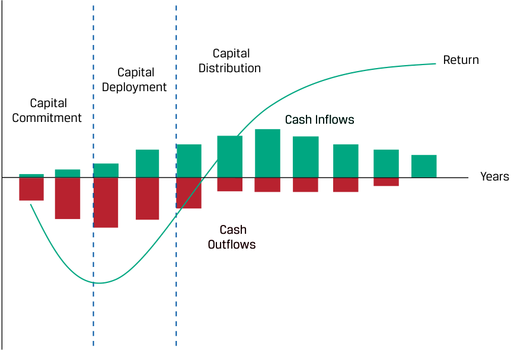

# Tập 8: Đầu tư Thay thế (Volume 8: Alternative Investments)
## Học phần 2: Hiệu quả Hoạt động và Tỷ suất Sinh lợi của Đầu tư Thay thế (Learning Module 2: Alternative Investment Performance and Returns)
### Phần 1/3: Giới thiệu (Introduction) (Trang PDF 41–51)

---

<!-- PDF Page 41 -->

#### H Ọ C P H Ầ N (L E A R N I N G M O D U L E)

# **<mark>2</mark>** 

### **Hiệu quả Hoạt động và Tỷ suất Sinh lợi của Đầu tư Thay thế (Alternative Investment Performance and Returns)** 

###### **<mark>MỤC TIÊU HỌC TẬP (LEARNING OUTCOMES)</mark>** 

**_Làm chủ kiến thức – Ứng viên cần có khả năng:_**
- mô tả việc thẩm định hiệu quả hoạt động (*performance appraisal*) của các khoản đầu tư thay thế
- tính toán và diễn giải tỷ suất sinh lợi của các khoản đầu tư thay thế cả trước và sau khi trừ phí (*before and after fees*)

##### **GIỚI THIỆU (INTRODUCTION)** 

## **<mark>1</mark>** 

Việc đo lường hiệu quả hoạt động đầu tư đối với các loại tài sản phổ biến, chẳng hạn như cổ phiếu và nợ đại chúng, là tương đối trực tiếp và đơn giản. Trong đầu tư thay thế (*alternative investments*), có những đặc điểm đặc thù khiến cho loại tài sản này trở nên khá phức tạp khi đo lường rủi ro và tỷ suất sinh lợi đầu tư. Trong học phần này, trước hết chúng ta thảo luận về những đặc tính độc nhất này và những thách thức mà chúng đặt ra đối với việc thẩm định hiệu quả hoạt động (*performance appraisal*). Sau đó, chúng ta giải thích các tính năng khác nhau trong thỏa thuận phí phức tạp của các khoản đầu tư thay thế cũng như những sắc thái tinh tế khi tính toán tỷ suất sinh lợi của nhà đầu tư.

###### **TỔNG QUAN HỌC PHẦN (LEARNING MODULE OVERVIEW)** 

- Các khoản đầu tư thay thế khác biệt với các loại tài sản truyền thống ở chỗ chúng liên quan đến thời hạn đầu tư dài hơn, các mô hình dòng tiền đặc thù, việc sử dụng đòn bẩy (*leverage*), các vị thế kém thanh khoản (*illiquid positions*), cấu trúc phí phức tạp hơn, cách thức xử lý thuế và kế toán khác nhau, v.v. Ngoài ra, tỷ suất sinh lợi của các khoản đầu tư thay thế thường ít tuân theo phân phối chuẩn hơn (*less normally distributed*) so với các khoản đầu tư truyền thống.

- Vòng đời đầu tư (*investment life cycle*) thường dài hơn và bao gồm ba giai đoạn: cam kết vốn (*capital commitment*), triển khai vốn (*capital deployment*), và phân phối vốn (*capital distribution*).

- Tỷ suất hoàn vốn nội bộ (*Internal rate of return* – IRR) thường là thước đo được ưa chuộng đối với tỷ suất sinh lợi của đầu tư thay thế. Bội số vốn đầu tư (*Multiple of invested capital* – MOIC) thường được sử dụng như một thước đo tính nhanh (*shortcut measure*), nhưng nó bỏ qua yếu tố thời điểm của các dòng tiền (*timing of cash flows*).

<!-- PDF Page 42 -->

- Các thỏa thuận thù lao phức tạp và được tùy chỉnh riêng tìm cách gắn kết lợi ích động lực giữa nhà quản lý và nhà đầu tư. Các điều khoản đặc biệt cũng tồn tại đối với việc khóa vốn (*lockup*) và mua lại/rút vốn (*redemption*) của các nhà đầu tư.

- Ngoài khoản phí quản lý cơ bản (*base management fee*), các khoản đầu tư thay thế thường tính thêm phí hiệu quả hoạt động (*performance fees*) dựa trên một tỷ lệ phần trăm của tỷ suất sinh lợi định kỳ của quỹ. Khi tính toán các khoản phí và tỷ suất sinh lợi ròng của nhà đầu tư, nhiều tính năng khác nhau phải được xem xét, chẳng hạn như hạng cổ phần sáng lập (*founder share class*), cấu trúc phí một trong hai (*either/or fee structure*), mức tỷ suất sinh lợi tối thiểu (*hurdle rate*), cùng các điều khoản mức đỉnh giá trị (*high-water mark*) và thu hồi phí (*clawback clauses*).

- Rất khó để khái quát hóa việc thẩm định hiệu quả hoạt động cho các khoản đầu tư này bởi vì tỷ suất sinh lợi có thể thay đổi tùy thuộc vào cách thức và thời điểm một nhà đầu tư cụ thể đầu tư vào một phương tiện đầu tư cụ thể.

###### **TỰ ĐÁNH GIÁ HỌC PHẦN (LEARNING MODULE SELF-ASSESSMENT)** 

1. Trong phần nào của vòng đời đầu tư của một khoản đầu tư vốn cổ phần tư nhân (*private equity investment*), các nhà đầu tư nhìn chung có thể kỳ vọng một dòng tiền dương? 

   - **A.** Cam kết vốn (*Capital commitment*) 

   - **B.** Triển khai vốn (*Capital deployment*) 

   - **C.** Phân phối vốn (*Capital distribution*) 

###### **Lời giải (Solution):** 

C là đáp án đúng. Trong giai đoạn cam kết vốn (*capital commitment*) ban đầu, các khoản phí và chi phí phát sinh ngay lập tức trước khi triển khai vốn, và các tài sản có thể tạo ra rất ít hoặc không tạo ra thu nhập trong giai đoạn đầu tiên này. Trong giai đoạn triển khai vốn (*capital deployment*), dòng tiền chi ra thường vượt quá dòng tiền thu vào khi nguồn vốn được giải ngân triển khai. Chỉ trong giai đoạn phân phối vốn (*capital distribution*) thì thu nhập thặng dư mới có thể được tạo ra từ các tài sản đã đầu tư và phần lãi vốn (*capital gains*) đáng kể mới được hiện thực hóa khi bán các tài sản.

2. Tại sao IRR lại được ưa chuộng để đo lường hiệu quả hoạt động cho các khoản đầu tư thay thế? 

   - **A.** IRR thường được sử dụng cho các loại tài sản khác. 

   - **B.** IRR dễ dàng và trực quan để tính toán. 

   - **C.** IRR có tính đến yếu tố thời điểm của các dòng tiền trong các khoản đầu tư thay thế có thời gian tồn tại lâu dài. 

###### **Lời giải (Solution):** 

C là đáp án đúng. IRR hiếm khi được sử dụng để đo lường hiệu quả hoạt động đầu tư của các loại tài sản khác có giá thị trường được niêm yết công khai. Mặc dù IRR phức tạp để tính toán và liên quan đến các giả định về chi phí cơ hội (*opportunity costs*) cũng như lãi suất tái đầu tư (*reinvestment rates*), nhưng nó là thước đo tốt nhất để đánh giá các khoản đầu tư thay thế dài hạn bởi vì nó có tính đến yếu tố thời điểm đặc thù của các dòng tiền trong vòng đời đầu tư của các khoản đầu tư thay thế.

3. Phát biểu nào sau đây liên quan đến cấu trúc phí của quỹ phòng hộ (*hedge fund*) là đúng? 

   - **A.** Tỷ suất sinh lợi định kỳ của tất cả các nhà đầu tư trong cùng một quỹ phải giống hệt nhau. 

   - **B.** Các quỹ phòng hộ thường tính một khoản phí hiệu quả hoạt động dựa trên một tỷ lệ phần trăm của tỷ suất sinh lợi định kỳ vượt trên một ngưỡng nhất định. 

<!-- PDF Page 43 -->

   - **C.** Mức tỷ lệ phí quản lý và phí hiệu quả hoạt động luôn giống nhau đối với tất cả các nhà đầu tư trong cùng một quỹ. 

   - **Lời giải (Solution):** B là đáp án đúng. Một quỹ phòng hộ thường tính cả phí quản lý cố định (*flat management fee*) và một khoản phí hiệu quả hoạt động (*performance fee*) bổ sung dựa trên một tỷ lệ phần trăm của tỷ suất sinh lợi định kỳ của quỹ. Kết quả hiệu quả hoạt động định kỳ có thể khác nhau tùy thuộc vào việc nhà đầu tư nào đã đầu tư và thời điểm nhà đầu tư đó rót vốn vào quỹ. Bên cạnh đó, một nhà đầu tư cụ thể có thể được hưởng mức phí khuyến khích (*incentive fees*) thấp hơn đáng kể nếu người đó đầu tư nhiều vốn hơn vào quỹ ở giai đoạn sớm hơn hoặc sẵn sàng chấp nhận các hạn chế lớn hơn đối với việc rút vốn (*redemptions*).

4. Một quỹ phòng hộ quy mô 100 triệu USD tính phí quản lý 2% cho tất cả các nhà đầu tư của mình và phí hiệu quả hoạt động 20% nếu tỷ suất sinh lợi định kỳ, sau khi trừ phí quản lý (*net of management fee*), vượt quá mức tỷ suất sinh lợi tối thiểu cứng (*hard hurdle rate*) là 5%. Tất cả các khoản phí được khấu trừ dựa trên giá trị cuối năm. Nếu quỹ đạt được tỷ suất sinh lợi gộp (trước khi trừ phí) là 8% trong năm, thì tỷ suất sinh lợi của nhà đầu tư sau khi trừ phí (*net of fees*) _gần nhất_ với mức nào (bỏ qua bất kỳ điều khoản mức đỉnh giá trị – *high-water mark* nào)? 

   - **A.** 4,67% 

   - **B.** 5,67% 

   - **C.** 5,84% 

   - **Lời giải (Solution):** B là đáp án đúng. Nếu quỹ phòng hộ đạt tỷ suất sinh lợi gộp 8% trong năm, giá trị tài sản ròng (NAV) của quỹ đã tăng lên 108 triệu USD trước khi khấu trừ bất kỳ khoản phí nào. Phí quản lý $= \$108 \times 2\% = \$2,16\text{ triệu USD}$. Phí hiệu quả hoạt động $= [(\$108 - \$2,16) - (\$100 \times 1,05)] \times 20\% = \$0,168\text{ triệu USD}$. Giá trị tài sản ròng sau khi khấu trừ phí $= \$108 - \$2,16 - \$0,168 = \$105,672\text{ triệu USD}$. Tỷ suất sinh lợi ròng của nhà đầu tư $= (\$105,672 - \$100)/\$100 \approx 5,67\%$.

5. Một quỹ vốn cổ phần tư nhân quy mô 100 triệu EUR có mức tỷ suất sinh lợi ưu đãi (*preferred return*) là 5% mỗi năm, 20% lợi ích phân chia (*carried interest*) với điều khoản bắt kịp toàn bộ (*full catch-up*), và các điều khoản thu hồi phí (*clawback clauses*) tiêu chuẩn. Quỹ hiện thực hóa mức lãi gộp là 50% trong hai năm trước khi phân phối toàn bộ vốn trả lại cho các LP của mình. Bỏ qua phí quản lý, tổng lợi ích phân chia (*carried interest*) trả cho GP trong hai năm _gần nhất_ với mức: 

   - **A.** 8 triệu EUR. 

   - **B.** 10 triệu EUR. 

   - **C.** 16 triệu EUR. 

   - **Lời giải (Solution):** 

B là đáp án đúng. Sau hai năm, giá trị tài sản ròng của quỹ đã tăng lên $€100\text{ triệu} \times 150\% = €150\text{ triệu}$ ngay trước khi phân phối. Mức tỷ suất sinh lợi ưu đãi dành cho các LP trong hai năm tổng cộng là $€100\text{ triệu} \times 5\% \times 2 = €10\text{ triệu}$. (Lưu ý rằng tỷ suất sinh lợi ưu đãi hàng năm thường không được tính lãi kép.) Tiếp theo, GP được phép hưởng bắt kịp toàn bộ (*full catch-up*) cho đến khi phần lợi ích phân chia của GP bắt kịp mức 20% của tổng lợi nhuận đã được tính đến thời điểm đó, tức là 2,5 triệu EUR ($€10\text{ triệu} / 0,8 \times 0,2$). Phần lợi nhuận còn lại là $50 - 10 - 2,5 = €37,5\text{ triệu}$ sau đó được chia theo tỷ lệ 80/20 giữa các LP và GP; nghĩa là GP sẽ nhận thêm 7,5 triệu EUR ($€37,5\text{ triệu} \times 20\%$). Do đó, tổng lợi ích phân chia trả cho GP là $2,5 + 7,5 = €10\text{ triệu}$, bằng đúng 20% của khoản lãi 50 triệu EUR.

<!-- PDF Page 44 -->

## **<mark>2</mark>** 

##### **HIỆU QUẢ HOẠT ĐỘNG CỦA ĐẦU TƯ THAY THẾ (ALTERNATIVE INVESTMENT PERFORMANCE)** 

mô tả việc thẩm định hiệu quả hoạt động (*performance appraisal*) của các khoản đầu tư thay thế

Các đặc điểm, hình thức và cấu trúc đặc thù của các khoản đầu tư thay thế phải được xem xét khi đánh giá hiệu quả hoạt động tương đối _giữa_ các khoản đầu tư thay thế với nhau và khi so sánh hiệu quả hoạt động của chúng với các loại tài sản phổ biến hơn theo thời gian. Đặc biệt, những đặc điểm như cam kết vốn giải ngân theo từng đợt (*staggered capital commitments*) theo thời gian, thời hạn đầu tư yêu cầu dài hơn, tính thanh khoản giảm sút, và các thị trường kém hiệu quả hơn đã được nhấn mạnh trong các bài học trước phải được đưa vào quá trình thẩm định hiệu quả hoạt động cho các khoản đầu tư thay thế. Tỷ suất sinh lợi của đầu tư thay thế thường ít tuân theo phân phối chuẩn hơn và do đó đòi hỏi các thước đo rủi ro và tỷ suất sinh lợi khác với những thước đo được sử dụng cho các loại tài sản truyền thống hơn.

###### **Thẩm định Hiệu quả Hoạt động của Đầu tư Thay thế (Alternative Investment Performance Appraisal)** 

Việc thẩm định hiệu quả hoạt động của các khoản đầu tư thay thế đòi hỏi sự xem xét kỹ lưỡng hơn ở một số khía cạnh nhất định so với các loại tài sản truyền thống.

###### **Khả năng So sánh với Các Loại Tài sản Truyền thống (Comparability with Traditional Asset Classes)** 

Chứng khoán nợ và vốn cổ phần đại chúng có chung một số đặc tính giúp tạo điều kiện thuận lợi cho việc so sánh hiệu quả hoạt động của chúng trong một giai đoạn cụ thể. Các quyền truy đòi được tiêu chuẩn hóa này không đòi hỏi thêm các cam kết góp vốn bổ sung nào trong tương lai và mang lại các quyền thụ hưởng giống hệt nhau đối với các dòng tiền định kỳ, chẳng hạn như cổ tức trong trường hợp của các cổ đông hoặc tiền lãi coupon trái phiếu và nợ gốc theo hợp đồng đối với các chủ nợ trái phiếu. Giá của các chứng khoán giao dịch đại chúng thường được yết giá liên tục, với các nhóm đồng cấp (*peer groups*) lớn gồm các khoản đầu tư tương tự sẵn có và các chỉ số phổ biến được sử dụng để làm chuẩn tham chiếu (*benchmark*) cho tỷ suất sinh lợi. Do đó, việc thẩm định hiệu quả hoạt động của các chứng khoán giao dịch đại chúng rất trực tiếp và dễ dàng để thực hiện cũng như đánh giá.

Ngược lại, các khoản đầu tư thay thế là những khoản đầu tư được thiết kế tùy chỉnh mà các đặc điểm riêng biệt của chúng làm phức tạp hóa việc thẩm định hiệu quả hoạt động giữa các khoản đầu tư với nhau và giữa các loại tài sản. Những đặc điểm này bao gồm:

- _thời điểm (timing)_ của các dòng tiền vào và dòng tiền ra đối với các khoản đầu tư cụ thể,

- việc sử dụng nguồn vốn vay (*borrowed funds*),

- việc _định giá (valuation)_ các vị thế danh mục đầu tư riêng lẻ qua các giai đoạn cụ thể của vòng đời đầu tư, và

- các cấu trúc phí cùng cách thức xử lý thuế và kế toán phức tạp hơn.

###### **Thẩm định Hiệu quả Hoạt động và Đặc điểm của Đầu tư Thay thế (Performance Appraisal and Alternative Investment Features)** 

Khi thẩm định các khoản đầu tư thay thế, bốn khía cạnh cần tập trung vào bao gồm giai đoạn vòng đời của khoản đầu tư, số lượng vốn vay được sử dụng để duy trì vị thế thị trường, việc định giá các tài sản, và cấu trúc phí của quỹ.

<!-- PDF Page 45 -->

###### **_Vòng đời Đầu tư (Investment Life Cycle)_** 

Không giống như các chứng khoán nợ hoặc vốn cổ phần đại chúng được mua trên thị trường sơ cấp hoặc thứ cấp, các khoản đầu tư thay thế thường liên quan đến một vòng đời đầu tư dài hơn với các giai đoạn riêng biệt được đặc trưng bởi các dòng tiền ra ròng và dòng tiền vào ròng làm phức tạp hóa việc so sánh tỷ suất sinh lợi định kỳ. Các giai đoạn vòng đời và thời điểm diễn ra thay đổi tùy theo từng loại hình đầu tư thay thế nhưng nhìn chung rơi vào ba giai đoạn riêng biệt, như được thể hiện trong Bảng minh họa 1.

###### **Bảng minh họa 1: Vòng đời Đầu tư (Exhibit 1: Investment Life Cycle)** 

<!-- Picture Text: Capital Return Capital Distribution Deployment Capital Commitment  Cash Inflows Years Cash Outflows  -->
> **Chú thích hình ảnh:** Đồ thị biểu diễn **Tỷ suất sinh lợi (*Return*)** theo **Số năm (*Years*)** qua 3 giai đoạn tạo thành hình chữ J (*J-curve*):
> 1. **Cam kết vốn (*Capital Commitment*):** Dòng tiền chi ra (*Cash Outflows*), tỷ suất sinh lợi âm.
> 2. **Triển khai vốn (*Capital Deployment*):** Tỷ suất sinh lợi bắt đầu đi lên và vượt qua trục hoành.
> 3. **Phân phối vốn (*Capital Distribution*):** Dòng tiền thu vào (*Cash Inflows*), tỷ suất sinh lợi tăng mạnh rồi đi ngang ở mức cao.

- **Cam kết vốn (*Capital commitment*):** Các nhà quản lý đầu tư thay thế xác định và lựa chọn các khoản đầu tư phù hợp với việc cam kết vốn giải ngân ngay lập tức hoặc trì hoãn (được gọi là lệnh gọi vốn – *capital call*), đó có thể là vào một công ty ở giai đoạn đầu trong trường hợp vốn đầu tư mạo hiểm, một công ty trưởng thành hơn đối với vốn cổ phần tư nhân, hoặc một hay nhiều bất động sản trong trường hợp bất động sản. Tỷ suất sinh lợi thường mang giá trị âm trong giai đoạn này bởi vì các khoản phí và chi phí phát sinh ngay lập tức trước khi triển khai vốn và các tài sản có thể tạo ra rất ít hoặc không tạo ra thu nhập trong giai đoạn đầu tiên này.

- **Triển khai vốn (*Capital deployment*):** Trong giai đoạn thứ hai này, các nhà quản lý đầu tư thay thế giải ngân nguồn vốn để tham gia vào việc xây dựng hoặc thực hiện nâng cấp cải tạo bất động sản trong trường hợp bất động sản hoặc cơ sở hạ tầng, gánh chịu các chi phí trong giai đoạn tái cơ cấu phục hồi (*turnaround phase*) của một công ty trưởng thành trong trường hợp vốn cổ phần tư nhân, hoặc bắt đầu vận hành hoạt động cho một công ty khởi nghiệp sử dụng vốn đầu tư mạo hiểm. Dòng tiền chi ra thường vượt quá dòng tiền thu vào, cùng với phí quản lý làm giảm thêm tỷ suất sinh lợi.

- **Phân phối vốn (*Capital distribution*):** Khi chiến lược tái cơ cấu phục hồi, giai đoạn khởi nghiệp, hoặc việc nâng cấp bất động sản được hoàn tất và nếu khoản đầu tư thành công, các tài sản cơ sở sẽ tăng giá và/hoặc tạo ra thu nhập vượt quá chi phí, khiến cho tỷ suất sinh lợi của quỹ tăng tốc mạnh mẽ. Quỹ có thể hiện thực hóa các khoản lãi vốn (*capital gains*) đáng kể từ việc thanh lý hoặc thoái vốn khỏi các khoản đầu tư của mình, có thể bao gồm một đợt chào bán cổ phiếu lần đầu ra công chúng (IPO) đối với vốn đầu tư mạo hiểm hoặc việc bán các bất động sản trong trường hợp đầu tư bất động sản.

<!-- PDF Page 46 -->

Cái gọi là **hiệu ứng đường cong chữ J (*J-curve effect*)** (bởi vì nó giống với chữ cái J) được thể hiện trong Bảng minh họa 1 đại diện cho mức tỷ suất sinh lợi âm ban đầu trong giai đoạn cam kết vốn, tiếp theo là sự tăng tốc của tỷ suất sinh lợi xuyên suốt giai đoạn triển khai vốn. Tỷ suất sinh lợi thường đi ngang ổn định khi vốn được phân phối cho các nhà đầu tư, các khoản đầu tư được bán đi, và quỹ được đóng lại. Do kết quả của các dòng tiền thu vào và chi ra diễn ra trong suốt vòng đời đầu tư, tỷ suất hoàn vốn nội bộ (*internal rate of return* – IRR) thường được sử dụng như một phương pháp tiếp cận ban đầu để tính toán tỷ suất sinh lợi đầu tư cho các khoản đầu tư này, bao gồm cả đầu tư vốn cổ phần tư nhân và bất động sản. Việc đánh giá hiệu quả hoạt động trong cả đầu tư vốn cổ phần tư nhân và bất động sản phụ thuộc nhiều hơn vào thời điểm và quy mô của các dòng tiền vào và ra khỏi các khoản đầu tư, và những yếu tố này thường khó tiêu chuẩn hóa cũng như khó dự đoán trước. Với thời hạn đầu tư dài, việc áp dụng các quy định xử lý thuế khác nhau có thể có tác động không hề nhỏ đến tỷ suất sinh lợi đầu tư sau thuế.

Như một quy tắc chung, cách tốt nhất để bắt đầu đánh giá các khoản đầu tư như vậy là sử dụng IRR, có tính đến các dòng tiền tương ứng đi vào một khoản đầu tư và thời điểm của chúng, đối chiếu với quy mô và thời điểm của các dòng tiền được hoàn trả từ khoản đầu tư đó (bao gồm cả các lợi ích về thuế).

Trong một quỹ vốn cổ phần tư nhân độc lập, có thời hạn hoạt động cố định (*fixed-life*), các quyết định huy động tiền, thu tiền dưới hình thức các lệnh gọi vốn (*capital calls*), và phân phối tiền thu được đều thuộc toàn quyền quyết định của nhà quản lý vốn cổ phần tư nhân. Thời điểm của các dòng tiền là một phần quan trọng của quy trình ra quyết định đầu tư. Do đó, nhà quản lý vốn cổ phần tư nhân cần được thưởng hoặc phạt dựa trên kết quả của những quyết định về thời điểm đó, và việc tính toán IRR là chìa khóa để thực hiện điều này.

Mặc dù việc xác định IRR liên quan đến một số giả định nhất định về mức lãi suất tài trợ vốn (*financing rate*) sử dụng cho các dòng tiền đi ra (thường là chi phí vốn bình quân gia quyền – WACC) và mức lãi suất tái đầu tư (*reinvestment rate*) sử dụng cho các dòng tiền đi vào (vốn phải được giả định và trên thực tế có thể đạt được hoặc không đạt được), nhưng IRR vẫn là thước đo then chốt được sử dụng để đánh giá các khoản đầu tư thay thế dài hạn hơn trong thế giới vốn cổ phần tư nhân và bất động sản. Các phép tính IRR sẽ được trình bày sâu hơn trong phần chủ đề Tổ chức Phát hành Doanh nghiệp (*Corporate Issuers*).

###### **VÍ DỤ 1 (EXAMPLE 1)** 

###### **Peterburgh Capital, LLC** 

Peterburgh Capital, LLC, một phương tiện đầu tư vốn cổ phần tư nhân, đang cân nhắc đầu tư vào nhiều công ty khác nhau và kỳ vọng mô hình dòng tiền sau đây từ các khoản đầu tư này:

|**Năm (*Year*)**|**Dòng tiền vào (*Cash Inflow*, USD)**|**Dòng tiền ra (*Cash Outflow*, USD)**|
|---|---|---|
|0|—|2.500.000|
|1|—|4.000.000|
|2|—|1.700.000|
|3|500.000|1.000.000|
|4|1.000.000|—|
|5|3.000.000|—|
|6|12.500.000|—|

IRR có thể được tính bằng công thức tiêu chuẩn:

$$\sum_{t=0}^{n} \frac{CF_t}{(1 + r)^t} = 0$$

hoặc sử dụng máy tính tài chính, $r \approx 14,596\%$.

Đúng như đối với bất kỳ phép tính IRR nào, các giả định liên quan đến chi phí cơ hội của các dòng tiền đi ra và lãi suất tái đầu tư cho các dòng tiền đi vào sẽ ảnh hưởng đến kết quả.

<!-- PDF Page 47 -->

Bởi vì sự phức tạp này, một phương pháp luận tính nhanh (*shortcut methodology*) thường được cả các nhà quản lý vốn cổ phần tư nhân và bất động sản sử dụng chỉ đơn giản là dẫn chiếu một **bội số vốn đầu tư (*multiple of invested capital* – MOIC)**, hay bội số tiền (*money multiple*), trên tổng số vốn đã đầu tư (tức là vốn đã góp – *paid-in capital* trừ đi phí quản lý và các chi phí của quỹ). Ở đây, người ta chỉ đơn giản đo lường tổng giá trị của tất cả các khoản đầu tư đã hiện thực hóa (*realized investments*) và giá trị tài sản còn lại (*residual asset values* – các tài sản có thể vẫn đang chờ được bán đi cuối cùng) so với tổng mức đầu tư ban đầu. MOIC được tính như sau:

$$\text{MOIC} = \frac{\text{Giá trị đã hiện thực hóa của khoản đầu tư (Realized value)} + \text{Giá trị chưa hiện thực hóa của khoản đầu tư (Unrealized value)}}{\text{Tổng số vốn đã đầu tư (Total amount of invested capital)}} \tag{1}$$

Mặc dù MOIC bỏ qua thời điểm của các dòng tiền, nhưng nó dễ tính toán hơn, và dễ hiểu hơn một cách trực quan khi ai đó nói rằng anh ta đã nhận lại gấp hai hoặc gấp ba lần khoản đầu tư ban đầu của mình. Nhưng mất bao lâu để hiện thực hóa giá trị này lại là điều rất quan trọng. Mức tỷ suất sinh lợi gấp $2\times$ khoản đầu tư ban đầu sẽ là rất tuyệt vời nếu khoản sinh lợi đó được thu về trong vòng 2 năm, nhưng sẽ kém hấp dẫn hơn rất nhiều nếu phải mất tới 15 năm mới hiện thực hóa được.

Nhìn chung, bởi vì các khoản đầu tư vốn cổ phần tư nhân và bất động sản liên quan đến thời gian nắm giữ dài hơn, nên người ta ít chú trọng hơn vào việc đánh giá chúng xét theo các lợi ích tương quan danh mục đầu tư trong ngắn hạn. Sau khi một quỹ vốn cổ phần tư nhân đã rút hết toàn bộ các khoản cam kết tiền tệ của mình, các giá trị kế toán giữa kỳ (*interim accounting values*) đối với một công ty hợp danh vốn cổ phần tư nhân trở nên ít quan trọng hơn trong một khoảng thời gian bởi vì không có dòng tiền vào hoặc dòng tiền ra nào có thể phụ thuộc ngay lập tức vào các mức định giá đó. Trong “giai đoạn giữa” (*“middle period”*) này của vòng đời một quỹ vốn cổ phần tư nhân, các giá trị kế toán có thể không phải lúc nào cũng phản ánh đặc biệt sát các khoản hiện thực hóa tiềm năng trong tương lai (và do đó là tỷ suất sinh lợi kỳ vọng) của quỹ. Không phải là giá trị của các khoản đầu tư không thực sự tăng lên và giảm xuống trước những ảnh hưởng kinh tế; mà đúng hơn là, các quy ước kế toán chỉ đơn giản giữ nguyên các khoản đầu tư dài hạn được ghi nhận ở mức giá gốc ban đầu của chúng trong một thời gian hoặc chỉ thực hiện những điều chỉnh khiêm tốn đối với giá trị ghi sổ (*carrying value*) cho đến khi các sự kiện suy giảm giá trị (*impairments*) hoặc hiện thực hóa (*realization events*) rõ ràng hơn diễn ra.

###### **KIỂM TRA KIẾN THỨC: TÍNH TOÁN MOIC (KNOWLEDGE CHECK: MOIC CALCULATION)** 

Himitsu, một công ty vốn cổ phần tư nhân, thực hiện một khoản đầu tư ban đầu trị giá 3,8 tỷ JPY vào công ty ZZZ ở Năm 0. Tám năm sau, công ty bán cổ phần của mình tại ZZZ với giá 8,5 tỷ JPY. Các khoản đầu tư vốn bổ sung đã được thực hiện vào Năm 2 và Năm 3 với giá trị lần lượt là 1,2 tỷ JPY và 200 triệu JPY.

1. Hãy tính MOIC. 

###### **Lời giải (Solution):** 

$$\text{MOIC} = \frac{8,5}{3,8 + 1,2 + 0,2} = 1,63\times$$

|**Khoản mục**|**Số tiền (*Amount*, nghìn JPY)**|**Năm (*Year*)**|
|---|---|---|
|Vốn Đầu tư (*Invested Capital*)|(3.800.000)|0|
||—|1|
|Vốn Bổ sung (*Additional Capital*)|(1.200.000)|2|
|Vốn Bổ sung (*Additional Capital*)|(200.000)|3|
|Sự kiện Thanh khoản (*Liquidity Event*)|8.500.000|8|
|**MOIC**|**1,63×**||
|**IRR**|**20%**||

<!-- PDF Page 48 -->

###### **_Sử dụng Vốn vay (Use of Borrowed Funds)_** 

Các khoản đầu tư thay thế có thể sử dụng nguồn vốn vay để gia tăng tỷ suất sinh lợi đầu tư. Hình thức đòn bẩy tài chính (*financial leverage*) này có tác dụng khuếch đại cả các khoản lãi lẫn các khoản lỗ bằng cách cho phép nhà đầu tư nắm giữ một vị thế thị trường lớn hơn số vốn đã cam kết. Hãy xét một khoản đầu tư bằng tiền mặt $V_c$ với tỷ suất sinh lợi định kỳ là $r$. Nếu chúng ta giả định một nhà đầu tư có thể đi vay ở mức lãi suất định kỳ là $r_b$ để tăng quy mô khoản đầu tư của mình thêm một lượng vốn vay là $V_b$, chúng ta có thể tính toán tỷ suất sinh lợi _có sử dụng đòn bẩy (leveraged rate of return)_ đơn giản $r_L$ cho kỳ đó như sau:

$$r_L = \frac{\text{Lợi nhuận danh mục có đòn bẩy (Leveraged portfolio return)}}{\text{Vị thế tiền mặt (Cash position)}} = \frac{r \times (V_c + V_b) - (V_b \times r_b)}{V_c} \tag{2}$$

Chúng ta có thể sắp xếp lại Phương trình 2 để thể hiện mối quan hệ giữa tỷ suất sinh lợi danh mục tiền mặt, $r$, và tỷ suất sinh lợi có đòn bẩy, $r_L$, như sau:

$$r_L = r + \frac{V_b}{V_c}(r - r_b) \tag{3}$$

Các quỹ phòng hộ (*hedge funds*) sử dụng đòn bẩy cho danh mục đầu tư của họ bằng cách sử dụng các công cụ phái sinh hoặc vay vốn từ các **nhà môi giới chính (*prime brokers*)**, đàm phán với họ để thiết lập các yêu cầu ký quỹ (*margin requirements*), tiền lãi và các khoản phí trước khi giao dịch. Trong một thỏa thuận **tài trợ ký quỹ (*margin financing*)** điển hình, nhà môi giới chính về bản chất cho quỹ phòng hộ vay cổ phiếu, trái phiếu hoặc công cụ phái sinh, và quỹ phòng hộ ký gửi tiền mặt hoặc tài sản thế chấp khác vào một tài khoản ký quỹ (*margin account*) tại nhà môi giới chính dựa trên những tỷ lệ nhất định của các vị thế đầu tư. Tài khoản ký quỹ đại diện cho vốn chủ sở hữu ròng (*net equity*) của quỹ phòng hộ trong các vị thế của mình. Mức ký quỹ tối thiểu bắt buộc phụ thuộc vào mức độ rủi ro của danh mục đầu tư và mức độ tín nhiệm (*creditworthiness*) của quỹ phòng hộ.

Đòn bẩy là một phần nguyên nhân lớn khiến một số quỹ phòng hộ hoặc kiếm được tỷ suất sinh lợi lớn hơn bình thường hoặc phải gánh chịu những khoản lỗ đáng kể. Nếu tài khoản ký quỹ hoặc vốn chủ sở hữu của quỹ phòng hộ trong một vị thế giảm xuống dưới một mức nhất định, bên cho vay sẽ phát lệnh gọi ký quỹ bổ sung (*margin call*) và yêu cầu quỹ phòng hộ phải nộp thêm tài sản thế chấp. Việc không có khả năng đáp ứng các lệnh gọi ký quỹ bổ sung có thể có tác dụng khuếch đại hoặc khóa chặt các khoản lỗ bởi vì quỹ phòng hộ có thể buộc phải thanh lý (đóng lại) vị thế đang thua lỗ đó. Việc thanh lý này có thể dẫn đến những khoản lỗ sâu hơn nếu quy mô lệnh đủ lớn làm dịch chuyển giá thị trường của chứng khoán trước khi quỹ có thể tất toán đủ vị thế đó. Trong các điều kiện bình thường, việc áp dụng đòn bẩy có thể là cần thiết để mang lại tỷ suất sinh lợi có ý nghĩa từ các chiến lược định lượng (*quantitative*), kinh doanh chênh lệch giá (*arbitrage*), hoặc giá trị tương đối (*relative value*) nhất định. Nhưng đi kèm với đòn bẩy gia tăng là rủi ro gia tăng.

###### **VÍ DỤ 2 (EXAMPLE 2)** 

###### **Đòn bẩy tại Quỹ Cơ hội Lupulus LLC (Leverage by Lupulus Opportunity Fund LLC)** 

Lupulus Opportunity Fund LLC, một quỹ phòng hộ có 100 triệu USD tiền vốn, thông thường sử dụng đòn bẩy để đầu tư vào nhiều loại trái phiếu liên kết cổ phiếu (*equity-linked notes*).

_Kịch bản 1 (Scenario 1):_ Giả sử các vị thế cơ sở của Lupulus sinh lời 8%. Nếu quỹ có thể bổ sung thêm khoản đòn bẩy 50 triệu USD vào danh mục đầu tư với chi phí huy động vốn là 4%, thì tỷ suất sinh lợi có đòn bẩy sẽ là bao nhiêu?

Sử dụng Phương trình 3, tỷ suất sinh lợi có đòn bẩy có thể được tính như sau:

$$V_c = 100; \quad V_b = 50$$

$$r_L = 0,08 + \left(\frac{50}{100}\right)(0,08 - 0,04) = 10\%$$

_Kịch bản 2 (Scenario 2):_ Giả sử các vị thế cơ sở của Lupulus gánh chịu khoản lỗ 2% thay vì có lãi. Tỷ suất sinh lợi có đòn bẩy sẽ là bao nhiêu nếu Lupulus đã vay 50 triệu USD ở mức lãi suất 4%?

Một lần nữa, sử dụng Phương trình 3, $V_c = 100$ và $V_b = 50$:

$$r_L = -0,02 + \left(\frac{50}{100}\right)(-0,02 - 0,04) = -5\%$$

<!-- PDF Page 49 -->

Nói cách khác, Lupulus sẽ làm khuếch đại khoản lỗ danh mục đầu tư của mình từ $-2\%$ lên $-5\%$ khi bổ sung thêm khoản đòn bẩy 50 triệu USD.

_Kịch bản 3 (Scenario 3):_ Nếu các vị thế cơ sở của Lupulus đạt mức lãi 6%, thì mức lãi suất đi vay hòa vốn (*breakeven borrowing rate*) mà tại đó Lupulus bàng quan với việc bổ sung thêm đòn bẩy vào danh mục đầu tư là bao nhiêu?

Từ Phương trình 3, Lupulus sẽ bàng quan với việc bổ sung thêm đòn bẩy khi hiệu ứng khuếch đại của đòn bẩy bằng 0; tức là:

khi $r_L = r$, hay $\left(\frac{V_b}{V_c}\right)(r - r_b) = 0$,

$$r_b = r = 6\%$$

Như ví dụ trước cho thấy, tỷ suất sinh lợi có đòn bẩy sẽ vượt quá tỷ suất sinh lợi của một danh mục tiền mặt tương đương nếu tỷ suất sinh lợi thị trường trên tài sản vượt quá lãi suất đi vay. Ví dụ này giả định nhà đầu tư có quyền tiếp cận không giới hạn để vay tự do trên cơ sở không có tài sản đảm bảo. Khả năng tiếp cận nguồn vốn vay hoặc việc thiếu hụt khả năng đó là một yếu tố quan trọng trong việc đánh giá rủi ro của các khoản đầu tư có sử dụng đòn bẩy.

###### **_Định giá (Valuation)_** 

Các tài sản thay thế thường được đặc trưng bởi tính kém thanh khoản, điều này khiến cho việc thẩm định hiệu quả hoạt động theo thời gian trở nên đầy thách thức và việc so sánh định kỳ với các loại tài sản phổ biến trở nên khó khăn. Các quy tắc kế toán quy định rằng các khoản đầu tư phải được ghi nhận theo **giá trị hợp lý (*fair value*)** của chúng cho các mục đích lập báo cáo tài chính. Giá trị hợp lý của một khoản đầu tư là một thước đo dựa trên thị trường căn cứ vào các giả định có thể quan sát được hoặc được suy ra nhằm xác định một mức giá mà những người tham gia thị trường sẽ sử dụng để trao đổi một tài sản hoặc nợ phải trả (thường được gọi là _giá thoát vị thế / giá bán – exit price_ đối với người bán) trong một giao dịch có trật tự tại một thời điểm cụ thể. Các giả định được sử dụng để đo lường giá trị hợp lý tuân theo một hệ thống phân cấp ba cấp độ (*three-level hierarchy*), như được thể hiện trong Bảng minh họa 2:

**Bảng minh họa 2: Hệ thống Phân cấp Giá trị Hợp lý (Exhibit 2: Fair Value Hierarchy)** 

|**Cấp độ (*Level*)**|**Mô tả (*Description*)**|**Ứng dụng và Phương pháp Mẫu (*Sample Application and Method*)**|
|---|---|---|
|**Cấp độ 1 (*Level 1*)**|Giá niêm yết trên các thị trường sôi động (*active markets*) cho các tài sản/nợ phải trả giống hệt nhau có thể tiếp cận được tính đến ngày đo lường|Chứng khoán vốn cổ phần đại chúng được giao dịch trên sàn (giá thị trường đóng cửa quan sát được)|
|**Cấp độ 2 (*Level 2*)**|Các yếu tố đầu vào ngoài giá thị trường niêm yết ở Cấp độ 1 có thể quan sát được trực tiếp hoặc gián tiếp đối với một tài sản/nợ phải trả|Các công cụ phái sinh lãi suất phi tập trung – OTC (mô hình định giá sử dụng các mức giá thị trường niêm yết)|
|**Cấp độ 3 (*Level 3*)**|Các yếu tố đầu vào không thể quan sát được (*unobservable inputs*) được sử dụng để đo lường giá trị hợp lý cho tài sản/nợ phải trả mà ở đó có rất ít, nếu có, hoạt động thị trường tính đến ngày đo lường|Các khoản đầu tư vốn cổ phần tư nhân hoặc bất động sản (các mô hình dự phóng dòng tiền với các giả định hợp lý sẵn có của người tham gia thị trường)|

Trong khi các loại tài sản phổ biến thường dựa vào các yếu tố đầu vào Cấp độ 1, thì việc định giá giữa kỳ (*interim valuation*) của vốn cổ phần tư nhân, bất động sản và các tài sản ít được giao dịch thường xuyên khác dựa trên các yếu tố đầu vào Cấp độ 3 lại mang tính thách thức hơn nhiều. Các giá trị kế toán giữa kỳ có thể ít quan trọng hơn đối với bản thân công ty hợp danh trong một giai đoạn mà ở đó không có dòng tiền vào hoặc dòng tiền ra nào được kỳ vọng diễn ra. Do đó, việc thiếu thông tin thị trường mới theo thời gian có thể neo giữ giá trị của các khoản đầu tư dài hạn này ở mức bằng hoặc gần với giá gốc ban đầu, với những điều chỉnh đối với giá trị ghi sổ chỉ khi có các sự kiện suy giảm giá trị (*impairments*) hoặc hiện thực hóa (*realization events*) xảy ra. Các mức định giá kế toán tương đối ổn định của

<!-- PDF Page 50 -->

những chiến lược này có thể mang lại cho các nhà đầu tư một cảm giác sai lầm rằng chúng ít tương quan hơn và ít biến động hơn so với các khoản đầu tư khác, mặc dù một bức tranh thực tế hơn có thể sẽ lộ diện nếu các nhà quản lý buộc phải thanh lý danh mục đầu tư trước thời hạn.

Đối với việc định giá tài sản Cấp độ 3, bất kể nhà quản lý sử dụng mô hình nào trong những hoàn cảnh như vậy, mô hình đó đều cần được kiểm định độc lập, đối chiếu chuẩn (*benchmarked*) và hiệu chỉnh (*calibrated*) theo các tiêu chuẩn được chấp nhận trong ngành nhằm đảm bảo tính nhất quán của phương pháp tiếp cận. Bởi vì tiềm ẩn xung đột lợi ích khi áp dụng các ước tính về giá trị, các quỹ phòng hộ phải xây dựng các quy trình định giá nội bộ, truyền đạt các quy trình này cho khách hàng và tuân thủ chúng một cách nhất quán.

Bất chấp các thông lệ tốt nhất, chính bản chất của các tài sản chỉ có thể được định giá trên cơ sở “định giá theo mô hình” (*“mark-to-model” basis*) có thể và cần phải là trọng tâm chú ý của nhà đầu tư tài sản thay thế. Một mô hình có thể phản ánh một mức định giá lý thuyết không hoàn hảo chứ không phải là một giá trị thanh lý thực sự (*true liquidation value*). Bản chất kém thanh khoản của các tài sản này đồng nghĩa với việc các ước tính, thay vì các mức giá giao dịch có thể quan sát được, rất có thể đã được đưa vào bất kỳ phép định giá nào. Hệ quả là, tỷ suất sinh lợi có thể bị làm mượt (*smoothed*) hoặc bị phóng đại (*overstated*) và độ biến động của tỷ suất sinh lợi bị đánh giá thấp hơn thực tế (*understated*). Như một nhận định khái quát, bất kỳ phương tiện đầu tư nào có liên quan mật thiết đến các tài sản được định giá ở Cấp độ 3 đều xứng đáng nhận được sự săm soi kỹ lưỡng và thẩm định chuyên sâu (*due diligence*) chặt chẽ hơn.

###### **_Các Khoản Phí (Fees)_** 

Các khoản phí đầu tư thay thế cũng khác biệt so với các loại tài sản phổ biến vốn thường chỉ liên quan đến một khoản phí quản lý cố định (*flat management fee*). Các khoản đầu tư thay thế thường thu thêm các khoản phí hiệu quả hoạt động (*performance fees*) dựa trên một tỷ lệ phần trăm của tỷ suất sinh lợi định kỳ của quỹ. Việc thẩm định hiệu quả hoạt động cho các khoản đầu tư này có thể rất khó để khái quát hóa, bởi vì kết quả có thể khác biệt đáng kể dựa trên việc nhà đầu tư _nào_ đã đầu tư vào _thời điểm nào_ trong một phương tiện đầu tư cụ thể.

Ví dụ, một nhà đầu tư có thể được hưởng mức phí khuyến khích (*incentive fees*) thấp hơn đáng kể nếu người đó đầu tư _nhiều_ vốn hơn vào một quỹ ở giai đoạn _sớm hơn_ hoặc sẵn sàng chấp nhận các hạn chế _lớn hơn_ đối với việc rút vốn (*redemptions*). Ngoài ra, một nhà đầu tư tham gia vào một quỹ thay thế ngay sau một đợt sụt giảm mạnh về giá trị có thể phải chịu phí hiệu quả hoạt động nếu quỹ tăng giá trở lại, trong khi một nhà đầu tư tham gia sớm hơn từng trải qua đợt sụt giảm mạnh về giá trị từ mức đỉnh có thể được miễn các khoản phí như vậy trong cùng giai đoạn đó. Những điểm này và các chi tiết khác của các thỏa thuận phí đầu tư thay thế phức tạp cũng như tác động của chúng đến tỷ suất sinh lợi đầu tư là chủ đề của bài học tiếp theo.

###### **BỘ CÂU HỎI (QUESTION SET)** 

1. Yếu tố nào sau đây _không phải_ là một yếu tố khiến cho việc so sánh hiệu quả hoạt động giữa các khoản đầu tư thay thế và các chứng khoán đại chúng trở nên khó khăn? 

   - **A.** Các khoản đầu tư thay thế tính mức phí cao hơn. 

   - **B.** Việc sử dụng đòn bẩy trong các khoản đầu tư thay thế làm khuếch đại các thước đo rủi ro và tỷ suất sinh lợi của chúng. 

   - **C.** Giá trị hợp lý của các vị thế danh mục đầu tư trong các khoản đầu tư thay thế có thể không có sẵn một cách dễ dàng. 

   - **Lời giải (Solution):** 

A là đáp án đúng. Mặc dù một khoản đầu tư thay thế có thể tính mức phí cao hơn, nhưng không phải mức phí tuyệt đối mà chính sự phức tạp của thỏa thuận phí mới là điều khiến cho việc thẩm định đầu tư thay thế trở nên đặc thù so với các loại tài sản phổ biến khác.

Các khoản đầu tư thay thế thường liên quan đến việc sử dụng đòn bẩy rõ ràng (*explicit leverage*), có tác dụng khuếch đại các khoản lãi và lỗ. Các tài sản thay thế thường được đặc trưng bởi tính kém thanh khoản với giá thị trường không thể quan sát được, khiến cho việc thẩm định hiệu quả hoạt động theo thời gian và so sánh định kỳ với các loại tài sản phổ biến trở nên đầy thách thức.

<!-- PDF Page 51 -->

2. Hãy mô tả hiệu ứng đường cong chữ J (*J-curve effect*) trong đầu tư thay thế. **Lời giải (Solution):** Hiệu ứng đường cong chữ J trong đầu tư thay thế mô tả mức tỷ suất sinh lợi âm ban đầu trong giai đoạn cam kết vốn (*capital commitment phase*), tiếp theo là sự tăng tốc của tỷ suất sinh lợi xuyên suốt giai đoạn triển khai vốn (*capital deployment phase*). Tỷ suất sinh lợi thường đi ngang ổn định khi vốn được phân phối cho các nhà đầu tư, các khoản đầu tư được bán đi, và quỹ được đóng lại. 

3. Một công ty vốn cổ phần tư nhân đóng một quỹ với mức cam kết vốn là 750 triệu EUR. Quỹ có một lệnh gọi vốn (*capital call*) là 500 triệu EUR ban đầu và thêm 250 triệu EUR nữa vào cuối Năm 1. Phí quản lý là 2% mỗi năm. Vào cuối Năm 5, tổng cộng 1,0 tỷ EUR được phân phối cho các nhà đầu tư của quỹ, và quỹ còn lại 500 triệu EUR giá trị tài sản. Bội số vốn đầu tư (MOIC) sau 5 năm _gần nhất_ với mức: 

   - **A.** $1,3\times$. 
   - **B.** $2,0\times$. 
   - **C.** $2,2\times$. 

**Lời giải (Solution):** C là đáp án đúng. Sử dụng Phương trình 1, $\text{MOIC} = (\text{Giá trị đã hiện thực hóa của khoản đầu tư} + \text{Giá trị chưa hiện thực hóa của khoản đầu tư})/\text{Tổng số vốn đã đầu tư}$, trong đó vốn đã đầu tư bằng tổng vốn đã góp (*paid-in capital*) trừ đi phí quản lý và các chi phí của quỹ. MOIC khác với thước đo IRR bởi vì nó bỏ qua yếu tố thời điểm của các dòng tiền. Tổng vốn đã góp $= 500 + 250 = 750$. Tổng phí quản lý trong 5 năm $= 750 \times 0,02 \times 5 = 75$. Tổng số vốn đã đầu tư $= 750 - 75 = 675$. $\text{MOIC} = (1.000 + 500)/675 \approx 2,2\times$.

4. Nếu tỷ suất sinh lợi thị trường của các vị thế danh mục cơ sở được kỳ vọng là 10% và nhà quản lý quỹ bổ sung thêm 100% đòn bẩy rõ ràng (*explicit leverage*) vào nguồn vốn của mình với mức lãi suất đi vay là 3%, thì tỷ suất sinh lợi có đòn bẩy kỳ vọng là bao nhiêu? **Lời giải (Solution):** 

Sử dụng Phương trình 3:

   - $r_L = r + \left(\frac{V_b}{V_c}\right)(r - r_b) = 0,10 + \left(\frac{100}{100}\right)(0,10 - 0,03) = 17\%$.

5. Hãy ghép nối phân loại giá trị hợp lý (*fair value classification*) của các tài sản với mô tả của chúng cho mục đích lập báo cáo tài chính:

|**Phân loại Giá trị Hợp lý (*Fair Value Classification*)**|**Mô tả (*Description*)**|
|---|---|
|1. Tài sản Cấp độ 1 (*Level 1 assets*)|(a) Các yếu tố đầu vào ngoài giá thị trường niêm yết có thể quan sát được trực tiếp hoặc gián tiếp để định giá vào ngày đo lường|
|2. Tài sản Cấp độ 2 (*Level 2 assets*)|(b) Các yếu tố đầu vào không thể quan sát được (*unobservable inputs*) được sử dụng để đánh giá giá trị hợp lý cho các tài sản|
|3. Tài sản Cấp độ 3 (*Level 3 assets*)|(c) Giá niêm yết trên các thị trường sôi động cho tài sản giống hệt nhau có sẵn vào ngày đo lường|
|**Lời giải (Solution):**||
|1. Tài sản Cấp độ 1 (*Level 1 assets*):|(c) Giá niêm yết trên các thị trường sôi động cho tài sản giống hệt nhau có sẵn vào ngày đo lường|
