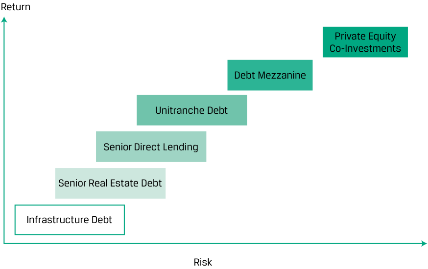

# Tập 8: Đầu tư Thay thế (*Alternative Investments*)
## Học phần 3: Đầu tư vào Vốn Tư nhân: Vốn cổ phần và Nợ (*Investments in Private Capital: Equity and Debt*)
### Phần 2/2: Đặc tính Đầu tư của Nợ Tư nhân (Trang PDF 87–100)

---

<!-- PDF Page 87 -->

(*corporate life cycle*), khi vốn đầu tư mạo hiểm (*venture capital*) là phù hợp nhất. Cuối cùng, tổ hợp “ii” là điển hình của giai đoạn tăng trưởng (*growth stage*), khi các cơ hội cho các hình thức đầu tư giao thoa với nhau và bất kỳ loại hình nào cũng đều thích hợp. 

### **ĐẶC TÍNH ĐẦU TƯ CỦA NỢ TƯ NHÂN (*PRIVATE DEBT INVESTMENT CHARACTERISTICS*)** 

# **<mark>3</mark>** 

**Mục tiêu học tập:** giải thích các đặc điểm của nợ tư nhân (*private debt*) và các đặc tính đầu tư của nó 

Nợ tư nhân (*private debt*) chủ yếu đề cập đến các hình thức nợ khác nhau được các nhà đầu tư cung cấp trực tiếp cho các pháp nhân tư nhân. Trong thập kỷ qua, sự mở rộng của thị trường nợ tư nhân phần lớn được thúc đẩy bởi các quỹ cho vay tư nhân (*private lending funds*) lấp đầy khoảng trống giữa nhu cầu vay vốn và nguồn cung tín dụng bị thu hẹp từ các bên cho vay truyền thống trước bối cảnh các quy định quản lý bị thắt chặt sau cuộc khủng hoảng tài chính năm 2008. 

Chúng ta có thể sắp xếp các phương thức đầu tư nợ tư nhân chính thành bốn phân loại: cho vay trực tiếp (*direct lending*), các khoản vay tầng giữa (*mezzanine loans*), nợ mạo hiểm (*venture debt*), và nợ xấu/nợ gặp khó khăn tài chính (*distressed debt*). Danh mục rộng lớn các chiến lược nợ không chỉ mang lại lợi ích đa dạng hóa mà còn tạo cơ hội tiếp cận với các lĩnh vực đầu tư khác, chẳng hạn như bất động sản và cơ sở hạ tầng. 

#### **Các Phân loại Nợ Tư nhân (*Private Debt Categories*)** 

Tương tự như đầu tư vốn cổ phần tư nhân, một nhà đầu tư muốn đưa nợ tư nhân vào danh mục đầu tư có nhiều lựa chọn thay thế theo sự phân biệt tương ứng giữa trực tiếp và gián tiếp. Trong đầu tư nợ tư nhân trực tiếp (*direct private debt investment*), nhà đầu tư cấp một khoản vay trực tiếp cho một công ty hoạt động (*operating company*) cụ thể. Trong cách tiếp cận gián tiếp (*indirect approach*), nhà đầu tư đi theo con đường qua trung gian, mua lợi ích trong một quỹ tập hợp vốn đóng góp thường là thay mặt cho nhiều bên tham gia để mua lại các khoản nợ từ một tập hợp các công ty hoạt động. Đối với cả hai cách tiếp cận, để đổi lấy khoản nợ, các nhà đầu tư nhận được các khoản thanh toán tiền lãi và hoàn trả nợ gốc sau một kỳ hạn xác định. Khoản nợ thường có tài sản đảm bảo (*secured*) và có các điều khoản bảo vệ/khế ước (*protections/covenants*) khác nhau được thiết lập. Minh họa 4 mô tả vai trò của nợ tư nhân trong vòng đời doanh nghiệp. 

<!-- PDF Page 88 -->

**Minh họa 4: Nợ Tư nhân và Vòng đời Doanh nghiệp (*Private Debt and Corporate Life Cycle*)** 

> **Chú thích hình ảnh:**
> - **Nguồn nợ ở giai đoạn đầu:** Nợ mạo hiểm (*Venture debt*), Nợ chuyển đổi nắm giữ tư nhân (*Privately held convertible debt*) $\rightarrow$ **Cơ hội đầu tư mạo hiểm (*Venture capital opportunity*)** (Công ty tư nhân nắm giữ - *Privately held company*).
> - **Nguồn nợ ở giai đoạn sau:** Nợ đại chúng và nợ tư nhân (*Public and private debt*), Cho vay trực tiếp, tài trợ tầng giữa, cho vay đòn bẩy (*Direct lending, mezzanine financing, leveraged lending*) $\rightarrow$ **Cơ hội vốn cổ phần tư nhân (*Private equity opportunity*)** (Từ IPO, giao dịch đại chúng - *Publicly traded*, đến Mua lại, chuyển thành tư nhân, LBO - *Buy-out, taking private, LBO*).
> - **Các giai đoạn vòng đời (*Life cycle stage*):**
>   - **Hạt giống (*Seed*):** Doanh thu (*Revenues*): Không có (*None*) | Dòng tiền (*Cash flow*): Âm (*Negative*) | Rủi ro kinh doanh (*Business risk*): Rất cao (*Very high*).
>   - **Khởi nghiệp (*Start-up*):** Doanh thu: Thấp đến không có (*Low to none*) | Dòng tiền: Âm (*Negative*) | Rủi ro kinh doanh: Cao (*High*).
>   - **Tăng trưởng (*Growth*):** Doanh thu: Đang tăng (*Increasing*) | Dòng tiền: Đang tăng (*Increasing*) | Rủi ro kinh doanh: Cao (*High*).
>   - **Trưởng thành (*Maturity*):** Doanh thu: Dương, có thể dự đoán (*Positive, predictable*) | Dòng tiền: Dương, có thể dự đoán (*Positive, predictable*) | Rủi ro kinh doanh: Thấp (*Low*).
>   - **Suy thoái (*Decline*):** Doanh thu: Đang giảm (*Declining*) | Dòng tiền: Đang giảm (*Declining*) | Rủi ro kinh doanh: Đang tăng (*Increasing*).

**Nợ mạo hiểm (*Venture debt*)** là nguồn tài trợ nợ tư nhân cung cấp sự hậu thuẫn vốn mạo hiểm cho các công ty khởi nghiệp (*start-up*) hoặc các công ty ở giai đoạn đầu (*early-stage companies*) có thể đang tạo ra rất ít dòng tiền hoặc dòng tiền âm. Các nhà khởi nghiệp có thể tìm kiếm nợ mạo hiểm, thường dưới hình thức hạn mức tín dụng (*line of credit*) hoặc khoản vay có kỳ hạn (*term loan*), để có thêm nguồn tài trợ mà không làm pha loãng thêm quyền sở hữu của cổ đông. Nợ mạo hiểm có thể bổ trợ cho nguồn tài trợ vốn cổ phần hiện có, cho phép các cổ đông hiện tại duy trì quyền sở hữu và quyền kiểm soát trong một khoảng thời gian dài hơn. Tương tự như nợ tầng giữa (*mezzanine debt*), nợ mạo hiểm có thể đi kèm các tính năng bổ sung nhằm đền bù cho nhà đầu tư/người cho vay trước rủi ro vỡ nợ gia tăng hoặc do các công ty khởi nghiệp và giai đoạn đầu thiếu tài sản đáng kể để làm tài sản thế chấp nợ. Một tính năng như vậy có thể trao cho người cho vay quyền mua vốn cổ phần tại công ty đi vay trong những hoàn cảnh nhất định. 

Các nhà đầu tư nợ tư nhân tham gia vào hoạt động **cho vay trực tiếp (*direct lending*)** bằng cách cung cấp vốn trực tiếp cho người đi vay và sau đó nhận tiền lãi, tiền gốc ban đầu, và có thể cả các khoản thanh toán khác để đổi lấy khoản đầu tư của mình. Giống như các khoản vay ngân hàng thông thường, các khoản thanh toán thường được nhận theo một lịch trình cố định. Bản thân khoản nợ thường có thứ tự ưu tiên cấp cao (*senior*) và có tài sản đảm bảo (*secured*), đồng thời có các khế ước (*covenants*) được thiết lập để bảo vệ người cho vay/nhà đầu tư. Khoản nợ này được cung cấp bởi một số lượng nhỏ các nhà đầu tư cho các pháp nhân tư nhân và đôi khi là đại chúng, đồng thời khác với các công cụ nợ truyền thống như trái phiếu — thứ có thể được phát hành cho nhiều bên tham gia và được giao dịch đại chúng. 

Cho vay trực tiếp chủ yếu bao gồm việc các công ty nợ tư nhân (hoặc các công ty vốn cổ phần tư nhân có bộ phận nợ tư nhân) thành lập các quỹ với số tiền huy động được từ các nhà đầu tư mong muốn có các khoản nợ lợi suất cao hơn. Khi đó, các nhà quản lý quỹ sẽ tìm kiếm các cơ hội tài trợ, chẳng hạn như cấp một khoản vay cho một doanh nghiệp thị trường tầm trung (*mid-market corporation*) hoặc cấp nợ cho một quỹ vốn cổ phần tư nhân khác đang tìm kiếm nguồn vốn để thực hiện các thương vụ mua lại. Nhìn chung, các quỹ nợ tư nhân cung cấp nợ, ở mức lãi suất cao hơn, cho các pháp nhân đang cần vốn nhưng thiếu các phương án thay thế tốt từ những bên cho vay ngân hàng truyền thống — những định chế mà bản thân họ có thể không quan tâm hoặc không thể giao dịch với những người đi vay này. Giống như trong lĩnh vực vốn cổ phần tư nhân, các nhà quản lý quỹ nợ tư nhân thực hiện việc thẩm định chuyên sâu (*thorough due diligence*) trước khi đầu tư. 

Trong hoạt động cho vay trực tiếp, nhiều công ty cũng có thể cung cấp nợ dưới hình thức **khoản vay đòn bẩy (*leveraged loan*)**, tức một khoản vay mà bản thân nó được sử dụng đòn bẩy. Các công ty nợ tư nhân đầu tư vào các khoản vay đòn bẩy trước tiên sẽ vay tiền để tài trợ cho khoản nợ đó và sau đó cấp khoản nợ này cho một người đi vay khác. Bằng cách sử dụng đòn bẩy, một công ty nợ tư nhân có thể nâng cao tỷ suất sinh lợi trên danh mục cho vay của mình. 

<!-- PDF Page 89 -->

##### **VÍ DỤ 4** 

#### **Peterburgh Real Estate Fund, LLC — Thế chấp Đòn bẩy Hợp vốn (*Syndicated Leveraged Mortgages*)** 

Quỹ bất động sản Peterburgh Real Estate Fund, LLC, đã mua lại một danh mục bao gồm sáu bất động sản thương mại với tổng giá trị là 100 triệu GBP. Từ các nhà đầu tư của mình, quỹ đã huy động được 30 triệu GBP tài trợ vốn cổ phần, và quỹ đã tìm đến BridgeRock Credit Opportunities LLP, một quỹ nợ tư nhân chuyên bảo lãnh phát hành các khoản thế chấp thương mại trước khi hợp vốn (*syndicating*) chúng. 

Trong giao dịch cụ thể này, các bất động sản được định giá ở mức 100 triệu GBP đóng vai trò làm tài sản thế chấp cho tổng cộng 75 triệu GBP các khoản vay thế chấp, tạo ra tỷ số khoản vay trên giá trị (*loan to value* – LTV) tổng hợp là 0,75, mang lại cho BridgeRock 25 triệu GBP tài sản thế chấp vượt mức (*excess collateral*). Các điều khoản của khoản thế chấp là lãi suất tham chiếu thị trường ($\text{MRR}$) $+ 150\text{ bps}$, với kỳ hạn 15 năm, trả dần nợ gốc hàng năm (*annual amortization*) là 5 triệu GBP, và tất cả các khoản thế chấp đều được đảm bảo bằng quyền cầm giữ thứ nhất (*first lien*) đối với bất động sản. Bên cho vay, BridgeRock, sau đó bán hoặc hợp vốn các khoản thế chấp này cho các ngân hàng hoặc nhà đầu tư định chế khác. Tỷ số LTV đóng một vai trò quan trọng trong cả hai vế của giao dịch này. Để Peterburgh có thể vay và để BridgeRock có thể hợp vốn các khoản vay, tỷ số LTV tổng hợp không được phép bị vi phạm, và bất kỳ sự sai lệch nào khỏi mức LTV ở cấp độ từng bất động sản riêng lẻ đều cần phải được khắc phục (*cured*). Khi Peterburgh trả dần nợ gốc của khoản vay, dư nợ gốc của các khoản thế chấp giảm xuống, làm giảm giá trị LTV. Tuy nhiên, nếu giá trị của bất động sản sụt giảm, thì Peterburgh sẽ bị yêu cầu phải huy động thêm tài sản thế chấp bổ sung để duy trì mức LTV. 

Trong lĩnh vực nợ tư nhân, **nợ tầng giữa (*mezzanine debt*)** đề cập đến khoản tín dụng tư nhân có thứ tự ưu tiên thấp hơn (*subordinated to*) nợ cấp cao có đảm bảo (*senior secured debt*) nhưng cao hơn (*senior to*) vốn cổ phần trong cấu trúc vốn của người đi vay. Nợ tầng giữa là một nguồn vốn bổ sung sẵn có cho người đi vay ngoài khoản nợ cấp cao có đảm bảo, thường được sử dụng để tài trợ cho các thương vụ LBO, tái cấu trúc vốn, mua lại doanh nghiệp, và các giao dịch tương tự. Do thứ hạng thường thấp hơn (*junior ranking*) và trạng thái thường không có tài sản đảm bảo (*unsecured status*), nợ tầng giữa rủi ro hơn so với nợ cấp cao có đảm bảo. Để đền bù cho các nhà đầu tư trước mức rủi ro gia tăng này, các nhà đầu tư thường đòi hỏi mức lãi suất cao hơn và có thể yêu cầu các quyền chọn tham gia vốn cổ phần (*options for equity participation*). Nợ tầng giữa thường đi kèm với các tính năng bổ sung, chẳng hạn như chứng quyền (*warrants*) hoặc quyền chuyển đổi (*conversion rights*). Những tính năng này mang lại sự tham gia vốn cổ phần cho người cho vay/nhà đầu tư, trao quyền chọn chuyển đổi khoản nợ của họ thành vốn cổ phần hoặc mua vốn cổ phần của người đi vay cơ sở trong những hoàn cảnh nhất định. 

Việc tham gia vào **nợ xấu / nợ gặp khó khăn tài chính (*distressed debt*)** thường bao gồm việc mua lại khoản nợ của các công ty đã trưởng thành đang gặp khó khăn về tài chính. Các công ty này có thể đang trong tình trạng phá sản, đã vỡ nợ, hoặc có vẻ nhiều khả năng sẽ vỡ nợ. Một số nhà đầu tư xác định những công ty đang gặp vấn đề dòng tiền tạm thời nhưng có kế hoạch kinh doanh tốt giúp công ty sống sót và cuối cùng phát triển thịnh vượng trở lại. Những nhà đầu tư này mua khoản nợ của công ty với kỳ vọng cả công ty lẫn khoản nợ của nó sẽ tăng giá trị. Các nhà đầu tư xoay chuyển tình thế (*turnaround investors*) mua nợ với mục đích tham gia chủ động hơn vào việc quản lý và định hướng công ty đang gặp khó khăn, tìm cách tái cấu trúc và hồi sinh công ty. Nhìn chung, các nhà đầu tư tập trung vào nợ gặp khó khăn tài chính cần phát triển kiến thức chuyên môn liên quan đến việc đánh giá xác suất vỡ nợ (*likelihood of default*) và tỷ lệ thu hồi có thể đạt được (*possible recovery rates*) bởi vì nợ gặp khó khăn tài chính được định giá theo tỷ lệ thu hồi kỳ vọng, nhưng đôi khi tỷ lệ thu hồi lại đánh giá sai lệch rủi ro cơ sở của các khoản phơi nhiễm và có chân trời thời gian kéo dài. Các thủ tục phá sản có thể rất tốn thời gian, phức tạp và thâm dụng vốn. Tương tự, các nhà đầu tư nợ gặp khó khăn tài chính cần hiểu cách tái cấu trúc các công ty và tái cấu trúc nợ. Một số quỹ nợ gặp khó khăn tài chính tập trung vào tài trợ con nợ nắm giữ tài sản (*debtor-in-possession* – DIP *financing*), cung cấp vốn hoạt động cho các công ty đã ở trong tình trạng phá sản. 

<!-- PDF Page 90 -->

##### **HERTZ VÀ TÀI TRỢ DIP (*DIP FINANCING*)** 

Hertz đã bước vào thủ tục tái tổ chức theo Chương 11 (*Chapter 11 reorganization*) vào tháng 5 năm 2020 sau khi nộp đơn xin phá sản do ngành du lịch toàn cầu gần như đóng cửa hoàn toàn vì đại dịch COVID-19. Vào tháng 10 năm 2020, hãng đã đàm phán khoản vốn hoạt động trị giá 1,65 tỷ USD được đảm bảo thông qua hình thức tài trợ con nợ nắm giữ tài sản (*debtor-in-possession financing*). Khoản tài trợ đó cam kết Hertz phải trả cho các chủ nợ mức lãi suất lên tới lãi suất tham chiếu thị trường ($\text{MRR}$) $+ 725\text{ bps}$, cho phép rút vốn (*drawdowns*) từ hạn mức này thành các đợt (*tranches*) riêng lẻ tối thiểu 250 triệu USD mỗi đợt. Tối đa 1 tỷ USD được cho phép dùng để mua sắm phương tiện xe, và tối đa 800 triệu USD được cho phép dùng để tài trợ vốn lưu động và các nhu cầu chung của doanh nghiệp. 

Khoản tài trợ DIP được dự kiến sẽ cung cấp cho Hertz thanh khoản để hỗ trợ các hoạt động liên tục của hãng trong suốt năm 2021, thời điểm khoản vay đáo hạn. Các công ty vốn tư nhân Apollo Global Management, Diameter Capital Partners, và Silver Point Capital đã cung cấp nguồn tài trợ này. Tài trợ DIP thường là một tín hiệu cho thấy những người cho vay tin tưởng vào khả năng tái tổ chức và hoàn trả khoản nợ đúng hạn của công ty. 

Một loại nợ khác có thể được cấp trực tiếp cho người đi vay là **nợ hợp nhất (*unitranche debt*)**. Nợ hợp nhất bao gồm một cấu trúc khoản vay lai ghép hoặc pha trộn (*hybrid or blended loan structure*) kết hợp các phần (*tranches*) nợ có đảm bảo và không có đảm bảo khác nhau thành một khoản vay duy nhất với một mức lãi suất pha trộn duy nhất (*single, blended interest rate*). Vì nợ hợp nhất là sự pha trộn giữa nợ có đảm bảo và nợ không có đảm bảo, nên lãi suất của nó nhìn chung sẽ nằm ở khoảng giữa mức lãi suất thường được đòi hỏi đối với nợ có đảm bảo và nợ không có đảm bảo. Khoản vay hợp nhất thường sẽ được cấu trúc nằm giữa nợ cấp cao (*senior debt*) và nợ thứ cấp (*subordinated debt*) xét về thứ tự ưu tiên thanh toán (*priority ranking*). 

Các công ty nợ tư nhân cũng có thể cung cấp _các khoản vay chuyên biệt (*specialty loans*)_, được cấp cho những người đi vay trong các phân khúc ngách ở những tình huống cụ thể. Ví dụ, trong lĩnh vực tài trợ tranh tụng (*litigation finance*), một công ty tài trợ chuyên biệt cung cấp khoản nợ cho khách hàng, thường là các nguyên đơn trong vụ kiện, để trang trải chi phí và lệ phí pháp lý của họ nhằm đổi lấy một phần tiền phán quyết thắng kiện (*share of judgements*). 

#### **Rủi ro – Lợi nhuận của Nợ Tư nhân (*Risk–Return of Private Debt*)** 

Các khoản đầu tư nợ tư nhân có thể mang lại những cơ hội có lợi suất cao hơn cho các nhà đầu tư thu nhập cố định đang tìm kiếm tỷ suất sinh lợi gia tăng so với trái phiếu truyền thống. Các quỹ nợ tư nhân có thể tạo ra tỷ suất sinh lợi cao hơn bằng cách nắm giữ các vị thế cơ hội (*opportunistic positions*) dựa trên sự kém hiệu quả của thị trường. Các quỹ cho vay tư nhân đã lấp đầy khoảng trống tài trợ do các bên cho vay truyền thống để lại sau cuộc khủng hoảng tài chính năm 2008. Các nhà đầu tư vào nợ tư nhân có thể hiện thực hóa tỷ suất sinh lợi cao hơn từ phần bù kém thanh khoản (*illiquidity premium*), tức phần tỷ suất sinh lợi vượt trội mà nhà đầu tư đòi hỏi để đền bù cho sự thiếu hụt thanh khoản. Các nhà đầu tư cũng được hưởng lợi từ việc gia tăng đa dạng hóa danh mục đầu tư khi sở hữu những chứng khoán này. 

Lãi suất của nợ tư nhân thường được biểu thị tương đối so với một mức lãi suất tham chiếu — ví dụ, Lãi suất Tài trợ Qua đêm Có đảm bảo (*Secured Overnight Financing Rate* – SOFR) $+ 375\text{ bps}$. Kết quả là, lãi suất coupon biến thiên cùng chiều với những thay đổi của lãi suất tham chiếu do những biến động trong môi trường lãi suất mang lại. 

Sự khác biệt giữa nợ đại chúng và nợ tư nhân bao gồm các điểm gia nhập và thoái vốn riêng biệt với người cho vay, điều mang lại cho người đi vay sự linh hoạt lớn hơn trong việc thu xếp nguồn tài trợ. Kiến thức chuyên môn về tài trợ nợ tư nhân là rất cần thiết để tạo ra giá trị gia tăng cho nhà đầu tư. Thứ nhất, việc tài trợ và tỷ suất sinh lợi trên nợ phụ thuộc vào giai đoạn cụ thể trong vòng đời của một công ty. Tài trợ nợ ở giai đoạn sớm hơn thường mang rủi ro cao hơn và mang lại tỷ suất sinh lợi cao hơn. Thứ hai, cấu trúc của khoản nợ cũng có tầm quan trọng; chẳng hạn, các nghĩa vụ khoản vay có thế chấp (*collateralized loan obligations* – CLOs) với lãi suất tham chiếu thị trường (MRR) làm lãi suất cơ sở đòi hỏi kiến thức chuyên môn. Cuối cùng, nhà đầu tư cần phải có kiến thức chuyên biệt về các tài sản cơ sở, đặc biệt là đối với hoạt động cho vay có đảm bảo, chẳng hạn như bất động sản. 

<!-- PDF Page 91 -->

Tiềm năng đạt tỷ suất sinh lợi cao hơn gắn liền với mức độ rủi ro cao hơn. Các khoản đầu tư nợ tư nhân khác nhau về rủi ro và tỷ suất sinh lợi, trong đó nợ tư nhân cấp cao (*senior private debt*) mang lại mức lợi suất ổn định hơn và rủi ro vừa phải, còn nợ tư nhân tầng giữa (*mezzanine private debt*) mang tiềm năng tăng trưởng cao hơn, cơ hội hưởng lợi từ việc tăng giá vốn cổ phần (*equity upside*), và rủi ro cao hơn so với nợ tư nhân cấp cao. Nhìn chung, đầu tư vào nợ tư nhân rủi ro hơn so với đầu tư vào trái phiếu truyền thống. Các nhà đầu tư cần nhận thức rõ về những rủi ro này, bao gồm tính kém thanh khoản và rủi ro vỡ nợ gia tăng khi các khoản vay được cấp cho những pháp nhân rủi ro hơn hoặc những người đi vay trong các tình huống rủi ro hơn. Việc mô hình hóa tỷ suất sinh lợi của vốn cổ phần tư nhân hoặc nợ tư nhân không hề đơn giản, do thiếu dữ liệu chất lượng tốt và hiện tượng tỷ suất sinh lợi bị làm mượt một cách giả tạo (*artificially smooth returns*). 

##### **BỘ CÂU HỎI (*QUESTION SET*)** 

1. Xác định hai phân loại nợ tư nhân thường được dựa vào trong giai đoạn tăng trưởng (*growth stage*) hoặc giai đoạn muộn hơn của vòng đời doanh nghiệp. 

##### **Lời giải:** 

Như được hiển thị trong Minh họa 4, ba phân loại nợ tư nhân xuất hiện trong các giai đoạn sau của vòng đời doanh nghiệp: 

   **1.** Cho vay trực tiếp (*Direct lending*) 

   **2.** Tài trợ tầng giữa (*Mezzanine financing*) 

   **3.** Cho vay đòn bẩy (*Leveraged lending*) 

2. **Xác định các câu trả lời đúng để điền vào chỗ trống:** Tương tự như nợ tầng giữa, ________________ có thể đi kèm các tính năng bổ sung nhằm đền bù cho nhà đầu tư/người cho vay trước ___________________________ hoặc đối với các công ty khởi nghiệp và giai đoạn đầu vốn _________________________. 

##### **Lời giải:** 

Tương tự như nợ tầng giữa, _nợ mạo hiểm (venture debt)_ có thể đi kèm các tính năng bổ sung nhằm đền bù cho nhà đầu tư/người cho vay trước _rủi ro vỡ nợ gia tăng (the increased risk of default)_ hoặc đối với các công ty khởi nghiệp và giai đoạn đầu vốn _thiếu tài sản đáng kể để làm tài sản thế chấp nợ (lack substantial assets for debt collateral)._ 

3. Mô tả chi phí đi vay của nợ hợp nhất (*unitranche debt*). 

##### **Lời giải:** 

Nợ hợp nhất (*unitranche debt*) bao gồm một cấu trúc khoản vay lai ghép hoặc pha trộn kết hợp các phần (*tranches*) nợ có đảm bảo và không có đảm bảo khác nhau thành một khoản vay duy nhất với một mức lãi suất pha trộn duy nhất. Vì nợ hợp nhất là sự pha trộn giữa nợ có đảm bảo và nợ không có đảm bảo, nên lãi suất của nó nhìn chung sẽ nằm ở khoảng giữa mức lãi suất thường được đòi hỏi đối với nợ có đảm bảo và nợ không có đảm bảo. 

4. Xác định phát biểu sau đây là đúng hay sai: Việc mô hình hóa tỷ suất sinh lợi của nợ tư nhân khá đơn giản bởi vì chúng là một hàm số của tỷ suất sinh lợi nợ đại chúng chuẩn (*benchmark public debt return*). 

##### **Lời giải:** 

Sai (*False*). Mặc dù nợ tư nhân và nợ đại chúng có chung một điểm tham chiếu là được cộng thêm biên độ (*marked up*) từ một mức tỷ suất sinh lợi chuẩn, nhưng việc mô hình hóa tỷ suất sinh lợi của vốn cổ phần tư nhân hoặc nợ tư nhân không hề đơn giản, do thiếu dữ liệu chất lượng tốt, có nhiều rủi ro đặc thù của từng chứng khoán (*security-specific risk*) giữa các tài sản hơn, và hiện tượng tỷ suất sinh lợi bị làm mượt một cách giả tạo (*artificially smooth returns*). 

<!-- PDF Page 92 -->

# **<mark>4</mark>** 

### **LỢI ÍCH ĐA DẠNG HÓA CỦA VỐN TƯ NHÂN (*DIVERSIFICATION BENEFITS OF PRIVATE CAPITAL*)** 

**Mục tiêu học tập:** mô tả những lợi ích đa dạng hóa (*diversification benefits*) mà vốn tư nhân (*private capital*) có thể mang lại 

Vì hiệu quả hoạt động của nợ tư nhân và vốn cổ phần tư nhân phụ thuộc rất lớn vào giai đoạn cụ thể trong vòng đời, hiệu quả hoạt động và rủi ro của một công ty, nên việc so sánh với nợ và vốn cổ phần đại chúng có thể không phù hợp. Thứ nhất, đầu tư vào một công ty khởi nghiệp mang rủi ro lớn hơn so với đầu tư vào một công ty đã có chỗ đứng vững chắc. Thứ hai, đầu tư vào một công ty trong một ngành đang suy thoái hoặc bị loại bỏ trung gian (*disintermediated industry*) ít có khả năng mang lại tỷ suất sinh lợi dương trong các chân trời thời gian dài hơn. Hơn nữa, rủi ro hiệu quả hoạt động của một khoản đầu tư liên tục vào vốn cổ phần và nợ đại chúng có thể dễ dàng được phòng vệ (*hedged away*). 

Năm khởi tạo (*vintage year*) rất quan trọng để so sánh các khoản đầu tư vốn cổ phần tư nhân và VC với các quỹ khác trong cùng năm đó. Mỗi quỹ vốn cổ phần tư nhân đều mang một **năm khởi tạo (*vintage year*)**, thường được định nghĩa là năm mà quỹ thực hiện khoản đầu tư đầu tiên của mình. Thông thường, một quỹ vốn cổ phần tư nhân hoạt động trong khoảng thời gian từ 10 đến 12 năm, thường được chia thành một giai đoạn đầu tư ban đầu (*initial investment period*) và một giai đoạn thu hoạch tiếp theo (*subsequent harvesting period*). Giai đoạn đầu tư thường là năm năm đầu tiên, trong đó nguồn vốn được huy động từ các thành viên góp vốn (*limited partners* – LPs) và được đầu tư vào các công ty khác nhau. Giai đoạn thu hoạch là những năm còn lại của quỹ, khi quỹ tìm cách thoái vốn khỏi các khoản đầu tư hiện có và hoàn trả vốn cho các thành viên góp vốn. 

Do môi trường kinh doanh và định giá luôn thay đổi, các quỹ thuộc một năm khởi tạo nhất định có lợi thế khi bắt đầu trong một giai đoạn phục hồi kinh tế có mức định giá thấp, khẩu vị rủi ro thấp, và hưởng lợi từ việc cưỡi trên làn sóng phục hồi kinh tế. Các năm khởi tạo khác có thể kém may mắn hơn và đầu tư phần lớn số vốn của mình vào một môi trường định giá cao ngay trước một đợt sụp đổ thị trường hoặc một giai đoạn thu hẹp kinh tế kéo dài. Đó là lý do tại sao các nhà đầu tư được khuyến khích theo đuổi việc đa dạng hóa theo năm khởi tạo (*vintage diversification*) bằng cách đầu tư vào nhiều năm khởi tạo khác nhau. 

Hiệu quả hoạt động thực tế mà quỹ đạt được phụ thuộc rất lớn vào năm khởi tạo và pha của chu kỳ kinh doanh (*phase of the business cycle*) mà năm khởi tạo đó diễn ra, như Minh họa 5 cho thấy. Các quỹ được gieo vốn (*seeded*) trong pha mở rộng (*expanding phase*) của chu kỳ kinh doanh có xu hướng kiếm được tỷ suất sinh lợi vượt trội (*excess returns*) nếu chúng tài trợ cho các công ty ở giai đoạn đầu (*early-stage companies*). Các quỹ được gieo vốn trong pha thu hẹp (*contracting phase*) của chu kỳ kinh doanh có xu hướng kiếm được tỷ suất sinh lợi vượt trội nếu chúng tài trợ cho các công ty đang gặp khó khăn tài chính (*distressed companies*). 

<!-- PDF Page 93 -->

##### **Minh họa 5: Tỷ suất sinh lợi theo Năm khởi tạo của Chỉ số Vốn cổ phần Tư nhân Hoa Kỳ, Hiệu quả hoạt động Ròng ở Cấp độ Quỹ (*US Private Equity Index Vintage Year Returns, Net Fund-Level Performance*)** 

> **Chú thích hình ảnh:**
> - **Năm khởi tạo (*Vintage Year*):** 2007 | 2011 | 2012 | 2013 | 2014 | 2015 | 2016 | 2017 | 2018
> - **Tỷ suất sinh lợi năm 2020 (*2020 Return*):** 10,3% | 14,7% | 24,8% | 29,6% | 29,0% | 33,9% | 40,4% | 29,7% | 43,5%

_Nguồn:_ Cambridge Associates, dữ liệu tính đến ngày 31 tháng 12 năm 2020. https://www.cambridgeassociates.com/benchmarks/us-pe-vc-benchmark-commentary-calendar-year-2020/ 

Các khoản đầu tư vào vốn tư nhân khác nhau về rủi ro và tỷ suất sinh lợi trên khắp thứ bậc cấu trúc vốn của doanh nghiệp (*corporate capital structure hierarchy*). Thông thường, vốn cổ phần tư nhân, với tư cách là lựa chọn thay thế rủi ro nhất, mang lại tỷ suất sinh lợi cao nhất, trong khi tỷ suất sinh lợi của nợ tư nhân giảm dần trên một dải liên tục xuống đến hình thức nợ an toàn nhất, được đảm bảo tốt nhất — nợ cơ sở hạ tầng (*infrastructure debt*). Minh họa 6 phác thảo các phân loại vốn cổ phần tư nhân và nợ tư nhân khác nhau theo mức độ rủi ro và tỷ suất sinh lợi của chúng (phản ánh lộ trình rủi ro – lợi nhuận đối với đầu tư vốn cổ phần và nợ truyền thống, hãy lưu ý sự đánh đổi khi nhà đầu tư lựa chọn giữa nợ cấp thấp và nợ cấp cao cũng như giữa vốn cổ phần và nợ). 

**Minh họa 6: Mức độ Rủi ro và Tỷ suất sinh lợi của Vốn Tư nhân theo Phân loại (*Private Capital Risk and Return Levels by Category*)** 

> **Chú thích hình ảnh:**
> - **Trục tung:** Tỷ suất sinh lợi (*Return*) | **Trục hoành:** Rủi ro (*Risk*)
> - **Thứ tự từ Rủi ro & Tỷ suất sinh lợi thấp nhất đến cao nhất:**
>   1. Nợ cơ sở hạ tầng (*Infrastructure Debt*)
>   2. Nợ bất động sản cấp cao (*Senior Real Estate Debt*)
>   3. Cho vay trực tiếp cấp cao (*Senior Direct Lending*)
>   4. Nợ hợp nhất (*Unitranche Debt*)
>   5. Nợ tầng giữa (*Debt Mezzanine*)
>   6. Đồng đầu tư (*Co-Investments*)
>   7. Vốn cổ phần tư nhân (*Private Equity*)

_Nguồn_: Dựa trên biểu đồ từ Leon Sinclair, “The Rise of Private Debt,” IHS Markit (7 tháng 8 năm 2017). 

<!-- PDF Page 94 -->

Các khoản đầu tư vào các quỹ vốn tư nhân có thể bổ sung một lợi ích đa dạng hóa vừa phải cho một danh mục gồm cổ phiếu và trái phiếu giao dịch đại chúng. Hệ số tương quan với các chỉ số thị trường đại chúng dao động từ 0,63 đến 0,83, như được hiển thị trong Minh họa 7. Và nếu các nhà đầu tư xác định được những nhà quản lý quỹ có kỹ năng tốt, họ hoàn toàn có thể thu được lợi ích từ tỷ suất sinh lợi vượt trội (*excess returns*) khi chấp nhận thêm rủi ro đòn bẩy, rủi ro thị trường và rủi ro thanh khoản. 

**Minh họa 7: Hệ số Tương quan Trung bình của Vốn Tư nhân với các Chỉ số Thị trường Đại chúng, Tháng 3/2008 – Tháng 6/2021 (*Private Capital’s Average Correlations with Public Market Indexes, March 2008–June 2021*)** 

||**Tổng Tỷ suất sinh lợi S&P 500 (*S&P 500 Total Return*)**|**Tổng Tỷ suất sinh lợi Russell 2000 (*Russell 2000 Total Return*)**|**Tổng Tỷ suất sinh lợi MSCI World (*MSCI World Total Return*)**|
|---|---|---|---|
|Preqin, Vốn cổ phần tư nhân (*Private Equity*)|0,80|0,76|0,81|
|Preqin, Đầu tư mạo hiểm mọi giai đoạn (*Venture All Stage*)|0,65|0,67|0,63|
|Preqin, Mua lại (*Buyout*)|0,82|0,76|0,83|
|Preqin, Nợ tư nhân (*Private Debt*)|0,82|0,77|0,86|

_Nguồn:_ Tỷ suất sinh lợi hàng quý được chuẩn hóa theo năm của Chỉ số Hàng quý Vốn Tư nhân (*Private Capital Quarterly Index*) được quy chuẩn lại gốc vào ngày 31 tháng 12 năm 2007, do Preqin cung cấp. 

##### **BỘ CÂU HỎI (*QUESTION SET*)** 

1. Nêu một yếu tố đầu tư nợ và vốn cổ phần tư nhân có thể khiến việc so sánh hiệu quả hoạt động/rủi ro với nợ và vốn cổ phần đại chúng trở nên không phù hợp. 

##### **Lời giải:** 

Có một số yếu tố đầu tư nợ và vốn cổ phần tư nhân có thể làm mất hiệu lực của những phép so sánh như vậy: 

   - Các khoản đầu tư vào công ty khởi nghiệp (*start-up investments*) mang rủi ro lớn hơn so với các công ty đã có tên tuổi. 

   - Các khoản đầu tư vào những ngành đang suy thoái ít có khả năng duy trì được mức sinh lời trong dài hạn. 

   - Rủi ro hiệu quả hoạt động diễn ra liên tục trong các khoản đầu tư tư nhân không thể dễ dàng được phòng vệ (*hedged*). 

2. Mô tả các phân đoạn vòng đời của một quỹ vốn cổ phần tư nhân. 

##### **Lời giải:** 

Năm mà một quỹ vốn cổ phần tư nhân thực hiện các khoản đầu tư đầu tiên được gọi là năm khởi tạo (*vintage year*) của nó. Thông thường, hoạt động của quỹ kéo dài trong khoảng thời gian từ 10 đến 12 năm, thường được chia thành một giai đoạn đầu tư ban đầu (*initial investment period*) và một giai đoạn thu hoạch tiếp theo (*subsequent harvesting period*). Giai đoạn đầu tư thường là năm năm đầu tiên, trong đó nguồn vốn được huy động từ các thành viên góp vốn (*limited partners*) và được đầu tư vào các công ty khác nhau. Giai đoạn thu hoạch là những năm còn lại của quỹ, khi quỹ tìm cách thoái vốn khỏi các khoản đầu tư hiện có và hoàn trả vốn cho các thành viên góp vốn. 

<!-- PDF Page 95 -->

3. Xác định phát biểu sau đây là đúng hay sai: 

Một quỹ vốn cổ phần tư nhân có năm khởi tạo rơi vào một môi trường định giá cao _có khả năng cao nhất_ sẽ bắt đầu với một lợi thế nhờ có mức giá cao cho các tài sản của mình. 

##### **Lời giải:** 

Sai (*False*). Các quỹ bắt đầu trong một giai đoạn phục hồi kinh tế có mức định giá thấp, khẩu vị rủi ro thấp sẽ được hưởng lợi từ việc cưỡi trên làn sóng phục hồi kinh tế và có lợi thế hơn so với các năm khởi tạo khác vốn đầu tư phần lớn số vốn của mình vào một môi trường định giá cao ngay trước một đợt sụp đổ thị trường hoặc một giai đoạn thu hẹp kinh tế kéo dài. 

4. Ghép hình thức đầu tư vốn tư nhân với vị trí _có khả năng cao nhất_ của nó trên dải liên tục rủi ro/tỷ suất sinh lợi (*risk/return continuum*). 

|**Hình thức Đầu tư (*Investment Form*)**|**Tổ hợp Rủi ro/tỷ suất sinh lợi (*Risk/return combination*)**|
|---|---|
|1. Tài trợ tầng giữa (*Mezzanine Financing*)|i. Rủi ro và tỷ suất sinh lợi thấp nhất (*Lowest risk and return*)|
|2. Vốn cổ phần tư nhân (*Private Equity*)|ii. Rủi ro và tỷ suất sinh lợi trung gian (*Intermediate risk and return*)|
|3. Cho vay trực tiếp cấp cao (*Senior Direct Lending*)|iii. Rủi ro và tỷ suất sinh lợi cao nhất (*Highest risk and return*)|

##### **Lời giải:** 

Đầu tư vào nợ và vốn cổ phần tư nhân phản ánh lộ trình rủi ro – lợi nhuận đối với đầu tư vốn cổ phần và nợ truyền thống. Khi các nhà đầu tư lựa chọn giữa nợ cấp cao (*senior*) và nợ cấp thấp (*junior*) cũng như giữa vốn cổ phần và nợ, rủi ro và tỷ suất sinh lợi tiềm năng sẽ tăng lên. Do đó, rủi ro và tỷ suất sinh lợi thấp nhất đến từ cho vay trực tiếp cấp cao (*senior direct lending*), và rủi ro cùng tỷ suất sinh lợi cao nhất đến từ vốn cổ phần tư nhân (*private equity*), trong khi tài trợ tầng giữa (*mezzanine financing*) nằm ở khoảng giữa hai hình thức này. 

|**Hình thức Đầu tư (*Investment Form*)**|**Tổ hợp Rủi ro/tỷ suất sinh lợi (*Risk/return combination*)**|
|---|---|
|1. Tài trợ tầng giữa (*Mezzanine Financing*)|ii. Rủi ro và tỷ suất sinh lợi trung gian (*Intermediate risk and return*)|
|2. Vốn cổ phần tư nhân (*Private Equity*)|iii. Rủi ro và tỷ suất sinh lợi cao nhất (*Highest risk and return*)|
|3. Cho vay trực tiếp cấp cao (*Senior Direct Lending*)|i. Rủi ro và tỷ suất sinh lợi thấp nhất (*Lowest risk and return*)|

<!-- PDF Page 96 -->

## **BÀI TẬP THỰC HÀNH (*PRACTICE PROBLEMS*)** 

**1.** Đối tượng nào sau đây _có khả năng cao nhất_ tham gia vào hoạt động tài trợ giai đoạn đầu (*early-stage financing*)?
   - **A.** Nhà sáng lập (*Founders*)
   - **B.** Nhà đầu tư thiên thần (*Angel investors*)
   - **C.** Nhà đầu tư chiến lược (*Strategic investors*)

**2.** Các quỹ vốn cổ phần tư nhân _có khả năng cao nhất_ sẽ sử dụng:
   - **A.** các giao dịch mua lại bằng đòn bẩy (*leveraged buyouts*).
   - **B.** các chiến lược dựa trên quyền chọn (*option-based strategies*).
   - **C.** các chiến lược kinh doanh chênh lệch giá sáp nhập (*merger arbitrage strategies*).

**3.** Một ưu điểm chung của chiến lược thoái vốn qua IPO và SPAC đối với một quỹ vốn cổ phần tư nhân là:
   - **A.** việc thực thi nhanh chóng và đơn giản.
   - **B.** khả năng thu hút sự chú ý của thị trường.
   - **C.** sự linh hoạt về cấu trúc giao dịch.

**4.** Tổ hợp các đặc điểm tài chính nào sau đây _có khả năng cao nhất_ sẽ gắn liền với một giao dịch nợ mạo hiểm (*venture debt*)?
   - **A.** Doanh thu và dòng tiền dương
   - **B.** Doanh thu và dòng tiền đang sụt giảm
   - **C.** Doanh thu thấp và dòng tiền âm

**5.** Trái ngược với cho vay trực tiếp và nợ gặp khó khăn tài chính (*distressed debt*), nợ tầng giữa (*mezzanine debt*) _có khả năng cao nhất_ đòi hỏi mức lãi suất cao hơn cho các nhà đầu tư của nó do:
   - **A.** sự phụ thuộc vào đòn bẩy của nó.
   - **B.** thứ hạng tổng thể và vị thế của nó trong cấu trúc nợ của công ty.
   - **C.** nhu cầu tham gia quản lý trong một khoảng thời gian kéo dài của nó.

**6.** Một đặc điểm mà nợ tư nhân và nợ đại chúng có chung khi thiết lập tỷ suất sinh lợi đầu tư của chúng là:
   - **A.** mối quan hệ của chúng với lãi suất chuẩn (*benchmark interest rates*).
   - **B.** nhu cầu về kiến thức đầu tư chuyên biệt của chúng.
   - **C.** cơ hội hưởng phần bù kém thanh khoản trong các cuộc khủng hoảng thị trường của chúng.

**7.** Tác động _có khả năng cao nhất_ đến sự đa dạng hóa của một danh mục đầu tư khi bắt đầu có sự phơi nhiễm với hoạt động cho vay trực tiếp (*direct lending*) là mức độ đa dạng hóa sẽ:
   - **A.** giảm xuống.

<!-- PDF Page 97 -->

   - **B.** giữ nguyên không đổi. 

   - **C.** tăng lên. 

**8.** Các quỹ vốn cổ phần tư nhân có năm khởi tạo (*vintage year*) diễn ra trong pha mở rộng của chu kỳ kinh doanh có xu hướng kiếm được tỷ suất sinh lợi vượt trội bằng cách đầu tư vào các công ty đang ở trạng thái: 

   - **A.** trưởng thành (*mature*). 

   - **B.** gặp khó khăn tài chính (*distressed*). 

   - **C.** giai đoạn đầu (*early stage*). 

**9.** Phân loại vốn tư nhân _có khả năng cao nhất_ mang lại lợi ích đa dạng hóa cao nhất cho các danh mục đang nắm giữ cổ phiếu và trái phiếu đại chúng là: 

   - **A.** nợ tư nhân (*private debt*). 

   - **B.** vốn cổ phần tư nhân (*private equity*). 

   - **C.** vốn đầu tư mạo hiểm (*venture capital*). 

<!-- PDF Page 98 -->

## **LỜI GIẢI (*SOLUTIONS*)** 

1. C là đáp án đúng. Các nhà đầu tư chiến lược (*strategic investors*) thường tham gia vào giai đoạn tài trợ từ giai đoạn đầu (*early-stage*) đến giai đoạn muộn (*later-stage*). A không đúng vì những người sáng lập thường là một phần của nhóm nhà đầu tư ở giai đoạn sớm nhất, tức giai đoạn tiền hạt giống (*pre-seed stage*). B không đúng vì các nhà đầu tư thiên thần thường tham gia vào các giai đoạn bắt đầu, tức tiền hạt giống (*pre-seed*) hoặc hạt giống (*seed*). 

2. A là đáp án đúng. Nhiều giao dịch vốn cổ phần tư nhân bao gồm các thương vụ mua lại bằng đòn bẩy (*leveraged buyouts*) để thâu tóm các công ty đại chúng hoặc các công ty tư nhân đã có chỗ đứng. B và C không đúng vì đây là những chiến lược được thực thi bởi các loại nhà đầu tư thay thế khác, chẳng hạn như các quỹ phòng hộ (*hedge funds*). 

3. B là đáp án đúng. Các đợt IPO có thể thu hút sự chú ý của công chúng cho các nhà tài trợ thông qua những đợt ra mắt kinh doanh đình đám, và các SPAC thường có sự tham gia của các nhà tài trợ có tên tuổi, giàu kinh nghiệm cùng mạng lưới nhà đầu tư của họ. A không đúng vì đây là ưu điểm của chiến lược thoái vốn qua bán thương mại (*trade sale*). C không đúng vì đây là lợi ích đặc thù của SPAC, trong khi IPO có các đặc tính khá cứng nhắc và được quy định sẵn, chẳng hạn như các yêu cầu công bố thông tin nặng nề và thời gian hạn chế chuyển nhượng (*lock-up periods*). 

4. C là đáp án đúng. Những đặc điểm tài chính này là điển hình của giai đoạn khởi nghiệp (*start-up stage*) trong vòng đời doanh nghiệp, khi việc dựa vào nợ mạo hiểm (*venture debt*) là phù hợp. A không đúng vì đây là các đặc điểm của giai đoạn trưởng thành (*maturity stage*), khi cho vay trực tiếp, tài trợ tầng giữa và cho vay đòn bẩy là thông dụng. B không đúng vì đây là các đặc điểm của giai đoạn suy thoái/trưởng thành muộn, khi cho vay trực tiếp, tài trợ tầng giữa và cho vay đòn bẩy là thông dụng. 

5. B là đáp án đúng. Do thứ hạng thường thấp hơn (*junior ranking*) và trạng thái thường không có tài sản đảm bảo (*unsecured status*), nợ tầng giữa rủi ro hơn so với nợ cấp cao có đảm bảo. Để đền bù cho các nhà đầu tư trước mức rủi ro gia tăng này, các nhà đầu tư thường đòi hỏi mức lãi suất cao hơn. A không đúng vì đòn bẩy thường là một đặc điểm của một hình thức cho vay trực tiếp trong đó các công ty cũng có thể cung cấp nợ dưới dạng khoản vay đòn bẩy (*leveraged loan*), tức một khoản vay mà bản thân nó được sử dụng đòn bẩy với chi phí đi vay được tính vào tỷ suất sinh lợi. C không đúng vì việc tham gia vận hành trong một khoảng thời gian có thể kéo dài với những rủi ro khó lường mô tả vai trò của các nhà đầu tư xoay chuyển tình thế (*turnaround investors*) tham gia vào nợ gặp khó khăn tài chính (*distressed debt*). 

6. A là đáp án đúng. Đối với cả nợ đại chúng và nợ tư nhân, tỷ suất sinh lợi trên vốn nợ có xu hướng đi theo và thay đổi cùng với môi trường lãi suất chuẩn (*benchmark interest rate environment*). B không đúng vì cần phải có kiến thức chuyên môn đối với tài trợ nợ tư nhân để tạo ra giá trị gia tăng cho nhà đầu tư thông qua việc xem xét các yếu tố như thời điểm vòng đời của khoản nợ, vị trí của nó trong cấu trúc tài chính, và chất lượng của các tài sản cơ sở. C không đúng vì trong những đợt gián đoạn thị trường, chẳng hạn như cuộc khủng hoảng tài chính năm 2008, nợ tư nhân được hưởng lợi riêng từ phần bù kém thanh khoản (*illiquidity premium*) khi các quỹ cho vay tư nhân lấp đầy khoảng trống tài trợ do các bên cho vay truyền thống để lại bởi các bên cho vay truyền thống ngần ngại bảo lãnh phát hành nợ đại chúng. 

7. C là đáp án đúng. Vốn tư nhân có thể có những đóng góp tích cực tổng thể vào việc đa dạng hóa. Tuy nhiên, hãy lưu ý rằng cho vay trực tiếp có thể liên quan đến một cam kết vốn lớn cho một người đi vay duy nhất, làm tăng rủi ro tập trung (*concentration risk*) và làm giảm sự đa dạng hóa. 

8. C là đáp án đúng. Hiệu quả hoạt động của quỹ phụ thuộc rất lớn vào năm khởi tạo và pha trùng khớp của chu kỳ kinh doanh. Các quỹ được gieo vốn trong pha mở rộng có xu hướng kiếm được tỷ suất sinh lợi vượt trội khi đầu tư vào các công ty ở giai đoạn đầu (*early-stage companies*). Các quỹ được gieo vốn trong pha thu hẹp có xu hướng hoạt động tốt nhất với các công ty đang gặp khó khăn tài chính (*distressed companies*). Kết quả có thể ở mức trung gian đối với các công ty trưởng thành, ổn định. 

<!-- PDF Page 99 -->

9. C là đáp án đúng. Nghiên cứu về hệ số tương quan giữa các danh mục nắm giữ những tài sản đại chúng này cho thấy vốn đầu tư mạo hiểm (*venture capital*) có hệ số tương quan thấp nhất trên tất cả các chỉ số thị trường chính. Mối quan hệ này hàm ý lợi ích đa dạng hóa cao hơn đối với vốn đầu tư mạo hiểm. 

<!-- PDF Page 100 -->
