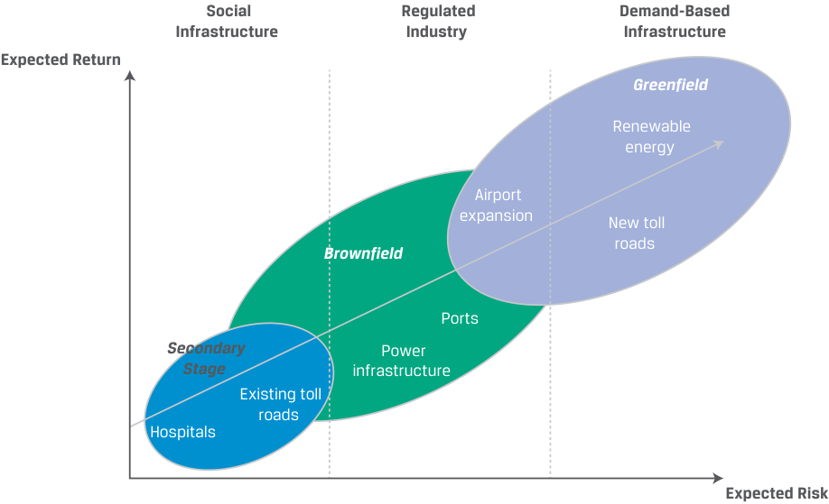

# Tập 8: Đầu tư Thay thế (Alternative Investments)
## Learning Module 4 Real Estate and Infrastructure (Trang PDF 101–128)

---

# Tập 8: Đầu tư Thay thế (*Alternative Investments*)
## Học phần 4: Bất động sản và Cơ sở hạ tầng (*Real Estate and Infrastructure*)
### Phần 1/2: Giới thiệu (Trang PDF 101–114)

---

<!-- PDF Page 101 -->

#### H Ọ C P H Ầ N 

# **<mark>4</mark>** 

### **Bất động sản và Cơ sở hạ tầng (*Real Estate and Infrastructure*)** 

###### **<mark>MỤC TIÊU HỌC TẬP (*LEARNING OUTCOMES*)</mark>** 

**_Thành thạo – Ứng viên cần có khả năng:_** 
- giải thích các tính năng và đặc điểm của bất động sản (*real estate*)
- giải thích các đặc tính đầu tư của các khoản đầu tư bất động sản (*real estate investments*)
- giải thích các tính năng và đặc điểm của cơ sở hạ tầng (*infrastructure*)
- giải thích các đặc tính đầu tư của các khoản đầu tư cơ sở hạ tầng (*infrastructure investments*)

##### **GIỚI THIỆU (*INTRODUCTION*)** 

## **<mark>1</mark>** 

Theo nghĩa rộng, bất động sản (*real estate*) bao gồm đất đai và các tòa nhà/công trình xây dựng. Các khoản đầu tư bất động sản liên quan đến đất đã được phát triển, bao gồm bất động sản thương mại và công nghiệp (*commercial and industrial real estate*) cũng như bất động sản nhà ở (*residential real estate*). Bất động sản có một số tính năng độc đáo, bao gồm tính không đồng nhất (*heterogeneity* — không có hai bất động sản nào hoàn toàn giống hệt nhau), vòng đời dài (*long lives*), và vị trí địa lý hoặc vật lý cố định (*fixed geographical or physical location*). 

Đất thô (*raw land*) và đất ít được phát triển hơn được sử dụng trong nông nghiệp và lâm nghiệp được phân loại là các khoản đầu tư _tài nguyên thiên nhiên (natural resources)_, trong khi _cơ sở hạ tầng (infrastructure)_ liên quan đến đất đai, tòa nhà và các tài sản cố định khác được phát triển bởi các pháp nhân công hoặc quan hệ đối tác công – tư (*public–private partnerships*) cho mục đích sử dụng kinh tế. Các khoản đầu tư vào bất động sản và cơ sở hạ tầng được đưa vào nhiều danh mục đầu tư bởi vì chúng có xu hướng thể hiện mức độ tương quan thấp với các loại tài sản truyền thống và mang lại các tổ hợp rủi ro và tỷ suất sinh lợi trải rộng trên một phổ lớn. Tại đây, cũng giống như ở các tài sản thay thế khác, các nhà đầu tư cần có kiến thức chuyên môn sâu rộng trong việc lựa chọn, mua lại, quản lý và thoái vốn các tài sản này. 

###### **TỔNG QUAN HỌC PHẦN (*LEARNING MODULE OVERVIEW*)** 

- Bất động sản bao gồm hai phân khúc chính: nhà ở (*residential*) và thương mại (*commercial*). Bất động sản nhà ở là phân khúc lớn nhất, chiếm tới 75% thị trường toàn cầu. Bất động sản thương mại bao gồm các tòa nhà văn phòng, trung tâm mua sắm và nhà kho. 

- Đầu tư bất động sản có một số tính năng độc đáo, bao gồm tính không đồng nhất (*heterogeneity* — không có hai bất động sản nào giống hệt nhau), tính phân mảnh (*fragmentation*), những thách thức trong việc khám phá giá (*price discovery challenges*), và các giao dịch tốn kém chi phí cũng như thời gian. 

<!-- PDF Page 102 -->

- Các khoản đầu tư bất động sản có thể là trực tiếp hoặc gián tiếp, trên thị trường đại chúng (ví dụ: các quỹ tín thác đầu tư bất động sản – REITs) hoặc các giao dịch tư nhân, dưới dạng nợ và vốn cổ phần. 

- Tỷ suất sinh lợi trên các khoản đầu tư bất động sản đến từ thu nhập (*income*) hoặc sự tăng giá tài sản (*asset appreciation*) hoặc kết hợp cả hai. Hơn một nửa tỷ suất sinh lợi mà các nhà đầu tư bất động sản thương mại kiếm được bắt nguồn từ thu nhập, và xuyên suốt một chu kỳ thị trường kinh tế, thu nhập từ bất động sản là nguồn tỷ suất sinh lợi ổn định hơn so với sự tăng giá vốn (*capital appreciation*). 

- Đầu tư vào bất động sản có thể tạo ra các dòng tiền giống trái phiếu (*bond-like cash flows*) có rủi ro thấp hơn từ các hợp đồng cho thuê hoặc tỷ suất sinh lợi đầu cơ giống vốn cổ phần (*equity-like speculative returns*) có rủi ro cao hơn từ việc hiện thực hóa giá trị từ các dự án phát triển hoặc tăng giá tài sản. 

- Bất động sản mang lại lợi ích đa dạng hóa cho các danh mục đầu tư. Tuy nhiên, trong những điều kiện thị trường nhất định, hệ số tương quan của các quỹ REIT vốn cổ phần (*equity REITs*) với các chỉ số chuẩn thị trường lại tăng lên, đặc biệt là trong các đợt suy thoái thị trường lao dốc mạnh. 

- Cơ sở hạ tầng (*infrastructure*) bao gồm các tài sản thâm dụng vốn (*capital intensive*) và có vòng đời dài (*long lived*), được thiết kế nhằm cung cấp các dịch vụ thiết yếu phục vụ mục đích công cộng. 

- Các khoản đầu tư cơ sở hạ tầng có thể diễn ra dưới nhiều hình thức, cả trực tiếp và gián tiếp. Chúng có thể được phân loại rộng thành cơ sở hạ tầng kinh tế (*economic* — ví dụ: tài sản giao thông vận tải, tiện ích và năng lượng) hoặc cơ sở hạ tầng xã hội (*social* — ví dụ: tài sản giáo dục). Chúng cũng có thể được phân loại dựa trên giai đoạn phát triển của tài sản cơ sở thành dự án mới (*greenfield*), giai đoạn thứ cấp (*secondary stage*), hoặc dự án mở rộng/nâng cấp (*brownfield*). Vòng đời đầu tư dự án mới (*greenfield*) phổ biến trong các quan hệ đối tác công – tư được gọi là vòng đời xây dựng – vận hành – chuyển giao (*build-operate-transfer* – BOT). 

- Hầu hết các tài sản cơ sở hạ tầng được tài trợ, sở hữu và vận hành bởi chính phủ, đồng thời cơ sở hạ tầng đang ngày càng được tài trợ tư nhân thông qua các quan hệ đối tác công – tư (*public–private partnerships* – PPPs) bởi chính quyền địa phương, khu vực và quốc gia. Các khoản đầu tư vào việc xây dựng và phát triển cơ sở hạ tầng mới được thực hiện với kỳ vọng tạo ra tiền mặt từ thu nhập hoặc từ sự tăng giá vốn. 

- Trong ba giai đoạn đầu tư cơ sở hạ tầng, các khoản đầu tư dự án mới (*greenfield investments*) mang lại tỷ suất sinh lợi kỳ vọng cao nhất và có rủi ro kỳ vọng cao nhất, còn các khoản đầu tư giai đoạn thứ cấp (*secondary stage investments*) mang lại tỷ suất sinh lợi kỳ vọng thấp nhất và có rủi ro kỳ vọng thấp nhất. 

- Các nhà đầu tư cơ sở hạ tầng trước hết kỳ vọng các tài sản sẽ tạo ra dòng tiền dài hạn ổn định có điều chỉnh theo tăng trưởng kinh tế và lạm phát, và thứ hai mới kỳ vọng vào sự tăng giá vốn, tùy thuộc vào loại hình và thời điểm đầu tư của họ. 

- Các khoản đầu tư cơ sở hạ tầng cung cấp một dòng thu nhập, làm tăng tính đa dạng hóa của danh mục đầu tư bằng cách bổ sung một loại tài sản thường có mức độ tương quan thấp với các khoản đầu tư đại chúng khác, mang lại sự bảo vệ nhất định trước những thay đổi trong tăng trưởng GDP, và cung cấp một mức độ bảo vệ chống lại lạm phát. 

###### **TỰ ĐÁNH GIÁ HỌC PHẦN (*LEARNING MODULE SELF-ASSESSMENT*)** 

Những câu hỏi ban đầu này nhằm giúp bạn tự đánh giá mức độ hiểu biết hiện tại của mình về học phần này. 

1. Hai phân loại của bất động sản thực (*real property*) là: 

   - **A.** nhà ở và thương mại (*residential and commercial*). 

   - **B.** nắm giữ tư nhân và giao dịch đại chúng (*privately held and publicly traded*). 

<!-- PDF Page 103 -->

   - **C.** thị trường cá nhân và thị trường định chế (*individual market and institutional market*).

###### **Lời giải:**

Đáp án đúng là A. Hai phân loại của bất động sản thực là bất động sản nhà ở (*residential*) và bất động sản thương mại (*commercial*).

2. Phương tiện đầu tư được ưa chuộng để các nhà đầu tư đại chúng sở hữu bất động sản tạo thu nhập (*income-producing real estate*) là:

   - **A.** các quỹ bất động sản (*real estate funds*).
   - **B.** chứng khoán đảm bảo bằng thế chấp (*mortgage-backed securities*).
   - **C.** tín thác đầu tư bất động sản (*real estate investment trusts*).

###### **Lời giải:**

Đáp án đúng là C. Tín thác đầu tư bất động sản (*Real estate investment trusts* – REITs) là phương tiện đầu tư được ưa chuộng để sở hữu bất động sản tạo thu nhập đối với cả các nhà đầu tư tư nhân và đại chúng.

3. Khoản đầu tư nào sau đây có rủi ro thấp nhất?

   - **A.** Bất động sản giá trị gia tăng (*Value-add real estate*)
   - **B.** Chứng khoán đảm bảo bằng thế chấp thương mại hạng đầu tư (*Investment-grade commercial mortgage-backed securities*)
   - **C.** Bất động sản nhà ở có hợp đồng thuê dài hạn và nhiều bên thuê (*Residential real estate with long-term leases and many lessors*)

###### **Lời giải:**

Đáp án đúng là B. Trong ba phương án này, chứng khoán đảm bảo bằng thế chấp thương mại (CMBS) hạng đầu tư có rủi ro thấp nhất, và các khoản đầu tư bất động sản giá trị gia tăng (*value-add real estate*) có rủi ro cao nhất.

4. Khoản đầu tư nào sau đây có rủi ro cao nhất?

   - **A.** Nợ tầng giữa (*Mezzanine debt*)
   - **B.** Chiến lược bất động sản cốt lõi mở rộng (*Core-plus real estate strategies*)
   - **C.** Tái phát triển một bất động sản hiện hữu (*Redevelopment of an existing property*)

###### **Lời giải:**

Đáp án đúng là A. Trong ba phương án này, nợ tầng giữa (*mezzanine debt*) có rủi ro cao nhất, và các chiến lược cốt lõi mở rộng (*core-plus strategies*) có rủi ro thấp nhất.

5. Giai đoạn phát triển đầu tiên của một tài sản cơ sở hạ tầng thường được gọi là:

   - **A.** bầu trời xanh (*bluesky*).
   - **B.** dự án mới / đồng cỏ xanh (*greenfield*).
   - **C.** giai đoạn đầu (*early stage*).

###### **Lời giải:**

Đáp án đúng là B. Giai đoạn phát triển đầu tiên của một tài sản cơ sở hạ tầng thường được gọi là *greenfield* (dự án mới). Đầu tư *greenfield* bao gồm việc phát triển các tài sản mới và cơ sở hạ tầng mới với mục đích cho thuê hoặc bán lại tài sản cho chính phủ sau khi xây dựng hoặc nắm giữ và vận hành các tài sản đó. Các nhà đầu tư *greenfield* thường đầu tư cùng với các nhà đầu tư chiến lược hoặc các nhà phát triển chuyên phát triển các tài sản cơ sở. Các giai đoạn phát triển tiếp theo của tài sản cơ sở hạ tầng thường được gọi là giai đoạn thứ cấp (*secondary stage*) và dự án mở rộng/nâng cấp (*brownfield*).

6. Đầu tư cơ sở hạ tầng trực tiếp liên quan đến các tài sản có tính chất:

   - **A.** kém thanh khoản (*illiquid*).

<!-- PDF Page 104 -->

   - **B.** được chứng khoán hóa (*securitized*). 

   - **C.** được giao dịch trên sở giao dịch (*exchange traded*). 

###### **Lời giải:** 

Đáp án đúng là A. Giống như bất động sản, đầu tư trực tiếp vào cơ sở hạ tầng hiện hữu liên quan đến việc mua lại các tài sản độc nhất, kém thanh khoản (*unique, illiquid assets*) với vị trí, tính năng và công dụng riêng biệt. Các nhà đầu tư quan tâm đến tính thanh khoản và sự đa dạng hóa có thể đầu tư gián tiếp bằng cách sử dụng các chứng khoán cơ sở hạ tầng được giao dịch đại chúng. 

7. Loại hình đầu tư cơ sở hạ tầng nào sau đây có tỷ suất sinh lợi kỳ vọng cao nhất? 

   - **A.** Dự án mới (*Greenfield*) 

   - **B.** Dự án mở rộng/nâng cấp (*Brownfield*) 

   - **C.** Giai đoạn thứ cấp (*Secondary stage*) 

###### **Lời giải:** 

Đáp án đúng là A. Các khoản đầu tư *greenfield* mang lại tỷ suất sinh lợi kỳ vọng cao nhất trong cả ba loại. Chúng cũng đi kèm với rủi ro kỳ vọng cao nhất. Giai đoạn thứ cấp (*secondary stage*) mang lại tỷ suất sinh lợi kỳ vọng thấp nhất và rủi ro kỳ vọng thấp nhất. 

8. Định chế nào sau đây có xu hướng phân bổ tỷ trọng lớn nhất vào loại tài sản cơ sở hạ tầng? 

   - **A.** Các quỹ hưu trí (*Pension funds*) 

   - **B.** Các quỹ đầu tư quốc gia (*Sovereign wealth funds*) 

   - **C.** Các công ty bảo hiểm nhân thọ (*Life insurance companies*) 

###### **Lời giải:** 

Đáp án đúng là B. Các quỹ đầu tư quốc gia (*sovereign wealth funds*) có xu hướng thực hiện các khoản phân bổ lớn nhất vào loại tài sản cơ sở hạ tầng — khoảng 5%–6% tổng tài sản đang quản lý (AUM), theo Preqin. 

## **<mark>2</mark>** 

##### **ĐẶC ĐIỂM CỦA BẤT ĐỘNG SẢN (*REAL ESTATE FEATURES*)** 

**Mục tiêu học tập:** giải thích các tính năng và đặc điểm của bất động sản (*real estate*) 

Cả cá nhân và các định chế đều đầu tư vào bất động sản thực (*real property*): hoặc vào bất động sản nhà ở (*residential*) hoặc vào bất động sản thương mại (*commercial*). Bất động sản nhà ở, hay thị trường nhà ở, bao gồm các ngôi nhà biệt lập dành cho một hộ gia đình (*single-family detached homes*) và các căn hộ liền kề dành cho nhiều hộ gia đình (*multi-family attached units*) có chung ít nhất một bức tường với căn hộ khác, chẳng hạn như chung cư (*condominiums*), nhà ở hợp tác xã (*cooperatives*), nhà phố (*townhouses*), hoặc nhà liền kề (*terraced housing*). Bất động sản thương mại chủ yếu bao gồm các tòa nhà văn phòng, trung tâm mua sắm bán lẻ, bất động sản thương mại và nhà ở cho thuê, và nhà kho. Trái ngược với thị trường nhà do chủ sở hữu tự ở (*owner-occupied market*), các bất động sản cho thuê (*rental properties*) được cho khách thuê (*tenants*) thuê lại. 

Bất động sản nhà ở cho đến nay là phân khúc thị trường lớn nhất xét về giá trị và quy mô. Savills World Research ước tính vào tháng 7 năm 2018 rằng bất động sản nhà ở chiếm hơn 75% giá trị bất động sản toàn cầu. Mặc dù giá trị trung bình của một ngôi nhà thấp hơn giá trị trung bình của một tòa nhà văn phòng, nhưng tổng không gian diện tích cần thiết để làm nơi ở cho con người lớn hơn rất nhiều so với không gian cần thiết để đáp ứng nhu cầu sử dụng văn phòng và mua sắm bán lẻ. 

<!-- PDF Page 105 -->

###### **Đầu tư Bất động sản (*Real Estate Investments*)** 

Các khoản đầu tư bất động sản thể hiện những điểm tương đồng và khác biệt chung so với các loại tài sản vốn cổ phần và nợ truyền thống. Bất động sản có thể được nắm giữ tư nhân hoặc giao dịch đại chúng thông qua các quỹ tín thác đầu tư bất động sản (*real estate investment trusts* – REITs). Đầu tư vốn cổ phần liên quan đến quyền sở hữu trực tiếp hoặc gián tiếp kèm theo quyền đòi hỏi đối với dòng tiền còn lại (*residual cash flows*) từ bất động sản. Tùy thuộc vào khoản đầu tư bất động sản, những dòng tiền này có thể biến đổi hoặc cố định. Đầu tư nợ thường liên quan đến việc cho vay thế chấp trực tiếp từ các định chế tài chính trung gian, một phần trong đó sau đó có thể được chứng khoán hóa (*securitized*) và giao dịch thông qua nhiều loại chứng khoán đảm bảo bằng thế chấp (*mortgage-backed securities* – MBS) khác nhau. Các đặc điểm chính của bất động sản nhà ở và bất động sản thương mại được trình bày trong Minh họa 1. 

**Minh họa 1: Các Đặc điểm Chính của Bất động sản Nhà ở và Bất động sản Thương mại (*Main Features of Residential and Commercial Real Estate*)** 

||**Bất động sản nhà ở (*Residential real estate*)**|**Bất động sản thương mại (*Commercial real estate*)**|
|---|---|---|
|Bất động sản điển hình (*Typical property*)|Nhà ở đơn lẻ do chủ sở hữu tự ở; bất động sản nhà ở cho một hộ gia đình (*Owner-occupied, single residences; single-family residential property*)|Bất động sản nhà ở thuộc sở hữu để cho thuê (*Residential properties owned for lease or rental*) Bất động sản văn phòng, bán lẻ, công nghiệp, nhà kho, khách sạn nghỉ dưỡng và phức hợp đa năng (*Office, retail, industrial, warehouse, hospitality, and mixed-use properties*)|
|Nguồn vốn cổ phần (*Source of equity*)|Chủ sở hữu (*Owners*)|Nắm giữ tư nhân bởi các chủ sở hữu (*Privately held by owners*) Nắm giữ đại chúng thông qua các nhà đầu tư (*Publicly held through investors*)|
|Nguồn nợ (*Source of debt*)|Trực tiếp: Các bên cho vay (ngân hàng) thông qua các khoản thế chấp nhà ở (*residential mortgages*) Gián tiếp: Các nhà đầu tư vào MBS đóng gói các khoản thế chấp nhà ở|Trực tiếp: Các bên cho vay (ngân hàng) thông qua các khoản thế chấp thương mại (*commercial mortgages*) Gián tiếp: Các nhà đầu tư vào MBS đóng gói các khoản thế chấp thương mại|
|Nguồn tỷ suất sinh lợi cho nhà đầu tư (*Source of return to investors*)|Sự thụ hưởng công năng của bất động sản (*Enjoyment of the property*) Sự tăng giá, hay tăng giá trị vốn (*Price, or capital, appreciation*)|Thu nhập, hay dòng tiền, được tạo ra bởi bất động sản (*Income, or cash flow, generated by the property*) Sự tăng giá, hay tăng giá trị vốn (*Price, or capital, appreciation*)|

Bất động sản khác biệt một cách độc đáo so với các loại tài sản khác ở một số khía cạnh: 

- Khoản đầu tư ban đầu thường có quy mô lớn. 

- Bất động sản là duy nhất và riêng biệt bởi vì không có hai bất động sản nào giống hệt nhau; mỗi bất động sản đều không đồng nhất (*heterogeneous*) và mang những đặc trưng độc nhất về vị trí, tuổi đời, cơ cấu chất lượng tín dụng của khách thuê (*tenant credit mix*), thời hạn hợp đồng thuê, và nhân khẩu học của thị trường. 

- Có nhiều loại hình lựa chọn đầu tư bất động sản sẵn có: các lựa chọn đầu tư trực tiếp và gián tiếp trải rộng trên toàn bộ phổ từ những khoản đầu tư tương đối thanh khoản vào các bất động sản ổn định, tạo thu nhập cho đến các khoản đầu tư kém thanh khoản trong một vòng đời phát triển kéo dài qua các giai đoạn mua, xây dựng/nâng cấp, lấp đầy (*occupancy*), và bán. 

- Việc đa dạng hóa trên tất cả các loại hình lựa chọn đầu tư bất động sản khác nhau có thể khó đạt được. 

- Các chỉ số thị trường tư nhân mô phỏng hiệu quả hoạt động của bất động sản không thể đầu tư trực tiếp được (*not directly investable*). 

Ngoài ra, quá trình khám phá giá (*price discovery process*) trên các thị trường bất động sản tư nhân thiếu tính minh bạch (*opaque*), vì nhiều lý do: 

- Giá lịch sử có thể không phản ánh các điều kiện thị trường hiện hành. 

<!-- PDF Page 106 -->

- Chi phí giao dịch thường cao. Việc mua và bán bất động sản có thể là một quá trình tốn nhiều thời gian, đòi hỏi sự tham gia của các chuyên gia bất động sản, ngân hàng, luật sư và những bên khác cần thiết để hỗ trợ thực hiện các giao dịch này. 

- Hoạt động giao dịch có thể bị hạn chế ở một số thị trường nhất định do điều kiện cung hoặc cầu. 

Do những đặc tính riêng biệt và độc nhất — vị trí địa lý và các công năng sử dụng tiềm năng — các thị trường bất động sản thường bị phân mảnh (*fragmented*), trong đó điều kiện cung và cầu tại địa phương quyết định giá trị của bất động sản. Hệ quả là, tính không đồng nhất đặc trưng của bất động sản đòi hỏi những kỹ năng chuyên môn hóa. Việc lựa chọn, định giá, mua lại, quản lý và thoái vốn một danh mục bất động sản thường phức tạp hơn so với việc quản lý một danh mục bao gồm nợ và vốn cổ phần doanh nghiệp niêm yết. 

###### **Cấu trúc Đầu tư Bất động sản (*Real Estate Investment Structures*)** 

Các khoản đầu tư bất động sản diễn ra dưới nhiều hình thức đại chúng và tư nhân khác nhau xuyên suốt các lựa chọn vốn cổ phần và vốn nợ, như được tóm tắt trong Minh họa 2. 

**Minh họa 2: Một số Hình thức Đầu tư Bất động sản Chọn lọc (*Selected Forms of Real Estate Investment*)** 

> **Chú thích hình ảnh:**
> - **Tư nhân (*Private*):**
>   - **Nợ (*Debt*):** Nợ thế chấp (*Mortgage debt*), Các khoản vay xây dựng (*Construction loans*), Nợ tầng giữa (*Mezzanine debt*).
>   - **Vốn cổ phần (*Equity*):**
>     - Sở hữu trực tiếp (*Direct ownership*): Sở hữu duy nhất (*Sole ownership*), Liên doanh (*Joint ventures*), Công ty hợp danh hữu hạn (*Limited partnerships*).
>     - Sở hữu gián tiếp (*Indirect ownership*): Các quỹ bất động sản (*Real estate funds*), REITs tư nhân (*Private REITs*).
> - **Đại chúng (*Public*):**
>   - **Nợ (*Debt*):** MBS/CMBS/CMOs, Trái phiếu có bảo đảm (*Covered bonds*), REITs thế chấp (*Mortgage REITs*), ETFs thế chấp (*Mortgage ETFs*).
>   - **Vốn cổ phần (*Equity*):**
>     - Cổ phiếu giao dịch đại chúng (*Publicly traded shares*): Xây dựng (*Construction*), Vận hành (*Operating*), Phát triển (*Development*).
>     - REITs đại chúng (*Public REITs*).
>     - UCITS / Quỹ tương hỗ (*Mutual funds*) / ETFs.

###### **_Đầu tư Bất động sản Trực tiếp (Direct Real Estate Investment)_** 

Đầu tư tư nhân trực tiếp bao gồm việc mua một bất động sản và khởi tạo khoản nợ cho chính tài khoản của mình. Quyền sở hữu có thể ở trạng thái hoàn toàn sạch nợ (*free and clear*), theo đó quyền sở hữu bất động sản (*property title*) được chuyển giao cho (các) chủ sở hữu mà không bị ràng buộc bởi bất kỳ quyền cầm giữ tài trợ nào (*unencumbered by any financing liens*), chẳng hạn như từ các khoản thế chấp còn dư nợ. Chi phí mua ban đầu gắn liền với quyền sở hữu trực tiếp có thể bao gồm chi phí pháp lý, chi phí khảo sát, nghiên cứu kỹ thuật/môi trường, và phí định giá (thẩm định giá – *appraisal*). Có những ưu điểm rõ rệt khi sở hữu bất động sản trực tiếp đối với các nhà đầu tư bất động sản: 

- _Quyền kiểm soát (*Control*).__ Chỉ có chủ sở hữu mới có thể quyết định khi nào nên mua hoặc bán, khi nào và chi bao nhiêu tiền cho các dự án đầu tư vốn, chọn ai làm khách thuê dựa trên mức độ ưu tiên về chất lượng tín dụng và cơ cấu khách thuê, cũng như đưa ra những loại điều khoản hợp đồng thuê nào. 

<!-- PDF Page 107 -->

Các chủ sở hữu tạo ra tỷ suất sinh lợi dòng tiền từ việc sử dụng và thụ hưởng bất động sản, việc nhận các khoản thanh toán tiền thuê, và tiềm năng tăng giá vốn. 

- _Lợi ích về thuế (*Tax benefits*).__ Các chủ sở hữu có thể làm giảm thu nhập chịu thuế của mình bằng cách sử dụng chi phí khấu hao bất động sản phi tiền mặt (*non-cash property depreciation expenses*) và chi phí lãi vay được khấu trừ thuế (*tax-deductible interest expenses*). 

- _Đa dạng hóa (*Diversification*).__ Trong lịch sử, bất động sản đã thể hiện mức độ tương quan thấp với các loại tài sản khác, và việc bổ sung bất động sản vào một danh mục đầu tư đã được chứng minh là làm tăng tính đa dạng hóa của danh mục và làm giảm rủi ro danh mục. 

Cũng có những nhược điểm khi đầu tư trực tiếp vào bất động sản: 

- _Tính phức tạp (*Complexity*).__ Các chủ sở hữu cần dành thời gian để quản lý bất động sản. Bản thân việc thực hiện giao dịch mua cũng phức tạp hơn, với các yêu cầu bao gồm lựa chọn bất động sản, đàm phán các điều khoản, thực hiện thẩm định chuyên sâu (*due diligence*), tra cứu quyền sở hữu (*title search*), rà soát hợp đồng, và kiểm định hiện trạng bất động sản (*property inspection*). 

- _Nhu cầu về kiến thức chuyên biệt (*Need for specialized knowledge*).__ Các chủ sở hữu cần hiểu rõ cả các đặc điểm thị trường chung lẫn thị trường địa phương, điều đòi hỏi phải có kiến thức thị trường bản địa. 

- _Nhu cầu vốn đáng kể (*Significant capital needs*).__ Các chủ sở hữu cần có khả năng tiếp cận một lượng vốn nợ và vốn cổ phần tiềm tàng rất lớn do khoản chi vốn ban đầu lớn cần thiết cho các khoản đầu tư bất động sản. 

- _Rủi ro tập trung (*Concentration risk*).__ Các chủ sở hữu, đặc biệt là những nhà đầu tư nhỏ hơn, không thể tạo ra một danh mục bất động sản được đa dạng hóa tốt thông qua đầu tư trực tiếp. 

- _Thiếu tính thanh khoản (*Lack of liquidity*).__ Thường rất khó để nhanh chóng mua hoặc bán các khoản đầu tư trực tiếp vào bất động sản, và chi phí giao dịch thường rất cao. 

Các nhà đầu tư bất động sản có thể chọn tự xử lý nội bộ tất cả các khía cạnh của việc đầu tư và vận hành bất động sản. Tuy nhiên, các nhà đầu tư bất động sản thương mại thường thuê các nhà tư vấn để xác định các khoản đầu tư, đàm phán các điều khoản mua lại và cho thuê, thực hiện thẩm định chuyên sâu, tiến hành các hoạt động vận hành bất động sản, và hỗ trợ việc thanh lý/thoái vốn cuối cùng. Các nhà đầu tư định chế thuê cố vấn hoặc nhà quản lý để quản lý khoản đầu tư bất động sản trực tiếp của mình cũng có thể sử dụng cấu trúc tài khoản tách biệt (*separate account structure*) cho phép nhà đầu tư kiểm soát thời điểm và giá trị của các thương vụ mua lại và thoái vốn. 

Các chủ sở hữu cũng có thể vay từ các bên cho vay thế chấp để tài trợ cho thương vụ mua lại. Các chi phí hoàn tất khoản vay (*debt closing costs*) bổ sung sẽ phát sinh khi chủ sở hữu vay vốn để tài trợ cho các khoản đầu tư của mình. 

###### **_Đầu tư Bất động sản Gián tiếp (Indirect Real Estate Investment)_** 

Đầu tư gián tiếp vào bất động sản tập hợp tài sản từ các nhà đầu tư khác nhau để mua lại một hoặc nhiều bất động sản; ở đây sự phơi nhiễm là gián tiếp thông qua nhiều phương tiện đầu tư khác nhau. Những phương tiện này có thể là đại chúng hoặc tư nhân, chẳng hạn như công ty hợp danh hữu hạn (*limited partnerships*), quỹ tương hỗ (*mutual funds*), cổ phiếu, REITs, và các quỹ hoán đổi danh mục (ETFs). Đôi khi các nhà đầu tư thành lập các liên doanh (*joint ventures*) với những nhà đầu tư khác để đầu tư vào bất động sản. Các liên doanh đặc biệt phổ biến khi một bên có thể đóng góp độc quyền một thứ gì đó có giá trị, chẳng hạn như đất đai, vốn, chuyên môn phát triển dự án, năng lực thẩm định nợ, hoặc tài năng khởi nghiệp kinh doanh. 

Các quỹ tín thác được hưởng ưu đãi thuế (*tax-advantaged trusts*) chuyên sở hữu, vận hành và đôi khi phát triển các bất động sản tạo thu nhập được gọi là các quỹ tín thác đầu tư bất động sản (*real estate investment trusts* – REITs). Cấu trúc của chúng được hiển thị trong Minh họa 3. Có ba hình thức REIT chính: REIT vốn cổ phần (*equity REITs*), đầu tư trực tiếp vào bất động sản hoặc thông qua các công ty hợp danh và liên doanh; REIT thế chấp (*mortgage REITs*), bảo lãnh cho vay đối với bất động sản (các khoản thế chấp) hoặc đầu tư vào MBS; và REIT lai ghép (*hybrid REITs*), đầu tư vào cả hai loại hình này. 

<!-- PDF Page 108 -->

**Minh họa 3: Cấu trúc Quỹ Tín thác Đầu tư Bất động sản (*Real Estate Investment Trust Structure*)** 

> **Chú thích hình ảnh:**
> - **Nhà đầu tư / Người nắm giữ chứng chỉ quỹ (*Investor / Unitholder*)** $\longleftarrow$ Phân phối thu nhập (*Income Distribution*) từ **REIT**.
> - **Bên nhận ủy thác (*Trustee*):** Cung cấp dịch vụ ủy thác (*Trustee Services*) cho REIT $\longleftrightarrow$ Nhận phí ủy thác (*Trustee Fees*) từ REIT.
> - **Nhà quản lý đầu tư (*Investment Manager*):** Cung cấp dịch vụ quản lý (*Management Services*) cho REIT $\longleftrightarrow$ Nhận phí quản lý (*Management Fees*) từ REIT.
> - **REIT:** Nhận tổng thu nhập bất động sản (*Gross Property Income*) và thực hiện mua/bán bất động sản (*Property Acquisition/Sale*) đối với các **Bất động sản (*Property*)**.
> - **Nhà quản lý bất động sản (*Property Manager*):** Cung cấp dịch vụ quản lý bất động sản (*Property Management Services*) cho các bất động sản và nhận phí quản lý bất động sản (*Property Management Fees*) từ REIT.

REITs là phương tiện đầu tư được ưa chuộng để sở hữu bất động sản tạo thu nhập đối với cả các nhà đầu tư tư nhân và đại chúng. Sức hấp dẫn chính của cấu trúc REIT là việc loại bỏ tình trạng đánh thuế hai lần đối với doanh nghiệp (*elimination of double corporate taxation*). Các công ty cổ phần thông thường phải nộp thuế trên thu nhập của mình, từ đó họ mới phân phối cổ tức cho các chủ sở hữu từ phần lợi nhuận sau thuế. Đến lượt mình, các cổ đông lại bị đánh thuế theo mức thuế suất cá nhân của họ. Các quỹ REIT có thể tránh thuế thu nhập doanh nghiệp bằng cách phân phối cổ tức bằng 90%–100% thu nhập cho thuê ròng chịu thuế (*taxable net rental income*). 

Chiến lược kinh doanh của các quỹ REIT vốn cổ phần (*equity REITs*) rất đơn giản: Tối đa hóa tỷ lệ lấp đầy bất động sản (*occupancy rates*) và tiền thuê trong khi tối thiểu hóa các chi phí vận hành và bảo trì thường xuyên nhằm tối đa hóa thu nhập bằng tiền và cổ tức. REITs là một phương tiện đầu tư phổ biến ở cả Hoa Kỳ — nơi chúng khởi nguồn — và ở các quốc gia khác. Các quỹ REIT và các cấu trúc tương tự REIT có cấu trúc pháp lý và thuế tương đồng nhau, đồng thời mang lại những lợi thế thuế độc đáo cho các nhà đầu tư và pháp nhân doanh nghiệp. 

Các quỹ REIT vốn cổ phần, giống như các công ty đại chúng khác, phải báo cáo thu nhập trên mỗi cổ phiếu (EPS) dựa trên lợi nhuận ròng theo định nghĩa của các nguyên tắc kế toán được chấp nhận chung (GAAP) hoặc Chuẩn mực Báo cáo Tài chính Quốc tế (IFRS). Nhiều quỹ báo cáo các thước đo phi truyền thống, chẳng hạn như giá trị tài sản ròng (*net asset value* – NAV) hoặc các biến thể của dòng tiền gộp, như dòng tiền từ hoạt động kinh doanh (*funds from operations* – FFO) — thước đo thực hiện các điều chỉnh đối với khấu hao, các khoản phân phối và cổ tức ưu đãi để ước tính tốt hơn cổ tức trong tương lai, bởi vì chi phí khấu hao phi tiền mặt có thể rất cao đối với các doanh nghiệp thâm dụng tài sản (*asset-intensive businesses*). 

Những quỹ REIT được giao dịch đại chúng này giải quyết được nhiều nhược điểm liên quan đến việc đầu tư bất động sản tư nhân. Các quỹ REIT này mang lại cho nhà đầu tư sự minh bạch lớn hơn. Ngoài ra, một nhà đầu tư REIT chỉ cần mua hoặc bán cổ phiếu REIT thay vì mua hoặc bán trực tiếp bất động sản. Quỹ REIT không bị buộc phải bán đi bất động sản cơ sở của công ty giống như các quỹ mở (*open-end funds*) khi đối mặt với làn sóng rút vốn ồ ạt (*mass redemptions*). Cuối cùng, các quỹ REIT có bí quyết chuyên môn để quản lý các bất động sản nhằm gắn kết lợi ích của REIT với lợi ích của các nhà đầu tư. Tuy nhiên, một nhược điểm của REIT là mức độ tương quan cao hơn của chúng với các thị trường vốn cổ phần đại chúng khi so sánh với bất động sản tư nhân. 

<!-- PDF Page 109 -->

###### **VÍ DỤ 1** 

###### **Quỹ Tín thác Đầu tư Bất động sản Luxury Dreams (*Luxury Dreams REIT*)** 

Quỹ Tín thác Đầu tư Bất động sản Luxury Dreams mua lại các bất động sản cao cấp, chất lượng cao, định hướng tạo thu nhập trên khắp thế giới và cung cấp các lựa chọn đầu tư cho những nhà đầu tư đang tìm kiếm dòng tiền dài hạn, ổn định, có thể dự đoán được, cùng sự tăng giá ở các bất động sản cơ sở từ việc đưa thêm các bất động sản vào danh mục và quản lý chủ động các bất động sản đó, với mức độ biến động nhìn chung thấp hơn nhờ tập trung vào phân khúc bất động sản cao cấp. 

Quỹ REIT này đầu tư ít nhất 75% tài sản vào các bất động sản nhà ở cao cấp và tối đa 25% tài sản vào các chứng khoán liên quan đến bất động sản được nắm giữ tư nhân, nợ thế chấp và tiền mặt. Quy mô của quỹ REIT này được giới hạn ở mức trần 5 tỷ USD. Bởi vì quỹ REIT này không được giao dịch đại chúng, cổ phiếu trong quỹ tín thác có thể được mua lại/rút vốn (*redeemed*) vào cuối mỗi tháng tại mức giá bằng với giá trị tài sản ròng (NAV) trên mỗi cổ phiếu của tháng trước đó theo các bội số 10.000 USD. NAV trên mỗi cổ phiếu được xác định vào cuối mỗi tháng và được công bố cho những người nắm giữ trong vòng 15 ngày làm việc sau khi kết thúc tháng. Mỗi cổ đông bị giới hạn giao dịch tối đa 2% tổng NAV mỗi tháng và 5% NAV mỗi quý. 

Các quỹ REIT và các quỹ bất động sản tư nhân khác được cấu trúc dưới dạng các quỹ mở có thời hạn vô hạn (*infinite-life, open-end funds*) và cho phép các nhà đầu tư góp vốn hoặc rút vốn trong suốt vòng đời của quỹ theo phương thức song hành với cấu trúc quỹ tương hỗ. Các quỹ mở nhìn chung mang lại sự tiếp cận với các bất động sản thương mại và nhà ở chất lượng cao, có tỷ lệ cho thuê tốt tại những thị trường tốt nhất, còn được gọi là **các chiến lược bất động sản cốt lõi (*core real estate strategies*)**. Các nhà đầu tư kỳ vọng bất động sản cốt lõi sẽ mang lại tỷ suất sinh lợi ổn định, chủ yếu từ thu nhập cho thuê bất động sản. 

Các nhà đầu tư tìm kiếm tỷ suất sinh lợi cao hơn cũng có thể chấp nhận thêm rủi ro từ việc phát triển mới (*development*), tái phát triển (*redevelopment*), tái định vị (*repositioning*), và cho thuê. Đối với những sở thích đầu tư mang tính cơ hội như vậy, các quỹ đóng có thời hạn hữu hạn (*finite-life, closed-end funds*) thường được sử dụng phổ biến hơn. Các nhà đầu tư có thể tập trung vào **các chiến lược bất động sản cốt lõi mở rộng (*core-plus real estate strategies*)**, tức các khoản đầu tư gia tăng giá trị đòi hỏi việc tái phát triển hoặc nâng cấp ở mức độ vừa phải để cho thuê bất kỳ không gian trống nào cùng với khả năng chuyển đổi mục đích sử dụng thay thế của các bất động sản cơ sở. Để kiếm được tỷ suất sinh lợi cao hơn nữa, các nhà đầu tư có thể tham gia vào **các chiến lược bất động sản giá trị gia tăng (*value-add real estate strategies*)**, chẳng hạn như tái phát triển ở quy mô lớn hơn và tái định vị các tài sản hiện hữu. **Các chiến lược bất động sản cơ hội (*opportunistic real estate strategies*)** nhất bao gồm việc tái phát triển quy mô lớn, chuyển đổi công năng tài sản (*repurposing of assets*), tiếp nhận các diện tích trống lớn, hoặc đầu cơ dựa trên sự cải thiện đáng kể của các điều kiện thị trường. 

Các quỹ REIT thế chấp (*mortgage REITs*) và REIT lai ghép (*hybrid REITs*) đầu tư vào nợ bất động sản, điển hình là MBS (được đề cập ở phần khác trong chương trình học). Những quỹ REIT nợ này có thể là các quỹ tư nhân hoặc được giao dịch đại chúng. 

###### **BỘ CÂU HỎI (*QUESTION SET*)** 

1. Đúng hay sai: Các đặc tính riêng biệt và độc nhất của bất động sản khiến việc quản lý một danh mục bất động sản ít phức tạp hơn so với việc quản lý một danh mục trái phiếu doanh nghiệp niêm yết. 

###### **Lời giải:** 

Sai (*False*). Việc lựa chọn, định giá, mua lại, quản lý và thoái vốn một danh mục bất động sản thường phức tạp hơn so với việc quản lý một danh mục bao gồm nợ doanh nghiệp niêm yết. Tính không đồng nhất đặc trưng của bất động sản đòi hỏi những kỹ năng chuyên biệt, và các thị trường bất động sản thường bị phân mảnh, với điều kiện cung và cầu tại địa phương quyết định giá trị của bất động sản. 

<!-- PDF Page 110 -->

2. Phân khúc lớn nhất của thị trường bất động sản là: 

   - **A.** bất động sản nhà ở (*residential real estate*). 

   - **B.** các quỹ tín thác đầu tư bất động sản (*real estate investment trusts*). 

   - **C.** các chứng khoán đảm bảo bằng thế chấp được giao dịch đại chúng (*publicly traded mortgage-backed securities*). 

###### **Lời giải:** 

Đáp án đúng là A. Bất động sản nhà ở cho đến nay là phân khúc thị trường lớn nhất xét về giá trị và quy mô. Savills World Research ước tính vào tháng 7 năm 2018 rằng bất động sản nhà ở chiếm hơn 75% giá trị bất động sản toàn cầu. 

3. Mô tả chiến lược kinh doanh của các quỹ REIT vốn cổ phần (*equity REITs*). 

###### **Lời giải:** 

Chiến lược kinh doanh của các quỹ REIT vốn cổ phần là tối đa hóa tỷ lệ lấp đầy bất động sản và tiền thuê trong khi tối thiểu hóa các chi phí vận hành và bảo trì thường xuyên nhằm tối đa hóa thu nhập bằng tiền và cổ tức. 

4. Khi một quyền sở hữu bất động sản (*property title*) được chuyển giao cho chủ sở hữu mới mà không bị ràng buộc bởi bất kỳ quyền cầm giữ tài trợ nào, chẳng hạn như từ các khoản thế chấp còn dư nợ, quyền sở hữu mới đó được coi là: 

   - **A.** nắm giữ tư nhân (*privately held*). 

   - **B.** hoàn toàn sạch nợ (*free and clear*). 

   - **C.** quyền sở hữu vốn cổ phần trực tiếp (*direct equity ownership*). 

###### **Lời giải:** 

Đáp án đúng là B. “Hoàn toàn sạch nợ” (*“Free and clear”*) đề cập đến việc không có bất kỳ quyền cầm giữ tài trợ (*financing liens*) nào trên một bất động sản được mua. Nếu một nhà đầu tư tư nhân trực tiếp mua một bất động sản và nhận được quyền sở hữu không bị ràng buộc bởi bất kỳ quyền cầm giữ tài trợ nào, quyền sở hữu đó được coi là *free and clear*. 

## **<mark>3</mark>** 

##### **ĐẶC TÍNH ĐẦU TƯ CỦA BẤT ĐỘNG SẢN (*REAL ESTATE INVESTMENT CHARACTERISTICS*)** 

**Mục tiêu học tập:** giải thích các đặc tính đầu tư của các khoản đầu tư bất động sản (*real estate investments*) 

Các khoản đầu tư vào bất động sản mang lại tổng tỷ suất sinh lợi dài hạn có tính cạnh tranh từ việc tạo ra thu nhập kết hợp với tiềm năng tăng giá. Nhiều công ty bất động sản thương mại cung cấp các hợp đồng thuê nhiều năm với mức tiền thuê cố định; do đó, thu nhập kiếm được từ những hợp đồng thuê này thường vừa có thể dự đoán được vừa ổn định. Hơn nữa, bất động sản có xu hướng mang lại sự bảo vệ chống lại lạm phát bởi vì các khoản thanh toán tiền thuê được điều chỉnh thường xuyên, cho phép định giá và xác định giá trị bất động sản một cách rõ ràng. Cuối cùng, bất động sản trong lịch sử có mức độ tương quan thấp với các loại tài sản khác, và việc bổ sung bất động sản vào một danh mục đầu tư mang lại lợi ích đa dạng hóa ở mức độ rủi ro tương đối thấp hơn. Có rất nhiều chỉ số trên toàn cầu được thiết kế để đo lường tổng tỷ suất sinh lợi và tỷ suất sinh lợi thành phần của bất động sản đối với các chứng khoán niêm yết và các phương tiện đầu tư không niêm yết. 

<!-- PDF Page 111 -->

###### **Nguồn Tỷ suất sinh lợi (*Source of Returns*)** 

Tỷ suất sinh lợi trên các khoản đầu tư bất động sản đến từ thu nhập hoặc sự tăng giá tài sản hoặc kết hợp cả hai. Bất động sản tạo thu nhập (*income-producing real estate*) tạo ra thu nhập chủ yếu từ việc thu tiền cho thuê (*rental or lease payments*), bao gồm cả việc gia hạn hợp đồng thuê. Các chi phí bao gồm chi phí quản lý trực tiếp và gián tiếp, chẳng hạn như chi phí bảo trì và cải tạo. Đầu tư bất động sản tạo thu nhập phần lớn là đầu tư trực tiếp có rủi ro thấp, phụ thuộc vào việc nhận được các khoản thanh toán tiền thuê đúng hạn. Các nhà đầu tư dựa vào sự tăng giá vốn (*capital appreciation*) thường kỳ vọng rằng các dự án phát triển bất động sản dài hạn hơn của họ sẽ thành công và giá thoái vốn sẽ vượt quá tổng số vốn đã đầu tư cùng bất kỳ dòng tiền nào mà họ có thể tạo ra trong khoảng thời gian đó. 

Phổ rủi ro và tỷ suất sinh lợi đối với các khoản đầu tư bất động sản, được mô tả trong Minh họa 4, bao gồm các chiến lược xuyên suốt cả đầu tư nợ và vốn cổ phần. Đầu tư vào bất động sản có thể tạo ra các dòng tiền giống trái phiếu có rủi ro thấp hơn từ các hợp đồng cho thuê hoặc tỷ suất sinh lợi đầu cơ giống vốn cổ phần có rủi ro cao hơn từ việc hiện thực hóa giá trị từ các dự án phát triển hoặc tăng giá tài sản. Hơn nữa, hầu hết các chiến lược bất động sản đều được tài trợ bằng sự kết hợp giữa nợ và vốn cổ phần, với tỷ trọng tùy thuộc vào loại hình bất động sản. 

**Minh họa 4: Phổ Rủi ro – Tỷ suất sinh lợi của Bất động sản (*Real Estate Risk–Return Spectrum*)** 

> **Chú thích hình ảnh:**
> - **Trục tung:** Tỷ suất sinh lợi (*Return*) từ Thấp (*Low*) đến Cao (*High*) | **Trục hoành:** Rủi ro (*Risk*) từ Thấp (*Low*) đến Cao (*High*).
> - **Nửa dưới bên trái — Sẵn có thông qua các phương tiện đại chúng (*Available Through Public Vehicles*) / Đặc tính tỷ suất sinh lợi giống trái phiếu (*Bond-Like Return Characteristics*):**
>   1. **Nợ cấp cao (*Senior Debt*):** Thế chấp thứ nhất (*First Mortgages*), CMBS hạng đầu tư (*Investment Grade CMBS*).
>   2. **Cốt lõi (*Core*):** Các bất động sản tạo thu nhập ổn định (*Stable Income Producing Properties*), Đầu tư REIT đại chúng đa dạng hóa (*Diversified Public REIT Investing*), Bán và thuê lại dựa trên tín dụng (*Credit Sale/Leaseback*).
> - **Nửa trên bên phải — Chủ yếu là các chiến lược tư nhân (*Primarily Private Strategies*) / Chiến lược đầu tư tăng trưởng dòng tiền (*Cash-Flow Growth Investment Strategies*):**
>   3. **Cốt lõi mở rộng (*Core-Plus*):** CMBS dưới hạng đầu tư (*Below Investment Grade CMBS*), Tân trang tối thiểu (*Minimal Refurbishment*), Tái định vị khách thuê (*Tenant Repositioning*), Ổn định hóa dòng tiền (*Stabilizing Cash Flow*).
>   4. **Giá trị gia tăng (*Value-add*):** Cho thuê không gian trống (*Leasing Vacant Space*), Tái phát triển và tái định vị bất động sản (*Redevelopment and Property Repositioning*).
>   5. **Cơ hội (*Opportunistic*):** Phát triển dự án mới (*Development*), Nợ tầng giữa (*Mezzanine Debt*), CMBS không được xếp hạng (*Unrated CMBS*), Các tình huống gặp khó khăn tài chính (*Distressed Situations*).

Phần rủi ro thấp/tỷ suất sinh lợi thấp của phổ này, bắt đầu ở góc dưới bên trái của hình minh họa, được tạo thành bởi các khoản nợ cấp cao có rủi ro tương đối thấp, chẳng hạn như các khoản thế chấp thứ nhất (*first mortgages*) và chứng khoán đảm bảo bằng thế chấp thương mại (CMBS) hạng đầu tư. Vì tài sản cơ sở là trái phiếu, nên cả rủi ro lẫn tỷ suất sinh lợi đều mang tính chất giống trái phiếu (*bond-like*). 

Phần thứ hai của phổ này được tạo thành từ các quỹ REIT cốt lõi, tạo thu nhập ổn định, đầu tư vào các bất động sản tạo ra dòng tiền ổn định từ những bất động sản có hợp đồng thuê dài hạn và có nhiều bên thuê (điển hình là bất động sản nhà ở) hoặc từ các giao dịch bán và thuê lại (*sale-leaseback transactions*). Bởi vì trong một giao dịch bán và thuê lại, chủ sở hữu của bất động sản bán bất động sản đó cho một nhà đầu tư rồi thuê lại chính bất động sản đó để tiếp tục sử dụng, nên rủi ro vỡ nợ là thấp, mang lại cho nhà đầu tư một mức tỷ suất sinh lợi ổn định và tương đối an toàn. Ngoài ra, các nhà đầu tư bất động sản thường sử dụng cấu trúc bán và thuê lại để huy động nguồn tài trợ một cách hiệu quả về chi phí hoặc để giảm mức đòn bẩy của mình. Nhìn chung, tỷ suất sinh lợi tương đối cao hơn so với nợ cấp cao rủi ro thấp và nhìn chung mang tính chất giống trái phiếu bởi vì nguồn tỷ suất sinh lợi chính đến từ các khoản thanh toán tiền thuê dài hạn. 

<!-- PDF Page 112 -->

Phần thứ ba và thứ tư của phổ mang lại tỷ suất sinh lợi tiềm năng cao hơn, rủi ro hơn và ít có khả năng dự đoán hơn; nguồn tỷ suất sinh lợi chính dịch chuyển rời xa các dòng tiền theo hợp đồng, giống trái phiếu, có thể dự đoán được và được thay thế bằng các nguồn mang tính đầu cơ nhiều hơn từ tiềm năng tăng giá. Nguồn tỷ suất sinh lợi chính đối với các khoản nắm giữ cốt lõi mở rộng (*core-plus*) vẫn đến từ các hợp đồng thuê, nhưng chi phí để có được những hợp đồng thuê này cũng như duy trì và nâng cấp các bất động sản cơ sở có thể trở nên đáng kể, đặc biệt là khi bất động sản cần được tân trang (*refurbishment*), cải tạo (*renovation*), và tái phát triển (*redevelopment*). Đối với bất động sản giá trị gia tăng (*value-add real estate*), tỷ suất sinh lợi ngày càng mang tính chất giống vốn cổ phần (*equity-like*), với cấu phần tăng giá ngày càng trở nên có ý nghĩa quan trọng. 

Giai đoạn cuối cùng, phần thứ năm của phổ mang lại tiềm năng tỷ suất sinh lợi lớn nhất với cái giá phải trả là mức độ rủi ro cao nhất từ bất động sản cơ hội (*opportunistic real estate*). Chẳng hạn, các khoản đầu tư vào những bất động sản đang gặp khó khăn tài chính (*distressed properties*) và vào việc phát triển bất động sản mới (*property development*) phải chịu rủi ro lớn hơn so với các khoản đầu tư vào những bất động sản có tình trạng tài chính lành mạnh hoặc có hoạt động ổn định như bất động sản cốt lõi. Tỷ suất sinh lợi ngày càng giống vốn cổ phần phản ánh thực tế rằng việc phát triển bất động sản phải đối mặt với những rủi ro đặc biệt, bao gồm các vấn đề pháp lý, sự chậm trễ trong xây dựng, và tình trạng đội vốn (*cost overruns*). Quy định về môi trường là một rào cản pháp lý, cũng giống như việc không nhận được giấy phép quy hoạch phân khu (*zoning*), giấy phép đưa vào sử dụng (*occupancy*), cùng các phê duyệt và giấy phép khác. Bởi vì vòng đời của những dự án như vậy có thể rất dài, các điều kiện kinh tế có thể thay đổi. Tất cả những vấn đề này có thể làm tăng thời gian xây dựng hoặc làm trì hoãn việc ký kết các hợp đồng cho thuê thành công, từ đó làm tăng chi phí xây dựng và làm giảm mức tiền thuê so với kỳ vọng ban đầu. Điều này có thể dẫn đến sự sụt giảm tỷ suất hoàn vốn nội bộ (IRR) so với kỳ vọng — khiến nhà đầu tư không được đền bù xứng đáng cho mức rủi ro cao hơn và tính kém thanh khoản của khoản đầu tư bất động sản. 

Tóm lại, các khoản đầu tư bất động sản mang lại một phạm vi rộng các cơ hội đầu tư dọc theo phổ rủi ro/tỷ suất sinh lợi. Ngoài ra, mức độ đòn bẩy được sử dụng trong mỗi chiến lược sẽ làm dịch chuyển sự đánh đổi rủi ro/tỷ suất sinh lợi bằng cách khuếch đại cả các khoản lãi lẫn các khoản lỗ. Đặc biệt đối với các nhà đầu tư bất động sản mang tính đầu cơ nhiều hơn, điều này có thể làm tăng rủi ro vỡ nợ của họ, nhất là khi có những thay đổi bất ngờ về mặt bằng lãi suất, khả năng tiếp cận nguồn tài trợ, hoặc các quy định sử dụng đất của chính phủ. Do đó, hiệu quả hoạt động của các khoản đầu tư bất động sản có thể biến thiên đáng kể tùy thuộc vào kỳ đo lường đang được xem xét. 

###### **VÍ DỤ 2** 

###### **Peterburgh Real Estate Fund, LLC — Thay đổi đối với Tỷ số LTV** 

Quỹ bất động sản Peterburgh Real Estate Fund, LLC, đã mua lại một danh mục bao gồm sáu bất động sản thương mại với tổng giá trị là 100 triệu GBP và huy động được 75 triệu GBP các khoản vay thế chấp từ BridgeRock Credit Opportunities LLP, một quỹ nợ tư nhân đã thực hiện hợp vốn các khoản vay này. Các điều khoản của khoản thế chấp là $\text{MRR} + 150\text{ bps}$, với kỳ hạn 15 năm, trả dần nợ gốc hàng năm là 5 triệu GBP, và tất cả các khoản thế chấp đều được đảm bảo bằng quyền cầm giữ thứ nhất đối với bất động sản. Các thỏa thuận vay quy định rằng tỷ số khoản vay trên giá trị (LTV) phải được duy trì ở mức 0,75. Nhưng sau một năm, môi trường kinh tế xấu đi đáng kể và giá trị thẩm định của một số bất động sản thương mại thuộc sở hữu của Peterburgh đã giảm 8 triệu GBP xuống còn 92 triệu GBP, vi phạm mức LTV 0,75. Cụ thể hơn, số dư nợ thế chấp còn lại đã giảm thông qua việc trả dần nợ gốc 5 triệu GBP xuống còn 70 triệu GBP và giá trị của bất động sản là 92 triệu GBP, dẫn đến mức LTV là $\frac{70}{92} \approx 0,76$. BridgeRock và các thành viên khác của tổ hợp cho vay giờ đây sẽ yêu cầu Peterburgh khắc phục vi phạm bằng cách bổ sung thêm 1,3 triệu GBP tài sản thế chấp để đưa tỷ số LTV quay trở xuống mức 0,75 (vì $\frac{70}{92 + 1,33} = 0,75$ hay giảm dư nợ tương ứng). 

Tỷ suất sinh lợi cho cả nhà đầu tư nợ và vốn cổ phần trong lĩnh vực bất động sản phụ thuộc ở mức độ lớn vào khả năng của các chủ sở hữu hoặc đại diện của họ trong việc vận hành thành công các bất động sản cơ sở. Giá trị bất động sản biến động theo các điều kiện toàn cầu, quốc gia và địa phương. Bất động sản có xu hướng mang lại sự bảo vệ chống lại lạm phát nếu các hợp đồng thuê quy định việc tăng tiền thuê định kỳ theo hợp đồng (*regular contractual rent step-ups*) 

<!-- PDF Page 113 -->

hoặc có thể thường xuyên được điều chỉnh theo giá thị trường (*marked to market*). Nghiên cứu cho thấy rằng khả năng phòng vệ lạm phát khác nhau đáng kể theo vị trí địa lý, phân khúc thị trường và khoảng thời gian. Đặc biệt, tiềm năng phòng vệ lạm phát của bất động sản có thể khó phát hiện hơn nếu giai đoạn lạm phát cao vào cuối những năm 1970 và đầu những năm 1980 bị loại ra khỏi giai đoạn nghiên cứu. Ngoài những điều kiện vĩ mô và vi mô này, mặt bằng lãi suất hiện hành cũng ảnh hưởng đến việc định giá, tỷ suất sinh lợi và rủi ro. 

###### **Lợi ích Đa dạng hóa của Đầu tư Bất động sản (*Real Estate Investment Diversification Benefits*)** 

Các nhà đầu tư vào bất động sản — dù là trực tiếp hay gián tiếp, đại chúng hay tư nhân, nợ hay vốn cổ phần — đều tìm kiếm tỷ suất sinh lợi cao, ổn định và đều đặn. Các khoản đầu tư bất động sản tạo ra dòng tiền giống trái phiếu từ các hợp đồng thuê bất động sản trung và dài hạn, đồng thời mang lại tỷ suất sinh lợi giống trái phiếu. Mức độ biến thiên của những tỷ suất sinh lợi này có thể được giảm thiểu nhờ các hợp đồng thuê dài hạn hơn, chất lượng tín dụng tốt hơn của khách thuê, và khả năng tăng tiền thuê. 

Các khoản đầu tư bất động sản mang lại cơ hội tăng giá vốn từ các tài sản cơ sở, giúp củng cố thêm tỷ suất sinh lợi. Trên thực tế, hơn một nửa tỷ suất sinh lợi mà các nhà đầu tư bất động sản thương mại kiếm được bắt nguồn từ thu nhập, phần còn lại đến từ sự tăng giá dài hạn. Ngoài ra, xuyên suốt một chu kỳ thị trường kinh tế, thu nhập từ bất động sản là nguồn tỷ suất sinh lợi nhất quán hơn so với sự tăng giá vốn. Điều này làm giảm rủi ro đầu tư cho các nhà đầu tư bất động sản và cung cấp một nguồn đa dạng hóa: tỷ suất sinh lợi của thị trường chứng khoán chủ yếu bắt nguồn từ sự tăng giá vốn dài hạn. Về bản chất, đầu tư vào bất động sản phần nào giống như một trái phiếu chuyển đổi (*convertible bond*) nhưng có một số ưu điểm: dòng tiền đều đặn, khả năng tăng giá vốn, và mức độ tương quan thấp giữa sự tăng giá bất động sản và sự tăng giá của thị trường cổ phiếu. 

Các nhà đầu tư khác nhau có những quan điểm khác nhau về cách tiếp cận các khoản đầu tư vào REITs. Một số nhà đầu tư định chế coi đó là một loại tài sản thay thế riêng biệt, một số coi đó là một phân ngành phụ (*sub-sector*) của thị trường bất động sản rộng lớn hơn, một số coi đó là một công cụ lai ghép giữa thu nhập cố định và vốn cổ phần (*fixed-income/equity hybrid*), và những người khác lại coi đó là một tài sản thu nhập cố định có lợi thế lợi suất tăng thêm (*incremental yield advantage*) so với trái phiếu doanh nghiệp hạng đầu tư. 

Việc bất động sản niêm yết vận động giống như cổ phiếu hay giống như bất động sản tư nhân vẫn là một chủ đề gây tranh luận liên tục. Thị trường định giá các quỹ REIT niêm yết một cách liên tục, trong khi bất động sản tư nhân có lẽ chỉ được thẩm định giá mỗi năm một lần. Sự lệch pha về thời điểm thẩm định giá này dẫn đến các con số tương quan bị thấp một cách giả tạo (*artificially low*). Ngoài ra, các nhà đầu tư vốn cổ phần vào bất động sản đại chúng chiết khấu các dòng tiền trong tương lai, trong khi các nhà thẩm định giá bất động sản tư nhân lại đặt trọng tâm lớn vào các điều kiện thị trường hiện tại và các xu hướng gần đây. Các chiến lược bất động sản khác nhau mang lại những lợi ích đa dạng hóa khác nhau, như Minh họa 5 cho thấy. 

**Minh họa 5: Hệ số Tương quan Lịch sử giữa các Chiến lược Đầu tư Bất động sản và Tỷ suất sinh lợi Thị trường, Tháng 3/2008 – Tháng 6/2021 (*Historical Correlation between Real Estate Investment Strategies and Market Returns, March 2008–June 2021*)** 

|**Hệ số tương quan (*Correlation*)**|**Tổng Tỷ suất sinh lợi S&P 500 (*S&P 500 Total Return*)**|**Tổng Tỷ suất sinh lợi MSCI US REIT (*MSCI US REIT Total Return*)**|**Tổng Tỷ suất sinh lợi MSCI World (*MSCI World Total Return*)**|
|---|---|---|---|
|Preqin, bất động sản (*real estate*)|0,51|0,49|0,46|
|Preqin, nợ bất động sản (*real estate debt*)|0,40|0,48|0,38|

_Nguồn:_ Tỷ suất sinh lợi hàng quý được chuẩn hóa theo năm của Chỉ số Hàng quý Vốn Tư nhân (*Private Capital Quarterly Index*) được quy chuẩn lại gốc vào ngày 31 tháng 12 năm 2007, do Preqin cung cấp. 

<!-- PDF Page 114 -->

Hơn nữa, trong những điều kiện thị trường nhất định, hệ số tương quan của các quỹ REIT vốn cổ phần với các chỉ số chuẩn thị trường lại tăng lên, đặc biệt là trong các đợt suy thoái thị trường lao dốc mạnh, chẳng hạn như cuộc khủng hoảng tài chính năm 2007–2008. Khi những mức tương quan cao này tiếp tục duy trì ở mức cao trong giai đoạn phục hồi sau khủng hoảng, chúng đã nâng giá trị của hầu hết các loại tài sản lên. Những mô hình tương tự trong giá tài sản tài chính và giá bất động sản dường như cũng đã được quan sát thấy trong đợt phục hồi sau đại dịch COVID-19. 

Nhìn chung, dường như có một sự đồng thuận rằng bất động sản mang lại lợi ích đa dạng hóa cho các danh mục đầu tư. Các thị trường bất động sản trên khắp thế giới có thể mang tính đặc thù rất cao (*highly idiosyncratic*) và thường có mức độ tương quan thấp với các loại tài sản truyền thống. Ví dụ, Oxford Economics đã nghiên cứu hiệu quả hoạt động kỳ vọng của bất động sản châu Âu niêm yết với tư cách là một loại tài sản, so sánh nó với cổ phiếu, chứng khoán thu nhập cố định và hàng hóa.1 “Một sự phân bổ đáng kể vào bất động sản niêm yết,” các tác giả kết luận, “thực sự nâng cao các đặc tính rủi ro – lợi nhuận của một danh mục đa tài sản.” Họ tiếp tục khuyến nghị mức phân bổ lớn hơn vào bất động sản cho các nhà đầu tư châu Âu. 

###### **BỘ CÂU HỎI (*QUESTION SET*)** 

1. Đúng hay sai: Bất động sản trong lịch sử có mức độ tương quan cao với các loại tài sản khác. 

###### **Lời giải:** 

Sai (*False*). Bất động sản trong lịch sử có mức độ tương quan thấp với các loại tài sản khác, và việc bổ sung bất động sản vào một danh mục đầu tư mang lại lợi ích đa dạng hóa ở mức độ rủi ro tương đối thấp hơn. 

2. Các nguồn tỷ suất sinh lợi dài hạn đối với các khoản đầu tư bất động sản là _______ và _______. 

###### **Lời giải:** 

_việc tạo ra thu nhập (income generation)_, _tiềm năng tăng giá (potential price appreciation)_ 

3. Các khoản đầu tư bất động sản tương tự như các khoản đầu tư trái phiếu ở những khía cạnh nào? 

###### **Lời giải:** 

Các khoản đầu tư bất động sản có thể tương tự như các khoản đầu tư trái phiếu ở chỗ chúng mang lại các dòng tiền ổn định, có thể dự đoán được, có rủi ro thấp hơn từ các hợp đồng cho thuê, tương tự như các khoản thanh toán coupon trái phiếu. 

4. Các khoản đầu tư bất động sản tương tự như các khoản đầu tư vốn cổ phần ở những khía cạnh nào? 

###### **Lời giải:** 

Các khoản đầu tư bất động sản có thể tương tự như các khoản đầu tư vốn cổ phần ở chỗ chúng mang lại tỷ suất sinh lợi đầu cơ (*speculative returns*) có thể được hiện thực hóa từ sự tăng giá của tài sản bất động sản.

---

# Tập 8: Đầu tư Thay thế (*Alternative Investments*)
## Học phần 4: Bất động sản và Cơ sở hạ tầng (*Real Estate and Infrastructure*)
### Phần 2/2: Các Đặc điểm Đầu tư Cơ sở hạ tầng (Trang PDF 115–128)

---

<!-- PDF Page 115 -->

### **CÁC ĐẶC ĐIỂM ĐẦU TƯ CƠ SỞ HẠ TẦNG (*INFRASTRUCTURE INVESTMENT FEATURES*)** 

# **<mark>4</mark>** 

**Mục tiêu học tập:** giải thích các tính năng và đặc điểm của cơ sở hạ tầng (*infrastructure*) 

Các khoản đầu tư cơ sở hạ tầng có mục đích phục vụ xã hội; tạo điều kiện thuận lợi cho các mục tiêu phát triển kinh tế, công nghệ và xã hội rộng lớn; và thường kết hợp đất đai, tòa nhà cùng các tài sản cố định có vòng đời dài khác. Cơ sở hạ tầng hỗ trợ giao thông công cộng, sân bay, các dịch vụ tiện ích (nước, khí đốt và điện), và gần đây hơn là thông tin (viễn thông, truyền hình cáp và mạng không dây). Các khoản đầu tư cơ sở hạ tầng thời kỳ đầu thường được tài trợ bởi các tập đoàn tư nhân nhằm hiện thực hóa lợi nhuận. Sau đó, nhiều chính phủ đã đảm nhận một tỷ trọng lớn hơn trong đầu tư cơ sở hạ tầng và đến nửa sau thế kỷ 20 đã trở thành nguồn đầu tư chính. Cuối thế kỷ 20 chứng kiến những làn sóng tư nhân hóa giao thông công cộng, và phạm vi đầu tư cơ sở hạ tầng tư nhân đã mở rộng sang những tài sản mà trong lịch sử các chính phủ từng tự mình tài trợ, sở hữu và vận hành. Thị trường dành cho cơ sở hạ tầng được tài trợ bởi tư nhân có quy mô rất lớn. 

#### **Đầu tư Cơ sở hạ tầng (*Infrastructure Investments*)** 

Các khoản đầu tư cơ sở hạ tầng là những tài sản thực, thâm dụng vốn và có vòng đời dài được thiết kế cho mục đích sử dụng công cộng và cung cấp các dịch vụ thiết yếu, chẳng hạn như sân bay, cơ sở chăm sóc sức khỏe và nhà máy xử lý nước thải. Những khoản đầu tư này có những điểm tương đồng và khác biệt so với vốn cổ phần phổ thông và nợ vay. Các khoản đầu tư bao gồm vốn cổ phần, với quyền đòi hỏi thông thường đối với dòng tiền còn lại, và nợ vay, để tài trợ và duy trì các khoản đầu tư đó. Giống như bất động sản, việc đầu tư vào cơ sở hạ tầng hiện hữu liên quan đến việc mua lại các tài sản độc nhất, kém thanh khoản với vị trí, tính năng và công dụng riêng biệt. Các khoản đầu tư vào việc xây dựng và phát triển cơ sở hạ tầng mới được thực hiện với kỳ vọng tạo ra tiền mặt từ thu nhập hoặc từ sự tăng giá vốn. 

Các khoản đầu tư cơ sở hạ tầng thường có sự tham gia của một tổ hợp (*consortium*) kết hợp một hoặc nhiều đối tác chiến lược có kỹ năng vận hành hoặc kỹ thuật chuyên biệt với các nhà đầu tư tài chính. Thay vì tiền thuê từ các khách thuê thương mại hoặc nhà ở, dòng tiền cơ sở hạ tầng trong hầu hết các trường hợp phát sinh từ các khoản thanh toán theo hợp đồng (*contractual payments*), chẳng hạn như các hình thức sau: 

- _Thanh toán theo mức độ sẵn sàng (*Availability payments*)_, là các khoản thanh toán nhận được nhờ việc duy trì cơ sở hạ tầng ở trạng thái sẵn sàng hoạt động. 

- _Thanh toán dựa trên mức độ sử dụng (*Usage-based payments*)_, chẳng hạn như phí cầu đường (*tolls*) và lệ phí sử dụng các cơ sở hạ tầng. 

- _Thỏa thuận “nhận hoặc trả” (*“Take-or-pay” arrangements*)_, buộc người mua phải trả một mức giá mua tối thiểu cho người bán đối với một sản lượng đã thỏa thuận trước. 

Việc phân bổ vốn vào các khoản đầu tư cơ sở hạ tầng được thúc đẩy bởi cả nhu cầu ngày càng tăng đối với cơ sở hạ tầng lẫn việc nhiều chính phủ tìm kiếm các nguồn tài trợ thay thế cho đầu tư cơ sở hạ tầng, chẳng hạn như các nhà đầu tư có sự quan tâm và kinh nghiệm trong việc xây dựng, quản lý và vận hành cơ sở hạ tầng. Các nhà đầu tư có mối quan tâm đến việc tài trợ cho các khoản đầu tư cơ sở hạ tầng và sự tăng trưởng từ phía cầu. Khi các chính phủ mở ra nhiều cơ hội hơn bằng cách mở rộng tài sản cơ sở hạ tầng, họ cũng tiếp tục tư nhân hóa các dịch vụ công của chính phủ. 

Hầu hết các tài sản cơ sở hạ tầng được tài trợ, sở hữu và vận hành bởi các chính phủ, và một tỷ trọng đáng kể của những khoản đầu tư này đến từ các nguồn công cộng tại các nước đang phát triển. Tuy nhiên, cơ sở hạ tầng đang ngày càng được tài trợ tư nhân thông qua các quan hệ đối tác công – tư (*public–private partnerships* – PPPs) bởi chính quyền địa phương, khu vực và quốc gia. Một **quan hệ đối tác công – tư (*public–private partnership*)** thường được định nghĩa là một mối quan hệ hợp đồng dài hạn giữa khu vực công và khu vực tư nhân nhằm mục đích để khu vực tư nhân cung cấp một dự án hoặc dịch vụ vốn theo truyền thống do khu vực công cung cấp. 

<!-- PDF Page 116 -->

Các nhà đầu tư cơ sở hạ tầng có thể có ý định cho chính phủ thuê lại tài sản, bán các tài sản mới xây dựng cho chính phủ, hoặc nắm giữ và vận hành các tài sản cho đến khi chúng đạt đến độ trưởng thành vận hành (*operational maturity*) hoặc có lẽ còn lâu hơn nữa. 

Các khoản đầu tư cơ sở hạ tầng cũng được thực hiện thông qua việc hợp tác với các định chế tài chính phát triển (*development finance institutions*), vốn là các định chế tài chính trung gian chuyên biệt cung cấp vốn chịu rủi ro (*risk capital*) cho các dự án phát triển kinh tế trên cơ sở phi thương mại. Có các định chế tài chính phát triển toàn cầu, quốc tế, quốc gia và địa phương. Chẳng hạn, Ngân hàng Tái thiết và Phát triển Châu Âu (*European Bank for Reconstruction and Development* – EBRD) đầu tư để cải thiện các dịch vụ đô thị, bao gồm cả cơ sở hạ tầng, và thường xuyên huy động vốn từ các thị trường tài chính toàn cầu để tài trợ cho cơ sở hạ tầng và các loại hình đầu tư khác. 

##### **_Các Phân loại Đầu tư Cơ sở hạ tầng (Categories of Infrastructure Investments)_** 

Để phân loại các khoản đầu tư cơ sở hạ tầng, các nhà đầu tư thường dựa vào các tài sản cơ sở, trong đó cách phân loại rộng nhất phân biệt giữa tài sản cơ sở hạ tầng kinh tế (*economic infrastructure assets*) và tài sản cơ sở hạ tầng xã hội (*social infrastructure assets*), như được hiển thị trong Minh họa 6. 

**Minh họa 6: Phân loại các Khoản đầu tư Cơ sở hạ tầng (*Categorizing Infrastructure Investments*)** 

|**Đầu tư Cơ sở hạ tầng Kinh tế: Tài sản Giao thông Vận tải (*Transportation Assets*)**|**Đầu tư Cơ sở hạ tầng Kinh tế: Tài sản Công nghệ Thông tin và Truyền thông (*Information and Communication Technology Assets*)**|**Đầu tư Cơ sở hạ tầng Kinh tế: Tài sản Tiện ích và Năng lượng (*Utility and Energy Assets*)**|**Đầu tư Cơ sở hạ tầng Xã hội (*Social Infrastructure Investments*)**|
|---|---|---|---|
|▫ đường bộ (*roads*) ▫ cầu (*bridges*) ▫ đường hầm (*tunnels*) ▫ sân bay (*airports*) ▫ cảng biển (*seaports*) ▫ hệ thống đường sắt (*railway systems*)|▫ tháp viễn thông (*telecommunication towers*) ▫ trung tâm dữ liệu (*data centers*)|▫ lưới điện (*electrical grid*) ▫ phát điện, truyền tải, phân phối điện (*power generation, transmission, distribution*) ▫ sản xuất nước sạch (*potable water production*) ▫ lưu trữ và phân phối khí đốt (*gas storage and distribution*) ▫ trạm tiếp nhận khí thiên nhiên hóa lỏng (*liquefied natural gas terminals*) ▫ cơ sở hạ tầng dầu khí (*oil and gas infrastructure*) ▫ xử lý chất thải rắn (*solid waste treatment*)|▫ tài sản giáo dục (*educational assets*) ▫ tài sản chăm sóc sức khỏe (*health care assets*) ▫ nhà ở xã hội (*social housing*) ▫ cơ sở cải huấn/nhà tù (*correctional facilities*) ▫ tòa nhà chính phủ/đô thị (*government/municipal buildings*)|

**Các khoản đầu tư cơ sở hạ tầng kinh tế (*Economic infrastructure investments*)** hỗ trợ hoạt động kinh tế thông qua các tài sản giao thông vận tải, tài sản công nghệ thông tin và truyền thông (ICT), và tài sản tiện ích và năng lượng: 

- _Tài sản giao thông vận tải (*Transportation assets*)_ bao gồm đường bộ, cầu, đường hầm, sân bay, cảng biển, và hệ thống đường sắt hạng nặng cũng như đường sắt nhẹ/đô thị. Thu nhập thường sẽ gắn liền với nhu cầu dựa trên lưu lượng giao thông, phí sân bay và cảng biển, phí cầu đường, và giá vé đường sắt, do đó được coi là mang rủi ro thị trường (*market risk*). 

- _Tài sản ICT (*ICT assets*)_ bao gồm cơ sở hạ tầng lưu trữ, phát sóng và truyền tải thông tin hoặc dữ liệu, chẳng hạn như các tháp viễn thông và trung tâm dữ liệu. 

- _Tài sản tiện ích và năng lượng (*Utility and energy assets*)_ phát điện và sản xuất nước uống; truyền tải, lưu trữ và phân phối khí đốt, nước và điện; đồng thời xử lý chất thải rắn. 

Các khoản đầu tư tiện ích bao hàm cả sự phát triển bền vững về môi trường, với sự tập trung ngày càng tăng vào các công nghệ tái tạo, bao gồm phát điện từ năng lượng mặt trời, gió, và chuyển hóa chất thải thành năng lượng (*waste-to-energy*). Các tài sản năng lượng khác có thể bao gồm cơ sở hạ tầng dầu khí hạ nguồn (*downstream oil and gas infrastructure*), lưới điện, và các trạm tiếp nhận khí thiên nhiên hóa lỏng (LNG). Thu nhập 

<!-- PDF Page 117 -->

kiếm được từ các tài sản tiện ích cũng có thể mang rủi ro nhu cầu (*demand risk*) bởi vì nhu cầu năng lượng và tài nguyên thiên nhiên của người mua luôn biến động. Ngoài ra, các công ty tiện ích có thể thiết lập các thỏa thuận “nhận hoặc trả” (*“take-or-pay” arrangements*), ràng buộc người mua vào các mức mua tối thiểu bất kể có cần nguồn cung hay không. Người mua thường có quyền truy đòi (*recourse*) nếu công ty tiện ích không đạt hiệu suất cam kết hoặc giao hàng trễ hay kém chất lượng. 

**Các khoản đầu tư cơ sở hạ tầng xã hội (*Social infrastructure investments*)** hướng tới các hoạt động của con người và bao gồm những tài sản như cơ sở giáo dục, chăm sóc sức khỏe, nhà ở xã hội và cơ sở cải huấn, với trọng tâm là cung cấp, vận hành và bảo trì cơ sở hạ tầng tài sản đó. Các dịch vụ liên quan được thực hiện thông qua những cơ sở đó thường được cung cấp riêng biệt bởi cơ quan công quyền hoặc bởi một nhà cung cấp dịch vụ tư nhân ký hợp đồng với cơ quan công quyền. Ở một số quốc gia, mô hình này đã được mở rộng sang các cơ sở hạ tầng công cộng khác, bao gồm các tòa nhà chính phủ và đô thị. Thu nhập từ cơ sở hạ tầng xã hội thường bắt nguồn từ một dạng thanh toán tiền thuê phụ thuộc vào các khoản thanh toán theo mức độ sẵn sàng (*availability payments*) cũng như việc quản lý và bảo trì tài sản theo các tiêu chuẩn được xác định trước. 

##### **VÍ DỤ 3** 

#### **Quỹ Cơ sở hạ tầng Clarkswood (*Clarkswood Infrastructure Fund LP*)** 

Clarkswood Infrastructure Fund LP đầu tư tài sản của mình vào vốn cổ phần, các chứng khoán giống vốn cổ phần (*equity-like securities*) và nợ được phát hành bởi các tổ chức phát hành sở hữu hoặc vận hành tài sản cơ sở hạ tầng tại các quốc gia phát triển và đang phát triển. Cơ sở hạ tầng đặt nền móng cho các dịch vụ, cơ sở vật chất và định chế cơ bản mà sự tăng trưởng và phát triển của một quốc gia phụ thuộc trực tiếp vào đó. Cụ thể hơn, tại một số quốc gia phát triển như Hoa Kỳ, Vương quốc Anh và Úc, nhiều tài sản cơ sở hạ tầng đã được tư nhân hóa khi chính quyền quốc gia, tiểu bang và địa phương chi tiêu ít hơn cho việc xây dựng, đầu tư, bảo trì và vận hành cơ sở hạ tầng. Khu vực tư nhân đã bước vào để cung cấp nguồn tài trợ vốn cổ phần nhằm tài trợ cho cơ sở hạ tầng. 

Chẳng hạn, quỹ đầu tư vào một nhà vận hành đường thu phí của Úc được niêm yết trên Sở Giao dịch Chứng khoán Úc, cũng như nhà vận hành Sân bay Auckland (sân bay lớn nhất của New Zealand), cũng được niêm yết trên một sở giao dịch chứng khoán. Quỹ cũng đầu tư vào một số tập đoàn cung cấp dịch vụ cơ sở hạ tầng ở cả các nước đang phát triển và các nước phát triển, bao gồm Trung Quốc và Ấn Độ — những nơi chứng kiến nhu cầu đáng kể đối với các sản phẩm và dịch vụ cơ sở hạ tầng và đang tìm kiếm sự đầu tư từ khu vực tư nhân. Quỹ đầu tư tối đa 50% tài sản vào các tài sản tại Hoa Kỳ, tối đa 30% vào các tài sản cơ sở hạ tầng đặt tại các quốc gia thuộc Tổ chức Hợp tác và Phát triển Kinh tế (OECD), tối đa 30% vào các tài sản tại các quốc gia ngoài OECD, và không quá 10% vào bất kỳ quốc gia nào cũng như không quá 5% vào bất kỳ nhà cung cấp cơ sở hạ tầng nào. 

##### **_Các Giai đoạn Phát triển Cơ sở hạ tầng (Stages of Infrastructure Development)_** 

Các khoản đầu tư cơ sở hạ tầng cũng có thể được phân loại theo giai đoạn phát triển của tài sản cơ sở. Thông thường, chúng ta phân biệt giữa đầu tư dự án mới (*greenfield investments*), đầu tư giai đoạn thứ cấp (*secondary-stage investments*), và đầu tư mở rộng/nâng cấp (*brownfield investments*). 

**Đầu tư dự án mới (*Greenfield investments*)**, tức phát triển các tài sản mới và cơ sở hạ tầng mới, là các khoản đầu tư mang tính cơ hội (*opportunistic investments*). Mục đích có thể là cho thuê hoặc bán lại tài sản cho chính phủ sau khi xây dựng hoặc nắm giữ và vận hành các tài sản đó. Nếu chúng được nắm giữ, việc nắm giữ có thể diễn ra trong dài hạn hoặc trong một khoảng thời gian ngắn hơn cho đến khi đạt độ trưởng thành vận hành, sau đó bán lại cho các nhà đầu tư mới, nhờ đó đảm bảo sự tăng giá vốn để phản ánh rủi ro xây dựng và đưa vào vận hành (*commissioning risk*). Các nhà đầu tư *greenfield* thường đầu tư cùng với các nhà đầu tư chiến lược hoặc các nhà phát triển chuyên phát triển các tài sản cơ sở. 

<!-- PDF Page 118 -->

Vòng đời đầu tư *greenfield* phổ biến trong các quan hệ đối tác công – tư được gọi là vòng đời xây dựng – vận hành – chuyển giao (*build-operate-transfer* – BOT) và được hiển thị trong Minh họa 7. Giai đoạn xây dựng (*build phase*) thường được đặc trưng bởi một giai đoạn phê duyệt và xây dựng ban đầu kéo dài hơn với các dòng tiền âm. Giai đoạn vận hành (*operate phase*) tiếp theo được điều chỉnh bởi một thỏa thuận nhượng quyền (*concession agreement*) trong đó nhà đầu tư tư nhân tạo ra thu nhập dựa trên các thông số đã thỏa thuận trước. Trong giai đoạn chuyển giao (*transfer phase*) cuối cùng, khoản đầu tư được chuyển giao cho một pháp nhân chính phủ dựa trên các thông số định trước, được bán cho một bên thứ ba, hoặc được ngừng hoạt động/tháo dỡ (*decommissioned*). 

**Minh họa 7: Mô hình Xây dựng – Vận hành – Chuyển giao (BOT) Minh họa cho Cơ sở hạ tầng Dự án mới (*Illustrative Build-Operate-Transfer Model for Greenfield Infrastructure*)** 

> **Chú thích hình ảnh:**
> - **Trục tung:** Tỷ suất sinh lợi (*Return*) — Phía trên trục hoành là Dòng tiền vào (*Cash Inflows*), phía dưới trục hoành là Dòng tiền ra / Chi phí (*Cash Outflows/Expenses*).
> - **Trục hoành:** Số năm (*Years*) trải qua 3 giai đoạn:
>   1. **Xây dựng (*Build*):** Dòng tiền âm sâu (chi phí đầu tư xây dựng lớn).
>   2. **Vận hành (*Operate*):** Dòng tiền dương tăng trưởng và duy trì ổn định trong nhiều năm.
>   3. **Chuyển giao (*Transfer*):** Kết thúc thời hạn nhượng quyền và chuyển giao tài sản.

**Đầu tư mở rộng/nâng cấp (*Brownfield investments*)** mở rộng các cơ sở hiện hữu và có thể bao gồm việc tư nhân hóa các tài sản công cộng hoặc giao dịch bán và thuê lại (*sale leaseback*) các dự án *greenfield* đã hoàn thành. Chúng được đặc trưng bởi thời gian đầu tư ngắn hơn với dòng tiền có ngay lập tức và đã có lịch sử hoạt động. Thông thường, một phần lịch sử tài chính và vận hành của tài sản đã có sẵn, và do đó các khoản đầu tư *brownfield* có thể được săn đón bởi cả các nhà đầu tư chiến lược chuyên vận hành tài sản và — đặc biệt là trong các thương vụ tư nhân hóa — các nhà đầu tư tài chính tập trung vào tỷ suất sinh lợi ổn định, dài hạn. 

**Đầu tư giai đoạn thứ cấp (*Secondary-stage investments*)** đầu tư vào các cơ sở hạ tầng hiện hữu hoặc các tài sản đã đi vào vận hành hoàn toàn mà không đòi hỏi phải đầu tư hoặc phát triển thêm trong suốt chân trời đầu tư. Những tài sản này tạo ra dòng tiền ngay lập tức và tỷ suất sinh lợi kỳ vọng trong suốt giai đoạn đầu tư. Một số tài sản không bao giờ đạt đến giai đoạn này bởi vì chúng liên tục đòi hỏi phải bổ sung thêm vốn và phát triển. 

##### **_Các Hình thức Đầu tư Cơ sở hạ tầng (Forms of Infrastructure Investment)_** 

Giống như các khoản đầu tư bất động sản, các khoản đầu tư cơ sở hạ tầng có rất nhiều hình thức khác nhau. Sự lựa chọn hình thức sẽ ảnh hưởng đến tính thanh khoản, dòng tiền và các dòng thu nhập. Các khoản đầu tư cơ sở hạ tầng có thể là trực tiếp hoặc gián tiếp. Đại đa số các nhà đầu tư tập trung vào đầu tư vốn cổ phần, với một số sự quan tâm dành cho nợ thuần túy (trái phiếu cơ sở hạ tầng – *infrastructure bonds*) và nợ chuyển đổi. 

- _Đầu tư trực tiếp vào cơ sở hạ tầng cơ sở (*Direct investment in the underlying infrastructure*)_ mang lại quyền kiểm soát và cơ hội nắm bắt toàn bộ giá trị. Nó đòi hỏi một khoản đầu tư lớn và dẫn đến cả rủi ro tập trung lẫn rủi ro thanh khoản trong khi các tài sản được quản lý và 

<!-- PDF Page 119 -->

vận hành. Do rủi ro này và chân trời thời gian dài hạn điển hình, đầu tư cơ sở hạ tầng trực tiếp thường diễn ra cùng với một nhóm hoặc một tổ hợp (*consortium*) các nhà đầu tư chiến lược cùng chia sẻ rủi ro tài chính và/hoặc đảm nhận một vai trò cụ thể trong việc xây dựng, vận hành hoặc quản lý tài sản. Những đối tác chiến lược như vậy, chẳng hạn như các quỹ hưu trí lớn hoặc các quỹ đầu tư quốc gia, là những nhà đầu tư trực tiếp thường xuyên bởi vì họ có vị thế tốt hơn để quản lý những rủi ro nhất định nhằm hạn chế rủi ro tập trung đơn lẻ. Thường thì các quỹ này đầu tư theo những ủy thác cụ thể vào các dự án cơ sở hạ tầng và đặc biệt ưu tiên các nhu cầu cơ sở hạ tầng trong nước. 

##### **VÍ DỤ 4** 

#### **Quan hệ Đối tác Công – Tư, Iguá Saneamento S.A.** 

Vào tháng 3 năm 2021, Ủy ban Đầu tư Kế hoạch Hưu trí Canada (*Canada Pension Plan Investment Board*) đã chi 270 triệu CAD (1.178 triệu BRL) để mua 45% cổ phần tại Iguá Saneamento S.A. (Iguá), một công ty dịch vụ cấp thoát nước đang vận hành 18 dự án nhượng quyền và hợp đồng trên khắp năm bang của Brazil. Công ty phục vụ hơn 6 triệu người dân, cung cấp dịch vụ vệ sinh môi trường, và là nhà cung cấp dịch vụ xử lý nước sạch và nước thải tư nhân lớn thứ ba của Brazil. 

Mục tiêu của giao dịch là hỗ trợ các mục tiêu tăng trưởng của Iguá và duy trì nguồn vốn hoạt động để hỗ trợ hoạt động vận hành của công ty. Iguá đang cân nhắc mua lại thêm các hợp đồng nhượng quyền cấp nước và vệ sinh tại Brazil, bao gồm cả việc hình thành các quan hệ đối tác công – tư tại đó. Các nhà đầu tư định chế khác bao gồm Alberta Investment Management Corporation (39%), BNDES Participações S.A. (11%), và IG4 Capital Group (11%). 

• _Đầu tư gián tiếp (*Indirect investments*)_ bao gồm các quỹ cơ sở hạ tầng (có cấu trúc tương tự như các quỹ vốn cổ phần tư nhân và có thể là quỹ đóng hoặc quỹ mở), các quỹ ETF cơ sở hạ tầng, và việc nắm giữ cổ phần tại các nhà cung cấp cơ sở hạ tầng được giao dịch đại chúng, hoặc các công ty hợp danh hữu hạn đại chúng (*master limited partnerships* – MLPs). Các nhà đầu tư quan tâm đến tính thanh khoản và sự đa dạng hóa có thể lựa chọn các chứng khoán cơ sở hạ tầng giao dịch đại chúng. Các chứng khoán cơ sở hạ tầng giao dịch đại chúng được hưởng lợi từ tính thanh khoản, mức phí hợp lý, quản trị minh bạch, giá thị trường có thể quan sát được và định giá minh bạch, bên cạnh sự đa dạng hóa giữa các tài sản cơ sở. Tuy nhiên, nhà đầu tư cần lưu ý rằng các chứng khoán cơ sở hạ tầng giao dịch đại chúng chỉ đại diện cho một phân khúc nhỏ của đầu tư cơ sở hạ tầng: S&P Dow Jones Indices đã báo cáo tổng vốn hóa thị trường toàn cầu là 2,23 nghìn tỷ USD tính đến ngày 31 tháng 12 năm 2021.2 Các khoản đầu tư cơ sở hạ tầng giao dịch đại chúng cũng có xu hướng tập trung thành cụm ở một số phân loại tài sản nhất định. 

Các công ty hợp danh hữu hạn đại chúng (*Master limited partnerships* – MLPs) giao dịch trên các sở giao dịch, là các pháp nhân chuyển tiếp thuế (*pass-through entities*) giống như REITs, và có chung các quy tắc đánh thuế theo cấu trúc chuyển tiếp thu nhập giúp giảm thiểu việc đánh thuế hai lần cho các nhà đầu tư. MLPs được sử dụng phổ biến nhất trong lĩnh vực vận chuyển, chế biến hoặc lưu trữ năng lượng; tạo ra dòng tiền tương đối ổn định từ thu nhập dựa trên phí (*fee-based income*); và phân phối phần lớn dòng tiền tự do của chúng cho các nhà đầu tư. 

Tài trợ nợ cho các dự án cơ sở hạ tầng có thể là cả nợ tư nhân và nợ giao dịch đại chúng. Thông thường, các điều khoản rất linh hoạt để thích ứng với những giai đoạn dòng tiền bằng không và chân trời phát triển hoặc đầu tư kéo dài. Nợ phát hành ra công chúng, chẳng hạn như trái phiếu vĩnh cửu của Cơ quan Quản lý Sân bay Hồng Kông (*Airport Authority of Hong Kong perpetual bonds*) và trái phiếu đô la Mỹ của Quỹ Cơ sở hạ tầng Indonesia (*Indonesian Infrastructure Fund US dollar bonds*) đã được nêu bật trong các học phần thu nhập cố định trước đó, là những cách tiếp cận khác để tài trợ cho các dự án cơ sở hạ tầng. 

> 2 S&P Dow Jones Indices, “Approaches to Benchmarking Listed Infrastructure” (Tháng 6 năm 2022, tr. 3). www.spglobal.com/spdji/en/documents/research/research-approaches-to-benchmarking-listed-infrastructure.pdf. 

<!-- PDF Page 120 -->

##### **BỘ CÂU HỎI (*QUESTION SET*)** 

1. Dòng tiền cơ sở hạ tầng chủ yếu phát sinh từ: 

   - **A.** cổ tức (*dividends*). 

   - **B.** các khách thuê thương mại (*commercial tenants*). 

   - **C.** các khoản thanh toán theo hợp đồng (*contractual payments*). 

###### **Lời giải:** 

Đáp án đúng là C. Thay vì tiền thuê từ các khách thuê thương mại hoặc nhà ở, dòng tiền cơ sở hạ tầng phát sinh từ các khoản thanh toán theo hợp đồng, chẳng hạn như: thanh toán theo mức độ sẵn sàng (*availability payments* — các khoản thanh toán nhận được để duy trì cơ sở ở trạng thái sẵn sàng), thanh toán dựa trên mức độ sử dụng (*usage-based payments* — ví dụ: phí cầu đường và lệ phí sử dụng cơ sở), và các thỏa thuận “nhận hoặc trả” (*“take-or-pay” arrangements* — buộc người mua phải trả một mức giá mua tối thiểu cho người bán đối với một sản lượng đã thỏa thuận trước). 

2. Hầu hết các tài sản cơ sở hạ tầng được tài trợ, sở hữu và vận hành bởi: 

   - **A.** các chính phủ (*governments*). 

   - **B.** các quan hệ đối tác công – tư (*public–private partnerships*). 

   - **C.** các định chế tài chính phát triển (*development finance institutions*). 

###### **Lời giải:** 

Đáp án đúng là A. Hầu hết các tài sản cơ sở hạ tầng được tài trợ, sở hữu và vận hành bởi các chính phủ, và một tỷ trọng đáng kể của những khoản đầu tư này đến từ các nguồn công cộng tại các nước đang phát triển. Tuy nhiên, cơ sở hạ tầng đang ngày càng được tài trợ tư nhân thông qua các quan hệ đối tác công – tư bởi chính quyền địa phương, khu vực và quốc gia. Các khoản đầu tư cơ sở hạ tầng cũng được thực hiện thông qua việc hợp tác với các định chế tài chính phát triển, vốn là các định chế tài chính trung gian chuyên biệt cung cấp vốn chịu rủi ro cho các dự án phát triển kinh tế trên cơ sở phi thương mại. 

3. Phát biểu nào sau đây về đầu tư cơ sở hạ tầng là đúng? Các khoản đầu tư cơ sở hạ tầng: 

   - **A.** có thể tạo ra thu nhập bằng tiền (*cash income*). 

   - **B.** được thiết kế nhằm mục đích phi lợi nhuận. 

   - **C.** không có sự tăng giá vốn (*capital appreciation*). 

###### **Lời giải:** 

Đáp án đúng là A. Các khoản đầu tư vào việc xây dựng và phát triển cơ sở hạ tầng mới được thực hiện với kỳ vọng tạo ra tiền mặt từ thu nhập hoặc từ sự tăng giá vốn. 

4. Đặc điểm nào sau đây là một đặc tính của đầu tư trực tiếp vào cơ sở hạ tầng? 

   - **A.** Tính thanh khoản cao (*High liquidity*) 

   - **B.** Rủi ro tập trung (*Concentration risk*) 

   - **C.** Chân trời thời gian ngắn hạn (*Short-term horizon*) 

###### **Lời giải:** 

Đáp án đúng là B. Đầu tư trực tiếp vào cơ sở hạ tầng đòi hỏi một khoản đầu tư lớn và dẫn đến cả rủi ro tập trung lẫn rủi ro thanh khoản trong khi các tài sản được quản lý và vận hành. Do những rủi ro này và chân trời thời gian 

<!-- PDF Page 121 -->

dài hạn điển hình, đầu tư cơ sở hạ tầng trực tiếp thường diễn ra cùng với một nhóm hoặc tổ hợp các nhà đầu tư chiến lược cùng chia sẻ rủi ro tài chính và/hoặc đảm nhận một vai trò cụ thể trong việc xây dựng, vận hành hoặc quản lý tài sản. 

### **ĐẶC TÍNH ĐẦU TƯ CƠ SỞ HẠ TẦNG (*INFRASTRUCTURE INVESTMENT CHARACTERISTICS*)** 

# **<mark>5</mark>** 

**Mục tiêu học tập:** giải thích các đặc tính đầu tư của các khoản đầu tư cơ sở hạ tầng (*infrastructure investments*) 

Loại hình đầu tư cơ sở hạ tầng cơ sở, giai đoạn phát triển của nó, vị trí địa lý của nó, và cách thức khoản đầu tư được cấu trúc sẽ xác định mức rủi ro và tỷ suất sinh lợi kỳ vọng, như Minh họa 8 mô tả. 

**Minh họa 8: Các Đặc tính Đầu tư Cơ sở hạ tầng (*Infrastructure Investment Characteristics*)** 

> **Chú thích hình ảnh:**
> - **Trục tung:** Tỷ suất sinh lợi kỳ vọng (*Expected Return*) | **Trục hoành:** Rủi ro kỳ vọng (*Expected Risk*).
> - **Phân vùng theo loại hình (từ trái sang phải — rủi ro tăng dần):** Cơ sở hạ tầng xã hội (*Social Infrastructure*) $\rightarrow$ Ngành được quản lý điều tiết (*Regulated Industry*) $\rightarrow$ Cơ sở hạ tầng dựa trên nhu cầu (*Demand-Based Infrastructure*).
> - **Phân tầng theo giai đoạn phát triển (từ dưới lên trên — rủi ro & lợi nhuận kỳ vọng tăng dần):**
>   1. **Giai đoạn thứ cấp (*Secondary Stage*):** Bệnh viện (*Hospitals*), Đường thu phí hiện hữu (*Existing toll roads*), Cơ sở hạ tầng điện năng (*Power infrastructure*).
>   2. **Mở rộng/Nâng cấp (*Brownfield*):** Các cảng (*Ports*), Mở rộng sân bay (*Airport expansion*).
>   3. **Dự án mới (*Greenfield*):** Năng lượng tái tạo (*Renewable energy*), Đường thu phí mới (*New toll roads*).

Trong ba phân nhóm của chu kỳ phát triển cơ sở hạ tầng — dự án mới (*greenfield*), giai đoạn thứ cấp đã đi vào vận hành (*operational secondary-stage*), và dự án mở rộng/nâng cấp (*brownfield*) — các tài sản giai đoạn thứ cấp đã đi vào vận hành với thành tích lịch sử hiện hữu trong việc tạo ra dòng tiền đều đặn, giống trái phiếu sở hữu mức rủi ro thấp nhất và mang lại tỷ suất sinh lợi thấp nhất cho các nhà đầu tư. Các khoản đầu tư *brownfield*, tức tái phát triển cơ sở hạ tầng hiện hữu, có mức rủi ro tăng thêm, và các dự án *greenfield* là rủi ro nhất. Minh họa 9 cho thấy số liệu thống kê rủi ro và tỷ suất sinh lợi lịch sử của các tài sản cơ sở hạ tầng so với các phân loại tài sản thực khác. 

<!-- PDF Page 122 -->

**Minh họa 9: Tỷ suất sinh lợi và Độ lệch chuẩn Tỷ suất sinh lợi Lịch sử Chuẩn hóa theo Năm của Cơ sở hạ tầng và Tài sản Thực, Tháng 3/2008 – Tháng 6/2021 (*Historical Annualized Return and Standard Deviation of Return for Infrastructure and Real Assets, March 2008–June 2021*)** 

|**Chuẩn hóa theo năm (*Annualized*)**|**Tỷ suất sinh lợi trung bình (*Average return*)**|**Độ lệch chuẩn (*Standard deviation*)**|**Hệ số biến thiên (*Coefficient of variation*)**|
|---|---|---|---|
|Preqin, cơ sở hạ tầng (*infrastructure*)|8,57%|0,07|0,82|
|Preqin, tài nguyên thiên nhiên (*natural resources*)|3,29%|0,09|2,66|
|Preqin, bất động sản (*real estate*)|3,43%|0,10|2,86|
|Tổng Tỷ suất sinh lợi S&P Infrastructure (*S&P Infrastructure Total Return*)|3,52%|0,19|5,52|
|Tổng Tỷ suất sinh lợi MSCI US REIT (*MSCI US REIT Total Return*)|7,77%|0,26|3,38|

_Nguồn:_ Tỷ suất sinh lợi hàng quý được chuẩn hóa theo năm của Chỉ số Hàng quý Vốn Tư nhân (*Private Capital Quarterly Index*) được quy chuẩn lại gốc vào ngày 31 tháng 12 năm 2007, do Preqin cung cấp. 

Ngoài ra, loại hình đầu tư cơ sở hạ tầng cũng đóng vai trò trọng yếu trong việc xác định rủi ro và tỷ suất sinh lợi. Trong khi các khoản đầu tư vào cơ sở hạ tầng dịch vụ xã hội cơ bản hoặc các ngành được quản lý điều tiết hiện hữu thường có ít rủi ro hơn và tỷ suất sinh lợi kỳ vọng thấp hơn, thì các dự án cơ sở hạ tầng dựa trên nhu cầu (*demand-based infrastructure projects*) thường được xây dựng dựa trên các dự phóng về tăng trưởng kinh tế trong tương lai và nhu cầu sử dụng gia tăng nên có rủi ro cao hơn. 

Tại các nền kinh tế thị trường đang phát triển, nơi các khoản đầu tư cơ sở hạ tầng là cần thiết để làm nền tảng cho sự tăng trưởng kinh tế, xã hội và hưởng lợi từ sự gia tăng của cải do nền kinh tế tạo ra, rủi ro là rất đáng kể, nhưng tỷ suất sinh lợi — trong các chân trời thời gian dài — cũng rất đáng kể. Các dự án cơ sở hạ tầng *greenfield* tại các quốc gia đang phát triển mang lại những cơ hội tỷ suất sinh lợi vượt trội trong các chân trời thời gian rất dài. Minh họa 10 cho thấy hồ sơ rủi ro của các dự án cơ sở hạ tầng khác nhau. 

**Minh họa 10: Tỷ suất sinh lợi Mục tiêu Minh họa của Quỹ Cơ sở hạ tầng Tư nhân (*Private Infrastructure Fund Illustrative Target Returns*)** 

|**Hồ sơ Rủi ro Cao (*High-Risk Profile*)**|**Hồ sơ Rủi ro Trung bình (*Medium-Risk Profile*)**|**Hồ sơ Rủi ro Thấp (*Low-Risk Profile*)**|
|---|---|---|
|Các dự án *greenfield* không có sự đảm bảo về nhu cầu sau khi hoàn thành — ví dụ: giá điện biến đổi, lưu lượng giao thông không chắc chắn trên đường bộ và qua các cảng|Chủ yếu là các tài sản *brownfield* (có một số yêu cầu chi tiêu vốn – *capital expenditure*) và một số tài sản *greenfield* (có rủi ro xây dựng và rủi ro nhu cầu hạn chế)|Các tài sản *brownfield* đã được giảm thiểu rủi ro — ví dụ: đã được xây dựng hoàn chỉnh với doanh thu theo hợp đồng/được quản lý điều tiết (*contracted/regulated revenues*)|
|Đặt tại các quốc gia OECD và các thị trường mới nổi|Đặt chủ yếu tại các quốc gia OECD|Đặt tại các quốc gia OECD ổn định nhất|
|Tỷ trọng cao nghiêng về tăng giá vốn (*capital appreciation*)|Kết hợp giữa lợi suất dòng tiền (*yield*) và tăng giá vốn|Tỷ trọng cao nghiêng về lợi suất hiện hành (*current yield*)|
|**Tỷ suất sinh lợi vốn cổ phần mục tiêu từ 14%+**|**Tỷ suất sinh lợi vốn cổ phần mục tiêu từ 10%–12%**|**Tỷ suất sinh lợi vốn cổ phần mục tiêu từ 6%–8%**|

_Lưu ý:_ Tỷ suất sinh lợi vốn cổ phần mục tiêu là mức ròng sau khi trừ phí (*net of fees*). _Nguồn:_ Cambridge Associates, “Digging In: Assessing the Private Infrastructure Opportunity Today,” Research Note (Tháng 4 năm 2017). 

Hầu hết các quỹ cơ sở hạ tầng đều hướng về các hồ sơ rủi ro trung bình và thấp, tạo ra tỷ suất sinh lợi hàng năm dài hạn trung bình khoảng 10%. Cũng giống như các khoản đầu tư thay thế khác, các hình thức đầu tư sở hữu vốn cổ phần trực tiếp kém thanh khoản hơn có xu hướng mang lại tỷ suất sinh lợi kỳ vọng cao nhất đi kèm với rủi ro lớn nhất, trong khi các hình thức nợ giao dịch đại chúng mang lại tỷ suất sinh lợi tiềm năng thấp nhất. Các tài sản được hậu thuẫn bởi các thỏa thuận nhượng quyền dài hạn ổn định mang lại tỷ suất sinh lợi ổn định nhất. 

<!-- PDF Page 123 -->

#### **Lợi ích Đa dạng hóa của Cơ sở hạ tầng (*Infrastructure Diversification Benefits*)** 

Các nhà đầu tư cơ sở hạ tầng kỳ vọng các tài sản trước hết sẽ tạo ra dòng tiền dài hạn ổn định có điều chỉnh theo tăng trưởng kinh tế và lạm phát, và thứ hai mới kỳ vọng vào sự tăng giá vốn, tùy thuộc vào loại hình và thời điểm đầu tư của họ. Bởi vì các khoản đầu tư cơ sở hạ tầng thường hỗ trợ những dịch vụ có cầu không co giãn (*inelastic demand*) và/hoặc được hưởng lợi từ rào cản gia nhập ngành cao (*high barriers to entry*), tạo ra tỷ suất sinh lợi tiền mặt đều đặn, và có vòng đời dài hơn, nên các khoản đầu tư vốn cổ phần vào cơ sở hạ tầng mang lại mức độ tương quan thấp hơn với cổ phiếu trên thị trường đại chúng và nền kinh tế nói chung. Về bản chất, các khoản đầu tư cơ sở hạ tầng cung cấp một dòng thu nhập, làm tăng tính đa dạng hóa của danh mục đầu tư bằng cách bổ sung một loại tài sản thường có mức độ tương quan thấp với các khoản đầu tư đại chúng khác, mang lại sự bảo vệ nhất định trước những thay đổi trong tăng trưởng GDP, và cung cấp một mức độ bảo vệ chống lại lạm phát. Minh họa 11 tóm tắt những lợi ích đa dạng hóa của các khoản đầu tư cơ sở hạ tầng và cho thấy mức độ tương quan thấp giữa cơ sở hạ tầng và tỷ suất sinh lợi của các thị trường khác. Đáng chú ý là tỷ suất sinh lợi của cơ sở hạ tầng đại chúng và cơ sở hạ tầng tư nhân thể hiện mức độ tương quan thấp với nhau. 

**Minh họa 11: Hệ số Tương quan Lịch sử Chuẩn hóa theo Năm đối với Tài sản Cơ sở hạ tầng, Tháng 3/2008 – Tháng 6/2021 (*Historical Annualized Correlations for Infrastructure Assets, March 2008–June 2021*)** 

|**Hệ số tương quan (*Correlation*)**|**Tổng Tỷ suất sinh lợi S&P 500 (*S&P 500 Total Return*)**|**Tổng Tỷ suất sinh lợi S&P Infrastructure (*S&P Infrastructure Total Return*)**|**Tổng Tỷ suất sinh lợi MSCI US REIT (*MSCI US REIT Total Return*)**|**Tổng Tỷ suất sinh lợi MSCI World (*MSCI World Total Return*)**|
|---|---|---|---|---|
|Preqin, cơ sở hạ tầng (*infrastructure*)|0,12|0,14|0,33|0,08|
|Preqin, tài nguyên thiên nhiên (*natural resources*)|0,68|0,67|0,61|0,68|
|Preqin, bất động sản (*real estate*)|0,51|0,39|0,49|0,46|

_Nguồn:_ Tỷ suất sinh lợi hàng quý được chuẩn hóa theo năm của Chỉ số Hàng quý Vốn Tư nhân (*Private Capital Quarterly Index*) được quy chuẩn lại gốc vào ngày 31 tháng 12 năm 2007, do Preqin cung cấp. 

Hầu hết các nhà đầu tư định chế đều xem xét các khoản đầu tư cơ sở hạ tầng nhằm cân bằng các khoản nắm giữ vốn cổ phần đại chúng bởi vì cơ sở hạ tầng đã chứng tỏ khả năng chống chịu tương đối tốt trước những biến động trên thị trường cổ phiếu. Xét đến bản chất cơ sở ổn định của dòng tiền, nợ cơ sở hạ tầng có xu hướng có tỷ lệ vỡ nợ thấp hơn (*lower default rates*) và tỷ lệ thu hồi cao hơn (*higher recovery*) so với các công cụ thu nhập cố định tương tự, đồng thời ít chịu sự biến động qua các chu kỳ kinh tế hơn. 

Ngoài ra, cơ sở hạ tầng có thể khớp tốt hơn với cấu trúc nợ phải trả dài hạn (*longer-term liability structure*) của một số nhà đầu tư nhất định, chẳng hạn như các quỹ hưu trí (*pension funds*), các chương trình hưu trí bắt buộc (*superannuation schemes*), và các công ty bảo hiểm nhân thọ. Nó cũng phù hợp với chân trời dài hạn hơn của các quỹ đầu tư quốc gia (*sovereign wealth funds*), những định chế có xu hướng thực hiện các khoản phân bổ lớn nhất vào loại tài sản này — khoảng 5%–6% tổng tài sản đang quản lý, theo Preqin. Lợi ích tương quan dài hạn cũng bắt nguồn từ thực tế là hầu hết các tài sản cơ sở hạ tầng đều có sự liên kết với lạm phát thông qua quy định quản lý, các thỏa thuận nhượng quyền, hoặc các hợp đồng phí khác mà mức giá của chúng tăng bằng hoặc cao hơn tỷ lệ lạm phát. 

##### **BỘ CÂU HỎI (*QUESTION SET*)** 

1. Đúng hay sai: Các dự án cơ sở hạ tầng *greenfield* tại các quốc gia đang phát triển mang lại những cơ hội tỷ suất sinh lợi vượt trội trong các chân trời thời gian rất dài. 

###### **Lời giải:** 

Đúng (*True*). Tại các nền kinh tế thị trường đang phát triển, nơi các khoản đầu tư cơ sở hạ tầng là cần thiết để làm nền tảng cho sự tăng trưởng kinh tế, xã hội và hưởng lợi 

<!-- PDF Page 124 -->

từ sự gia tăng của cải do nền kinh tế tạo ra, rủi ro là rất đáng kể nhưng tỷ suất sinh lợi — trong các chân trời thời gian dài — cũng rất đáng kể. 

2. Loại hình đầu tư cơ sở hạ tầng nào sau đây có rủi ro kỳ vọng cao nhất? 

   - **A.** Ngành được quản lý điều tiết (*Regulated industry*) 

   - **B.** Cơ sở hạ tầng xã hội (*Social infrastructure*) 

   - **C.** Cơ sở hạ tầng dựa trên nhu cầu (*Demand-based infrastructure*) 

###### **Lời giải:** 

Đáp án đúng là C. Các khoản đầu tư cơ sở hạ tầng dựa trên nhu cầu (*demand-based infrastructure*) có rủi ro kỳ vọng cao nhất trong cả ba loại. Cơ sở hạ tầng xã hội có rủi ro thấp nhất. 

3. Tài sản nào sau đây có tỷ trọng nghiêng về tăng giá vốn (*capital appreciation*) cao nhất? 

   - **A.** Các tài sản *greenfield* có rủi ro xây dựng và rủi ro nhu cầu hạn chế 

   - **B.** Các tài sản *brownfield* đã được xây dựng hoàn chỉnh với doanh thu theo hợp đồng 

   - **C.** Các tài sản *greenfield* không có sự đảm bảo về nhu cầu sau khi hoàn thành 

###### **Lời giải:** 

Đáp án đúng là C. Các dự án *greenfield* không có sự đảm bảo về nhu cầu sau khi hoàn thành — ví dụ: giá điện biến đổi, lưu lượng giao thông không chắc chắn trên đường bộ và qua các cảng — có tỷ trọng cao nghiêng về tăng giá vốn. Các tài sản *greenfield* có rủi ro xây dựng và rủi ro nhu cầu hạn chế có sự kết hợp giữa lợi suất dòng tiền và tăng giá vốn. Các tài sản *brownfield* đã được giảm thiểu rủi ro (ví dụ: đã được xây dựng hoàn chỉnh với doanh thu theo hợp đồng/được quản lý điều tiết) đặt tại các quốc gia OECD ổn định nhất có tỷ trọng cao nghiêng về lợi suất hiện hành (*current yield*). 

4. Phát biểu nào sau đây là đúng đối với các khoản đầu tư cơ sở hạ tầng? 

   - **A.** Các khoản đầu tư cơ sở hạ tầng thường tạo ra tỷ suất sinh lợi tiền mặt đầy biến động. 

   - **B.** Các khoản đầu tư cơ sở hạ tầng thường hỗ trợ những dịch vụ có cầu không co giãn và/hoặc được hưởng lợi từ rào cản gia nhập ngành cao. 

   - **C.** Trong khi tỷ suất sinh lợi cơ sở hạ tầng đại chúng có mức độ tương quan thấp với tỷ suất sinh lợi thị trường, thì tỷ suất sinh lợi cơ sở hạ tầng tư nhân lại có mức độ tương quan cao với tỷ suất sinh lợi thị trường. 

###### **Lời giải:** 

Đáp án đúng là B. Bởi vì các khoản đầu tư cơ sở hạ tầng thường hỗ trợ những dịch vụ có cầu không co giãn và/hoặc được hưởng lợi từ rào cản gia nhập ngành cao, tạo ra tỷ suất sinh lợi tiền mặt đều đặn, và có vòng đời dài hơn, nên các khoản đầu tư vốn cổ phần vào cơ sở hạ tầng mang lại mức độ tương quan thấp hơn với cổ phiếu trên thị trường đại chúng và nền kinh tế nói chung. Đáng chú ý là tỷ suất sinh lợi của cơ sở hạ tầng đại chúng và tư nhân đều thể hiện mức độ tương quan thấp. 

<!-- PDF Page 125 -->

## **BÀI TẬP THỰC HÀNH (*PRACTICE PROBLEMS*)** 

**1.** Một quỹ REIT được coi là “lai ghép” (*“hybrid”*) nếu nó đầu tư vào cả hai: 

   - **A.** REIT vốn cổ phần và REIT thế chấp (*equity REITs and mortgage REITs*). 

   - **B.** sở hữu duy nhất và liên doanh (*sole ownership and joint ventures*). 

   - **C.** quyền sở hữu bất động sản trực tiếp và gián tiếp (*direct and indirect property ownership*). 

**2.** Một nhà đầu tư bất động sản tư nhân trực tiếp có thể làm giảm thu nhập chịu thuế bằng cách sử dụng: 

   - **A.** việc đánh thuế hai lần (*double taxation*). 

   - **B.** chi phí khấu hao bằng tiền mặt (*cash depreciation expenses*). 

   - **C.** chi phí lãi vay được khấu trừ thuế (*tax-deductible interest expenses*). 

**3.** Sức hấp dẫn chính của cấu trúc REIT là việc loại bỏ: 

   - **A.** các khoản phân phối cổ tức. 

   - **B.** tình trạng đánh thuế hai lần đối với doanh nghiệp (*double corporate taxation*). 

   - **C.** yêu cầu phải báo cáo thu nhập trên mỗi cổ phiếu (EPS). 

**4.** Một ưu điểm của các quỹ REIT là: 

   - **A.** chi phí khấu hao phi tiền mặt thấp. 

   - **B.** minh bạch hơn so với các thị trường bất động sản tư nhân. 

   - **C.** mức độ tương quan với thị trường vốn cổ phần đại chúng thấp hơn so với bất động sản tư nhân. 

**5.** Đặc điểm nào sau đây có xu hướng _không_ phải là đặc trưng của các khoản đầu tư bất động sản? 

   - **A.** Khả năng dự đoán được (*Predictability*) 

   - **B.** Sự bảo vệ khỏi lạm phát (*Protection from inflation*) 

   - **C.** Mức độ tương quan cao với các loại tài sản khác (*High correlations with other asset classes*) 

**6.** Công ty Đầu tư Akasaka đã thiết lập một danh mục bất động sản nhà kho với tổng giá trị thị trường là 3,60 tỷ THB. Công ty đã huy động được khoản tài trợ thế chấp trị giá 2,61 tỷ THB. Các điều khoản của khoản thế chấp yêu cầu Akasaka phải duy trì tỷ số khoản vay trên giá trị (LTV) ở mức 0,725. 

Sau 18 tháng, giá trị danh mục đã giảm xuống còn 3,23 tỷ THB và nợ phải trả thế chấp là 2,35 tỷ THB. 

Akasaka phải giảm nợ phải trả thế chấp của mình đi bao nhiêu để đưa tỷ số LTV quay trở về mức yêu cầu? 

- **A.** 6,00 triệu THB 

- **B.** 8,25 triệu THB 

- **C.** 9,19 triệu THB 

<!-- PDF Page 126 -->

**7.** Không giống như các nhà thẩm định giá (*appraisers*), các nhà đầu tư vốn cổ phần có xu hướng đặt trọng tâm lớn vào:
   - **A.** các xu hướng gần đây (*recent trends*).
   - **B.** các dòng tiền chiết khấu (*discounted cash flows*).
   - **C.** các điều kiện thị trường hiện tại (*current market conditions*).

**8.** Các khoản đầu tư cơ sở hạ tầng có thể được phân loại dựa trên bản chất của các tài sản cơ sở thành:
   - **A.** kinh tế hoặc xã hội (*economic or social*).
   - **B.** địa phương, khu vực hoặc quốc gia (*local, regional, or national*).
   - **C.** dựa trên mức độ sử dụng hoặc nhận-hoặc-trả (*usage-based or take-or-pay*).

**9.** Loại hình nào sau đây có khả năng cao nhất sẽ thu hút một nhà đầu tư mong muốn có tỷ suất sinh lợi dài hạn, ổn định?
   - **A.** Đầu tư dự án mới (*Greenfield investments*)
   - **B.** Đầu tư mở rộng/nâng cấp (*Brownfield investments*)
   - **C.** Đầu tư giai đoạn thứ cấp (*Secondary-stage investments*)

**10.** Phát biểu nào sau đây là đúng đối với các khoản đầu tư cơ sở hạ tầng?
   - **A.** Chúng không thể được thực hiện bằng cách sử dụng các chứng khoán giao dịch đại chúng.
   - **B.** Các công ty hợp danh hữu hạn đại chúng (*Master limited partnerships*) giảm thiểu việc đánh thuế hai lần cho các nhà đầu tư.
   - **C.** Các quỹ hưu trí lớn là thành viên thường xuyên của các tổ hợp đầu tư trực tiếp vì sự ưu tiên của họ đối với chân trời thời gian ngắn hạn.

**11.** Loại hình đầu tư cơ sở hạ tầng nào sau đây có rủi ro kỳ vọng thấp nhất?
   - **A.** Dự án mới (*Greenfield*)
   - **B.** Mở rộng/nâng cấp (*Brownfield*)
   - **C.** Giai đoạn thứ cấp (*Secondary stage*)

**12.** Tài sản nào sau đây có tỷ trọng nghiêng về lợi suất hiện hành (*current yield*) cao nhất?
   - **A.** Các tài sản *greenfield* có rủi ro xây dựng và rủi ro nhu cầu hạn chế
   - **B.** Các tài sản *brownfield* đã được xây dựng hoàn chỉnh với doanh thu theo hợp đồng
   - **C.** Các tài sản *greenfield* không có sự đảm bảo về nhu cầu sau khi hoàn thành

**13.** So với các công cụ thu nhập cố định tương tự, nợ cơ sở hạ tầng (*infrastructure debt*):
   - **A.** có tỷ lệ thu hồi cao hơn (*higher recovery rates*).
   - **B.** có tỷ lệ vỡ nợ cao hơn (*higher default rates*).
   - **C.** có nhiều biến động hơn qua chu kỳ kinh tế.

<!-- PDF Page 127 -->

## **LỜI GIẢI (*SOLUTIONS*)** 

1. Đáp án đúng là A. Có ba hình thức REIT chính: (1) REIT vốn cổ phần (*equity REITs*) đầu tư trực tiếp vào các bất động sản hoặc thông qua các công ty hợp danh và liên doanh, (2) REIT thế chấp (*mortgage REITs*) bảo lãnh các khoản vay cho bất động sản (các khoản thế chấp) hoặc đầu tư vào MBS, và (3) REIT lai ghép (*hybrid REITs*) đầu tư vào cả hai loại hình này. 

2. Đáp án đúng là C. Các chủ sở hữu bất động sản tư nhân trực tiếp có thể làm giảm thu nhập chịu thuế của mình bằng cách sử dụng chi phí khấu hao bất động sản _phi_ tiền mặt (*non-cash property depreciation expenses*) và chi phí lãi vay được khấu trừ thuế (*tax-deductible interest expenses*). 

3. Đáp án đúng là B. Sức hấp dẫn chính của cấu trúc REIT là việc loại bỏ tình trạng đánh thuế hai lần đối với doanh nghiệp (*double corporate taxation*). Các công ty thông thường nộp thuế trên thu nhập của mình, từ đó họ phân phối cổ tức cho các chủ sở hữu từ lợi nhuận sau thuế. Đến lượt mình, các cổ đông lại bị đánh thuế theo mức thuế suất cá nhân của họ. Các quỹ REIT vốn cổ phần, giống như các công ty đại chúng khác, phải báo cáo thu nhập trên mỗi cổ phiếu dựa trên lợi nhuận ròng theo định nghĩa của các nguyên tắc kế toán được chấp nhận chung (GAAP) hoặc Chuẩn mực Báo cáo Tài chính Quốc tế (IFRS). 

4. Đáp án đúng là B. Một ưu điểm của các quỹ REIT là sự minh bạch cao hơn so với các thị trường bất động sản tư nhân. Là một ngành kinh doanh thâm dụng tài sản, các quỹ REIT có thể có chi phí khấu hao phi tiền mặt cao. Các quỹ REIT có mức độ tương quan với thị trường vốn cổ phần đại chúng cao hơn so với bất động sản tư nhân, và đây là một nhược điểm của REITs. 

5. Đáp án đúng là C. Bất động sản trong lịch sử có mức độ tương quan thấp với các loại tài sản khác, và việc bổ sung bất động sản vào một danh mục đầu tư mang lại lợi ích đa dạng hóa ở mức độ rủi ro tương đối thấp hơn. Nhiều công ty bất động sản thương mại cung cấp các hợp đồng thuê nhiều năm với mức tiền thuê cố định; do đó, thu nhập kiếm được từ những hợp đồng thuê này thường vừa có thể dự đoán được vừa ổn định. Hơn nữa, bất động sản có xu hướng mang lại sự bảo vệ khỏi lạm phát bởi vì các khoản thanh toán tiền thuê được điều chỉnh thường xuyên. 

6. Đáp án đúng là B. $\text{LTV} = \frac{\text{Nợ phải trả thế chấp (Mortgage liability)}}{\text{Giá trị danh mục (Portfolio value)}}$. $\text{Nợ phải trả thế chấp} = \text{LTV} \times \text{Giá trị danh mục}$. $\text{Nợ phải trả thế chấp yêu cầu} = \text{LTV yêu cầu} \times \text{Giá trị danh mục}$. 

   - $\text{Mức giảm nợ phải trả thế chấp yêu cầu} = \text{Nợ phải trả thế chấp hiện tại} - \text{Nợ phải trả thế chấp yêu cầu}$. 

$$\text{Mức giảm nợ phải trả thế chấp yêu cầu} = \text{Nợ phải trả thế chấp} - (\text{LTV yêu cầu} \times \text{Giá trị danh mục})$$

$$8,25\text{ triệu THB} = 2.350\text{ triệu THB} - (0,725 \times 3.230\text{ triệu THB})$$

7. Đáp án đúng là B. Các nhà đầu tư vốn cổ phần vào bất động sản đại chúng chiết khấu các dòng tiền trong tương lai, trong khi các nhà thẩm định giá bất động sản tư nhân đặt trọng tâm lớn vào các điều kiện thị trường hiện tại và các xu hướng gần đây. 

8. Đáp án đúng là A. Để phân loại các khoản đầu tư cơ sở hạ tầng, các nhà đầu tư thường dựa vào các tài sản cơ sở, trong đó cách phân loại rộng nhất phân biệt giữa tài sản cơ sở hạ tầng kinh tế và tài sản cơ sở hạ tầng xã hội. 

9. Đáp án đúng là B. Với các khoản đầu tư *brownfield*, thông thường một phần lịch sử tài chính và vận hành đã có sẵn. Do đó, các khoản đầu tư *brownfield* có thể được săn đón bởi cả các nhà đầu tư chiến lược chuyên vận hành tài sản 

<!-- PDF Page 128 -->

và — đặc biệt là trong các thương vụ tư nhân hóa — các nhà đầu tư tài chính tập trung vào tỷ suất sinh lợi dài hạn, ổn định. 

10. Đáp án đúng là B. Các công ty hợp danh hữu hạn đại chúng (*Master limited partnerships* – MLPs) giao dịch trên các sở giao dịch, là các pháp nhân chuyển tiếp thuế giống như REITs, và cũng có thể chia sẻ với REITs các quy tắc đánh thuế giúp giảm thiểu tình trạng đánh thuế hai lần cho nhà đầu tư. Các nhà đầu tư quan tâm đến tính thanh khoản và sự đa dạng hóa có thể lựa chọn các chứng khoán cơ sở hạ tầng giao dịch đại chúng. 

Do rủi ro tập trung và rủi ro thanh khoản cùng chân trời thời gian dài hạn điển hình, đầu tư cơ sở hạ tầng trực tiếp thường diễn ra cùng với một nhóm hoặc tổ hợp các nhà đầu tư chiến lược cùng chia sẻ rủi ro tài chính và/hoặc đảm nhận một vai trò cụ thể trong việc xây dựng, vận hành hoặc quản lý tài sản. Những đối tác chiến lược như vậy, chẳng hạn như các quỹ hưu trí lớn hoặc các quỹ đầu tư quốc gia, là những nhà đầu tư trực tiếp thường xuyên bởi vì họ có vị thế tốt hơn để quản lý những rủi ro nhất định nhằm hạn chế rủi ro tập trung đơn lẻ. 

11. Đáp án đúng là C. Trong ba phân nhóm của chu kỳ phát triển cơ sở hạ tầng — dự án mới (*greenfield*), giai đoạn thứ cấp đã đi vào vận hành (*operational secondary stage*), và dự án mở rộng/nâng cấp (*brownfield*) — các tài sản giai đoạn thứ cấp đã đi vào vận hành với thành tích lịch sử hiện hữu trong việc tạo ra dòng tiền đều đặn, giống trái phiếu sở hữu mức rủi ro thấp nhất và mang lại tỷ suất sinh lợi thấp nhất cho các nhà đầu tư. Các khoản đầu tư *brownfield*, tức tái phát triển cơ sở hạ tầng hiện hữu, có mức rủi ro tăng thêm, và các dự án *greenfield* là rủi ro nhất. 

12. Đáp án đúng là B. Các tài sản *brownfield* đã được giảm thiểu rủi ro (ví dụ: đã được xây dựng hoàn chỉnh với doanh thu theo hợp đồng/được quản lý điều tiết) đặt tại các quốc gia OECD ổn định nhất có tỷ trọng cao nghiêng về lợi suất hiện hành (*current yield*). Các tài sản *greenfield* có rủi ro xây dựng và rủi ro nhu cầu hạn chế có sự kết hợp giữa lợi suất dòng tiền và tăng giá vốn. Các dự án *greenfield* không có sự đảm bảo về nhu cầu sau khi hoàn thành — ví dụ: giá điện biến đổi, lưu lượng giao thông không chắc chắn trên đường bộ và qua các cảng — có tỷ trọng cao nghiêng về tăng giá vốn. 

13. Đáp án đúng là A. Xét đến bản chất cơ sở ổn định của dòng tiền, nợ cơ sở hạ tầng có xu hướng có tỷ lệ vỡ nợ thấp hơn và tỷ lệ thu hồi cao hơn so với các công cụ thu nhập cố định tương tự, đồng thời ít chịu sự biến động qua chu kỳ kinh tế hơn.
