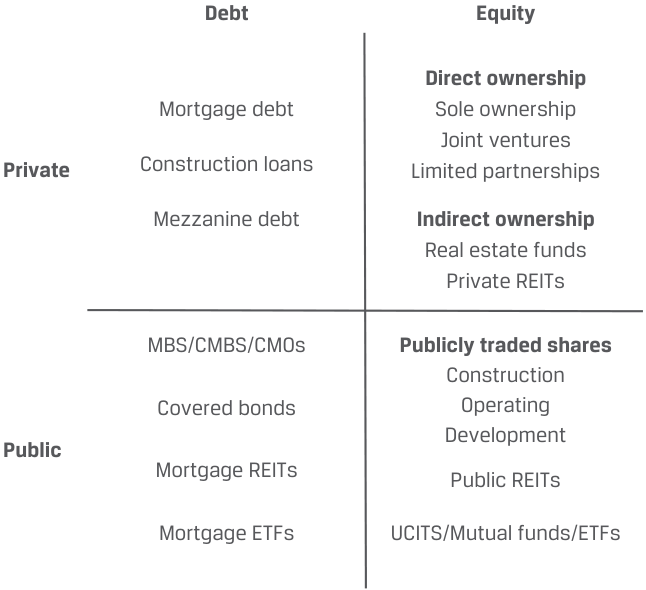
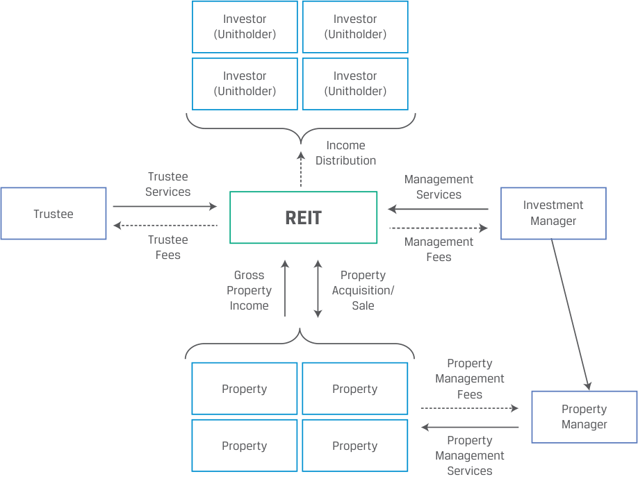

# Tập 8: Đầu tư Thay thế (*Alternative Investments*)
## Học phần 4: Bất động sản và Cơ sở hạ tầng (*Real Estate and Infrastructure*)
### Phần 1/2: Giới thiệu (Trang PDF 101–114)

---

<!-- PDF Page 101 -->

#### H Ọ C P H Ầ N 

# **<mark>4</mark>** 

### **Bất động sản và Cơ sở hạ tầng (*Real Estate and Infrastructure*)** 

###### **<mark>MỤC TIÊU HỌC TẬP (*LEARNING OUTCOMES*)</mark>** 

**_Thành thạo – Ứng viên cần có khả năng:_** 
- giải thích các tính năng và đặc điểm của bất động sản (*real estate*)
- giải thích các đặc tính đầu tư của các khoản đầu tư bất động sản (*real estate investments*)
- giải thích các tính năng và đặc điểm của cơ sở hạ tầng (*infrastructure*)
- giải thích các đặc tính đầu tư của các khoản đầu tư cơ sở hạ tầng (*infrastructure investments*)

##### **GIỚI THIỆU (*INTRODUCTION*)** 

## **<mark>1</mark>** 

Theo nghĩa rộng, bất động sản (*real estate*) bao gồm đất đai và các tòa nhà/công trình xây dựng. Các khoản đầu tư bất động sản liên quan đến đất đã được phát triển, bao gồm bất động sản thương mại và công nghiệp (*commercial and industrial real estate*) cũng như bất động sản nhà ở (*residential real estate*). Bất động sản có một số tính năng độc đáo, bao gồm tính không đồng nhất (*heterogeneity* — không có hai bất động sản nào hoàn toàn giống hệt nhau), vòng đời dài (*long lives*), và vị trí địa lý hoặc vật lý cố định (*fixed geographical or physical location*). 

Đất thô (*raw land*) và đất ít được phát triển hơn được sử dụng trong nông nghiệp và lâm nghiệp được phân loại là các khoản đầu tư _tài nguyên thiên nhiên (natural resources)_, trong khi _cơ sở hạ tầng (infrastructure)_ liên quan đến đất đai, tòa nhà và các tài sản cố định khác được phát triển bởi các pháp nhân công hoặc quan hệ đối tác công – tư (*public–private partnerships*) cho mục đích sử dụng kinh tế. Các khoản đầu tư vào bất động sản và cơ sở hạ tầng được đưa vào nhiều danh mục đầu tư bởi vì chúng có xu hướng thể hiện mức độ tương quan thấp với các loại tài sản truyền thống và mang lại các tổ hợp rủi ro và tỷ suất sinh lợi trải rộng trên một phổ lớn. Tại đây, cũng giống như ở các tài sản thay thế khác, các nhà đầu tư cần có kiến thức chuyên môn sâu rộng trong việc lựa chọn, mua lại, quản lý và thoái vốn các tài sản này. 

###### **TỔNG QUAN HỌC PHẦN (*LEARNING MODULE OVERVIEW*)** 

- Bất động sản bao gồm hai phân khúc chính: nhà ở (*residential*) và thương mại (*commercial*). Bất động sản nhà ở là phân khúc lớn nhất, chiếm tới 75% thị trường toàn cầu. Bất động sản thương mại bao gồm các tòa nhà văn phòng, trung tâm mua sắm và nhà kho. 

- Đầu tư bất động sản có một số tính năng độc đáo, bao gồm tính không đồng nhất (*heterogeneity* — không có hai bất động sản nào giống hệt nhau), tính phân mảnh (*fragmentation*), những thách thức trong việc khám phá giá (*price discovery challenges*), và các giao dịch tốn kém chi phí cũng như thời gian. 

<!-- PDF Page 102 -->

- Các khoản đầu tư bất động sản có thể là trực tiếp hoặc gián tiếp, trên thị trường đại chúng (ví dụ: các quỹ tín thác đầu tư bất động sản – REITs) hoặc các giao dịch tư nhân, dưới dạng nợ và vốn cổ phần. 

- Tỷ suất sinh lợi trên các khoản đầu tư bất động sản đến từ thu nhập (*income*) hoặc sự tăng giá tài sản (*asset appreciation*) hoặc kết hợp cả hai. Hơn một nửa tỷ suất sinh lợi mà các nhà đầu tư bất động sản thương mại kiếm được bắt nguồn từ thu nhập, và xuyên suốt một chu kỳ thị trường kinh tế, thu nhập từ bất động sản là nguồn tỷ suất sinh lợi ổn định hơn so với sự tăng giá vốn (*capital appreciation*). 

- Đầu tư vào bất động sản có thể tạo ra các dòng tiền giống trái phiếu (*bond-like cash flows*) có rủi ro thấp hơn từ các hợp đồng cho thuê hoặc tỷ suất sinh lợi đầu cơ giống vốn cổ phần (*equity-like speculative returns*) có rủi ro cao hơn từ việc hiện thực hóa giá trị từ các dự án phát triển hoặc tăng giá tài sản. 

- Bất động sản mang lại lợi ích đa dạng hóa cho các danh mục đầu tư. Tuy nhiên, trong những điều kiện thị trường nhất định, hệ số tương quan của các quỹ REIT vốn cổ phần (*equity REITs*) với các chỉ số chuẩn thị trường lại tăng lên, đặc biệt là trong các đợt suy thoái thị trường lao dốc mạnh. 

- Cơ sở hạ tầng (*infrastructure*) bao gồm các tài sản thâm dụng vốn (*capital intensive*) và có vòng đời dài (*long lived*), được thiết kế nhằm cung cấp các dịch vụ thiết yếu phục vụ mục đích công cộng. 

- Các khoản đầu tư cơ sở hạ tầng có thể diễn ra dưới nhiều hình thức, cả trực tiếp và gián tiếp. Chúng có thể được phân loại rộng thành cơ sở hạ tầng kinh tế (*economic* — ví dụ: tài sản giao thông vận tải, tiện ích và năng lượng) hoặc cơ sở hạ tầng xã hội (*social* — ví dụ: tài sản giáo dục). Chúng cũng có thể được phân loại dựa trên giai đoạn phát triển của tài sản cơ sở thành dự án mới (*greenfield*), giai đoạn thứ cấp (*secondary stage*), hoặc dự án mở rộng/nâng cấp (*brownfield*). Vòng đời đầu tư dự án mới (*greenfield*) phổ biến trong các quan hệ đối tác công – tư được gọi là vòng đời xây dựng – vận hành – chuyển giao (*build-operate-transfer* – BOT). 

- Hầu hết các tài sản cơ sở hạ tầng được tài trợ, sở hữu và vận hành bởi chính phủ, đồng thời cơ sở hạ tầng đang ngày càng được tài trợ tư nhân thông qua các quan hệ đối tác công – tư (*public–private partnerships* – PPPs) bởi chính quyền địa phương, khu vực và quốc gia. Các khoản đầu tư vào việc xây dựng và phát triển cơ sở hạ tầng mới được thực hiện với kỳ vọng tạo ra tiền mặt từ thu nhập hoặc từ sự tăng giá vốn. 

- Trong ba giai đoạn đầu tư cơ sở hạ tầng, các khoản đầu tư dự án mới (*greenfield investments*) mang lại tỷ suất sinh lợi kỳ vọng cao nhất và có rủi ro kỳ vọng cao nhất, còn các khoản đầu tư giai đoạn thứ cấp (*secondary stage investments*) mang lại tỷ suất sinh lợi kỳ vọng thấp nhất và có rủi ro kỳ vọng thấp nhất. 

- Các nhà đầu tư cơ sở hạ tầng trước hết kỳ vọng các tài sản sẽ tạo ra dòng tiền dài hạn ổn định có điều chỉnh theo tăng trưởng kinh tế và lạm phát, và thứ hai mới kỳ vọng vào sự tăng giá vốn, tùy thuộc vào loại hình và thời điểm đầu tư của họ. 

- Các khoản đầu tư cơ sở hạ tầng cung cấp một dòng thu nhập, làm tăng tính đa dạng hóa của danh mục đầu tư bằng cách bổ sung một loại tài sản thường có mức độ tương quan thấp với các khoản đầu tư đại chúng khác, mang lại sự bảo vệ nhất định trước những thay đổi trong tăng trưởng GDP, và cung cấp một mức độ bảo vệ chống lại lạm phát. 

###### **TỰ ĐÁNH GIÁ HỌC PHẦN (*LEARNING MODULE SELF-ASSESSMENT*)** 

Những câu hỏi ban đầu này nhằm giúp bạn tự đánh giá mức độ hiểu biết hiện tại của mình về học phần này. 

1. Hai phân loại của bất động sản thực (*real property*) là: 

   - **A.** nhà ở và thương mại (*residential and commercial*). 

   - **B.** nắm giữ tư nhân và giao dịch đại chúng (*privately held and publicly traded*). 

<!-- PDF Page 103 -->

   - **C.** thị trường cá nhân và thị trường định chế (*individual market and institutional market*).

###### **Lời giải:**

Đáp án đúng là A. Hai phân loại của bất động sản thực là bất động sản nhà ở (*residential*) và bất động sản thương mại (*commercial*).

2. Phương tiện đầu tư được ưa chuộng để các nhà đầu tư đại chúng sở hữu bất động sản tạo thu nhập (*income-producing real estate*) là:

   - **A.** các quỹ bất động sản (*real estate funds*).
   - **B.** chứng khoán đảm bảo bằng thế chấp (*mortgage-backed securities*).
   - **C.** tín thác đầu tư bất động sản (*real estate investment trusts*).

###### **Lời giải:**

Đáp án đúng là C. Tín thác đầu tư bất động sản (*Real estate investment trusts* – REITs) là phương tiện đầu tư được ưa chuộng để sở hữu bất động sản tạo thu nhập đối với cả các nhà đầu tư tư nhân và đại chúng.

3. Khoản đầu tư nào sau đây có rủi ro thấp nhất?

   - **A.** Bất động sản giá trị gia tăng (*Value-add real estate*)
   - **B.** Chứng khoán đảm bảo bằng thế chấp thương mại hạng đầu tư (*Investment-grade commercial mortgage-backed securities*)
   - **C.** Bất động sản nhà ở có hợp đồng thuê dài hạn và nhiều bên thuê (*Residential real estate with long-term leases and many lessors*)

###### **Lời giải:**

Đáp án đúng là B. Trong ba phương án này, chứng khoán đảm bảo bằng thế chấp thương mại (CMBS) hạng đầu tư có rủi ro thấp nhất, và các khoản đầu tư bất động sản giá trị gia tăng (*value-add real estate*) có rủi ro cao nhất.

4. Khoản đầu tư nào sau đây có rủi ro cao nhất?

   - **A.** Nợ tầng giữa (*Mezzanine debt*)
   - **B.** Chiến lược bất động sản cốt lõi mở rộng (*Core-plus real estate strategies*)
   - **C.** Tái phát triển một bất động sản hiện hữu (*Redevelopment of an existing property*)

###### **Lời giải:**

Đáp án đúng là A. Trong ba phương án này, nợ tầng giữa (*mezzanine debt*) có rủi ro cao nhất, và các chiến lược cốt lõi mở rộng (*core-plus strategies*) có rủi ro thấp nhất.

5. Giai đoạn phát triển đầu tiên của một tài sản cơ sở hạ tầng thường được gọi là:

   - **A.** bầu trời xanh (*bluesky*).
   - **B.** dự án mới / đồng cỏ xanh (*greenfield*).
   - **C.** giai đoạn đầu (*early stage*).

###### **Lời giải:**

Đáp án đúng là B. Giai đoạn phát triển đầu tiên của một tài sản cơ sở hạ tầng thường được gọi là *greenfield* (dự án mới). Đầu tư *greenfield* bao gồm việc phát triển các tài sản mới và cơ sở hạ tầng mới với mục đích cho thuê hoặc bán lại tài sản cho chính phủ sau khi xây dựng hoặc nắm giữ và vận hành các tài sản đó. Các nhà đầu tư *greenfield* thường đầu tư cùng với các nhà đầu tư chiến lược hoặc các nhà phát triển chuyên phát triển các tài sản cơ sở. Các giai đoạn phát triển tiếp theo của tài sản cơ sở hạ tầng thường được gọi là giai đoạn thứ cấp (*secondary stage*) và dự án mở rộng/nâng cấp (*brownfield*).

6. Đầu tư cơ sở hạ tầng trực tiếp liên quan đến các tài sản có tính chất:

   - **A.** kém thanh khoản (*illiquid*).

<!-- PDF Page 104 -->

   - **B.** được chứng khoán hóa (*securitized*). 

   - **C.** được giao dịch trên sở giao dịch (*exchange traded*). 

###### **Lời giải:** 

Đáp án đúng là A. Giống như bất động sản, đầu tư trực tiếp vào cơ sở hạ tầng hiện hữu liên quan đến việc mua lại các tài sản độc nhất, kém thanh khoản (*unique, illiquid assets*) với vị trí, tính năng và công dụng riêng biệt. Các nhà đầu tư quan tâm đến tính thanh khoản và sự đa dạng hóa có thể đầu tư gián tiếp bằng cách sử dụng các chứng khoán cơ sở hạ tầng được giao dịch đại chúng. 

7. Loại hình đầu tư cơ sở hạ tầng nào sau đây có tỷ suất sinh lợi kỳ vọng cao nhất? 

   - **A.** Dự án mới (*Greenfield*) 

   - **B.** Dự án mở rộng/nâng cấp (*Brownfield*) 

   - **C.** Giai đoạn thứ cấp (*Secondary stage*) 

###### **Lời giải:** 

Đáp án đúng là A. Các khoản đầu tư *greenfield* mang lại tỷ suất sinh lợi kỳ vọng cao nhất trong cả ba loại. Chúng cũng đi kèm với rủi ro kỳ vọng cao nhất. Giai đoạn thứ cấp (*secondary stage*) mang lại tỷ suất sinh lợi kỳ vọng thấp nhất và rủi ro kỳ vọng thấp nhất. 

8. Định chế nào sau đây có xu hướng phân bổ tỷ trọng lớn nhất vào loại tài sản cơ sở hạ tầng? 

   - **A.** Các quỹ hưu trí (*Pension funds*) 

   - **B.** Các quỹ đầu tư quốc gia (*Sovereign wealth funds*) 

   - **C.** Các công ty bảo hiểm nhân thọ (*Life insurance companies*) 

###### **Lời giải:** 

Đáp án đúng là B. Các quỹ đầu tư quốc gia (*sovereign wealth funds*) có xu hướng thực hiện các khoản phân bổ lớn nhất vào loại tài sản cơ sở hạ tầng — khoảng 5%–6% tổng tài sản đang quản lý (AUM), theo Preqin. 

## **<mark>2</mark>** 

##### **ĐẶC ĐIỂM CỦA BẤT ĐỘNG SẢN (*REAL ESTATE FEATURES*)** 

**Mục tiêu học tập:** giải thích các tính năng và đặc điểm của bất động sản (*real estate*) 

Cả cá nhân và các định chế đều đầu tư vào bất động sản thực (*real property*): hoặc vào bất động sản nhà ở (*residential*) hoặc vào bất động sản thương mại (*commercial*). Bất động sản nhà ở, hay thị trường nhà ở, bao gồm các ngôi nhà biệt lập dành cho một hộ gia đình (*single-family detached homes*) và các căn hộ liền kề dành cho nhiều hộ gia đình (*multi-family attached units*) có chung ít nhất một bức tường với căn hộ khác, chẳng hạn như chung cư (*condominiums*), nhà ở hợp tác xã (*cooperatives*), nhà phố (*townhouses*), hoặc nhà liền kề (*terraced housing*). Bất động sản thương mại chủ yếu bao gồm các tòa nhà văn phòng, trung tâm mua sắm bán lẻ, bất động sản thương mại và nhà ở cho thuê, và nhà kho. Trái ngược với thị trường nhà do chủ sở hữu tự ở (*owner-occupied market*), các bất động sản cho thuê (*rental properties*) được cho khách thuê (*tenants*) thuê lại. 

Bất động sản nhà ở cho đến nay là phân khúc thị trường lớn nhất xét về giá trị và quy mô. Savills World Research ước tính vào tháng 7 năm 2018 rằng bất động sản nhà ở chiếm hơn 75% giá trị bất động sản toàn cầu. Mặc dù giá trị trung bình của một ngôi nhà thấp hơn giá trị trung bình của một tòa nhà văn phòng, nhưng tổng không gian diện tích cần thiết để làm nơi ở cho con người lớn hơn rất nhiều so với không gian cần thiết để đáp ứng nhu cầu sử dụng văn phòng và mua sắm bán lẻ. 

<!-- PDF Page 105 -->

###### **Đầu tư Bất động sản (*Real Estate Investments*)** 

Các khoản đầu tư bất động sản thể hiện những điểm tương đồng và khác biệt chung so với các loại tài sản vốn cổ phần và nợ truyền thống. Bất động sản có thể được nắm giữ tư nhân hoặc giao dịch đại chúng thông qua các quỹ tín thác đầu tư bất động sản (*real estate investment trusts* – REITs). Đầu tư vốn cổ phần liên quan đến quyền sở hữu trực tiếp hoặc gián tiếp kèm theo quyền đòi hỏi đối với dòng tiền còn lại (*residual cash flows*) từ bất động sản. Tùy thuộc vào khoản đầu tư bất động sản, những dòng tiền này có thể biến đổi hoặc cố định. Đầu tư nợ thường liên quan đến việc cho vay thế chấp trực tiếp từ các định chế tài chính trung gian, một phần trong đó sau đó có thể được chứng khoán hóa (*securitized*) và giao dịch thông qua nhiều loại chứng khoán đảm bảo bằng thế chấp (*mortgage-backed securities* – MBS) khác nhau. Các đặc điểm chính của bất động sản nhà ở và bất động sản thương mại được trình bày trong Minh họa 1. 

**Minh họa 1: Các Đặc điểm Chính của Bất động sản Nhà ở và Bất động sản Thương mại (*Main Features of Residential and Commercial Real Estate*)** 

||**Bất động sản nhà ở (*Residential real estate*)**|**Bất động sản thương mại (*Commercial real estate*)**|
|---|---|---|
|Bất động sản điển hình (*Typical property*)|Nhà ở đơn lẻ do chủ sở hữu tự ở; bất động sản nhà ở cho một hộ gia đình (*Owner-occupied, single residences; single-family residential property*)|Bất động sản nhà ở thuộc sở hữu để cho thuê (*Residential properties owned for lease or rental*) Bất động sản văn phòng, bán lẻ, công nghiệp, nhà kho, khách sạn nghỉ dưỡng và phức hợp đa năng (*Office, retail, industrial, warehouse, hospitality, and mixed-use properties*)|
|Nguồn vốn cổ phần (*Source of equity*)|Chủ sở hữu (*Owners*)|Nắm giữ tư nhân bởi các chủ sở hữu (*Privately held by owners*) Nắm giữ đại chúng thông qua các nhà đầu tư (*Publicly held through investors*)|
|Nguồn nợ (*Source of debt*)|Trực tiếp: Các bên cho vay (ngân hàng) thông qua các khoản thế chấp nhà ở (*residential mortgages*) Gián tiếp: Các nhà đầu tư vào MBS đóng gói các khoản thế chấp nhà ở|Trực tiếp: Các bên cho vay (ngân hàng) thông qua các khoản thế chấp thương mại (*commercial mortgages*) Gián tiếp: Các nhà đầu tư vào MBS đóng gói các khoản thế chấp thương mại|
|Nguồn tỷ suất sinh lợi cho nhà đầu tư (*Source of return to investors*)|Sự thụ hưởng công năng của bất động sản (*Enjoyment of the property*) Sự tăng giá, hay tăng giá trị vốn (*Price, or capital, appreciation*)|Thu nhập, hay dòng tiền, được tạo ra bởi bất động sản (*Income, or cash flow, generated by the property*) Sự tăng giá, hay tăng giá trị vốn (*Price, or capital, appreciation*)|

Bất động sản khác biệt một cách độc đáo so với các loại tài sản khác ở một số khía cạnh: 

- Khoản đầu tư ban đầu thường có quy mô lớn. 

- Bất động sản là duy nhất và riêng biệt bởi vì không có hai bất động sản nào giống hệt nhau; mỗi bất động sản đều không đồng nhất (*heterogeneous*) và mang những đặc trưng độc nhất về vị trí, tuổi đời, cơ cấu chất lượng tín dụng của khách thuê (*tenant credit mix*), thời hạn hợp đồng thuê, và nhân khẩu học của thị trường. 

- Có nhiều loại hình lựa chọn đầu tư bất động sản sẵn có: các lựa chọn đầu tư trực tiếp và gián tiếp trải rộng trên toàn bộ phổ từ những khoản đầu tư tương đối thanh khoản vào các bất động sản ổn định, tạo thu nhập cho đến các khoản đầu tư kém thanh khoản trong một vòng đời phát triển kéo dài qua các giai đoạn mua, xây dựng/nâng cấp, lấp đầy (*occupancy*), và bán. 

- Việc đa dạng hóa trên tất cả các loại hình lựa chọn đầu tư bất động sản khác nhau có thể khó đạt được. 

- Các chỉ số thị trường tư nhân mô phỏng hiệu quả hoạt động của bất động sản không thể đầu tư trực tiếp được (*not directly investable*). 

Ngoài ra, quá trình khám phá giá (*price discovery process*) trên các thị trường bất động sản tư nhân thiếu tính minh bạch (*opaque*), vì nhiều lý do: 

- Giá lịch sử có thể không phản ánh các điều kiện thị trường hiện hành. 

<!-- PDF Page 106 -->

- Chi phí giao dịch thường cao. Việc mua và bán bất động sản có thể là một quá trình tốn nhiều thời gian, đòi hỏi sự tham gia của các chuyên gia bất động sản, ngân hàng, luật sư và những bên khác cần thiết để hỗ trợ thực hiện các giao dịch này. 

- Hoạt động giao dịch có thể bị hạn chế ở một số thị trường nhất định do điều kiện cung hoặc cầu. 

Do những đặc tính riêng biệt và độc nhất — vị trí địa lý và các công năng sử dụng tiềm năng — các thị trường bất động sản thường bị phân mảnh (*fragmented*), trong đó điều kiện cung và cầu tại địa phương quyết định giá trị của bất động sản. Hệ quả là, tính không đồng nhất đặc trưng của bất động sản đòi hỏi những kỹ năng chuyên môn hóa. Việc lựa chọn, định giá, mua lại, quản lý và thoái vốn một danh mục bất động sản thường phức tạp hơn so với việc quản lý một danh mục bao gồm nợ và vốn cổ phần doanh nghiệp niêm yết. 

###### **Cấu trúc Đầu tư Bất động sản (*Real Estate Investment Structures*)** 

Các khoản đầu tư bất động sản diễn ra dưới nhiều hình thức đại chúng và tư nhân khác nhau xuyên suốt các lựa chọn vốn cổ phần và vốn nợ, như được tóm tắt trong Minh họa 2. 

**Minh họa 2: Một số Hình thức Đầu tư Bất động sản Chọn lọc (*Selected Forms of Real Estate Investment*)** 

> **Chú thích hình ảnh:**
> - **Tư nhân (*Private*):**
>   - **Nợ (*Debt*):** Nợ thế chấp (*Mortgage debt*), Các khoản vay xây dựng (*Construction loans*), Nợ tầng giữa (*Mezzanine debt*).
>   - **Vốn cổ phần (*Equity*):**
>     - Sở hữu trực tiếp (*Direct ownership*): Sở hữu duy nhất (*Sole ownership*), Liên doanh (*Joint ventures*), Công ty hợp danh hữu hạn (*Limited partnerships*).
>     - Sở hữu gián tiếp (*Indirect ownership*): Các quỹ bất động sản (*Real estate funds*), REITs tư nhân (*Private REITs*).
> - **Đại chúng (*Public*):**
>   - **Nợ (*Debt*):** MBS/CMBS/CMOs, Trái phiếu có bảo đảm (*Covered bonds*), REITs thế chấp (*Mortgage REITs*), ETFs thế chấp (*Mortgage ETFs*).
>   - **Vốn cổ phần (*Equity*):**
>     - Cổ phiếu giao dịch đại chúng (*Publicly traded shares*): Xây dựng (*Construction*), Vận hành (*Operating*), Phát triển (*Development*).
>     - REITs đại chúng (*Public REITs*).
>     - UCITS / Quỹ tương hỗ (*Mutual funds*) / ETFs.

###### **_Đầu tư Bất động sản Trực tiếp (Direct Real Estate Investment)_** 

Đầu tư tư nhân trực tiếp bao gồm việc mua một bất động sản và khởi tạo khoản nợ cho chính tài khoản của mình. Quyền sở hữu có thể ở trạng thái hoàn toàn sạch nợ (*free and clear*), theo đó quyền sở hữu bất động sản (*property title*) được chuyển giao cho (các) chủ sở hữu mà không bị ràng buộc bởi bất kỳ quyền cầm giữ tài trợ nào (*unencumbered by any financing liens*), chẳng hạn như từ các khoản thế chấp còn dư nợ. Chi phí mua ban đầu gắn liền với quyền sở hữu trực tiếp có thể bao gồm chi phí pháp lý, chi phí khảo sát, nghiên cứu kỹ thuật/môi trường, và phí định giá (thẩm định giá – *appraisal*). Có những ưu điểm rõ rệt khi sở hữu bất động sản trực tiếp đối với các nhà đầu tư bất động sản: 

- _Quyền kiểm soát (*Control*).__ Chỉ có chủ sở hữu mới có thể quyết định khi nào nên mua hoặc bán, khi nào và chi bao nhiêu tiền cho các dự án đầu tư vốn, chọn ai làm khách thuê dựa trên mức độ ưu tiên về chất lượng tín dụng và cơ cấu khách thuê, cũng như đưa ra những loại điều khoản hợp đồng thuê nào. 

<!-- PDF Page 107 -->

Các chủ sở hữu tạo ra tỷ suất sinh lợi dòng tiền từ việc sử dụng và thụ hưởng bất động sản, việc nhận các khoản thanh toán tiền thuê, và tiềm năng tăng giá vốn. 

- _Lợi ích về thuế (*Tax benefits*).__ Các chủ sở hữu có thể làm giảm thu nhập chịu thuế của mình bằng cách sử dụng chi phí khấu hao bất động sản phi tiền mặt (*non-cash property depreciation expenses*) và chi phí lãi vay được khấu trừ thuế (*tax-deductible interest expenses*). 

- _Đa dạng hóa (*Diversification*).__ Trong lịch sử, bất động sản đã thể hiện mức độ tương quan thấp với các loại tài sản khác, và việc bổ sung bất động sản vào một danh mục đầu tư đã được chứng minh là làm tăng tính đa dạng hóa của danh mục và làm giảm rủi ro danh mục. 

Cũng có những nhược điểm khi đầu tư trực tiếp vào bất động sản: 

- _Tính phức tạp (*Complexity*).__ Các chủ sở hữu cần dành thời gian để quản lý bất động sản. Bản thân việc thực hiện giao dịch mua cũng phức tạp hơn, với các yêu cầu bao gồm lựa chọn bất động sản, đàm phán các điều khoản, thực hiện thẩm định chuyên sâu (*due diligence*), tra cứu quyền sở hữu (*title search*), rà soát hợp đồng, và kiểm định hiện trạng bất động sản (*property inspection*). 

- _Nhu cầu về kiến thức chuyên biệt (*Need for specialized knowledge*).__ Các chủ sở hữu cần hiểu rõ cả các đặc điểm thị trường chung lẫn thị trường địa phương, điều đòi hỏi phải có kiến thức thị trường bản địa. 

- _Nhu cầu vốn đáng kể (*Significant capital needs*).__ Các chủ sở hữu cần có khả năng tiếp cận một lượng vốn nợ và vốn cổ phần tiềm tàng rất lớn do khoản chi vốn ban đầu lớn cần thiết cho các khoản đầu tư bất động sản. 

- _Rủi ro tập trung (*Concentration risk*).__ Các chủ sở hữu, đặc biệt là những nhà đầu tư nhỏ hơn, không thể tạo ra một danh mục bất động sản được đa dạng hóa tốt thông qua đầu tư trực tiếp. 

- _Thiếu tính thanh khoản (*Lack of liquidity*).__ Thường rất khó để nhanh chóng mua hoặc bán các khoản đầu tư trực tiếp vào bất động sản, và chi phí giao dịch thường rất cao. 

Các nhà đầu tư bất động sản có thể chọn tự xử lý nội bộ tất cả các khía cạnh của việc đầu tư và vận hành bất động sản. Tuy nhiên, các nhà đầu tư bất động sản thương mại thường thuê các nhà tư vấn để xác định các khoản đầu tư, đàm phán các điều khoản mua lại và cho thuê, thực hiện thẩm định chuyên sâu, tiến hành các hoạt động vận hành bất động sản, và hỗ trợ việc thanh lý/thoái vốn cuối cùng. Các nhà đầu tư định chế thuê cố vấn hoặc nhà quản lý để quản lý khoản đầu tư bất động sản trực tiếp của mình cũng có thể sử dụng cấu trúc tài khoản tách biệt (*separate account structure*) cho phép nhà đầu tư kiểm soát thời điểm và giá trị của các thương vụ mua lại và thoái vốn. 

Các chủ sở hữu cũng có thể vay từ các bên cho vay thế chấp để tài trợ cho thương vụ mua lại. Các chi phí hoàn tất khoản vay (*debt closing costs*) bổ sung sẽ phát sinh khi chủ sở hữu vay vốn để tài trợ cho các khoản đầu tư của mình. 

###### **_Đầu tư Bất động sản Gián tiếp (Indirect Real Estate Investment)_** 

Đầu tư gián tiếp vào bất động sản tập hợp tài sản từ các nhà đầu tư khác nhau để mua lại một hoặc nhiều bất động sản; ở đây sự phơi nhiễm là gián tiếp thông qua nhiều phương tiện đầu tư khác nhau. Những phương tiện này có thể là đại chúng hoặc tư nhân, chẳng hạn như công ty hợp danh hữu hạn (*limited partnerships*), quỹ tương hỗ (*mutual funds*), cổ phiếu, REITs, và các quỹ hoán đổi danh mục (ETFs). Đôi khi các nhà đầu tư thành lập các liên doanh (*joint ventures*) với những nhà đầu tư khác để đầu tư vào bất động sản. Các liên doanh đặc biệt phổ biến khi một bên có thể đóng góp độc quyền một thứ gì đó có giá trị, chẳng hạn như đất đai, vốn, chuyên môn phát triển dự án, năng lực thẩm định nợ, hoặc tài năng khởi nghiệp kinh doanh. 

Các quỹ tín thác được hưởng ưu đãi thuế (*tax-advantaged trusts*) chuyên sở hữu, vận hành và đôi khi phát triển các bất động sản tạo thu nhập được gọi là các quỹ tín thác đầu tư bất động sản (*real estate investment trusts* – REITs). Cấu trúc của chúng được hiển thị trong Minh họa 3. Có ba hình thức REIT chính: REIT vốn cổ phần (*equity REITs*), đầu tư trực tiếp vào bất động sản hoặc thông qua các công ty hợp danh và liên doanh; REIT thế chấp (*mortgage REITs*), bảo lãnh cho vay đối với bất động sản (các khoản thế chấp) hoặc đầu tư vào MBS; và REIT lai ghép (*hybrid REITs*), đầu tư vào cả hai loại hình này. 

<!-- PDF Page 108 -->

**Minh họa 3: Cấu trúc Quỹ Tín thác Đầu tư Bất động sản (*Real Estate Investment Trust Structure*)** 

> **Chú thích hình ảnh:**
> - **Nhà đầu tư / Người nắm giữ chứng chỉ quỹ (*Investor / Unitholder*)** $\longleftarrow$ Phân phối thu nhập (*Income Distribution*) từ **REIT**.
> - **Bên nhận ủy thác (*Trustee*):** Cung cấp dịch vụ ủy thác (*Trustee Services*) cho REIT $\longleftrightarrow$ Nhận phí ủy thác (*Trustee Fees*) từ REIT.
> - **Nhà quản lý đầu tư (*Investment Manager*):** Cung cấp dịch vụ quản lý (*Management Services*) cho REIT $\longleftrightarrow$ Nhận phí quản lý (*Management Fees*) từ REIT.
> - **REIT:** Nhận tổng thu nhập bất động sản (*Gross Property Income*) và thực hiện mua/bán bất động sản (*Property Acquisition/Sale*) đối với các **Bất động sản (*Property*)**.
> - **Nhà quản lý bất động sản (*Property Manager*):** Cung cấp dịch vụ quản lý bất động sản (*Property Management Services*) cho các bất động sản và nhận phí quản lý bất động sản (*Property Management Fees*) từ REIT.

REITs là phương tiện đầu tư được ưa chuộng để sở hữu bất động sản tạo thu nhập đối với cả các nhà đầu tư tư nhân và đại chúng. Sức hấp dẫn chính của cấu trúc REIT là việc loại bỏ tình trạng đánh thuế hai lần đối với doanh nghiệp (*elimination of double corporate taxation*). Các công ty cổ phần thông thường phải nộp thuế trên thu nhập của mình, từ đó họ mới phân phối cổ tức cho các chủ sở hữu từ phần lợi nhuận sau thuế. Đến lượt mình, các cổ đông lại bị đánh thuế theo mức thuế suất cá nhân của họ. Các quỹ REIT có thể tránh thuế thu nhập doanh nghiệp bằng cách phân phối cổ tức bằng 90%–100% thu nhập cho thuê ròng chịu thuế (*taxable net rental income*). 

Chiến lược kinh doanh của các quỹ REIT vốn cổ phần (*equity REITs*) rất đơn giản: Tối đa hóa tỷ lệ lấp đầy bất động sản (*occupancy rates*) và tiền thuê trong khi tối thiểu hóa các chi phí vận hành và bảo trì thường xuyên nhằm tối đa hóa thu nhập bằng tiền và cổ tức. REITs là một phương tiện đầu tư phổ biến ở cả Hoa Kỳ — nơi chúng khởi nguồn — và ở các quốc gia khác. Các quỹ REIT và các cấu trúc tương tự REIT có cấu trúc pháp lý và thuế tương đồng nhau, đồng thời mang lại những lợi thế thuế độc đáo cho các nhà đầu tư và pháp nhân doanh nghiệp. 

Các quỹ REIT vốn cổ phần, giống như các công ty đại chúng khác, phải báo cáo thu nhập trên mỗi cổ phiếu (EPS) dựa trên lợi nhuận ròng theo định nghĩa của các nguyên tắc kế toán được chấp nhận chung (GAAP) hoặc Chuẩn mực Báo cáo Tài chính Quốc tế (IFRS). Nhiều quỹ báo cáo các thước đo phi truyền thống, chẳng hạn như giá trị tài sản ròng (*net asset value* – NAV) hoặc các biến thể của dòng tiền gộp, như dòng tiền từ hoạt động kinh doanh (*funds from operations* – FFO) — thước đo thực hiện các điều chỉnh đối với khấu hao, các khoản phân phối và cổ tức ưu đãi để ước tính tốt hơn cổ tức trong tương lai, bởi vì chi phí khấu hao phi tiền mặt có thể rất cao đối với các doanh nghiệp thâm dụng tài sản (*asset-intensive businesses*). 

Những quỹ REIT được giao dịch đại chúng này giải quyết được nhiều nhược điểm liên quan đến việc đầu tư bất động sản tư nhân. Các quỹ REIT này mang lại cho nhà đầu tư sự minh bạch lớn hơn. Ngoài ra, một nhà đầu tư REIT chỉ cần mua hoặc bán cổ phiếu REIT thay vì mua hoặc bán trực tiếp bất động sản. Quỹ REIT không bị buộc phải bán đi bất động sản cơ sở của công ty giống như các quỹ mở (*open-end funds*) khi đối mặt với làn sóng rút vốn ồ ạt (*mass redemptions*). Cuối cùng, các quỹ REIT có bí quyết chuyên môn để quản lý các bất động sản nhằm gắn kết lợi ích của REIT với lợi ích của các nhà đầu tư. Tuy nhiên, một nhược điểm của REIT là mức độ tương quan cao hơn của chúng với các thị trường vốn cổ phần đại chúng khi so sánh với bất động sản tư nhân. 

<!-- PDF Page 109 -->

###### **VÍ DỤ 1** 

###### **Quỹ Tín thác Đầu tư Bất động sản Luxury Dreams (*Luxury Dreams REIT*)** 

Quỹ Tín thác Đầu tư Bất động sản Luxury Dreams mua lại các bất động sản cao cấp, chất lượng cao, định hướng tạo thu nhập trên khắp thế giới và cung cấp các lựa chọn đầu tư cho những nhà đầu tư đang tìm kiếm dòng tiền dài hạn, ổn định, có thể dự đoán được, cùng sự tăng giá ở các bất động sản cơ sở từ việc đưa thêm các bất động sản vào danh mục và quản lý chủ động các bất động sản đó, với mức độ biến động nhìn chung thấp hơn nhờ tập trung vào phân khúc bất động sản cao cấp. 

Quỹ REIT này đầu tư ít nhất 75% tài sản vào các bất động sản nhà ở cao cấp và tối đa 25% tài sản vào các chứng khoán liên quan đến bất động sản được nắm giữ tư nhân, nợ thế chấp và tiền mặt. Quy mô của quỹ REIT này được giới hạn ở mức trần 5 tỷ USD. Bởi vì quỹ REIT này không được giao dịch đại chúng, cổ phiếu trong quỹ tín thác có thể được mua lại/rút vốn (*redeemed*) vào cuối mỗi tháng tại mức giá bằng với giá trị tài sản ròng (NAV) trên mỗi cổ phiếu của tháng trước đó theo các bội số 10.000 USD. NAV trên mỗi cổ phiếu được xác định vào cuối mỗi tháng và được công bố cho những người nắm giữ trong vòng 15 ngày làm việc sau khi kết thúc tháng. Mỗi cổ đông bị giới hạn giao dịch tối đa 2% tổng NAV mỗi tháng và 5% NAV mỗi quý. 

Các quỹ REIT và các quỹ bất động sản tư nhân khác được cấu trúc dưới dạng các quỹ mở có thời hạn vô hạn (*infinite-life, open-end funds*) và cho phép các nhà đầu tư góp vốn hoặc rút vốn trong suốt vòng đời của quỹ theo phương thức song hành với cấu trúc quỹ tương hỗ. Các quỹ mở nhìn chung mang lại sự tiếp cận với các bất động sản thương mại và nhà ở chất lượng cao, có tỷ lệ cho thuê tốt tại những thị trường tốt nhất, còn được gọi là **các chiến lược bất động sản cốt lõi (*core real estate strategies*)**. Các nhà đầu tư kỳ vọng bất động sản cốt lõi sẽ mang lại tỷ suất sinh lợi ổn định, chủ yếu từ thu nhập cho thuê bất động sản. 

Các nhà đầu tư tìm kiếm tỷ suất sinh lợi cao hơn cũng có thể chấp nhận thêm rủi ro từ việc phát triển mới (*development*), tái phát triển (*redevelopment*), tái định vị (*repositioning*), và cho thuê. Đối với những sở thích đầu tư mang tính cơ hội như vậy, các quỹ đóng có thời hạn hữu hạn (*finite-life, closed-end funds*) thường được sử dụng phổ biến hơn. Các nhà đầu tư có thể tập trung vào **các chiến lược bất động sản cốt lõi mở rộng (*core-plus real estate strategies*)**, tức các khoản đầu tư gia tăng giá trị đòi hỏi việc tái phát triển hoặc nâng cấp ở mức độ vừa phải để cho thuê bất kỳ không gian trống nào cùng với khả năng chuyển đổi mục đích sử dụng thay thế của các bất động sản cơ sở. Để kiếm được tỷ suất sinh lợi cao hơn nữa, các nhà đầu tư có thể tham gia vào **các chiến lược bất động sản giá trị gia tăng (*value-add real estate strategies*)**, chẳng hạn như tái phát triển ở quy mô lớn hơn và tái định vị các tài sản hiện hữu. **Các chiến lược bất động sản cơ hội (*opportunistic real estate strategies*)** nhất bao gồm việc tái phát triển quy mô lớn, chuyển đổi công năng tài sản (*repurposing of assets*), tiếp nhận các diện tích trống lớn, hoặc đầu cơ dựa trên sự cải thiện đáng kể của các điều kiện thị trường. 

Các quỹ REIT thế chấp (*mortgage REITs*) và REIT lai ghép (*hybrid REITs*) đầu tư vào nợ bất động sản, điển hình là MBS (được đề cập ở phần khác trong chương trình học). Những quỹ REIT nợ này có thể là các quỹ tư nhân hoặc được giao dịch đại chúng. 

###### **BỘ CÂU HỎI (*QUESTION SET*)** 

1. Đúng hay sai: Các đặc tính riêng biệt và độc nhất của bất động sản khiến việc quản lý một danh mục bất động sản ít phức tạp hơn so với việc quản lý một danh mục trái phiếu doanh nghiệp niêm yết. 

###### **Lời giải:** 

Sai (*False*). Việc lựa chọn, định giá, mua lại, quản lý và thoái vốn một danh mục bất động sản thường phức tạp hơn so với việc quản lý một danh mục bao gồm nợ doanh nghiệp niêm yết. Tính không đồng nhất đặc trưng của bất động sản đòi hỏi những kỹ năng chuyên biệt, và các thị trường bất động sản thường bị phân mảnh, với điều kiện cung và cầu tại địa phương quyết định giá trị của bất động sản. 

<!-- PDF Page 110 -->

2. Phân khúc lớn nhất của thị trường bất động sản là: 

   - **A.** bất động sản nhà ở (*residential real estate*). 

   - **B.** các quỹ tín thác đầu tư bất động sản (*real estate investment trusts*). 

   - **C.** các chứng khoán đảm bảo bằng thế chấp được giao dịch đại chúng (*publicly traded mortgage-backed securities*). 

###### **Lời giải:** 

Đáp án đúng là A. Bất động sản nhà ở cho đến nay là phân khúc thị trường lớn nhất xét về giá trị và quy mô. Savills World Research ước tính vào tháng 7 năm 2018 rằng bất động sản nhà ở chiếm hơn 75% giá trị bất động sản toàn cầu. 

3. Mô tả chiến lược kinh doanh của các quỹ REIT vốn cổ phần (*equity REITs*). 

###### **Lời giải:** 

Chiến lược kinh doanh của các quỹ REIT vốn cổ phần là tối đa hóa tỷ lệ lấp đầy bất động sản và tiền thuê trong khi tối thiểu hóa các chi phí vận hành và bảo trì thường xuyên nhằm tối đa hóa thu nhập bằng tiền và cổ tức. 

4. Khi một quyền sở hữu bất động sản (*property title*) được chuyển giao cho chủ sở hữu mới mà không bị ràng buộc bởi bất kỳ quyền cầm giữ tài trợ nào, chẳng hạn như từ các khoản thế chấp còn dư nợ, quyền sở hữu mới đó được coi là: 

   - **A.** nắm giữ tư nhân (*privately held*). 

   - **B.** hoàn toàn sạch nợ (*free and clear*). 

   - **C.** quyền sở hữu vốn cổ phần trực tiếp (*direct equity ownership*). 

###### **Lời giải:** 

Đáp án đúng là B. “Hoàn toàn sạch nợ” (*“Free and clear”*) đề cập đến việc không có bất kỳ quyền cầm giữ tài trợ (*financing liens*) nào trên một bất động sản được mua. Nếu một nhà đầu tư tư nhân trực tiếp mua một bất động sản và nhận được quyền sở hữu không bị ràng buộc bởi bất kỳ quyền cầm giữ tài trợ nào, quyền sở hữu đó được coi là *free and clear*. 

## **<mark>3</mark>** 

##### **ĐẶC TÍNH ĐẦU TƯ CỦA BẤT ĐỘNG SẢN (*REAL ESTATE INVESTMENT CHARACTERISTICS*)** 

**Mục tiêu học tập:** giải thích các đặc tính đầu tư của các khoản đầu tư bất động sản (*real estate investments*) 

Các khoản đầu tư vào bất động sản mang lại tổng tỷ suất sinh lợi dài hạn có tính cạnh tranh từ việc tạo ra thu nhập kết hợp với tiềm năng tăng giá. Nhiều công ty bất động sản thương mại cung cấp các hợp đồng thuê nhiều năm với mức tiền thuê cố định; do đó, thu nhập kiếm được từ những hợp đồng thuê này thường vừa có thể dự đoán được vừa ổn định. Hơn nữa, bất động sản có xu hướng mang lại sự bảo vệ chống lại lạm phát bởi vì các khoản thanh toán tiền thuê được điều chỉnh thường xuyên, cho phép định giá và xác định giá trị bất động sản một cách rõ ràng. Cuối cùng, bất động sản trong lịch sử có mức độ tương quan thấp với các loại tài sản khác, và việc bổ sung bất động sản vào một danh mục đầu tư mang lại lợi ích đa dạng hóa ở mức độ rủi ro tương đối thấp hơn. Có rất nhiều chỉ số trên toàn cầu được thiết kế để đo lường tổng tỷ suất sinh lợi và tỷ suất sinh lợi thành phần của bất động sản đối với các chứng khoán niêm yết và các phương tiện đầu tư không niêm yết. 

<!-- PDF Page 111 -->

###### **Nguồn Tỷ suất sinh lợi (*Source of Returns*)** 

Tỷ suất sinh lợi trên các khoản đầu tư bất động sản đến từ thu nhập hoặc sự tăng giá tài sản hoặc kết hợp cả hai. Bất động sản tạo thu nhập (*income-producing real estate*) tạo ra thu nhập chủ yếu từ việc thu tiền cho thuê (*rental or lease payments*), bao gồm cả việc gia hạn hợp đồng thuê. Các chi phí bao gồm chi phí quản lý trực tiếp và gián tiếp, chẳng hạn như chi phí bảo trì và cải tạo. Đầu tư bất động sản tạo thu nhập phần lớn là đầu tư trực tiếp có rủi ro thấp, phụ thuộc vào việc nhận được các khoản thanh toán tiền thuê đúng hạn. Các nhà đầu tư dựa vào sự tăng giá vốn (*capital appreciation*) thường kỳ vọng rằng các dự án phát triển bất động sản dài hạn hơn của họ sẽ thành công và giá thoái vốn sẽ vượt quá tổng số vốn đã đầu tư cùng bất kỳ dòng tiền nào mà họ có thể tạo ra trong khoảng thời gian đó. 

Phổ rủi ro và tỷ suất sinh lợi đối với các khoản đầu tư bất động sản, được mô tả trong Minh họa 4, bao gồm các chiến lược xuyên suốt cả đầu tư nợ và vốn cổ phần. Đầu tư vào bất động sản có thể tạo ra các dòng tiền giống trái phiếu có rủi ro thấp hơn từ các hợp đồng cho thuê hoặc tỷ suất sinh lợi đầu cơ giống vốn cổ phần có rủi ro cao hơn từ việc hiện thực hóa giá trị từ các dự án phát triển hoặc tăng giá tài sản. Hơn nữa, hầu hết các chiến lược bất động sản đều được tài trợ bằng sự kết hợp giữa nợ và vốn cổ phần, với tỷ trọng tùy thuộc vào loại hình bất động sản. 

**Minh họa 4: Phổ Rủi ro – Tỷ suất sinh lợi của Bất động sản (*Real Estate Risk–Return Spectrum*)** 

> **Chú thích hình ảnh:**
> - **Trục tung:** Tỷ suất sinh lợi (*Return*) từ Thấp (*Low*) đến Cao (*High*) | **Trục hoành:** Rủi ro (*Risk*) từ Thấp (*Low*) đến Cao (*High*).
> - **Nửa dưới bên trái — Sẵn có thông qua các phương tiện đại chúng (*Available Through Public Vehicles*) / Đặc tính tỷ suất sinh lợi giống trái phiếu (*Bond-Like Return Characteristics*):**
>   1. **Nợ cấp cao (*Senior Debt*):** Thế chấp thứ nhất (*First Mortgages*), CMBS hạng đầu tư (*Investment Grade CMBS*).
>   2. **Cốt lõi (*Core*):** Các bất động sản tạo thu nhập ổn định (*Stable Income Producing Properties*), Đầu tư REIT đại chúng đa dạng hóa (*Diversified Public REIT Investing*), Bán và thuê lại dựa trên tín dụng (*Credit Sale/Leaseback*).
> - **Nửa trên bên phải — Chủ yếu là các chiến lược tư nhân (*Primarily Private Strategies*) / Chiến lược đầu tư tăng trưởng dòng tiền (*Cash-Flow Growth Investment Strategies*):**
>   3. **Cốt lõi mở rộng (*Core-Plus*):** CMBS dưới hạng đầu tư (*Below Investment Grade CMBS*), Tân trang tối thiểu (*Minimal Refurbishment*), Tái định vị khách thuê (*Tenant Repositioning*), Ổn định hóa dòng tiền (*Stabilizing Cash Flow*).
>   4. **Giá trị gia tăng (*Value-add*):** Cho thuê không gian trống (*Leasing Vacant Space*), Tái phát triển và tái định vị bất động sản (*Redevelopment and Property Repositioning*).
>   5. **Cơ hội (*Opportunistic*):** Phát triển dự án mới (*Development*), Nợ tầng giữa (*Mezzanine Debt*), CMBS không được xếp hạng (*Unrated CMBS*), Các tình huống gặp khó khăn tài chính (*Distressed Situations*).

Phần rủi ro thấp/tỷ suất sinh lợi thấp của phổ này, bắt đầu ở góc dưới bên trái của hình minh họa, được tạo thành bởi các khoản nợ cấp cao có rủi ro tương đối thấp, chẳng hạn như các khoản thế chấp thứ nhất (*first mortgages*) và chứng khoán đảm bảo bằng thế chấp thương mại (CMBS) hạng đầu tư. Vì tài sản cơ sở là trái phiếu, nên cả rủi ro lẫn tỷ suất sinh lợi đều mang tính chất giống trái phiếu (*bond-like*). 

Phần thứ hai của phổ này được tạo thành từ các quỹ REIT cốt lõi, tạo thu nhập ổn định, đầu tư vào các bất động sản tạo ra dòng tiền ổn định từ những bất động sản có hợp đồng thuê dài hạn và có nhiều bên thuê (điển hình là bất động sản nhà ở) hoặc từ các giao dịch bán và thuê lại (*sale-leaseback transactions*). Bởi vì trong một giao dịch bán và thuê lại, chủ sở hữu của bất động sản bán bất động sản đó cho một nhà đầu tư rồi thuê lại chính bất động sản đó để tiếp tục sử dụng, nên rủi ro vỡ nợ là thấp, mang lại cho nhà đầu tư một mức tỷ suất sinh lợi ổn định và tương đối an toàn. Ngoài ra, các nhà đầu tư bất động sản thường sử dụng cấu trúc bán và thuê lại để huy động nguồn tài trợ một cách hiệu quả về chi phí hoặc để giảm mức đòn bẩy của mình. Nhìn chung, tỷ suất sinh lợi tương đối cao hơn so với nợ cấp cao rủi ro thấp và nhìn chung mang tính chất giống trái phiếu bởi vì nguồn tỷ suất sinh lợi chính đến từ các khoản thanh toán tiền thuê dài hạn. 

<!-- PDF Page 112 -->

Phần thứ ba và thứ tư của phổ mang lại tỷ suất sinh lợi tiềm năng cao hơn, rủi ro hơn và ít có khả năng dự đoán hơn; nguồn tỷ suất sinh lợi chính dịch chuyển rời xa các dòng tiền theo hợp đồng, giống trái phiếu, có thể dự đoán được và được thay thế bằng các nguồn mang tính đầu cơ nhiều hơn từ tiềm năng tăng giá. Nguồn tỷ suất sinh lợi chính đối với các khoản nắm giữ cốt lõi mở rộng (*core-plus*) vẫn đến từ các hợp đồng thuê, nhưng chi phí để có được những hợp đồng thuê này cũng như duy trì và nâng cấp các bất động sản cơ sở có thể trở nên đáng kể, đặc biệt là khi bất động sản cần được tân trang (*refurbishment*), cải tạo (*renovation*), và tái phát triển (*redevelopment*). Đối với bất động sản giá trị gia tăng (*value-add real estate*), tỷ suất sinh lợi ngày càng mang tính chất giống vốn cổ phần (*equity-like*), với cấu phần tăng giá ngày càng trở nên có ý nghĩa quan trọng. 

Giai đoạn cuối cùng, phần thứ năm của phổ mang lại tiềm năng tỷ suất sinh lợi lớn nhất với cái giá phải trả là mức độ rủi ro cao nhất từ bất động sản cơ hội (*opportunistic real estate*). Chẳng hạn, các khoản đầu tư vào những bất động sản đang gặp khó khăn tài chính (*distressed properties*) và vào việc phát triển bất động sản mới (*property development*) phải chịu rủi ro lớn hơn so với các khoản đầu tư vào những bất động sản có tình trạng tài chính lành mạnh hoặc có hoạt động ổn định như bất động sản cốt lõi. Tỷ suất sinh lợi ngày càng giống vốn cổ phần phản ánh thực tế rằng việc phát triển bất động sản phải đối mặt với những rủi ro đặc biệt, bao gồm các vấn đề pháp lý, sự chậm trễ trong xây dựng, và tình trạng đội vốn (*cost overruns*). Quy định về môi trường là một rào cản pháp lý, cũng giống như việc không nhận được giấy phép quy hoạch phân khu (*zoning*), giấy phép đưa vào sử dụng (*occupancy*), cùng các phê duyệt và giấy phép khác. Bởi vì vòng đời của những dự án như vậy có thể rất dài, các điều kiện kinh tế có thể thay đổi. Tất cả những vấn đề này có thể làm tăng thời gian xây dựng hoặc làm trì hoãn việc ký kết các hợp đồng cho thuê thành công, từ đó làm tăng chi phí xây dựng và làm giảm mức tiền thuê so với kỳ vọng ban đầu. Điều này có thể dẫn đến sự sụt giảm tỷ suất hoàn vốn nội bộ (IRR) so với kỳ vọng — khiến nhà đầu tư không được đền bù xứng đáng cho mức rủi ro cao hơn và tính kém thanh khoản của khoản đầu tư bất động sản. 

Tóm lại, các khoản đầu tư bất động sản mang lại một phạm vi rộng các cơ hội đầu tư dọc theo phổ rủi ro/tỷ suất sinh lợi. Ngoài ra, mức độ đòn bẩy được sử dụng trong mỗi chiến lược sẽ làm dịch chuyển sự đánh đổi rủi ro/tỷ suất sinh lợi bằng cách khuếch đại cả các khoản lãi lẫn các khoản lỗ. Đặc biệt đối với các nhà đầu tư bất động sản mang tính đầu cơ nhiều hơn, điều này có thể làm tăng rủi ro vỡ nợ của họ, nhất là khi có những thay đổi bất ngờ về mặt bằng lãi suất, khả năng tiếp cận nguồn tài trợ, hoặc các quy định sử dụng đất của chính phủ. Do đó, hiệu quả hoạt động của các khoản đầu tư bất động sản có thể biến thiên đáng kể tùy thuộc vào kỳ đo lường đang được xem xét. 

###### **VÍ DỤ 2** 

###### **Peterburgh Real Estate Fund, LLC — Thay đổi đối với Tỷ số LTV** 

Quỹ bất động sản Peterburgh Real Estate Fund, LLC, đã mua lại một danh mục bao gồm sáu bất động sản thương mại với tổng giá trị là 100 triệu GBP và huy động được 75 triệu GBP các khoản vay thế chấp từ BridgeRock Credit Opportunities LLP, một quỹ nợ tư nhân đã thực hiện hợp vốn các khoản vay này. Các điều khoản của khoản thế chấp là $\text{MRR} + 150\text{ bps}$, với kỳ hạn 15 năm, trả dần nợ gốc hàng năm là 5 triệu GBP, và tất cả các khoản thế chấp đều được đảm bảo bằng quyền cầm giữ thứ nhất đối với bất động sản. Các thỏa thuận vay quy định rằng tỷ số khoản vay trên giá trị (LTV) phải được duy trì ở mức 0,75. Nhưng sau một năm, môi trường kinh tế xấu đi đáng kể và giá trị thẩm định của một số bất động sản thương mại thuộc sở hữu của Peterburgh đã giảm 8 triệu GBP xuống còn 92 triệu GBP, vi phạm mức LTV 0,75. Cụ thể hơn, số dư nợ thế chấp còn lại đã giảm thông qua việc trả dần nợ gốc 5 triệu GBP xuống còn 70 triệu GBP và giá trị của bất động sản là 92 triệu GBP, dẫn đến mức LTV là $\frac{70}{92} \approx 0,76$. BridgeRock và các thành viên khác của tổ hợp cho vay giờ đây sẽ yêu cầu Peterburgh khắc phục vi phạm bằng cách bổ sung thêm 1,3 triệu GBP tài sản thế chấp để đưa tỷ số LTV quay trở xuống mức 0,75 (vì $\frac{70}{92 + 1,33} = 0,75$ hay giảm dư nợ tương ứng). 

Tỷ suất sinh lợi cho cả nhà đầu tư nợ và vốn cổ phần trong lĩnh vực bất động sản phụ thuộc ở mức độ lớn vào khả năng của các chủ sở hữu hoặc đại diện của họ trong việc vận hành thành công các bất động sản cơ sở. Giá trị bất động sản biến động theo các điều kiện toàn cầu, quốc gia và địa phương. Bất động sản có xu hướng mang lại sự bảo vệ chống lại lạm phát nếu các hợp đồng thuê quy định việc tăng tiền thuê định kỳ theo hợp đồng (*regular contractual rent step-ups*) 

<!-- PDF Page 113 -->

hoặc có thể thường xuyên được điều chỉnh theo giá thị trường (*marked to market*). Nghiên cứu cho thấy rằng khả năng phòng vệ lạm phát khác nhau đáng kể theo vị trí địa lý, phân khúc thị trường và khoảng thời gian. Đặc biệt, tiềm năng phòng vệ lạm phát của bất động sản có thể khó phát hiện hơn nếu giai đoạn lạm phát cao vào cuối những năm 1970 và đầu những năm 1980 bị loại ra khỏi giai đoạn nghiên cứu. Ngoài những điều kiện vĩ mô và vi mô này, mặt bằng lãi suất hiện hành cũng ảnh hưởng đến việc định giá, tỷ suất sinh lợi và rủi ro. 

###### **Lợi ích Đa dạng hóa của Đầu tư Bất động sản (*Real Estate Investment Diversification Benefits*)** 

Các nhà đầu tư vào bất động sản — dù là trực tiếp hay gián tiếp, đại chúng hay tư nhân, nợ hay vốn cổ phần — đều tìm kiếm tỷ suất sinh lợi cao, ổn định và đều đặn. Các khoản đầu tư bất động sản tạo ra dòng tiền giống trái phiếu từ các hợp đồng thuê bất động sản trung và dài hạn, đồng thời mang lại tỷ suất sinh lợi giống trái phiếu. Mức độ biến thiên của những tỷ suất sinh lợi này có thể được giảm thiểu nhờ các hợp đồng thuê dài hạn hơn, chất lượng tín dụng tốt hơn của khách thuê, và khả năng tăng tiền thuê. 

Các khoản đầu tư bất động sản mang lại cơ hội tăng giá vốn từ các tài sản cơ sở, giúp củng cố thêm tỷ suất sinh lợi. Trên thực tế, hơn một nửa tỷ suất sinh lợi mà các nhà đầu tư bất động sản thương mại kiếm được bắt nguồn từ thu nhập, phần còn lại đến từ sự tăng giá dài hạn. Ngoài ra, xuyên suốt một chu kỳ thị trường kinh tế, thu nhập từ bất động sản là nguồn tỷ suất sinh lợi nhất quán hơn so với sự tăng giá vốn. Điều này làm giảm rủi ro đầu tư cho các nhà đầu tư bất động sản và cung cấp một nguồn đa dạng hóa: tỷ suất sinh lợi của thị trường chứng khoán chủ yếu bắt nguồn từ sự tăng giá vốn dài hạn. Về bản chất, đầu tư vào bất động sản phần nào giống như một trái phiếu chuyển đổi (*convertible bond*) nhưng có một số ưu điểm: dòng tiền đều đặn, khả năng tăng giá vốn, và mức độ tương quan thấp giữa sự tăng giá bất động sản và sự tăng giá của thị trường cổ phiếu. 

Các nhà đầu tư khác nhau có những quan điểm khác nhau về cách tiếp cận các khoản đầu tư vào REITs. Một số nhà đầu tư định chế coi đó là một loại tài sản thay thế riêng biệt, một số coi đó là một phân ngành phụ (*sub-sector*) của thị trường bất động sản rộng lớn hơn, một số coi đó là một công cụ lai ghép giữa thu nhập cố định và vốn cổ phần (*fixed-income/equity hybrid*), và những người khác lại coi đó là một tài sản thu nhập cố định có lợi thế lợi suất tăng thêm (*incremental yield advantage*) so với trái phiếu doanh nghiệp hạng đầu tư. 

Việc bất động sản niêm yết vận động giống như cổ phiếu hay giống như bất động sản tư nhân vẫn là một chủ đề gây tranh luận liên tục. Thị trường định giá các quỹ REIT niêm yết một cách liên tục, trong khi bất động sản tư nhân có lẽ chỉ được thẩm định giá mỗi năm một lần. Sự lệch pha về thời điểm thẩm định giá này dẫn đến các con số tương quan bị thấp một cách giả tạo (*artificially low*). Ngoài ra, các nhà đầu tư vốn cổ phần vào bất động sản đại chúng chiết khấu các dòng tiền trong tương lai, trong khi các nhà thẩm định giá bất động sản tư nhân lại đặt trọng tâm lớn vào các điều kiện thị trường hiện tại và các xu hướng gần đây. Các chiến lược bất động sản khác nhau mang lại những lợi ích đa dạng hóa khác nhau, như Minh họa 5 cho thấy. 

**Minh họa 5: Hệ số Tương quan Lịch sử giữa các Chiến lược Đầu tư Bất động sản và Tỷ suất sinh lợi Thị trường, Tháng 3/2008 – Tháng 6/2021 (*Historical Correlation between Real Estate Investment Strategies and Market Returns, March 2008–June 2021*)** 

|**Hệ số tương quan (*Correlation*)**|**Tổng Tỷ suất sinh lợi S&P 500 (*S&P 500 Total Return*)**|**Tổng Tỷ suất sinh lợi MSCI US REIT (*MSCI US REIT Total Return*)**|**Tổng Tỷ suất sinh lợi MSCI World (*MSCI World Total Return*)**|
|---|---|---|---|
|Preqin, bất động sản (*real estate*)|0,51|0,49|0,46|
|Preqin, nợ bất động sản (*real estate debt*)|0,40|0,48|0,38|

_Nguồn:_ Tỷ suất sinh lợi hàng quý được chuẩn hóa theo năm của Chỉ số Hàng quý Vốn Tư nhân (*Private Capital Quarterly Index*) được quy chuẩn lại gốc vào ngày 31 tháng 12 năm 2007, do Preqin cung cấp. 

<!-- PDF Page 114 -->

Hơn nữa, trong những điều kiện thị trường nhất định, hệ số tương quan của các quỹ REIT vốn cổ phần với các chỉ số chuẩn thị trường lại tăng lên, đặc biệt là trong các đợt suy thoái thị trường lao dốc mạnh, chẳng hạn như cuộc khủng hoảng tài chính năm 2007–2008. Khi những mức tương quan cao này tiếp tục duy trì ở mức cao trong giai đoạn phục hồi sau khủng hoảng, chúng đã nâng giá trị của hầu hết các loại tài sản lên. Những mô hình tương tự trong giá tài sản tài chính và giá bất động sản dường như cũng đã được quan sát thấy trong đợt phục hồi sau đại dịch COVID-19. 

Nhìn chung, dường như có một sự đồng thuận rằng bất động sản mang lại lợi ích đa dạng hóa cho các danh mục đầu tư. Các thị trường bất động sản trên khắp thế giới có thể mang tính đặc thù rất cao (*highly idiosyncratic*) và thường có mức độ tương quan thấp với các loại tài sản truyền thống. Ví dụ, Oxford Economics đã nghiên cứu hiệu quả hoạt động kỳ vọng của bất động sản châu Âu niêm yết với tư cách là một loại tài sản, so sánh nó với cổ phiếu, chứng khoán thu nhập cố định và hàng hóa.1 “Một sự phân bổ đáng kể vào bất động sản niêm yết,” các tác giả kết luận, “thực sự nâng cao các đặc tính rủi ro – lợi nhuận của một danh mục đa tài sản.” Họ tiếp tục khuyến nghị mức phân bổ lớn hơn vào bất động sản cho các nhà đầu tư châu Âu. 

###### **BỘ CÂU HỎI (*QUESTION SET*)** 

1. Đúng hay sai: Bất động sản trong lịch sử có mức độ tương quan cao với các loại tài sản khác. 

###### **Lời giải:** 

Sai (*False*). Bất động sản trong lịch sử có mức độ tương quan thấp với các loại tài sản khác, và việc bổ sung bất động sản vào một danh mục đầu tư mang lại lợi ích đa dạng hóa ở mức độ rủi ro tương đối thấp hơn. 

2. Các nguồn tỷ suất sinh lợi dài hạn đối với các khoản đầu tư bất động sản là _______ và _______. 

###### **Lời giải:** 

_việc tạo ra thu nhập (income generation)_, _tiềm năng tăng giá (potential price appreciation)_ 

3. Các khoản đầu tư bất động sản tương tự như các khoản đầu tư trái phiếu ở những khía cạnh nào? 

###### **Lời giải:** 

Các khoản đầu tư bất động sản có thể tương tự như các khoản đầu tư trái phiếu ở chỗ chúng mang lại các dòng tiền ổn định, có thể dự đoán được, có rủi ro thấp hơn từ các hợp đồng cho thuê, tương tự như các khoản thanh toán coupon trái phiếu. 

4. Các khoản đầu tư bất động sản tương tự như các khoản đầu tư vốn cổ phần ở những khía cạnh nào? 

###### **Lời giải:** 

Các khoản đầu tư bất động sản có thể tương tự như các khoản đầu tư vốn cổ phần ở chỗ chúng mang lại tỷ suất sinh lợi đầu cơ (*speculative returns*) có thể được hiện thực hóa từ sự tăng giá của tài sản bất động sản.
