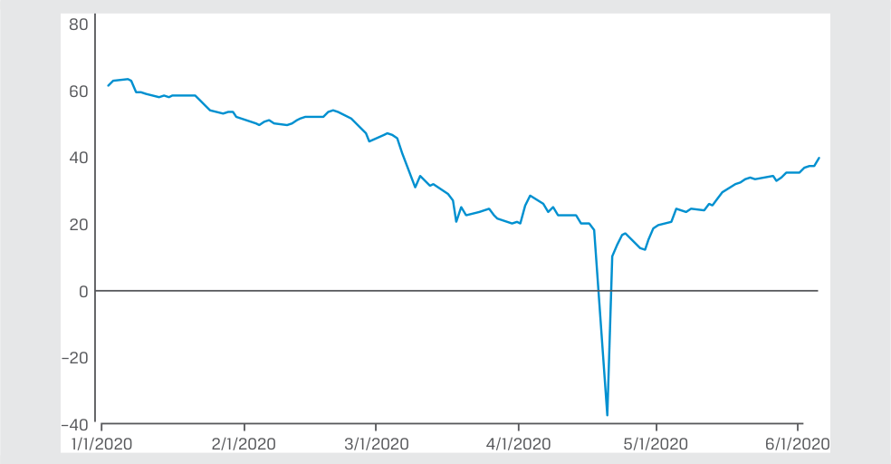
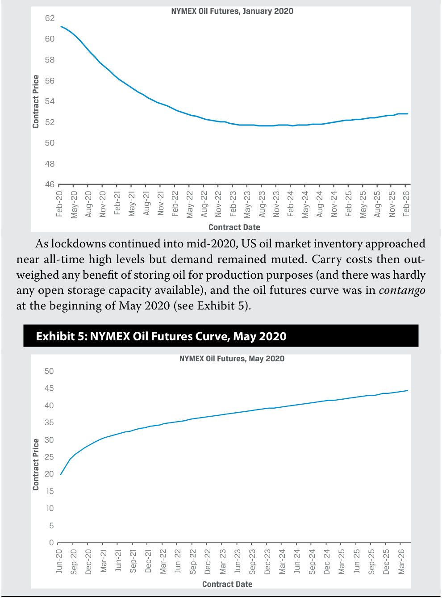
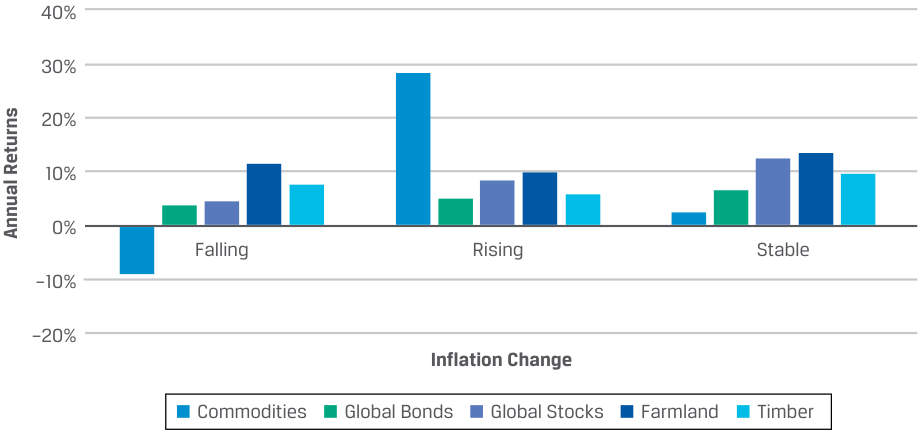

# Tập 8: Đầu tư Thay thế (Alternative Investments)
## Learning Module 5 Natural Resources (Trang PDF 129–154)

---

# Tập 8: Đầu tư Thay thế (*Alternative Investments*)
## Học phần 5: Tài nguyên Thiên nhiên (*Natural Resources*)
### Phần 1/2: Giới thiệu (Trang PDF 129–142)

---

<!-- PDF Page 129 -->

#### H Ọ C P H Ầ N 

# **<mark>5</mark>** 

### **Tài nguyên Thiên nhiên (*Natural Resources*)** 

###### **<mark>MỤC TIÊU HỌC TẬP (*LEARNING OUTCOMES*)</mark>** 

**_Thành thạo – Ứng viên cần có khả năng:_** 
- giải thích các đặc điểm của đất thô (*raw land*), đất lâm nghiệp (*timberland*), và đất nông nghiệp (*farmland*) cùng các đặc tính đầu tư của chúng
- mô tả các đặc điểm của hàng hóa (*commodities*) và các đặc tính đầu tư của chúng
- phân tích các nguồn rủi ro, tỷ suất sinh lợi và sự đa dạng hóa giữa các khoản đầu tư tài nguyên thiên nhiên (*natural resource investments*)

##### **GIỚI THIỆU (*INTRODUCTION*)** 

**<mark>1</mark>** 

Tài nguyên thiên nhiên (*natural resources*) bao gồm hàng hóa (*commodities*) và đất thô được sử dụng cho mục đích nông nghiệp, cụ thể là canh tác nông nghiệp (*farming*) và trồng rừng lấy gỗ (*timber*). Việc quản lý loại tài sản này đòi hỏi kiến thức chuyên môn về các đặc điểm của tài nguyên thiên nhiên. Ngày càng có nhiều danh mục đầu tư đưa tài nguyên thiên nhiên vào, điều này lý giải sự cần thiết phải có một sự khảo sát riêng biệt về lĩnh vực này. Đã có sự phát triển nhanh chóng trong việc cung cấp các hình thức đầu tư gián tiếp vào tài nguyên thiên nhiên thông qua các quỹ hoán đổi danh mục (ETFs), công ty hợp danh hữu hạn (*limited partnerships*), các quỹ tín thác đầu tư bất động sản (REITs), hợp đồng hoán đổi (*swaps*), và hợp đồng tương lai (*futures*). 

Hàng hóa, chẳng hạn như dầu thô, đậu nành, đồng và vàng, được xem là các khoản đầu tư. Đầu tư vào hàng hóa có thể là hàng hóa “cứng” (*“hard” commodities* — những thứ được khai mỏ như đồng, hoặc chiết xuất như dầu mỏ) hoặc hàng hóa “mềm” (*“soft” commodities* — những thứ được nuôi trồng trong một khoảng thời gian, chẳng hạn như gia súc, ngũ cốc và cây trồng thương phẩm như cà phê). 

Đầu tư đất lâm nghiệp (*timberland investment*) bao gồm việc sở hữu đất thô và thu hoạch cây rừng để lấy gỗ xẻ (*lumber*), từ đó tạo ra một dòng thu nhập và tiềm năng lãi vốn (*capital gain*), đồng thời đất lâm nghiệp đã được đưa vào các danh mục đầu tư định chế lớn trong nhiều thập kỷ qua. Đất nông nghiệp (*farmland*) với tư cách là một khoản đầu tư là một hiện tượng mới xuất hiện gần đây hơn, với chỉ một vài quỹ chuyên biệt tham gia. Tuy nhiên, khi sự gia tăng dân số, thời tiết và quản lý nguồn nước ngày càng trở thành chủ đề thời sự, các nhà đầu tư có thể tìm đến những tài sản này để chủ động giải quyết vấn đề phát triển bền vững (*sustainability*). 

###### **TỔNG QUAN HỌC PHẦN (*LEARNING MODULE OVERVIEW*)** 

- Các khoản đầu tư vào đất nông nghiệp và đất lâm nghiệp có những điểm tương đồng ở một số khía cạnh nhất định với các khoản đầu tư bất động sản nhưng cũng thể hiện một số điểm khác biệt quan trọng. 

<!-- PDF Page 130 -->

- Trong khi tỷ suất sinh lợi đầu tư của đất thô (*raw land*) chỉ phát sinh thuần túy từ những thay đổi về giá của tài sản, thì cả đất nông nghiệp và đất lâm nghiệp đều tạo ra tỷ suất sinh lợi từ dòng thu nhập của tài sản bên cạnh những thay đổi về giá của tài sản. 

- Dòng thu nhập của đất lâm nghiệp khác với dòng thu nhập của đất nông nghiệp ở chỗ thời điểm thu hoạch gỗ có thể được lựa chọn linh hoạt trong khi mùa màng từ đất nông nghiệp phải được thu hoạch theo một chu kỳ cố định. 

- Các khoản đầu tư hàng hóa thường được thực hiện thông qua các thị trường phái sinh (*derivative markets*), mặc dù một số nhà đầu tư có thể tìm thấy giá trị khi đầu tư trực tiếp vào hàng hóa vật chất (*physical commodities*) hoặc thông qua các quỹ chuyên biệt. 

- Mức giá sẵn có của hàng hóa thông qua các thị trường phái sinh phải có mối liên hệ với mức giá của chính những hàng hóa đó trên các thị trường vật chất để ngăn chặn các cơ hội kinh doanh chênh lệch giá (*arbitrage opportunities*). 

- Giá kỳ hạn (*forward price*) của một hàng hóa sẽ lớn hơn giá giao ngay (*spot price*) của cùng hàng hóa đó chỉ khi chi phí nắm giữ (*carrying costs*) của việc sở hữu hàng hóa vật chất lớn hơn những lợi ích phi tiền mặt (*non-cash benefits*) của việc sở hữu hàng hóa vật chất đó. 

- Việc đầu tư vào hàng hóa được thúc đẩy bởi tiềm năng mang lại tỷ suất sinh lợi kỳ vọng cao, tiềm năng đa dạng hóa một danh mục tài sản truyền thống, và sự bảo vệ chống lại lạm phát. Hàng hóa thể hiện mức độ tương quan cao với lạm phát trong suốt 30 năm qua, cho thấy rằng hàng hóa là một công cụ phòng vệ lạm phát (*inflation hedge*) hiệu quả. 

- Các khoản đầu tư đất nông nghiệp và đất lâm nghiệp giao dịch không thường xuyên và diễn ra trên các thị trường phi đại chúng. Kết quả là, chúng có khả năng tampak ít biến động hơn so với hàng hóa và các tài sản rủi ro được giao dịch đại chúng khác (chẳng hạn như cổ phiếu), bất chấp thực tế là cả hai loại tài sản này đều phải đối mặt với những rủi ro đáng kể, chẳng hạn như các mối đe dọa liên quan đến thời tiết. 

- Đất nông nghiệp và đất lâm nghiệp mang lại tiềm năng đa dạng hóa cho các danh mục đầu tư bao gồm chủ yếu là các tài sản truyền thống (tức cổ phiếu và trái phiếu). Hệ số tương quan lịch sử giữa những loại tài sản này và các tài sản truyền thống xấp xỉ bằng không. 

###### **TỰ ĐÁNH GIÁ HỌC PHẦN (*LEARNING MODULE SELF-ASSESSMENT*)** 

Những câu hỏi ban đầu này nhằm giúp bạn tự đánh giá mức độ hiểu biết hiện tại của mình về học phần này. 

1. Đặc tính tài sản nào sau đây là điểm chung của cả khoản đầu tư đất nông nghiệp và khoản đầu tư bất động sản? 

   - **A.** Cả hai đều là các khoản đầu tư thanh khoản. 

   - **B.** Cả hai đều là các khoản đầu tư kém thanh khoản (*illiquid investments*). 

   - **C.** Các cải tạo vật chất (*physical improvements*) là trọng tâm chính tạo nên giá trị đầu tư đối với cả hai. 

###### **Lời giải:** 

B là đáp án đúng. Đất nông nghiệp và bất động sản có chung đặc tính kém thanh khoản: Rất tốn kém chi phí để tìm kiếm người mua khi muốn bán khoản đầu tư. A không đúng vì cả hai đều là các khoản đầu tư kém thanh khoản. C không đúng vì các cải tạo vật chất chỉ là trọng tâm tạo nên giá trị đối với các khoản đầu tư bất động sản, chứ không phải đối với các khoản đầu tư đất nông nghiệp. 

<!-- PDF Page 131 -->

2. Khoản đầu tư tài nguyên thiên nhiên nào sau đây ít có khả năng sử dụng cấu trúc sở hữu quỹ tín thác đầu tư bất động sản (REIT) nhất? 

   - **A.** Đất nông nghiệp (*Farmland*) 

   - **B.** Đất thô (*Raw land*) 

   - **C.** Đất lâm nghiệp (*Timberland*) 

###### **Lời giải:** 

B là đáp án đúng. Đất thô thường được mua lại thông qua quyền sở hữu trực tiếp hoặc cấu trúc công ty hợp danh (*partnership structure*). Ngoài ra, đất thô không có dòng thu nhập cố hữu và tỷ suất sinh lợi tích lũy thuần túy từ sự tăng giá, khiến cấu trúc REIT chuyển tiếp thu nhập (*income passthrough REIT structure*) trở nên ít phù hợp hơn. Cả A và C đều không đúng vì cả khoản đầu tư đất nông nghiệp và đất lâm nghiệp đều được đưa vào cấu trúc REIT, cũng như các hình thức sở hữu khác. 

3. Loại nhà đầu tư nào có khả năng ưa thích đầu tư vào hàng hóa bằng cách sử dụng các sản phẩm giao dịch trên sở giao dịch (*exchange-traded products* – ETPs)? 

   - **A.** Những người tìm kiếm hoạt động giao dịch đơn giản hóa thông qua một tài khoản môi giới (*brokerage account*) 

   - **B.** Những người tìm kiếm quyền tiếp cận các chiến lược giao dịch hàng hóa năng động (*dynamic commodity trading strategies*) 

   - **C.** Những người tìm kiếm chuyên môn sâu trong một lĩnh vực hàng hóa cụ thể 

###### **Lời giải:** 

A là đáp án đúng. Các sản phẩm giao dịch trên sở giao dịch (ETPs) cho phép nhà đầu tư có được sự tiếp cận với hàng hóa thông qua một công cụ giao dịch trên sở giao dịch đơn giản có thể được truy cập qua tài khoản môi giới. B không đúng vì nó mô tả những nhà đầu tư lựa chọn sử dụng các nhà tư vấn giao dịch hàng hóa (*commodity trading advisors* – CTAs). C không đúng vì loại nhà đầu tư này sẽ lựa chọn một quỹ hàng hóa chuyên biệt để tận dụng chuyên môn của quỹ đó. 

4. Điều nào sau đây mô tả một lợi ích phi tiền mặt của việc nắm giữ một hàng hóa vật chất thay vì một hợp đồng phái sinh trên cùng hàng hóa đó? 

   - **A.** Tiền lãi (*Interest*) 

   - **B.** Lợi suất thuận tiện (*Convenience yield*) 

   - **C.** Lưu kho (*Storage*) 

###### **Lời giải:** 

B là đáp án đúng. Trong những môi trường thị trường mà lượng hàng tồn kho vật chất của một hàng hóa xuống thấp, các nhà đầu tư vào hàng hóa đó sẽ thích nắm giữ tài sản vật chất hơn là một hợp đồng phái sinh có tài sản đó làm tài sản cơ sở. Phần bù trên giá giao ngay phát sinh từ sự ưu tiên này được gọi là lợi suất thuận tiện (*convenience yield*). A và C đều không đúng vì tiền lãi và chi phí lưu kho phản ánh các chi phí gắn liền với việc sở hữu hàng hóa vật chất. 

5. Phát biểu nào sau đây phản ánh chính xác nhất các yếu tố nền tảng về cung và cầu hàng hóa? 

   - **A.** Cung hàng hóa điều chỉnh ngang bằng với cầu hàng hóa. 

   - **B.** Cung hàng hóa điều chỉnh nhanh hơn so với cầu hàng hóa. 

   - **C.** Cung hàng hóa điều chỉnh chậm hơn so với cầu hàng hóa. 

###### **Lời giải:** 

C là đáp án đúng. Cung hàng hóa điều chỉnh chậm trước nhu cầu do thời gian sản xuất kéo dài; ví dụ, cây trồng nông nghiệp đòi hỏi phải trải qua một chu kỳ sinh trưởng. 

<!-- PDF Page 132 -->

6. Thước đo nào sau đây được sử dụng tốt nhất để đánh giá tiềm năng đa dạng hóa danh mục đầu tư khi bổ sung đất nông nghiệp hoặc đất lâm nghiệp vào một danh mục gồm các tài sản truyền thống? 

   - **A.** Tỷ suất sinh lợi của các loại tài sản khác 

   - **B.** Độ biến động của các loại tài sản khác 

   - **C.** Hệ số tương quan (*Correlation*) giữa các loại tài sản khác 

###### **Lời giải:** 

C là đáp án đúng. Hệ số tương quan giữa các loại tài sản phản ánh tốt nhất tiềm năng đa dạng hóa danh mục đầu tư. Một loại tài sản thể hiện mức độ tương quan thấp hơn (tức gần bằng không hơn) với các loại tài sản truyền thống (chẳng hạn như cổ phiếu và trái phiếu) có tiềm năng đa dạng hóa tốt hơn so với một loại tài sản thể hiện mức độ tương quan cao hơn (tức gần bằng một hơn). A và B không đúng vì tỷ suất sinh lợi và độ biến động chỉ phản ánh phần thưởng và rủi ro của riêng loại tài sản đó mà không xem xét đến việc loại tài sản đó hoạt động như thế nào khi so sánh với các loại tài sản khác. 

## **<mark>2</mark>** 

##### **ĐẶC ĐIỂM ĐẦU TƯ TÀI NGUYÊN THIÊN NHIÊN (*NATURAL RESOURCES INVESTMENT FEATURES*)** 

**Mục tiêu học tập:** giải thích các đặc điểm của đất thô (*raw land*), đất lâm nghiệp (*timberland*), và đất nông nghiệp (*farmland*) cùng các đặc tính đầu tư của chúng 

Tài nguyên thiên nhiên bao gồm các yếu tố đầu vào sản xuất khác nhau mang tính cơ bản đối với nền kinh tế và đời sống hàng ngày: thực vật và động vật (tức hàng hóa mềm – *soft commodities*); năng lượng và khoáng sản (hàng hóa cứng – *hard commodities*); cùng các kim loại và hàng hóa công nghiệp được sử dụng để chế tạo hàng hóa và sản xuất dịch vụ. Một tỷ trọng đáng kể các khoản đầu tư tài nguyên thiên nhiên được thực hiện trực tiếp thông qua đất nông nghiệp, đất thô có quyền thăm dò và khai thác mỏ, và đất lâm nghiệp. Quyền sở hữu trực tiếp trải rộng trên một phổ lớn: từ những người nông dân sản xuất ngũ cốc cho đến các nhà đầu tư định chế xây dựng các trang trại năng lượng mặt trời. 

Nhiều nhà đầu tư định chế lớn tạo ra sự tiếp cận trực tiếp với tài nguyên thiên nhiên bằng cách mua đứt đất đai kèm quyền canh tác nông sản; chiết xuất dầu mỏ và khí đốt; xây dựng các cơ sở phát năng lượng thay thế, chẳng hạn như trang trại điện mặt trời và điện gió; hoặc khai thác các loại hàng hóa như sắt, than đá và các kim loại công nghiệp khác. Bằng cách đầu tư vào những tài sản này, các nhà đầu tư định chế thường tìm cách hoàn thành các mục tiêu về môi trường, xã hội và quản trị (ESG) của họ, chẳng hạn như phát triển bền vững, bảo tồn nguồn nước và các mục tiêu môi trường khác. 

###### **Đầu tư Đất đai so với Bất động sản (*Land Investments vs. Real Estate*)** 

Đất nông nghiệp, đất lâm nghiệp và đất thô tương tự như các khoản đầu tư bất động sản ở chỗ chúng đều là những tài sản độc nhất, kém thanh khoản với vị trí địa lý và đặc tính riêng biệt, trong đó hai đặc điểm sau có ảnh hưởng đến giá trị của chính tài nguyên đó. Chúng đều liên quan đến các hình thức vốn sở hữu (*ownership capital* — quyền đòi hỏi đối với dòng tiền còn lại). Trong trường hợp bất động sản đã phát triển và đất nông nghiệp, cũng có thể có các dòng tiền đều đặn (từ hợp đồng cho thuê). 

Đất ít được phát triển hơn bao gồm đất nông nghiệp, đất lâm nghiệp và đất thô, cũng như các quyền khai thác khoáng sản hoặc quyền khoan thăm dò đi kèm. Các nguồn tỷ suất sinh lợi bao gồm sự tăng giá kỳ vọng theo thời gian và các dòng tiền, chẳng hạn như tiền cho thuê trang trại (đối với chủ sở hữu), thu nhập vận hành trang trại (đối với chủ sở hữu kiêm người vận hành – *owner-operator*), thu nhập từ đất lâm nghiệp trang trại, và tiền bản quyền khai thác khoáng sản và khoan thăm dò (*mineral and drilling royalties*). 

<!-- PDF Page 133 -->

Các ước tính cho thấy gần một nửa diện tích đất lâm nghiệp tư nhân có thể đầu tư được trên toàn cầu nằm ở Hoa Kỳ. Các khu vực đất lâm nghiệp lớn nhất tiếp theo là Trung và Đông Âu, Mỹ Latinh, Úc và New Zealand. 

Có một số điểm khác biệt giữa đầu tư bất động sản và đầu tư đất thô, đất nông nghiệp và đất lâm nghiệp. Điểm khác biệt đầu tiên là không giống như bất động sản, có rất ít hoặc không có sự tập trung vào việc cải tạo vật chất (*physical improvements*) trên đất. Giá trị của các tòa nhà, công trình xây dựng và sự phát triển không phải là điều quan trọng mà thay vào đó là chất lượng của đất trồng (*soil quality*), đặc điểm khí hậu (đối với đất nông nghiệp, đất lâm nghiệp), hoặc địa chất (đối với quyền khoáng sản). Ngược lại, chính những cải tạo thực tế, tiềm năng và theo kế hoạch mới là yếu tố quyết định giá trị của tài sản trong các khoản đầu tư bất động sản. Vị trí của đất cũng rất quan trọng; đất càng gần hệ thống giao thông vận tải và thị trường tiêu thụ thì giá càng cao. Mặc dù khoảng cách gần với giao thông vận tải cũng là một yếu tố đối với bất động sản, nhưng chi phí vận chuyển có thể là một cấu phần đáng kể trong mức giá sản phẩm mà người tiêu dùng cuối cùng phải trả đối với đất lâm nghiệp và đất nông nghiệp. 

Để thực hiện các khoản đầu tư vào đất thô, đất lâm nghiệp hoặc đất nông nghiệp, các nhà đầu tư cần có kiến thức chuyên môn và sự am hiểu về những đặc thù của loại tài nguyên thiên nhiên đó. Các nhà đầu tư đầu tư trực tiếp vào đất lâm nghiệp cần có chuyên môn đầu tư lâm nghiệp để quản lý một khu rừng trong suốt vòng đời của nó. Nhiều nhà đầu tư định chế lớn không có chuyên môn này thường dựa vào **các tổ chức quản lý đầu tư đất lâm nghiệp (*timberland investment management organizations* – TIMOs)**, tức các pháp nhân hỗ trợ nhà đầu tư định chế thông qua việc quản lý các khoản đầu tư vào đất lâm nghiệp của họ bằng cách phân tích và mua lại các diện tích đất lâm nghiệp phù hợp. 

Cả bất động sản thương mại và bất động sản nhà ở đều cung cấp rất nhiều lựa chọn tài trợ đa dạng; tuy nhiên, có ít lựa chọn thay thế hơn đối với đất nông nghiệp, đất lâm nghiệp và đất thô. Thường thì những khoản đầu tư này được tài trợ thông qua các khoản vay ngân hàng hoặc đầu tư nợ tư nhân trực tiếp. Cuối cùng, đây là những tài sản kém thanh khoản có số lượng người mua và người bán tiềm năng hạn chế do đòi hỏi kiến thức chuyên môn và nguồn vốn lớn cho các giao dịch này. Những đặc điểm này được phác thảo trong Minh họa 1. 

**Minh họa 1: Đất thô, Đất nông nghiệp và Đất lâm nghiệp (*Raw Land, Farmland and Timberland*)** 

||**Đất thô (*Raw land*)**|**Đất nông nghiệp (*Farmland*)**|**Đất lâm nghiệp (*Timberland*)**|
|---|---|---|---|
|Các động lực tạo tỷ suất sinh lợi (*Return drivers*)|Giá đất (*Price of land*)|Sản lượng thu hoạch (*Harvest quantities*) Giá hàng hóa nông sản (*Commodity prices*) Giá đất (*Price of land*)|Sự sinh trưởng sinh học (*Biological growth*) Sản lượng thu hoạch (*Harvest quantities*) Giá gỗ xẻ (*Lumber prices*) Giá đất (*Price of land*)|
|Nguồn doanh thu trực tiếp (*Source of direct revenue*)|Sự tăng giá đất (*Price appreciation*) Doanh thu cho thuê (*Lease revenue*)|Bán mùa màng và các sản phẩm nông nghiệp khác Sự tăng giá đất Doanh thu cho thuê|Bán cây, gỗ và các sản phẩm lâm sản khác Sự tăng giá đất Doanh thu cho thuê|
|Yếu tố quyết định giá trị (*Value*)|Vị trí vật lý (*Physical location*)|Vị trí vật lý Chu kỳ sinh trưởng (*Growth cycle*) Chất lượng đất trồng (*Soil quality*)|Vị trí vật lý Chất lượng gỗ (*Quality of timber*) Giai đoạn trong sản xuất gỗ (*Phase in timber production*)|
|Rủi ro chính (*Main risks*)|Mục đích sử dụng thay thế tốt nhất (*Best alternative use*)|Các yếu tố thời tiết và biến đổi khí hậu (*Weather factors and climate change*) Các yếu tố sinh học, dịch bệnh (*Biological factors, diseases*)|Các yếu tố thời tiết và biến đổi khí hậu (*Weather factors and climate change*) Các yếu tố sinh học, dịch bệnh (*Biological factors, diseases*)|
|Chủ sở hữu (*Owners*)|Chủ yếu là các định chế, một số cá nhân|Chủ yếu là các cá nhân, một số định chế|Chủ yếu là các định chế, một số cá nhân|
|Cấu trúc sở hữu (*Ownership structure*)|Sở hữu trực tiếp, công ty hợp danh (*partnership*)|Sở hữu trực tiếp, công ty hợp danh, REIT|Sở hữu trực tiếp, công ty hợp danh, REIT, TIMO|

<!-- PDF Page 134 -->

###### **Đặc điểm và Hình thức Đầu tư Đất nông nghiệp và Đất lâm nghiệp (*Features and Forms of Farmland and Timberland Investment*)** 

Sự quan tâm bền vững đối với các khoản đầu tư đất nông nghiệp và đất lâm nghiệp bắt nguồn từ bản chất thiết yếu chung của chúng (mọi người đều cần ăn và cần nơi trú ẩn), khoản thu nhập định kỳ từ mùa màng, sự bảo vệ khỏi lạm phát từ việc nắm giữ đất đai, và mức độ cách ly của chúng khỏi sự biến động của thị trường tài chính. Đất nông nghiệp Hoa Kỳ, chẳng hạn, đã đạt tỷ suất sinh lợi dương trong cả những giai đoạn khi GDP của Hoa Kỳ sụt giảm đáng kể (1973–1975 và 2007–2009) lẫn khi Hoa Kỳ trải qua mức lạm phát cao hơn bình thường (1915–1920, 1940–1951, và 1967–1981). 

Đất lâm nghiệp đã là một phần trong danh mục đầu tư của các định chế và các cá nhân có giá trị tài sản ròng siêu cao (*ultra-high-net-worth*) trong nhiều thập kỷ, thường được giao dịch theo những đơn vị diện tích đất lớn (hàng nghìn mẫu Anh hoặc héc-ta). Một trong những thách thức chính của các khoản đầu tư này là chu kỳ thị trường dài của chúng, đặc biệt là đối với rừng trồng mới (*new-growth forest*) và các loại cây trồng thu hái quả như cây ăn quả. Ngược lại, đất nông nghiệp có thể được tìm thấy ở những quy mô nhỏ hơn nhiều — có lẽ chỉ vài chục hoặc vài trăm mẫu Anh hay héc-ta. Nhiều trang trại vẫn thuộc sở hữu gia đình, chẳng hạn như 98% diện tích đất nông nghiệp tại Hoa Kỳ. Trên phạm vi toàn cầu, đất nông nghiệp vẫn là một nguồn tài sản gia đình chính. 

Các khoản đầu tư vào đất nông nghiệp và đất lâm nghiệp — dù được sở hữu trực tiếp, sở hữu gián tiếp hay đi thuê — đều tạo ra tỷ suất sinh lợi từ việc bán mùa màng và gỗ. Đất nông nghiệp chủ yếu bao gồm các loại cây trồng theo luống/hàng năm (*row crops*) được gieo trồng và thu hoạch (có thể diễn ra nhiều hơn một vụ gieo trồng và thu hoạch trong một năm tùy thuộc vào loại cây trồng và khí hậu) và các loại cây trồng lâu năm (*permanent crops*) mọc trên cây thân gỗ hoặc cây dây leo. Đất nông nghiệp cũng có thể được sử dụng làm đồng cỏ chăn nuôi gia súc (*pastureland for livestock*). Các sản phẩm nông trại phải được thu hoạch ngay khi chín, với rất ít sự linh hoạt trong sản xuất. Ngược lại, đất lâm nghiệp đóng vai trò vừa là một nhà máy vừa là một nhà kho. Gỗ (cây rừng) có thể sinh trưởng (tức đặc tính nhà máy của đất lâm nghiệp) và dễ dàng được lưu trữ đơn giản bằng cách chưa chặt hạ cây (tức đặc tính nhà kho của đất lâm nghiệp). Đặc tính này mang lại sự linh hoạt trong việc thu hoạch khi giá gỗ tăng cao và trì hoãn việc thu hoạch khi giá gỗ giảm thấp. 

Là một phần trong tỷ suất sinh lợi được tạo ra từ việc bán sản lượng đầu ra từ đất, cả đất nông nghiệp và đất lâm nghiệp đều tạo ra tỷ suất sinh lợi từ những thay đổi về giá của sản lượng đầu ra. Giá thị trường của các sản phẩm nông nghiệp và gỗ có thể biến động đáng kể theo thời gian, và những mức giá này kết hợp với sản lượng thu hoạch sẽ quyết định doanh thu tạo ra từ việc bán sản lượng của đất. Cuối cùng, giá trị của đất đai có thể thay đổi theo thời gian đối với cả đất nông nghiệp và đất lâm nghiệp, và những thay đổi về giá đất này cũng đóng góp vào tỷ suất sinh lợi của các khoản đầu tư đất nông nghiệp và đất lâm nghiệp. Các động lực tạo ra tỷ suất sinh lợi được tóm tắt ở hàng đầu tiên của Minh họa 1. 

Trong nhiều thế kỷ, quyền sở hữu trực tiếp đất nông nghiệp và đất lâm nghiệp là hình thức thống trị ban đầu, với trọng tâm hướng vào các nhà đầu tư dài hạn được miễn thuế, chẳng hạn như các quỹ hưu trí, các quỹ từ thiện (*foundations*), và các quỹ hiến tặng (*endowments*). Đó là lý do tại sao các phương tiện đầu tư chính của những nhà đầu tư nhỏ hơn đối với đất lâm nghiệp và đất nông nghiệp là các quỹ đầu tư, dù được chào bán trên các thị trường đại chúng như các quỹ tín thác đầu tư bất động sản (REITs) tại Hoa Kỳ, hay được quản lý tư nhân thông qua các công ty hợp danh hữu hạn (*limited partnerships*). Các nhà đầu tư đất lâm nghiệp trực tiếp sử dụng các tổ chức TIMO để lựa chọn, quản lý và bán tài sản phù hợp với mục tiêu của nhà đầu tư. Các tổ chức TIMO thường được sử dụng kết hợp với các lựa chọn đầu tư gián tiếp, chẳng hạn như công ty hợp danh hữu hạn, công ty trách nhiệm hữu hạn (LLC), và các quỹ REIT tư nhân. 

Các nhà đầu tư lớn hơn có thể xem xét đầu tư trực tiếp vào những tài sản có sức hấp dẫn. Ví dụ, các quỹ đầu tư quốc gia ở Trung Đông đã thực hiện các khoản đầu tư vào đất nông nghiệp tại Châu Phi và Đông Nam Á. Ngày càng có nhiều quỹ đất nông nghiệp, công ty hợp danh hữu hạn và các quỹ REIT đất nông nghiệp giao dịch đại chúng được ra mắt. 

Những phương tiện đầu tư gián tiếp này thường liên quan đến các tài khoản được quản lý riêng biệt (*separately managed accounts*) phân biệt giữa mô hình chủ sở hữu (*owner*) và mô hình chủ sở hữu kiêm người vận hành (*owner-operator*); trong trường hợp thứ nhất, chủ sở hữu cho thuê đất được sử dụng để trồng cây hàng năm (tức ngũ cốc, v.v.), trong khi ở trường hợp thứ hai, họ giữ lại một số quyền kiểm soát vận hành đối với các bất động sản trồng cây lâu năm (vườn cây ăn quả, vườn nho, v.v.). Dòng tiền thường cố định trong trường hợp thứ nhất và biến đổi trong trường hợp thứ hai, khi nhà đầu tư gánh chịu một phần rủi ro vận hành. 

<!-- PDF Page 135 -->

Việc sở hữu đất nông nghiệp vật chất mở ra cánh cửa tiếp cận với nhiều loại thực phẩm đa dạng hơn: gia vị, các loại hạt, trái cây và rau củ — một danh mục rộng lớn hơn nhiều so với ngô, đậu nành và lúa mì được cung cấp bởi hoạt động đầu tư hợp đồng tương lai. Tuy nhiên, có sự hạn chế về tính minh bạch giá cả hoặc thông tin để định hướng các quyết định đầu tư nếu không có sự hỗ trợ của các chuyên gia trong ngành. Tính kém thanh khoản của các khoản đầu tư đất nông nghiệp và đất lâm nghiệp trực tiếp cũng là một yếu tố gây hạn chế. 

Xét về mặt rủi ro, đất nông nghiệp rất nhạy cảm với những thay đổi thời tiết bất ngờ và các diễn biến khí hậu có thể dễ dàng phá hủy mùa màng và xóa sổ doanh thu. Tác động của thời tiết kéo dài suốt toàn bộ mùa vụ sinh trưởng, khiến sản lượng và giá cả nông sản rất khó dự đoán. Đó là lý do tại sao các hợp đồng tương lai hàng hóa nông sản có thể được kết hợp với việc nắm giữ đất nông nghiệp để tạo ra một mức tỷ suất sinh lợi tổng thể đã được phòng vệ rủi ro (*hedged return*). Một trang trại có vị thế mua (*long position*) cố hữu đối với mùa màng của mình và do đó sẽ bán các hợp đồng tương lai để giao hàng vào thời điểm thu hoạch. Phần thảo luận tiếp theo cung cấp một nghiên cứu tình huống chi tiết hơn về các rủi ro khí hậu gắn liền với hoạt động đầu tư đất lâm nghiệp. 

Có một lợi ích gián tiếp từ các khoản đầu tư đất nông nghiệp và đất lâm nghiệp: Những tài nguyên thiên nhiên này tiêu thụ carbon như một phần của vòng đời thực vật và giá trị của chúng không chỉ đến từ việc thu hoạch mà còn đến từ khả năng bù đắp carbon (*carbon offset*) cho hoạt động của con người. Quyền sử dụng nước (*water rights*) cũng là một phần tạo nên giá trị trực tiếp và ngầm định của những bất động sản này; các quyền địa dịch bảo tồn (*conservation easements*) có thể tạo ra giá trị bằng cách hỗ trợ các truyền thống và việc bảo tồn thiên nhiên. Nhu cầu đối với đất canh tác có thể tăng lên khi sự quan tâm đến các khoản đầu tư tuân thủ các yếu tố ESG ngày càng lớn. 

###### **NGHIÊN CỨU TÌNH HUỐNG (*CASE STUDY*)** 

###### **Đầu tư Có trách nhiệm vào Tài sản Đất lâm nghiệp: Nghiên cứu Tình huống Có Ý thức về Khí hậu** 

Campbell Global (CG) là một nhà quản lý đầu tư toàn cầu tập trung vào các khoản đầu tư rừng và tài nguyên thiên nhiên. Có trụ sở tại Portland, Oregon, với các văn phòng tại 14 tiểu bang Hoa Kỳ và New Zealand, công ty có gần bốn thập kỷ kinh nghiệm trong việc kiến tạo giá trị bền vững. CG cam kết quản lý các khu rừng của mình theo phương thức thúc đẩy lợi ích dài hạn tốt nhất của khách hàng, đồng thời nỗ lực giải quyết các vấn đề kinh tế và ESG. Ngoài giá trị kinh tế, các khu rừng còn đóng vai trò là những bể chứa carbon (*carbon sinks*) khổng lồ, với cây cối loại bỏ $\text{CO}_2$ trong khí quyển và cung cấp khả năng lưu trữ carbon. Trong một năm, một cây linh sam Douglas (*Douglas fir*) duy nhất — một loài gỗ thương mại phổ biến ở vùng Tây Bắc Thái Bình Dương của Hoa Kỳ — lưu trữ lượng $\text{CO}_2$ tương đương với việc lái một chiếc ô tô tiêu chuẩn đi quãng đường 400 dặm. Trên phạm vi toàn cầu, các khu rừng trên Trái Đất được ước tính hấp thụ tới 30% lượng phát thải $\text{CO}_2$ do con người gây ra. 

Các sản phẩm và vật liệu gỗ được thu hoạch bền vững cũng lưu trữ $\text{CO}_2$ khí quyển rất lâu sau khi được lấy ra khỏi rừng, với một mét khối gỗ giữ lại gần một tấn $\text{CO}_2$. Ngoài việc cô lập carbon (*carbon sequestration*), rừng còn mang lại lợi ích về nguồn nước sạch và môi trường sống cho động vật hoang dã, các cơ hội giải trí, và nguồn việc làm có mức lương đủ sống tại các cộng đồng nông thôn. Những thuộc tính này hoàn toàn phù hợp với các Mục tiêu Phát triển Bền vững của Liên Hợp Quốc (*UN’s Sustainable Development Goals*) và góp phần thúc đẩy sứ mệnh của Liên Hợp Quốc vì một tương lai bền vững trên toàn cầu. Với những tác động này, ngày càng có nhiều nhận thức rằng các khu rừng được quản lý tốt là một cấu phần thiết yếu của bất kỳ chiến lược biến đổi khí hậu toàn cầu nào. 

CG sử dụng các phân tích kịch bản (*scenario analyses*) để xác định những rủi ro liên quan đến khí hậu bắt đầu ở quy mô cấp quốc gia rộng lớn, thu hẹp dần xuống một khu đất cụ thể, và sau đó kiểm định tác động của các rủi ro khác nhau đối với mức độ phù hợp ở hiện tại và tương lai của địa điểm đó. Các yếu tố được phân tích để đo lường rủi ro khí hậu bao gồm mô hình lượng mưa (*precipitation patterns*), biến động nhiệt độ, mức độ nghiêm trọng của các hiện tượng thời tiết, sự hiện diện của sâu bệnh, và tốc độ tăng trưởng trung bình hàng năm của các loài cây thương mại. Mặc dù nhiều rủi ro liên quan đến khí hậu trong lâm nghiệp được giảm thiểu thông qua việc quản lý chủ động, trong suốt quá trình lặp đi lặp lại này, CG phân tích các tác động tích cực và tiêu cực tiềm tàng gắn liền với 

<!-- PDF Page 136 -->

những rủi ro này để đánh giá những thay đổi tiềm ẩn đối với giá trị tài sản ròng (NAV). Bảng dưới đây minh họa các rủi ro khí hậu được đánh giá, tác động của chúng đối với khu rừng, và khả năng giảm thiểu rủi ro. 

|**Rủi ro Khí hậu (*Climate Risk*)**|**Hệ quả (*Implication*)**|**Các Biện pháp Giảm thiểu của CG (*CG Mitigants*)**|
|---|---|---|
|Thay đổi nhiệt độ (*Change in temperature*)|Gia tăng nguy cơ cháy rừng (*Increased fire danger*)|Kế hoạch phòng chống cháy rừng đặc thù cho từng khu đất; đánh giá lại các khu vực/quốc gia mục tiêu để đầu tư|
|Thay đổi mô hình lượng mưa (*Change in precipitation patterns*)|Thay đổi phạm vi phân bố các loài cây; gia tăng hạn hán và rủi ro cháy rừng liên quan|Mô hình hóa mức độ phù hợp của thảm thực vật và cải thiện di truyền giống cây; đánh giá lại các khu vực/quốc gia mục tiêu để đầu tư|
|Tần suất của các hiện tượng thời tiết cực đoan (*Frequency of extreme weather events*)|Mất mát trữ lượng gỗ đứng (*standing timber*) do các hiện tượng gió bão|Đánh giá lại các khu vực mục tiêu; kế hoạch ứng phó đặc thù cho từng khu đất; xây dựng danh mục đầu tư đa dạng hóa về mặt địa lý|
|Sự hiện diện của sâu bệnh (*Presence of pests or disease*)|Khởi phát sớm và gia tăng tần suất chết ở từng cá thể cây|Xử lý ngay lập tức, có thể bao gồm việc loại bỏ các cây bị nhiễm bệnh để ngăn chặn sự lây lan thêm của sâu bệnh trong rừng|
|Thay đổi về mức tăng trưởng (*Change in growth*)|Tốc độ tăng trưởng tăng lên hoặc giảm xuống|Các tác động sẽ khác nhau tùy theo khu vực, có thể ảnh hưởng đến quyết định lựa chọn giống cây trồng; đánh giá lại các giả định của mô hình tăng trưởng rừng|

Các cơ hội và thách thức từ biến đổi khí hậu được nêu bật trong quy trình đầu tư của CG bao gồm: 

- Xác định các cơ hội trồng rừng mới (*afforestation* — thiết lập rừng mới) giúp giảm thiểu biến đổi khí hậu bằng cách cô lập lượng phát thải $\text{CO}_2$ từ khí quyển vào cây cối và đất trồng, đồng thời mang lại nhiều đồng lợi ích (*co-benefits*) quan trọng cho cộng đồng, đa dạng sinh học, cũng như chất lượng đất và nước. 

- Bảo vệ trữ lượng carbon hiện có bằng cách giảm thiểu các tác động đến lượng carbon được lưu trữ trên tầng đất mặt của rừng thông qua các phương thức quản lý rừng được thiết kế riêng. 

- Tăng cường khả năng cô lập carbon của rừng bằng cách trồng lại cây ở các khu vực càng sớm càng tốt để khu rừng mới nhanh chóng bắt đầu loại bỏ $\text{CO}_2$ khỏi khí quyển. 

Khả năng định lượng, đánh giá và báo cáo những thay đổi qua từng năm trong dấu chân carbon (*carbon footprint*) của một khu rừng có thể tác động đến những ảnh hưởng mà một tổ chức tạo ra đối với môi trường, dẫn đến sự minh bạch gia tăng và các quyết định kinh doanh có đầy đủ thông tin hơn. Việc tích hợp các yếu tố biến đổi khí hậu vào quy trình đầu tư không chỉ làm giảm thiểu các rủi ro liên quan đến khí hậu; nó còn thúc đẩy và nâng cao các giải pháp tự nhiên mà rừng mang lại. Việc hiểu và đo lường toàn diện trữ lượng carbon của rừng có thể dẫn đến các quyết định kinh doanh giúp cải thiện khả năng cô lập carbon, một yếu tố sống còn để giải quyết vấn đề biến đổi khí hậu. 

###### **BỘ CÂU HỎI (*QUESTION SET*)** 

1. Xác định ba động lực tạo tỷ suất sinh lợi chính của việc đầu tư vào đất lâm nghiệp. 

###### **Lời giải:** 

Ba động lực tạo tỷ suất sinh lợi chính của việc đầu tư vào đất lâm nghiệp là (1) sự sinh trưởng sinh học (*biological growth*) của gỗ sẽ được thu hoạch trong tương lai, (2) giá gỗ xẻ (*price of lumber*), và (3) những thay đổi trong giá đất (*changes in the price of the land*). 

<!-- PDF Page 137 -->

2. Phát biểu nào sau đây cung cấp mô tả chính xác nhất về các tổ chức quản lý đầu tư đất lâm nghiệp (TIMOs)?

   - **A.** TIMOs là các pháp nhân sử dụng chuyên môn đầu tư lâm nghiệp của mình để phân tích và mua lại các khoản nắm giữ đất lâm nghiệp phù hợp thay mặt cho các nhà đầu tư định chế.
   - **B.** TIMOs là các quỹ đầu tư huy động tiền từ các nhà đầu tư cá nhân để mua đất lâm nghiệp.
   - **C.** TIMOs là các pháp nhân chỉ hỗ trợ quyền sở hữu trực tiếp đất lâm nghiệp của các nhà đầu tư định chế.

###### **Lời giải:**

A là câu trả lời đúng. Đất lâm nghiệp đòi hỏi chuyên môn đặc thù theo tài sản, và các tổ chức TIMO sử dụng chuyên môn của mình để phân tích và mua lại các khoản nắm giữ đất lâm nghiệp một cách trực tiếp hoặc gián tiếp cho các nhà đầu tư định chế. B không đúng vì TIMO không phải là các quỹ đầu tư. C không đúng vì TIMO có thể được các nhà đầu tư định chế sử dụng kết hợp với việc đầu tư gián tiếp vào đất lâm nghiệp.

3. Mô tả một điểm tương đồng quan trọng và một điểm khác biệt quan trọng giữa việc đầu tư vào đất lâm nghiệp so với đầu tư vào bất động sản.

###### **Lời giải:**

Điểm tương đồng giữa đất lâm nghiệp và bất động sản bao gồm thực tế là cả hai loại tài sản đều liên quan đến việc đầu tư vào những tài sản độc nhất có vị trí địa lý riêng biệt và cả hai loại tài sản đều có mức độ kém thanh khoản cao.

Một điểm khác biệt quan trọng giữa hai loại tài sản là mức độ mà giá trị phản ánh các cải tạo vật chất trên đất. Cụ thể, đầu tư bất động sản định giá các cải tạo thực tế và tiềm năng trong khi đầu tư đất lâm nghiệp thì không.

4. Mô tả một sự khác biệt đáng kể trong cấu phần thu nhập của đầu tư đất nông nghiệp so với đầu tư đất lâm nghiệp.

###### **Lời giải:**

Đất lâm nghiệp mang lại sự linh hoạt về thời điểm thu hoạch cây rừng. Không giống như đất lâm nghiệp, các sản phẩm nông trại phải được thu hoạch ngay khi chín, với rất ít sự linh hoạt trong sản xuất.

## **CÁC HÌNH THỨC ĐẦU TƯ HÀNG HÓA (*COMMODITY INVESTMENT FORMS*)** **<mark>3</mark>** 

**Mục tiêu học tập:** mô tả các đặc điểm của hàng hóa (*commodities*) và các đặc tính đầu tư của chúng 

<!-- PDF Page 138 -->

###### **Đặc điểm Đầu tư Hàng hóa (*Commodity Investment Features*)** 

Bản thân hàng hóa không tạo ra dòng tiền mà thường làm phát sinh các chi phí (_chi phí nắm giữ_ – *cost of carry* đã được giới thiệu trong các học phần công cụ phái sinh), chẳng hạn như chi phí vận chuyển, lưu kho và bảo hiểm đối với hàng hóa vật chất. Các nhà đầu tư tìm cách hưởng lợi từ sự tăng giá hàng hóa (vượt quá chi phí nắm giữ) dựa trên giá trị kinh tế tương lai của chúng hơn là việc sử dụng thực tế tài sản cơ sở. 

Hơn nữa, các chính phủ đã nhận ra tầm quan trọng của việc kiểm soát các nguồn tài nguyên thiên nhiên và đảm nhận một vai trò ngày càng quan trọng trên các thị trường tài nguyên thiên nhiên. Chẳng hạn, nhiều chính phủ cung cấp trợ cấp giá lương thực cho người tiêu dùng và hỗ trợ giá cho nông dân. 

Các chính phủ thường kiểm soát các quyền tài nguyên thiên nhiên có thể khai thác, chẳng hạn như tài nguyên năng lượng và khai mỏ. Tại nhiều thị trường mới nổi, các chính phủ hoặc các doanh nghiệp nhà nước kiểm soát việc sản xuất năng lượng chiến lược hoặc các nguồn tài nguyên khai khoáng. Chẳng hạn, SOCAR, Công ty Dầu khí Nhà nước Cộng hòa Azerbaijan, là công ty dầu khí quốc gia thuộc sở hữu hoàn toàn của nhà nước tại quốc gia này và khai thác dầu mỏ cùng khí đốt tự nhiên từ các mỏ trên đất liền và ngoài khơi Biển Caspi. Hơn nữa, công ty vận hành nhà máy lọc dầu duy nhất của Azerbaijan và vận hành một số đường ống xuất khẩu dầu khí. Đây là một nguồn thu nhập chính của quốc gia này. Ở các quốc gia khác, chủ sở hữu đất có thể chỉ được phép canh tác lớp đất mặt và chỉ được khai thác một số khoáng sản nhất định. Thường thì chính phủ sở hữu và quản lý các quyền lòng đất (*subsurface rights*) và có quyền khai thác một số tài nguyên nhất định, chẳng hạn như dầu mỏ, khí đốt, than đá, vàng và bạc. 

Các yếu tố môi trường đóng vai trò trực tiếp trong các khoản đầu tư tài nguyên thiên nhiên, bởi vì các chính phủ đang ngày càng thực thi các biện pháp bảo vệ môi trường nhằm đáp ứng các mục tiêu khí hậu và kiểm soát những hoạt động có tác động đến khí hậu, chẳng hạn như khai mỏ, nông nghiệp, và khai thác cũng như sản xuất năng lượng. Cụ thể hơn, các chính sách biến đổi khí hậu toàn cầu tìm cách giảm sự phụ thuộc vào nhiên liệu hóa thạch (than đá, dầu mỏ) và tăng cường sử dụng năng lượng tái tạo. Để làm được điều đó, các quốc gia đang trong quá trình thông qua các chương trình quốc gia nhằm gia tăng năng lượng tái tạo (gió, mặt trời, sinh khối – *biomass*) và giảm sự phụ thuộc vào nhiên liệu hóa thạch. 

Mục tiêu chính sách giảm sự phụ thuộc vào nhiên liệu hóa thạch đã chuyển dịch trọng tâm sang xe điện và những tiến bộ trong công nghệ pin. Một tác động tiềm tàng của việc dựa vào các công nghệ năng lượng phát thải carbon thấp là nhu cầu cao hơn đối với nhiều loại khoáng sản và kim loại, chẳng hạn như lithium, coban và niken. Khi hoạt động khai thác những kim loại thiết yếu này gia tăng, sẽ có những tác động đáng kể đến hệ thống nước tại địa phương, các hệ sinh thái và cộng đồng dân cư. 

Cuối cùng, ngày càng có nhiều sự quan tâm từ các nhà đầu tư ESG nhằm thúc đẩy các phương thức canh tác bền vững hoặc sử dụng các khoản đầu tư đất lâm nghiệp để bù đắp carbon (*carbon offsets*). 

###### **Các Đặc tính Phân biệt của Đầu tư Hàng hóa (*Distinguishing Characteristics of Commodity Investments*)** 

Các phân ngành hàng hóa bao gồm kim loại quý và kim loại cơ bản (tức kim loại công nghiệp), các sản phẩm năng lượng, và các sản phẩm nông nghiệp. Minh họa 2 đưa ra các ví dụ cho từng loại. Tầm quan trọng tương đối, khối lượng và giá cả của từng hàng hóa riêng lẻ phát triển cùng với thị hiếu và nhu cầu của xã hội. Quá trình công nghiệp hóa ngày càng tăng của các thị trường mới nổi đã thúc đẩy nhu cầu toàn cầu mạnh mẽ đối với hàng hóa. Những thị trường này cần khối lượng ngày càng tăng dầu mỏ, thép và các vật liệu khác để hỗ trợ sản xuất chế tạo, phát triển cơ sở hạ tầng và nhu cầu tiêu dùng của người dân. Các công nghệ mới nổi, chẳng hạn như điện thoại di động tiên tiến và xe điện, tạo ra nhu cầu đối với các vật liệu mới và triệt tiêu nhu cầu đối với các nguồn tài nguyên cũ khi thị trường của từng loại hàng hóa cụ thể tiến hóa theo thời gian. 

<!-- PDF Page 139 -->

**Minh họa 2: Các Ví dụ về Hàng hóa (*Examples of Commodities*)** 

|**Phân ngành (*Sector*)**|**Hàng hóa Mẫu (*Sample Commodities*)**|
|---|---|
|Năng lượng (*Energy*)|Dầu mỏ, khí đốt tự nhiên, điện, than đá (*Oil, natural gas, electricity, coal*)|
|Kim loại cơ bản (*Base metals*)|Đồng, nhôm, kẽm, chì, thiếc, niken (*Copper, aluminum, zinc, lead, tin, nickel*)|
|Kim loại quý (*Precious metals*)|Vàng, bạc, bạch kim (*Gold, silver, platinum*)|
|Nông nghiệp (*Agriculture*)|Ngũ cốc, gia súc, cà phê (*Grains, livestock, coffee*)|
|Khác (*Other*)|Tín chỉ carbon, cước vận tải hàng hóa, lâm sản (*Carbon credits, freight, forest products*)|

Hàng hóa có thể được phân loại chi tiết hơn theo vị trí vật lý và phẩm cấp hoặc chất lượng (*grade or quality*). Ví dụ, có nhiều phẩm cấp và địa điểm giao hàng khác nhau đối với dầu thô và lúa mì. Do đó, các hợp đồng phái sinh hàng hóa quy định cụ thể về số lượng, chất lượng, ngày đáo hạn và địa điểm giao hàng. 

Phần lớn hoạt động đầu tư hàng hóa được thực thi thông qua các công cụ phái sinh. Hàng hóa vật chất thường làm phát sinh các nghĩa vụ thuế không mong muốn và các chi phí phát sinh từ việc lưu kho, bảo hiểm, môi giới và vận chuyển. Ngoài ra, các thị trường hàng hóa vật chất thiếu tính minh bạch về giá. Do đó, các khoản đầu tư hàng hóa thường được thực hiện thông qua các công cụ tài chính phái sinh, phổ biến nhất là hợp đồng tương lai và hợp đồng kỳ hạn hàng hóa (*commodity futures and forwards*) và đôi khi là quyền chọn trên hợp đồng tương lai (*options on futures*). Việc sử dụng các công cụ phái sinh để thiết lập sự phơi nhiễm với tài nguyên thiên nhiên có một số lợi ích: Bởi vì những công cụ này được giao dịch trên các sở giao dịch có tổ chức, chúng rất thanh khoản và mang lại cơ hội khám phá giá (*price discovery*). 

Hợp đồng tương lai (*futures contracts*) là các nghĩa vụ mua hoặc bán một số lượng cụ thể của một hàng hóa nhất định tại một mức giá, địa điểm và ngày cố định trong tương lai. Hợp đồng tương lai được giao dịch trên sở giao dịch, được định giá lại theo thị trường hàng ngày (*marked to market daily*), và có thể được hoặc không được thanh toán bằng việc giao hoặc nhận hàng hóa vật chất khi kết thúc hợp đồng. Nghĩa vụ giao nhận hàng vật chất này trở nên cực kỳ quan trọng trong những giai đoạn căng thẳng. Ví dụ, đối với dầu mỏ trong cuộc khủng hoảng tài chính toàn cầu năm 2008 và trong đại dịch COVID-19 năm 2020, khi nhu cầu sụp đổ, các nhà sản xuất dầu không thể tìm được người mua và các kho chứa trên toàn cầu đột ngột bị lấp đầy. Ngay cả các quỹ ETF liên quan đến hàng hóa cũng bị ảnh hưởng, buộc một số quỹ phải đóng cửa và gây ra những khoản lỗ lớn cho các nhà đầu tư. 

Đối với các hợp đồng tương lai, rủi ro đối tác (*counterparty risk*) được quản lý thông qua quy trình thanh toán bù trừ giữa trung tâm thanh toán bù trừ/sở giao dịch và các công ty môi giới bù trừ (*clearing brokers*). Sự tiếp cận với hàng hóa có thể đạt được thông qua các phương tiện khác ngoài việc đầu tư trực tiếp vào hàng hóa hoặc phái sinh hàng hóa, bao gồm các hình thức sau: 

- _Các sản phẩm giao dịch trên sở giao dịch (*Exchange-traded products* – ETPs).__ Các sản phẩm ETP, dù là dạng quỹ (ETFs) hay dạng trái phiếu/chứng chỉ ghi nợ (ETNs), có thể phù hợp với những nhà đầu tư bị giới hạn chỉ được mua cổ phiếu hoặc đang tìm kiếm hoạt động giao dịch đơn giản hóa thông qua một tài khoản môi giới tiêu chuẩn. Các ETP có thể đầu tư vào hàng hóa hoặc hợp đồng tương lai hàng hóa. Ví dụ, quỹ SPDR Gold Shares ETF tìm cách bám sát giá vàng vật chất bằng cách nắm giữ vàng thỏi (*bullion*) trong các hầm chứa. Quỹ này sở hữu gần 53 tỷ USD vàng thỏi tính đến tháng 12 năm 2022. Các ETP có thể sử dụng đòn bẩy và có thể mô phỏng kết quả thanh toán (*pay-offs*) từ một vị thế mua (*long*) hoặc vị thế bán (*short*), trong đó hình thức sau được coi là nghịch đảo (*inverse*) hay “đầu cơ giá xuống” (*“bearish”*). Tương tự như các quỹ tương hỗ hoặc quỹ tín thác đơn vị (*unit trusts*), các ETP thu phí được tính gộp trong tỷ lệ chi phí hoạt động (*expense ratios*) của chúng. 

- _Đầu tư thông qua các nhà tư vấn giao dịch hàng hóa (*commodity trading advisers* – CTAs).__ Các CTA là một cách khác để có được sự tiếp cận với hàng hóa. CTA là các quỹ hợp đồng tương lai được quản lý (*managed futures funds*) thực hiện các khoản đầu tư theo xu hướng (*directional investments*) chủ yếu trên các thị trường hợp đồng tương lai dựa trên các chiến lược phân tích kỹ thuật và phân tích cơ bản. Một CTA tập trung vào hàng hóa có thể chỉ tập trung vào một loại hàng hóa cụ thể (chẳng hạn như ngũ cốc) hoặc được đa dạng hóa rộng rãi trên nhiều loại hàng hóa. Tuy nhiên, nhà đầu tư sẽ cần phải tìm một quỹ chỉ tập trung duy nhất vào loại hàng hóa mong muốn, bởi vì các CTA hiện đại thường đầu tư vào rất nhiều loại hợp đồng tương lai khác nhau, bao gồm hàng hóa, cổ phiếu, thu nhập cố định và ngoại hối. Các nhà đầu tư cá nhân có thể thiết lập các tài khoản được quản lý theo 

<!-- PDF Page 140 -->

đúng sở thích đầu tư cụ thể và mức độ chấp nhận rủi ro của họ, được gọi là **các tài khoản được quản lý riêng biệt (*separately managed accounts* – SMAs)**. Những loại tài khoản cá nhân này rất phổ biến đối với các khoản đầu tư hàng hóa. Chi tiết hơn về CTA và hợp đồng tương lai được quản lý sẽ được trình bày trong học phần về các quỹ phòng hộ (*hedge funds*). 

- _Các quỹ chuyên biệt đầu tư vào các phân ngành hàng hóa cụ thể (*Specialized funds investing in specific commodity sectors*).__ Một ví dụ về các quỹ chuyên biệt là các công ty hợp danh năng lượng tư nhân (*private energy partnerships*), có cấu trúc tương tự như các quỹ vốn cổ phần tư nhân và cho phép các định chế tiếp cận với ngành năng lượng. Phí quản lý có thể dao động từ 1% đến 3% vốn cam kết (*committed capital*), với vòng đời điển hình là 10 năm cùng các đợt gia hạn từ 1 đến 2 năm. Các quỹ tương hỗ và quỹ tín thác đơn vị ngành năng lượng chào bán ra công chúng thường tập trung vào lĩnh vực dầu khí, thường đóng vai trò như các khoản đầu tư thu nhập cố định để trả cổ tức từ tiền thuê tài nguyên (*rents*) hoặc lãi vốn. Chúng có thể tập trung vào thượng nguồn (*upstream* — khoan thăm dò, khai thác), trung nguồn (*midstream* — lọc dầu, vận chuyển), hoặc hạ nguồn (*downstream* — hóa chất, phân phối). Phí quản lý của chúng tương đương với phí của các nhà quản lý cổ phiếu đại chúng khác và dao động từ 0,4% đến 1%. 

Các khoản đầu tư hàng hóa thường là việc bảo lãnh trực tiếp cho quá trình mua lại, quản lý và khai thác chính tài nguyên thiên nhiên đó. Những khoản đầu tư này thường liên quan đến các quyền đòi hỏi trực tiếp hoặc gián tiếp đối với chính các tài sản _vật chất (physical assets)_ chứ không phải quyền đòi hỏi đối với dòng tiền còn lại (vốn cổ phần) hay dòng tiền cố định (nợ). 

Tuy nhiên, cách tiếp cận gián tiếp này đi kèm với những rủi ro gia tăng từ hoạt động tài trợ và vận hành, và khi được nắm giữ tư nhân, còn chịu thêm tác động của tính kém thanh khoản bổ sung. 

###### **Cơ bản về Định giá Hàng hóa (*Basics of Commodity Pricing*)** 

Các nhà đầu tư tìm cách hưởng lợi từ sự phơi nhiễm trực tiếp với giá hàng hóa thường sử dụng các công cụ phái sinh, chẳng hạn như hợp đồng tương lai và quyền chọn giao dịch trên sở giao dịch cùng hợp đồng kỳ hạn, với các hàng hóa riêng lẻ hoặc một chỉ số làm tài sản cơ sở. Các chỉ số hàng hóa khác nhau được cấu thành từ những hàng hóa khác nhau và có tỷ trọng chỉ số khác nhau đáng kể, điều này quyết định mức độ phơi nhiễm khác nhau đối với không chỉ các hàng hóa cụ thể mà còn cả các phân ngành hàng hóa. Tuy nhiên, như chúng ta sẽ thấy ở phần sau của học phần này, hệ số tương quan giữa hàng hóa và các loại tài sản truyền thống thường thấp, nghĩa là hoàn toàn có thể cải thiện sự đa dạng hóa danh mục đầu tư bất kể lựa chọn chỉ số nào. 

Vì hàng hóa được giao dịch trên cả thị trường vật chất và thị trường tài chính, nên có một mối quan hệ trực tiếp giữa giá của chúng trên cả thị trường tiền mặt vật chất và thị trường tài chính phái sinh. Các điều kiện không có kinh doanh chênh lệch giá (*no-arbitrage conditions*) như vậy — mà chúng ta đã gặp trước đó trong các bài đọc về công cụ phái sinh — quy định rằng sự chênh lệch giá giữa thị trường tiền mặt (hay thị trường giao ngay) và thị trường phái sinh bằng với _chi phí nắm giữ (cost of carry)_, tức chi phí cơ hội của việc nắm giữ những tài sản này, đồng thời phản ánh lãi suất phi rủi ro cùng chi phí lưu kho, vận chuyển và bảo hiểm hàng hóa đó. Người nắm giữ hàng hóa vật chất kỳ vọng sẽ được đền bù thông qua một mức giá kỳ hạn cao hơn, $F_0^+(T)$, so với mức giá tiền mặt hiện hành. 

Tuy nhiên, có thể có những lợi ích phi tiền mặt từ việc nắm giữ hàng hóa vật chất thay vì tiếp cận thông qua việc sử dụng một công cụ phái sinh. _Lợi suất thuận tiện (convenience yield)_ như vậy có thể phát sinh trong những điều kiện khi những người tham gia thị trường thích nắm giữ hàng hóa vật chất hơn; chẳng hạn, các chủ sở hữu muốn đảm bảo rằng họ có quyền tiếp cận liên tục đối với hàng hóa này. Thông thường, lợi suất thuận tiện có mối quan hệ tỷ lệ nghịch với mức tồn kho (*inventory levels*) của hàng hóa cơ sở. Bởi vì lợi suất thuận tiện là một lợi ích và _tích lũy_ cho người sở hữu, nên nó _làm giảm_ giá kỳ hạn. 

Mối quan hệ định giá giữa thị trường tiền mặt giao ngay, $S_0$, và thị trường phái sinh có thể được biểu thị theo phương pháp ghép lãi liên tục (*continuous compounding*) như sau: 

$$F_0(T) = S_0 e^{(r + c - i)T}$$

<!-- PDF Page 141 -->

trong đó $c$ là chi phí nắm giữ (*cost of carry*), $i$ là lợi suất thuận tiện (*convenience yield*), $r$ là lãi suất phi rủi ro (*risk-free rate*), và $T$ là thời gian cho đến khi đáo hạn hợp đồng kỳ hạn. Về bản chất, mối quan hệ giữa giá kỳ hạn và giá giao ngay của hàng hóa theo thời gian phụ thuộc vào mối quan hệ tương đối giữa chi phí nắm giữ và lợi suất thuận tiện. 

Nhìn vào mối quan hệ giữa lợi suất thuận tiện và chi phí nắm giữ, có hai trạng thái quan hệ. Khi giá giao ngay cao hơn giá kỳ hạn, thị trường ở trạng thái **bù hoãn bán (*backwardation*)**, tức đường cong kỳ hạn dốc xuống hoặc đảo ngược (*downward-sloping, or inverted, forward curve*). Điều này có thể xảy ra đối với các hợp đồng thanh toán vật chất khi lợi suất thuận tiện dương và lợi ích của việc nắm giữ trực tiếp hàng hóa vượt quá chi phí nắm giữ. Khi giá giao ngay thấp hơn giá kỳ hạn, thị trường ở trạng thái **bù hoãn mua (*contango*)** bởi vì chi phí sở hữu vượt quá lợi ích của lợi suất thuận tiện và giá kỳ hạn sẽ nằm trên mức giá tài sản giao ngay cơ sở. Theo quy tắc kinh nghiệm, một kịch bản *contango* nhìn chung làm giảm tỷ suất sinh lợi của nhà đầu tư chỉ nắm giữ vị thế mua (*long-only investor*), và một kịch bản *backwardation* sẽ làm tăng tỷ suất sinh lợi đó. Ví dụ sau đây cho thấy những thay đổi của thị trường có thể dẫn đến sự dịch chuyển đáng kể trong hình dạng của đường cong kỳ hạn hàng hóa như thế nào: 

###### **VÍ DỤ 1** 

###### **Dầu thô Chuyển từ Trạng thái Bù hoãn bán (*Backwardation*) sang Bù hoãn mua (*Contango*)** 

Vào tháng 4 năm 2020, giá hợp đồng tương lai dầu thô trên Sở Giao dịch Hàng hóa New York (NYMEX) đã rơi xuống dưới mức 0 lần đầu tiên trong lịch sử; người bán đã phải trả tiền cho người mua để họ tiếp nhận sự phơi nhiễm với dầu mỏ. Tình huống này cực kỳ bất thường và bị gây ra bởi các lệnh phong tỏa trong bối cảnh đại dịch COVID-19 vốn làm xói mòn nhu cầu đối với dầu mỏ. Các nhà sản xuất không thể cắt giảm sản lượng dầu thô đủ nhanh, và các cơ sở lưu trữ đã tràn ngập dầu. Điều này khiến lượng tồn kho dầu tăng vọt. Minh họa 3 cho thấy giá hợp đồng tương lai dầu NYMEX từ tháng 1 đến tháng 6 năm 2020. 

**Minh họa 3: Giá Hợp đồng Tương lai Dầu NYMEX (Đô la Mỹ trên mỗi hợp đồng), Tháng 1 – Tháng 6/2020 (*NYMEX Oil Futures Price, January–June 2020*)** 

> **Chú thích hình ảnh:**
> - **Trục tung:** Giá hợp đồng (USD) từ $-40$ đến $80$.
> - **Trục hoành:** Thời gian từ `1/1/2020` đến `6/1/2020` (giá rơi xuống mức âm gần $-40\text{ USD}$ vào cuối tháng 4 năm 2020).

_Nguồn:_ Bloomberg. 

Sự biến mất đột ngột của nhu cầu dầu mỏ đã tác động đến hình dạng của đường cong hợp đồng tương lai dầu (*oil futures curve*), tức chuỗi giá các hợp đồng tương lai dầu có các ngày thanh toán kỳ hạn khác nhau. Trước khi đại dịch COVID-19 bùng phát vào tháng 1 năm 2020, thị trường dầu mỏ Hoa Kỳ có mức tồn kho thấp nhất trong hơn một năm và kỳ vọng nhu cầu lành mạnh sẽ tiếp diễn từ một nền kinh tế sôi động. Do mức tồn kho thấp, đường cong hợp đồng tương lai dầu ở trạng thái bù hoãn bán (*backwardation*) vào đầu tháng 1 năm 2020 bởi vì lợi ích của việc nắm giữ dầu trực tiếp vượt quá chi phí nắm giữ dầu trong kho (xem Minh họa 4). 

<!-- PDF Page 142 -->

###### **Minh họa 4: Đường cong Hợp đồng Tương lai Dầu NYMEX, Tháng 1/2020 (*NYMEX Oil Futures Curve, January 2020*)** 

> **Chú thích hình ảnh & Nội dung trang 142:**
> - **Biểu đồ trên — Minh họa 4: Đường cong Hợp đồng Tương lai Dầu NYMEX, Tháng 1/2020 (*NYMEX Oil Futures, January 2020*):**
>   - **Trục tung:** Giá hợp đồng (*Contract Price*) từ 46 đến 62 USD (đường cong dốc xuống — trạng thái *backwardation*).
>   - **Trục hoành:** Ngày hợp đồng (*Contract Date*) từ `Feb-20` đến `Feb-26`.
> - **Đoạn văn giữa hai biểu đồ:** Khi các lệnh phong tỏa tiếp diễn đến giữa năm 2020, lượng tồn kho trên thị trường dầu mỏ Hoa Kỳ tiến gần đến mức cao kỷ lục mọi thời đại nhưng nhu cầu vẫn trầm lắng. Khi đó, chi phí nắm giữ (*carry costs*) vượt quá bất kỳ lợi ích nào của việc lưu trữ dầu cho mục đích sản xuất (và hầu như không còn bất kỳ công suất lưu kho trống nào), và đường cong hợp đồng tương lai dầu đã chuyển sang trạng thái **bù hoãn mua (*contango*)** vào đầu tháng 5 năm 2020 (xem Minh họa 5).
> - **Biểu đồ dưới — Minh họa 5: Đường cong Hợp đồng Tương lai Dầu NYMEX, Tháng 5/2020 (*Exhibit 5: NYMEX Oil Futures Curve, May 2020*):**
>   - **Trục tung:** Giá hợp đồng (*Contract Price*) từ 0 đến 50 USD (đường cong dốc lên — trạng thái *contango*).
>   - **Trục hoành:** Ngày hợp đồng (*Contract Date*) từ `Jun-20` đến `Mar-26`.

###### **BỘ CÂU HỎI (*QUESTION SET*)** 

1. So sánh đầu tư đất nông nghiệp với đầu tư hàng hóa xét về các nguồn tạo ra giá trị. 

###### **Lời giải:** 

Một điểm tương đồng giữa hai hình thức này là cả hai hình thức đầu tư đều dựa vào những thay đổi về giá của tài sản cơ sở. Một điểm khác biệt giữa hai hình thức này là các khoản đầu tư hàng hóa — vốn thường dựa vào các hợp đồng phái sinh — không tạo ra dòng tiền trong khi đầu tư đất nông nghiệp tạo ra dòng tiền thông qua thu nhập có được từ việc thu hoạch mùa màng nông nghiệp.

---

# Tập 8: Đầu tư Thay thế (*Alternative Investments*)
## Học phần 5: Tài nguyên Thiên nhiên (*Natural Resources*)
### Phần 2/2: Rủi ro, Tỷ suất sinh lợi và Đa dạng hóa của Đầu tư Tài nguyên Thiên nhiên (Trang PDF 143–154)

---

<!-- PDF Page 143 -->

2. Phát biểu nào sau đây là đúng nhất về các nhà đầu tư tìm kiếm sự tiếp cận với hàng hóa thông qua một nhà tư vấn giao dịch hàng hóa (CTA)? 

   - **A.** Nhà đầu tư đang tìm cách thực hiện đầu tư trực tiếp vào hàng hóa. 

   - **B.** Nhà đầu tư đang tìm cách hưởng lợi từ một dòng thu nhập từ hàng hóa. 

   - **C.** Nhà đầu tư đang tìm cách kiếm lời từ các xu hướng biến động giá có định hướng cụ thể (*specific directional trends*) trong các hợp đồng tương lai hàng hóa. 

###### **Lời giải:** 

C là đáp án đúng. Các nhà tư vấn giao dịch hàng hóa (CTAs) thiết kế các chiến lược giao dịch sử dụng hợp đồng phái sinh trên hàng hóa tập trung vào việc dự đoán các xu hướng thị trường giá lên (*bull*) hoặc giá xuống (*bear*) sắp tới. A không đúng vì các CTA không tư vấn về các giao dịch hàng hóa vật chất. B không đúng vì lý do tương tự, bởi dòng thu nhập từ hầu hết các loại hàng hóa sẽ đòi hỏi quyền sở hữu đất trực tiếp hoặc gián tiếp — nơi sản xuất ra hàng hóa đó. 

3. Thảo luận cách thức mối quan hệ giữa chi phí nắm giữ (*costs of carry*) và lợi ích của việc sở hữu trực tiếp một hàng hóa ảnh hưởng như thế nào đến mối quan hệ giữa giá kỳ hạn (*forward price*) và giá giao ngay (*spot price*) của hàng hóa đó. 

##### **Lời giải:** 

Một khuôn khổ đơn giản để biểu thị mối quan hệ giữa giá kỳ hạn và giá giao ngay xét theo chi phí và lợi ích của việc sở hữu hàng hóa cơ sở như sau: 

$$\text{Giá kỳ hạn (Forward price)} = \text{Giá giao ngay (Spot price)} + \text{Chi phí nắm giữ (Costs of carry)} - \text{Lợi ích của việc sở hữu (Benefits of ownership)}$$

Do đó, nếu chi phí nắm giữ vượt quá lợi ích của việc sở hữu, thì giá kỳ hạn sẽ lớn hơn giá giao ngay của hàng hóa đó. Ngược lại, giá kỳ hạn sẽ nhỏ hơn giá giao ngay nếu lợi ích vượt quá chi phí. 

4. Giải thích tại sao mức tồn kho thấp của một hàng hóa có thể dẫn đến trạng thái bù hoãn bán (*backwardation*) đối với hàng hóa đó. 

##### **Lời giải:** 

Trạng thái bù hoãn bán (*backwardation*) phản ánh một cấu trúc kỳ hạn của giá dốc xuống đối với một hàng hóa. Trong ngắn hạn, *backwardation* hàm ý giá kỳ hạn thấp hơn giá giao ngay. Mức tồn kho thấp của một hàng hóa khiến các nhà đầu tư thích nắm giữ hàng hóa vật chất hơn là các hợp đồng phái sinh (tức hợp đồng kỳ hạn). Sự ưu tiên này sẽ khiến giá của tài sản vật chất được trả giá cao hơn, và nếu lợi ích phi tiền mặt của việc sở hữu hàng hóa vật chất này (còn được gọi là lợi suất thuận tiện – *convenience yield*) vượt quá chi phí sở hữu hàng hóa (chẳng hạn như tiền lãi và chi phí lưu kho), thì giá giao ngay của hàng hóa sẽ vượt quá giá kỳ hạn của nó. 

### **RỦI RO, TỶ SUẤT SINH LỢI VÀ ĐA DẠNG HÓA CỦA ĐẦU TƯ TÀI NGUYÊN THIÊN NHIÊN (*NATURAL RESOURCE INVESTMENT RISK, RETURN, AND DIVERSIFICATION*)** 

# **<mark>4</mark>** 

**Mục tiêu học tập:** phân tích các nguồn rủi ro, tỷ suất sinh lợi và sự đa dạng hóa giữa các khoản đầu tư tài nguyên thiên nhiên (*natural resource investments*) 

<!-- PDF Page 144 -->

Giá hàng hóa có các động lực rủi ro và tỷ suất sinh lợi thường liên quan đến nhưng không phải lúc nào cũng trùng khớp trực tiếp với thời điểm của chu kỳ kinh tế vốn ảnh hưởng đến giá của cổ phiếu phổ thông và chứng khoán nợ. Hàng hóa, đất nông nghiệp và đất lâm nghiệp có các động lực tạo tỷ suất sinh lợi và chu kỳ khác nhau. Hàng hóa được định giá theo từng giây trên các sở giao dịch đại chúng, trong khi đất đai nhìn chung có cơ chế định giá không thường xuyên và có thể bao gồm những ước tính thiếu chính xác, trái ngược với các giao dịch thực tế. Việc ghi nhớ những khác biệt về cấu trúc thị trường này giúp các nhà đầu tư cân nhắc những lợi ích và thách thức tương đối của chúng. 

#### **Hàng hóa (*Commodities*)** 

Động lực cung hàng hóa vật chất được quyết định bởi hoạt động sản xuất (trong trường hợp hàng hóa cứng), năng suất mùa vụ theo mùa (đối với hàng hóa mềm), và mức tồn kho trong ngắn hạn, trong khi việc sử dụng những yếu tố đầu vào cơ bản này của người dùng cuối/người tiêu dùng hàng hóa thúc đẩy nhu cầu cuối cùng. Nguồn cung hàng hóa vật chất được quyết định bởi mức sản xuất và tồn kho, và thứ hai là bởi hành động của các nhà đầu tư không nhằm mục đích phòng vệ (*non-hedging investors*). Nhu cầu đối với hàng hóa được quyết định bởi nhu cầu của người dùng cuối và thứ hai là bởi hành động của các nhà đầu tư không nhằm mục đích phòng vệ. Hành động của nhà đầu tư có thể vừa làm dịu bớt vừa kích thích các biến động giá hàng hóa, ít nhất là trong ngắn hạn. Vàng, một hàng hóa vật chất và là một kim loại quý, thường là một kênh trú ẩn an toàn (*safe haven*) được ưa chuộng nhờ vai trò lịch sử của nó như một phương tiện lưu giữ giá trị (*store of value*) giữa các nhà đầu tư và như một khoản dự trữ không dựa trên tiền tệ giữa các ngân hàng trung ương. 

Các nhà sản xuất không thể thay đổi mức cung hàng hóa một cách nhanh chóng bởi vì thường cần có thời gian chuẩn bị kéo dài (*extended lead times*) để tác động đến mức sản xuất. Ví dụ, sản lượng nông nghiệp có thể được thay đổi bằng cách trồng thêm mùa màng và thay đổi kỹ thuật canh tác, nhưng ít nhất phải qua một chu kỳ sinh trưởng trước khi có kết quả. Và ít nhất một yếu tố nằm ngoài tầm kiểm soát của nhà sản xuất — thời tiết — sẽ ảnh hưởng đáng kể đến sản lượng. Việc xây dựng cơ sở hạ tầng cần thiết để gia tăng sản lượng dầu mỏ và khai khoáng có thể mất nhiều năm, bao gồm cả việc phát triển chính khu mỏ đó lẫn các cấu phần vận chuyển và luyện kim cần thiết. Đối với hàng hóa, việc các nhà cung cấp không có khả năng phản ứng nhanh chóng trước những thay đổi của nhu cầu có thể dẫn đến tình trạng nguồn cung quá thấp trong thời kỳ tăng trưởng kinh tế và quá cao khi nền kinh tế chậm lại. Và bất chấp công nghệ ngày càng tiến bộ, chi phí của nguồn cung mới có thể tăng lên theo thời gian. 

Việc đầu tư vào hàng hóa được thúc đẩy bởi tiềm năng tỷ suất sinh lợi, đa dạng hóa danh mục đầu tư và bảo vệ khỏi lạm phát của nó. Các nhà đầu tư có thể lựa chọn hàng hóa nếu họ tin rằng giá sẽ tăng trong ngắn hạn hoặc trung hạn. Các hợp đồng tương lai hàng hóa có thể mang lại cho nhà đầu tư một phần bù thanh khoản (*liquidity premium*) hoặc các cơ hội giao dịch khác, tạo ra triển vọng đạt được tỷ suất sinh lợi thực dương. Trong giai đoạn 30 năm được tham chiếu trong Minh họa 6, các khoản đầu tư hàng hóa đã có hiệu quả vượt trội so với cổ phiếu toàn cầu và trái phiếu toàn cầu nhưng đi kèm với mức độ biến động cao hơn nhiều. 

**Minh họa 6: Tỷ suất sinh lợi Lịch sử của Hàng hóa, Quý 3/1992 – Quý 2/2022 (dữ liệu hàng quý) (*Historical Returns of Commodities, Q3 1992–Q2 2022*)** 

||**Cổ phiếu Toàn cầu (*Global Stocks*)**|**Trái phiếu Toàn cầu (*Global Bonds*)**|**Hàng hóa (*Commodities*)**|
|---|---|---|---|
|Tỷ suất sinh lợi chuẩn hóa theo năm (*Annualized return*) 1992:Q3–2022:Q2|6,89%|4,39%|7,81%|
|Độ lệch chuẩn chuẩn hóa theo năm (*Annualized standard deviation*) 1992:Q3–2022:Q2|16,76%|6,14%|24,39%|
|Năm dương lịch tệ nhất (*Worst calendar year*)|$-43,54\%$ (2008)|$-5,17\%$ (1999)|$-42,80\%$ (2008)|

<!-- PDF Page 145 -->

||**Cổ phiếu Toàn cầu (*Global Stocks*)**|**Trái phiếu Toàn cầu (*Global Bonds*)**|**Hàng hóa (*Commodities*)**|
|---|---|---|---|
|Năm dương lịch tốt nhất (*Best calendar year*)|$31,62\%$ (2003)|$19,66\%$ (1995)|$50,30\%$ (2009)|

_Nguồn:_ Cổ phiếu toàn cầu, MSCI ACWI; trái phiếu toàn cầu, Bloomberg Barclays Global Aggregate Index; hàng hóa, S&P GSCI Total Return. 

Minh họa 6 trình bày tóm tắt hiệu quả đầu tư và độ biến động của cổ phiếu toàn cầu, trái phiếu toàn cầu và hàng hóa trong chân trời thời gian 30 năm từ Quý 3 năm 1992 đến hết Quý 2 năm 2022. Hàng hóa thể hiện mức tỷ suất sinh lợi trung bình cao nhất và độ biến động cao nhất trong ba loại tài sản. Hiệu quả hoạt động tệ nhất đối với cả cổ phiếu toàn cầu và hàng hóa diễn ra vào năm 2008, trùng với giữa cuộc khủng hoảng tài chính toàn cầu năm 2007–2009. Khi các nền kinh tế toàn cầu bắt đầu phục hồi vào năm 2009, hàng hóa đã thể hiện hiệu quả hoạt động theo năm dương lịch tốt nhất của mình. Mặc dù dữ liệu có thể hàm ý rằng hàng hóa vận động tương tự như cổ phiếu toàn cầu, chúng ta sẽ trực tiếp xem xét hệ số tương quan giữa hai loại tài sản này ở phần sau của bài học. Mức cầu tổng thể chịu ảnh hưởng bởi động lực sản xuất chế tạo toàn cầu và tăng trưởng kinh tế. Khi mức cầu và các lệnh mua bán của nhà đầu tư trong một giai đoạn nhất định thay đổi nhanh chóng, sự lệch pha giữa cung và cầu phát sinh có thể dẫn đến sự biến động giá mạnh. 

#### **Đất nông nghiệp và Đất lâm nghiệp (*Farmland and Timberland*)** 

Ngược lại, đất nông nghiệp và đất lâm nghiệp được giao dịch ít thường xuyên hơn nhiều và nhận giá trị từ những nguồn khác nhau. Trong trường hợp đất nông nghiệp, chính nhiều mùa vụ sinh trưởng qua thời gian tạo ra tỷ suất sinh lợi. Trong trường hợp đất lâm nghiệp, chính chu kỳ sinh trưởng rừng/cây dài hơn và nhu cầu đối với gỗ xẻ quyết định tỷ suất sinh lợi một khi gỗ đã được đốn hạ. Quy mô của thị trường đất nông nghiệp có thể đầu tư được trên toàn cầu được ước tính vào khoảng 1 nghìn tỷ USD, với một tỷ trọng tương đối nhỏ, dưới 5%, được nắm giữ bởi các nhà đầu tư định chế. Các nhà đầu tư định chế nắm giữ khoảng một phần tư diện tích đất lâm nghiệp có thể đầu tư được trên toàn cầu, được định giá vào khoảng 285 tỷ USD. Phần lớn diện tích đất lâm nghiệp do các nhà đầu tư này nắm giữ nằm tại Hoa Kỳ, Úc và New Zealand. 

Chuyển sang đất đai, Minh họa 7 cung cấp một sự so sánh về tỷ suất sinh lợi của đất lâm nghiệp và đất nông nghiệp tại Hoa Kỳ. Hội đồng Quốc gia các Tổ chức Nhận ủy thác Đầu tư Bất động sản (*National Council of Real Estate Investment Fiduciaries* – NCREIF) xây dựng nhiều chỉ số dựa trên thẩm định giá (*appraisal-based indexes*) cho bất động sản, đất lâm nghiệp và đất nông nghiệp. Trong khoảng thời gian 30 năm từ Quý 3 năm 1992 đến Quý 2 năm 2022, đất nông nghiệp có tỷ suất sinh lợi chuẩn hóa theo năm cao hơn và đất lâm nghiệp có độ lệch chuẩn cao hơn. 

**Minh họa 7: Tỷ suất sinh lợi Lịch sử của các Chỉ số Bất động sản Hoa Kỳ, Quý 3/1992 – Quý 2/2022 (dữ liệu hàng quý) (*Historical Returns of US Real Estate Indexes, Q3 1992–Q2 2022*)** 

|**Dữ liệu NCREIF (*NCREIF Data*)**|**Đất lâm nghiệp (*Timberland*)**|**Đất nông nghiệp (*Farmland*)**|
|---|---|---|
|Tỷ suất sinh lợi chuẩn hóa theo năm (*Annualized return*)|8,69%|10,95%|
|Độ lệch chuẩn chuẩn hóa theo năm (*Annualized standard deviation*)|6,76%|5,88%|
|Năm dương lịch tệ nhất (*Worst calendar year*)|$-5,30\%$ (2001)|$2,02\%$ (2001)|
|Năm dương lịch tốt nhất (*Best calendar year*)|$22,36\%$ (1993)|$33,90\%$ (2005)|

<!-- PDF Page 146 -->

Mặc dù dữ liệu trong Minh họa 7 khiến đất nông nghiệp có vẻ là một khoản đầu tư rất hấp dẫn, nhưng nó có những rủi ro rõ rệt. Tính thanh khoản rất thấp, rủi ro dòng tiền âm cao bởi vì chi phí cố định tương đối cao (đất đai đòi hỏi sự chăm sóc và cây trồng cần phân bón, hạt giống, v.v.), và doanh thu biến động rất mạnh dựa vào thời tiết. Rủi ro của đất lâm nghiệp và đất nông nghiệp tương tự như rủi ro của các khoản đầu tư bất động sản vào đất thô, nhưng thời tiết là một rủi ro độc nhất và mang tính ngoại sinh (*exogenous risk*) nhiều hơn đối với những tài sản này và không có tác động tương tự lên các bất động sản thương mại và nhà ở truyền thống. Hạn hán và lũ lụt có thể làm giảm thê thảm năng suất thu hoạch mùa màng và do đó làm giảm dòng thu nhập kỳ vọng. 

Trái ngược với bản chất địa phương của bất động sản, đất nông nghiệp và đất lâm nghiệp phải đối mặt với nhiều rủi ro toàn cầu hơn do những khoản đầu tư này tạo ra các mặt hàng được giao dịch và tiêu thụ trên phạm vi toàn cầu. Ví dụ, đã có những sự gián đoạn trong thương mại thế giới, và sự cạnh tranh nông nghiệp ngày càng gia tăng đã dẫn đến việc giá ngũ cốc sụt giảm. Do đó, có vẻ rất khó để lặp lại những mức tỷ suất sinh lợi này trong 30 năm tới. Các khoản đầu tư đất lâm nghiệp và đất nông nghiệp cần phải xem xét bối cảnh quốc tế như một yếu tố rủi ro chính. 

Cuối cùng, việc đầu tư vào đất trống hoặc đất thô chưa được phát triển hoặc chuẩn bị cho việc xây dựng nhìn chung có rủi ro lớn hơn so với đất nông nghiệp hoặc đất lâm nghiệp. 

#### **Lợi ích Phòng vệ Lạm phát và Đa dạng hóa của Đầu tư Tài nguyên Thiên nhiên (*Inflation Hedging and Diversification Benefits of Natural Resource Investments*)** 

Các nhà đầu tư thường xem các khoản đầu tư hàng hóa như một công cụ phòng vệ chống lại lạm phát (*hedge against inflation*) và như một nguồn đa dạng hóa danh mục đầu tư so với một danh mục gồm các tài sản truyền thống (tức cổ phiếu và trái phiếu). 

##### **_Phòng vệ chống lại Lạm phát (Hedge against Inflation)_** 

Lập luận coi hàng hóa là một công cụ phòng vệ chống lại lạm phát bắt nguồn từ việc giá của một số mặt hàng là cấu phần trong các phép tính lạm phát. Hàng hóa, đặc biệt là năng lượng và thực phẩm, ảnh hưởng đến chi phí sinh hoạt của người tiêu dùng. Độ biến động của giá hàng hóa, nhất là năng lượng và thực phẩm, cao hơn nhiều so với mức lạm phát tiêu dùng được báo cáo. Lạm phát tiêu dùng được tính toán từ nhiều sản phẩm, bao gồm cả nhà ở — thứ có giá thay đổi chậm hơn giá hàng hóa, và các phép tính lạm phát sử dụng những kỹ thuật làm mượt thống kê (*statistical smoothing techniques*) cùng các giả định hành vi. Minh họa 8 trình bày tóm tắt tỷ suất sinh lợi theo năm dương lịch của cổ phiếu toàn cầu, trái phiếu toàn cầu, hàng hóa, đất nông nghiệp và đất lâm nghiệp được phân đoạn theo việc chỉ số CPI của Hoa Kỳ (tức lạm phát) nằm trên hay dưới mức trung vị (*median*) 2,26% của nó. 

**Minh họa 8: Tỷ suất sinh lợi Lịch sử của các Loại Tài sản Chia theo Mức CPI Trung vị của Hoa Kỳ, 1993–2021 (tỷ suất sinh lợi hàng năm) (*Historical Asset Class Returns Divided by Median US CPI, 1993–2021*)** 

||**Cổ phiếu Toàn cầu (*Global Stocks*)**|**Trái phiếu Toàn cầu (*Global Bonds*)**|**Hàng hóa (*Commodities*)**|**Đất nông nghiệp (*Farmland*)**|**Đất lâm nghiệp (*Timberland*)**|
|---|---|---|---|---|---|
|Lạm phát cao hơn (*Higher inflation*)|$+9,40\%$|$+5,66\%$|$+22,87\%$|$12,78\%$|$10,44\%$|
|Lạm phát thấp hơn (*Lower inflation*)|$+5,43\%$|$+4,18\%$|$-9,26\%$|$9,85\%$|$5,70\%$|

_Nguồn:_ Cổ phiếu toàn cầu, MSCI ACWI; trái phiếu toàn cầu, Bloomberg Barclays Global Aggregate Index; hàng hóa, S&P GSCI Total Return; Đất nông nghiệp và Đất lâm nghiệp, NCREIF. 

Dữ liệu từ Minh họa 8 bao quát 29 năm dương lịch trọn vẹn hoàn toàn nhất quán với quan điểm cho rằng các khoản đầu tư vào hàng hóa hoạt động tốt khi lạm phát cao hơn và hoạt động kém khi lạm phát thấp hơn. Sự khác biệt này cũng vẫn đúng nếu 29 năm dương lịch được chia thành các mức tỷ lệ lạm phát thấp, trung bình và cao. Trên thực tế, sự khác biệt về hiệu quả hoạt động 

<!-- PDF Page 147 -->

đối với hàng hóa thậm chí còn lớn hơn khi sử dụng ba phân nhóm lạm phát thay vì chỉ có hai. Tuy nhiên, có ít bằng chứng hơn cho thấy hiệu quả đầu tư của đất nông nghiệp hoặc đất lâm nghiệp khác biệt đáng kể trong các môi trường lạm phát khác nhau. 

Như một cách trình bày thay thế cho tỷ suất sinh lợi của các loại tài sản trong thời kỳ lạm phát cao hơn hoặc thấp hơn, Minh họa 9 cho thấy dữ liệu tỷ suất sinh lợi trung bình của hàng hóa, trái phiếu toàn cầu và cổ phiếu toàn cầu khi lạm phát giảm xuống, tăng lên, hoặc biến động rất ít. Ở đây, lạm phát ổn định (*stable inflation*) được định nghĩa là mức dịch chuyển dưới $10\text{ bps}$ từ năm này sang năm khác, do đó các chế độ lạm phát giảm (*falling*) và lạm phát tăng (*rising*) là những năm có sự thay đổi lạm phát qua từng năm lớn hơn. 

**Minh họa 9: Tỷ suất sinh lợi Hàng năm của các Loại Tài sản trong Môi trường Lạm phát Giảm, Tăng và Ổn định, 1993–2021 (*Annual Asset Class Returns in Falling, Rising, and Stable Inflation Environments, 1993–2021*)** 

> **Chú thích hình ảnh:**
> - **Trục tung:** Tỷ suất sinh lợi hàng năm (*Annual Returns*) từ $-20\%$ đến $40\%$.
> - **Trục hoành:** Sự thay đổi lạm phát (*Inflation Change*) gồm 3 môi trường: Lạm phát giảm (*Falling*), Lạm phát tăng (*Rising*), Lạm phát ổn định (*Stable*).
> - **Các loại tài sản so sánh:** Hàng hóa (*Commodities*), Trái phiếu toàn cầu (*Global Bonds*), Cổ phiếu toàn cầu (*Global Stocks*), Đất nông nghiệp (*Farmland*), Đất lâm nghiệp (*Timber*). (Trong đó Hàng hóa âm sâu khi lạm phát giảm và tăng vọt trên 30% khi lạm phát tăng).

_Nguồn_: Cổ phiếu toàn cầu, MSCI ACWI; trái phiếu toàn cầu, Bloomberg Barclays Global Aggregate Index; hàng hóa, S&P GSCI Total Return; Đất nông nghiệp và Đất lâm nghiệp, NCREIF. 

Nhất quán với dữ liệu được hiển thị trong Minh họa 8, tỷ suất sinh lợi được trình bày trong Minh họa 9 làm nổi bật rằng hàng hóa mang lại tỷ suất sinh lợi lớn hơn trong môi trường lạm phát gia tăng với cái giá phải trả là tỷ suất sinh lợi âm khi tỷ lệ lạm phát sụt giảm. Trong môi trường lạm phát ổn định, tỷ suất sinh lợi của hàng hóa có xu hướng thấp nhưng vẫn dương. Không có loại tài sản nào khác, kể cả đất nông nghiệp và đất lâm nghiệp, thể hiện sự tương phản lớn về hiệu quả hoạt động dựa trên sự thay đổi của lạm phát như vậy. 

##### **_Đa dạng hóa Danh mục Đầu tư (Portfolio Diversification)_** 

Đất nông nghiệp, đất lâm nghiệp và hàng hóa thể hiện tiềm năng đa dạng hóa danh mục đầu tư. Trong lịch sử, cả ba loại tài sản này đều có mức độ tương quan thấp với tỷ suất sinh lợi đầu tư từ các tài sản truyền thống (tức cổ phiếu và trái phiếu) trong suốt chu kỳ kinh doanh. Minh họa 10 cho thấy hệ số tương quan hàng quý giữa đất nông nghiệp, đất lâm nghiệp, các hàng hóa chọn lọc, cổ phiếu toàn cầu và các chỉ số trái phiếu toàn cầu từ Quý 3 năm 1992 đến hết Quý 2 năm 2022. Cả ba loại tài sản thay thế đều cho thấy hệ số tương quan xấp xỉ bằng không với trái phiếu toàn cầu. Đất lâm nghiệp cho thấy mức độ tương quan thấp nhất trong các loại tài sản thay thế với cổ phiếu toàn cầu, ở mức xấp xỉ 0,02. Hệ số tương quan của đất nông nghiệp với cổ phiếu toàn cầu vẫn thấp, ở mức xấp xỉ 0,12, trong khi hàng hóa thể hiện tiềm năng đa dạng hóa thấp nhất với cổ phiếu toàn cầu, với hệ số tương quan là 0,41. Hệ số tương quan của cổ phiếu, trái phiếu và hàng hóa được kỳ vọng là dương bởi vì tất cả các tài sản này đều có một mức độ phơi nhiễm nhất định với chu kỳ kinh doanh toàn cầu. Chỉ số hàng hóa S&P GSCI (*Goldman Sachs Commodity Index*) có tỷ trọng nghiêng nặng về lĩnh vực năng lượng, trong đó mỗi hàng hóa cơ sở có thể thể hiện hành vi độc nhất. 

<!-- PDF Page 148 -->

Dữ liệu trong Minh họa 10 cũng bổ sung cho phần thảo luận trước đó về tiềm năng của các loại tài sản trong việc đóng vai trò làm công cụ phòng vệ lạm phát. Hệ số tương quan giữa hàng hóa và lạm phát ở mức 0,54 cao hơn nhiều so với hệ số tương quan của các loại tài sản khác với lạm phát và hoàn toàn nhất quán với ý tưởng coi hàng hóa là một công cụ phòng vệ lạm phát. Cả đất nông nghiệp ($-0,17$) lẫn đất lâm nghiệp ($0,02$) đều không cho thấy mức độ tương quan cao với lạm phát, hàm ý rằng những loại tài sản này kém hiệu quả hơn khi làm công cụ phòng vệ lạm phát. Tuy nhiên, phần trước gợi ý rằng việc thiếu sự tương quan này liên quan nhiều hơn đến thực tế là hiệu quả đầu tư của chúng không bị suy giảm trong những giai đoạn lạm phát thấp hoặc đang giảm. Ngược lại, tỷ suất sinh lợi của hàng hóa lại mang giá trị âm trong thời kỳ lạm phát thấp hoặc đang giảm, như đã chỉ ra ở phần trước. 

**Minh họa 10: Hệ số Tương quan Tỷ suất sinh lợi Hàng hóa Lịch sử, 1990 – Quý 1/2020 (dữ liệu hàng quý) (*Historical Commodity Return Correlations, 1990–Q1 2020*)** 

||**Đất nông nghiệp (*Farmland*)**|**Đất lâm nghiệp (*Timberland*)**|**Hàng hóa (*Commodities*)**|**Trái phiếu Toàn cầu (*Global Bonds*)**|**Cổ phiếu Toàn cầu (*Global Stocks*)**|**Lạm phát (*Inflation*)**|
|---|---|---|---|---|---|---|
|Đất nông nghiệp (*Farmland*)|1||||||
|Đất lâm nghiệp (*Timberland*)|0,4352|1|||||
|Hàng hóa (*Commodities*)|$-0,1276$|$-0,1180$|1||||
|Trái phiếu Toàn cầu (*Global Bonds*)|$-0,0209$|$-0,0047$|0,0006|1|||
|Cổ phiếu Toàn cầu (*Global Stocks*)|0,1221|0,0215|0,4106|0,1465|1||
|Lạm phát (*Inflation*)|$-0,1724$|0,0166|0,5404|$-0,2180$|0,0954|1|

_Nguồn:_ Cổ phiếu toàn cầu, MSCI ACWI; trái phiếu toàn cầu, Bloomberg Barclays Global Aggregate Index; hàng hóa, S&P GSCI Total Return; Đất nông nghiệp và Đất lâm nghiệp, NCREIF. 

Nhìn chung, các khoản đầu tư vào tài sản tài nguyên thiên nhiên thể hiện tiềm năng đa dạng hóa danh mục đầu tư đáng kể nhờ mức độ tương quan thấp với các loại tài sản truyền thống. Đất nông nghiệp và đất lâm nghiệp thể hiện mức độ tương quan khá cao với nhau (xấp xỉ 0,44), nhưng mỗi loại tài sản này lại có hệ số tương quan hơi âm với hàng hóa. 

Cuối cùng, giá hàng hóa thường nhạy cảm hơn với các yếu tố địa chính trị và các hiện tượng tự nhiên, chẳng hạn như điều kiện thời tiết. Ngoài ra, các khoản đầu tư hàng hóa thường xuyên sử dụng đòn bẩy và tìm cách tận dụng những thay đổi giá kỳ vọng dựa trên các chiến lược phức tạp hơn, chẳng hạn như thời điểm và địa điểm giao hàng của hợp đồng tương lai — những nội dung sẽ được đề cập trong các bài học sau. 

##### **BỘ CÂU HỎI (*QUESTION SET*)** 

1. Đối chiếu việc định giá hàng hóa với việc định giá các khoản đầu tư đất nông nghiệp/đất lâm nghiệp. 

##### **Lời giải:** 

Hàng hóa được định giá trên các sở giao dịch đại chúng, và mức định giá của chúng phản ánh những thông tin mới nhất. Các khoản đầu tư đất đai, chẳng hạn như đất nông nghiệp và đất lâm nghiệp, chỉ được giao dịch khi có các giao dịch thực tế diễn ra; do đó việc định giá là không thường xuyên và dựa vào những ước tính thiếu chính xác. 

2. Giải thích tại sao nguồn cung hàng hóa thường điều chỉnh chậm trước những thay đổi trong nhu cầu đối với hàng hóa đó. 

##### **Lời giải:** 

Nguồn cung hàng hóa điều chỉnh chậm trước những thay đổi trong cầu hàng hóa bởi vì các nhà sản xuất không thể thay đổi nguồn cung một cách nhanh chóng do cần phải có thời gian chuẩn bị kéo dài (*extended lead times*) để tác động đến mức sản xuất. Ví dụ, nhu cầu gia tăng 

<!-- PDF Page 149 -->

đối với một loại cây trồng nông nghiệp cụ thể đòi hỏi ít nhất một chu kỳ sinh trưởng để tạo ra thêm nguồn cung. 

3. Giải thích một lý do tại sao lạm phát giá tiêu dùng có khả năng ít biến động hơn so với giá hàng hóa. 

##### **Lời giải:** 

- Một lý do khả dĩ là lạm phát giá tiêu dùng phản ánh nhiều sản phẩm bổ sung ngoài hàng hóa (chẳng hạn như nhà ở), điều này làm dịu bớt tác động của giá hàng hóa lên lạm phát. 

- Một lý do khả dĩ khác là các kỹ thuật thống kê được sử dụng để tính toán lạm phát giá tiêu dùng tạo ra sự làm mượt (*smoothing*) trong dữ liệu trong khi giá hàng hóa phản ánh những thay đổi theo thời gian thực trên các sở giao dịch đại chúng. 

4. Phân tích kết quả trong Minh họa 9 về việc các loại tài sản khác nhau hoạt động như thế nào khi lạm phát thay đổi. 

##### **Lời giải:** 

Hàng hóa rõ ràng hoạt động tốt trong những giai đoạn lạm phát tăng và thể hiện rõ hiệu quả hoạt động âm khi lạm phát giảm. Cổ phiếu và trái phiếu toàn cầu không thể hiện những sự khác biệt rõ rệt về hiệu quả hoạt động liên quan đến lạm phát như vậy. Cả cổ phiếu và trái phiếu toàn cầu đều hoạt động tốt nhất trong những giai đoạn lạm phát ổn định. 

<!-- PDF Page 150 -->

## **BÀI TẬP THỰC HÀNH (*PRACTICE PROBLEMS*)** 

**1.** Động lực tạo giá trị khả dĩ nào sau đây _không_ áp dụng cho cả khoản đầu tư đất thô và khoản đầu tư đất nông nghiệp? 

   - **A.** Doanh thu cho thuê (*Lease revenue*) 

   - **B.** Bán các sản phẩm nông nghiệp (*Sale of agricultural products*) 

   - **C.** Sự tăng giá của bất động sản (*Price appreciation of property*) 

**2.** Phát biểu nào sau đây mô tả đúng nhất một sự khác biệt đáng kể giữa đầu tư đất nông nghiệp và đầu tư đất lâm nghiệp? 

   - **A.** Đất lâm nghiệp mang lại lợi ích môi trường nhờ khả năng hấp thụ carbon của cây cối, trong khi đất nông nghiệp thì không. 

   - **B.** Đất nông nghiệp cung cấp nguồn tài nguyên thiết yếu cho sự tồn tại của con người, trong khi đất lâm nghiệp thì không. 

   - **C.** Đất nông nghiệp thường thuộc sở hữu gia đình, trong khi đất lâm nghiệp thường thuộc sở hữu của các nhà đầu tư định chế. 

**3.** Điều nào sau đây phản ánh tốt nhất một ưu điểm của việc định chế sở hữu đất nông nghiệp vật chất trái ngược với việc mua sự phơi nhiễm với mùa màng thông qua các hợp đồng tương lai? 

   - **A.** Tính thanh khoản của đất nông nghiệp vật chất 

   - **B.** Tính minh bạch giá của đất nông nghiệp 

   - **C.** Sự linh hoạt để có được sự phơi nhiễm giá với nhiều loại sản phẩm nông nghiệp đa dạng hơn 

**4.** Điều nào sau đây nhất quán nhất với trạng thái bù hoãn bán (*backwardation*) trên một thị trường hàng hóa? 

   - **A.** Lợi suất thuận tiện (*convenience yield*) mang giá trị âm. 

   - **B.** Lợi ích của việc nắm giữ hàng hóa vật chất vượt quá chi phí nắm giữ (*cost of carry*). 

   - **C.** Giá kỳ hạn cao hơn giá giao ngay. 

**5.** Điều kiện giá thị trường hợp đồng tương lai nào sau đây sẽ được kỳ vọng nhiều nhất trong một giai đoạn tồn kho hàng hóa ở mức thấp? 

   - **A.** Bù hoãn bán (*Backwardation*) 

   - **B.** Giá đang giảm (*Falling prices*) 

   - **C.** Bù hoãn mua (*Contango*) 

**6.** Đặc điểm nào sau đây _không_ phải là một lợi ích của các công cụ phái sinh (so với quyền sở hữu hàng hóa vật chất) với tư cách là một phương tiện để tiếp cận hàng hóa? 

   - **A.** Tính minh bạch về giá (*Price transparency*) 

   - **B.** Các lợi ích phi tiền mặt (*Non-cash benefits*) 

<!-- PDF Page 151 -->

   - **C.** Tính thanh khoản (*Liquidity*) 

**7.** Phát biểu nào sau đây mô tả đúng nhất lý do tại sao các khoản đầu tư hàng hóa được cho là mang lại sự phòng vệ chống lại lạm phát? 

   - **A.** Tỷ suất sinh lợi của việc đầu tư hàng hóa được thúc đẩy bởi những thay đổi của giá hàng hóa, và lạm phát phản ánh một phần những thay đổi này. 

   - **B.** Giá hàng hóa tăng lên sau khi tỷ lệ lạm phát tăng lên. 

   - **C.** Kỳ vọng về mức lạm phát cao hơn khiến giá hàng hóa tăng lên. 

**8.** Phát biểu nào sau đây là đúng nhất về các khoản đầu tư hàng hóa? 

   - **A.** Các khoản đầu tư hàng hóa được kỳ vọng sẽ hoạt động kém hơn trong môi trường có lạm phát. 

   - **B.** Các khoản đầu tư hàng hóa thể hiện rủi ro cao do sử dụng đòn bẩy cao. 

   - **C.** Các khoản đầu tư hàng hóa mang lại khả năng đa dạng hóa danh mục đầu tư yếu do rủi ro cao của chúng. 

**9.** Phát biểu nào sau đây là đúng nhất nếu bạn quan sát thấy hệ số tương quan giữa đất nông nghiệp và lạm phát thấp hơn đáng kể so với hệ số tương quan giữa hàng hóa và lạm phát (và cả hai hệ số tương quan đều dương)? 

   - **A.** Hàng hóa được kỳ vọng sẽ mang lại sự phòng vệ lạm phát tốt hơn so với đất nông nghiệp. 

   - **B.** Đất nông nghiệp được kỳ vọng sẽ mang lại sự phòng vệ lạm phát tốt hơn so với hàng hóa. 

   - **C.** Sự khác biệt về hệ số tương quan không cung cấp bất kỳ thông tin hữu ích nào trong việc đánh giá liệu một loại tài sản có phải là công cụ phòng vệ lạm phát hay không. 

<!-- PDF Page 152 -->

## **LỜI GIẢI (*SOLUTIONS*)** 

1. B là đáp án đúng. Giá trị của đất thô chỉ bắt nguồn từ doanh thu cho thuê và sự tăng giá. Ngược lại, đất nông nghiệp còn tạo ra giá trị từ việc sản xuất và bán các sản phẩm nông nghiệp. 

2. C là đáp án đúng. Các khu đất lâm nghiệp thường bao gồm hàng nghìn (hoặc nhiều hơn) mẫu Anh đất, trong khi đất nông nghiệp khá thường xuyên được sở hữu thành những mảnh nhỏ hơn chỉ vài chục hoặc vài trăm mẫu Anh. Do đó, đất nông nghiệp phù hợp hơn nhiều với hình thức sở hữu gia đình, trong khi đất lâm nghiệp thường được sở hữu bởi các định chế hơn. A không đúng vì khả năng bù đắp carbon đều có ở cả cây rừng (tức đất lâm nghiệp) và cây trồng mùa vụ (tức đất nông nghiệp). B không đúng vì gỗ xẻ từ đất lâm nghiệp cung cấp nguyên liệu thô cho nhà ở, vốn là một nhu cầu cơ bản của con người. 

3. C là đáp án đúng. Các hợp đồng tương lai chỉ có sẵn đối với một số lượng rất hạn chế các loại cây trồng phổ biến (tức lúa mì, ngô, v.v.). Quyền sở hữu đất nông nghiệp vật chất mở ra khả năng gieo trồng các loại cây không được giao dịch trên các sở giao dịch hợp đồng tương lai, từ đó mang lại một tập hợp rộng lớn hơn các mức phơi nhiễm giá sản phẩm nông nghiệp. A và B không đúng vì các hợp đồng tương lai mang lại tính thanh khoản và sự minh bạch về giá cao hơn so với đất nông nghiệp vật chất — thứ không được giao dịch trên các sở giao dịch đại chúng. 

4. B là đáp án đúng. Trạng thái bù hoãn bán (*backwardation*) trên một thị trường hàng hóa hàm ý rằng giá kỳ hạn thấp hơn giá giao ngay. Điều này chỉ có thể xảy ra nếu tổng lợi ích của quyền sở hữu vật chất đối với hàng hóa vượt quá tổng chi phí. A không đúng vì lợi suất thuận tiện không thể âm. C không đúng vì phát biểu này hàm ý một thị trường bù hoãn mua (*contango*). 

5. A là đáp án đúng. Mức tồn kho thấp của một hàng hóa cụ thể tạo ra động lực cho những người tham gia thị trường sở hữu hàng hóa vật chất thay vì một hợp đồng phái sinh. Động lực này đẩy giá giao ngay lên cao tương đối so với giá kỳ hạn và có thể dẫn đến việc giá giao ngay lớn hơn giá kỳ hạn (tức trạng thái *backwardation*). B không đúng vì mức tồn kho thấp của một hàng hóa cho thấy sự khan hiếm và sẽ có nhiều khả năng góp phần làm tăng giá hàng hóa đó hơn. C không đúng vì thị trường *contango* là ngược lại với thị trường *backwardation*. 

6. B là đáp án đúng. Các lợi ích phi tiền mặt đề cập đến lợi suất thuận tiện (*convenience yield*), thứ gây ra sự ưu tiên sở hữu hàng hóa vật chất hơn là một hợp đồng phái sinh. A không đúng ở chỗ các công cụ phái sinh mang lại tính minh bạch về giá trong khi thị trường hàng hóa vật chất kém minh bạch hơn nhiều. C không đúng ở chỗ việc giao dịch thường xuyên hơn của các công cụ phái sinh trên các sở giao dịch có tổ chức làm tăng tính thanh khoản trong khi các thị trường hàng hóa vật chất được đặc trưng bởi hoạt động giao dịch không thường xuyên và do đó có tính thanh khoản kém. 

7. A là đáp án đúng. Giá hàng hóa chiếm một tỷ trọng đáng kể trong giá tiêu dùng bởi vì hàng hóa bao gồm các khía cạnh của đời sống hàng ngày, chẳng hạn như thực phẩm và năng lượng, và do đó lạm phát giá tiêu dùng sẽ kết hợp cả những tác động từ sự thay đổi giá hàng hóa. Bằng cách đầu tư vào hàng hóa, một nhà đầu tư, ít nhất là một phần, đã được phòng vệ trước mức lạm phát xảy ra khi giá hàng hóa tăng lên. B không đúng vì lạm phát và giá hàng hóa không biến động cùng lúc theo hướng đó, mà thay vào đó, những thay đổi trong tỷ lệ lạm phát có độ trễ theo sau những thay đổi của giá hàng hóa. C không đúng vì trong trường hợp này, sự gia tăng giá hàng hóa diễn ra trước khi lạm phát thay đổi. 

8. B là đáp án đúng. Các khoản đầu tư hàng hóa thường được thực hiện thông qua các hợp đồng phái sinh, vốn là những công cụ tài chính có đòn bẩy rất cao. Kết quả là, tỷ suất sinh lợi quan sát được có độ biến động rất lớn. A không đúng vì các khoản đầu tư hàng hóa 

<!-- PDF Page 153 -->

được kỳ vọng sẽ hoạt động tốt hơn trong các môi trường lạm phát. C không đúng vì các khoản đầu tư hàng hóa có xu hướng thể hiện mức độ tương quan thấp với các tài sản truyền thống và do đó thường được sử dụng làm công cụ đa dạng hóa danh mục đầu tư. 

9. A là đáp án đúng. Một công cụ phòng vệ hiệu quả thể hiện mức độ tương quan tương đối cao với khoản phơi nhiễm rủi ro đang được phòng vệ. Do đó, hệ số tương quan cao hơn giữa hàng hóa và lạm phát hàm ý rằng hàng hóa mang lại sự phòng vệ chống lại lạm phát tốt hơn so với đất nông nghiệp. 

<!-- PDF Page 154 -->
