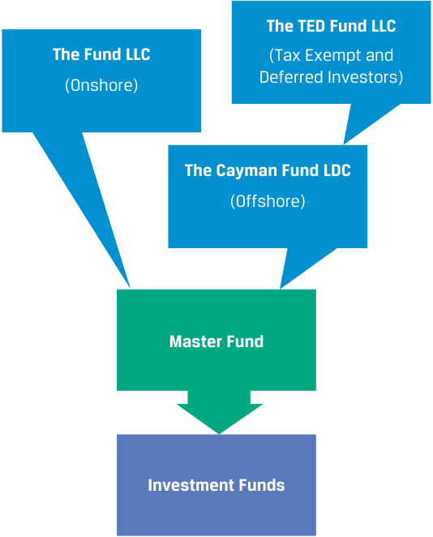
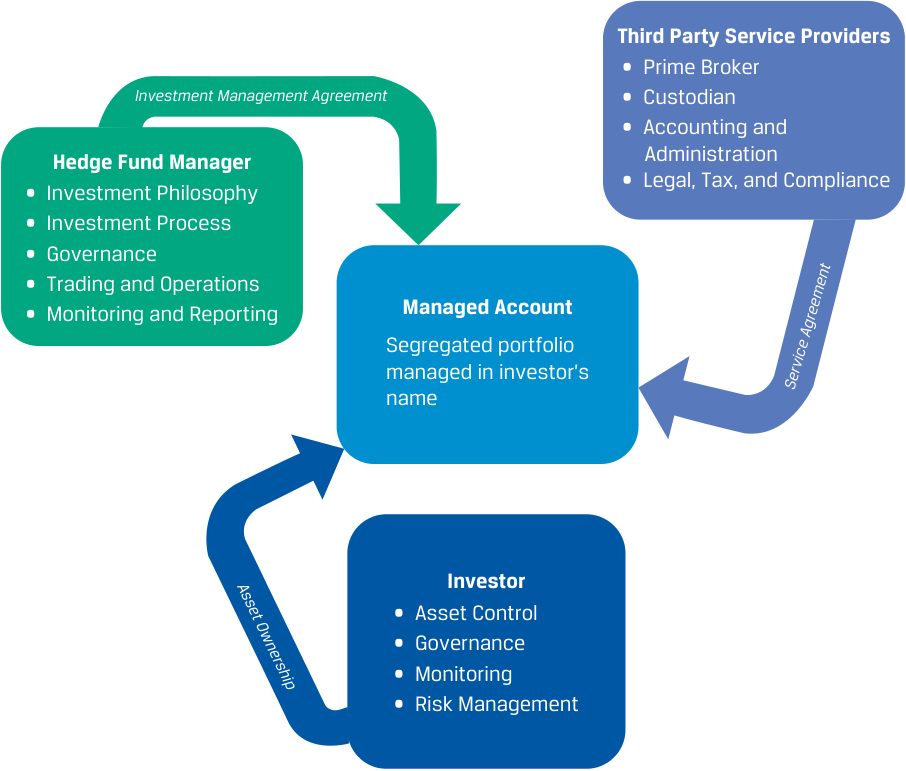
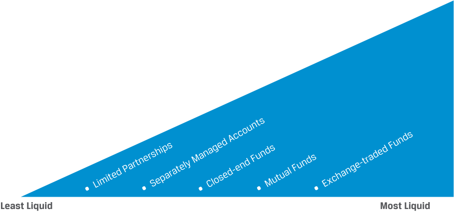
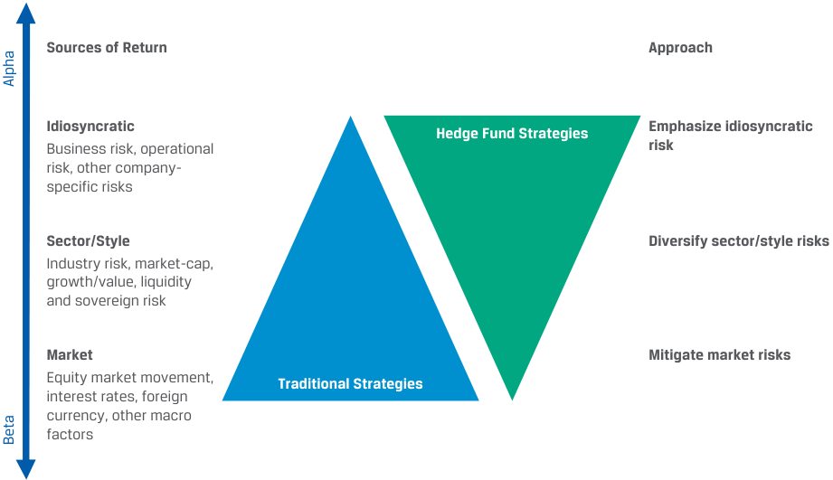

# Tập 8: Đầu tư Thay thế (Alternative Investments)
## Learning Module 6 Hedge Funds (Trang PDF 155–186)

---

# Tập 8: Đầu tư Thay thế (*Alternative Investments*)
## Học phần 6: Quỹ Phòng hộ (*Hedge Funds*)
### Phần 1/3: Giới thiệu (Trang PDF 155–167)

---

<!-- PDF Page 155 -->

#### H Ọ C P H Ầ N

# **<mark>6</mark>** 

### **Quỹ Phòng hộ (*Hedge Funds*)** 

###### **<mark>MỤC TIÊU HỌC TẬP (*LEARNING OUTCOMES*)</mark>** 

|**_Mức độ thành thạo_**|**_Ứng viên cần có khả năng:_**|
|---|---|
||giải thích các đặc điểm đầu tư của quỹ phòng hộ (*hedge funds*) và đối chiếu chúng với các loại tài sản khác|
||mô tả các hình thức và phương tiện đầu tư (*investment forms and vehicles*) được sử dụng trong đầu tư quỹ phòng hộ|
||phân tích các nguồn rủi ro, lợi nhuận và đa dạng hóa (*diversification*) giữa các khoản đầu tư quỹ phòng hộ|

##### **GIỚI THIỆU (*INTRODUCTION*)** 

## **<mark>1</mark>** 

Các quỹ phòng hộ (*hedge funds*) ban đầu khởi nguồn là một phương tiện đầu tư cổ phiếu (*equity investment vehicle*), trong đó các vị thế bán khống (*short positions*) và mua (*long positions*) bù trừ lẫn nhau nhằm bảo vệ tổng thể danh mục đầu tư trước những biến động lớn của thị trường chứng khoán. Ngày nay, tên gọi _quỹ phòng hộ_ (*hedge funds*) không còn phản ánh đúng bản chất (*misnomer*). Chúng không chỉ giới hạn ở cổ phiếu hay chỉ riêng các chiến lược phòng hộ (*hedging strategies*). Quỹ phòng hộ là các phương tiện đầu tư gộp vốn tư nhân (*private pooled investment vehicles*) có thể đầu tư vào rất nhiều loại sản phẩm đa dạng, bao gồm cổ phiếu (*equities*), thu nhập cố định (*fixed income*), công cụ phái sinh (*derivatives*), ngoại hối (*foreign exchange*), vốn tư nhân (*private capital*), và tài sản thực (*real assets*). Chính _cách tiếp cận_ đầu tư (*investment approach*) chứ không phải bản thân các tài sản cơ sở (*underlying investments*) mới là yếu tố tạo nên sự khác biệt của các quỹ phòng hộ. Nhiều quỹ phòng hộ hoạt động trên đủ mọi loại thị trường tài chính thông qua việc sử dụng đòn bẩy (*leverage*), bán khống (*short selling*), hoặc sử dụng các công cụ tài chính ít khi được dùng bởi các quỹ trộn vốn (*commingled funds*) tương tự khác như quỹ tương hỗ (*mutual funds*). Điều này có thể tạo ra một hồ sơ rủi ro và lợi nhuận (*risk and return profile*) rất khác biệt so với việc trực tiếp sở hữu chính các tài sản cơ sở đó. 

Ngành công nghiệp quỹ phòng hộ luôn ở trong trạng thái thay đổi liên tục khi có hàng trăm quỹ mới được thành lập mỗi năm, cùng với một số lượng tương đương các quỹ rút lui hoặc bị thanh lý (*liquidated*). Mặc dù nhiều khu vực pháp lý trên thế giới có quy định quản lý các quỹ phòng hộ, nhưng nhìn chung chúng thường chịu sự quản lý nhẹ nhàng hơn (*lightly regulated*) so với các phương tiện đầu tư khác. 

###### **TỔNG QUAN HỌC PHẦN (*LEARNING MODULE OVERVIEW*)** 

- Quỹ phòng hộ (*hedge funds*) là các phương tiện đầu tư tư nhân (*private investment vehicles*) gộp vốn từ các định chế tài chính (*institutions*) và các nhà đầu tư có giá trị tài sản ròng cao (*high-net-worth – HNW investors*). Quỹ phòng hộ thường có các chiến lược đầu tư linh hoạt hơn so với các lựa chọn khác như quỹ tương hỗ (*mutual funds*) và quỹ hoán đổi danh mục (*ETFs*). 

<!-- PDF Page 156 -->

- Quỹ phòng hộ không phải là một loại tài sản riêng biệt (*not an asset class*) mà là một tập hợp đa dạng các phương tiện đầu tư được dẫn dắt bởi một loạt các chiến lược đầu tư khác biệt (*disparate investment strategies*). Hầu hết các quỹ phòng hộ đều sử dụng một hình thức đòn bẩy (*leverage*) nào đó để gia tăng lợi nhuận tiềm năng. 

- Các quỹ phòng hộ thường được phân loại theo chiến lược (*classified by strategy*). Có nhiều cách phân loại khác nhau, giúp ích cho việc lựa chọn các chiến lược đầu tư phù hợp, chọn các chỉ số chuẩn đo lường hiệu quả (*performance benchmarks*) thích hợp và đánh giá hiệu quả hoạt động tổng thể (*aggregate performance*). 

- Hầu hết các quỹ phòng hộ được thành lập dưới hình thức công ty hợp danh hữu hạn (*limited partnerships*), trong đó nhà quản lý danh mục đầu tư đóng vai trò là thành viên hợp danh (*general partner* – GP) và các nhà đầu tư tổ chức đóng vai trò là thành viên góp vốn hữu hạn (*limited partners* – LPs). Đây là hình thức thiết lập quỹ phòng hộ trực tiếp (*direct form*). Đối với các nhà đầu tư nhỏ hơn và nhà đầu tư cá nhân (*retail investors*), các hình thức gián tiếp (*indirect forms*), chẳng hạn như quỹ đầu tư vào các quỹ (*funds of funds*), giúp họ tiếp cận được với khoản đầu tư quỹ phòng hộ. 

- Mối quan hệ pháp lý và hợp đồng giữa các GP và LP được điều chỉnh bởi bộ tài liệu chào bán quỹ (*fund offering documents*). Ngoài ra, nhà quản lý có thể soạn thảo một “thư thỏa thuận phụ” (*“side letter”*) chỉ áp dụng riêng cho một số nhà đầu tư nhất định, với các yêu cầu khác biệt về pháp lý, quy định quản lý, thuế, vận hành hoặc báo cáo. 

- Các quỹ phòng hộ sử dụng nhiều chiến lược, chẳng hạn như chiến lược trung lập thị trường (*market-neutral*), giá trị tương đối (*relative value*), và định hướng theo sự kiện (*event-driven strategies*), nhằm đạt được lợi ích đa dạng hóa (*diversification benefits*) và nỗ lực vượt trội hơn thị trường cổ phiếu trên cơ sở đã điều chỉnh rủi ro (*risk-adjusted basis*). 

- Các chiến lược quỹ phòng hộ được phân loại dựa trên sự kết hợp giữa các công cụ mà chúng đầu tư vào, triết lý giao dịch (*trading philosophy*) được tuân thủ, và các loại rủi ro mà chúng chấp nhận (*types of risks assumed*). 

###### **TỰ ĐÁNH GIÁ HỌC PHẦN (*LEARNING MODULE SELF-ASSESSMENT*)** 

Những câu hỏi ban đầu này nhằm giúp bạn tự đánh giá mức độ hiểu biết hiện tại của mình về học phần này. 

1. Phát biểu nào về quỹ phòng hộ (*hedge funds*) là chính xác nhất? 

   - **A.** Quỹ phòng hộ là các sản phẩm đầu tư được chào bán ra công chúng và được giao dịch hàng ngày trên thị trường phi tập trung (*OTC market*). 

   - **B.** Quỹ phòng hộ được đo lường theo một chỉ số chuẩn (*benchmarked to an index*) hoặc ngành/lĩnh vực, và các nhà quản lý sử dụng các chiến lược phức tạp để mô phỏng lại chỉ số hoặc ngành/lĩnh vực đó. 

   - **C.** Quỹ phòng hộ là các quỹ gộp vốn tư nhân (*private pooled funds*), áp dụng các chiến lược với mục tiêu tối đa hóa lợi nhuận đồng thời giảm thiểu rủi ro. 

###### **Lời giải:** 

C là đáp án đúng. Quỹ phòng hộ là một phương tiện đầu tư gộp vốn sử dụng các kỹ thuật giao dịch phức tạp (sử dụng đòn bẩy, bán khống, sử dụng công cụ phái sinh, v.v.) và quản trị rủi ro nhằm nâng cao hiệu quả hoạt động cho một nhóm tư nhân gồm các nhà đầu tư đủ điều kiện (*accredited investors*). 

A không đúng. Quỹ tương hỗ (*mutual funds*), chứ không phải quỹ phòng hộ, mới là các sản phẩm đầu tư chịu sự quản lý chặt chẽ được chào bán ra công chúng và có thể giao dịch hàng ngày. 

B không đúng. Các quỹ hoán đổi danh mục (*Exchange-traded funds* – ETFs) thường được đối chiếu theo một chỉ số chuẩn hoặc ngành/lĩnh vực và thường bám sát (*track*) một ngành hoặc chỉ số cụ thể. Các quỹ phòng hộ được đối chiếu với một chỉ số quỹ phòng hộ (*hedge fund index*) hoặc được đo lường hiệu quả bằng lợi nhuận tuyệt đối (*absolute returns*). 

<!-- PDF Page 157 -->

2. Phát biểu nào sau đây về các chiến lược giá trị tương đối (*relative value strategies*) là _kém chính xác nhất_? 

   - **A.** Các chiến lược giá trị tương đối tìm cách kiếm lời từ sự chênh lệch giá hoặc lợi nhuận (*price or return discrepancy*) giữa các chứng khoán dựa trên một mối quan hệ ngắn hạn. 

   - **B.** Các quỹ giá trị tương đối về bản chất được cấu trúc để giảm thiểu rủi ro thị trường ròng (*net market risk*) và rủi ro tín dụng (*credit risks*). 

   - **C.** Các khoản đầu tư được thực hiện theo chiến lược giá trị tương đối đều nằm trong một loại tài sản (*asset class*) hoặc một ngành duy nhất, sử dụng các tài sản có mức chênh lệch giá đủ lớn để kinh doanh chênh lệch giá (*arbitrage*) dựa trên sự dịch chuyển của chúng về mức giá cân bằng (*equilibrium prices*). 

**Lời giải:** C là đáp án đúng vì đây là phát biểu kém chính xác nhất. Các chiến lược giá trị tương đối thường bao gồm các khoản đầu tư vào nhiều loại tài sản khác nhau (*different asset classes*). A và B đều đúng. 

3. Phát biểu nào sau đây là _kém chính xác nhất_ về các quỹ phòng hộ? 

   - **A.** Các chiến lược kinh doanh chênh lệch giá trong sáp nhập (*merger arbitrage strategies*) nhìn chung giả định rằng bên mua (*acquirer*) sẽ trả giá quá cao (*overpaying*) cho công ty mục tiêu (*target*). 

   - **B.** Các quỹ phòng hộ định hướng theo sự kiện (*event-driven hedge funds*) phát triển mạnh trong môi trường thị trường ổn định, nơi những sai lệch nhỏ về giá tài sản nhanh chóng hội tụ về mức cân bằng. 

   - **C.** Một chiến lược cổ đông tích cực (*activist strategy*) kỳ vọng sẽ hiện thực hóa được lợi nhuận cao hơn nhờ việc nhà quản lý hoạt động hiệu quả hơn trong việc thúc đẩy các chính sách doanh nghiệp hoặc định hướng chiến lược của khoản đầu tư. 

**Lời giải:** B là đáp án đúng vì đây là phát biểu kém chính xác nhất. Các quỹ phòng hộ định hướng theo sự kiện (*event-driven hedge funds*) phát triển mạnh trong môi trường thị trường đang lên (*rising market environment*) với mức độ hoạt động doanh nghiệp sôi động trong một nền kinh tế vững mạnh. Đây là những thời điểm thúc đẩy mạnh mẽ hoạt động mua bán và sáp nhập (*merger and acquisition activity*). A và C là các phát biểu chính xác. 

4. Điều nào sau đây _không phải_ là một đặc điểm của quỹ phòng hộ? 

   - **A.** Quỹ phòng hộ phần lớn kém thanh khoản (*illiquid*), với rất ít khả năng giao dịch. 
   - **B.** Các nhà quản lý quỹ phòng hộ sử dụng đòn bẩy (*leverage*); tuy nhiên, rủi ro tổng thể lại thấp hơn. 
   - **C.** Quỹ phòng hộ là một loại tài sản khác biệt (*different asset class*), với một hồ sơ rủi ro/lợi nhuận (*risk/reward profile*) riêng biệt. 
   - **D.** Các nhà quản lý đòi hỏi mức thù lao cao hơn và có quyền tự quyết (*discretionary freedom*) lớn hơn trong việc lựa chọn các khoản đầu tư. 

**Lời giải:** C là đáp án đúng. Các quỹ phòng hộ đầu tư vào các loại tài sản truyền thống nhưng sử dụng một chiến lược đầu tư cụ thể. Chúng không phải là một loại tài sản riêng biệt (*not a distinct asset class*). 

5. Vào tháng Giêng, HedgeAway, một quỹ phòng hộ mới, bắt đầu đi vào hoạt động với số vốn ban đầu là 100 triệu USD. Quỹ thu phí quản lý (*management fee*) 1,6% tính trên giá trị cuối năm (*end-of-year value*) và phí hiệu quả hoạt động (*performance fee*) 18% tính trên lợi nhuận gộp (*gross returns*) phải trả cho phần vượt quá tỷ suất ngưỡng (*hurdle rate*) 8% sau khi trừ phí quản lý (*after fees*). Quỹ kết thúc năm với tổng tài sản đang quản lý (*assets under management* – AUM) là 120 triệu USD. Tỷ suất sinh lợi của các nhà đầu tư trong năm đó là bao nhiêu? 

   - **A.** 16,38% 
   - **B.** 18,08% 

<!-- PDF Page 158 -->

   - **C.** 18,19% 

**Lời giải:** 

A là đáp án đúng. 

$$\text{Phí quản lý (Management fee)} = 1,6\% \times 120\text{ triệu} = 1,92\text{ triệu USD}.$$

$$\text{Mức tăng trưởng trong năm} = 20\text{ triệu USD}, \quad \text{phần vượt quá tỷ suất ngưỡng (excess over the hurdle)}$$

$$= 20\text{ triệu} - (100\text{ triệu} \times 0,08) - 1,92\text{ triệu} = 10,08\text{ triệu USD}.$$

$$\text{Phí hiệu quả hoạt động (Performance fee)} = 10,08\text{ triệu} \times 0,18 = 1,81\text{ triệu USD (chính xác là } 1,8144\text{ triệu USD)}.$$

$$\text{Tổng phí (Total fees)} = 1,92\text{ triệu} + 1,81\text{ triệu} = 3,72\text{ triệu USD (làm tròn từ } 3,7344\text{ triệu USD)}.$$

$$\text{Lợi nhuận cho các nhà đầu tư (Return to the investors)} = 20\text{ triệu} - 3,72\text{ triệu} = 16,38\text{ triệu USD}.$$

$$\text{Tỷ suất sinh lợi của nhà đầu tư (Investors' return)} = 16,38\%.$$

## **<mark>2</mark> CÁC ĐẶC ĐIỂM ĐẦU TƯ CỦA QUỸ PHÒNG HỘ (*HEDGE FUND INVESTMENT FEATURES*)** 

**Mục tiêu học tập:** Giải thích các đặc điểm đầu tư của quỹ phòng hộ và đối chiếu chúng với các loại tài sản khác.

Là các phương tiện đầu tư tư nhân (*private investment vehicles*), các quỹ phòng hộ được phân biệt bởi cách tiếp cận đầu tư (*investment approach*) hơn là bởi bản thân các tài sản cơ sở (*underlying investments*). Các quỹ phòng hộ kết hợp các công cụ nợ và vốn cổ phần truyền thống với đòn bẩy (*leverage*), công cụ phái sinh (*derivatives*), bán khống (*short selling*), và các chiến lược khác nhằm tạo ra và gia tăng tỷ suất sinh lợi của mình. Mục tiêu của một quỹ phòng hộ là tạo ra lợi nhuận cao, xét theo nghĩa tuyệt đối (*absolute sense*) hoặc trên cơ sở đã điều chỉnh rủi ro (*risk-adjusted basis*) tương quan với mức độ biến động ở cấp độ danh mục (*portfolio-level volatility*) của nó. Các chiến lược mà quỹ phòng hộ sử dụng có thể khiến việc đo lường hiệu quả hoạt động của chúng so với các chỉ số chuẩn truyền thống (*traditional index performance benchmarks*) trở nên khó khăn. Do đó, nhiều quỹ phòng hộ đánh giá hiệu quả hoạt động của mình bằng một tiêu chuẩn lợi nhuận tuyệt đối (*absolute return standard*) thay vì bám sát một chỉ số chuẩn (*tracking a benchmark*). Các quỹ phòng hộ hấp dẫn nhờ hiệu ứng đa dạng hóa (*diversification effects*) bởi vì lợi nhuận của chúng thường thể hiện mức tương quan thấp (*low correlation*) với hoạt động đầu tư tài sản truyền thống. 

Các quỹ phòng hộ thông thường áp dụng những nguyên tắc chung mà nhìn bề ngoài có vẻ làm gia tăng rủi ro danh mục đầu tư, chẳng hạn như vay tiền để đầu tư, sử dụng đòn bẩy (công cụ phái sinh), và bán khống. Nếu xét riêng lẻ từng công cụ, chúng không hề phòng hộ (*hedge*) các vị thế rủi ro trước một biến động của thị trường; ngược lại, chúng dường như còn khuếch đại rủi ro (*amplify the risks*). Có vẻ như cái tên _quỹ phòng hộ_ (*hedge funds*) là một cách gọi sai bản chất (*misnomer*). Tuy nhiên, chiến lược đầu tư này phân tách một danh mục sao cho mỗi cấu phần giúp phòng hộ rủi ro từ cấu phần kia. Nhờ vậy, bằng cách trung hòa rủi ro thị trường (*internally neutralizing market risk*) từ bên trong và quản lý các cấu phần danh mục, nhà quản lý quỹ phòng hộ có thể đạt được tỷ suất sinh lợi đã điều chỉnh rủi ro vượt trội hơn (*enhanced risk-adjusted returns*). 

Mặc dù các quỹ tương hỗ (*mutual funds*) và quỹ phòng hộ có vẻ giống nhau ở điểm cả hai đều đầu tư tiền của khách hàng để đạt được hồ sơ rủi ro/lợi nhuận tốt hơn, nhưng giữa chúng có một số khác biệt lớn. Các nhà quản lý quỹ tương hỗ được trả một khoản thù lao cố định (*fixed compensation*) và không nhất thiết phải đầu tư tiền cá nhân vào các quỹ mà họ quản lý. Các nhà quản lý quỹ phòng hộ được trả một khoản phí dựa trên hiệu quả hoạt động (*performance-based fee*), và nhiều quỹ yêu cầu các nhà quản lý phải tự bỏ vốn đầu tư vào chính quỹ phòng hộ đó. Một số quỹ phòng hộ kết hợp điều khoản mức đỉnh cao nhất (*high-water mark*), theo đó nhà quản lý sẽ chỉ nhận được phí hiệu quả hoạt động khi tỷ suất sinh lợi vượt qua mức giá trị cao nhất trước đó của quỹ. 

<!-- PDF Page 159 -->

Thông thường, các nhà quản lý quỹ phòng hộ có quyền tự do rất lớn (*great deal of freedom*) trong việc đưa ra các quyết định giao dịch và quyết định cách thức phân bổ nguồn vốn của khách hàng. Các quỹ tương hỗ chịu sự quản lý rất chặt chẽ (*highly regulated*) vì chúng được chào bán cho các nhà đầu tư đại chúng (*public investors*). Trong khi đó, các quỹ phòng hộ chỉ dành riêng cho các nhà đầu tư tổ chức (*institutional investors*) và các nhà đầu tư đủ điều kiện (*accredited investors*). 

Các quỹ phòng hộ khác với các loại quỹ khác, chẳng hạn như quỹ tương hỗ (*mutual funds*), quỹ ETF, quỹ trái phiếu (*bond funds*), và quỹ tín thác đầu tư bất động sản (*REITs*), ở chỗ quỹ phòng hộ thuộc sở hữu tư nhân (*privately owned*). Và không giống như nhiều quỹ trong số này, các quỹ phòng hộ chịu sự quản lý pháp lý nhẹ nhàng (*lightly regulated*). Chúng cũng khác với các quỹ vốn cổ phần tư nhân (*private equity funds*) ở điểm các quỹ phòng hộ thường có thời hạn đầu tư ngắn hơn (*shorter time horizon*) và đầu tư vào các loại tài sản có tính thanh khoản cao hơn (*more liquid asset classes*). 

Các quỹ phòng hộ lựa chọn các khoản đầu tư từ một hoặc nhiều loại tài sản (cổ phiếu, tín dụng, thu nhập cố định, hàng hóa, hợp đồng tương lai, ngoại hối, các khoản cho vay, và đôi khi cả các tài sản hữu hình (*hard assets*) như bất động sản). Một số quỹ phòng hộ triển khai các chiến lược tập trung vào một loại tài sản cụ thể, trong khi những quỹ khác kết hợp nhiều loại tài sản. Các quỹ phòng hộ cũng có thể tập trung theo khu vực địa lý (*geographically focused*) hoặc không phân biệt địa lý (*agnostic*) và triển khai các chiến lược của mình trên khắp các khu vực địa lý khác nhau. 

Đòn bẩy (*leverage*)—thông qua bán khống (*short selling*), vay nợ (*borrowing*), hoặc công cụ phái sinh (*derivatives*) và đôi khi kết hợp cả ba—thường được các quỹ phòng hộ sử dụng để gia tăng lợi nhuận. Vì đòn bẩy thường là một cấu phần cốt lõi của chiến lược, các quỹ phòng hộ cần phải liên tục giám sát giá trị các mức tiếp xúc rủi ro (*exposures*) của mình. Điều này đặc biệt quan trọng khi một quỹ phòng hộ nắm giữ cả vị thế mua (*long*) và vị thế bán (*short*) (khi có thể) chỉ bằng cách sử dụng duy nhất các công cụ phái sinh. 

Các quỹ phòng hộ thường được phân loại theo chiến lược. Một cách phân loại như vậy bao gồm năm nhóm chiến lược lớn (*five broad categories of strategies*): 

- quỹ phòng hộ cổ phiếu (*equity hedge funds*), 

- quỹ phòng hộ định hướng theo sự kiện (*event-driven hedge funds*), 

- quỹ phòng hộ giá trị tương đối (*relative value hedge funds*), 

- quỹ phòng hộ cơ hội (*opportunistic hedge funds*), và 

- quỹ phòng hộ đa nhà quản lý (*multi-manager hedge funds*). 

Nhiều quỹ phòng hộ giao dịch nợ chính phủ và nợ doanh nghiệp (*sovereign and corporate debt*), hàng hóa (*commodities*), hợp đồng tương lai (*futures contracts*), quyền chọn (*options*), công cụ phái sinh (*derivatives*), và thậm chí cả các khoản đầu tư bất động sản. Tuy nhiên, không phải tất cả các quỹ phòng hộ đều duy trì vị thế bán khống hoặc sử dụng đòn bẩy. Thay vào đó, nhiều quỹ chỉ đơn giản là khai thác các lĩnh vực chuyên môn ngách (*niche areas of expertise*) một cách tinh vi; việc phòng hộ và sử dụng đòn bẩy có thể có hoặc không. Cuối cùng, có các quỹ đầu tư vào các quỹ phòng hộ (*funds of hedge funds*) giúp tạo ra một danh mục đa dạng hóa gồm nhiều quỹ phòng hộ. Các phương tiện này hấp dẫn đối với các nhà đầu tư nhỏ hơn, những người không có đủ nguồn lực để tự lựa chọn từng quỹ phòng hộ riêng lẻ và xây dựng một danh mục từ chúng. 

Việc phân loại quỹ phòng hộ cho phép các nhà đầu tư xem xét dữ liệu hiệu quả hoạt động tổng hợp (*aggregate performance data*), lựa chọn các chiến lược để xây dựng một danh mục các quỹ, và lựa chọn hoặc xây dựng các chỉ số chuẩn đo lường hiệu quả (*performance benchmarks*) phù hợp. Bảng 1 (*Exhibit 1*) trình bày các ví dụ về năm nhóm chiến lược quỹ phòng hộ lớn đã đề cập ở trên. 

**Bảng 1: Các Chiến lược Quỹ Phòng hộ (*Exhibit 1: Hedge Fund Strategies*)** 

|**Cổ phiếu (*Equity*)**|**Định hướng theo sự kiện (*Event Driven*)**|**Giá trị tương đối (*Relative Value*)**|**Cơ hội (*Opportunistic*)**|**Đa nhà quản lý (*Multi-Manager*)**|
|---|---|---|---|---|
|Mua/Bán khống Cổ phiếu (*Long/Short Equity*)|Kinh doanh chênh lệch giá trong Sáp nhập (*Merger Arbitrage*)|Kinh doanh chênh lệch giá Trái phiếu chuyển đổi (*Convertible Bond Arbitrage*)|Vĩ mô Toàn cầu (*Global Macro*)|Quỹ của các Quỹ (*Fund of Funds*)|
|Thiên về Bán khống (*Short Biased*)|Nợ xấu/Khủng hoảng (*Distressed*)|Kinh doanh chênh lệch giá Thu nhập cố định (*Fixed-Income Arbitrage*)|Hợp đồng Tương lai có Quản lý (*Managed Futures*)||
|Trung lập Thị trường (*Market Neutral*)|Tình huống Đặc biệt (*Special Situations*) Cổ đông Tích cực (*Activist*)|Đa Chiến lược (*Multi-Strategy*)|||

<!-- PDF Page 160 -->

###### **Các Chiến lược Quỹ Phòng hộ Cổ phiếu (*Equity Hedge Fund Strategies*)** 

Việc phòng hộ các vị thế mua (*long positions*) thông qua bán khống (*short selling*) có thể được xem là phân nhóm quỹ phòng hộ nguyên thủy nhất. Các quỹ cổ phiếu mua/bán khống (*long/short equity funds*) tập trung vào các thị trường cổ phiếu đại chúng (*public equity markets*) và thực hiện các vị thế mua và bán khống đối với cổ phiếu và các chứng khoán phái sinh trên cổ phiếu (*equity derivative securities*). Hầu hết các chiến lược phòng hộ cổ phiếu sử dụng cách tiếp cận đặc thù theo từng chứng khoán “từ dưới lên” (*“bottom-up” security-specific approach*)—phân tích ở cấp độ công ty, tiếp theo là phân tích tổng thể ngành, rồi đến phân tích tổng thể thị trường—với mức độ tiếp xúc vị thế mua và bán khống tương đối cân bằng. Ngược lại, cách tiếp cận “từ trên xuống” (*“top-down” approach*) bao gồm việc phân tích vĩ mô toàn cầu, tiếp theo là phân tích lĩnh vực/khu vực, rồi đến phân tích từng công ty riêng lẻ hoặc bất kỳ cách tiếp cận định thời điểm thị trường (*market-timing approach*) nào. Một số chiến lược cổ phiếu mua/bán khống có thể sử dụng các công cụ phòng hộ bán khống dựa trên chỉ số (*index-based short hedges*) để giảm rủi ro thị trường hoặc bán khống từng cổ phiếu đơn lẻ (*single-name shorts*) để tạo ra alpha cho danh mục và gia tăng lợi nhuận tuyệt đối (*added absolute return*). Sau đây là các ví dụ về các chiến lược phòng hộ cổ phiếu. 

- **Mua/bán khống cơ bản (*Fundamental long/short*)**: Trong chiến lược này, quỹ phòng hộ thực hiện các vị thế mua (*long positions*) ở những công ty đang giao dịch ở mức giá rẻ so với giá trị nội tại tiềm năng (*potential intrinsic value*) của chúng và bán khống (*shorts*) những công ty giao dịch theo chiều hướng ngược lại, với ý định sẽ đảo ngược giao dịch này (*reversing this trade*) để thu về hệ số alpha. 

Trong mọi trường hợp, chiến lược này thực hiện vị thế mua đối với những chứng khoán (mua cổ phiếu hoặc quyền chọn mua – *call options*) có mức định giá đang bị thị trường đánh giá thấp/định giá thấp (*underestimated/undervalued*) hoặc có tiềm năng tăng trưởng mà thị trường chưa nhận diện được. Chiến lược này đồng thời cũng bán khống các cổ phiếu hoặc một chỉ số để giảm thiểu rủi ro. Nhà quản lý thường duy trì một mức tiếp xúc ròng thiên về vị thế mua (*net long exposure*) nhưng có thể điều chỉnh lượng rủi ro thị trường ròng (*net market risk*) tùy thuộc vào dự báo thị trường của mình. Hầu hết các quỹ phòng hộ sử dụng chiến lược mua/bán khống đều có xu hướng thiên về mua (*long bias*), điều này giúp phân biệt chiến lược này với chiến lược thiên về bán khống (*short bias strategy*). 

- **Tăng trưởng cơ bản (*Fundamental growth*)**: Các chiến lược này sử dụng phân tích cơ bản (*fundamental analysis*) để xác định những công ty được kỳ vọng sẽ thể hiện mức tăng trưởng cao và tăng giá vốn (*capital appreciation*). Quỹ phòng hộ sẽ thực hiện vị thế mua đối với các cổ phiếu này. Quỹ sẽ bán khống những công ty có mô hình kinh doanh đang chịu áp lực suy giảm và được kỳ vọng sẽ có mức tăng trưởng thấp hoặc âm và chịu sự sụt giảm giá vốn (*capital depreciation*). Trên thực tế, mức chênh lệch (*spread*) giữa kỳ vọng tăng trưởng và giá trị sẽ dẫn dắt chiến lược đầu tư và hiệu quả hoạt động của danh mục. Hầu hết các danh mục này có xu hướng nghiêng về vị thế mua (*long biased*); do đó, chúng có thể không trung lập với thị trường (*not market neutral*) và lợi nhuận của chúng có thể thể hiện một hệ số beta khác không (*non-zero beta*). 

- **Giá trị cơ bản (*Fundamental value*)**: Các chiến lược này sử dụng phân tích cơ bản để xác định những công ty đang bị định giá thấp và không được ưa chuộng (*undervalued and unloved companies*) nhưng có khả năng phục hồi và xoay chuyển tình thế doanh nghiệp (*corporate turnaround*), với sự tăng trưởng doanh thu và dòng tiền trong tương lai sẽ dẫn đến mức định giá cao hơn. Quỹ phòng hộ thực hiện các vị thế mua ở những công ty này để nắm bắt sự tăng giá cổ phiếu dự kiến trong tương lai. Trên thực tế, chính mức chênh lệch giữa kỳ vọng giá trị và tăng trưởng là động lực thúc đẩy hiệu quả hoạt động của danh mục. 

- **Thiên về bán khống (*Short biased*)**: Các chiến lược này sử dụng phân tích định lượng (*quantitative*), phân tích kỹ thuật (*technical*), và phân tích cơ bản (*fundamental analysis*) để bán khống các chứng khoán vốn cổ phần đang bị định giá quá cao (*overvalued equity securities*) với mức độ tiếp xúc ở phía vị thế mua rất hạn chế hoặc không có (*limited or no long-side exposures*). Các nhà quản lý thường thực hiện phân tích cơ bản mang tính điều tra sâu (*forensic*) và đôi khi cố gắng vạch trần những sai sót về kế toán hoặc kinh doanh chưa được nhận diện trước đó. Kỳ vọng đặt ra là giá cổ phiếu của công ty sẽ sụt giảm và từ đó cải thiện khả năng sinh lời cho danh mục của quỹ. Các quỹ này thay đổi mức độ tiếp xúc bán khống của mình theo thời gian. Các nhà quản lý thiên về bán khống có xu hướng đi ngược đám đông (*contrarian*); họ bán khống cổ phiếu của những công ty mà nhìn bề ngoài vẫn đang thành công. Các quỹ này có thể là sự bổ sung hữu ích cho các danh mục đầu tư lớn hơn trong những giai đoạn thị trường căng thẳng (*periods of market stress*). Tuy nhiên, các nhà quản lý thiên về bán khống nhìn chung đã gặp nhiều khó khăn trong việc ghi nhận mức lợi nhuận dài hạn có ý nghĩa trong suốt 30 năm qua khi điều kiện thị trường nhìn chung là tích cực. 

<!-- PDF Page 161 -->

- **Trung lập thị trường (*Market neutral*)**: Các chiến lược này sử dụng phân tích định lượng, cơ bản và kỹ thuật để xác định các chứng khoán vốn cổ phần đang bị định giá thấp và định giá cao. Quỹ phòng hộ thực hiện các vị thế mua đối với các chứng khoán bị định giá thấp và các vị thế bán khống đối với các chứng khoán bị định giá cao, đồng thời tìm cách duy trì một vị thế ròng trung lập với thị trường (*market-neutral net position*). Lý tưởng nhất là nhà quản lý đạt được một hệ số beta tổng thể so với thị trường xấp xỉ bằng không (*overall beta relative to the market close to zero*). 

Mục đích là nhằm kiếm lời từ sự biến động của từng chứng khoán riêng lẻ—những chứng khoán bị định giá thấp tăng giá và những chứng khoán bị định giá cao giảm giá—trong khi tránh được những biến động của thị trường chung. Để đạt được một mức tỷ suất sinh lợi có ý nghĩa, các danh mục trung lập thị trường có thể đòi hỏi phải áp dụng đòn bẩy (*application of leverage*). Các danh mục này nhìn chung tìm kiếm mức lợi nhuận ổn định ở mức một chữ số (*single-digit returns*) độc lập với thị trường (trung lập thị trường), nhưng bởi vì đòn bẩy được sử dụng để khuếch đại lợi nhuận, các quỹ này có thể phảiเผชิญ với rủi ro cao hơn trong những giai đoạn biến động bất ngờ (*unexpected volatility*) trừ khi họ cắt giảm đòn bẩy của mình. 

###### **VÍ DỤ 1 (*EXAMPLE 1*)** 

###### **Tenderledge Investments LLC—Các Chiến lược Cổ phiếu (*Equity Strategies*)** 

Tenderledge Investments, một quỹ phòng hộ đầu tư vào các quỹ (*fund-of-funds hedge fund*), đang đối chiếu chuẩn (*benchmarking*) hiệu quả hoạt động của các chiến lược cổ phiếu khác nhau được đo lường bằng tỷ suất sinh lợi hàng tháng của quỹ phòng hộ trong giai đoạn 10 năm, được thể hiện trong các bảng dưới đây. 

|**Các Chiến lược Cổ phiếu:** **Lợi nhuận Hàng tháng (*Monthly Returns*)**|**Chỉ số Thị trường (*Market Index*)**|**Giá trị Cơ bản (*Fundamental Value*)**|**Trung lập Thị trường (*Market Neutral*)**|**Tăng trưởng Cơ bản (*Fundamental Growth*)**|**Thiên về Bán khống (*Short Bias*)**|
|---|---|---|---|---|---|
|Trung bình (*Average*)|0,30%|0,03%|−0,04%|0,03%|−0,5%|
|Độ lệch chuẩn (*Standard deviation*)|2,0%|1,0%|0,5%|1,5%|2,3%|
|Hệ số biến thiên (*Coefficient of variation*)|14,8%|2,6%|−7,4%|1,9%|−20,1%|
|Tối đa (*Max.*)|5,2%|2,2%|1,0%|3,5%|7,2%|
|Tối thiểu (*Min.*)|−8,1%|−4,0%|−2,7%|−10,4%|−11,3%|

|**Các Chiến lược Cổ phiếu:** **Hệ số Tương quan của Lợi nhuận Hàng tháng (*Correlation of Monthly Returns*)**|**Chỉ số Thị trường (*Market Index*)**|**Giá trị Cơ bản (*Fundamental Value*)**|**Trung lập Thị trường (*Market Neutral*)**|**Tăng trưởng Cơ bản (*Fundamental Growth*)**|**Thiên về Bán khống (*Short Bias*)**|
|---|---|---|---|---|---|
|Chỉ số Thị trường (*Market Index*)|1,00|||||
|Giá trị Cơ bản (*Fundamental Value*)|0,80|1,00||||
|Trung lập Thị trường (*Market Neutral*)|0,22|0,24|1,00|||
|Tăng trưởng Cơ bản (*Fundamental Growth*)|0,67|0,64|0,38|1,00||
|Thiên về Bán khống (*Short Bias*)|−0,72|−0,53|−0,23|−0,60|1,00|

Chỉ số thị trường (*market index*), được đo lường bởi Chỉ số S&P 500, đã vượt trội hơn từng chiến lược xét cả về mặt tuyệt đối (đo bằng lợi nhuận hàng tháng trung bình) lẫn về mặt tương đối (đo bằng hệ số biến thiên của lợi nhuận – *coefficient of variation of returns*). Hơn nữa, việc phân tích hệ số tương quan giữa các chiến lược này cho thấy chiến lược giá trị cơ bản (*fundamental value*) và tăng trưởng cơ bản (*fundamental growth*) đã thể hiện mức tương quan cao với chỉ số thị trường. 

Các quỹ trung lập thị trường (*market-neutral funds*) có mức tương quan dương thấp nhất với chỉ số thị trường, phản ánh thực tế rằng các chiến lược này hướng tới việc tạo ra lợi nhuận mà không cần gánh chịu mức tiếp xúc rủi ro ở cấp độ thị trường (*market-level exposure*). Đúng như dự kiến, các quỹ thiên về bán khống (*short-bias funds*) có tương quan âm với các chiến lược khác. Lưu ý rằng trong các khung thời gian ngắn, các chiến lược thiên về bán khống có tương quan âm với các chiến lược dựa trên chỉ số thị trường. Tuy nhiên, trong dài hạn, các mức tương quan tương tự có thể không còn duy trì được. 

<!-- PDF Page 162 -->

###### **Các Chiến lược Định hướng theo Sự kiện (*Event-Driven Strategies*)** 

Các chiến lược từ dưới lên (*bottom-up strategies*) này tìm cách kiếm lời từ những sự kiện xác định được kỳ vọng sẽ làm thay đổi mức định giá, thường liên quan đến những thay đổi trong cấu trúc doanh nghiệp (*corporate structure*), chẳng hạn như một thương vụ mua lại (*acquisition*) hoặc tái cấu trúc (*restructuring*). Các chiến lược định hướng theo sự kiện có thể bao gồm các vị thế mua và bán khống đối với cổ phiếu phổ thông và cổ phiếu ưu đãi, chứng khoán nợ, và quyền chọn. Các phân nhóm chi tiết hơn của danh mục này theo Tổ chức Nghiên cứu Quỹ Phòng hộ (*Hedge Fund Research* – HFR) bao gồm: 

- **Kinh doanh chênh lệch giá trong sáp nhập (*Merger arbitrage*)**: Nhìn chung, các chiến lược này bao gồm việc mở vị thế mua (*going long* – mua vào) cổ phiếu của công ty bị mua lại (*company being acquired*) ở một mức chiết khấu (*discount*) so với mức giá thâu tóm đã được công bố (*announced takeover price*) và mở vị thế bán khống (*going short* – bán ra) cổ phiếu của công ty đi mua lại (*acquiring company*) khi thương vụ sáp nhập hoặc mua lại được công bố. Nhà quản lý có thể kỳ vọng thu được lợi nhuận một khi mức chênh lệch giao dịch ban đầu này (*initial deal spread* – chênh lệch giá giữa bên mua và đối tượng của thương vụ mua lại) thu hẹp về mức giá trị đóng cửa của giao dịch sau khi thương vụ được hoàn tất toàn bộ (*fully consummated*). Mức chênh lệch (*spread*) này tồn tại là do yếu tố thời gian và sự không chắc chắn về việc hoàn tất thương vụ do các rào cản pháp lý và quy định quản lý, hoặc do bên mua có thể quyết định rút lui (*step away*). Việc bán khống công ty đi mua cũng là một cách để phản ánh rủi ro trả giá quá cao trong thương vụ sáp nhập (*risk of merger overpayment*). Rủi ro chính trong kinh doanh chênh lệch giá sáp nhập là việc sáp nhập đã công bố không diễn ra (*fails to occur*) và giá trị các khoản nắm giữ của quỹ bị tác động tiêu cực trước khi quỹ kịp tất toán vị thế (*unwind its position*) của mình. Vì rủi ro và lợi nhuận kỳ vọng của một chiến lược kinh doanh chênh lệch giá sáp nhập bắt nguồn từ mức chênh lệch giá khiêm tốn, đòn bẩy (*leverage*) thường xuyên được sử dụng để khuếch đại lợi nhuận nhưng đồng thời cũng làm gia tăng các khoản lỗ khi chiến lược thất bại. 

- **Nợ xấu/tái cấu trúc (*Distressed/restructuring*)**: Các chiến lược này tập trung vào chứng khoán của các công ty đang trong tình trạng phá sản hoặc được nhận định là gần phá sản (*in or perceived to be near bankruptcy*). Trong một cách tiếp cận, các quỹ phòng hộ chỉ đơn giản là mua các chứng khoán thu nhập cố định đang giao dịch ở mức chiết khấu đáng kể so với mệnh giá (*significant discount to par*) nhưng vẫn có thứ tự ưu tiên đủ cao (*senior enough*) để được đảm bảo bởi lượng tài sản doanh nghiệp đầy đủ. Kỳ vọng đặt ra là các chứng khoán này sẽ được định giá ở mức ngang mệnh giá (*at par*) hoặc ít nhất là ở một mức thặng dư đáng kể (*significant premium*) so với giá mua trái phiếu hiện tại trong một cuộc tái tổ chức hoặc thanh lý phá sản (*bankruptcy reorganization or liquidation*). Ngoài ra, một quỹ có thể mua một công cụ nợ được kỳ vọng sẽ được chuyển đổi thành vốn cổ phần mới (*new equity*) khi tiến hành tái cấu trúc hoặc phá sản, thường được gọi là _chứng khoán bản lề_ (*fulcrum security*), và sau đó tiếp tục nắm giữ cổ phiếu đó hoặc thoái vốn (*exit*). 

- **Tình huống đặc biệt (*Special situations*)**: Các chiến lược này tập trung vào các cơ hội mua vốn cổ phần của các công ty đang tham gia vào hoạt động phát hành hoặc mua lại chứng khoán (*security issuance or repurchase*), phân phối vốn đặc biệt (*special capital distributions*), tài trợ giải cứu (*rescue finance*), bán tài sản/tách công ty con (*asset sales/spin-offs*), hoặc các tình huống định hướng theo chất xúc tác (*catalyst-oriented situations*) khác. 

- **Cổ đông tích cực (*Activist*)**: Thuật ngữ “activist” là viết tắt của “cổ đông tích cực” (*“activist shareholder”*). Ở đây, các nhà quản lý nắm giữ một lượng cổ phần đủ lớn để cho phép họ tìm kiếm một chiếc ghế trong hội đồng quản trị công ty (*company board*) và gây ảnh hưởng lên các chính sách hoặc định hướng của doanh nghiệp. Họ tìm cách tạo ra những thay đổi trong kinh doanh nhằm đưa khoản đầu tư tiến tới một kết quả mong muốn. Ví dụ, một quỹ phòng hộ tích cực có thể vận động cho việc thoái vốn bộ phận (*divestitures*), tái cấu trúc, phân phối vốn cho cổ đông, hoặc thay đổi ban điều hành và chiến lược công ty có ảnh hưởng đến lượng cổ phần họ đang nắm giữ. Các quỹ phòng hộ như vậy khác biệt với các quỹ vốn cổ phần tư nhân (*private equity*) bởi vì chúng hoạt động chủ yếu trên thị trường vốn cổ phần đại chúng (*public equity market*). 

Các chiến lược định hướng theo sự kiện có xu hướng nghiêng về vị thế mua (*long biased*), trong đó chiến lược kinh doanh chênh lệch giá trong sáp nhập (*merger arbitrage*) có độ lệch mua ít nhất; thời gian để hoàn tất một giao dịch sáp nhập thường mất khoảng từ 6 đến 24 tháng, trong khi một vụ phá sản hoặc tái tổ chức có thể mất nhiều năm mới hoàn thành. 

<!-- PDF Page 163 -->

###### **VÍ DỤ 2 (*EXAMPLE 2*)** 

###### **Hoạt động Cổ đông Tích cực (*Activism*) của Carl Icahn và Hertz** 

Carl Icahn, một nhà quản lý quỹ phòng hộ theo hướng cổ đông tích cực (*activist hedge fund manager*), đã gặt hái thành công về mặt tài chính trong nhiều thương vụ mà ông nắm giữ lợi ích kiểm soát (*controlling interest*) tại các công ty nhằm định hướng hoạt động của chúng để gia tăng giá trị doanh nghiệp (*enterprise value*). Hertz, một công ty cho thuê xe hơi, là một ví dụ thú vị. Năm 2014, Icahn bắt đầu đầu tư vào Hertz và đến năm 2020 đã nắm giữ hơn 55 triệu cổ phiếu, tương đương 39% tổng số cổ phiếu phổ thông của hãng. Trong tháng 5 năm 2020, Hertz đã nộp đơn xin bảo hộ phá sản (*bankruptcy protection*) do tác động của đại dịch COVID-19 và sự sụp đổ của ngành du lịch toàn cầu. Trước khi Hertz nộp đơn xin bảo hộ phá sản, số cổ phần Icahn nắm giữ có trị giá khoảng 2,3 tỷ USD. Sau khi Hertz nộp đơn, ông đã bán toàn bộ số cổ phiếu của mình với khoản lỗ lên tới 2 tỷ USD, mặc dù ông mới chỉ mua thêm 11 triệu cổ phiếu vài tuần trước đó. 

Ban đầu, Icahn mua lại cổ phần tại Hertz bắt đầu từ năm 2014 dựa trên quan điểm của ông rằng Hertz có một thương hiệu mạnh và nền tảng vận hành tốt nhưng lại thiếu tính kỷ luật và năng lực quản trị. Và Icahn đã tích lũy một vị thế trị giá hơn 1,1 tỷ USD tại công ty tính đến cuối năm đó. Khi Icahn bước chân vào Hertz, công ty đang dần thoát ra khỏi nhiều năm chìm trong các vấn đề về vận hành, chiến lược và tài chính vốn đã làm xói mòn sức mạnh tài chính của hãng. Icahn đã đưa các thành viên hội đồng quản trị mới và một ban điều hành mới vào vị trí, những người mà trong các năm tiếp theo đã thiết lập lại kỷ luật tài khóa và vận hành. Công ty đã điều chỉnh hồi tố (*restated*) báo cáo lợi nhuận của các năm trước, hoàn tất việc tích hợp các hệ thống quản trị toàn doanh nghiệp khác nhau, và đảm bảo có được một đội ngũ quản lý đủ năng lực. Cùng thời điểm đó, ngành công nghiệp cho thuê xe hơi chịu tác động bởi hai sự dịch chuyển chiến lược: Một là sự gia tăng thị hiếu đối với dòng xe SUV, và hai là sự trỗi dậy của các ứng dụng gọi xe công nghệ (*ride-hailing apps*). Mặc dù công ty đã cho thấy doanh thu cao hơn và lợi nhuận ngày càng ổn định hơn, nhưng chi phí để khôi phục công ty đã làm xói mòn vị thế tài chính và thanh khoản của hãng. Sau khi Hertz thoát khỏi thủ tục phá sản vào tháng 7 năm 2021, Icahn vẫn tiếp tục theo dõi sát sao công ty này. 

###### **Các Chiến lược Giá trị Tương đối (*Relative Value Strategies*)** 

Các chiến lược giá trị tương đối tìm cách kiếm lời từ sự chênh lệch định giá (*pricing discrepancy*) giữa các chứng khoán có liên quan dựa trên một mối quan hệ bất thường trong ngắn hạn. Kỳ vọng đặt ra là sự chênh lệch ngắn hạn này sẽ được giải quyết theo thời gian. Các ví dụ về chiến lược giá trị tương đối bao gồm: 

- _Kinh doanh chênh lệch giá trái phiếu chuyển đổi (Convertible bond arbitrage)._ Chiến lược đầu tư mang tính trung lập thị trường về mặt lý thuyết này tìm cách khai thác sự định giá sai được nhận diện (*perceived mispricing*) giữa một trái phiếu chuyển đổi (*convertible bond*) và các cấu phần của nó: trái phiếu cơ sở (*underlying bond*) và quyền chọn mua gắn kèm (*embedded call option*). Có thể tồn tại sự định giá sai tương đối giữa vốn cổ phần và trái phiếu chuyển đổi. Chiến lược này thường bao gồm việc mua các chứng khoán nợ chuyển đổi và đồng thời bán ra một lượng cổ phiếu phổ thông nhất định của cùng tổ chức phát hành đó dựa trên hệ số delta của quyền chọn mua gắn kèm. Chiến lược này có thể nhạy cảm với rủi ro phá sản; tuy nhiên, các rủi ro này có thể được phòng hộ (*hedged away*) bằng cách sử dụng quyền chọn bán cổ phiếu (*equity put options*) hoặc các công cụ phái sinh hoán đổi rủi ro tín dụng (*credit default swap derivatives* – CDS) đối với tổ chức phát hành đó. 

- _Thu nhập cố định tổng quát (Fixed income – general)._ Các chiến lược này tập trung vào giá trị tương đối bên trong các thị trường thu nhập cố định, với trọng tâm là nợ chính phủ (*sovereign debt* – lãi suất giá trị tương đối) và đôi khi là việc định giá tương đối của nợ doanh nghiệp hạng đầu tư (*investment-grade corporate debt* – tín dụng giá trị tương đối). Các chiến lược có thể kết hợp các giao dịch mua–bán khống (*long–short trades*) giữa hai tổ chức phát hành khác nhau, giữa tổ chức phát hành doanh nghiệp và chính phủ, giữa các bộ phận khác nhau trong cấu trúc vốn của cùng một tổ chức phát hành, hoặc 

<!-- PDF Page 164 -->

giữa các phần kỳ hạn khác nhau trên đường cong lợi suất (*yield curve*) của một tổ chức phát hành. Ở đây, động thái của mức chênh lệch lợi suất (*spread*) và tiền tệ cùng với các cân nhắc xoay quanh hình dạng đường cong lợi suất chính phủ sẽ dẫn dắt các lựa chọn đầu tư và tỷ suất sinh lợi. 

- _Thu nhập cố định (chứng khoán đảm bảo bằng tài sản, chứng khoán đảm bảo bằng thế chấp, và lợi suất cao) (Fixed income – asset backed, mortgage backed, and high yield)._ Các chiến lược này tập trung vào giá trị tương đối của các chứng khoán có lợi suất cao hơn khác nhau, chẳng hạn như chứng khoán đảm bảo bằng tài sản (*asset-backed securities* – ABS), chứng khoán đảm bảo bằng thế chấp (*mortgage-backed securities* – MBS), các khoản vay và trái phiếu lợi suất cao (*high-yield loans and bonds*), cùng các công cụ phái sinh của chúng. Các quỹ phòng hộ tìm cách tạo ra mức lợi nhuận coupon hấp dẫn và có độ đảm bảo cao, đồng thời khai thác những sai lệch định giá tương đối về chứng khoán và chất lượng tín dụng. 

- _Đa chiến lược (Multi-strategy)._ Các chiến lược này giao dịch giá trị tương đối bên trong và xuyên suốt các loại tài sản hoặc công cụ khác nhau. Thay vì chỉ tập trung vào một loại giao dịch (ví dụ: kinh doanh chênh lệch giá trái phiếu chuyển đổi), một cơ sở giao dịch duy nhất (ví dụ: kinh doanh chênh lệch giá trong sáp nhập), hoặc một loại tài sản cụ thể (ví dụ: thu nhập cố định), chiến lược này thay vào đó tìm kiếm bất kỳ cơ hội đầu tư sẵn có nào, thường với các nhóm nhỏ (*pods*) các nhà quản lý khác nhau thực thi các cách tiếp cận thị trường độc đáo. Mục tiêu của một nhà quản lý đa chiến lược là ban đầu triển khai (và sau đó tái triển khai) nguồn vốn một cách hiệu quả và nhanh chóng qua các mảng chiến lược khác nhau khi điều kiện thị trường thay đổi. 

###### **Các Chiến lược Cơ hội (*Opportunistic Strategies*)** 

Cũng có những quỹ tập trung vào các sự kiện vĩ mô (*macro events*) và giao dịch hàng hóa (*commodity trading*). Các chiến lược này thường có thể sử dụng các chứng khoán ETF chỉ số hoặc công cụ phái sinh bên cạnh các chứng khoán riêng lẻ. 

- _Các chiến lược vĩ mô (Macro strategies)_ nhấn mạnh cách tiếp cận từ trên xuống (*top-down approach*) để xác định các xu hướng kinh tế. Các giao dịch được thực hiện trên cơ sở những biến động dự kiến của các biến số kinh tế. Nhìn chung, các quỹ này giao dịch theo cơ hội trên các thị trường thu nhập cố định, cổ phiếu, tiền tệ và hàng hóa. Các quỹ phòng hộ vĩ mô sử dụng các vị thế mua và bán khống để kiếm lời từ một quan điểm nhận định về xu hướng chung của thị trường khi nó chịu ảnh hưởng bởi các xu hướng và sự kiện kinh tế lớn. Bởi vì các quỹ này nhìn chung hưởng lợi nhiều nhất từ những giai đoạn có độ biến động cao hơn (*higher volatility*), nên các động thái can thiệp tích cực của các cơ quan quản lý quốc gia, chẳng hạn như các ngân hàng trung ương, nhằm làm dịu bớt các cú sốc kinh tế có khả năng làm thu hẹp không gian đầu tư của chúng. 

- Các quỹ _hợp đồng tương lai có quản lý (Managed futures)_ là các quỹ được quản lý chủ động thực hiện các khoản đầu tư theo xu hướng (*directional investments*) được đa dạng hóa chủ yếu trên các thị trường hợp đồng tương lai trên cơ sở các chiến lược kỹ thuật và cơ bản. Các quỹ hợp đồng tương lai có quản lý còn được gọi là các cố vấn giao dịch hàng hóa (*commodity trading advisers* – CTAs) bởi vì trong lịch sử chúng tập trung vào hợp đồng tương lai hàng hóa. Tuy nhiên, các CTA có thể bao gồm các khoản đầu tư vào nhiều loại hợp đồng tương lai đa dạng, bao gồm hàng hóa, cổ phiếu, thu nhập cố định, và ngoại hối. Các CTA nhìn chung sử dụng các mô hình đo lường xu hướng (*trends*) và đà tăng trưởng (*momentum*) qua các khung thời gian khác nhau. Các khoản đầu tư CTA có thể hữu ích cho việc đa dạng hóa danh mục, đặc biệt là trong những thời điểm điều kiện thị trường có xu hướng mạnh (*strong trending market conditions*) và nhất là trong những giai đoạn thị trường căng thẳng kéo dài khi các chiến lược cơ bản khác được dự kiến sẽ hoạt động kém hiệu quả. Người ta có thể dựa vào các CTA để kiếm lời từ việc đã mở các vị thế bán (*short positions*) trong các thị trường đang sụt giảm. Tuy nhiên, các thị trường hồi quy về giá trị trung bình (*mean-reverting markets*)—vốn có thể gây ra các tín hiệu đột phá đà giả (*false momentum breakout signals*)—có thể dẫn đến những giai đoạn sụt giảm vốn kéo dài (*extended drawdown periods*) trước khi các xu hướng mạnh xuất hiện cho CTA. Ở chừng mực mà nhiều CTA đã dịch chuyển sang giao dịch ngày càng nhiều các sản phẩm tài chính (chẳng hạn như hợp đồng tương lai chỉ số chứng khoán và hợp đồng tương lai trái phiếu), mức độ tin cậy của lợi ích đa dạng hóa từ CTA đã suy giảm. 

<!-- PDF Page 165 -->

Các quỹ hợp đồng tương lai có quản lý tập trung vào hàng hóa (*commodity-focused managed futures funds*) có tính độc đáo riêng (so với vĩ mô toàn cầu) bởi vì luôn có một sự căng thẳng về giá liên tục (*constant price tension*) giữa các nhà cung cấp và người tiêu dùng: Giá cao làm tê liệt nhu cầu (có xu hướng kéo giá xuống), và giá thấp làm đóng băng nguồn cung (và do đó đẩy giá lên). Tình huống này tạo ra một sự cân bằng độc đáo không hề có ở cổ phiếu và trái phiếu truyền thống. 

###### **Các Đặc điểm Phân biệt của Khoản Đầu tư Quỹ Phòng hộ (*Distinguishing Characteristics of Hedge Fund Investments*)** 

Các đặc điểm chính giúp phân biệt quỹ phòng hộ và các chiến lược của chúng với các khoản đầu tư truyền thống bao gồm: 

**1.** Ít chịu các ràng buộc về pháp lý và quy định quản lý hơn (*Less legal and regulatory constraints*) 

**2.** Các ủy thác đầu tư linh hoạt (*Flexible mandates*) cho phép sử dụng bán khống và công cụ phái sinh 

**3.** Một vũ trụ đầu tư rộng lớn hơn (*A larger investment universe*) để tập trung khai thác 

**4.** Phong cách đầu tư quyết liệt (*Aggressive investment styles*) cho phép nắm giữ các vị thế tập trung ở những chứng khoán mang lại sự tiếp xúc với các phần bù rủi ro tín dụng, biến động và thanh khoản (*credit, volatility, and liquidity risk premiums*) 

**5.** Sử dụng đòn bẩy tương đối tự do (*Relatively liberal use of leverage*) 

**6.** Các hạn chế về thanh khoản (*Liquidity constraints*) bao gồm thời gian khóa vốn (*lockups*) và cổng kiểm soát thanh khoản (*liquidity gates*) 

**7.** Cấu trúc phí tương đối cao (*Relatively high fee structures*) bao gồm phí quản lý và phí khuyến khích (*management and incentive fees*) 

Mặc dù các quỹ phòng hộ thường xuyên đầu tư vào các công cụ nợ hoặc vốn cổ phần được giao dịch công khai và thường sử dụng các kỹ thuật phân tích báo cáo tài chính để định giá chứng khoán, nhưng các đặc điểm về lợi nhuận và rủi ro của chúng nhìn chung khác với các quỹ ETF và quỹ tương hỗ. Một quỹ phòng hộ giá trị tương đối điển hình tạo ra lợi nhuận bằng cách sử dụng kết hợp các vị thế mua và bán khống cổ phiếu, gia tăng quy mô tài sản của mình bằng vốn vay, và triển khai các vị thế cơ hội trong các tình huống đặc biệt, nhằm tìm kiếm các hồ sơ rủi ro–lợi nhuận rất khác biệt so với các quỹ chỉ mua thông thường (*common long-only funds*). 

Các quỹ phòng hộ cũng chịu các yêu cầu nhẹ nhàng hơn nhiều về quy định quản lý, tuân thủ và tính minh bạch. Với sự linh hoạt cao hơn trong việc xây dựng danh mục đầu tư, các quỹ phòng hộ có được khoảng trống tự do để đầu tư vào những tình huống mà có thể cần nhiều thời gian mới tạo ra được mức lợi nhuận kỳ vọng và do đó không phù hợp với một quỹ tương hỗ vốn phải cung cấp thanh khoản hàng ngày. Các nhà đầu tư vào các quỹ phòng hộ hiện đại phải chịu các khoảng thời gian nắm giữ kéo dài (được gọi là _thời gian khóa vốn_ – _lockup periods_) và _thời gian thông báo trước_ (_notice periods_) tiếp theo đó trước khi có thể thực hiện rút vốn đầu tư (*investment redemption*). Một số quỹ phòng hộ giới hạn một phần việc rút vốn khỏi quỹ thông qua điều khoản cổng thanh khoản (*liquidity gate provision*) để tài sản có thể được thanh lý trong một khoảng thời gian dài hơn. So với, chẳng hạn, nhiều quỹ tương hỗ cho phép rút vốn dễ dàng hơn và đảm bảo thanh khoản chỉ sau một ngày thông báo, thì các khoảng thời gian khóa vốn và thông báo bắt buộc kéo dài như vậy cho phép các quỹ phòng hộ có sự linh hoạt cao hơn so với quỹ tương hỗ hoặc các loại hình đầu tư khác. 

Một khoản phí rút vốn (*redemption fee*) có thể được áp dụng, thường được trả cho chính bản thân quỹ (chứ không phải cho nhà quản lý) nhằm bảo vệ các nhà đầu tư còn lại trong quỹ, đặc biệt là trong những trường hợp việc rút vốn diễn ra ngay trong thời gian khóa vốn. Đặc điểm này được gọi là _khóa vốn mềm_ (_soft lockup_), và nó mở ra một con đường (dù đắt đỏ) để rút vốn sớm. 

Với việc giảm bớt các ràng buộc trong vận hành, các quỹ phòng hộ có thể tận dụng những cơ hội kém thanh khoản hơn và ít được chú ý, mà mức định giá thực sự của chúng đôi khi có thể thiếu minh bạch (*opaque*). Chẳng hạn, một số chiến lược quỹ phòng hộ—mua/bán khống, cổ đông tích cực, nợ xấu, và kinh doanh chênh lệch giá—được xây dựng dựa trên các khoản nắm giữ có mức độ tập trung cao, dài hạn và có sử dụng đòn bẩy đối với cổ phiếu, nợ và công cụ phái sinh. Việc xây dựng một mức tiếp xúc như vậy có thể mất nhiều thời gian hơn để thực thi và việc tất toán (*unwinding*) một vị thế như thế có thể rất phức tạp và tốn khá nhiều thời gian, đặc biệt là khi các thị trường tài chính đang chịu sự căng thẳng nhất thời (*transitory stress*). Đó là lý do tại sao các hạn chế đối với việc _rút vốn_ (_redemptions_) thường được áp đặt. 

Ngoài ra còn có sự suy giảm tính minh bạch (*reduced transparency*) đối với các khoản đầu tư quỹ phòng hộ phức tạp hơn và tình trạng thông tin bất cân xứng (*asymmetric information*) giữa nhà quản lý và nhà đầu tư. Điều này dẫn đến các khoản phí hiệu quả hoạt động dựa trên sự khuyến khích (*incentive-based performance fees*) nhằm thu hẹp khoảng cách lợi ích giữa nhà quản lý và nhà đầu tư. Các nhà đầu tư tìm kiếm mức lợi nhuận cao, và việc chia sẻ một phần tỷ lệ trong mức lợi nhuận cao này cho các nhà quản lý sẽ tạo động lực khuyến khích các nhà quản lý hoạt động vì lợi ích của các 

<!-- PDF Page 166 -->

cổ đông. Các quỹ phòng hộ nhìn chung được coi là rủi ro hơn xét từ góc độ giám sát (rủi ro gian lận – *fraud risk*), nhưng một số quỹ phòng hộ lại chấp nhận mức rủi ro thị trường tuyệt đối (*absolute market risk*) trong việc xây dựng danh mục thấp hơn so với mức rủi ro mà các sản phẩm đăng ký chào bán cho nhà đầu tư cá nhân gánh chịu. Do đó, rủi ro thị trường thực sự của một quỹ phòng hộ và sự phân biệt của nó giữa rủi ro quy định pháp lý (*regulatory risk*) và rủi ro kém thanh khoản (*illiquidity risk*) thường có thể bị nhầm lẫn. 

Các quỹ phòng hộ nhìn chung sử dụng phương thức quản lý chủ động (*active management*) bởi các nhà quản lý giàu kinh nghiệm cùng một cách tiếp cận quản trị rủi ro tích hợp (*integrated risk management approach*). Có thể triển khai nhiều chiến lược đa dạng, khiến cho mỗi quỹ phòng hộ đều có sự khác biệt độc đáo so với các quỹ khác. Chúng có thể được tùy chỉnh theo sở thích cụ thể của từng nhà đầu tư. Chúng mang lại khả năng tạo ra hệ số alpha và tỷ suất sinh lợi đã điều chỉnh rủi ro không tương quan (*uncorrelated risk-adjusted returns*). Một số chiến lược còn triển khai các hàng rào bảo vệ (*guardrails*) để bảo hiểm trước những khoản thua lỗ lớn. Những thuộc tính như vậy giúp nhà đầu tư xây dựng một danh mục đa dạng hóa giúp ổn định sự biến động của thị trường bên trong một danh mục đa tài sản (*multi-asset class portfolio*). 

Các nhà đầu tư cần xem xét một số vấn đề khi lựa chọn một quỹ phòng hộ. Nhìn rộng ra, họ nên rà soát năng lực của thành viên góp vốn hữu hạn (*limited partner capabilities*), bao gồm khung vận hành, các thông lệ quản trị rủi ro, và việc giám sát sát sao hiệu quả hoạt động của danh mục. Đối với hiệu quả hoạt động của thành viên hợp danh (*GP performance*), nhà đầu tư nên xem xét các nguyên tắc quản lý ủy thác (*fiduciary management guidelines*), kinh nghiệm của nhà quản lý, và sự gắn kết lợi ích (*alignment of interests*) hướng tới các chiến lược của quỹ. 

Đã có khá nhiều vụ việc gian lận được báo cáo trong lĩnh vực quỹ phòng hộ, bao gồm việc dựng lên một quỹ dưới dạng mô hình lừa đảo Ponzi (*Ponzi scheme*) và báo cáo dữ liệu hiệu quả hoạt động sai sự thật. Một số quỹ phòng hộ có các chiến lược phức tạp đã bị sụp đổ trong giai đoạn thị trường hỗn loạn. Sự giám sát pháp lý giảm nhẹ, cùng với số vốn đầu tư lớn thường được yêu cầu để tham gia vào một quỹ phòng hộ, đã mở đường cho một số nhà quản lý quỹ vô đạo đức lợi dụng lòng tin của các nhà đầu tư dành cho họ. 

Khi đánh giá khoản đầu tư, nhà đầu tư cần tính đến chiến lược, tính minh bạch, tính thanh khoản và các thông lệ báo cáo của quỹ. Ngoài ra, nhà đầu tư cần đánh giá kỹ lưỡng hiệu quả hoạt động trong quá khứ của nhà quản lý quỹ và nắm rõ cách thức quỹ trả thù lao cho các nhà quản lý quỹ cũng như cách tính toán các khoản phí thu từ nhà đầu tư. 

###### **BỘ CÂU HỎI (*QUESTION SET*)** 

1. Cả quỹ phòng hộ (*hedge funds*) và quỹ vốn cổ phần tư nhân (*private equity*) đều đầu tư vào cổ phiếu của các doanh nghiệp đại chúng hoặc tư nhân, và có nhiều điểm tương đồng giữa chúng. Các phát biểu sau đây nêu lên một số điểm tương đồng, và một trong các phát biểu này là sai. Hãy chọn phát biểu _sai_. 

   - **A.** Cả hai đều được cấu trúc dưới dạng công ty hợp danh (*partnerships*) của các nhà đầu tư với hình thức gộp vốn tư nhân và chủ yếu dành cho các cá nhân có giá trị tài sản ròng cao (*high-net-worth individuals*). 

   - **B.** Cả hai đều sử dụng đòn bẩy (*leverage*) để đầu tư vào nhiều loại chứng khoán khả mại (*marketable securities*) đa dạng. 

   - **C.** Cả hai đều kém thanh khoản hơn so với quỹ tương hỗ (*mutual funds*) hoặc quỹ ETF. 

   - **D.** Cả hai đều ít chịu sự quản lý pháp lý hơn (*less regulated*), và các yêu cầu về tính minh bạch/báo cáo không quá khắt khe. 

###### **Lời giải:** 

B là phát biểu sai. Các quỹ phòng hộ thông thường đầu tư vào các chứng khoán đại chúng (bao gồm nợ, cổ phiếu và công cụ phái sinh), trong khi các quỹ vốn cổ phần tư nhân (*private equity funds*) đầu tư trực tiếp vào các công ty hoạt động tư nhân (*private operating companies*)—vốn không phải là các chứng khoán khả mại—và các công ty vốn cổ phần tư nhân cũng không áp dụng đòn bẩy vào bản thân quỹ của họ. 

2. Cả quỹ phòng hộ và quỹ vốn cổ phần tư nhân đều đầu tư vào cổ phần của các doanh nghiệp đại chúng hoặc tư nhân. Tuy nhiên, có rất nhiều điểm khác biệt giữa chúng. 

<!-- PDF Page 167 -->

Các phát biểu sau đây liệt kê một số điểm khác biệt của chúng. Hãy chọn phát biểu _sai_.

   - **A.** Các quỹ vốn cổ phần tư nhân đầu tư cho dài hạn, trong khi các quỹ phòng hộ đầu tư vào cổ phiếu cho thời hạn ngắn hơn.
   - **B.** Các quỹ phòng hộ điển hình có định hướng giao dịch (*transaction oriented*); chúng thực hiện nhiều giao dịch bù trừ lẫn nhau (*offsetting trades*). Các quỹ vốn cổ phần tư nhân thực hiện các khoản đầu tư ổn định, dài hạn vào một số ít công ty.
   - **C.** Nhà đầu tư thông thường rót vốn vào quỹ phòng hộ ngay tại thời điểm bắt đầu khoản đầu tư, trong khi các quỹ vốn cổ phần tư nhân được cam kết vốn (*committed*) lúc bắt đầu và được giải ngân theo thời gian khi có yêu cầu gọi vốn (*funded over time, upon demand*).
   - **D.** Vốn cổ phần tư nhân có thể được rút vốn định kỳ (*redeemable on a periodic basis*), trong khi các quỹ phòng hộ đòi hỏi một sự cam kết dài hạn hơn.

###### **Lời giải:**

D là lựa chọn đáp án đúng vì phát biểu này sai. Các quỹ phòng hộ có thể được rút vốn theo định kỳ (*redeemable on a periodic basis*), còn các quỹ vốn cổ phần tư nhân đòi hỏi một sự cam kết dài hạn hơn. Các phát biểu còn lại đều đúng.

3. Quỹ phòng hộ so với quỹ tương hỗ (*mutual funds*): Hãy chọn phát biểu _sai_.

   - **A.** Quỹ tương hỗ mở rộng cho bất kỳ nhà đầu tư nào và nhìn chung là các công cụ có tính thanh khoản cao hơn với những hạn chế tối thiểu đối với việc rút vốn.
   - **B.** Phí của quỹ phòng hộ thường có thể thương lượng được (*negotiable*) bởi nhà đầu tư, trong khi các quỹ tương hỗ hoạt động với cùng một mức phí áp dụng cho tất cả các nhà đầu tư.
   - **C.** Quỹ phòng hộ bị hạn chế nhiều hơn về những gì chúng có thể giao dịch so với quỹ tương hỗ.

###### **Lời giải:**

C là phát biểu sai. Các quỹ phòng hộ ít bị hạn chế hơn so với các quỹ tương hỗ về các loại chứng khoán mà chúng có thể giao dịch. Chúng cũng chịu ít yêu cầu về công bố thông tin và tính minh bạch hơn. A và B là các phát biểu đúng.

4. Có bao nhiêu phát biểu sau đây khi so sánh quỹ phòng hộ và quỹ ETF là đúng?

   1. ETF là các chứng khoán đại chúng được giao dịch trên sàn (*exchange-traded public securities*), trong khi quỹ phòng hộ là các quỹ hợp danh tư nhân (*private partnership funds*).
   2. Bất kỳ nhà đầu tư nào cũng có thể đầu tư vào một quỹ ETF, trong khi có những hạn chế cụ thể áp dụng đối với đối tượng được phép đầu tư vào một quỹ phòng hộ.
   3. Các quỹ ETF có mức phí và tỷ lệ chi phí (*expense ratios*) rất thấp so với các quỹ phòng hộ.
   4. Các quỹ ETF chịu sự quản lý rất chặt chẽ (*highly regulated*), với các yêu cầu báo cáo cụ thể, trong khi các quỹ phòng hộ chịu sự quản lý nhẹ nhàng (*lightly regulated*).

   - **A.** Một trong các phát biểu là đúng.
   - **B.** Hai trong các phát biểu là đúng.
   - **C.** Ba trong các phát biểu là đúng.
   - **D.** Bốn phát biểu đều đúng.

###### **Lời giải:**

D là đáp án đúng. Tất cả các phát biểu trên đều đúng.

---

# Tập 8: Đầu tư Thay thế (*Alternative Investments*)
## Học phần 6: Quỹ Phòng hộ (*Hedge Funds*)
### Phần 2/3: Các Hình thức Đầu tư Quỹ Phòng hộ (Trang PDF 168–182)

---

<!-- PDF Page 168 -->

5. Hãy chọn các phát biểu đúng: 

   - **A.** Các động lực chính thúc đẩy lợi nhuận từ cổ phiếu là các dự phóng tăng trưởng (*growth projections*), cổ tức (*dividends*), và lợi nhuận giữ lại (*retained earnings*). 

   - **B.** Các động lực chính thúc đẩy lợi nhuận từ một trái phiếu là lãi suất (*interest rates*), rủi ro tín dụng (*credit risk*), và các khoản thanh toán lãi coupon (*coupon payments*). 

   - **C.** Các động lực chính thúc đẩy lợi nhuận từ các quỹ phòng hộ là sự biến động của thị trường (*market volatility*) và sự kém hiệu quả của thị trường (*market inefficiency*). 

**Lời giải:** 

Cả A, B và C đều đúng. 

# **<mark>3</mark>** 

## **CÁC HÌNH THỨC ĐẦU TƯ QUỸ PHÒNG HỘ (*HEDGE FUND INVESTMENT FORMS*)** 

**Mục tiêu học tập:** Mô tả các hình thức và phương tiện đầu tư (*investment forms and vehicles*) được sử dụng trong đầu tư quỹ phòng hộ.

Một đặc điểm cấu trúc phổ biến của quỹ phòng hộ là nó được thiết lập dưới dạng một công ty hợp danh đầu tư tư nhân (*private investment partnership*) ở trong nước (*onshore*) hoặc tại một địa điểm nước ngoài có ưu đãi thuế (*tax-advantaged offshore location*). Theo một số hạn chế pháp lý nhất định (thay đổi tùy theo khu vực tài phán), đợt chào bán chỉ có thể được mở cho một số lượng giới hạn các nhà đầu tư đáp ứng các tiêu chuẩn nhất định về thu nhập và giá trị tài sản ròng (*income and net worth guidelines*). 

Các quỹ phòng hộ, giống như các quỹ vốn cổ phần tư nhân (*private equity funds*), về mặt pháp lý thường được thành lập và tổ chức dưới dạng các công ty hợp danh hữu hạn tư nhân (*private limited partnerships*) hoặc công ty trách nhiệm hữu hạn (*limited liability companies* – LLC) với một thành viên hợp danh (*general partner* – GP) hoặc thành viên quản lý (*managing member*) đóng vai trò là nhà quản lý quỹ phòng hộ (*hedge fund manager*). Công ty hợp danh hoặc thành viên quản lý nhận một khoản phí quản lý (*management fee*), và thành viên hợp danh nhận thù lao dựa trên hiệu quả hoạt động của quỹ (*compensation based on fund performance*). Các nhà đầu tư quỹ phòng hộ mua một phần vốn góp của quỹ hoặc công ty hợp danh và nhận lại một tỷ lệ phần trăm cố định trên lợi nhuận của quỹ, sau khi đã trừ đi các khoản phí áp dụng. 

Bộ tài liệu của quỹ—bản cáo bạch chào bán riêng lẻ (*private placement memorandum* – PPM), thỏa thuận hợp danh (*partnership agreement*), hoặc điều lệ công ty (*articles of incorporation*)—quy định mối quan hệ pháp lý và hợp đồng giữa nhà quản lý quỹ và nhà đầu tư vào quỹ, đồng thời tạo lập khung vận hành (*operational framework*) cho quỹ. Thông thường, các cấu trúc quỹ được thành lập dưới dạng các pháp nhân có thời hạn vĩnh viễn (*perpetual legal entities*), nhưng trên thực tế, khi các quỹ phòng hộ đóng cửa, chúng vẫn bị thanh lý (*liquidated*) một cách thường xuyên. 

### **Các Hình thức Đầu tư Quỹ Phòng hộ Trực tiếp (*Direct Hedge Fund Investment Forms*)** 

Một hình thức quỹ phòng hộ phổ biến là cấu trúc quỹ chính – quỹ vệ tinh (*master feeder structure*). Cấu trúc quỹ chính – quỹ vệ tinh được thiết lập nhằm tối ưu hóa hiệu quả về thuế (*optimum tax efficiency*) và bao gồm một quỹ vệ tinh ở nước ngoài (*offshore feeder fund*) cùng một quỹ vệ tinh ở trong nước (*onshore feeder fund*)—cả hai cùng rót vốn vào một quỹ chính (*master fund*) thực hiện đầu tư nguồn vốn dựa trên các thỏa thuận hợp danh theo hợp đồng của quỹ. Cấu trúc này được minh họa trong Bảng 2 (*Exhibit 2*). 

<!-- PDF Page 169 -->

**Bảng 2: Mẫu Cấu trúc Quỹ chính – Quỹ vệ tinh (*Exhibit 2: Sample Master-feeder Structure*)** 

<!-- Picture Text: The TED Fund LLC The Fund LLC (Tax Exempt and Deferred Investors) (Onshore) The Cayman Fund LDC (Offshore) Master Fund Investment Funds  -->

> **Chú thích hình ảnh:**
> - **The Fund LLC (Onshore):** Quỹ LLC (Trong nước)
> - **The TED Fund LLC (Tax Exempt and Deferred Investors):** Quỹ TED LLC (Dành cho các nhà đầu tư được miễn thuế và hoãn thuế)
> - **The Cayman Fund LDC (Offshore):** Quỹ Cayman LDC (Nước ngoài)
> - **Master Fund:** Quỹ chính (*Master Fund*)
> - **Investment Funds:** Các quỹ đầu tư (*Investment Funds*)

Một cấu trúc phí quỹ phòng hộ phổ biến được biết đến với tên gọi “hai và hai mươi” (*“two and twenty”*). Trong cách thiết lập này, pháp nhân hợp danh quỹ phòng hộ trực tiếp vận hành và quản trị quỹ sẽ nhận mức phí quản lý (*management fee*) là 2%. Thành viên hợp danh (*general partner* – GP), người quản lý các khoản đầu tư của quỹ, nhận 20% lợi nhuận ròng (*net profits*) của quỹ. Lợi nhuận đầu tư, sau khi trừ đi phí quản lý và phí hiệu quả hoạt động, sẽ chảy ngược về các quỹ vệ tinh (*feeder funds*) để phân phối cho các nhà đầu tư. Gần đây, cấu trúc phí này đang dần thay đổi do áp lực từ phía các nhà đầu tư. Một số quỹ mới hơn được chào bán với mức phí “1 hoặc 30” (*1 or 30*), trong đó nhà quản lý nhận mức cao hơn giữa phí quản lý 1% hoặc phí khuyến khích (*incentive fee*) bằng 30% hệ số alpha hay phần lợi nhuận vượt trội (*outperformance*) của quỹ so với một chỉ số chuẩn (*benchmark*), thay vì một khoản phí hiệu quả hoạt động chỉ đơn thuần tính trên tổng lợi nhuận. 

Bên cạnh thỏa thuận hợp danh vốn phân định rõ các trách nhiệm, các quỹ phòng hộ thường sử dụng các thư thỏa thuận phụ (*side letters*) để giải quyết các yêu cầu cụ thể về pháp lý, quy định quản lý, thuế, vận hành và báo cáo của một nhà đầu tư. Những thư thỏa thuận phụ như vậy bổ sung và đôi khi có thể thay thế (*supersede*) các điều khoản trong bộ tài liệu gốc của quỹ và thường được sử dụng khi một nhà đầu tư quỹ phòng hộ yêu cầu những nhượng bộ riêng (*concessions*) mà không cần phải sửa đổi bản cáo bạch chào bán riêng lẻ (*PPM*), thỏa thuận hợp danh hay điều lệ quỹ. Đôi khi, các quyền cụ thể được trao riêng cho một nhà đầu tư nhất định, chẳng hạn như quyền được cung cấp thông tin nâng cao (*enhanced information rights*). 

Đối với các nhà đầu tư lớn hơn, cấu trúc quỹ phòng hộ có thể là một quỹ một thành viên (*fund of one*) hoặc một tài khoản được quản lý riêng biệt (*separately managed account* – SMA). Đây là các tài khoản đầu tư tách biệt mà nhà đầu tư giữ quyền chi phối lớn hơn (*retains more influence*). Trong trường hợp cấu trúc quỹ một thành viên (*fund of one*), quỹ phòng hộ được tạo lập dành riêng cho một nhà đầu tư duy nhất; còn trong trường hợp một tài khoản SMA, nhà đầu tư tự tạo lập phương tiện đầu tư của riêng mình và các tài sản cơ sở (*underlying assets*) được nắm giữ và đăng ký dưới chính tên của nhà đầu tư đó. Tuy nhiên, việc quản lý tài khoản hàng ngày được ủy quyền cho nhà quản lý quỹ phòng hộ. Các cấu trúc này có thể đòi hỏi các thỏa thuận bổ sung và các nhà cung cấp dịch vụ (*service providers*) để vận hành một cách hiệu quả và trơn tru. Bảng 3 (*Exhibit 3*) trình bày một cấu trúc điển hình. 

<!-- PDF Page 170 -->

**Bảng 3: Tài khoản Đầu tư Quỹ Phòng hộ Được Quản lý Riêng biệt (*Exhibit 3: Separately Managed Hedge Fund Investment Account*)** 

<!-- Picture Text: Third Party Service Providers • Prime Broker Investment Management Agreement • Custodian • Accounting and Hedge Fund Manager  Administration • Legal, Tax, and Compliance • Investment Philosophy • Investment Process • Governance • Trading and Operations • Monitoring and Reporting Managed Account Segregated portfolio managed in investor’s name Investor • Asset Control • Governance • Monitoring • Risk Management Asset Ownership Service Agreement  -->

> **Chú thích hình ảnh:**
> - **Hedge Fund Manager (Nhà quản lý quỹ phòng hộ):** Triết lý đầu tư (*Investment Philosophy*), Quy trình đầu tư (*Investment Process*), Quản trị (*Governance*), Giao dịch và Vận hành (*Trading and Operations*), Giám sát và Báo cáo (*Monitoring and Reporting*). Kết nối qua **Thỏa thuận Quản lý Đầu tư (*Investment Management Agreement*)**.
> - **Managed Account (Tài khoản được quản lý):** Danh mục tách biệt được quản lý dưới tên của nhà đầu tư (*Segregated portfolio managed in investor's name*).
> - **Investor (Nhà đầu tư):** Kiểm soát tài sản (*Asset Control*), Quản trị (*Governance*), Giám sát (*Monitoring*), Quản trị rủi ro (*Risk Management*). Nắm giữ **Quyền sở hữu tài sản (*Asset Ownership*)**.
> - **Third Party Service Providers (Các nhà cung cấp dịch vụ bên thứ ba):** Kết nối qua **Thỏa thuận Dịch vụ (*Service Agreement*)**, bao gồm: Nhà môi giới chính (*Prime Broker*), Tổ chức lưu ký (*Custodian*), Kế toán và Quản trị hành chính (*Accounting and Administration*), Pháp lý, Thuế và Tuân thủ (*Legal, Tax, and Compliance*).

_Nguồn:_ KPMG. https://assets.kpmg/content/dam/kpmg/pdf/2015/09/hedge-fund-managed-accounts.pdf. 

Cấu trúc SMA cho phép tạo ra một danh mục đầu tư có thể tùy chỉnh (*customizable portfolio*), với các ủy thác đầu tư đặc thù theo yêu cầu của nhà đầu tư (*investor-specific investment mandates*), tính minh bạch tốt hơn, phân bổ vốn hiệu quả, và tính thanh khoản cao hơn, qua đó nhà đầu tư có thể thực hiện quyền kiểm soát nâng cao trong khi vẫn giữ mức phí thấp hơn. Tuy nhiên, các tài khoản SMA phức tạp hơn về mặt vận hành và cũng đòi hỏi sự giám sát quản trị (*governance oversight*) lớn hơn. Đó là lý do tại sao các tài khoản này phù hợp hơn với các nhà đầu tư tổ chức có quy mô lớn. 

Cấu trúc SMA cũng có một số nhược điểm. Không giống như một quỹ trộn vốn (*commingled fund*), các nhà quản lý không có vốn góp lợi ích (*stake*) trong các khoản đầu tư của quỹ. Các nhà đầu tư đàm phán mức phí và chi phí quỹ thấp hơn nhưng đổi lại, họ có thể chỉ nhận được sự phân bổ vào các giao dịch đầu tư có tính thanh khoản cao nhất của nhà quản lý quỹ. Do đó, động lực tổng thể của các nhà quản lý đối với hiệu quả hoạt động đầu tư có thể bị suy giảm. Việc cấu trúc thù lao nghiêng về phía phí khuyến khích (*incentive fees*) có thể giúp giảm thiểu vấn đề này. 

### **Các Hình thức Đầu tư Quỹ Phòng hộ Gián tiếp (*Indirect Hedge Fund Investment Forms*)** 

Đầu tư gián tiếp vào các quỹ phòng hộ nhằm mục đích giúp việc tiếp cận quỹ phòng hộ trở nên dễ dàng hơn đối với các nhà đầu tư tổ chức nhỏ hơn và các nhà đầu tư cá nhân lớn (*larger retail investors*), hoặc đối với những người có thể thiếu kỹ năng chuyên môn trong việc quản lý một số loại tài sản nhất định hay muốn tạo ra nhiều mức tiếp xúc đồng thời (*multiple and concurrent exposures*) với các chiến lược khác nhau. Việc lựa chọn tiếp cận gián tiếp thường được thúc đẩy bởi mong muốn giảm chi phí quản lý, tăng tính minh bạch về hiệu quả hoạt động, và cải thiện tính thanh khoản. Lựa chọn phổ biến thường là cách tiếp cận quỹ đầu tư vào các quỹ phòng hộ (*fund-of-hedge-funds approach*), tức là một danh mục được quản lý gồm nhiều quỹ phòng hộ. 

<!-- PDF Page 171 -->

Các quỹ đầu tư vào các quỹ phòng hộ (*funds of hedge funds*) gộp vốn từ các nhà đầu tư và đầu tư số tiền thu được vào một danh mục đa dạng hóa gồm các khoản đầu tư quỹ phòng hộ trải rộng trên nhiều quỹ phòng hộ khác nhau. Cách tiếp cận này mang lại lợi ích đa dạng hóa trực tiếp xuyên suốt các chiến lược quỹ, các khu vực đầu tư, và các phong cách quản lý. Các quỹ này nhìn chung đưa ra mức đầu tư tối thiểu thấp hơn (*lower investment minimums*), thời gian khóa vốn ngắn hơn (*reduced lockup periods*), và thường có thanh khoản thoái vốn tốt hơn (*better exit liquidity*). 

Đối với nhà đầu tư, tất cả những lợi ích này đi kèm với một cấu trúc phí cao hơn—thường là cộng thêm 1%—bởi vì nhà quản lý của quỹ đầu tư vào các quỹ (*fund of funds*) sẽ tính thêm phần phí của riêng mình chồng lên trên các khoản phí quản lý của quỹ phòng hộ cơ sở. Các nhà đầu tư vào quỹ của các quỹ thường phải chịu thêm mức phí khuyến khích (*incentive fee*) 10% bên cạnh các khoản phí do các quỹ phòng hộ cơ sở thu. Phí khuyến khích thường được tính trên lợi nhuận ròng sau khi đã trừ phí quản lý ở cả cấp độ quỹ phòng hộ cơ sở lẫn cấp độ quỹ của các quỹ. Điều này làm tăng chi phí cho các nhà đầu tư, nhưng đồng thời, họ có được quyền tiếp cận vào các quỹ phòng hộ mà nếu tự mình đầu tư thì họ sẽ không thể tham gia vào một bể quỹ đa dạng hóa như vậy. Hiện tượng chồng lớp phí (*fee layering*) làm giảm tỷ suất sinh lợi đầu tư gộp ban đầu của nhà đầu tư cuối cùng và có thể dẫn đến việc nhà đầu tư phải trả phí nhiều hơn một lần cho việc quản lý cùng một khối tài sản. Bất chấp các khoản phí bổ sung đó, các nhà đầu tư vẫn lựa chọn quỹ của các quỹ vì chúng mang lại cơ hội đầu tư vào một quỹ phòng hộ cơ sở mà có thể đã đóng cửa không nhận thêm nhà đầu tư mới (*closed to new investors*). Tuy nhiên, tính thanh khoản cao hơn ở các quỹ của các quỹ có thể dẫn đến hiệu quả hoạt động yếu hơn do làn sóng rút vốn khỏi quỹ (*fund redemptions*) trong những thời điểm thị trường hỗn loạn. 

Các nhà quản lý quỹ đầu tư vào các quỹ phòng hộ phải có chuyên môn sâu trong việc thực hiện thẩm định chuyên sâu quỹ phòng hộ (*hedge fund due diligence*), phải giám sát cả hiệu quả hoạt động tuyệt đối và tương đối, và thường có khả năng đàm phán các điều khoản rút vốn hoặc điều khoản phí tốt hơn so với các nhà đầu tư cá nhân đơn lẻ. 

#### **VÍ DỤ 3 (*EXAMPLE 3*)** 

### **Tenderledge Investments LLC—So sánh các chiến lược (*Comparing strategies*)** 

Tenderledge Investments, một quỹ phòng hộ đầu tư vào các quỹ (*fund-of-funds hedge fund*), đang đối chiếu chuẩn hiệu quả hoạt động của các chiến lược quỹ phòng hộ khác nhau được đo lường bằng tỷ suất sinh lợi chiến lược hàng năm trong giai đoạn 10 năm. Tập trung vào hệ số tương quan giữa các chiến lược quỹ phòng hộ khác nhau, mức tương quan cao nhất với lợi nhuận của quỹ đầu tư vào các quỹ (*fund-of-funds*) là chiến lược tăng trưởng cơ bản (*fundamental growth*), và thấp nhất là với các quỹ thiên về bán khống (*short-bias funds*). 

|**Hệ số Tương quan giữa Lợi nhuận Hàng năm (*Correlation between Annual Returns*)**|**Quỹ của các Quỹ (*Fund of Funds*)**|
|---|---|
|Tăng trưởng Cơ bản (*Fundamental Growth*)|0,91|
|Kinh doanh chênh lệch giá Trái phiếu chuyển đổi (*Convertible Arbitrage*)|0,89|
|Nợ xấu/Tái cấu trúc (*Distressed/Restructuring*)|0,84|
|Đa Chiến lược (*Multi-Strategy*)|0,83|
|Tín dụng (*Credit*)|0,74|
|Cổ phiếu Trung lập Thị trường (*Equity Market Neutral*)|–0,02|
|Vĩ mô/CTA (*Macro/CTA*)|–0,16|
|Thiên về Bán khống (*Short Bias*)|–0,84|

Ngày càng có nhiều sản phẩm giao dịch trên sàn (*exchange-traded products*), chẳng hạn như các quỹ ETF, tìm cách mô phỏng lại các _phong cách_ đầu tư quỹ phòng hộ (*replicate hedge fund investment styles*) mà không trực tiếp đầu tư vào chính các quỹ phòng hộ đó. Bảng 4 (*Exhibit 4*) cho thấy vị trí của các khoản đầu tư này trên phổ thanh khoản (*liquidity spectrum*). 

<!-- PDF Page 172 -->

#### **Bảng 4: Phổ Thanh khoản của các Lựa chọn Đầu tư Thay thế Khác nhau (*Exhibit 4: Liquidity Spectrum of Various Investment Alternatives*)** 

<!-- Picture Text: Least Liquid Most Liquid • Limited Partnerships• Separately Managed Accounts• Closed-end Funds• Mutual Funds• Exchange-traded Funds  -->

> **Chú thích hình ảnh:**
> Từ **Kém thanh khoản nhất (*Least Liquid*)** $\longrightarrow$ **Thanh khoản cao nhất (*Most Liquid*)**:
> - Công ty hợp danh hữu hạn (*Limited Partnerships*) $\rightarrow$ Tài khoản được quản lý riêng biệt (*Separately Managed Accounts*) $\rightarrow$ Quỹ đóng (*Closed-end Funds*) $\rightarrow$ Quỹ tương hỗ (*Mutual Funds*) $\rightarrow$ Quỹ hoán đổi danh mục (*Exchange-traded Funds* – ETFs).

Các quỹ này có thể mang lại tỷ suất sinh lợi tương tự như nhiều chiến lược quỹ phòng hộ phổ biến, chẳng hạn như cổ phiếu mua/bán khống (*long/short equity*), trung lập thị trường (*market neutral*), và định hướng theo sự kiện (*event driven*), thông qua phương pháp đầu tư theo chỉ số (*indexing*) hoặc quản lý chủ động sử dụng các tài sản có tính thanh khoản cao. Trên thực tế, các quỹ ETF mô phỏng quỹ phòng hộ (*hedge fund replication ETFs*) tìm cách tạo ra lợi nhuận có mức tương quan cao với lợi nhuận thực tế của quỹ phòng hộ. Bằng cách dựa vào các công cụ định lượng (*quantitative tools*), chúng bắt chước một phổ rộng lợi nhuận của các quỹ phòng hộ hoặc lợi nhuận của một phong cách cụ thể. Tuy nhiên, tỷ suất sinh lợi từ các chiến lược này thường thấp hơn (*fall short*) so với các chiến lược quỹ phòng hộ thuần túy bởi vì các công cụ này được giao dịch công khai, phải chịu gánh nặng quy định pháp lý lớn hơn rất nhiều, không áp đặt các hạn chế đối với việc rút vốn, và không thể sử dụng đòn bẩy ở cùng một mức độ. Dù vậy, các khoản đầu tư này hưởng lợi từ tính thanh khoản cao hơn, mức phí thấp hơn, và tính minh bạch gia tăng so với các chiến lược quỹ phòng hộ hoặc quỹ của các quỹ tương đương, đồng thời tìm cách bám sát lợi nhuận hàng tháng của các chỉ số quỹ phòng hộ, như trong ví dụ sau đây. 

#### **VÍ DỤ 4 (*EXAMPLE 4*)** 

### **Tenderledge Investments LLC—Tạo lập một Quỹ ETF Mô phỏng Quỹ Phòng hộ (*Creating a Hedge Fund ETF*)** 

Tenderledge đang trong quá trình phát triển một quỹ ETF quỹ phòng hộ nhằm bám sát (*track*), trước khi trừ phí và chi phí, hiệu quả hoạt động của một chỉ số chiến lược quỹ đầu tư vào các quỹ phòng hộ (*fund-of-hedge-funds strategy index*). Chỉ số chiến lược này tìm cách mô phỏng lại các đặc điểm lợi nhuận đã điều chỉnh rủi ro của quỹ đầu tư vào các quỹ phòng hộ và nhiều phong cách đầu tư quỹ phòng hộ cơ sở—cụ thể hơn là cổ phiếu mua/bán khống (*long/short equity*), trung lập thị trường (*market neutral*), định hướng theo sự kiện (*event driven*), kinh doanh chênh lệch giá thu nhập cố định (*fixed-income arbitrage*), và các tình huống nợ xấu/khủng hoảng (*distressed situations*). 

Mặc dù Tenderledge là một quỹ đầu tư vào các quỹ phòng hộ, nhưng quỹ ETF này sẽ không đầu tư vào bất kỳ quỹ phòng hộ nào mà thay vào đó, kết hợp kinh nghiệm và kiến thức của Tenderledge trong việc lựa chọn các khoản đầu tư quỹ phòng hộ dùng cho việc xây dựng quỹ của các quỹ chủ lực (*flagship fund of funds*) của hãng. Tenderledge sẽ sử dụng các công cụ định lượng để lựa chọn các công cụ nợ và vốn cổ phần được giao dịch trên sàn, cũng như một số công cụ phái sinh nhất định, nhằm mô phỏng lại hiệu quả hoạt động của năm chiến lược quỹ phòng hộ này. 

Quỹ ETF này hướng tới việc đạt được sự đa dạng hóa danh mục bằng cách bám sát hiệu quả hoạt động của vũ trụ quỹ phòng hộ và năm phong cách mà nó tìm cách mô phỏng, tạo ra lợi nhuận có độ tương quan cao với các chiến lược này trong dài hạn. Hơn nữa, bằng cách kết hợp các chiến lược riêng biệt này, quỹ ETF sẽ giảm thiểu mức tiếp xúc của mình với các nguồn rủi ro truyền thống, chẳng hạn như biến động lãi suất (*interest rate volatility*) và các nhân tố rủi ro thị trường cổ phiếu như hệ số beta. 

<!-- PDF Page 173 -->

###### **BỘ CÂU HỎI (*QUESTION SET*)**

1. Hãy chọn các phát biểu đúng liên quan đến lợi ích của cấu trúc quỹ chính – quỹ vệ tinh (*master feeder structure*).

   - **A.** Nó cho phép các nhà đầu tư tại các khu vực pháp lý chịu thuế đầu tư vào một quỹ phòng hộ ở nước ngoài (*offshore hedge fund*) mà không phải chịu bất kỳ nghĩa vụ thuế nào.
   - **B.** Việc gộp vốn từ các quỹ ở nước ngoài (*offshore*) và trong nước (*onshore*) tạo ra lợi thế kinh tế theo quy mô (*economies of scale*).
   - **C.** Cấu trúc này cho phép các quỹ phòng hộ tiếp nhận nguồn vốn từ các nhà đầu tư toàn cầu một cách tương đối dễ dàng.
   - **D.** Nhiều yêu cầu quy định quản lý cấp khu vực có thể được tránh khỏi nhờ cấu trúc như vậy.

**Lời giải:**

B, C và D là đúng. A không đúng bởi vì các nhà đầu tư tại các khu vực pháp lý chịu thuế không thể trốn tránh nghĩa vụ thuế chỉ bằng cách đầu tư vào các quỹ ở nước ngoài (*offshore funds*).

2. Phát biểu nào sau đây về các tài khoản được quản lý riêng biệt (*SMAs*) là _kém chính xác nhất_?

   - **A.** SMA là sự lựa chọn ưa thích của các nhà đầu tư có giá trị tài sản ròng cao (*high-net-worth investors*) có các ủy thác đầu tư cụ thể bởi vì chúng có khả năng tùy chỉnh rất cao (*highly customizable*).
   - **B.** SMA mang lại tính minh bạch tốt hơn cho nhà đầu tư so với các cấu trúc quỹ khác.
   - **C.** SMA được đặc trưng bởi các cấu trúc phí đơn giản hơn so với các quỹ tương hỗ (*mutual funds*).
   - **D.** Tiềm ẩn xung đột lợi ích (*conflicts of interest*) tồn tại đối với các tài khoản SMA vì các nhà quản lý không bỏ tiền cá nhân đầu tư vào các quỹ này và các yêu cầu quản lý pháp lý lại nhẹ nhàng.

**Lời giải:**

C là đáp án đúng vì đây là phát biểu kém chính xác nhất. Phí của quỹ tương hỗ được công bố rõ ràng trong bản cáo bạch (*prospectus*) của quỹ. Trong khi đó, phí của SMA được đàm phán riêng với nhà quản lý cho từng tài khoản và đòi hỏi sự cẩn trọng thỏa đáng để cấu trúc sao cho tạo được động lực khuyến khích nhà quản lý. A, B và D là các phát biểu chính xác.

3. Điều nào sau đây _ít có khả năng nhất_ là một mục tiêu của nhà đầu tư giúp định hướng cho việc lựa chọn một cấu trúc quỹ cụ thể?

   - **A.** Giảm thất thoát thuế (*tax leakage*) và gia tăng lợi nhuận thông qua việc lập kế hoạch thuế hiệu quả
   - **B.** Đảm bảo mức độ kiểm soát phù hợp của nhà đầu tư đối với các công ty và chiến lược
   - **C.** Tối đa hóa lợi nhuận ròng (*net returns*) trên các khoản đầu tư
   - **D.** Giảm thiểu các yêu cầu về quy định quản lý và tuân thủ (*regulatory and compliance requirements*)

**Lời giải:**

C là đáp án đúng vì đây là mục tiêu ít có khả năng nhất khi xét về việc chọn cấu trúc quỹ. Mục tiêu của nhà quản lý đầu tư (*investment manager*) mới là tối đa hóa lợi nhuận, trong khi mục tiêu của 

<!-- PDF Page 174 -->

cấu trúc quỹ (*structure*) là nhằm đảm bảo rằng các lựa chọn còn lại (Các lựa chọn A, B và D) được giải quyết thỏa đáng.

4. Hãy xác định cấu trúc đầu tư phù hợp nhất cho từng nhà đầu tư sau.
   - **A.** Hợp đồng tương lai có quản lý (*Managed futures*)
   - **B.** Tài khoản được quản lý riêng biệt (*SMA*)
   - **C.** Quỹ của các quỹ (*Fund of funds*)

   1. Một nhà đầu tư có giá trị tài sản ròng cao cần các kênh đầu tư hiệu quả về thuế với mức độ kiểm soát cao đối với các quyết định phân bổ vốn
   2. Một nhà đầu tư tổ chức có ý định đầu tư vào các thị trường hàng hóa (*commodity markets*)
   3. Một nhà đầu tư nhỏ muốn tiếp cận quỹ phòng hộ ở mức rủi ro thấp hơn

**Lời giải:**

| Nhà đầu tư | Cấu trúc phù hợp |
|---|---|
| 1. Một nhà đầu tư có giá trị tài sản ròng cao cần các kênh đầu tư hiệu quả về thuế với mức độ kiểm soát cao đối với các quyết định phân bổ vốn | **B. SMA** |
| 2. Một nhà đầu tư tổ chức có ý định đầu tư vào các thị trường hàng hóa | **A. Hợp đồng tương lai có quản lý (*Managed futures*)** |
| 3. Một nhà đầu tư nhỏ muốn tiếp cận quỹ phòng hộ ở mức rủi ro thấp hơn | **C. Quỹ của các quỹ (*Fund of funds*)** |

**Lựa chọn A:** Các quỹ hợp đồng tương lai có quản lý (*managed futures funds*) còn được gọi là các cố vấn giao dịch hàng hóa (*commodity trading advisers* – CTAs) bởi vì trong lịch sử chúng tập trung vào hợp đồng tương lai hàng hóa. Tuy nhiên, các CTA có thể bao gồm các khoản đầu tư vào nhiều loại hợp đồng tương lai đa dạng, bao gồm hàng hóa, cổ phiếu, thu nhập cố định, và ngoại hối. 

**Lựa chọn B:** Cấu trúc SMA cho phép tạo ra một danh mục đầu tư có thể tùy chỉnh, với các ủy thác đầu tư đặc thù theo yêu cầu của nhà đầu tư, tính minh bạch tốt hơn, phân bổ vốn hiệu quả, và tính thanh khoản cao hơn, qua đó nhà đầu tư có thể thực hiện quyền kiểm soát nâng cao trong khi vẫn giữ mức phí thấp hơn. Tuy nhiên, các tài khoản SMA phức tạp hơn về mặt vận hành và cũng đòi hỏi sự giám sát quản trị lớn hơn. Đó là lý do tại sao các tài khoản này phù hợp hơn với các nhà đầu tư lớn hơn. 

**Lựa chọn C:** Các quỹ của các quỹ (*funds of funds*) cho phép các nhà đầu tư nhỏ hơn thực hiện đầu tư vào các quỹ phòng hộ mà nếu đầu tư trực tiếp thì các yêu cầu về mức vốn tối thiểu và nghiên cứu thẩm định sẽ trở thành gánh nặng quá lớn. Độ biến động (*volatility*) nhìn chung là thấp trong các đợt chào bán này bởi vì nhà quản lý quỹ của các quỹ đầu tư vào nhiều quỹ phòng hộ khác nhau. 

<!-- PDF Page 175 -->

## **RỦI RO, LỢI NHUẬN VÀ ĐA DẠNG HÓA TRONG ĐẦU TƯ QUỸ PHÒNG HỘ (*HEDGE FUND INVESTMENT RISK, RETURN, AND DIVERSIFICATION*)** 

# **<mark>4</mark>** 

**Mục tiêu học tập:** Phân tích các nguồn rủi ro, lợi nhuận và đa dạng hóa (*diversification*) giữa các khoản đầu tư quỹ phòng hộ.

Các danh mục đầu tư quỹ phòng hộ tiếp cận việc tạo ra lợi nhuận theo cách khác với các danh mục truyền thống, như Bảng 5 (*Exhibit 5*) thể hiện. Sự khác biệt đáng kể nhất là các quỹ phòng hộ tìm cách hạn chế mức tiếp xúc thị trường (*market exposure*) và lợi nhuận từ hệ số beta, đồng thời tập trung chủ yếu vào việc tạo ra lợi nhuận đặc thù (*idiosyncratic returns*) bằng cách xác định các nguồn lợi nhuận độc đáo, hay còn gọi là hệ số alpha. Nguồn lợi nhuận vượt trội (*excess return*) chính của quỹ phòng hộ là những sự kém hiệu quả của thị trường (*market inefficiencies* – vốn có thể chỉ tồn tại trong thời gian ngắn) và kỹ năng của nhà quản lý trong việc tận dụng đòn bẩy để khai thác chúng. 

**Bảng 5: So sánh các Nguồn Lợi nhuận của Danh mục Truyền thống và Danh mục Quỹ Phòng hộ (*Exhibit 5: Comparing Traditional and Hedge Fund Portfolio Sources of Return*)** 

<!-- Picture Text: Sources of Return Approach Idiosyncratic Hedge Fund Strategies Emphasize idiosyncratic Business risk, operational risk risk, other company- specific risks Sector/Style Diversify sector/style risks Industry risk, market-cap, growth/value, liquidity and sovereign risk Market Mitigate market risks Equity market movement, Traditional Strategies interest rates, foreign currency, other macro factors Alpha Beta  -->

> **Chú thích hình ảnh:**
> - **Sources of Return (Các nguồn lợi nhuận):**
>   - **Idiosyncratic (Đặc thù / Alpha):** Rủi ro kinh doanh (*Business risk*), rủi ro vận hành (*operational risk*), các rủi ro đặc thù khác của công ty (*other company-specific risks*).
>   - **Sector/Style (Ngành/Phong cách):** Rủi ro ngành (*Industry risk*), quy mô vốn hóa (*market-cap*), tăng trưởng/giá trị (*growth/value*), rủi ro thanh khoản và rủi ro quốc gia (*liquidity and sovereign risk*).
>   - **Market (Thị trường / Beta):** Biến động thị trường cổ phiếu (*Equity market movement*), lãi suất (*interest rates*), ngoại tệ (*foreign currency*), các nhân tố vĩ mô khác (*other macro factors*).
> - **Approach (Cách tiếp cận):**
>   - **Hedge Fund Strategies (Các chiến lược Quỹ phòng hộ):** Nhấn mạnh vào rủi ro đặc thù (*Emphasize idiosyncratic risk*) $\rightarrow$ Đa dạng hóa rủi ro ngành/phong cách (*Diversify sector/style risks*) $\rightarrow$ Giảm thiểu rủi ro thị trường (*Mitigate market risks*).
>   - **Traditional Strategies (Các chiến lược Truyền thống):** Tập trung chủ yếu ở phần Thị trường (Beta) và Ngành/Phong cách.

Một số nguồn tạo ra alpha cụ thể là kỹ năng của nhà quản lý trong việc lựa chọn cổ phiếu cụ thể (*specific stock selection*) và sử dụng các chiến lược có lợi nhuận cao hơn đồng thời giảm thiểu rủi ro. Hiệu quả hoạt động của các quỹ phòng hộ có thể được quy cho ba nguồn riêng biệt (*three distinct sources*): 

- **Beta thị trường (*Market beta*)**—hệ số beta của thị trường chung có thể hiện thực hóa được bằng cách sử dụng các quỹ/ETF dựa trên chỉ số thị trường 

- **Beta chiến lược (*Strategy beta*)**—hệ số beta được quy cho chiến lược đầu tư của quỹ phòng hộ được áp dụng trên toàn thị trường chung 

- **Alpha**—lợi nhuận đặc thù của nhà quản lý (*manager-specific returns*), có được nhờ việc lựa chọn các vị thế cụ thể 

Các nhà quản lý có thể hiện thực hóa lợi nhuận từ beta chiến lược và alpha nhờ kỹ năng của họ trong việc nhận diện các chứng khoán và các ngành bị định giá sai (*mis-priced securities and sectors*), định thời điểm thị trường chính xác (*correctly timing the market*), và sử dụng quyền kiểm soát vận hành đối với mô hình kinh doanh của công ty, cũng như sử dụng đòn bẩy (*leverage*) để khuếch đại kết quả. 

<!-- PDF Page 176 -->

Điều này không hàm ý rằng các mô hình định giá tài sản truyền thống (*traditional asset pricing models*) là sai. Chúng hoạt động bên trong một tập hợp các giả định—mà một trong những giả định quan trọng nhất là thị trường có tính hiệu quả (*markets are efficient*). Lợi nhuận từ các quỹ phòng hộ đến từ các nhân tố rủi ro thay thế mang tính hệ thống và đặc thù (*systematic and idiosyncratic alternative risk factors*) vốn không được xem xét bởi mô hình truyền thống. 

Thông thường, các nhà đầu tư không nhận được toàn bộ phần lợi nhuận từ quỹ phòng hộ. Các quỹ phòng hộ được đặc trưng bởi mức phí cao hơn, làm sụt giảm hệ số alpha do chúng tạo ra. Một số quỹ phòng hộ hoạt động kém hiệu quả phải đóng cửa vì các vấn đề hiệu suất còn phải đối mặt với một vấn đề khác: Nguồn vốn thu hồi được từ các vị thế bị thanh lý (*liquidated positions*) có thể dẫn đến mức chi trả thấp hơn (*lower payout*), trên thực tế làm suy giảm tổng tỷ suất sinh lợi từ quỹ. 

Để so sánh các đặc điểm lợi nhuận đã điều chỉnh rủi ro của từng quỹ phòng hộ riêng lẻ và các chiến lược quỹ phòng hộ tổng hợp, chúng ta sử dụng các chỉ số quỹ phòng hộ (*hedge fund indexes*) được tạo lập bằng cách sử dụng dữ liệu hiệu quả hoạt động của quỹ phòng hộ được công bố công khai. Có một số nhà cung cấp (*vendors*) tạo ra các chỉ số như vậy, và mỗi chỉ số có những đặc trưng riêng, nhưng có một số lưu ý chung xoay quanh các chỉ số này giúp phân biệt chúng với các chỉ số khác được dùng để so sánh hiệu quả hoạt động. Hầu hết các chỉ số quỹ phòng hộ đều dựa trên thông tin do chính các nhà quản lý quỹ phòng hộ và những bên khác nhận được thông tin hiệu suất có quyền chia sẻ thông tin đó báo cáo. Cũng cần lưu ý rằng việc báo cáo của bất kỳ quỹ phòng hộ nào đều mang tính tự nguyện (*voluntary*). Tình huống này làm phát sinh một số nguồn thiên lệch (*sources of bias*) và cho thấy rằng hiệu quả hoạt động của quỹ phòng hộ nhiều khả năng đang bị ước tính quá cao (*overestimated*). 

**Thiên lệch lựa chọn (*Selection bias*)** có thể là một vấn đề. Các quỹ riêng lẻ được phân bổ vào các nhóm đồng cấp chiến lược (*strategy peer groups*) theo một cách thức thiếu nhất quán: đôi khi dựa trên bản cáo bạch, đôi khi dựa trên phân tích phong cách lịch sử, đôi khi sử dụng sự kết hợp của nhiều cách tiếp cận, mà mỗi cách lại cộng thêm và làm trầm trọng thêm sự thiên lệch. Các chỉ số cũng có thể có các nguồn dữ liệu cơ sở không nhất quán. Chỉ có một số ít các chỉ số này hoạt động với quy trình đưa vào (*inclusion*), lựa chọn (*selection*), và loại ra (*exclusion*) một cách minh bạch và nhất quán đối với từng nhà quản lý và/hoặc các quỹ của họ. Một số nhà cung cấp chỉ số áp đặt các yêu cầu về tổng tài sản đang quản lý (*AUM*), năm thành lập (*vintage*), và việc liệu quỹ phòng hộ đó có còn mở cửa nhận các nhà đầu tư mới hay không. 

**Thiên lệch sống sót (*Survivorship bias*)** cũng có thể là một vấn đề. Khi các quỹ ngừng báo cáo bị loại khỏi chỉ số, chỉ số đó nhiều khả năng sẽ cho thấy hiệu quả hoạt động tốt hơn thực tế. Hiệu ứng này có thể được giảm thiểu bằng cách đưa vào cả tỷ suất sinh lợi của các quỹ đầu tư vào các quỹ (*funds of funds*) đang hoạt động lẫn những quỹ đã ngừng báo cáo. Chẳng hạn, một nhà quản lý quỹ phòng hộ liên tục hoạt động kém hơn so với nhóm đồng cấp có thể có rất ít động lực để tiếp tục làm nổi bật sự kém hiệu quả đó, đặc biệt là khi nhà quản lý đang tích cực tìm kiếm các nhà đầu tư mới hoặc đang ra mắt các quỹ mới. Do đó, nhà quản lý có thể ngừng báo cáo kết quả yếu kém, làm cho hiệu quả hoạt động được báo cáo bị ước tính quá cao (*overestimates reported performance*). 

Thêm vào đó, các quỹ phòng hộ đã đóng cửa đối với nhà đầu tư mới (*closed to new investors* – do đã đủ vốn và rất thành công) hoặc đóng cửa do hoạt động kém hiệu quả (*closed because of underperformance*) lại bị đối xử ngang nhau: Hiệu quả hoạt động của chúng đều bị loại ra khỏi giá trị chỉ số. Ngoài ra, dữ liệu hiệu quả hoạt động của quỹ phòng hộ được công bố có độ trễ (*published with a delay*), thông thường là độ trễ thời gian bốn tuần hoặc một tháng. Vì các chỉ số này không thể đầu tư trực tiếp được (*non-investable*) và kém thanh khoản, việc mô phỏng lại hiệu quả hoạt động của chúng có thể rất khó khăn. 

Ngoài ra, **thiên lệch điền dữ liệu quá khứ (*backfill bias*)** cũng có thể là một vấn đề. Khi một quỹ thành công bắt đầu báo cáo hiệu quả hoạt động lần đầu tiên, rất có khả năng kết quả hoạt động trong quá khứ của nó là cực kỳ xuất sắc (*stellar*), vì thông thường chỉ những quỹ phòng hộ có lợi nhuận thuận lợi mới được báo cáo. Khi các quỹ như vậy được thêm vào một chỉ số, các chỉ số chuẩn sẽ phóng đại hiệu quả hoạt động thực tế (*overstate the actual performance*). Đây là một biến thể của thiên lệch sống sót xảy ra khi một quỹ phòng hộ mới được đưa vào một chỉ số nhất định và kết quả hoạt động trong quá khứ của nó được “điền hồi tố” (*“backfilled”*) vào cơ sở dữ liệu của chỉ số đó. Thông thường, các chỉ số lớn hơn sẽ ít bị thiên lệch điền dữ liệu quá khứ hơn. 

Đại đa số các chỉ số quỹ phòng hộ không được tính trọng số theo tổng tài sản đang quản lý (*not weighted by assets under management*). Trong các chỉ số quỹ phòng hộ này, mỗi quỹ phòng hộ nhận được một tỷ trọng chỉ số bằng nhau (*equal index weighting*) trong nhóm đồng cấp hiệu suất. Kết quả là, việc so sánh giữa các quỹ lớn và quỹ nhỏ có thể bị lệch (*skewed*) so với hiệu quả hoạt động của một chỉ số được tính trọng số theo quy mô (*size-weighted index*). 

<!-- PDF Page 177 -->

### **Rủi ro và Lợi nhuận Đầu tư Quỹ Phòng hộ (*Hedge Fund Investment Risks and Returns*)** 

Nhiều quỹ đầu tư truyền thống, chẳng hạn như các quỹ tương hỗ chỉ mua (*long-only mutual funds*) và các quỹ ETF chỉ số, đa dạng hóa nhằm loại bỏ phần lớn các rủi ro đặc thù (*idiosyncratic risks*) trong các khoản nắm giữ của mình bằng cách đầu tư vào một số lượng lớn cổ phiếu và đạt được phần lớn lợi nhuận chủ yếu bằng cách gánh chịu rủi ro thị trường có hệ thống (*systematic market risk* – beta). Không giống như các quỹ truyền thống, các quỹ phòng hộ sử dụng nhiều công cụ đa dạng xuyên suốt các loại tài sản và các kỹ thuật khác nhau nhằm tìm kiếm lợi nhuận tuyệt đối (*absolute returns*) trong mọi môi trường thị trường. 

Cấu trúc của một quỹ phòng hộ làm phức tạp hóa việc đối chiếu chuẩn (*benchmarking*) lợi nhuận một cách thường xuyên. Do mức độ linh hoạt cao mà các nhà quản lý có được đối với các khoản đầu tư và mức độ công bố thông tin tối thiểu (cũng như tần suất công bố thông tin thưa thớt) mà họ cung cấp, rất khó để thực hiện bất kỳ phân tích quy thuộc hiệu quả hoạt động (*performance attribution analysis*) nào. Thêm vào đó, tính kém thanh khoản tương đối của các khoản đầu tư do quỹ nắm giữ khiến cho việc định giá theo thị trường (*marking to market*) trở thành một quy trình đầy bất cập và có khả năng vô ích. 

Do đó, việc quy gán các nguồn lợi nhuận và rủi ro là một quá trình tổng hợp bị làm cho phức tạp thêm bởi sự rắc rối của các chiến lược và bị nhân lên gấp bội khi sử dụng nhiều nguồn đòn bẩy khác nhau. Đó là lý do tại sao các phép so sánh rủi ro và lợi nhuận thường được thực hiện đối với các chỉ số tổng hợp quỹ của các quỹ (*fund-of-funds composite indexes*) nhằm giảm thiểu những sự bóp méo lợi nhuận (*return distortions*). Cách tiếp cận đó giúp kiểm soát các tác động của thiên lệch tự báo cáo (*self-reporting bias*) và thiên lệch lựa chọn (*selection bias*). Hơn nữa, nó đảm bảo rằng chỉ số chuẩn quỹ của các quỹ là có thể đầu tư được (*investable*). 

Mặc dù vậy, xét trong dài hạn (kể từ năm 1990), các quỹ phòng hộ đã tận hưởng mức tỷ suất sinh lợi cao hơn (ít nhất là trước khi trừ phí và chi phí) so với cả cổ phiếu lẫn trái phiếu, cùng một mức độ lệch chuẩn (*standard deviation*) gần như tương đương với trái phiếu. Cụ thể, Bảng 6 (*Exhibit 6*) so sánh lợi nhuận, rủi ro và các thước đo hiệu quả hoạt động của Chỉ số Tổng hợp Quỹ của các Quỹ HFRI (*HFRI Fund of Funds Composite Index*), Chỉ số MSCI ACWI, và Chỉ số Bloomberg Barclays Global Aggregate. Chỉ số HFRI Fund of Funds Composite là một chỉ số hiệu quả hoạt động có trọng số bằng nhau (*equally weighted performance index*) của các quỹ đầu tư vào các quỹ phòng hộ nằm trong Cơ sở dữ liệu HFR (*HFR Database*). 

Như đã đề cập trước đó, các chỉ số quỹ phòng hộ thường được xây dựng dựa trên dữ liệu do từng quỹ phòng hộ tự báo cáo. Bởi vì các dữ liệu này là tự báo cáo (*self-reported*), nên luôn có một mức độ thiên lệch sống sót nhất định mà Chỉ số HFRI Fund of Funds Composite giúp giảm thiểu bằng cách phản ánh hiệu quả hoạt động thực tế của các danh mục gồm nhiều quỹ phòng hộ. Các thước đo trình bày ở đây có thể phản ánh mức lợi nhuận báo cáo thấp hơn do có thêm một lớp phí bổ sung (*added layer of fees*), nhưng chúng nhiều khả năng đại diện cho một ước tính công bằng hơn, thận trọng hơn và chính xác hơn về hiệu quả hoạt động trung bình của quỹ phòng hộ so với chỉ số tổng hợp các quỹ riêng lẻ của HFR. Lợi nhuận này có khả năng nghiêng về phía các quỹ cổ phiếu mua/bán khống (*equity long/short funds*) vì đây thường là một phần đáng kể trong cơ cấu phân bổ của các quỹ đầu tư vào các quỹ. Ngoài ra còn có các chỉ số quỹ phòng hộ khác cho phép phân tích kỹ lưỡng hơn về nguồn gốc của lợi nhuận. 

Như được thể hiện trong Bảng 6 (*Exhibit 6*), trong suốt giai đoạn 25 năm từ năm 1990 đến năm 2014, các quỹ phòng hộ có tỷ suất sinh lợi cao hơn cả cổ phiếu lẫn trái phiếu và có độ lệch chuẩn gần như hệt như của trái phiếu. Tuy nhiên, điều này phụ thuộc vào các chỉ số chuẩn được sử dụng, vốn thường là các chỉ số chuẩn thị trường rộng (*broad market benchmarks*). Trong giai đoạn 1990–2014, các quỹ phòng hộ có mức tương quan tổng thể vừa phải với lợi nhuận cổ phiếu toàn cầu ($0,56$) và mức tương quan không đáng kể với lợi nhuận trái phiếu toàn cầu ($0,07$) trong suốt giai đoạn 25 năm này. Các quỹ phòng hộ chắc chắn đã mang lại giá trị gia tăng cho các nhà đầu tư tổ chức với vai trò là một tác nhân đa dạng hóa danh mục (*portfolio diversification agent*) trong giai đoạn thời gian này. 

**Bảng 6: Đặc điểm Rủi ro–Lợi nhuận Lịch sử của Quỹ Phòng hộ và các Khoản Đầu tư Khác, 1990–2019 (*Exhibit 6: Historical Risk–Return Characteristics of Hedge Funds and Other Investments, 1990–2019*)** 

||**Quỹ của các Quỹ (*FoF*)**|**Cổ phiếu Toàn cầu (*Global Stocks*)**|**Trái phiếu Toàn cầu (*Global Bonds*)**|
|---|---|---|---|
|**Lợi nhuận quy đổi theo năm (*Annualized return*)**||||
|1990–2014|7,2%|6,9%|6,3%|
|_2015–2019_|_2,48%_|_10,41%_|_2,42%_|
|**Độ biến động quy đổi theo năm (*Annualized volatility*)**||||
|1990–2014|6,0%|16,5%|5,8%|
|_2015–2019_|_1,08%_|_11,42%_|_1,33%_|
|**Tương quan với FoF (trung bình tháng) (*FoF correlation – avg. monthly*)**||||
|1990–2014||0,56|0,07|
|_2015–2019_||_0,86_|_0,03_|
|Tỷ lệ phần trăm số tháng có lợi nhuận dương (*Percentage of positive months*)|69,3%|61,3%|62,7%|
|Tháng tốt nhất (*Best month*)|6,8%|11,9%|6,2%|
|Tháng tệ nhất (*Worst month*)|−7,5%|−19,8%|−3,8%|
|Mức sụt giảm vốn tệ nhất (*Worst drawdown*)|−22,2%|−54,6%|−10,1%|

<!-- PDF Page 178 -->

_Nguồn:_ Dữ liệu quỹ của các quỹ (*FoF*) lấy từ Chỉ số HFRI Fund of Funds Composite; dữ liệu cổ phiếu toàn cầu lấy từ Chỉ số MSCI ACWI; dữ liệu trái phiếu toàn cầu lấy từ Chỉ số Bloomberg Barclays Global Aggregate. 

Đáng chú ý, Bảng 6 (*Exhibit 6*) cho thấy rằng trong giai đoạn 5 năm tiếp theo từ năm 2015 đến năm 2019, lợi nhuận tuyệt đối của các quỹ đầu tư vào các quỹ (*funds of funds*) khi so với, đặc biệt là, cổ phiếu toàn cầu đã sụt giảm, trong khi hệ số tương quan hiệu quả hoạt động của chúng với các thị trường cổ phiếu trên thực tế lại tăng lên. Xu hướng này đã khiến cho việc phân bổ vốn vào quỹ phòng hộ có thể nói là trở nên kém hữu ích hơn và cũng phần nào kém phổ biến hơn. Tuy nhiên, một số nhà phân bổ vốn (*allocators*) vẫn tiếp tục tìm thấy giá trị để duy trì hoặc thậm chí tăng cường tỷ trọng phân bổ của họ vào một tập hợp kết hợp các quỹ phòng hộ như một sự thay thế cho thị trường trái phiếu (*bond market substitute*) trong việc xây dựng danh mục tổng thể của mình. 

Khi nhìn vào hiệu quả hoạt động của các chiến lược quỹ phòng hộ khác nhau theo thời gian, một cách tiếp cận là xem xét mối quan hệ giữa lợi nhuận của quỹ phòng hộ và rủi ro được đo lường bằng độ lệch chuẩn của lợi nhuận. Bảng 7 (*Exhibit 7*) trình bày lợi nhuận logarit (*log returns*) và độ lệch chuẩn của lợi nhuận đối với một số chiến lược quỹ phòng hộ được lựa chọn trên cơ sở hàng tháng quy đổi theo năm do Tổ chức Nghiên cứu Quỹ Phòng hộ (*Hedge Fund Research* – HFR) báo cáo. Dữ liệu bao phủ giai đoạn từ tháng 1 năm 2008 đến tháng 11 năm 2021, tức là một khoảng thời gian gần 14 năm. 

<!-- PDF Page 179 -->

**Bảng 7: Lợi nhuận và Rủi ro của một số Chiến lược Quỹ Phòng hộ Được Lựa chọn, 2008–2021 (*Exhibit 7: Return and Risk of Selected Hedge Fund Strategies, 2008–2021*)** 

<!-- Picture Text: 8% Short Bias 7% MSCI ACWI Index 6% S&P 500 Index Convertible Arbitrage 5% Fundamental Growth 4% Distressed/ 3% Macro/CTA Restructuring Credit 2% Bloomberg Barclays Global Aggregate Equity Market Neutral Index 1% Macro Multi-strategy –6% –5% –4% –3% –2% –1% 0% 1% 2% 3% 4% 5% 6% AVERAGE OF ANNUALIZED MONTHLY LOG RETURN STANDARD DEVIATION OF ANNUALIZED MONTHLY LOG RETURN  -->

> **Chú thích hình ảnh:**
> - **Trục hoành (*AVERAGE OF ANNUALIZED MONTHLY LOG RETURN*):** Trung bình lợi nhuận logarit hàng tháng quy đổi theo năm (từ $-6\%$ đến $6\%$).
> - **Trục tung (*STANDARD DEVIATION OF ANNUALIZED MONTHLY LOG RETURN*):** Độ lệch chuẩn của lợi nhuận logarit hàng tháng quy đổi theo năm (từ $1\%$ đến $8\%$).
> - **Các chiến lược và chỉ số trên biểu đồ:** Thiên về bán khống (*Short Bias*), Chỉ số MSCI ACWI (*MSCI ACWI Index*), Chỉ số S&P 500 (*S&P 500 Index*), Kinh doanh chênh lệch giá trái phiếu chuyển đổi (*Convertible Arbitrage*), Tăng trưởng cơ bản (*Fundamental Growth*), Nợ xấu/Tái cấu trúc (*Distressed/Restructuring*), Vĩ mô/CTA (*Macro/CTA*), Tín dụng (*Credit*), Chỉ số Bloomberg Barclays Global Aggregate, Cổ phiếu trung lập thị trường (*Equity Market Neutral*), Vĩ mô (*Macro*), Đa chiến lược (*Multi-strategy*).

_Nguồn_: Hedge Fund Research (HFR), lợi nhuận logarit hàng tháng quy đổi theo năm. 

Một số chiến lược quỹ phòng hộ đã tạo ra mức lợi nhuận trung bình âm. Các chiến lược thiên về bán khống (*short-bias strategies*) hoạt động kém hơn tất cả các chiến lược khác xét cả về lợi nhuận lẫn rủi ro đo bằng độ lệch chuẩn. Để so sánh, lợi nhuận của Chỉ số S&P 500, MSCI ACWI, và Bloomberg Barclays Global Aggregate cũng được biểu diễn trên đồ thị để cho thấy rằng nhiều chiến lược có các đặc điểm rủi ro/lợi nhuận biến thiên rất rộng so với các chỉ số chuẩn cổ phiếu và thu nhập cố định thông thường. 

Một cách tiếp cận khác để phân tích những lợi ích từ việc đầu tư vào các quỹ phòng hộ là xem xét sự đánh đổi giữa rủi ro và lợi nhuận (*risk/return trade-off*) được đo lường bằng hệ số biến thiên (*coefficient of variation*) của lợi nhuận quỹ phòng hộ hàng năm. Hệ số biến thiên (theo cách định nghĩa trong học phần này của tác giả: tỷ số lợi nhuận trên rủi ro) có thể được hiểu là mức giá của lợi nhuận tính theo rủi ro hoặc lợi nhuận tương đối đã điều chỉnh theo rủi ro: Hệ số này càng cao thì mang lại lợi nhuận càng lớn cho cùng một lượng rủi ro. 

### **Lợi ích Đa dạng hóa của các Khoản Đầu tư Quỹ Phòng hộ (*Diversification Benefits of Hedge Fund Investments*)** 

Chiến lược quỹ phòng hộ nguyên thủy là một chiến lược trung lập thị trường (*market-neutral strategy*), trong đó các vị thế mua và bán khống làm cho danh mục trở nên trung lập về beta (*beta neutral*) và tạo ra một hệ số alpha dương. Nói cách khác, các quỹ phòng hộ ban đầu giữ cho mức độ nhạy cảm thị trường ròng (*net market sensitivity exposure*) của danh mục đối với chỉ số chuẩn thị trường ở mức bằng không. Bằng cách nắm giữ các vị thế mua và bán khống, chúng tìm cách tạo ra giá trị cho các nhà đầu tư của mình với mức tiếp xúc tối thiểu với thị trường chung. 

Theo thời gian, các khoản đầu tư quỹ phòng hộ đã tiến hóa từ những chiến lược phòng hộ cổ phiếu có rất ít hoặc không có tương quan với thị trường cổ phiếu này sang các chiến lược phức tạp trải rộng trên nhiều loại tài sản khác nhau. Mặc dù các chiến lược quỹ phòng hộ rất đa dạng, nhưng các chiến lược trung lập thị trường (*market-neutral*), giá trị tương đối (*relative value*), và định hướng theo sự kiện (*event-driven*) có xu hướng vượt trội hơn thị trường cổ phiếu trong những giai đoạn thị trường suy thoái (*market downturns*) và khi độ tương quan giữa các cổ phiếu riêng lẻ sụt giảm, đồng thời có xu hướng hoạt động yếu hơn khi độ tương quan ở mức cao (làm giảm bớt các cơ hội giá trị tương đối) và khi các cổ phiếu đồng loạt tăng giá. 

<!-- PDF Page 180 -->

Lợi ích đa dạng hóa của các quỹ phòng hộ lần đầu tiên trở nên nổi bật khi bong bóng dot-com xì hơi vào giai đoạn 2000–2002, thời điểm mà nhìn chung chúng đã hoạt động tốt so với các sản phẩm đầu tư chỉ mua truyền thống (*traditional long-only investment products*). Bắt đầu với các quỹ đầu tư vào các quỹ (*funds of funds*), các nhà đầu tư tổ chức đã gia tăng mức tiếp xúc với quỹ phòng hộ của mình và sau đó mở rộng thông qua các khoản phân bổ trực tiếp (*direct allocations*) sau cuộc khủng hoảng tài chính năm 2008. Tìm kiếm sự đa dạng hóa và giảm thiểu rủi ro tốt hơn, bất chấp mức phí quỹ phòng hộ cao, các nhà đầu tư hướng tới tỷ suất sinh lợi tuyệt đối và đã điều chỉnh rủi ro không tương quan (*uncorrelated risk-adjusted returns*) hơn là hiệu suất tăng trưởng đột biến. Vào đầu những năm 2000, khi các quỹ phòng hộ trở nên nổi bật, động lực chính là lợi nhuận vượt trội tuyệt đối (*absolute excess returns*), bất kể xu hướng thị trường. Nỗ lực xác minh (*verification efforts*) từ phía các nhà đầu tư đối với hoạt động vận hành của quỹ phòng hộ là rất tối thiểu. Cuộc khủng hoảng năm 2008 (bao gồm vụ phá sản của Lehman Brothers và vụ lừa đảo của Bernie Madoff) đã phơi bày sự cần thiết phải thực hiện thẩm định chuyên sâu (*due diligence*) bổ sung. Đợt điều chỉnh sau cuộc khủng hoảng năm 2008 đã mang lại nhiều thay đổi. Dòng vốn chảy vào từ các nhà đầu tư tổ chức chất lượng cao và các quỹ hưu trí đã tăng lên. Những nhà đầu tư như vậy đòi hỏi sự minh bạch và quyền kiểm soát bổ sung đối với quy trình đầu tư của quỹ, hoạt động vận hành quỹ, mức đòn bẩy áp dụng, và hiệu quả hoạt động của các nhà quản lý. Sự thay đổi này chỉ mang lại lợi ích cho những quỹ có chất lượng cao nhất, và hầu hết các quỹ phòng hộ khác đã không theo kịp đà tăng trưởng tích cực của thị trường cổ phiếu và trái phiếu trong giai đoạn 2009–2019. Tuy nhiên, chúng vẫn tiếp tục có một vị trí trong cơ cấu phân bổ tài sản của các định chế tài chính nhờ vào các đặc tính đa dạng hóa rủi ro của mình. 

Bảng 8 (*Exhibit 8*) cho thấy mối quan hệ lợi nhuận giữa các quỹ phòng hộ và các chỉ số cổ phiếu và trái phiếu Hoa Kỳ từ năm 2001 đến năm 2021. Mặc dù đa dạng hóa thường được sử dụng để làm giảm rủi ro đặc thù (*idiosyncratic risk*), nhưng việc đa dạng hóa bằng cách sử dụng các khoản đầu tư quỹ phòng hộ lại tìm cách bổ sung thêm phần hiệu suất vượt trội mang tính đặc thù (*idiosyncratic outperformance*). 

Mặc dù các lợi ích đa dạng hóa rủi ro của quỹ phòng hộ xứng đáng được nghiên cứu tìm hiểu, kinh nghiệm thực tế cũng phản ánh rằng lợi thế tiềm năng của chúng có thể thay đổi theo thời gian. Các nhà đầu tư cần phải thực hiện thẩm định chuyên sâu (*due diligence*) một cách kỹ lưỡng khi lựa chọn một nhà quản lý quỹ phòng hộ. Hiệu quả hoạt động của quỹ phòng hộ có độ tương quan rất thấp với hiệu quả hoạt động của các loại tài sản truyền thống như trái phiếu hạng đầu tư (*investment bonds*) và tiền tệ/tiền mặt (*currencies/cash*). Đối với các nhà đầu tư truyền thống vào các loại tài sản này, quỹ phòng hộ mang lại một cơ hội nâng cao để đa dạng hóa danh mục và tạo ra lợi nhuận ổn định theo thời gian. Việc bổ sung các quỹ phòng hộ vào một danh mục 60/40 truyền thống thường làm giảm độ lệch chuẩn của tổng danh mục (*total portfolio standard deviation*) và làm tăng tỷ số Sharpe (*Sharpe ratio*), qua đó nâng cao hiệu quả đa dạng hóa danh mục và tỷ suất sinh lợi đã điều chỉnh rủi ro. 

**Bảng 8: Hệ số Tương quan Lợi nhuận Hàng tháng Lịch sử của Quỹ Phòng hộ, 2001–2021 (*Exhibit 8: Historical Hedge Fund Monthly Return Correlations, 2001–2021*)** 

||**Quỹ Phòng hộ (*Hedge Funds*)**|**S&P 500**|**Trái phiếu Hạng Đầu tư (*Investment-Grade Bonds*)**|
|---|---|---|---|
|Quỹ Phòng hộ (*Hedge Funds*)|1|0,82|0,10|
|S&P 500||1|−0,06|
|Trái phiếu Hạng Đầu tư (*Investment-Grade Bonds*)|||1|

_Ghi chú:_ Quỹ phòng hộ = Chỉ số Quỹ Phòng hộ Dow Jones Credit Suisse (*Dow Jones Credit Suisse Hedge Fund Index*). Trái phiếu hạng đầu tư = Chỉ số Trái phiếu Tổng hợp Hoa Kỳ Bloomberg Barclays (*Bloomberg Barclays US Aggregate Bond Index*). 

Như Bảng 8 (*Exhibit 8*) cho thấy, các quỹ phòng hộ có mức tương quan khá cao với cổ phiếu và mức tương quan thấp với trái phiếu hạng đầu tư. 

<!-- PDF Page 181 -->

###### **BỘ CÂU HỎI (*QUESTION SET*)**

1. Việc lựa chọn các giao dịch đầu tư có rủi ro đặc thù cao (*high idiosyncratic risk*) _có nhiều khả năng nhất_ gắn liền với hoạt động quản lý của loại quỹ nào? 

   - **A.** Quỹ ETF chỉ số cổ phiếu (*Equity index ETF*) 
   - **B.** Quỹ tương hỗ cổ phiếu chỉ mua (*Long-only equity mutual fund*) 
   - **C.** Quỹ phòng hộ cổ phiếu mua/bán khống (*Long/short equity hedge fund*) 

**Lời giải:** 

C là đáp án đúng. Các quỹ phòng hộ cổ phiếu mua/bán khống là loại quỹ có nhiều khả năng nhất tìm kiếm các giao dịch có rủi ro đặc thù cao, do đó hiệu quả hoạt động của chúng được dẫn dắt chủ yếu bởi việc lựa chọn cổ phiếu (*stock selection*) và ít phụ thuộc hơn vào các nhân tố khác như mức tiếp xúc ngành và thị trường. B không đúng bởi vì các quỹ tương hỗ chỉ mua có nhiều khả năng tìm kiếm lợi nhuận từ rủi ro thị trường và rủi ro ngành với sự nhấn mạnh ít hơn vào các rủi ro đặc thù theo từng chứng khoán không thể đa dạng hóa. A không đúng bởi vì các quỹ chỉ số cổ phiếu không tìm kiếm rủi ro đặc thù mà chỉ đơn giản cố gắng bắt chước hiệu quả hoạt động của một chỉ số. 

2. Các quỹ phòng hộ không có nghĩa vụ phải báo cáo hiệu quả hoạt động của mình ra công chúng. Tuy nhiên, nhiều quỹ vẫn làm vậy để thu hút thêm các nhà đầu tư. Các chỉ số chuẩn và chỉ số quỹ phòng hộ được tạo lập bằng cách sử dụng dữ liệu được báo cáo đó. Điều nào sau đây _ít có khả năng nhất_ là một sự thiên lệch (*bias*) mà các nhà đầu tư quỹ phòng hộ cần phải lưu ý khi đánh giá hiệu quả hoạt động của các chỉ số chuẩn và chỉ số quỹ phòng hộ? 

   - **A.** Thiên lệch sống sót (*Survivorship bias*): Các quỹ phòng hộ không thành công và bị thanh lý bị loại bỏ khỏi chỉ số, dẫn đến việc kết quả hoạt động yếu kém của chúng không được tính đến trong chỉ số. 

   - **B.** Thiên lệch tự báo cáo (*Self-reporting bias*): Các quỹ phòng hộ có quyền tự do không báo cáo hiệu quả hoạt động của mình, và chỉ những quỹ có báo cáo mới được đưa vào chỉ số. 

   - **C.** Thiên lệch xã hội (*Societal bias*): Điều này liên quan đến nhận thức về các quỹ phòng hộ ở cấp độ xã hội, nơi các quỹ phòng hộ được nhìn nhận là có hiệu suất cao được đưa vào chỉ số. 

**Lời giải:** 

C là đáp án đúng. Thiên lệch xã hội (*societal bias*) không phải là một trong những sự thiên lệch mà các nhà đầu tư quỹ phòng hộ cần phải lưu ý khi đánh giá hiệu quả hoạt động của quỹ phòng hộ. A và B là những sự thiên lệch làm bóp méo hiệu quả hoạt động của các chỉ số chuẩn và chỉ số quỹ phòng hộ. 

3. Một nhà đầu tư muốn đầu tư vào một quỹ phòng hộ đa dạng hóa giúp giảm thiểu tương quan lợi nhuận với các loại tài sản truyền thống, nhưng lại muốn quỹ đó có tính thanh khoản cao hơn và minh bạch hơn đồng thời giảm thiểu mức đòn bẩy có được từ việc vay nợ hoặc bán khống. Đâu sẽ là quỹ phòng hộ phù hợp _nhất_ mà nhà đầu tư này có thể lựa chọn? 

   - **A.** Giá trị cơ bản (*Fundamental value*) 
   - **B.** Hợp đồng tương lai có quản lý (*Managed futures*) 
   - **C.** Đa chiến lược (*Multi-strategy*) 
   - **D.** Quỹ của các quỹ (*Fund of funds*) 

**Lời giải:** 

B là đáp án đúng. Các quỹ hợp đồng tương lai có quản lý (*managed futures*), xét trong lịch sử, đã thể hiện mức tương quan thấp với các tài sản truyền thống và đầu tư vào các hợp đồng tương lai sôi động trên các thị trường hàng hóa và 

<!-- PDF Page 182 -->

ngoại hối có tính thanh khoản cao. Chúng cũng có khả năng gia tăng mức tiếp xúc rủi ro (*increase exposure*) mà không cần phải viện đến việc vay nợ hay bán khống.

---

# Tập 8: Đầu tư Thay thế (*Alternative Investments*)
## Học phần 6: Quỹ Phòng hộ (*Hedge Funds*)
### Phần 3/3: Bài tập Thực hành (Trang PDF 183–186)

---

<!-- PDF Page 183 -->

# **BÀI TẬP THỰC HÀNH (*PRACTICE PROBLEMS*)** 

**1.** Hãy chọn phát biểu _sai_ về các quỹ phòng hộ (*hedge funds*): 

   - **A.** Trong khi các nhà quản lý quỹ truyền thống chủ yếu thu phí quản lý (*management fee*), các nhà quản lý quỹ phòng hộ thu cả phí quản lý và phí khuyến khích dựa trên hiệu quả hoạt động (*performance-based incentive fee*). 

   - **B.** Việc rút vốn (*redemption of funds*) khỏi một quỹ phòng hộ trước khi quỹ đó thanh lý là rất khó khăn, do có thời gian khóa vốn ban đầu (*initial lockup period*) và các điều khoản rút vốn cụ thể. 

   - **C.** Các nhà đầu tư cá nhân nhỏ lẻ (*individual retail investors*) không thể đầu tư vào các quỹ phòng hộ, mà chỉ có các nhà đầu tư tổ chức (*institutional investors*) mới có thể tham gia. 

**2.** Một nhà quản lý quỹ phòng hộ mua/bán khống cơ bản (*fundamental long/short hedge fund manager*) đang đánh giá các chứng khoán cụ thể để xây dựng các vị thế cho danh mục đầu tư. Đâu là chiến lược mà nhà quản lý này _ít có khả năng nhất_ sẽ áp dụng? 

   - **A.** Mở vị thế mua (*long*) các chứng khoán có tiềm năng tăng giá (*upside potential*) so với mức giá hiện tại 

   - **B.** Bán khống (*short*) các lĩnh vực có xu hướng vĩ mô đang tác động tiêu cực đến công ty 

   - **C.** Mở vị thế mua các chứng khoán đang giao dịch ở mức chiết khấu đáng kể, với kỳ vọng mức định giá sẽ tăng lên trong trường hợp xảy ra phá sản (*bankruptcy*) 

**3.** Cấu trúc quỹ nào sau đây có nhiều khả năng phù hợp nhất đối với một nhà đầu tư quỹ phòng hộ tổ chức đang tìm kiếm một sản phẩm chào bán có khả năng tùy chỉnh cao (*highly customizable offering*) với mức phí có thể thương lượng được (*negotiable fees*)? 

   - **A.** Các quỹ phòng hộ được quản lý riêng biệt (*Separately managed hedge funds*) 

   - **B.** Các quỹ phòng hộ trộn vốn (*Commingled hedge funds* – quỹ chính – quỹ vệ tinh) 

   - **C.** Các quỹ tương hỗ (*Mutual funds*) 

   - **D.** Các quỹ đầu tư vào các quỹ (*Funds of funds*) 

**4.** Bên nào sau đây chịu trách nhiệm quản lý danh mục đầu tư của một quỹ đầu tư vào các quỹ phòng hộ (*fund of hedge funds*)? 

   - **A.** Nhà đầu tư đủ điều kiện (*Accredited investor*) 

   - **B.** Thành viên hợp danh (*General partner*) 

   - **C.** Thành viên góp vốn hữu hạn (*Limited partner*) 

**5.** Điều nào sau đây giải thích đúng nhất lý do tại sao một quỹ phòng hộ có hiệu quả hoạt động yếu kém lại ít có khả năng được đưa vào một chỉ số (*index*)? 

   - **A.** Thiên lệch sống sót (*Survivorship bias*) 

   - **B.** Thiên lệch điền dữ liệu quá khứ (*Backfill bias*) 

   - **C.** Thiên lệch lựa chọn (*Selection bias*) 

**6.** Chiến lược nhận diện các cơ hội từ các vụ sáp nhập (*merger*), phá sản (*bankruptcy*), hoặc 

<!-- PDF Page 184 -->

tách công ty con (*spin-offs*) trong tương lai và tìm kiếm lợi nhuận từ những sự kém hiệu quả trong định giá (*pricing inefficiencies*) được gọi là: 

   - **A.** định hướng theo sự kiện (*event driven*). 

   - **B.** giá trị tương đối (*relative value*). 

   - **C.** cơ hội (*opportunistic*). 

**7.** Một nhà quản lý tiền tệ đang rà soát lĩnh vực ô tô và nhận thấy rằng cổ phiếu của General Motors (GM) đang bị định giá quá cao một cách tương đối (*relatively overvalued*) so với Ford. Nhà quản lý tiền tệ này mua 100 cổ phiếu của Ford và bán khống 150 cổ phiếu của GM. Hóa ra nhận định của nhà quản lý này là đúng. Vào cuối quý, bà tất toán (*unwinds*) cả hai vị thế, thu được lợi nhuận ở cả hai vị thế. Chiến lược này được gọi là gì? 

   - **A.** Cổ phiếu mua/bán khống (*Equity long/short*) 

   - **B.** Định hướng theo sự kiện (*Event driven*) 

   - **C.** Giá trị tương đối (*Relative value*) 

<!-- PDF Page 185 -->

# **LỜI GIẢI (*SOLUTIONS*)** 

1. C là đáp án đúng vì đây là một phát biểu sai. Các nhà đầu tư cá nhân đủ điều kiện (*accredited retail investors*) có thể đầu tư vào nhiều loại quỹ phòng hộ khác nhau. A và B đều đúng. 

2. C là đáp án đúng. Việc tham gia vào một tình huống phá sản tiềm năng sẽ là đặc trưng của một nhà quản lý quỹ phòng hộ định hướng theo sự kiện (*event-driven hedge fund manager*) chứ không phải là một nhà quản lý mua/bán khống cơ bản (*fundamental long/short manager*). A (trong bản gốc ghi nhầm nhãn B/C nhưng giải thích cho A và B) không đúng bởi vì một nhà quản lý mua/bán khống cơ bản sẽ đầu tư vào các chứng khoán được kỳ vọng thể hiện mức tăng trưởng cao và tăng giá vốn. B không đúng bởi vì một nhà quản lý mua/bán khống cơ bản sẽ bán khống các chứng khoán thuộc những lĩnh vực dự phóng tăng trưởng âm. 

3. A là đáp án đúng. Một tài khoản quản lý riêng biệt (*SMA*) quỹ phòng hộ có thể được thiết kế riêng cho một nhà đầu tư duy nhất đang tìm kiếm một danh mục tùy chỉnh với mức phí được đàm phán riêng. Các cấu trúc quỹ khác nhìn chung không cung cấp khả năng tùy chỉnh hoặc mức phí có thể thương lượng. 

4. B là đáp án đúng. Thành viên hợp danh (*general partner* – GP) chịu trách nhiệm lựa chọn các quỹ phòng hộ trong một quỹ đầu tư vào các quỹ phòng hộ (*fund of hedge funds*). A và C không đúng bởi vì chúng đề cập đến các khách hàng hoặc nhà đầu tư góp vốn vào quỹ. 

5. C là đáp án đúng. Thiên lệch lựa chọn (*selection bias*) đề cập đến việc các tiêu chí đưa vào chỉ số chuẩn chỉ bao gồm những quỹ có hiệu quả hoạt động tốt và do đó mới tự báo cáo kết quả hoạt động của mình để thu hút các nhà đầu tư mới. A không đúng; thiên lệch sống sót (*survivorship bias*) là khi chỉ số chuẩn ngừng tính đến các quỹ đã chấm dứt hoạt động, rất có thể là do kết quả hoạt động yếu kém, và do đó không đại diện đầy đủ cho toàn bộ vũ trụ quỹ phòng hộ. B không đúng; thiên lệch điền dữ liệu quá khứ (*backfill bias*) xảy ra khi một chỉ số đưa bổ sung hồi tố (*retroactively includes*) hiệu quả hoạt động trước đó của một quỹ vào trước thời điểm quỹ đó chính thức được thêm vào chỉ số. 

6. A là đáp án đúng. Các chiến lược định hướng theo sự kiện (*event-driven strategies*) bao gồm các vụ sáp nhập, phá sản và tách công ty con. Các chiến lược giá trị tương đối (Lựa chọn B) tìm cách kiếm lời từ sự chênh lệch giá hoặc lợi nhuận giữa các chứng khoán dựa trên một mối quan hệ ngắn hạn. Các chiến lược cơ hội (Lựa chọn C) sử dụng hợp đồng tương lai có quản lý (*managed futures*) và các chiến lược vĩ mô (*macro strategies*). 

7. A là đáp án đúng. Các chiến lược cổ phiếu mua/bán khống (*equity long/short strategies*) mua các cổ phiếu đang bị định giá thấp và bán khống các cổ phiếu đang bị định giá cao. Các nhà quản lý định hướng theo sự kiện (Lựa chọn B) tham gia vào các sự kiện như sáp nhập và tách công ty con. Các nhà quản lý giá trị tương đối (Lựa chọn C) tìm cách kinh doanh chênh lệch giá trị giữa các chứng khoán có liên quan với nhau. 

<!-- PDF Page 186 -->
