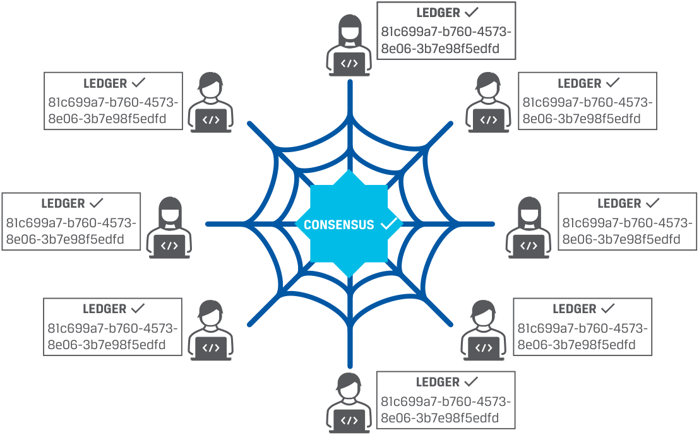
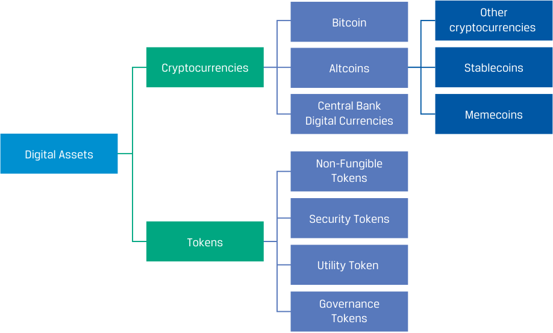

# Tập 8: Đầu tư Thay thế (*Alternative Investments*)
## Học phần 7: Giới thiệu về Tài sản Số (*Introduction to Digital Assets*)
### Phần 1/3: Giới thiệu (Trang PDF 187–197)

---

<!-- PDF Page 187 -->

#### H Ọ C P H Ầ N

# **<mark>7</mark>** 

### **Giới thiệu về Tài sản Số (*Introduction to Digital Assets*)** 

###### **<mark>MỤC TIÊU HỌC TẬP (*LEARNING OUTCOMES*)</mark>** 

|**_Mức độ thành thạo_**|**_Ứng viên cần có khả năng:_**|
|---|---|
||mô tả các ứng dụng tài chính của công nghệ sổ cái phân tán (*distributed ledger technology* – DLT)|
||giải thích các đặc điểm đầu tư của tài sản số (*digital assets*) và đối chiếu chúng với các loại tài sản khác|
||mô tả các hình thức và phương tiện đầu tư (*investment forms and vehicles*) được sử dụng trong đầu tư tài sản số|
||phân tích các nguồn rủi ro, lợi nhuận và đa dạng hóa (*diversification*) giữa các khoản đầu tư tài sản số|

##### **GIỚI THIỆU (*INTRODUCTION*)** 

## **<mark>1</mark>** 

Như đã được giới thiệu trong Học phần 1 của môn Đầu tư Thay thế, tài sản số (*digital assets*) là một loại tài sản đầu tư tương đối mới bao gồm các tài sản có thể được tạo lập, lưu trữ và truyền tải bằng phương thức điện tử (*created, stored, and transmitted electronically*) và gắn liền với các quyền sở hữu hoặc quyền sử dụng (*ownership or use rights*). Loại tài sản này bao gồm rất nhiều dạng tài sản số đa dạng, trong đó có tiền mã hóa (*cryptocurrencies*), mã thông báo (*tokens*), và các vật phẩm sưu tầm kỹ thuật số (*digital collectables*). Dựa trên công nghệ sổ cái phân tán (*distributed ledger technology* – DLT) mang tính đột phá, hay còn gọi là công nghệ chuỗi khối (*blockchain technology*), các tài sản số sử dụng các kỹ thuật mã hóa tiên tiến (*advanced encryption techniques*) nhằm đảm bảo tính xác thực (*authenticity*) của tài sản số. Trong khi các đồng tiền mã hóa (*cryptocurrencies*) có chuỗi khối (*blockchains*) của riêng mình, thì các mã thông báo tiền mã hóa (*crypto-tokens*) lại được xây dựng trên một chuỗi khối đã tồn tại sẵn. 

Cũng giống như các loại hình đầu tư thay thế khác, tài sản số có những đặc điểm khác biệt rõ rệt so với các khoản đầu tư truyền thống. Kể từ sự ra đời của Bitcoin vào năm 2009—thời điểm mà nó vẫn còn là một khái niệm ngách trong thế giới công nghệ—tài sản số đã dần trở thành các khoản đầu tư thay thế phổ biến hơn (*mainstream alternative investments*) đối với các nhà đầu tư trên toàn thế giới. Chúng ta sẽ đưa ra một cái nhìn tổng quan về các hình thức đầu tư tài sản số phổ biến và thảo luận về các khái niệm cốt lõi cũng như những cạm bẫy (*pitfalls*) trong lĩnh vực này. 

Bên cạnh các tính năng đặc biệt và đặc điểm công nghệ của mình, tài sản số mang lại cho các nhà đầu tư khả năng đa dạng hóa đồng thời cung cấp mức lợi nhuận kỳ vọng cao hơn (*higher expected returns*) so với các khoản đầu tư truyền thống. Tuy nhiên, rủi ro của chúng cũng cao hơn. Chúng ta sẽ thảo luận về các nguồn rủi ro trong tài sản số nhằm mang lại sự thấu hiểu tốt hơn về loại tài sản đang không ngừng phát triển này. 

<!-- PDF Page 188 -->

###### **TỔNG QUAN HỌC PHẦN (*LEARNING MODULE OVERVIEW*)** 

- Công nghệ chuỗi khối (*blockchain*) và công nghệ sổ cái phân tán (*distributed ledger technology* – DLT) có thể mang lại một phương thức mới để lưu trữ, ghi nhận và theo dõi các tài sản số trên một nền tảng phân tán, an toàn (*secure, distributed basis*). Thêm vào đó, DLT có thể mang lại hiệu quả cho các quy trình hậu giao dịch (*post-trade*) và tuân thủ (*compliance processes*) thông qua tự động hóa, hợp đồng thông minh (*smart contracts*), và xác minh danh tính (*identity verification*). 

- DLT có thể tồn tại dưới hình thức các mạng lưới không cần cấp phép (*permissionless networks*) hoặc các mạng lưới có cấp phép (*permissioned networks*). 

- Giao thức đồng thuận (*consensus protocol*) là một tập hợp các quy tắc chi phối cách thức các khối (*blocks*) được liên kết chuỗi với nhau bằng mật mã học (*cryptographically chained together*) trong một mạng lưới blockchain nhằm xác minh lịch sử hoàn chỉnh và bất biến (*immutable history*) của các bản ghi giao dịch. Hai loại giao thức đồng thuận lớn là “bằng chứng công việc” (*“proof of work”* – PoW) và “bằng chứng cổ phần” (*“proof of stake”* – PoS). 

- Tài sản số thường được xem là một loại tài sản thay thế (*alternative asset class*). Khi tài sản số ngày càng phát triển hoàn thiện hơn, các nhà đầu tư tổ chức có thể tiếp tục tìm kiếm một mức độ tiếp xúc nhất định với các tài sản này vì mức lợi nhuận cao hơn và các lợi ích đa dạng hóa tiềm năng của chúng. 

- Tài sản số khác với các tài sản tài chính truyền thống xét về giá trị nội tại vốn có (*inherent value*), cách tiếp cận xác thực giao dịch (*transaction validation approach*), việc sử dụng làm phương tiện trao đổi hợp pháp (*legal medium of exchange*), và sự bảo vệ về mặt pháp lý cũng như quy định quản lý (*legal and regulatory protection*). 

- Các tài sản số phổ biến nhất là tiền mã hóa (*cryptocurrencies*), bao gồm Bitcoin và các đồng tiền mã hóa thay thế (*altcoins*, bao gồm cả tiền mã hóa ổn định giá – *stablecoins* và đồng tiền trào lưu – *meme coins*). Ngoài ra còn có các mã thông báo số hóa (*digitalized tokens*) bao gồm mã thông báo không thể thay thế (*non-fungible tokens* – NFTs), mã thông báo chứng khoán (*security tokens*), mã thông báo tiện ích (*utility tokens*), và mã thông báo quản trị (*governance tokens*). 

- Nhiều đồng tiền mã hóa được thiết kế với các giới hạn tự áp đặt (*self-imposed limits*) đối với tổng nguồn cung thông qua các thuật toán máy tính phức tạp. Những giới hạn như vậy có thể giúp duy trì giá trị xét từ góc độ kỹ thuật, tuy nhiên vẫn chưa có sự đồng thuận về mặt kinh tế (*no economic consensus*) về cách thức định giá chúng. Các sàn giao dịch tiền mã hóa (*cryptocurrency exchanges*) được phân loại thành sàn giao dịch tập trung (*centralized exchanges*) và sàn giao dịch phi tập trung (*decentralized exchanges*). Cả sàn giao dịch tập trung và phi tập trung đều phải đối mặt với các vấn đề về gian lận và thao túng (*fraud and manipulation*) bởi vì chúng không chịu sự giám sát nghiêm ngặt và nhìn chung không được quản lý như các sàn giao dịch tài chính chính thống. 

- Đầu tư vào tài sản số có thể dưới hình thức sở hữu trực tiếp (*direct ownership*) tiền mã hóa và các tài sản số khác trên các chuỗi khối, hoặc đầu tư gián tiếp (*indirect investment*) vào các sản phẩm giao dịch trên sàn (*exchange-traded products*), quỹ phòng hộ (*hedge funds*), quỹ tín thác (*trusts*), hợp đồng tương lai (*futures*), và các cổ phiếu theo chủ đề (*thematic stocks*). 

- Mã thông báo được đảm bảo bằng tài sản (*asset-backed tokens*) là các quyền đòi nợ kỹ thuật số (*digital claims*) đối với tài sản vật chất, tài sản tài chính hoặc công cụ tài chính và được thế chấp (*collateralized*) bằng chính các tài sản cơ sở này. 

- Sự thúc đẩy phát triển các ứng dụng tài chính phi tập trung dựa trên mã nguồn mở (*open-source codes*) và hợp đồng thông minh đã phát triển thành một phong trào được gọi là tài chính phi tập trung (*decentralized finance*), hay DeFi. DeFi tìm cách thiết kế, kết hợp và phát triển các ứng dụng tài chính phi tập trung đóng vai trò như những viên gạch nền tảng (*building blocks*) cho các sản phẩm và dịch vụ tài chính tinh vi. 

- Giá của Bitcoin và các tài sản số khác được dẫn dắt bởi những kỳ vọng về sự tăng giá tài sản trong tương lai (*expectations on future asset appreciation*) hơn là bất kỳ dòng tiền cơ sở (*underlying cash flow*) nào. Nhu cầu thị trường đối với nguồn cung hữu hạn của tiền mã hóa là một động lực dẫn dắt giá đáng kể. 

<!-- PDF Page 189 -->

- Hiệu quả hoạt động của tài sản số đầu tiên được giao dịch rộng rãi là Bitcoin được đặc trưng bởi lợi nhuận cao (*high return*), độ biến động cao (*high volatility*), và mức tương quan thấp (*low correlations*) với các loại tài sản truyền thống. 

- Do có mức tương quan lịch sử thấp với các loại tài sản khác, tài sản số mang lại lợi ích đa dạng hóa tiềm năng cho một danh mục đầu tư đã được đa dạng hóa tốt. Tuy nhiên, người ta quan sát thấy hệ số tương quan này đã tăng lên, đặc biệt là trong những giai đoạn thị trường có mức độ bất định cao (*high market uncertainty*). 

###### **TỰ ĐÁNH GIÁ HỌC PHẦN (*LEARNING MODULE SELF-ASSESSMENT*)** 

Những câu hỏi ban đầu này nhằm giúp bạn tự đánh giá mức độ hiểu biết hiện tại của mình về học phần này. 

1. Giao thức đồng thuận (*consensus protocol*) trên một mạng lưới công nghệ sổ cái phân tán (*distributed ledger technology network*) đề cập đến: 

   - **A.** cách tiếp cận tiêu chuẩn hóa chi phối việc các tài sản số được tạo ra từ một mạng lưới blockchain nên được định giá như thế nào. 

   - **B.** các chương trình được nhúng trong các bản ghi giao dịch điện tử được lập trình để tự thực thi (*self-execute*) theo các điều kiện đã được xác định trước. 

   - **C.** tập hợp các quy tắc chi phối cách thức các khối (*blocks*) được liên kết bằng mật mã học vào chuỗi để trở nên bất biến (*immutable*) trên mạng lưới sổ cái phân tán. 

   - **Lời giải:** 

Đáp án đúng là C. Khi các giao dịch đi vào một nút (*node*) của sổ cái phân tán, chúng được bó lại thành các “khối” (*“blocks”*) và được “nối chuỗi” (*“chained”*) với nhau bằng mật mã học nhằm tạo thuận lợi cho việc xác minh lịch sử trước đó. Cách thức các khối được nối chuỗi với nhau được quyết định bởi giao thức đồng thuận (*consensus protocol*)—một tập hợp các quy tắc chi phối cách các khối có thể gia nhập vào chuỗi và trở thành “sự thật” bất biến (*immutable “truth”*). Các giao thức đồng thuận được thiết kế để chống lại các nỗ lực thao túng ác ý (*malicious manipulation*) cho đến một cấp độ bảo mật nhất định. 

2. Tiền mã hóa (*cryptocurrencies*) là một dạng tài sản số phổ biến mà: 

   - **A.** chỉ có thể được đào (*mined*) thông qua cơ chế “bằng chứng công việc” (*“proof of work”*) trên các mạng lưới blockchain. 

   - **B.** tồn tại ở cả hình thái vật chất lẫn các bản ghi điện tử đi kèm quyền sử dụng, mua hoặc bán bởi chủ sở hữu. 

   - **C.** có thể được sử dụng để chuyển giao hoặc lưu trữ giá trị (*transfer or store value*), cho phép thực hiện các giao dịch tiết kiệm thời gian giữa các bên mà không cần đến một bên trung gian (*intermediary*). 

   - **Lời giải:** 

Đáp án đúng là C. Tiền mã hóa được sử dụng để chuyển giao hoặc lưu trữ giá trị, cho phép thực hiện các giao dịch gần như theo thời gian thực (*near-real-time transactions*) giữa các bên mà không cần đến bên trung gian. Là các phương tiện trao đổi điện tử, tiền mã hóa không có hình thái vật chất (*lack physical form*) và chỉ tồn tại dưới dạng các bản ghi điện tử trên các sổ cái phân tán. Tùy thuộc vào giao thức đồng thuận cụ thể được sử dụng, tiền mã hóa có thể được tạo ra bằng cơ chế “bằng chứng công việc” (*“proof of work”*) hoặc “bằng chứng cổ phần” (*“proof of stake”*) bởi các thợ đào (*miners*) hoặc những người xác thực (*validators*) trên mạng lưới. 

3. Tài sản số khác với các chứng khoán tài chính truyền thống ở điểm: 

   - **A.** tài sản số được hưởng một khung bảo vệ pháp lý rộng hơn. 

   - **B.** tài sản số không được định giá dựa trên dòng tiền kỳ vọng trong tương lai (*expected future cash flow*) của chúng. 

<!-- PDF Page 190 -->

   - **C.** các bản ghi giao dịch của tài sản số đòi hỏi phải có một bên trung gian tập trung (*centralized intermediary*). 

   - **Lời giải:** 

Đáp án đúng là B. Hầu hết các tài sản số không có giá trị cơ bản (*fundamental value*) dựa trên các tài sản cơ sở hoặc dựa trên dòng tiền hay thu nhập tiềm năng mà chúng được kỳ vọng sẽ tạo ra. Cho đến nay, các khung pháp lý và quy định quản lý đối với tài sản số vẫn đang trong quá trình hoàn thiện, và nhìn chung có ít sự bảo vệ pháp lý hơn so với các chứng khoán tài chính truyền thống. Các giao dịch tài sản số được ghi nhận trên một sổ cái phân tán, và không cần đến bất kỳ bên trung gian tập trung nào trong quy trình này. 

4. Một loại tiền mã hóa đặc biệt được đảm bảo bằng (*backed by*) và neo giá vào (*pegged to*) một đồng tiền pháp định (*fiat currency*) được gọi là: 

   - **A.** đồng tiền thay thế (*altcoin*). 

   - **B.** đồng tiền ổn định giá (*stablecoin*). 

   - **C.** đồng tiền trào lưu (*meme coin*). 

   - **Lời giải:** 

Đáp án đúng là B. Một đồng tiền ổn định giá (*stablecoin*) được thiết kế để duy trì một mức giá trị ổn định bằng cách neo giá trị của nó vào một tài sản khác và được thế chấp bằng một rổ tài sản (*collateralized by a basket of assets*), thường là một đồng tiền pháp định (*fiat currency*), kim loại quý, hoặc các đồng tiền mã hóa khác. 

5. Một khoản đầu tư gián tiếp (*indirect investment*) vào tài sản số có thể được thực hiện thông qua: 

   - **A.** việc tham gia vào các hợp đồng tương lai tiền mã hóa (*cryptocurrency futures*). 

   - **B.** việc mua Bitcoin trên các ví tiền mã hóa (*cryptocurrency wallets*). 

   - **C.** việc tham gia vào đợt phát hành tiền mã hóa lần đầu (*initial coin offering* – ICO) của một mã thông báo kỹ thuật số mới. 

   - **Lời giải:** 

Đáp án đúng là A. Các nhà đầu tư quan tâm đến việc đầu tư gián tiếp vào tài sản số có thể giao dịch các hợp đồng tương lai tiền mã hóa trên các sàn giao dịch lâu đời, chẳng hạn như Sàn Giao dịch Hàng hóa Chicago (*Chicago Mercantile Exchange* – CME). Ngược lại, việc mua Bitcoin và mua các mã thông báo mới thông qua một đợt phát hành tiền mã hóa lần đầu (ICO) là các hình thức đầu tư trực tiếp (*direct forms of investment*). 

6. Một quỹ ETF tiền mã hóa (*cryptocurrency ETF*) tìm cách: 

   - **A.** đạt được mức tiếp xúc (*gain exposure*) với tiền mã hóa thông qua tiền mặt và các công cụ phái sinh tiền mã hóa (*cryptocurrency derivatives*). 

   - **B.** mô phỏng tỷ suất sinh lợi đầu tư tài sản số bằng cách đầu tư trực tiếp vào các đồng tiền mã hóa. 

   - **C.** đạt được mức tiếp xúc với chủ đề tiền mã hóa bằng cách đầu tư vào các cổ phiếu đại chúng có liên quan đến lĩnh vực tài sản số. 

###### **Lời giải:** 

Đáp án đúng là A. Một quỹ ETF tiền mã hóa tìm cách mô phỏng lại tỷ suất sinh lợi đầu tư tài sản số bằng tiền mặt và các công cụ phái sinh tiền mã hóa. 

7. Bitcoin, với tư cách là một khoản đầu tư thay thế, trong lịch sử đã thể hiện: 

   - **A.** lợi nhuận thấp, rủi ro thấp, và mức tương quan cao với các tài sản truyền thống. 

   - **B.** lợi nhuận cao, rủi ro cao, và mức tương quan thấp với các tài sản truyền thống. 

<!-- PDF Page 191 -->

   - **C.** lợi nhuận cao, rủi ro cao, và mức tương quan cao với các tài sản truyền thống. 

**Lời giải:** Đáp án đúng là B. Mặc dù không tạo ra dòng tiền trong tương lai, Bitcoin với tư cách là một khoản đầu tư thay thế đã được đặc trưng bởi lợi nhuận cao (*high return*), độ biến động cao (*high volatility*), và mức tương quan thấp (*low correlations*) với các loại tài sản truyền thống. 

8. Các nhà đầu tư giai đoạn đầu vào tiền mã hóa đã tận hưởng mức tăng giá đáng kể nhưng nhiều nhà đầu tư ở giai đoạn sau lại phải gánh chịu những khoản lỗ khổng lồ, nguyên nhân có khả năng cao nhất là vì: 

   - **A.** công nghệ blockchain ưu ái các nhà đầu tư giai đoạn đầu. 
   - **B.** có những biến động giá rất lớn (*substantial price fluctuations*) trong tiền mã hóa. 
   - **C.** tiền mã hóa đã gia tăng sức hấp dẫn đối với các nhà đầu tư tổ chức. 

**Lời giải:** Đáp án đúng là B. Bởi vì tiền mã hóa là một sự đổi mới tương đối gần đây, thị trường của chúng phải chịu những biến động giá nhanh chóng, nhiều thay đổi và sự bất định. Giá của chúng cực kỳ biến động qua các năm, và các đợt sụt giảm giá (*price drawdowns*) thường lớn hơn rất nhiều so với các loại tài sản truyền thống. Kết quả là, các nhà đầu tư giai đoạn sau có thể phải gánh chịu những khoản lỗ khổng lồ tùy thuộc vào thời điểm gia nhập và rút lui (*points of entry and exit*) của họ. 

##### **CÔNG NGHỆ SỔ CÁI PHÂN TÁN (*DISTRIBUTED LEDGER TECHNOLOGY*)** 

## **<mark>2</mark>** 

**Mục tiêu học tập:** Mô tả các ứng dụng tài chính của công nghệ sổ cái phân tán (*distributed ledger technology*).

**Công nghệ sổ cái phân tán (*Distributed ledger technology* – DLT)** dựa trên một sổ cái phân tán (được định nghĩa ở phần sau) đại diện cho một bước phát triển công nghệ và mang lại những cải tiến tiềm năng cho việc cung cấp các dịch vụ tài chính và lưu trữ hồ sơ tài chính (*financial record keeping*). Các mạng lưới DLT đang được xem xét như một phương tiện để tạo lập, trao đổi và theo dõi quyền sở hữu các tài sản tài chính trên cơ sở ngang hàng (*peer-to-peer* – P2P). Những lợi ích tiềm năng của việc sử dụng công nghệ này bao gồm độ chính xác, tính minh bạch và tính bảo mật cao hơn trong việc lưu trữ hồ sơ; chuyển giao quyền sở hữu nhanh hơn; và các tương tác ngang hàng (P2P). Tuy nhiên, công nghệ này không hoàn toàn an toàn tuyệt đối, và các vụ vi phạm quyền riêng tư cũng như bảo vệ dữ liệu vẫn có thể xảy ra. Thêm vào đó, các quy trình tính toán nền tảng của DLT nhìn chung đòi hỏi một lượng năng lượng khổng lồ (*massive amounts of energy*) để xác minh hoạt động giao dịch. 

Một **sổ cái phân tán (*distributed ledger*)** là một loại cơ sở dữ liệu có thể được chia sẻ giữa một số lượng các thực thể tiềm năng là vô hạn trong một mạng lưới. Trong một sổ cái phân tán, các bút toán (*entries*) được ghi nhận, lưu trữ và phân phối trên khắp một mạng lưới các bên tham gia sao cho mỗi thực thể tham gia đều có một bản sao khớp hoàn toàn (*matching copy*) của cơ sở dữ liệu kỹ thuật số đó, biến mỗi bản sao của cơ sở dữ liệu thành một bản ghi đã được xác minh của tất cả các giao dịch hiện tại và trước đó. Các yếu tố cơ bản của một mạng lưới DLT bao gồm một sổ cái kỹ thuật số (*digital ledger*), một cơ chế đồng thuận (*consensus mechanism*) được sử dụng để xác nhận các bút toán mới, và một mạng lưới các bên tham gia (*participant network*). 

Cơ chế đồng thuận (*consensus mechanism*) là quy trình mà qua đó các thực thể máy tính (hay các nút – *nodes*) trong một mạng lưới thống nhất với nhau về một trạng thái chung của sổ cái (*common state of the ledger*). Sự đồng thuận nhìn chung bao gồm hai bước: xác thực giao dịch (*transaction validation*) và sự đồng ý cập nhật sổ cái (*agreement on ledger update*) bởi các bên trong mạng lưới. Những tính năng này cho phép tạo ra các bản ghi mà phần lớn được coi là bất biến (*immutable*), hay không thể thay đổi được, nhưng vẫn minh bạch và có thể truy cập được bởi các bên tham gia mạng lưới trên cơ sở gần như thời gian thực (*near-real-time basis*). Có nhiều cách tiếp cận khác nhau để thiết lập sự đồng thuận. 

<!-- PDF Page 192 -->

Các tính năng của DLT bao gồm việc sử dụng **mật mã học (*cryptography*)**—một quy trình thuật toán để mã hóa dữ liệu, làm cho dữ liệu không thể sử dụng được nếu rơi vào tay các bên không được ủy quyền—giúp mang lại mức độ bảo mật mạng lưới và tính toàn vẹn cơ sở dữ liệu (*database integrity*) rất cao. Ví dụ, DLT sử dụng các phương pháp bằng chứng mật mã học (*cryptographic methods of proof*) để xác minh danh tính của bên tham gia mạng lưới và để mã hóa dữ liệu. 

DLT có tiềm năng hỗ trợ các “**hợp đồng thông minh (*smart contracts*)**”, vốn là các chương trình máy tính tự thực thi (*self-execute*) trên cơ sở các điều khoản và điều kiện đã được quy định trước và được đồng thuận bởi các bên tham gia hợp đồng. Các ví dụ về việc sử dụng hợp đồng thông minh là việc tự động thực thi các quyền đòi nợ có điều kiện (*contingent claims*) đối với các công cụ phái sinh và việc chuyển giao tài sản thế chấp tức thời (*instantaneous transfer of collateral*) trong trường hợp xảy ra vỡ nợ (*default*). 

Bảng 1 (*Exhibit 1*) minh họa một mạng lưới sổ cái phân tán trong đó tất cả các bên tham gia (các nút – *nodes*) được kết nối với nhau, mỗi nút nắm giữ một bản sao của sổ cái phân tán. Thuật ngữ “đồng thuận” (*“consensus”*) được hiển thị ở trung tâm của mạng lưới và đại diện cho cơ chế đồng thuận mà qua đó các nút thống nhất về các giao dịch mới và các bản cập nhật sổ cái. 

###### **Bảng 1: Thiết lập Mạng lưới Sổ cái Phân tán (*Exhibit 1: Distributed Ledger Network Setup*)** 

<!-- Picture Text: LEDGER 81c699a7-b760-4573- 8e06-3b7e98f5edfd LEDGER LEDGER 81c699a7-b760-4573- 81c699a7-b760-4573- 8e06-3b7e98f5edfd 8e06-3b7e98f5edfd LEDGER LEDGER 81c699a7-b760-4573- CONSENSUS 81c699a7-b760-4573- 8e06-3b7e98f5edfd 8e06-3b7e98f5edfd LEDGER LEDGER 81c699a7-b760-4573- 81c699a7-b760-4573- 8e06-3b7e98f5edfd 8e06-3b7e98f5edfd LEDGER 81c699a7-b760-4573- 8e06-3b7e98f5edfd  -->

> **Chú thích hình ảnh:**
> - **CONSENSUS (Ở tâm mạng lưới):** Cơ chế đồng thuận kết nối tất cả các nút (*nodes*).
> - **LEDGER (Tại mỗi nút xung quanh):** Mỗi nút lưu trữ một bản sao sổ cái giống hệt nhau (cùng mã định danh `81c699a7-b760-4573-8e06-3b7e98f5edfd`).

**Chuỗi khối (*Blockchain*)** là một loại sổ cái kỹ thuật số trong đó thông tin, chẳng hạn như những thay đổi về quyền sở hữu, được ghi nhận tuần tự bên trong các khối (*blocks*), sau đó các khối này được liên kết hoặc “nối chuỗi” (*“chained”*) lại với nhau và được bảo mật bằng cách sử dụng các phương pháp mật mã học. Các bước phác thảo việc thêm một giao dịch mới vào mạng lưới được trình bày trong Bảng 2 (*Exhibit 2*). Có một số bước chính mà một giao dịch phải trải qua trước khi nó được thêm vào chuỗi khối. 

<!-- PDF Page 193 -->

**Bảng 2: Thêm một Giao dịch vào Chuỗi khối (*Exhibit 2: Adding a Transaction to the Blockchain*)** 

<!-- Picture Text: 2. A block with transaction 3. Nodes validate the 1. Transaction takes place  information is created and  transaction details and  between buyer and seller.  broadcast to the network of  parties to the transaction.  computers (nodes). 4. Once verified, the 5. The block of data is then  transaction is combined 6. Transaction is considered  added or linked (using a  with other transactions to  complete and ledger has  cryptographic process) to  form a new block (of  been updated.  the previous block(s)  predetermined size) of data  containing trasaction data.  for the ledger.  -->

> **Chú thích hình ảnh (Quy trình 6 bước thêm giao dịch vào Blockchain):**
> 1. **Bước 1:** Giao dịch diễn ra giữa người mua và người bán (*Transaction takes place between buyer and seller*).
> 2. **Bước 2:** Một khối chứa thông tin giao dịch được tạo ra và phát tán tới mạng lưới các máy tính / các nút (*A block with transaction information is created and broadcast to the network of computers (nodes)*).
> 3. **Bước 3:** Các nút xác thực chi tiết giao dịch và các bên tham gia giao dịch (*Nodes validate the transaction details and parties to the transaction*).
> 4. **Bước 4:** Sau khi được xác minh, giao dịch được gộp chung với các giao dịch khác để tạo thành một khối dữ liệu mới (có kích thước xác định trước) cho sổ cái (*Once verified, the transaction is combined with other transactions to form a new block (of predetermined size) of data for the ledger*).
> 5. **Bước 5:** Khối dữ liệu sau đó được thêm vào hoặc liên kết (bằng quy trình mật mã học) với (các) khối trước đó có chứa dữ liệu giao dịch (*The block of data is then added or linked (using a cryptographic process) to the previous block(s) containing transaction data*).
> 6. **Bước 6:** Giao dịch được coi là hoàn tất và sổ cái đã được cập nhật (*Transaction is considered complete and ledger has been updated*).

Mỗi khối chứa một nhóm các giao dịch (hoặc bút toán) và một liên kết bảo mật (được gọi là mã băm – *hash*) nối với khối liền trước. Các giao dịch mới chỉ được chèn vào chuỗi sau khi đã được xác thực thông qua một cơ chế đồng thuận, trong đó các thành viên được ủy quyền thống nhất về giao dịch đó cũng như thứ tự trước sau, hay lịch sử, mà các giao dịch trước đó đã diễn ra. 

###### **Bằng chứng Công việc so với Bằng chứng Cổ phần (*Proof of Work vs. Proof of Stake*)** 

Về cơ bản, chuỗi khối (*blockchains*) là các giao thức phần mềm (*software protocols*) cho phép nhiều bên tương tác với nhau dưới những giả định và hiểu biết chung mà không cần phải tin tưởng lẫn nhau. Khi các giao dịch đi vào một nút của chuỗi khối, chúng được bó lại thành các “khối” (*“blocks”*) và được “nối chuỗi” (*“chained”*) với nhau bằng mật mã học để tạo thuận lợi cho việc xác minh lịch sử trước đó. Cách thức các khối được nối chuỗi với nhau được quyết định bởi **giao thức đồng thuận (*consensus protocol*)**—một tập hợp các quy tắc chi phối cách các khối có thể gia nhập chuỗi và trở thành “sự thật” bất biến. Các giao thức đồng thuận được thiết kế để chống lại các nỗ lực thao túng ác ý cho đến một cấp độ bảo mật nhất định. Chúng ta phân biệt giữa hai loại giao thức chính. 

###### **_Giao thức Bằng chứng Công việc (The Proof of Work – PoW Protocol)_** 

Giao thức bằng chứng công việc quyết định khối cụ thể nào sẽ được thêm vào thông qua một cuộc xổ số tiêu tốn nhiều chi phí tính toán (*computationally costly lottery*). Cơ chế đồng thuận PoW được sử dụng để xác minh một giao dịch bao gồm một bài toán mật mã học (*cryptographic problem*) phải được giải bởi một số máy tính trên mạng lưới (được gọi là các thợ đào – *miners*) mỗi khi có một giao dịch diễn ra. **Các thợ đào (*Miners*)** sử dụng các máy tính mạnh mẽ và lượng năng lượng đáng kể để giải các câu đố thuật toán phức tạp nhằm xác thực và khóa các khối giao dịch vào chuỗi khối, đồng thời kiếm được tiền mã hóa cho chính họ trong quá trình đó. Quy trình đồng thuận “bằng chứng công việc” để cập nhật chuỗi khối có thể đòi hỏi năng lực tính toán (*computing power*) vô cùng lớn, khiến cho một bên thứ ba đơn lẻ rất khó và cực kỳ tốn kém nếu muốn thao túng dữ liệu lịch sử. Để thao túng dữ liệu lịch sử, một cá nhân hoặc thực thể sẽ phải kiểm soát phần lớn các nút (*most nodes*) trong mạng lưới. Do đó, sự thành công của mạng lưới phụ thuộc vào sự tham gia rộng rãi của các thành viên trong mạng lưới. 

Các bên tham gia trên mạng lưới đồng ý rằng _chuỗi dài nhất_ của các khối (*longest chain of blocks*) là đại diện trung thực duy nhất cho tất cả các giao dịch trước đó. Nếu một kẻ tấn công ác ý muốn tạo ra một chuỗi dài hơn có bao gồm các giao dịch gian lận, kẻ đó phải vượt qua năng lực tính toán của toàn bộ mạng lưới, điều mà về mặt lý thuyết đòi hỏi phải nắm giữ phần lớn năng lực 

<!-- PDF Page 194 -->

tính toán hiện có của mạng lưới. Đây chính là ngưỡng tấn công 51% (*51% attack threshold*) nổi tiếng và đóng vai trò là ranh giới của các tiêu chuẩn bảo mật thuộc giao thức PoW. Việc tích lũy một sức mạnh mạng lưới lớn đến mức này trên các chuỗi khối được sử dụng rộng rãi nhất đứng sau các đồng tiền mã hóa như Bitcoin hay Ethereum là điều cực kỳ khó khăn đối với bất kỳ cá nhân, tổ chức hoặc nhóm tác nhân phối hợp nào. Ngay cả khi phần lớn năng lực tính toán của mạng lưới có thể bị kiểm soát trong chốc lát, thì độ dài của lịch sử khối có thể bị thay đổi cũng bị giới hạn bởi thời lượng của sự kiểm soát đó. Đây từng là giao thức đồng thuận được sử dụng rộng rãi nhất cho các tài sản số. 

###### **_Giao thức Bằng chứng Cổ phần (The Proof of Stake – PoS Protocol)_** 

Giao thức này yêu cầu những người tham gia được lựa chọn trên mạng lưới, được gọi là những người xác thực (*validators*), phải cam kết thế chấp vốn (*pledge capital*) để bảo lãnh cho tính hợp lệ của khối (*vouch for the block's validity*). Phần vốn đặt cọc (*stake*) này phát tín hiệu cho mạng lưới biết rằng người xác thực đó sẵn sàng xác minh tính trung thực của một giao dịch và đề xuất một khối mới. Đa số những người xác thực khác, những người cũng đã đặt cọc một tài sản số tương tự vào mạng lưới, sau đó phải chứng thực tính hợp lệ (*attest to the validity*) của khối được đề xuất đó. Những người xác thực hưởng lợi từ cả việc đề xuất lẫn việc chứng thực tính hợp lệ của các khối do các thành viên khác đề xuất trong một quy trình đặt cọc (*staking process*) tương tự. Ranh giới của các tiêu chuẩn bảo mật thuộc giao thức PoS được xây dựng dựa trên một nhóm những người đặt cọc (*stakers* cùng phần vốn cam kết của họ) kiểm soát năng lực tính toán của mạng lưới và bảo vệ quyền truy cập khỏi việc các bên ác ý giành được đa số. 

Dưới cả hai giao thức đồng thuận, việc xác thực các giao dịch đều đi kèm với phần thưởng: hoạt động đào (*mining*). Các thợ đào thành công xác thực được giao dịch sẽ nhận được một tài sản số mới, cho dù đó là một đồng tiền mã hóa hay một mã thông báo (*token*). Tốc độ đào (*rate of mining*) và tốc độ mà các giao dịch mới trên mạng lưới được xác thực nhìn chung sẽ kiểm soát số lượng tài sản số mới có thể được tạo ra trên một mạng lưới sổ cái kỹ thuật số cụ thể. 

###### **Mạng lưới Có cấp phép và Mạng lưới Không cần cấp phép (*Permissioned and Permissionless Networks*)** 

DLT có thể tồn tại dưới hình thức các mạng lưới không cần cấp phép hoặc có cấp phép. **Các mạng lưới không cần cấp phép (*Permissionless networks*)** mở rộng cho bất kỳ người dùng nào muốn thực hiện giao dịch, và tất cả người dùng bên trong mạng lưới đều có thể nhìn thấy mọi giao dịch tồn tại trên chuỗi khối. Trong một hệ thống DLT không cần cấp phép, hay hệ thống mở (*open*), bất kỳ bên tham gia mạng lưới nào cũng có thể thực hiện tất cả các chức năng của mạng lưới. 

Lợi ích chính của một mạng lưới không cần cấp phép là nó không phụ thuộc vào một cơ quan có thẩm quyền tập trung (*centralized authority*) để xác nhận hay từ chối tính hợp lệ của các giao dịch, bởi vì việc này diễn ra thông qua cơ chế đồng thuận đã được lựa chọn. Điều này có nghĩa là không tồn tại điểm lỗi đơn lẻ (*no single point of failure exists*) bởi vì tất cả các giao dịch đều được ghi nhận trên một cơ sở dữ liệu phân tán duy nhất và mọi nút đều lưu trữ một bản sao của cơ sở dữ liệu đó. Một khi giao dịch đã được thêm vào chuỗi khối, nó không thể bị thay đổi, ngoại trừ trường hợp bị thao túng; sổ cái phân tán trở thành một bản ghi vĩnh viễn và bất biến (*permanent and immutable record*) của tất cả các giao dịch trước đó. Trong một mạng lưới không cần cấp phép, sự tin tưởng (*trust*) giữa các bên giao dịch không phải là một yêu cầu bắt buộc. 

**Bitcoin** là một ứng dụng nổi tiếng của mạng lưới mở không cần cấp phép. Bitcoin được tạo ra vào năm 2009 để đóng vai trò là sổ cái công khai (*public ledger*) cho tất cả các giao dịch diễn ra trên đồng tiền ảo của nó. Kể từ khi Bitcoin ra đời, rất nhiều đồng tiền mã hóa, hay tiền kỹ thuật số khác sử dụng các mạng lưới DLT không cần cấp phép đã được tạo ra. 

Trong **các mạng lưới có cấp phép (*permissioned networks*)**, các thành viên mạng lưới có thể bị hạn chế tham gia vào một số hoạt động nhất định của mạng lưới. Các biện pháp kiểm soát, hay quyền hạn (*permissions*), có thể được sử dụng để cho phép các cấp độ truy cập khác nhau vào sổ cái, từ việc thêm các giao dịch (ví dụ: một bên tham gia giao dịch) đến việc chỉ được xem các giao dịch (ví dụ: cơ quan quản lý nhà nước) hoặc chỉ được xem các chi tiết chọn lọc của giao dịch chứ không được xem toàn bộ bản ghi. Bảng 3 (*Exhibit 3*) so sánh các đặc điểm nổi bật của chuỗi khối có cấp phép và không cần cấp phép. 

<!-- PDF Page 195 -->

**Bảng 3: Đặc điểm của Chuỗi khối Có cấp phép và Chuỗi khối Không cần cấp phép (*Exhibit 3: Features of Permissioned and Permissionless Blockchains*)** 

||**Chuỗi khối có cấp phép (*Permissioned blockchain*)**|**Chuỗi khối không cần cấp phép (*Permissionless blockchain*)**|
|---|---|---|
|**Tốc độ (*Speed*)**|Nhanh hơn vì chỉ có một số lượng hạn chế các thành viên tham gia hoặc được ủy quyền xác thực các giao dịch|Chậm hơn vì một số lượng lớn các thành viên phải đạt được sự đồng thuận, làm giảm tốc độ mạng lưới và khả năng mở rộng quy mô (*scalability*)|
|**Chi phí (*Cost*)**|Hiệu quả về chi phí (*cost-effective*) vì chỉ cần ít thành viên xác thực mỗi giao dịch|Không hiệu quả về chi phí vì cần nhiều thành viên xác thực mỗi giao dịch|
|**Tính phi tập trung (*Decentralization*)**|Phi tập trung một phần (*partially decentralized*) vì có một số lượng hạn chế thành viên trong chuỗi|Phi tập trung hoàn toàn (*decentralized*) vì tất cả các thành viên đều có thể truy cập mạng lưới|
|**Quyền truy cập (*Access*)**|Tư cách thành viên bị giới hạn (*limited*).|Tư cách thành viên không giới hạn (*unlimited*).|
|**Quản trị (*Governance*)**|Việc quản trị được quyết định bởi một tổ chức tập trung (*centralized organization*).|Việc quản trị mang tính phi tập trung và được duy trì bởi các thành viên.|

Dựa trên bản chất phi tập trung của mình, các sổ cái phân tán không cần cấp phép mở hoàn toàn cho tất cả mọi người, nhưng mức độ phi tập trung cao đó thường đòi hỏi năng lực xử lý (*processing power*) và băng thông (*bandwidth*) lớn hơn, khiến chúng kém hiệu quả về mặt chi phí hơn. Điều ngược lại đúng với các chuỗi khối có cấp phép. Quản trị và xác minh giao dịch là hai khía cạnh khác mang tính đặc thù tùy theo từng loại chuỗi khối. 

###### **Các Loại Tài sản Số (*Types of Digital Assets*)** 

Các ứng dụng tiềm năng của DLT đối với dịch vụ tài chính và quản lý đầu tư bao gồm việc tạo lập các tài sản số, chẳng hạn như tiền mã hóa, và quy trình cung cấp các dịch vụ tài chính một cách hiệu quả hơn, chẳng hạn như các quy trình mã hóa tài sản (*tokenization*), bù trừ và thanh toán hậu giao dịch (*post-trade clearing and settlement*), và tuân thủ (*compliance*). Bảng 4 (*Exhibit 4*) tóm tắt các loại tài sản số khác nhau. 

###### **Bảng 4: Các Loại Tài sản Số Khác nhau (*Exhibit 4: Different Digital Assets*)** 

<!-- Picture Text: Other Bitcoin cryptocurrencies Cryptocurrencies Altcoins Stablecoins Central Bank Memecoins Digital Currencies Digital Assets Non-Fungible Tokens Security Tokens Tokens Utility Token Governance Tokens  -->

> **Chú thích hình ảnh (Phân loại Tài sản Số – *Digital Assets*):**
> - **Cryptocurrencies (Tiền mã hóa):**
>   - **Bitcoin**
>   - **Altcoins (Tiền mã hóa thay thế):** Các đồng tiền mã hóa khác (*Other cryptocurrencies*), Tiền mã hóa ổn định giá (*Stablecoins*), Đồng tiền trào lưu (*Memecoins*).
>   - **Central Bank Digital Currencies – CBDCs:** Tiền kỹ thuật số của Ngân hàng Trung ương.
> - **Tokens (Mã thông báo):**
>   - **Non-Fungible Tokens (NFTs):** Mã thông báo không thể thay thế.
>   - **Security Tokens:** Mã thông báo chứng khoán.
>   - **Utility Tokens:** Mã thông báo tiện ích.
>   - **Governance Tokens:** Mã thông báo quản trị.

<!-- PDF Page 196 -->

###### **_Tiền mã hóa (Cryptocurrencies)_** 

Tài sản số là những tài sản chỉ tồn tại dưới dạng một bản ghi điện tử đi kèm với các quyền sử dụng, mua hoặc bán. Chúng có thể là chứng khoán, tiền tệ, bất động sản hoặc hàng hóa. Các tài sản số phổ biến nhất là các đơn vị được sử dụng để chuyển giao hoặc lưu trữ giá trị, được gọi là **tiền mã hóa (*cryptocurrency*)** và tiền kỹ thuật số (*digital currency*), cho phép thực hiện các giao dịch gần như theo thời gian thực giữa các bên mà không cần đến một bên trung gian. 

Là các phương tiện trao đổi điện tử, tiền mã hóa không có hình thái vật chất và được phát hành tư nhân bởi các cá nhân, công ty và các tổ chức khác. Do đó, chúng không được hưởng sự bảo chứng của một ngân hàng trung ương hay một cơ quan quản lý tiền tệ (*monetary authority*). Hầu hết các đồng tiền mã hóa đã phát hành đều sử dụng các hệ thống DLT mở, trong đó một sổ cái phân tán phi tập trung được sử dụng để ghi nhận và xác minh tất cả các giao dịch tiền kỹ thuật số. Có nhiều loại tiền mã hóa khác nhau tồn tại, chẳng hạn như altcoin và stablecoin. 

Nhiều đồng tiền mã hóa có một giới hạn tự áp đặt (*self-imposed limit*) đối với tổng lượng tiền tệ mà chúng có thể phát hành. Mặc dù những giới hạn như vậy có thể giúp duy trì chức năng lưu trữ giá trị (*store of value*) của chúng, nhưng điều quan trọng cần lưu ý là nhiều đồng tiền mã hóa đã trải qua những mức độ biến động giá rất cao (*high levels of price volatility*). Chưa có sự đồng thuận nào về cách thức định giá tiền mã hóa, và sự thiếu vắng rõ rệt của các yếu tố cơ bản rõ ràng (*clear fundamentals*) làm nền tảng cho các đồng tiền này đã góp phần tạo nên sự biến động của chúng. 

Tiền mã hóa không được chính phủ bảo chứng hay quản lý. Tuy nhiên, các ngân hàng trung ương trên khắp thế giới đang dần nhận ra những lợi ích tiềm năng và đang nghiên cứu các trường hợp ứng dụng (*use cases*) cho các phiên bản tiền mã hóa của riêng họ như một sự thay thế cho tiền tệ vật chất. Những đồng **tiền kỹ thuật số của ngân hàng trung ương (*central bank digital currencies* – CBDCs)** như vậy thường được thiết kế dưới dạng một phiên bản mã hóa (*tokenized version*) của đồng tiền do ngân hàng trung ương phát hành (“tiền pháp định” – *“fiat currency”*)—về bản chất là một tờ tiền giấy hoặc đồng tiền xu kỹ thuật số. 

###### **_Mã thông báo (Tokens)_** 

Các giao dịch liên quan đến tài sản vật chất, chẳng hạn như bất động sản, hàng xa xỉ và hàng hóa, thường đòi hỏi những nỗ lực đáng kể trong việc xác minh và kiểm tra quyền sở hữu mỗi khi có sự chuyển giao quyền sở hữu diễn ra. Thông qua **mã hóa tài sản (*tokenization*)**—quy trình biểu diễn các quyền sở hữu đối với tài sản vật chất trên một chuỗi khối hoặc sổ cái phân tán—DLT có tiềm năng tinh gọn hóa quy trình này bằng cách tạo ra một bản ghi quyền sở hữu kỹ thuật số duy nhất dùng để xác minh giấy tờ sở hữu (*ownership title*) và tính xác thực (*authenticity*), bao gồm toàn bộ hoạt động lịch sử. 

Một dạng tài sản số khác là **mã thông báo không thể thay thế (*non-fungible token* – NFT)**. Một NFT liên kết các tài sản số với các chứng chỉ xác thực (*certificates of authenticity*) bằng công nghệ chuỗi khối. NFT khác với các mã thông báo “có thể thay thế cho nhau” (*“fungible” tokens*) như tiền mã hóa, bởi vì mỗi mã thông báo NFT và đối tượng được xác thực mà nó đại diện là duy nhất (*unique*). Do đó, chúng “đóng dấu” (*“stamp”*) các tài sản một cách độc bản và có thể đại diện cho các tài sản số trong một thế giới ảo. Ứng dụng phổ biến nhất của NFT là giao dịch các tác phẩm nghệ thuật kỹ thuật số (*digital artwork*). 

**Mã thông báo chứng khoán (*Security tokens*)** số hóa các quyền sở hữu gắn liền với các chứng khoán được giao dịch công khai. Việc lưu ký (*custody*) các mã thông báo chứng khoán này có thể được lưu trữ trên một chuỗi khối, giúp làm tăng hiệu quả của việc xử lý hậu giao dịch (*post-trade processing*), thanh toán (*settlement*), lưu trữ hồ sơ, và lưu ký. Một giải pháp sổ cái đơn nhất như vậy sẽ loại bỏ sự cần thiết phải đối chiếu (*reconciliation*) và xác thực các giao dịch qua nhiều khâu, đồng thời cho phép các bên tham gia thực hiện các giao dịch khác nhau một cách dễ dàng hơn và với tính minh bạch cao hơn. 

Một ví dụ về mã thông báo chứng khoán là **phát hành tiền mã hóa lần đầu (*initial coin offering* – ICO)**, một quy trình không chịu sự quản lý pháp lý (*unregulated process*) theo đó các công ty bán các mã thông báo tiền mã hóa (*crypto-tokens*) của họ cho các nhà đầu tư để đổi lấy tiền mặt hoặc đổi lấy một đồng tiền mã hóa khác đã được thỏa thuận. Một đợt ICO thường được cấu trúc để phát hành các mã thông báo kỹ thuật số cho các nhà đầu tư mà sau đó có thể được dùng để mua các sản phẩm hoặc dịch vụ trong tương lai đang được phát triển bởi tổ chức phát hành. ICO cung cấp một phương án thay thế cho các quy trình huy động vốn truyền thống, chịu sự quản lý pháp lý như phát hành cổ phiếu lần đầu ra công chúng (*IPOs*). So với thị trường IPO được quản lý chặt chẽ, ICO có thể có chi phí phát hành liên quan thấp hơn và khung thời gian huy động vốn ngắn hơn. Tuy nhiên, hầu hết các đợt ICO thường không có quyền biểu quyết đi kèm (*attached voting rights*). Quy định quản lý đối với ICO đang được xem xét tại một số khu vực pháp lý, và đã có rất nhiều trường hợp nhà đầu tư bị mất vốn bắt nguồn từ các mô hình lừa đảo (*fraudulent schemes*). 

<!-- PDF Page 197 -->

Ngoài ra còn có **các mã thông báo tiện ích (*utility tokens*)** cung cấp các dịch vụ bên trong một mạng lưới, chẳng hạn như thanh toán cho các dịch vụ và phí mạng lưới (*network fees*). Trong khi các mã thông báo chứng khoán có thể chi trả cổ tức (*dividends*), thì các mã thông báo tiện ích chỉ bồi hoàn cho các hoạt động trên mạng lưới. 

**Các mã thông báo quản trị (*Governance tokens*)** đóng vai trò quan trọng trong các mạng lưới không cần cấp phép. Chúng đóng vai trò như những lá phiếu (*votes*) để quyết định cách thức các mạng lưới cụ thể được vận hành. Chẳng hạn, khi có một sự cố kỹ thuật trên một mạng lưới chuỗi khối không cần cấp phép, chính những người sở hữu mã thông báo quản trị là những người có thể bỏ phiếu cho một giải pháp khắc phục hoặc bất kỳ thay đổi lớn nào nhằm duy trì sự ổn định và tính toàn vẹn của mạng lưới. 

###### **BỘ CÂU HỎI (*QUESTION SET*)** 

1. Điều nào sau đây _không phải_ là một lợi ích tiềm năng của công nghệ sổ cái phân tán (*distributed ledger technology*)? 

   - **A.** Tạo điều kiện thuận lợi cho các hợp đồng thông minh (*smart contracts*) 

   - **B.** Phương thức lưu trữ hồ sơ tiết kiệm năng lượng (*energy-efficient*) 

   - **C.** Các bản ghi giao dịch bất biến và an toàn (*immutable and secure transaction records*) 

   - **Lời giải:** 

Đáp án đúng là B. Công nghệ sổ cái phân tán mang lại độ chính xác, tính minh bạch và tính bảo mật cao hơn trong việc lưu trữ hồ sơ; cho phép chuyển giao quyền sở hữu nhanh hơn; và cho phép các tương tác ngang hàng (*peer-to-peer interactions*). Một mạng lưới DLT dựa trên những cơ chế đồng thuận nhất định, trong đó tất cả các nút (*nodes*) được kết nối trên mạng lưới thống nhất với nhau về các giao dịch mới và các bản cập nhật sổ cái. Một khi đã được xác minh bởi tất cả các nút của mạng lưới, sổ cái giao dịch là bất biến và được lưu giữ bởi từng nút. Tuy nhiên, quy trình xác thực giao dịch đòi hỏi năng lực tính toán đáng kể (*material computational power*) của tất cả các thợ đào trên mạng lưới, đặc biệt là trong trường hợp giao thức đồng thuận bằng chứng công việc (*proof-of-work consensus protocol*). 

2. Hãy xác định phát biểu sau đây là đúng hay sai: Giá của các đồng tiền mã hóa có thể biến động mạnh bởi vì có những giới hạn hữu hạn (*finite limits*) đối với tổng lượng tiền tệ có thể được phát hành. 

   - **Lời giải:** 

Sai (*False*). Giá của các đồng tiền mã hóa biến động mạnh là bởi vì không có sự đồng thuận nào về cách thức định giá tiền mã hóa. Sự thiếu vắng rõ rệt của các yếu tố cơ bản rõ ràng (*clear fundamentals*) làm nền tảng cho các đồng tiền này đã góp phần tạo nên sự biến động của chúng. 

3. Quy trình mà một nút trên mạng lưới chuỗi khối cam kết thế chấp (*pledges*) tài sản số của mình để xác minh tính hợp lệ của một khối mới được gọi là: 

   - **A.** mã hóa tài sản (*tokenization*). 

   - **B.** bằng chứng công việc (*proof of work*). 

   - **C.** bằng chứng cổ phần (*proof of stake*). 

   - **Lời giải:** 

Đáp án đúng là C. Giao thức bằng chứng cổ phần (*proof-of-stake protocol*) này yêu cầu những người tham gia được lựa chọn trên mạng lưới chuỗi khối, tức những người xác thực (*validators*), phải cam kết thế chấp tài sản số để bảo lãnh cho tính hợp lệ của khối. Phần vốn đặt cọc (*stake*) này phát tín hiệu cho mạng lưới biết rằng người xác thực sẵn sàng xác minh tính trung thực của một giao dịch và đề xuất một khối. Những người xác thực khác đã đặt cọc tài sản số vào mạng lưới sau đó phải chứng thực tính hợp lệ của khối được đề xuất đó. Những người xác thực hưởng lợi từ cả việc đề xuất lẫn việc chứng thực tính hợp lệ của các khối đã được đề xuất bởi những người tham gia khác trong một quy trình đặt cọc tương tự dưới hình thức nhận được các tài sản số mới.
