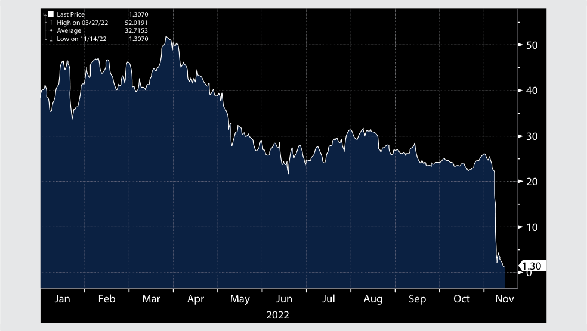

# Tập 8: Đầu tư Thay thế (*Alternative Investments*)
## Học phần 7: Giới thiệu về Tài sản Số (*Introduction to Digital Assets*)
### Phần 2/3: Các Đặc điểm Đầu tư của Tài sản Số (Trang PDF 198–212)

---

<!-- PDF Page 198 -->

4. Hãy xác định các loại tài sản số khác nhau theo phân loại chung của chúng: 

<!-- Picture Text: A. Cryptocurrencies 1. ICO B. Tokens 2. NFT 3. CBDC 4. Ether 5. Stablecoin 6. Utility token Solution: A. Cryptocurrencies 3. CBDC 4. Ether 5. Stablecoin B. Tokens 1. ICO 2. NFT 6. Utility token  -->

| Phân loại chung | Các loại tài sản số |
|---|---|
| **A. Tiền mã hóa (*Cryptocurrencies*)** | 1. Phát hành tiền mã hóa lần đầu (*ICO*) 2. Mã thông báo không thể thay thế (*NFT*) 3. Tiền kỹ thuật số của ngân hàng trung ương (*CBDC*) 4. Ether 5. Tiền mã hóa ổn định giá (*Stablecoin*) 6. Mã thông báo tiện ích (*Utility token*) |
| **B. Mã thông báo (*Tokens*)** | |

**Lời giải:**

| Phân loại chung | Kết quả ghép nối |
|---|---|
| **A. Tiền mã hóa (*Cryptocurrencies*)** | 3. Tiền kỹ thuật số của ngân hàng trung ương (*CBDC*) 4. Ether 5. Tiền mã hóa ổn định giá (*Stablecoin*) |
| **B. Mã thông báo (*Tokens*)** | 1. Phát hành tiền mã hóa lần đầu (*ICO*) 2. Mã thông báo không thể thay thế (*NFT*) 6. Mã thông báo tiện ích (*Utility token*) |

# **<mark>3</mark>** 

## **CÁC ĐẶC ĐIỂM ĐẦU TƯ CỦA TÀI SẢN SỐ (*DIGITAL ASSET INVESTMENT FEATURES*)** 

**Mục tiêu học tập:** Giải thích các đặc điểm đầu tư của tài sản số (*digital assets*) và đối chiếu chúng với các loại tài sản khác.

Tài sản số đang ngày càng hiện diện mạnh mẽ hơn trong ngành dịch vụ tài chính và đã trở thành một loại tài sản phổ biến hơn đối với các nhà đầu tư. Hầu hết các tài sản số là tiền mã hóa (*cryptocurrencies*), và sự tăng trưởng của chúng là vô cùng ngoạn mục. Trong khi chỉ có khoảng 70 đồng tiền mã hóa được ghi nhận vào năm 2013, thì đến đầu năm 2022, đã có gần 10.000 đồng tiền mã hóa khác nhau được phát hành bởi các tập đoàn, tổ chức và trong nhiều trường hợp là bởi các cá nhân. 

Đầu tư tiền mã hóa thường được nhìn nhận là một tài sản thay thế (*alternative asset*). Khi tài sản số ngày càng trở nên nổi bật, một số nhà đầu tư tổ chức bắt đầu có chọn lọc tìm kiếm mức độ tiếp xúc (*exposure*) với các tài sản này vì tiềm năng sinh lời cao hơn và những lợi ích đa dạng hóa có thể có của chúng. Khi các nhà đầu tư tổ chức cảm thấy thoải mái hơn với việc đầu tư vào tài sản số, đó có thể là một dấu hiệu rất sớm cho thấy thị trường đang tiến gần đến một điểm bùng phát (*tipping point*). Khi ngày càng có nhiều nhà đầu tư tổ chức thoải mái với ý tưởng sở hữu trực tiếp tài sản số (*owning digital assets outright*), nhiều nhà cung cấp dịch vụ tài chính khác nhau, chẳng hạn như các sàn giao dịch kỹ thuật số (*digital exchanges*) và các tổ chức lưu ký (*custodians*), đã mở rộng cơ sở hạ tầng của mình nhằm đón đầu và hỗ trợ hoạt động đầu tư tiềm năng vào các tài sản số này. 

<!-- PDF Page 199 -->

### **Các Đặc điểm Phân biệt của Tài sản Số (*Distinguishing Characteristics of Digital Assets*)** 

Có những điểm khác biệt đáng chú ý giữa tài sản số và các tài sản tài chính truyền thống (*traditional financial assets*). Điểm tương đồng chính giữa các loại tài sản này là sự xuất hiện của các phương tiện đầu tư gián tiếp (*indirect investment vehicles*) chẳng hạn như các quỹ hoán đổi danh mục (*ETFs*) và các quỹ phòng hộ (*hedge funds*) đầu tư vào cả tài sản tài chính truyền thống lẫn tài sản số. Những điểm khác biệt chính giữa các loại tài sản này như sau: 

- _Sự khác biệt về giá trị nội tại vốn có (Differences in inherent value)._ Không giống như các tài sản tài chính, hầu hết các tài sản số không có giá trị nội tại vốn có (*inherent value*) dựa trên các tài sản cơ sở hoặc dựa trên dòng tiền tiềm năng—tiền lãi và cổ tức—mà chúng có thể hoặc được kỳ vọng sẽ tạo ra. Do không có thu nhập kỳ vọng để làm cơ sở xác định giá trị ngày hôm nay và chỉ báo xu hướng khả dĩ cho mức giá ngày mai, các tài sản số không có giá trị cơ bản (*fundamental value*). Giá của chúng hoàn toàn bắt nguồn từ sự tăng giá tài sản được kỳ vọng (*anticipated asset appreciation*) dựa trên giá trị khan hiếm được cảm nhận (*perceived scarcity value* – do những giới hạn đối với tổng nguồn cung tiền tệ) và khả năng tiềm tàng trong việc chuyển giao giá trị trong tương lai (nhờ các tính năng độc đáo trong các thuật toán cơ sở có thể tạo thuận lợi cho một số loại giao dịch tài chính nhất định). 

- _Sự khác biệt trong việc xác thực giao dịch (Differences in validating transactions)._ Một điểm khác biệt cốt lõi giữa tài sản số và các công cụ tài chính truyền thống là các tài sản truyền thống nhìn chung được ghi nhận trong các sổ cái tư nhân (*private ledgers*) do các bên trung gian tập trung (*central intermediaries*) duy trì. Quyền sở hữu và việc trao đổi các tài sản số nhìn chung được ghi nhận trên một sổ cái kỹ thuật số phi tập trung (*decentralized digital ledger*) sử dụng mật mã học và các thuật toán nâng cao. Việc một giao dịch tài sản số được xác thực trong một mạng lưới không cần cấp phép hay có cấp phép bằng tiêu chuẩn PoS hay PoW đều tác động đến giá trị cảm nhận (*perceived value*) của nó. 

- _Sự khác biệt trong việc sử dụng làm phương tiện trao đổi (Differences in the uses as a medium of exchange)._ Các tài sản tài chính theo truyền thống được định giá và giao dịch bằng các đồng tiền được chấp nhận rộng rãi; chúng có thể dễ dàng được giao dịch và quy đổi sang các đồng tiền pháp định (*fiat currencies*). Tiền pháp định tạo nên nền tảng của các hệ thống tài chính hiện đại với vai trò là phương tiện trao đổi ở bất kỳ quốc gia nào. Ngược lại, một số tài sản số—ví dụ như các đồng tiền mã hóa như Bitcoin—được sử dụng làm các công cụ thay thế trực tiếp (*direct substitutes*) cho các đồng tiền pháp định trong thế giới thực ở một số hoàn cảnh nhất định—đặc biệt là đối với các giao dịch trực tuyến trong hệ sinh thái Web3 đang nổi lên. Web3 là một khái niệm đề cập đến thế hệ thứ ba của mạng internet được xây dựng trên nền tảng công nghệ chuỗi khối, tính phi tập trung và các nền kinh tế dựa trên mã thông báo (*token-based economies*). 

- Mặc dù nhiều tài sản số, chẳng hạn như nghệ thuật kỹ thuật số (*digital art*) và NFT, được giao dịch và mua bán bằng tiền mã hóa, nhưng cho đến nay vẫn chỉ có sự chấp nhận rất hạn chế đối với tài sản số trong vai trò là một phương tiện trao đổi trong hệ thống tài chính chính thống (*mainstream financial system*). Một nguyên nhân là do chi phí tương đối của các giao dịch có thể cao đến mức cản trở (*prohibitively high*) việc xử lý một khối lượng lớn các giao dịch một cách có ý nghĩa. Mặc dù tiền mã hóa đang được sử dụng để thanh toán cho một số hàng hóa và dịch vụ nhất định cũng như làm khoản đầu tư, nhưng chúng không phải là phương tiện thanh toán hợp pháp (*legal tender*) ở hầu hết các khu vực pháp lý và thông thường không thể được sử dụng để thanh toán và xóa nợ hợp pháp (*legally settle and extinguish debt*) theo cùng cách như các đồng tiền pháp định. Cuối cùng, việc sử dụng tiền mã hóa cho mục đích thanh toán và đầu tư bị hạn chế nghiêm ngặt ở nhiều quốc gia; một số quốc gia đã cấm hoàn toàn việc sử dụng chúng và việc sở hữu tài sản số có thể dẫn đến án phạt hình sự (*criminal conviction*). Một số chính phủ đang khám phá khái niệm CBDC như một phiên bản mã hóa của tiền pháp định, nhưng vẫn còn phải chờ xem ý tưởng này sẽ tiến triển như thế nào. 

<!-- PDF Page 200 -->

#### **VÍ DỤ 1 (*EXAMPLE 1*)** 

### **Việc Tesla Chấp nhận Bitcoin và Dogecoin** 

Một người ủng hộ nổi tiếng đối với tiền mã hóa và các mã thông báo là Elon Musk, Giám đốc điều hành (CEO) và cổ đông lớn của Tesla Inc., hãng sản xuất ô tô điện. Vào tháng 2 năm 2021, Tesla đã công bố trong một hồ sơ đại chúng rằng hãng đã đầu tư 1,5 tỷ USD vào Bitcoin nhằm đa dạng hóa số dư tiền mặt của mình (vốn ở mức hơn 19 tỷ USD vào cuối năm 2020). Hãng cũng cho biết sẽ bắt đầu chấp nhận Bitcoin làm phương thức thanh toán cho các mẫu xe của mình tùy thuộc vào luật pháp hiện hành và ban đầu triển khai trên cơ sở giới hạn. Nhưng đến tháng 5 năm 2021, công ty thông báo rằng họ đã tạm ngừng việc mua xe bằng Bitcoin, viện dẫn những lo ngại về việc gia tăng sử dụng nhiên liệu hóa thạch (*fossil fuels*) cho hoạt động đào và giao dịch Bitcoin. Vào tháng 7 năm 2021, Musk cho biết Tesla nhiều khả năng sẽ khởi động lại việc chấp nhận thanh toán bằng Bitcoin một khi hãng hoàn tất việc thẩm định chuyên sâu (*due diligence*) về lượng năng lượng tái tạo (*renewable energy*) được sử dụng trong hoạt động đào Bitcoin. Tuy nhiên hãng đã không nối lại việc chấp nhận Bitcoin (bản gốc ghi "It resumed accepting Bitcoin; in January 2022..." ý nói chuyển sang bước tiếp theo); vào tháng 1 năm 2022, Musk thông báo rằng Tesla sẽ bắt đầu chấp nhận Dogecoin làm phương thức thanh toán cho một số mặt hàng lưu niệm thương hiệu (*brand merchandise*) được chọn. Hiện tại đây là đồng tiền mã hóa duy nhất mà Tesla chấp nhận cho việc thanh toán trực tuyến đối với một số sản phẩm đủ điều kiện mua bằng Dogecoin. 

Vào tháng 7 năm 2022, Tesla thông báo rằng hãng đã bán tháo 75% lượng Bitcoin đang nắm giữ khi giá lao dốc, nhưng không bán bất kỳ đồng Dogecoin nào của mình. 

- _Sự khác biệt về sự bảo vệ pháp lý và quy định quản lý (Differences in legal and regulatory protection)._ Các quy tắc chi phối các công cụ tài chính và hoạt động giao dịch các công cụ tài chính là rất rõ ràng, có thể dự đoán được, và được định nghĩa chặt chẽ ở hầu hết các khu vực pháp lý. Các tiêu chuẩn pháp lý và quy định quản lý đối với các công cụ và tài sản tài chính truyền thống cũng như hoạt động giao dịch chúng đã được phát triển rất hoàn thiện và thường có tính tương đồng qua biên giới các quốc gia; nhưng điều này không đúng với tài sản số. Các quy tắc toàn diện dành riêng cho tài sản số—việc hình thành, giao dịch và các tiêu chuẩn pháp lý của chúng—vẫn đang trong quá trình xây dựng. Khung pháp lý không rõ ràng, mơ hồ (*unclear, ambiguous framework*) đặt tài sản số vào thế bất lợi. Các cơ quan quản lý Hoa Kỳ xem một số đồng tiền kỹ thuật số nhất định là hàng hóa (*commodities*), trong khi các cơ quan quản lý khác lại xem chúng là một tài sản phi tài chính (*non-financial asset*). Khi không có sự công nhận—và bảo vệ—pháp lý toàn diện và rõ ràng dành cho tài sản số, giá trị của chúng mang tính đầu cơ rất cao (*highly speculative*). Cuối cùng, các sàn giao dịch khác nhau nơi tiền kỹ thuật số được giao dịch thường không được quản lý như một sàn giao dịch tài chính truyền thống. Do đó, một số hành vi thị trường nhất định, chẳng hạn như thao túng giá (*price manipulation*) và gian lận trắng trợn (*outright fraud*)—vốn bị coi là các hoạt động bất hợp pháp trong các giao dịch tài chính truyền thống—lại không nhất thiết bị cấm trên một sàn giao dịch kỹ thuật số. Bảng 5 (*Exhibit 5*) thể hiện những điểm khác biệt giữa tài sản số và tài sản tài chính truyền thống. 

#### **Bảng 5: Tài sản Số so với Tài sản Tài chính Truyền thống (*Exhibit 5: Digital Assets vs. Traditional Financial Assets*)** 

||**Tài sản Số (*Digital Assets*)**|**Tài sản Tài chính Truyền thống (*Traditional Financial Assets*)**|
|---|---|---|
|**Giá trị nội tại vốn có (*Inherent value*)**|■ Không có giá trị cơ bản hoặc không tạo ra dòng tiền trong tương lai ■ Giá được dẫn dắt bởi một số tính năng nhất định trên chuỗi khối|■ Giá trị được xác định bởi dòng tiền trong tương lai được tạo ra từ các tài sản|
|**Xác thực giao dịch (*Transaction validation*)**|■ Thường được ghi nhận trên các sổ cái kỹ thuật số phi tập trung sử dụng mật mã học và các thuật toán cho các mạng lưới chuỗi khối không cần cấp phép|■ Được ghi nhận trong các sổ cái tư nhân do các bên trung gian tập trung duy trì|

<!-- PDF Page 201 -->

||**Tài sản Số (*Digital Assets*)**|**Tài sản Tài chính Truyền thống (*Traditional Financial Assets*)**|
|---|---|---|
|**Sử dụng làm phương tiện trao đổi (*Uses as a medium of exchange*)**|■ Rất ít tài sản số được sử dụng làm phương tiện trao đổi trực tiếp, chủ yếu nhắm tới sự chấp nhận khả thi về mặt thương mại trên quy mô lớn|■ Không được sử dụng trực tiếp làm phương tiện trao đổi nhưng có thể dễ dàng giao dịch và quy đổi sang các đồng tiền pháp định truyền thống vốn được sử dụng rộng rãi trong thế giới thực|
|**Sự bảo vệ pháp lý và quy định quản lý (*Legal and regulatory protection*)**|■ Khung pháp lý mơ hồ, thường mâu thuẫn, đang phát triển; nhìn chung chưa được quản lý, với sự bảo vệ pháp lý tối thiểu ■ Việc sử dụng có thể là bất hợp pháp hoặc phạm tội hình sự ở một số quốc gia|■ Các tiêu chuẩn pháp lý, quy định quản lý và thương mại đã được thiết lập vững chắc, được kiểm nghiệm và chứng minh, rất rõ ràng, có thể dự đoán được và được định nghĩa chặt chẽ trên tất cả các khu vực pháp lý|

### **Các Tài sản Số Có thể Đầu tư (*Investible Digital Assets*)** 

Sự tăng trưởng nhanh chóng của tài sản số là vô cùng đáng chú ý. Việc tồn tại nhiều tài sản số và tiền mã hóa khác nhau phản ánh rằng các chuỗi khối cơ sở (*underlying blockchains*) của chúng được thiết kế và tối ưu hóa cho các mục đích khác nhau. Hai đồng tiền mã hóa phổ biến nhất là Bitcoin và Ether. Bitcoin và Ether cộng lại chiếm hơn 80% tổng giá trị thị trường tiền mã hóa tính đến tháng 7 năm 2022. 

Bitcoin (BTC hoặc XBT) được ra mắt nhằm bảo mật các khoản thanh toán trong một mạng lưới ngang hàng (P2P). Nó được thiết kế như một phương án thay thế cho các đồng tiền truyền thống: đóng vai trò là một phương tiện trao đổi (*medium of exchange*) và công cụ lưu trữ giá trị (*store of value*). Đây là đồng tiền mã hóa nổi tiếng nhất và được giao dịch rộng rãi nhất, đồng thời thiết kế nền tảng của nó tiếp tục có ảnh hưởng đến sự phát triển của các loại tài sản số mới. Hàng ngàn đồng tiền mã hóa khác tồn tại dựa trên công nghệ tương tự như Bitcoin: Chúng được gọi là **các đồng tiền thay thế (*altcoins*)**. 

#### **_Tiền mã hóa thay thế (Altcoins)_** 

Đồng altcoin nổi bật nhất là **Ether**, được ra mắt vào năm 2015 trên mạng lưới Ethereum của riêng nó. Ether có thêm tính năng của một chuỗi khối có khả năng lập trình được (*programmable blockchain*) cho phép người dùng xây dựng các ứng dụng sử dụng chuỗi khối đó để xác thực hoặc bảo mật các giao dịch hay các khoản thanh toán cho các thị trường hoặc các mục đích sử dụng khác. Do đó, Ether và các đồng tiền có khả năng lập trình khác có tiềm năng được sử dụng rộng rãi hơn chứ không chỉ đơn thuần là một công cụ lưu trữ giá trị. Những đồng altcoin có khả năng lập trình như vậy còn được gọi là các đồng tiền thông minh (*smart coins*) hoặc hợp đồng thông minh (*smart contracts*)—một hợp đồng tự thực thi với các điều khoản nổi bật của hợp đồng được viết trực tiếp vào các dòng mã lệnh (*lines of code*), cho phép thực thi hợp đồng bằng mạng lưới chuỗi khối. Việc thực thi đó cung cấp một bản ghi có thể truy xuất (*trackable*) và không thể đảo ngược (*irreversible*), chịu sự xác minh bất biến bởi các nút của mạng lưới. Các đồng altcoin khác bao gồm tiền mã hóa ổn định giá (*stablecoins*) và đồng tiền trào lưu (*meme coins*). 

#### **_Tiền mã hóa ổn định giá (Stablecoins)_** 

**Tiền mã hóa ổn định giá (*Stablecoins*)** được thiết kế để duy trì một mức giá trị ổn định bằng cách liên kết giá trị của chúng với một tài sản khác và được thế chấp bằng một rổ tài sản (*collateralized by a basket of assets*), thường là phương tiện thanh toán hợp pháp (*legal tender*), kim loại quý, hoặc các đồng tiền mã hóa khác. Rổ dự trữ (*reserve basket*) bảo vệ những người nắm giữ trước sự biến động giá và giảm thiểu rủi ro cho những người nắm giữ stablecoin trong trường hợp đồng tiền mã hóa đó gặp phải các trục trặc giao dịch, bao gồm cả sự đổ vỡ (*failure*). Một số stablecoin—stablecoin thông minh (*smart stablecoins*) hoặc stablecoin thuật toán (*algorithmic stablecoins*)—được thiết kế để sử dụng các thuật toán nhằm kiểm soát nguồn cung sẵn có của tài sản, chẳng hạn như đúc thêm (*minting*) tài sản bổ sung khi nhu cầu đối với đồng tiền đó tăng lên. Điều quan trọng cần lưu ý là các đồng stablecoin (thuật toán/không bảo chứng đầy đủ hoặc tùy loại) không phải lúc nào cũng có thể trực tiếp đổi ngang sang tiền pháp định như tiền gửi ngân hàng và không có bất kỳ sự bảo chứng nào về mặt pháp lý hay quy định quản lý của nhà nước (*do not have any legal or regulatory backing*). 

Stablecoin có tiềm năng tạo thuận lợi cho việc thanh toán (*settlement*) và tinh gọn hóa hoạt động giao dịch, đầu tư và thanh toán xuyên biên giới (*cross-border*). Trong những năm gần đây, một số giải pháp cạnh tranh đã được phát triển nhằm tạo thuận lợi cho các giao dịch xuyên suốt các tài sản và công cụ tài chính vật chất cũng như được mã hóa khác nhau bằng cách sử dụng khái niệm stablecoin. Một ví dụ đặc biệt là **mã thông báo được đảm bảo bằng tài sản (*asset-backed token*)**, vốn duy trì sự ngang giá (*price parity*) với một tài sản mục tiêu nào đó (đồng 

<!-- PDF Page 202 -->

đô la Mỹ hoặc vàng) thông qua quá trình mã hóa tài sản (*tokenization*) và sẽ được trình bày ở phần sau của học phần này. Đối với một nhà đầu tư nắm giữ tài sản trong một ví mật mã (*cryptographic wallet*), các mã thông báo được đảm bảo bằng tài sản mang lại sự tiếp xúc với cả các tài sản nằm trên chuỗi (*on the chain* – tiền mã hóa và tài sản số) lẫn ngoài chuỗi (*off the chain* – các công cụ tài chính). 

#### **VÍ DỤ 2 (*EXAMPLE 2*)** 

### **Cuộc Thanh lọc Thị trường của các Đồng tiền Ổn định giá (*Market Shakeout of Stablecoins*)** 

Các đồng tiền ổn định giá (*stablecoins*) được thiết kế để bám sát giá trị của các đồng tiền pháp định thông thường trong thế giới thực và mang lại khả năng tiếp cận thanh khoản tức thời cho các nhà giao dịch để quy đổi các đồng stablecoin kỹ thuật số của họ ngang giá (*at par*) với giá trị của các đồng tiền pháp định. Một số đồng stablecoin này được thế chấp bằng các tài sản tài chính, chẳng hạn như một rổ các đồng tiền pháp định, vàng, trái phiếu Kho bạc (*Treasuries*), và các tài sản thanh khoản hoặc kém thanh khoản khác. Hai trong số các đồng stablecoin lớn nhất xét về tài sản thế chấp là Tether (USDT) và USD Coin (USDC) sử dụng cách tiếp cận này và có thể được giao dịch tự do trên thị trường mở hoặc được quy đổi lấy giá trị đô la tương ứng từ các tổ chức phát hành. 

Một đồng stablecoin phổ biến khác là Terra lại thường được gọi là một “stablecoin thuật toán” (*“algorithmic stablecoin”*). Nó không được đảm bảo bằng tài sản thế chấp là các tài sản tài chính và vật chất, mà thông qua một thuật toán tìm cách giữ cho giá trị của nó ổn định. 

Chẳng hạn, TerraUSD (UST) là đồng stablecoin của Terra được neo giá vào đồng đô la Mỹ “bằng thuật toán” (*“algorithmically”*) thay vì dựa vào giá trị của tài sản thế chấp cơ sở trong quỹ dự trữ bằng đô la Mỹ. Thuật toán máy tính được phát triển bởi tổ chức phát hành Terra là Terraform Labs đã sử dụng Luna—một mã thông báo quản trị (*governance token*) cũng do Terraform Labs phát hành—để duy trì sự ổn định giá trị của Terra. Mối quan hệ giữa Terra và Luna được thiết kế sao cho những người nắm giữ Terra luôn có thể quy đổi nó lấy một giá trị ổn định bằng các đồng Luna mới được đúc ra (*newly minted Luna coins*). Nếu mối quan hệ định giá giữa Terra và Luna không ở trạng thái cân bằng, các đồng Luna mới có thể được phát hành thêm hoặc các đồng Luna hiện hữu sẽ bị đốt bỏ (*destroyed*) nhằm duy trì mối quan hệ giá trị và tỷ giá neo thuật toán (*algorithmic peg*) này giữa Terra và Luna. Thông qua hoạt động kinh doanh chênh lệch giá tài chính (*financial arbitrage*), sự ổn định của giá trị Terra thông qua việc giao dịch qua lại giữa Terra và Luna sẽ được giữ vững. Trên thực tế, Terra chỉ đơn giản là được bảo chứng bằng Luna, trong đó cả hai đều mang một giá trị tính bằng đô la Mỹ. 

Vào tháng 5 năm 2022, mối quan hệ này đã bị thử thách. Vào ngày 9 tháng 5, giá của Luna bắt đầu trượt dốc trước, gây áp lực lên tỷ giá neo (*peg*) của Terra. Nhiều người sở hữu Terra đã đổ xô đi quy đổi đồng tiền của họ, dẫn đến sự tăng vọt đột ngột trong nguồn cung đồng Luna mới được phát hành: Chỉ trong vòng một tuần, số lượng đồng Luna đã tăng vọt từ 350 triệu đồng lên tới 6,5 nghìn tỷ đồng (*6.5 trillion*). Hậu quả là giá của Luna sụp đổ hoàn toàn, và giá của Terra cũng sụp đổ theo. 

TerraUSD cuối cùng đã bị mất chốt tỷ giá (*depegged*) khỏi đồng đô la Mỹ vào ngày 9 tháng 5 năm 2022. Mặc dù nhà đồng sáng lập của Terra đã cố gắng hồi sinh Terra dưới một hình thức tái sinh là TerraClassicUSD, nhưng đồng stablecoin này kể từ đó đã đánh mất hoàn toàn uy tín. Với sức hấp dẫn đã suy giảm, đồng tiền này trên thực tế đã chết (*practically defunct*). 

Sự sụp đổ của Terra đã làm dấy lên mối lo ngại sâu sắc về tài sản thế chấp bảo chứng của các đối thủ stablecoin lớn nhất của nó là Tether và USD Coin, do tính minh bạch hạn chế về quỹ dự trữ của chúng. Một cuộc tháo chạy và rút vốn ồ ạt (*massive run and redemption*) bởi những người nắm giữ đầy lo lắng đối với các đồng stablecoin này đã nhanh chóng diễn ra ngay sau đó. 

Mặc dù các đồng stablecoin “được chứng khoán hóa/đảm bảo bằng tài sản” (*“securitized” stablecoins*) như Tether có thể đã sống sót qua cơn hỗn loạn thị trường, nhưng các đồng stablecoin “thuật toán” khác có thể không trụ vững khi những lỗ hổng kỹ thuật của chúng bị khai thác. Tương tự như vậy, giá trị của các mã thông báo được đảm bảo bằng tài sản (*asset-backed tokens*) phụ thuộc vào cả các tài sản cơ sở lẫn giá của các mã thông báo có liên quan. Một ví dụ về Tether được trình bày trong Bảng 6 (*Exhibit 6*). 

<!-- PDF Page 203 -->

#### **Bảng 6: Giá Thị trường của Tether (*Exhibit 6: Market Price of Tether*)** 

<!-- Picture Text: 1.002 1.001 1.7 0 0 0.999 0.998 0.997 0.996 Oct Nov Dec Jan Feb Mar Apr May Jun Jul Aug Sep Oct 2021 2022 Source:  Bloomberg  -->

> **Chú thích hình ảnh:** Biểu đồ biến động giá thị trường của đồng Tether (USDT) xoay quanh mốc $1,000\text{ USD}$ (từ $0,996$ đến $1,002$) từ tháng 10/2021 đến tháng 10/2022, có thời điểm sụt giảm mạnh xuống dưới $0,996$ vào tháng 5/2022 khi xảy ra sự kiện Terra/Luna. Nguồn: Bloomberg.

#### **_Đồng tiền trào lưu (Meme Coins)_** 

**Đồng tiền trào lưu (*Meme coins*)** là các đồng tiền mã hóa thường được lấy cảm hứng từ một trò đùa (*joke*) và nhìn chung được ra mắt vì mục đích giải trí khi chúng nhanh chóng trở nên nổi tiếng trong một khoảng thời gian ngắn, cho phép những người mua giai đoạn đầu bán lại số lượng nắm giữ của mình với mức lợi nhuận thường rất đáng kể. 

#### **VÍ DỤ 3 (*EXAMPLE 3*)** 

### **Đồng tiền Trào lưu—Lịch sử của Dogecoin** 

Đồng meme coin nguyên bản và có lẽ là phổ biến nhất là Dogecoin, được dựa trên bức ảnh chế (*meme*) nổi tiếng trên internet về chú chó “doge”. Dogecoin, với hình ảnh chú chó Shiba Inu trên biểu trưng (logo) của mình, ban đầu được sáng lập vào năm 2013 như một sự chế giễu (*mockery*) đối với sự nổi tiếng của các đồng tiền mã hóa, chủ yếu là Bitcoin. Ngay cả từ “dog” (con chó) cũng được cố tình viết sai chính tả thành “doge” như một phần của màn nhại lại mang tính hài hước nhẹ nhàng (*light-hearted parody*). 

Trong khi một số đồng tiền mã hóa có tính khan hiếm ngay từ khâu thiết kế, thì Dogecoin lại được cố ý thiết kế để không có giới hạn về nguồn cung (*no limit in supply*). Thế nhưng thứ bắt đầu như một trò đùa ấy chẳng mấy chốc đã trở nên nổi tiếng trong cộng đồng những người theo dõi cuồng nhiệt như một biểu tượng sùng bái (*cult symbol*), đặc biệt là sau những lời tán dương trên mạng xã hội của một số nhân vật kinh doanh có tầm ảnh hưởng lớn. Ở mức đỉnh điểm vào tháng 5 năm 2021, giá trị thị trường của Dogecoin đã nhảy vọt lên hơn 80 tỷ USD. Tuy nhiên, giá và vốn hóa thị trường của Dogecoin đã lao dốc không phanh khi các nhà đầu tư và giới đầu cơ bán tháo (*dumped*) những đồng tiền này vì giá trị của chúng dường như rất khó có thể biện minh hợp lý. Đến tháng 5 năm 2022, giá trị thị trường của nó đã sụt xuống còn 11 tỷ USD. 

<!-- PDF Page 204 -->

#### **BỘ CÂU HỎI (*QUESTION SET*)** 

1. Giá trị thị trường của một tài sản số chủ yếu được dẫn dắt bởi: 

   - **A.** kỳ vọng giá trong tương lai của các nhà đầu cơ (*speculators*). 

   - **B.** thu nhập trong tương lai được tạo ra từ các tài sản số đó. 

   - **C.** thuật toán mật mã học của mạng lưới chuỗi khối. 

   - **Lời giải:** 

Đáp án đúng là A. Không giống như các tài sản tài chính, hầu hết các tài sản số không có giá trị nội tại vốn có dựa trên các tài sản cơ sở hoặc dựa trên dòng tiền kỳ vọng có thể được tạo ra. Nói cách khác, tài sản số không có giá trị kinh tế cơ bản (*fundamental economic value*). Giá của chúng phụ thuộc hoàn toàn vào sự tăng giá tài sản kỳ vọng (*expected asset appreciation*) nhờ giá trị khan hiếm được cảm nhận và khả năng tiềm tàng trong việc chuyển giao giá trị trong tương lai; tuy nhiên, giá trị đó phản ánh các kỳ vọng của thị trường tại thời điểm giao dịch diễn ra. 

2. Hãy xác định phát biểu sau đây là đúng hay sai: Các quy định bảo vệ pháp lý đối với chứng khoán và hàng hóa nhìn chung đều có thể áp dụng cho tài sản số. 

#### **Lời giải:** 

Sai (*False*). Trong khi các tiêu chuẩn pháp lý và quy định quản lý đối với các công cụ tài chính truyền thống đã được phát triển hoàn thiện, được kiểm nghiệm và chứng minh về mặt pháp lý; có hiệu lực thực thi rộng rãi và thống nhất; và thường có tính tương đồng giữa các khu vực tài phán và hệ thống pháp luật khác nhau, thì các quy tắc toàn diện dành riêng cho tài sản số—việc hình thành, giao dịch và các tiêu chuẩn pháp lý của chúng—vẫn đang trong quá trình xây dựng. Thêm vào đó, các sàn giao dịch kỹ thuật số khác nhau nơi tiền kỹ thuật số được giao dịch thường không chịu sự quản lý chặt chẽ như các thị trường tài chính truyền thống. Hậu quả là, một số hành vi thị trường bất thường, chẳng hạn như thao túng giá và gian lận trắng trợn, không phải lúc nào cũng bị cấm trên một sàn giao dịch kỹ thuật số. 

3. Quyền sở hữu và việc trao đổi các tài sản số trên các mạng lưới không cần cấp phép (*permissionless networks*) thường được ghi nhận trên một: 

   - **A.** sổ cái tập trung (*centralized ledger*) do một bên trung gian tập trung duy trì. 

   - **B.** sổ cái phi tập trung (*decentralized ledger*) do một bên trung gian tập trung duy trì. 

   - **C.** sổ cái phi tập trung mà không có bất kỳ bên trung gian tập trung nào. 

   - **Lời giải:** 

Đáp án đúng là C. Quyền sở hữu và việc trao đổi các tài sản số trên các mạng lưới không cần cấp phép nhìn chung được ghi nhận trên một sổ cái kỹ thuật số phân tán (tức phi tập trung) sử dụng mật mã học và các thuật toán nâng cao mà không sử dụng bất kỳ bên trung gian tập trung nào. 

4. Hãy so sánh và đối chiếu các loại tiền mã hóa ổn định giá (*stablecoins*) chính. 

#### **Lời giải:** 

Loại stablecoin truyền thống, hay còn gọi là “stablecoin được chứng khoán hóa/thế chấp bằng tài sản” (*“securitized stablecoin”*), được đảm bảo bằng tài sản thế chấp vật chất là các đồng tiền pháp định, kim loại quý, hoặc các tài sản tài chính khác đóng vai trò làm quỹ dự trữ cho mỗi đồng stablecoin được phát hành. Mỗi đồng tiền có thể được giao dịch tự do trên thị trường mở hoặc được quy đổi lấy giá trị đô la tương ứng từ tổ chức phát hành thông qua việc thanh lý tài sản thế chấp. Một ví dụ đặc biệt của stablecoin là mã thông báo được đảm bảo bằng tài sản 

<!-- PDF Page 205 -->

(*asset-backed token*), vốn duy trì sự ngang giá (*price parity*) với một số tài sản mục tiêu—ví dụ như đồng đô la Mỹ hoặc vàng—thông qua quá trình mã hóa tài sản (*tokenization*). 

Một loại stablecoin độc đáo khác được gọi là “stablecoin thông minh” (*“smart stablecoin”*) hoặc “stablecoin thuật toán” (*“algorithmic stablecoin”*), bởi vì không hề có sự bảo chứng bằng tài sản vật chất nào cho đồng tiền mã hóa này. Thay vào đó, giá trị của nó được bảo chứng bằng một đồng tiền mã hóa hoặc mã thông báo khác và được liên kết với đồng đô la Mỹ “bằng thuật toán” (*“algorithmically”*) thay vì sử dụng quỹ dự trữ bằng tiền đô la thực tế. 

## **CÁC HÌNH THỨC ĐẦU TƯ TÀI SẢN SỐ (*DIGITAL ASSET INVESTMENT FORMS*)** 

# **<mark>4</mark>** 

**Mục tiêu học tập:** Mô tả các hình thức và phương tiện đầu tư (*investment forms and vehicles*) được sử dụng trong đầu tư tài sản số.

Đầu tư vào tài sản số có thể diễn ra dưới hình thức đầu tư trực tiếp (*direct investment*) trên chuỗi khối hoặc đầu tư gián tiếp (*indirect investments*) vào các sản phẩm giao dịch trên sàn và các quỹ phòng hộ. Việc sở hữu trực tiếp Bitcoin và các đồng tiền mã hóa khác bao gồm việc sử dụng một **ví tiền mã hóa (*cryptocurrency wallet*)**, nơi lưu trữ các mã kỹ thuật số (khóa công khai và khóa cá nhân – *public and private digital codes*) cần thiết để truy cập vào tài sản trên một trang web máy tính hoặc ứng dụng thiết bị di động. Có hai loại sàn giao dịch tiền mã hóa (*cryptocurrency exchanges*) khác nhau tồn tại. 

- _Các sàn giao dịch tập trung (Centralized exchanges)_ là loại sàn giao dịch phổ biến nhất. Các sàn giao dịch thuộc sở hữu tư nhân này cung cấp các nền tảng giao dịch cho tiền mã hóa và mang lại khối lượng giao dịch (*volume*), tính thanh khoản (*liquidity*), và sự minh bạch về giá (*price transparency*). Mặc dù khái niệm sàn giao dịch tập trung không tương thích với hệ tư tưởng phi tập trung (*decentralized ideology*) của Bitcoin, nhưng chúng lại rất phổ biến. Hoạt động giao dịch diễn ra bằng phương thức điện tử và trực tiếp, không qua bất kỳ nhà môi giới hay đại lý trung gian nào, và được lưu trữ trên các máy chủ tư nhân (*private servers*), khiến cho các sàn giao dịch tập trung và khách hàng của họ phải đối mặt với các lỗ hổng bảo mật (*security vulnerabilities*). Nếu các máy chủ của sàn giao dịch bị xâm nhập (*compromised*), toàn bộ hệ thống có thể bị tê liệt, làm ngưng trệ giao dịch, và làm rò rỉ thông tin sống còn của người dùng—chẳng hạn như bị lộ các khóa mật mã dùng để truy cập vào các ví lưu ký (*custodial wallets*). Một số sàn giao dịch chịu sự quản lý pháp lý, và tùy thuộc vào khu vực tài phán, các sàn giao dịch này có thể được quản lý như các sàn giao dịch tài chính hoặc các loại hình trung gian tài chính khác. 

- _Các sàn giao dịch phi tập trung (Decentralized exchanges – DEX)_ mô phỏng giao thức phi tập trung của chuỗi khối và vận hành tương tự như cách thức hoạt động của Bitcoin. Các sàn giao dịch phi tập trung không có cơ chế kiểm soát tập trung và hoạt động trên một nền tảng phân tán mà không có sự điều phối hay kiểm soát trung tâm. Điều này mang lại lợi ích là nếu một trong các máy tính trên mạng lưới bị tấn công, sàn giao dịch vẫn tiếp tục hoạt động bình thường vì có rất nhiều máy tính khác vẫn tiếp tục vận hành trên mạng lưới. Đó là lý do tại sao việc tấn công các sàn giao dịch phi tập trung khó khăn hơn rất nhiều, khiến cho những cuộc tấn công như vậy gần như chắc chắn thất bại. Các sàn giao dịch phi tập trung rất khó quản lý về mặt pháp lý bởi vì không có một cá nhân, tổ chức hay nhóm đơn lẻ nào kiểm soát hệ thống. Điều này có nghĩa là những người giao dịch trên các sàn giao dịch phi tập trung nhìn chung được tự do giao dịch mà không chịu bất kỳ sự giám sát pháp lý nào (*regulatory scrutiny*), tạo kẽ hở cho các hoạt động có khả năng bất hợp pháp. 

Cả sàn giao dịch tập trung và phi tập trung đều có thể gặp phải các vấn đề về gian lận và thao túng, đồng thời làm dấy lên những lo ngại về bảo vệ nhà đầu tư bởi vì chúng không chịu sự giám sát nghiêm ngặt. Không giống như các sàn giao dịch dành cho các tài sản truyền thống hơn như chứng khoán vốn cổ phần và hợp đồng tương lai, bản thân tiền mã hóa và các địa điểm giao dịch tiền mã hóa (*cryptocurrency trading venues*) 

<!-- PDF Page 206 -->

phần lớn không được quản lý (*largely unregulated*), và các cá nhân hoặc các nhóm có thể tham gia vào hành vi gian lận hoặc thao túng thị trường (bao gồm cả việc sử dụng mạng xã hội để quảng bá tiền mã hóa theo cách làm tăng giá một đồng tiền mã hóa một cách giả tạo). 

#### **VÍ DỤ 4 (*EXAMPLE 4*)** 

### **Các Mô hình Bơm và Xả (*Pump and Dump Schemes*) trong Tiền mã hóa** 

Trong một mô hình bơm và xả (*pump and dump scheme*) điển hình, những nhà đầu tư mua tài sản ở giai đoạn đầu sẽ thổi phồng (*talk it up*) tài sản đó để khuyến khích những người khác mua vào, đẩy giá lên cao. Khi mức giá đã đủ cao, những kẻ chủ mưu mô hình (*scheme orchestrators*) nhanh chóng hiện thực hóa lợi nhuận và xả (*dump*) tài sản đó ra thị trường, bỏ lại những nhà đầu tư nhẹ dạ cả tin với những khoản lỗ giao dịch thường là rất nặng nề. Xét đến sự thổi phồng quá mức (*hype*) xoay quanh tiền mã hóa và bản chất không được quản lý pháp lý của các tài sản số, các mô hình bơm và xả diễn ra hết sức tràn lan. 

EthereumMax (EMAX) là một mã thông báo kỹ thuật số được tạo ra trên chuỗi khối Ethereum vào tháng 5 năm 2021, nhưng nó không có bất kỳ mối liên hệ nào khác với Ethereum. Được tung hô là một “đồng tiền văn hóa” (*“culture coin”*) giúp “bắc nhịp cầu nối giữa các đồng tiền do cộng đồng dẫn dắt và các đồng tiền nền tảng”, nó đã được bảo chứng và quảng bá rầm rộ bởi các ngôi sao giải trí nhạc pop và các ngôi sao thể thao nổi tiếng chỉ một tháng sau khi ra đời. Giá của EMAX đã tăng vọt mạnh mẽ, với làn sóng mua vào điên cuồng nhiều khả năng được tiếp lửa bởi mức độ phủ sóng dày đặc trên mạng xã hội. Đà tăng của nó rất nhanh, nhưng cú lao dốc của nó còn nhanh hơn: Chỉ sau một tháng, nó đã mất gần như toàn bộ giá trị và sự quan tâm giao dịch đối với đồng tiền này hoàn toàn biến mất. Sau đó, có cáo buộc cho rằng EMAX là một ví dụ kinh điển của mô hình bơm và xả điển hình. Các vụ kiện pháp lý tiếp theo nhắm vào những người nổi tiếng đã bảo chứng và “bơm thổi” (*“pumping”*) EMAX bằng những tuyên bố sai sự thật và gây hiểu lầm đã cáo buộc rằng âm mưu này cho phép các giám đốc điều hành của EMAX xả toàn bộ số EMAX họ nắm giữ để thu lợi nhuận kếch xù trong khi bỏ mặc các nhà đầu tư khác ôm những mã thông báo vô giá trị (*worthless tokens*). 

#### **VÍ DỤ 5 (*EXAMPLE 5*)** 

### **Vụ Phá sản của Sàn giao dịch FTX (*FTX Bankruptcy*)** 

FTX, một sàn giao dịch tiền mã hóa đặt trụ sở tại Bahamas đồng thời sở hữu FTX.US (dành cho các nhà đầu tư Hoa Kỳ), đã tăng trưởng nhanh chóng sau khi được thành lập vào năm 2019. 

Là một sàn giao dịch tập trung dành cho tiền mã hóa giao ngay (*spot cryptocurrency*) và stablecoin, cũng như hợp đồng tương lai, FTX đã trở thành một trong những sàn giao dịch lớn nhất thuộc loại này. Nó cũng cung cấp các dịch vụ lưu ký và giao dịch. Năm 2021, sàn có 1,2 triệu người dùng và tạo ra doanh thu hơn 1 tỷ USD. Giống như nhiều sàn giao dịch tiền kỹ thuật số khác, FTX phát hành một mã thông báo sàn giao dịch (*exchange token* – FTT), một dạng mã thông báo tiện ích (*utility token*) được các thành viên thị trường sử dụng trên nền tảng của mình. Bởi vì FTT có thể được vay hoặc cho vay—và mang lại cho người nắm giữ mức chiết khấu phí giao dịch trên sàn FTX—nên nó đại diện cho một giá trị nhất định (được thể hiện trong Bảng 7 – *Exhibit 7*). 

FTX đã được tài trợ vốn qua nhiều vòng đầu tư vốn mạo hiểm (*venture capital* – VC) liên tiếp, huy động được 400 triệu USD từ các công ty VC và một quỹ hưu trí lớn. Vào tháng 1 năm 2022, FTX được định giá ở mức 31,6 tỷ USD. 

FTX từng được coi là một lựa chọn thay thế tương đối ổn định và đáng tin cậy trong số các sàn giao dịch tiền kỹ thuật số. Trong năm 2022, giá tiền mã hóa sụt giảm cùng với lãi suất tăng cao đã tạo ra áp lực thanh khoản cho FTX và các thành viên thị trường tiền mã hóa khác. 

Sự căng thẳng thanh khoản ngày càng gia tăng này lại càng trở nên trầm trọng hơn bởi các báo cáo cho biết FTX và Alameda Research—một công ty giao dịch định lượng do nhà sáng lập của FTX kiểm soát—đang nắm giữ một lượng lớn tài sản thế chấp dưới dạng các khoản đầu tư kém thanh khoản, bao gồm cả các tài sản có liên quan đến chính FTX. Vào ngày 2 tháng 11 năm 2022, một bài báo trên trang _Coindesk_ đã dẫn chứng mối quan hệ mật thiết giữa FTX và Alameda Research và lưu ý rằng Alameda Research nắm giữ hơn một phần ba trong tổng quy mô 

<!-- PDF Page 207 -->

bảng cân đối kế toán trị giá 14,6 tỷ USD của mình trực tiếp bằng đồng FTT hoặc dưới dạng tài sản thế chấp dựa trên FTT. Tiết lộ này đã châm ngòi cho một đợt bán tháo đồng FTT của các nhà đầu tư và làn sóng rút tiền của khách hàng (*customer withdrawals*), khiến giá FTT rơi tự do từ mức hơn 25 USD xuống chỉ còn khoảng 1 USD chỉ trong hơn một tuần, như Bảng 7 (*Exhibit 7*) cho thấy. Vào ngày 11 tháng 11 năm 2022, FTX đã chính thức nộp đơn xin phá sản. 

#### **Bảng 7: Giá Mã thông báo Kỹ thuật số FTT (USD), Tháng 1–Tháng 11 năm 2022 (*Exhibit 7: FTT Digital Token Price (USD), January–November 2022*)** 

<!-- Picture Text: Last Price 1.3070 High on 03/27/22 52.0191 Average 32.7153 Low on 11/14/22 1.3070 50 40 30 20 10 1.30 0 Jan Feb Mar Apr May Jun Jul Aug Sep Oct Nov 2022  -->

> **Chú thích hình ảnh:**
> - **Last Price (Giá cuối):** $1,3070\text{ USD}$
> - **High on 03/27/22 (Đỉnh cao nhất ngày 27/03/2022):** $52,0191\text{ USD}$
> - **Average (Trung bình):** $32,7153\text{ USD}$
> - **Low on 11/14/22 (Đáy thấp nhất ngày 14/11/2022):** $1,3070\text{ USD}$

_Nguồn:_ Bloomberg. 

Trong hồ sơ xin phá sản của mình, FTX liệt kê khoản nợ phải trả (*liabilities*) lên tới 9 tỷ USD, trong khi các khoản đầu tư có tính thanh khoản chỉ chiếm vỏn vẹn 900 triệu USD trong tổng tài sản. Số lượng chủ nợ (*creditors*) vượt quá con số 100.000 người. 

#### **VÍ DỤ 6 (*EXAMPLE 6*)** 

### **Cáo buộc Mô hình Ponzi đối với Forsage (*Ponzi Scheme Allegation over Forsage*)** 

Mô hình Ponzi (*Ponzi scheme*) là một trò lừa đảo đầu tư thường bao gồm việc phân phối mức lợi nhuận cao cho các nhà đầu tư hiện hữu không phải từ bất kỳ khoản đầu tư thực sự nào mà lấy từ nguồn tiền đóng góp của các nhà đầu tư mới. Một biến thể của mô hình Ponzi là mô hình Ponzi kim tự tháp (*pyramid Ponzi scheme*), trong đó mỗi tầng nấc của những kẻ lừa đảo lại dụ dỗ thêm các nhà đầu tư mới tham gia bằng cách hứa hẹn mức lợi nhuận cao từ các cơ hội đầu tư thường là bịa đặt (*fabricated*). Nguồn tiền mới sau đó được chuyển lên để chi trả “lợi nhuận” cho tầng ngay phía trên. Trên thực tế, “lợi nhuận” mà các nhà đầu tư tham gia sớm ở tầng đỉnh kiếm được là do khoản tiền mặt đóng góp từ các tầng nấc nhà đầu tư mới khác nhau chi trả. 

Được ra mắt vào tháng 1 năm 2020, Forsage vận hành một nền tảng chuỗi khối phi tập trung được cho là cho phép các doanh nghiệp trực tuyến giao dịch thông qua các hợp đồng thông minh dựa trên các mạng lưới Ethereum, Tron và Binance. Nhưng đến tháng 8 năm 2022, Ủy ban Chứng khoán và Sàn giao dịch Hoa Kỳ (SEC) đã khởi tố 11 cá nhân, bao gồm bốn nhà sáng lập đặt tại Nga, Georgia và Indonesia cùng một số người quảng bá (*promoters*) tại Hoa Kỳ, về tội gian lận đầu tư. SEC cáo buộc rằng Forsage đã vận hành một mô hình lừa đảo Ponzi và kim tự tháp tiền mã hóa điển hình, huy động hơn 300 triệu USD từ các nhà đầu tư cá nhân trên toàn thế giới, được tiếp sức bởi hoạt động bảo chứng và tiếp thị rầm rộ của những người quảng bá trên mạng xã hội. 

<!-- PDF Page 208 -->

### **Các Hình thức Đầu tư Tài sản Số Trực tiếp (*Direct Digital Asset Investment Forms*)** 

Các khoản đầu tư trực tiếp vào tài sản số được thực hiện trên các sàn giao dịch kỹ thuật số khác nhau nơi giao dịch được ghi nhận trên chuỗi khối. Một khi giao dịch như vậy được xác lập giữa các bên, nó sẽ được xác thực trên chuỗi khối và một bản ghi vĩnh viễn về giao dịch đó được tạo ra. Hầu hết các sàn giao dịch tiền mã hóa đều mở cửa và hoạt động 24/7, cho phép giao dịch liên tục. 

Có một số rủi ro khi đầu tư trực tiếp vào tiền mã hóa. Thứ nhất, có rủi ro gian lận (*risk for fraud*), vốn đã gia tăng cùng với sự phổ biến của tiền mã hóa. Sự gian lận như vậy xuất hiện dưới nhiều hình thức và bao gồm các đợt ICO lừa đảo (*scam ICOs*), các mô hình bơm và xả khác nhau, thao túng thị trường, trộm cắp (*theft*), và các âm mưu tìm cách chiếm đoạt thông tin đăng nhập (*credentials*) cần thiết để truy cập vào thông tin ví tiền mã hóa. Thứ hai, vì tiền mã hóa thường được giữ trong một chiếc ví chỉ có thể truy cập được bằng một mã khóa mật khẩu duy nhất (*unique passkey*), nên việc mất quyền truy cập vào mã khóa này sẽ khiến cho toàn bộ tài sản nắm giữ trong ví không thể nào khôi phục lại được (*irretrievable*). Khoảng 20% tổng số Bitcoin trên toàn thế giới được báo cáo là đang nằm trong những chiếc ví bị mất hoặc bị bỏ hoang mà chủ sở hữu của chúng không thể truy cập được nữa. 

Hơn nữa, nhiều đồng tiền mã hóa nhỏ hơn có thể được nắm giữ chủ yếu bởi một số lượng nhỏ những người sở hữu, đôi khi được gọi là các “cá voi” (*“whales”*). “Cá voi” là thuật ngữ chuyên ngành (*jargon*) được cộng đồng tiền mã hóa sử dụng để chỉ những cá nhân hoặc thực thể nắm giữ một lượng tiền mã hóa đủ lớn để có khả năng thao túng giá (*manipulate the price*). 

#### **VÍ DỤ 7 (*EXAMPLE 7*)** 

### **Cá voi Tiền mã hóa (*Cryptocurrency Whales*)** 

Có báo cáo vào giữa năm 2022 cho biết các nhà đầu tư lớn trên chuỗi khối Ethereum đang tích lũy đồng meme coin mới được tạo ra là Shiba Inu (SHIB), một đối thủ cạnh tranh sát sườn với Dogecoin. Theo Whalestats, nền tảng theo dõi cá voi tiền mã hóa, tính đến tháng 8 năm 2022, 41% tổng số SHIB đã bị “đốt” (*“burned”* – tức được gửi vào các “ví chết” và trên thực tế là bị rút khỏi lưu thông). Tuy nhiên, 10 người nắm giữ SHIB lớn nhất tiếp theo được ước tính đang nắm giữ khoảng 21%–23% tổng số mã thông báo (tương đương 36%–39% tổng số đồng tiền đang lưu hành). Điều này có thể đã cho phép những “cá voi” đó dễ dàng gây ảnh hưởng lên giá của SHIB. Một cái nhìn thoáng qua về khối lượng giao dịch có thể mang lại gợi ý về tác động lên biến động giá (*price action*) trong một môi trường thị trường giao dịch mỏng (*thin trading market environment*), khi khối lượng giao dịch trung bình hàng ngày chỉ chưa đầy 10% tổng số mã thông báo SHIB. Bảng 8 (*Exhibit 8*) trình bày dữ liệu về giá và khối lượng giao dịch của SHIB. 

<!-- PDF Page 209 -->

**Bảng 8: Biến động Giá và Khối lượng Giao dịch của Shiba Inu (*Exhibit 8: Price Action and Trading Volume in Shiba Inu*)** 

<!-- Picture Text: 40,000 45,000 40,000 35,000 35,000 30,000 30,000 25,000 25,000 20,000 20,000 15,000 15,000 10,000 10,000 5,000 5,000 0 0 Dec-2020 Apr-2021 Aug-2021 Dec-2021 Apr-2022 Aug-2022 Volume in millions Market Capitalization in USD millions Trading volume in millions Market Capitalization in USD millions  -->

> **Chú thích hình ảnh:**
> - **Trục tung bên trái (*Volume in millions*):** Khối lượng giao dịch tính bằng triệu đơn vị (từ $0$ đến $40.000$).
> - **Trục tung bên phải (*Market Capitalization in USD millions*):** Vốn hóa thị trường tính bằng triệu USD (từ $0$ đến $45.000$).
> - **Trục hoành:** Thời gian từ tháng 12/2020 đến tháng 8/2022.

### **Các Hình thức Đầu tư Tài sản Số Gián tiếp (*Indirect Digital Asset Investment Forms*)** 

Có một số phương án thay thế tồn tại để đạt được mức tiếp xúc gián tiếp với tài sản số, bao gồm: 

- _Các quỹ tín thác đồng tiền mã hóa (Cryptocurrency coin trusts)_ cho phép các nhà đầu tư giao dịch cổ phần trong các quỹ tín thác đang nắm giữ những bể lớn của một đồng tiền mã hóa, được giao dịch trên thị trường phi tập trung (*over the counter* – OTC) và vận hành giống như các quỹ đóng (*closed-end funds*). Đối với một nhà đầu tư vào quỹ tín thác tiền mã hóa, họ không cần phải tạo ví kỹ thuật số và sử dụng các khóa mã hóa để đầu tư vào tiền mã hóa. Thêm vào đó, các quỹ tín thác có thể mang lại sự minh bạch bổ sung trong hoạt động giao dịch. Tuy nhiên, các quỹ tín thác này thu mức phí và chi phí rất lớn, trong một số trường hợp vượt quá 2%, và có thể giao dịch ở mức giá thặng dư (*premium*) hoặc chiết khấu (*discount*) so với giá trị tài sản ròng (*net asset values* – NAV) của chúng. 

- Các hợp đồng _tương lai tiền mã hóa (Cryptocurrency futures)_ là những thỏa thuận mua hoặc bán một số lượng cụ thể Bitcoin hoặc đồng tiền mã hóa khác ở một mức giá xác định vào một ngày cụ thể trong tương lai. Chẳng hạn, hoạt động giao dịch hợp đồng tương lai Bitcoin trên Sàn Giao dịch Hàng hóa Chicago (*Chicago Mercantile Exchange* – CME) được dựa trên Tỷ giá Tham chiếu Bitcoin CME CF (*CME CF Bitcoin Reference Rate*), vốn bám sát mức giá giao dịch Bitcoin giao ngay (*spot Bitcoin*) trên các sàn giao dịch tiền mã hóa. Không giống như các hàng hóa vật chất, các hợp đồng này thường được thanh toán bằng tiền mặt (*cash settled*), mà không có đồng tiền mã hóa thực tế nào được chuyển giao. Giao dịch hợp đồng tương lai về bản chất luôn có tính đòn bẩy (*inherently leveraged*). Thị trường hợp đồng tương lai tiền mã hóa có thể kém phát triển hơn và có khả năng kém thanh khoản hơn cũng như biến động mạnh hơn so với các thị trường hợp đồng tương lai lâu đời hơn. 

<!-- PDF Page 210 -->

- _Các quỹ hoán đổi danh mục tiền mã hóa (Cryptocurrency exchange-traded funds – ETFs):_ Ngày càng có nhiều sản phẩm giao dịch trên sàn, chẳng hạn như các quỹ ETF, tìm cách mô phỏng lại tỷ suất sinh lợi đầu tư tài sản số. Các quỹ ETF này thường không đầu tư trực tiếp vào tiền mã hóa mà đạt được mức tiếp xúc với giá trị của tiền mã hóa bằng cách sử dụng tiền mặt và các công cụ phái sinh tiền mã hóa (*cryptocurrency derivatives*). 

##### **Bản Điều khoản Tóm tắt Quỹ ETF Tiền mã hóa Baywhite Financial (*Baywhite Financial Cryptocurrency ETF (Fund) Term Sheet*)** 

|**Mô tả quỹ (*Fund description*)**|Quỹ được thiết kế nhằm mang lại kết quả đầu tư nhìn chung tương ứng với hiệu quả hoạt động của các đồng tiền mã hóa lớn được giao dịch. Quỹ cung cấp cho các nhà đầu tư một phương thức thuận tiện để đưa một tài sản số đang tăng trưởng nhanh chóng vào danh mục của họ như một sự thay thế cho các khoản đầu tư truyền thống. Quỹ không đầu tư trực tiếp vào Bitcoin hoặc các đồng tiền mã hóa khác.|
|---|---|
|**Chiến lược đầu tư của quỹ (*Fund investment strategy*)**|Quỹ tìm cách mang lại sự tăng giá vốn (*capital appreciation*) chủ yếu thông qua việc quản lý mức tiếp xúc với các hợp đồng tương lai tiền mã hóa. Quỹ không đầu tư trực tiếp vào tiền mã hóa. Giá trị của tiền mã hóa không được bảo chứng bởi bất kỳ chính phủ, tập đoàn, hay cơ quan xác định nào khác có thẩm quyền phát hành tiền tệ hợp pháp. Thay vào đó, giá trị của nó được quyết định một phần bởi cung và cầu trên các thị trường được tạo ra để phục vụ giao dịch tiền mã hóa. Quyền sở hữu và các bản ghi giao dịch đối với tiền mã hóa được bảo vệ thông qua mật mã học khóa công khai (*public-key cryptography*). Nguồn cung tiền mã hóa thường được quyết định bởi các giao thức mang tính đặc thù riêng của từng đồng tiền mã hóa cụ thể. Quỹ cũng có thể đầu tư vào: _Các hợp đồng tương lai tiền mã hóa (Cryptocurrency futures contracts)_, tức các hợp đồng tương lai tiền mã hóa được tiêu chuẩn hóa, thanh toán bằng tiền mặt được giao dịch trên các sở giao dịch. _Các công cụ thị trường tiền tệ (Money market instruments)_, chẳng hạn như các công cụ tiền mặt ngắn hạn có hồ sơ tín dụng chất lượng cao, bao gồm nợ chính phủ ngắn hạn và các hợp đồng mua lại (*repurchase agreements* – repos).|
|**Giao dịch quỹ (*Fund trading*)**|Quỹ được mua và bán thông qua một tài khoản môi giới chứng khoán (*brokerage account*), loại bỏ sự cần thiết phải có một tài khoản sàn giao dịch tiền mã hóa hoặc ví kỹ thuật số.|
|**Chi phí của quỹ (*Fund expenses*)**|Chi phí hoạt động hàng năm của Quỹ là 1,50% tính trên NAV.|
|**Các lưu ý bổ sung (*Additional considerations*)**|Quỹ thuộc dạng không đa dạng hóa (*non-diversified*), với khả năng đầu tư một tỷ lệ phần trăm tài sản tương đối cao vào các công cụ tài chính với một đối tác duy nhất (*single counterparty*) hoặc một vài đối tác. Tiền mã hóa và hợp đồng tương lai tiền mã hóa là các khoản đầu tư tương đối mới. Chúng phải chịu những rủi ro đặc thù và rất lớn, đồng thời trong lịch sử từng trải qua sự biến động giá nghiêm trọng. Giá trị của một khoản đầu tư vào Quỹ có thể sụt giảm mạnh mẽ mà không có cảnh báo trước, kể cả việc giảm về bằng không (*zero*).|

- _Các cổ phiếu tiền mã hóa (Cryptocurrency stocks)_ mang lại mức tiếp xúc gián tiếp nhờ hoạt động kinh doanh và mối quan hệ của chúng với các tài sản số. Các ví dụ bao gồm vốn cổ phần tại các sàn giao dịch kỹ thuật số được niêm yết công khai; các nhà cung cấp dịch vụ thanh toán chấp nhận tiền mã hóa; các tập đoàn chấp nhận tiền mã hóa làm phương thức thanh toán, đầu tư vào tiền mã hóa, hoặc đào tiền mã hóa; và các tập đoàn phát triển và/hoặc sản xuất các sản phẩm hay dịch vụ được sử dụng để vận hành các mạng lưới chuỗi khối, chẳng hạn như các máy tính chuyên dụng dùng cho hoạt động đào (*mining*). 

- _Các quỹ phòng hộ đầu tư vào tiền mã hóa (Hedge funds investing in cryptocurrencies)_, chẳng hạn như các quỹ mua tự quyết (*discretionary long*), mua/bán khống (*long/short*), định lượng (*quantitative*), và đa chiến lược (*multi-strategy*), đã nổi lên như một nguồn đầu tư tài sản số gián tiếp quan trọng. Một số quỹ phòng hộ còn tích cực đào Bitcoin để tạo thêm lợi nhuận. 

<!-- PDF Page 211 -->

##### **Bản Điều khoản Tóm tắt Quỹ Phòng hộ Tiền mã hóa Sequester Capital LLC (*Sequester Capital LLC Crypto Hedge Fund (“Fund”) Term Sheet*)**

|**Mô tả quỹ (*Fund description*)**|Quỹ được thiết kế nhằm mang lại kết quả đầu tư nhìn chung tương ứng với hiệu quả hoạt động của các đồng tiền mã hóa lớn được giao dịch. Quỹ đầu tư trực tiếp vào nhiều đồng tiền mã hóa khác nhau.|
|---|---|
|**Chiến lược đầu tư của quỹ (*Fund investment strategy*)**|Quỹ sử dụng sự kết hợp của các chiến lược quỹ phòng hộ phổ biến, bao gồm các chiến lược giao dịch dẫn dắt bởi định lượng (*quantitatively driven trading strategies*), các vị thế mua/bán khống tự quyết (*discretionary long/short positions*), và các vị thế chỉ mua tự quyết (*discretionary long-only positions*) đối với tiền mã hóa và các tài sản số khác. Quỹ đầu tư vào nhiều đồng tiền mã hóa, bao gồm Bitcoin, Ether, Litecoin, Cardano, Solana, và Polkadot. Thêm vào đó, Quỹ giao dịch các công cụ phái sinh tiền mã hóa và đôi khi có thể thực hiện các vị thế bán khống mang tính đầu cơ (*speculative short positions*) đối với một số đồng tiền mã hóa nhất định mà Quỹ tin rằng đang bị định giá quá cao. Quỹ có thể tham gia vào hoạt động cho vay và đi vay (*lending and borrowing*) tiền mã hóa.|

### **Các Hình thức Đầu tư Kỹ thuật số đối với các Tài sản Phi Kỹ thuật số (*Digital Forms of Investment for Non-Digital Assets*)** 

Những hình thức này đại diện cho các dạng đầu tư kỹ thuật số tương tự nhưng có một tài sản cơ sở _phi kỹ thuật số_ (*underlying non-digital asset*) mà từ đó khoản đầu tư nhận được giá trị của mình. 

Một sự phát triển gần đây là các mã thông báo được đảm bảo bằng tài sản (*asset-backed tokens*)—tức các quyền đòi nợ kỹ thuật số (*digital claims*) đối với tài sản vật chất, tài sản tài chính, hoặc các công cụ tài chính được thế chấp bằng chính tài sản cơ sở đó và nhận giá trị trực tiếp từ tài sản cơ sở. Các mã thông báo được đảm bảo bằng tài sản là một sự biểu diễn kỹ thuật số của quyền sở hữu (*digital representation of the ownership*). Các tài sản được mã hóa (*tokenized assets*) bao gồm vàng, dầu thô, bất động sản và cổ phiếu. 

Các mã thông báo được đảm bảo bằng tài sản có thể làm tăng tính thanh khoản bằng cách cho phép sở hữu theo phân đoạn nhỏ (*fractional ownership*) đối với các tài sản có giá trị cao, chẳng hạn như nhà cửa, tác phẩm nghệ thuật, kim loại quý và đá quý, giúp nhiều nhà đầu tư có thể cùng sở hữu một phần lợi ích phân đoạn (*fractional interest*) của cùng một tài sản. Sự biểu diễn kỹ thuật số của quyền sở hữu cho phép tạo ra một bản ghi bất biến về thông tin quyền sở hữu và chuyển giao quyền sở hữu, làm tăng tính minh bạch của các giao dịch này và làm giảm chi phí giao dịch, chi phí trung gian và chi phí lưu trữ hồ sơ. 

Các cơ quan quản lý tài chính thường phân loại các mã thông báo được đảm bảo bằng tài sản là chứng khoán (*securities*), bởi vì quyền sở hữu mã thông báo trao cho người nắm giữ quyền lợi sở hữu (*ownership interest*) đối với tài sản cơ sở. 

Các mã thông báo được đảm bảo bằng tài sản thường được phát hành trên mạng lưới Ethereum hoặc các nền tảng hợp đồng thông minh khác cho phép tương tác ngang hàng (P2P) bằng cách sử dụng các hợp đồng thông minh minh bạch, có khả năng tương tác liên thông (*interoperable*) và tồn tại xuyên suốt thời gian hoạt động của chuỗi. Các ứng dụng phi tập trung này, hay còn gọi là **dApps**, cho phép các giao dịch diễn ra—và được ghi nhận trên chuỗi khối—mà không cần một cơ chế điều phối trung tâm. 

Sự thúc đẩy phát triển các ứng dụng tài chính phi tập trung đã lớn mạnh thành một phong trào được biết đến với tên gọi **tài chính phi tập trung (*decentralized finance*)**, hay **DeFi**. DeFi tìm cách thiết kế, kết hợp và phát triển các ứng dụng tài chính mã nguồn mở khác nhau đóng vai trò như những viên gạch nền tảng (*building blocks*) cho các sản phẩm và dịch vụ tài chính tinh vi. Trên thực tế, DeFi là một thị trường (*marketplace*) của các ứng dụng dApp được thiết kế để thực hiện các chức năng tài chính cốt lõi khác nhau, bao gồm tiềm năng đóng vai trò là phương tiện trao đổi, công cụ lưu trữ giá trị, mã hóa các tài sản cơ sở, và lưu trữ hồ sơ bất biến về quyền sở hữu cũng như chuyển giao quyền sở hữu. Về mặt hiệu quả, đủ mọi loại hợp đồng thông minh có thể được nhúng vào trong các dApp để xử lý gần như mọi khía cạnh của hệ thống tài chính truyền thống, chẳng hạn như cho vay, giao dịch, đầu tư, bù trừ thanh toán, chi trả và chuyển tiền theo một cách thức phi tập trung, được xác thực và diễn ra tức thời. Một số người ủng hộ DeFi lập luận rằng hệ sinh thái chuỗi khối hiện đại có thể có nhiều lợi thế kỹ thuật hơn so với hệ thống tài chính truyền thống—ví dụ như tiết kiệm thời gian và giảm thiểu rủi ro trong khâu thanh toán và chuyển giao tài sản. Tuy nhiên, ý tưởng non trẻ (*nascent idea*) về DeFi vẫn chưa được phát triển hoàn thiện. Cho đến nay, hầu hết các dApp vẫn chỉ xoay quanh việc cấp đòn bẩy (*extending leverage*) cho hoạt động đầu tư và đầu cơ vào các tài sản số. 

<!-- PDF Page 212 -->

#### **BỘ CÂU HỎI (*QUESTION SET*)** 

1. Hãy so sánh và đối chiếu các sàn giao dịch tiền mã hóa tập trung (*centralized cryptocurrency exchanges*) và các sàn giao dịch tiền mã hóa phi tập trung (*decentralized cryptocurrency exchanges*). 

**Lời giải:** 

   - _Các sàn giao dịch tập trung (Centralized exchanges)_ thuộc sở hữu tư nhân. Chúng cung cấp các nền tảng giao dịch cho tiền mã hóa và mang lại khối lượng giao dịch, tính thanh khoản và sự minh bạch về giá. Hoạt động giao dịch diễn ra bằng phương thức điện tử và trực tiếp, không qua bất kỳ nhà môi giới hay đại lý trung gian nào, và được lưu trữ trên các máy chủ tư nhân, khiến cho các sàn giao dịch tập trung và khách hàng của họ phải đối mặt với các lỗ hổng bảo mật. Nếu các máy chủ của sàn giao dịch bị tấn công, toàn bộ hệ thống có thể bị xâm phạm, làm ngưng trệ giao dịch và làm rò rỉ thông tin sống còn của người dùng. Tùy thuộc vào khu vực tài phán, một số sàn giao dịch tập trung được quản lý như các sàn giao dịch tài chính hoặc các loại hình trung gian tài chính khác. 

   - _Các sàn giao dịch phi tập trung (Decentralized exchanges)_ mô phỏng giao thức phi tập trung của chuỗi khối. Các sàn giao dịch phi tập trung không có cơ chế kiểm soát tập trung và hoạt động trên một nền tảng phân tán mà không có sự điều phối hay kiểm soát trung tâm. Lợi ích là nếu một trong các máy tính trên mạng lưới bị tấn công, sàn giao dịch vẫn tiếp tục hoạt động vì có rất nhiều máy tính khác vẫn tiếp tục vận hành trên mạng lưới. Đó là lý do tại sao các sàn giao dịch phi tập trung ít bị tổn thương hơn rất nhiều trước các cuộc tấn công tin tặc (*computer hacks*). Các sàn giao dịch phi tập trung rất khó quản lý về mặt pháp lý bởi vì không có một cá nhân, tổ chức hay nhóm đơn lẻ nào kiểm soát hệ thống. Do đó, những người giao dịch trên các sàn giao dịch phi tập trung nhìn chung không chịu bất kỳ sự giám sát pháp lý nào, tạo kẽ hở cho các hoạt động có khả năng bất hợp pháp. 

#### 2. Hãy xác định các hình thức đầu tư trực tiếp và gián tiếp vào tài sản số: 

| Hình thức đầu tư | Khoản đầu tư |
|---|---|
| **A. Đầu tư trực tiếp (*Direct investment*)** | 1. Quỹ ETF tiền mã hóa (*Cryptocurrency ETF*) 2. Quỹ tín thác đồng tiền mã hóa (*Cryptocurrency coin trust*) 3. Phát hành tiền mã hóa lần đầu (*Initial coin offering*) 4. Quỹ phòng hộ đầu tư vào các mã thông báo kỹ thuật số (*Hedge fund investing in digital tokens*) 5. Mua một NFT nghệ thuật kỹ thuật số (*Buying a digital art NFT*) 6. Giao dịch các cổ phiếu tiền mã hóa (*Trading cryptocurrency stocks*) 7. Giao dịch các mã thông báo trên một sàn giao dịch tiền mã hóa (*Trading tokens on a cryptocurrency exchange*) 8. Mua hợp đồng tương lai Bitcoin trên một sàn giao dịch hợp đồng tương lai (*Buying Bitcoin futures on a futures exchange*) |
| **B. Đầu tư gián tiếp (*Indirect investment*)** | |

#### **Lời giải:** 

| Hình thức đầu tư | Kết quả phân loại |
|---|---|
| **A. Đầu tư trực tiếp (*Direct investment*)** | 3. Phát hành tiền mã hóa lần đầu (*Initial coin offering*) 5. Mua một NFT nghệ thuật kỹ thuật số (*Buying a digital art NFT*) 7. Giao dịch các mã thông báo trên một sàn giao dịch tiền mã hóa (*Trading tokens on a cryptocurrency exchange*) |
| **B. Đầu tư gián tiếp (*Indirect investment*)** | 1. Quỹ ETF tiền mã hóa (*Cryptocurrency ETF*) 2. Quỹ tín thác đồng tiền mã hóa (*Cryptocurrency coin trust*) 4. Quỹ phòng hộ đầu tư vào các mã thông báo kỹ thuật số (*Hedge fund investing in digital tokens*) 6. Giao dịch các cổ phiếu tiền mã hóa (*Trading cryptocurrency stocks*) 8. Mua hợp đồng tương lai Bitcoin trên một sàn giao dịch hợp đồng tương lai (*Buying Bitcoin futures on a futures exchange*) |
