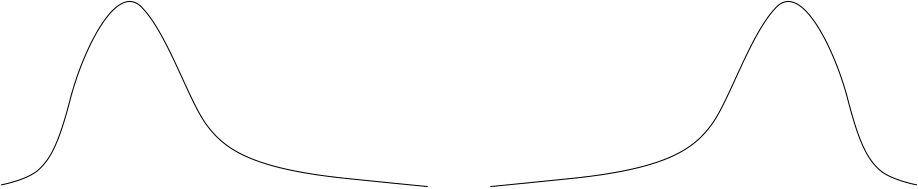
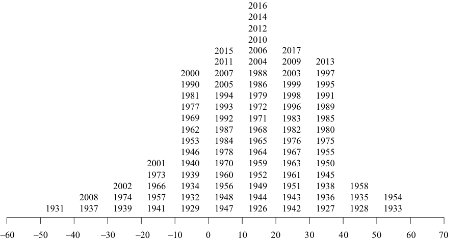
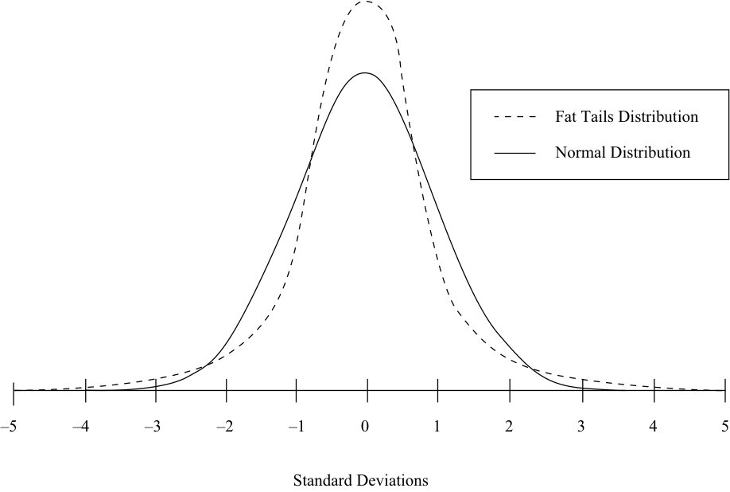
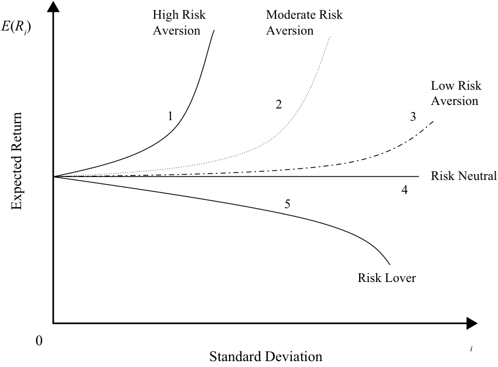

# Tập 9: Quản lý Danh mục Đầu tư (*Portfolio Management*)
## Học phần 1: Rủi ro và Lợi nhuận Danh mục Đầu tư: Phần I (*Portfolio Risk and Return: Part I*)
### Phần 1/4: Giới thiệu (*Introduction*) (Trang PDF 13–27)

---

<!-- PDF Page 13 -->

#### H Ọ C P H Ầ N

# **<mark>1</mark>**

### **Rủi ro và Lợi nhuận Danh mục Đầu tư: Phần I (*Portfolio Risk and Return: Part I*)**

**bởi Vijay Singal, PhD, CFA.**

_Vijay Singal, PhD, CFA, công tác tại Virginia Tech (Hoa Kỳ)._

###### **<mark>MỤC TIÊU HỌC TẬP (*LEARNING OUTCOMES*)</mark>**

|**_Mức độ thành thạo_**|**_Ứng viên cần có khả năng:_**|
|---|---|
||mô tả đặc điểm của các nhóm tài sản chính (*major asset classes*) mà nhà đầu tư xem xét khi hình thành danh mục đầu tư|
||giải thích sự ngại rủi ro (*risk aversion*) và các hàm ý của nó đối với việc lựa chọn danh mục đầu tư (*portfolio selection*)|
||giải thích việc lựa chọn danh mục đầu tư tối ưu (*optimal portfolio*), khi biết độ hữu dụng (*utility*) (hoặc mức độ ngại rủi ro) của nhà đầu tư và đường phân bổ vốn (*capital allocation line* – CAL)|
||tính toán và diễn giải giá trị trung bình (*mean*), phương sai (*variance*), và hiệp phương sai (*covariance*) (hoặc hệ số tương quan – *correlation*) của tỷ suất sinh lợi tài sản dựa trên dữ liệu lịch sử|
||tính toán và diễn giải độ lệch chuẩn của danh mục đầu tư (*portfolio standard deviation*)|
||mô tả tác động lên rủi ro của danh mục đầu tư khi đầu tư vào các tài sản có tương quan nhỏ hơn mức tương quan hoàn hảo (*less than perfectly correlated*)|
||mô tả và diễn giải đường biên phương sai tối thiểu (*minimum-variance frontier*) và đường biên hiệu quả (*efficient frontier*) của các tài sản rủi ro cùng với danh mục đầu tư có phương sai tối thiểu toàn cục (*global minimum-variance portfolio*)|

##### **GIỚI THIỆU (*INTRODUCTION*)**

## **<mark>1</mark>**

Xây dựng một danh mục đầu tư tối ưu (*optimal portfolio*) là một mục tiêu quan trọng đối với nhà đầu tư. Trong bài đọc này, chúng ta sẽ khám phá quy trình xem xét các đặc điểm rủi ro và lợi nhuận (*risk and return characteristics*) của từng tài sản riêng lẻ, tạo lập tất cả các danh mục đầu tư khả thi, lựa chọn những danh mục đầu tư hiệu quả nhất (*most efficient portfolios*), và cuối cùng là chọn ra danh mục đầu tư tối ưu phù hợp với từng cá nhân cụ thể.

Trong quá trình xây dựng danh mục đầu tư tối ưu, một số yếu tố và đặc điểm đầu tư sẽ được xem xét. Quan trọng nhất trong số các yếu tố đó là rủi ro và lợi nhuận của từng tài sản riêng lẻ đang được cân nhắc. Mối tương quan (*correlations*) giữa các tài sản riêng lẻ cùng với rủi ro và lợi nhuận là những yếu tố quyết định quan trọng đối với rủi ro của danh mục đầu tư (*portfolio risk*). Việc tạo lập một danh mục đầu tư cho nhà đầu tư đòi hỏi sự thấu hiểu về hồ sơ rủi ro (*risk profile*) của nhà đầu tư đó. Mặc dù chúng ta sẽ không thảo luận về quy trình xác định mức độ ngại rủi ro (*risk aversion*) cho các nhà đầu tư cá nhân hoặc tổ chức, nhưng việc thu thập thông tin như vậy là cần thiết để đưa ra một

<!-- PDF Page 14 -->

## **<mark>2</mark>**

quyết định có đầy đủ cơ sở thông tin. Trong bài đọc này, chúng ta sẽ giải thích các nhóm nhà đầu tư chính và cách thức sở thích rủi ro – lợi nhuận (*risk–return preferences*) của họ có thể được chuẩn hóa thành mô hình để lựa chọn danh mục đầu tư tối ưu từ vô số danh mục đầu tư nằm trong tập hợp cơ hội đầu tư (*investment opportunity set*).

Bài đọc được cấu trúc như sau: Phần 2–3 thảo luận về các đặc điểm đầu tư của tài sản. Phần 4–6 thảo luận về sự ngại rủi ro (*risk aversion*) và cách thức xây dựng các đường bàng quan (*indifference curves*) – công cụ kết hợp sở thích cá nhân của nhà đầu tư. Các đường bàng quan này sau đó được áp dụng vào việc lựa chọn một danh mục đầu tư tối ưu sử dụng hai tài sản rủi ro. Phần 7–9 cung cấp kiến thức và cách tính toán rủi ro danh mục đầu tư. Vai trò của hệ số tương quan (*correlation*) và việc đa dạng hóa rủi ro danh mục đầu tư (*diversification of portfolio risk*) được xem xét chi tiết. Phần 10–12 bắt đầu với các tài sản rủi ro hiện có cho nhà đầu tư và xây dựng một số lượng lớn các danh mục đầu tư rủi ro. Phần này minh họa quy trình thu hẹp các lựa chọn thành một tập hợp hiệu quả các danh mục đầu tư rủi ro (*efficient set of risky portfolios*) trước khi xác định danh mục đầu tư rủi ro tối ưu (*optimal risky portfolio*). Danh mục đầu tư rủi ro này được kết hợp với sở thích rủi ro của nhà đầu tư để tạo ra danh mục đầu tư tối ưu của nhà đầu tư (*investor's optimal portfolio*). Một phần tóm tắt sẽ khép lại bài đọc này.

##### **LỢI NHUẬN VÀ RỦI RO LỊCH SỬ (*HISTORICAL RETURN AND RISK*)**

mô tả đặc điểm của các nhóm tài sản chính (*major asset classes*) mà nhà đầu tư xem xét khi hình thành danh mục đầu tư

Trước khi xem xét dữ liệu lịch sử, việc phân biệt giữa tỷ suất sinh lợi trung bình lịch sử (*historical mean return*) và tỷ suất sinh lợi kỳ vọng (*expected return*) là rất hữu ích; đây là hai khái niệm rất khác nhau nhưng lại dễ gây nhầm lẫn. Lợi nhuận lịch sử (*historical return*) là những gì thực tế đã kiếm được trong _quá khứ_, trong khi lợi nhuận kỳ vọng (*expected return*) là những gì nhà đầu tư dự kiến sẽ kiếm được trong _tương lai_.

Tỷ suất sinh lợi kỳ vọng (*expected return*) là tỷ suất sinh lợi danh nghĩa (*nominal return*) khiến nhà đầu tư cận biên (*marginal investor*) quyết định đầu tư vào một tài sản dựa trên lãi suất phi rủi ro thực (*real risk-free interest rate*, $r_{rF}$), lạm phát kỳ vọng (*expected inflation*, $E(\pi)$), và phần bù rủi ro kỳ vọng (*expected risk premium*) cho rủi ro của tài sản đó [$E(RP)$]. Lãi suất phi rủi ro thực được kỳ vọng là số dương như một khoản đền bù cho việc trì hoãn tiêu dùng. Tương tự, phần bù rủi ro được kỳ vọng là số dương trong hầu hết các trường hợp.1 Tỷ lệ lạm phát kỳ vọng nhìn chung là số dương, ngoại trừ khi nền kinh tế đang trong tình trạng giảm phát (*deflationary state*) và giá cả đang giảm xuống. Do đó, tỷ suất sinh lợi kỳ vọng nhìn chung là số dương. Mối quan hệ giữa tỷ suất sinh lợi kỳ vọng và lãi suất phi rủi ro thực, tỷ lệ lạm phát, cùng phần bù rủi ro có thể được biểu diễn bằng phương trình sau:

$$1 + E(R) = (1 + r_{rF}) \times [1 + E(\pi)] \times [1 + E(RP)]$$

Tuy nhiên, tỷ suất sinh lợi trung bình lịch sử (*historical mean return*) đối với khoản đầu tư vào một tài sản cụ thể lại được thu thập từ tỷ suất sinh lợi thực tế (*actual return*) mà nhà đầu tư đã kiếm được. Bởi vì khoản đầu tư có rủi ro, không có gì đảm bảo rằng lợi nhuận thực tế sẽ bằng với lợi nhuận kỳ vọng. Trên thực tế, rất khó có khả năng hai mức lợi nhuận này bằng nhau trong một khoảng thời gian cụ thể đang được xem xét. Với một khoảng thời gian đủ dài, chúng ta có thể _kỳ vọng_ rằng tỷ suất sinh lợi tương lai (kỳ vọng) sẽ bằng với tỷ suất sinh lợi lịch sử trung bình. Thật không may, chúng ta không biết khoảng thời gian đó dài bao lâu—10 năm, 50 năm, hay 100 năm. Trên thực tế, chúng ta thường giả định rằng tỷ suất sinh lợi trung bình lịch sử là một đại diện thỏa đáng cho tỷ suất sinh lợi kỳ vọng, mặc dù giả định này có thể không chính xác. Ví dụ, Bảng minh họa 1 (*Exhibit 1*) cho thấy tỷ suất sinh lợi cổ phiếu lịch sử trong tám năm qua (2010–2017) đối với cổ phiếu các công ty lớn của Hoa Kỳ là dương trong khi tỷ suất sinh lợi thực tế lại âm trong thập kỷ trước đó, nhưng nhìn chung gần như luôn luôn dương trong lịch sử. Tuy nhiên, tỷ suất sinh lợi dài hạn hơn

> 1 Có những ngoại lệ khi một tài sản làm giảm rủi ro tổng thể của danh mục đầu tư. Chúng ta sẽ xem xét những ngoại lệ đó trong Phần 9.

<!-- PDF Page 15 -->

(1926–2017) là dương và có thể nhất quán với tỷ suất sinh lợi kỳ vọng. Mặc dù chưa rõ liệu tỷ suất sinh lợi trung bình lịch sử có đại diện chính xác cho tỷ suất sinh lợi kỳ vọng hay không, đây vẫn là một giả định thường được đưa ra.

**Bảng minh họa 1: Rủi ro và Lợi nhuận của các Nhóm Tài sản tại Hoa Kỳ theo Thập kỷ (%)**

|**Nhóm tài sản (*Asset Class*)**|**Chỉ tiêu**|**1930s**|**1940s**|**1950s**|**1960s**|**1970s**|**1980s**|**1990s**|**2000s**|**2010s***|**1926–2017**|
|---|---|---|---|---|---|---|---|---|---|---|---|
|Cổ phiếu công ty lớn (*Large company stocks*)|Lợi nhuận (*Return*)|−0.1|9.2|19.4|7.8|5.9|17.6|18.2|−1.0|13.9|10.2|
||Rủi ro (*Risk*)|41.6|17.5|14.1|13.1|17.2|19.4|15.9|16.3|13.6|19.8|
|Cổ phiếu công ty nhỏ (*Small company stocks*)|Lợi nhuận (*Return*)|1.4|20.7|16.9|15.5|11.5|15.8|15.1|6.3|14.8|12.1|
||Rủi ro (*Risk*)|78.6|34.5|14.4|21.5|30.8|22.5|20.2|26.1|19.4|31.7|
|Trái phiếu doanh nghiệp dài hạn (*Long-term corporate bonds*)|Lợi nhuận (*Return*)|6.9|2.7|1|1.7|6.2|13|8.4|7.7|8.3|6.1|
||Rủi ro (*Risk*)|5.3|1.8|4.4|4.9|8.7|14.1|6.9|11.7|8.8|8.3|
|Trái phiếu chính phủ dài hạn (*Long-term government bonds*)|Lợi nhuận (*Return*)|4.9|3.2|−0.1|1.4|5.5|12.6|8.8|7.7|6.8|5.5|
||Rủi ro (*Risk*)|5.3|2.8|4.6|6|8.7|16|8.9|12.4|10.8|9.9|
|Tín phiếu Kho bạc (*Treasury bills*)|Lợi nhuận (*Return*)|0.6|0.4|1.9|3.9|6.3|8.9|4.9|2.8|0.2|3.4|
||Rủi ro (*Risk*)|0.2|0.1|0.2|0.4|0.6|0.9|0.4|0.6|0.1|3.1|
|Lạm phát (*Inflation*)|Lợi nhuận (*Return*)|−2.0|5.4|2.2|2.5|7.4|5.1|2.9|2.5|1.7|2.9|
||Rủi ro (*Risk*)|2.5|3.1|1.2|0.7|1.2|1.3|0.7|1.6|1.1|4.0|

_* Tính đến ngày 31 tháng 12 năm 2017. Lưu ý:_ Lợi nhuận được đo lường bằng tỷ suất sinh lợi trung bình nhân hàng năm (*annualized geometric mean returns*). _Rủi ro được đo lường bằng cách chuẩn hóa theo năm các độ lệch chuẩn hàng tháng. Nguồn:_ Niên giám SBBI 2018 (Bảng 1.2, 1.3, 2.3 và 6.2).

Trong phần tiếp theo, hãy lưu ý phân biệt rõ giữa tỷ suất sinh lợi kỳ vọng và tỷ suất sinh lợi trung bình lịch sử. Chúng tôi sẽ lưu ý người đọc bất cứ khi nào tỷ suất sinh lợi lịch sử được sử dụng để ước tính tỷ suất sinh lợi kỳ vọng.

###### **Tỷ suất sinh lợi danh nghĩa của các nhóm tài sản chính tại Hoa Kỳ (*Nominal Returns of Major US Asset Classes*)**

Chúng ta tập trung vào ba danh mục tài sản chính trong Bảng minh họa 1: cổ phiếu (*stocks*), trái phiếu (*bonds*), và tín phiếu Kho bạc (*T-bills*). Tỷ suất sinh lợi danh nghĩa trung bình của các nhóm tài sản tại Hoa Kỳ được báo cáo theo từng thập kỷ kể từ những năm 1930. Tổng hợp cho giai đoạn 1926–2017 nằm ở cột cuối cùng. Tất cả các mức lợi nhuận đều là tỷ suất sinh lợi trung bình nhân hàng năm (*annual geometric mean returns*). Cổ phiếu công ty lớn có tỷ suất sinh lợi hàng năm tổng thể là 10,2% trong suốt giai đoạn 92 năm. Tỷ suất sinh lợi này âm vào những năm 1930 và những năm 2000, và dương trong tất cả các thập kỷ còn lại. Những năm 1950 và 1990 là những thập kỷ tốt nhất đối với cổ phiếu công ty lớn. Cổ phiếu công ty nhỏ thậm chí còn có kết quả tốt hơn. Tỷ suất sinh lợi danh nghĩa chưa bao giờ âm trong bất kỳ thập kỷ nào, và có mức tăng trưởng hai chữ số trong tất cả các thập kỷ ngoại trừ hai thập kỷ, dẫn đến tỷ suất sinh lợi hàng năm tổng thể trong 92 năm đạt 12,1%.

Trái phiếu doanh nghiệp dài hạn (*long-term corporate bonds*) và trái phiếu chính phủ dài hạn (*long-term government bonds*) đạt tỷ suất sinh lợi tổng thể lần lượt là 6,1% và 5,5%. Trái phiếu doanh nghiệp không có một thập kỷ nào mang lại lợi nhuận âm, mặc dù trái phiếu chính phủ ghi nhận mức lợi nhuận âm vào những năm 1950 khi cổ phiếu đang hoạt động cực kỳ tốt. Trái phiếu cũng có một số thập kỷ xuất sắc, đạt mức lợi nhuận hai chữ số vào những năm 1980 và 2000.

Tín phiếu Kho bạc (*Treasury bills* – chứng khoán chính phủ ngắn hạn) không có lợi nhuận âm trong bất kỳ thập kỷ nào. Trên thực tế, tín phiếu Kho bạc chỉ có lợi nhuận âm vào năm 1938 (–0,02%) khi tỷ lệ lạm phát là –2,78%. Tỷ suất sinh lợi dương nhất quán đối với tín phiếu Kho bạc không có gì đáng ngạc nhiên bởi vì lãi suất danh nghĩa (*nominal interest rates*) hầu như không bao giờ

<!-- PDF Page 16 -->

âm và tín phiếu Kho bạc chịu rất ít rủi ro lãi suất (*interest rate risk*) hoặc rủi ro lạm phát (*inflation risk*). Kể từ cuộc Đại Suy thoái (*Great Depression*), không có sự giảm phát nào trong bất kỳ thập kỷ nào, mặc dù tỷ lệ lạm phát ở mức âm rất sâu vào năm 1930 (–6,03%), năm 1931 (–9,52%), và năm 1932 (–10,30%). Ngược lại, tỷ lệ lạm phát rất cao vào cuối những năm 1970 và đầu những năm 1980, lên tới 13,31% vào năm 1979. Tỷ lệ lạm phát phần lớn dao động trong biên độ từ 1% đến 3% từ năm 1991 đến năm 2017. Nhìn chung, tỷ lệ lạm phát là 2,9% trong giai đoạn 92 năm.

###### **Tỷ suất sinh lợi thực của các nhóm tài sản chính tại Hoa Kỳ (*Real Returns of Major US Asset Classes*)**

Bởi vì tỷ lệ lạm phát hàng năm có thể biến động rất lớn, từ –10,30% đến +13,31% trong 92 năm qua, việc so sánh giữa các giai đoạn thời gian khác nhau bằng cách sử dụng tỷ suất sinh lợi danh nghĩa là rất khó khăn và dễ gây hiểu lầm. Do đó, việc dựa vào tỷ suất sinh lợi thực (*real returns*) sẽ hiệu quả hơn. Tỷ suất sinh lợi thực của cổ phiếu, trái phiếu, và tín phiếu Kho bạc được báo cáo từ năm 1900 trong Bảng minh họa 2 và Bảng minh họa 3.

**Bảng minh họa 2: Lợi nhuận tích lũy của các Nhóm Tài sản tại Hoa Kỳ theo Giá trị Thực, 1900–2017 (*Cumulative Returns on US Asset Classes in Real Terms, 1900–2017*)**

<!-- Picture Text: 1,654 1,000 100 10 10.2 2.6 1 0.10 1900 10 20 30 40 50 60 70 80 90 2000 10 Equities 6.5% per year Bonds 2.0% per year Bills 0.8% per year  -->

> **Chú thích hình ảnh:** Trục hoành biểu diễn các năm từ 1900 đến 2017; trục tung (thang logarit) biểu diễn giá trị tích lũy thực từ 0,10 đến 1.654. Ba đường biểu diễn: Cổ phiếu (*Equities*) tăng lên 1.654 (6,5%/năm), Trái phiếu (*Bonds*) tăng lên 10,2 (2,0%/năm), và Tín phiếu (*Bills*) tăng lên 2,6 (0,8%/năm).

_Nguồn_: E. Dimson, P. Marsh, và M. Staunton, _Credit Suisse Global Investment Returns Yearbook 2018_, Viện Nghiên cứu Credit Suisse (Tháng 2 năm 2018). Biểu đồ này được cập nhật hàng năm và có thể tìm thấy tại https://www.credit-suisse.com/media/assets/corporate/docs/about-us/media/media-release/2018/02/giry-summary-2018.pdf.

Bảng minh họa 2 cho thấy 1 đô la sẽ tăng trưởng lên thành 1.654 đô la nếu được đầu tư vào cổ phiếu, chỉ lên mức 10,20 đô la nếu được đầu tư vào trái phiếu, và lên mức 2,60 đô la nếu được đầu tư vào tín phiếu Kho bạc. Sự khác biệt về mức tăng trưởng giữa ba danh mục tài sản là rất lớn, mặc dù sự khác biệt về tỷ suất sinh lợi thực hàng năm dường như không lớn đến vậy: 6,5% mỗi năm đối với cổ phiếu so với 2,0% mỗi năm đối với trái phiếu. Sự khác biệt này thể hiện tác động của lãi kép (*compounding*) trong suốt giai đoạn 118 năm.

Bảng minh họa 3 báo cáo tỷ suất sinh lợi thực. Như chúng ta đã thảo luận trước đó và như được thể hiện trong bảng, trung bình nhân (*geometric mean* – GM) không bao giờ lớn hơn trung bình cộng (*arithmetic mean* – AM). Phân tích của chúng ta về lợi nhuận tập trung vào trung bình nhân bởi vì nó là sự thể hiện chính xác hơn về tỷ suất sinh lợi cho nhiều kỳ nắm giữ (*multiple holding periods*) so với trung bình cộng. Chúng ta quan sát thấy rằng tỷ suất sinh lợi thực của cổ phiếu cao hơn tỷ suất sinh lợi thực của trái phiếu.

<!-- PDF Page 17 -->

**Bảng minh họa 3: Tỷ suất sinh lợi thực và Phần bù rủi ro của các Nhóm Tài sản (1900–2017) (*Real Returns and Risk Premiums for Asset Classes (1900–2017)*)**

|**Chỉ tiêu**|**_Tài sản_ (*Asset*)**|**Hoa Kỳ (*United States*)**|||**Thế giới (*World*)**|||**Thế giới ngoại trừ Hoa Kỳ (*World excluding United States*)**|||
|---|---|---|---|---|---|---|---|---|---|---|
|||**_GM_ (%)**|**_AM_ (%)**|**_SD_ (%)**|**_GM_ (%)**|**_AM_ (%)**|**_SD_ (%)**|**_GM_ (%)**|**_AM_ (%)**|**_SD_ (%)**|
|**Tỷ suất sinh lợi thực (*Real Returns*)**|Cổ phiếu (*Equities*)|6.5|8.4|20.0|5.2|6.6|17.4|4.5|6.2|18.9|
||Trái phiếu (*Bonds*)|2.0|2.5|10.4|2.0|2.5|11.0|1.7|2.7|14.4|
|**Phần bù (*Premiums*)**|Cổ phiếu so với trái phiếu (*Equities vs. bonds*)|4.4|6.5|20.7|3.2|4.4|15.3|2.8|3.8|14.4|

_Lưu ý:_ Tất cả tỷ suất sinh lợi được tính bằng phần trăm mỗi năm đo lường theo đồng đô la Mỹ (US$). GM = trung bình nhân (*geometric mean*), AM = trung bình cộng (*arithmetic mean*), SD = độ lệch chuẩn (*standard deviation*).

_“Thế giới” bao gồm 21 quốc gia phát triển:_ Úc, Áo, Bỉ, Canada, Đan Mạch, Phần Lan, Pháp, Đức, Ireland, Ý, Nhật Bản, Hà Lan, New Zealand, Na Uy, Bồ Đào Nha, Nam Phi, Tây Ban Nha, Thụy Điển, Thụy Sĩ, Vương quốc Anh, và Hoa Kỳ. Tỷ trọng được tính theo quy mô vốn hóa thị trường tương đối của mỗi quốc gia. Xem nguồn để biết chi tiết về các phép tính.

_Nguồn:_ Credit Suisse Global Investment Returns Sourcebook, 2018.

###### **Tỷ suất sinh lợi danh nghĩa và thực của các nhóm tài sản tại các quốc gia lớn (*Nominal and Real Returns of Asset Classes in Major Countries*)**

Cùng với tỷ suất sinh lợi của Hoa Kỳ, tỷ suất sinh lợi thực của các nhóm tài sản chính cho một thế giới gồm 21 quốc gia và thế giới ngoại trừ Hoa Kỳ cũng được trình bày trong Bảng minh họa 3. Tỷ suất sinh lợi cổ phiếu được tính trọng số theo GDP của mỗi quốc gia trước năm 1968 do thiếu dữ liệu vốn hóa thị trường đáng tin cậy. Tỷ suất sinh lợi được tính trọng số theo vốn hóa thị trường của quốc gia bắt đầu từ năm 1968. Tương tự, tỷ suất sinh lợi trái phiếu được xác định bởi một chỉ số trái phiếu gồm 21 quốc gia, ngoại trừ việc GDP được sử dụng để tạo trọng số bởi vì cách tính trọng số theo vốn hóa thị trường cổ phiếu là không phù hợp đối với một chỉ số trái phiếu và dữ liệu vốn hóa thị trường trái phiếu không có sẵn.

Tỷ suất sinh lợi trung bình nhân thực đối với chỉ số cổ phiếu thế giới trong 117 năm qua là 5,2%, và trái phiếu có tỷ suất sinh lợi trung bình nhân thực là 2,0%. Tỷ suất sinh lợi trung bình nhân thực đối với thế giới ngoại trừ Hoa Kỳ là 4,5% đối với cổ phiếu và 1,7% đối với trái phiếu. Đối với cả cổ phiếu và trái phiếu, Hoa Kỳ đều đạt tỷ suất sinh lợi cao hơn thế giới ngoại trừ Hoa Kỳ. Tương tự, tỷ suất sinh lợi thực đối với cổ phiếu và trái phiếu tại Hoa Kỳ cao hơn tỷ suất sinh lợi thực của phần còn lại của thế giới.

###### **Rủi ro của các nhóm tài sản chính (*Risk of Major Asset Classes*)**

Rủi ro của các nhóm tài sản chính tại Hoa Kỳ được báo cáo cho giai đoạn 1926–2017 trong Bảng minh họa 1, và rủi ro của các nhóm tài sản chính đối với Hoa Kỳ, thế giới, và thế giới ngoại trừ Hoa Kỳ được báo cáo cho giai đoạn 1900–2017 trong Bảng minh họa 3. Bảng minh họa 1 cho thấy cổ phiếu các công ty nhỏ của Hoa Kỳ có rủi ro cao nhất là 31,7%, tiếp theo là cổ phiếu các công ty lớn của Hoa Kỳ ở mức 19,8%. Trái phiếu chính phủ dài hạn và trái phiếu doanh nghiệp dài hạn có rủi ro thấp hơn ở mức 9,9% và 8,3%, với tín phiếu Kho bạc có rủi ro thấp nhất ở mức khoảng 3,1%.

Bảng minh họa 3 cho thấy rủi ro đối với cổ phiếu thế giới là 17,4% và đối với trái phiếu thế giới là 11,0%. Thế giới ngoại trừ Hoa Kỳ có mức rủi ro là 18,9% đối với cổ phiếu và 14,4% đối với trái phiếu. Tác động của sự đa dạng hóa (*diversification*) thể hiện rõ rệt khi rủi ro thế giới được so sánh với rủi ro Hoa Kỳ và rủi ro thế giới ngoại trừ Hoa Kỳ. Mặc dù rủi ro của cổ phiếu Hoa Kỳ là 20,0% và rủi ro của cổ phiếu thế giới ngoại trừ Hoa Kỳ là 18,9%, sự kết hợp này mang lại mức rủi ro chỉ 17,4% cho cổ phiếu thế giới.

<!-- PDF Page 18 -->

###### **Sự đánh đổi giữa Rủi ro và Lợi nhuận (*Risk–Return Trade-off*)**

Cụm từ “sự đánh đổi giữa rủi ro và lợi nhuận (*risk–return trade-off*)” đề cập đến mối quan hệ cùng chiều (*positive relationship*) giữa rủi ro và lợi nhuận kỳ vọng. Nói cách khác, không thể đạt được mức lợi nhuận cao hơn trong các **thị trường hiệu quả (*efficient markets*)** và trong các khoảng thời gian dài mà không chấp nhận mức rủi ro cao hơn. Lợi nhuận kỳ vọng phải lớn hơn đối với những tài sản có rủi ro lớn hơn.

Dữ liệu lịch sử được trình bày ở trên cho thấy sự đánh đổi giữa rủi ro và lợi nhuận. Bảng minh họa 1 chỉ ra rằng tại Hoa Kỳ, cổ phiếu công ty nhỏ có rủi ro cao hơn và lợi nhuận cao hơn so với cổ phiếu công ty lớn. Cổ phiếu công ty lớn có lợi nhuận cao hơn và rủi ro cao hơn so với cả trái phiếu doanh nghiệp dài hạn và trái phiếu chính phủ dài hạn. Trái phiếu có lợi nhuận cao hơn và rủi ro cao hơn tín phiếu Kho bạc. Tuy nhiên, một điểm khác thường là trái phiếu chính phủ dài hạn lại có tổng rủi ro (*total risk*) cao hơn trái phiếu doanh nghiệp dài hạn, mặc dù lợi nhuận của trái phiếu doanh nghiệp cao hơn một chút. Những yếu tố này không có nghĩa là trái phiếu chính phủ dài hạn có rủi ro vỡ nợ (*default risk*) lớn hơn, mà chỉ đơn giản là chúng biến động nhiều hơn so với trái phiếu doanh nghiệp trong giai đoạn lịch sử này.

Bảng minh họa 3 cho thấy rủi ro và lợi nhuận của cổ phiếu là cao nhất trong các nhóm tài sản, còn rủi ro và lợi nhuận của trái phiếu thấp hơn cổ phiếu đối với Hoa Kỳ, thế giới, và thế giới ngoại trừ Hoa Kỳ.

Một cách khác để nhìn nhận sự đánh đổi giữa rủi ro và lợi nhuận là tập trung vào **phần bù rủi ro (*risk premium*)**, tức là khoản lợi nhuận tăng thêm mà nhà đầu tư có thể kỳ vọng khi gánh chịu thêm rủi ro, sau khi đã tính đến lãi suất phi rủi ro. Phần bù rủi ro danh nghĩa (*nominal risk premium*) là tỷ suất sinh lợi có rủi ro danh nghĩa trừ đi lãi suất phi rủi ro danh nghĩa (vốn đã bao gồm cả khoản đền bù cho lạm phát kỳ vọng và lãi suất phi rủi ro thực). Phần bù rủi ro thực (*real risk premium*) là tỷ suất sinh lợi có rủi ro thực trừ đi lãi suất phi rủi ro thực. Phần bù rủi ro cổ phiếu toàn cầu được báo cáo ở cuối Bảng minh họa 3 cho thấy cổ phiếu có thành quả vượt trội hơn trái phiếu. Các nhà đầu tư vào cổ phiếu kiếm được tỷ suất sinh lợi cao hơn các nhà đầu tư vào trái phiếu vì rủi ro ở cổ phiếu cao hơn.

Một sự thể hiện ấn tượng hơn về sự đánh đổi giữa rủi ro và lợi nhuận được trình bày trong Bảng minh họa 2, cho thấy lợi nhuận tích lũy của các nhóm tài sản tại Hoa Kỳ theo giá trị thực. Đường biểu diễn tín phiếu Kho bạc ít biến động hơn nhiều so với các đường khác. Sau khi điều chỉnh lạm phát, tỷ suất sinh lợi thực trung bình của tín phiếu Kho bạc là 0,8% mỗi năm. Đường biểu diễn trái phiếu biến động nhiều hơn đường tín phiếu Kho bạc nhưng ít biến động hơn đường biểu diễn cổ phiếu. Tổng lợi nhuận đối với cổ phiếu bao gồm cổ tức (*dividends*) và lãi vốn (*capital gains*) cho thấy 1 đô la được đầu tư vào đầu năm 1900 đã tăng lên thành 1.654 đô la như thế nào, tạo ra tỷ suất sinh lợi chuẩn hóa theo năm là 6,5% theo giá trị thực.

Qua những khoảng thời gian dài, chúng ta quan sát thấy rằng rủi ro cao hơn thực sự mang lại tỷ suất sinh lợi trung bình cao hơn. Do đó, hoàn toàn hợp lý khi khẳng định rằng, trong dài hạn, giá cả thị trường đền đáp rủi ro cao hơn bằng mức lợi nhuận cao hơn – đây chính là đặc điểm của một nhà đầu tư ngại rủi ro (*risk-averse investor*), một chủ đề mà chúng ta sẽ thảo luận trong Phần 4.

## **<mark>3</mark> CÁC ĐẶC ĐIỂM ĐẦU TƯ KHÁC (*OTHER INVESTMENT CHARACTERISTICS*)**

mô tả đặc điểm của các nhóm tài sản chính (*major asset classes*) mà nhà đầu tư xem xét khi hình thành danh mục đầu tư

Khi đánh giá các khoản đầu tư chỉ sử dụng giá trị trung bình (lợi nhuận kỳ vọng) và phương sai (rủi ro), chúng ta đang ngầm đưa ra hai giả định quan trọng: 1) rằng tỷ suất sinh lợi có phân phối chuẩn (*normally distributed*) và có thể được mô tả đầy đủ bằng giá trị trung bình và phương sai của chúng, và 2) rằng thị trường không chỉ hiệu quả về mặt thông tin (*informationally efficient*) mà còn hiệu quả về mặt vận hành (*operationally efficient*). Trong chừng mực mà các giả định này bị vi phạm, chúng ta cần phải xem xét thêm các đặc điểm đầu tư bổ sung. Những đặc điểm này được thảo luận dưới đây.

<!-- PDF Page 19 -->

###### **Đặc điểm phân phối (*Distributional Characteristics*)**

Như đã giải thích trong một bài đọc trước, một **phân phối chuẩn (*normal distribution*)** có ba đặc điểm chính: giá trị trung bình (*mean*) và trung vị (*median*) của nó bằng nhau; nó được xác định hoàn toàn bởi hai tham số là giá trị trung bình và phương sai (*variance*); và nó đối xứng quanh giá trị trung bình với:

- 68% các quan sát nằm trong khoảng $\pm 1\sigma$ quanh giá trị trung bình,

- 95% các quan sát nằm trong khoảng $\pm 2\sigma$ quanh giá trị trung bình, và

- 99% các quan sát nằm trong khoảng $\pm 3\sigma$ quanh giá trị trung bình.

Việc chỉ sử dụng giá trị trung bình và phương sai sẽ phù hợp để đánh giá các khoản đầu tư nếu tỷ suất sinh lợi có phân phối chuẩn. Tuy nhiên, tỷ suất sinh lợi không có phân phối chuẩn; sự sai lệch khỏi phân phối chuẩn xảy ra vì cả hai lý do: tỷ suất sinh lợi bị lệch (*skewed*), nghĩa là chúng không đối xứng quanh giá trị trung bình, và xác suất xảy ra các sự kiện cực đoan (*extreme events*) lớn hơn đáng kể so với những gì phân phối chuẩn gợi ý. Sự sai lệch thứ hai này được gọi là độ nhọn (*kurtosis*) hay đuôi béo (*fat tails*) trong phân phối tỷ suất sinh lợi. Các phần tiếp theo sẽ thảo luận sâu hơn về những sự sai lệch này.

###### **Độ lệch (*Skewness*)**

**Độ lệch (*Skewness*)** đề cập đến tính bất đối xứng của phân phối tỷ suất sinh lợi, nghĩa là tỷ suất sinh lợi không đối xứng quanh giá trị trung bình. Một phân phối được gọi là lệch trái (*left skewed*) hoặc lệch âm (*negatively skewed*) nếu phần lớn phân phối tập trung về phía bên phải, và lệch phải (*right skewed*) hoặc lệch dương (*positively skewed*) nếu phần lớn tập trung về phía bên trái. Bảng minh họa 4 cho thấy hình ảnh đại diện điển hình của độ lệch âm và độ lệch dương, trong khi Bảng minh họa 5 chứng minh độ lệch âm của tỷ suất sinh lợi cổ phiếu bằng cách vẽ biểu đồ tần suất (*histogram*) tỷ suất sinh lợi cổ phiếu của các công ty lớn tại Hoa Kỳ trong giai đoạn 1926–2017.

###### **Bảng minh họa 4: Độ lệch (*Skewness*)**

Phân phối lệch phải (Lệch dương – *Positively Skewed*) | Phân phối lệch trái (Lệch âm – *Negatively Skewed*)

_Nguồn_: In lại từ _Fixed Income Readings for the Chartered Financial Analyst_® _Program._ Bản quyền thuộc Viện CFA (CFA Institute).

<!-- PDF Page 20 -->

<!-- Picture Text: Exhibit 5: Histogram of US Large Company Stock Returns, 1926–2017 (Percent)  -->

> **Chú thích hình ảnh:** Bảng minh họa 5: Biểu đồ tần suất (*Histogram*) tỷ suất sinh lợi cổ phiếu công ty lớn tại Hoa Kỳ, 1926–2017 (Phần trăm).

<!-- Picture Text: 2016 2014 2012 2010 2015 2006 2017 2011 2004 2009 2013 2000 2007 1988 2003 1997 1990 2005 1986 1999 1995 1981 1994 1979 1998 1991 1977 1993 1972 1996 1989 1969 1992 1971 1983 1985 1962 1987 1968 1982 1980 1953 1984 1965 1976 1975 1946 1978 1964 1967 1955 2001 1940 1970 1959 1963 1950 1973 1939 1960 1952 1961 1945 2002 1966 1934 1956 1949 1951 1938 1958 2008 1974 1957 1932 1948 1944 1943 1936 1935 1954 1931 1937 1939 1941 1929 1947 1926 1942 1927 1928 1933 –60 –50 –40 –30 –20 –10 0 10 20 30 40 50 60 70  -->

> **Chú thích hình ảnh:** Biểu đồ tần suất phân bổ các năm từ 1926 đến 2017 theo các khoảng tỷ suất sinh lợi từ –60% đến +70% trên trục hoành.

_Nguồn_: Niên giám SBBI 2018 (Phụ lục A1)

###### **Độ nhọn (*Kurtosis*)**

**Độ nhọn (*Kurtosis*)** đề cập đến hiện tượng đuôi béo (*fat tails*) hoặc xác suất xảy ra các mức lợi nhuận cực đoan cao hơn mức bình thường, và có tác động làm tăng rủi ro của một tài sản mà không được phản ánh trong khung phân tích trung bình – phương sai (*mean–variance framework*), như được minh họa trong Bảng minh họa 6. Các nhà đầu tư cố gắng đánh giá tác động của độ nhọn bằng cách sử dụng các kỹ thuật thống kê như giá trị có rủi ro (*Value at Risk* – VaR) và kỳ vọng đuôi có điều kiện (*conditional tail expectations*).2 Nhiều thành viên tham gia thị trường lưu ý rằng xác suất và mức độ nghiêm trọng của các sự kiện cực đoan thường bị đánh giá thấp và đó là một yếu tố chính góp phần dẫn đến cuộc khủng hoảng tài chính năm 2008.3 Xác suất cao hơn của các kết quả âm cực đoan trong tỷ suất sinh lợi cổ phiếu cũng có thể được quan sát thấy trong Bảng minh họa 5.

> 2 Giá trị có rủi ro (*Value at risk* – VaR) là một thước đo bằng tiền về mức lỗ tối thiểu dự kiến của một danh mục đầu tư trong một khoảng thời gian xác định tại một mức xác suất cho trước. Nó thường được sử dụng để đo lường các khoản lỗ mà một danh mục đầu tư có thể gánh chịu trong điều kiện thị trường bình thường. Ví dụ, nếu VaR một ngày ở mức 10% của một danh mục đầu tư là 200.000 bảng Anh (£200,000), điều đó ngụ ý rằng có 10% xác suất giá trị của danh mục đầu tư sẽ giảm hơn 200.000 bảng Anh trong khoảng thời gian một ngày duy nhất (dưới điều kiện thị trường bình thường). Xác suất này ngụ ý rằng danh mục đầu tư sẽ trải qua khoản lỗ ít nhất 200.000 bảng Anh vào một trong số mỗi mười ngày.

> 3 Ví dụ, xem Bogle (2008) và Taleb (2007).

<!-- PDF Page 21 -->

###### **Bảng minh họa 6: Độ nhọn (*Kurtosis*)**

<!-- Picture Text: Fat Tails Distribution Normal Distribution –5 –4 –3 –2 –1 0 1 2 3 4 5 Standard Deviations  -->

> **Chú thích hình ảnh:** So sánh giữa Phân phối đuôi béo (*Fat Tails Distribution*) và Phân phối chuẩn (*Normal Distribution*) theo Độ lệch chuẩn (*Standard Deviations*) từ –5 đến 5 trên trục hoành.

_Nguồn_: In lại từ _Fixed Income Readings for the Chartered Financial Analyst® Program._ Bản quyền thuộc Viện CFA (CFA Institute).

###### **Đặc điểm thị trường (*Market Characteristics*)**

Trong phân tích trước đó, chúng ta đã ngầm giả định rằng thị trường vừa hiệu quả về mặt thông tin vừa hiệu quả về mặt vận hành. Mặc dù tính hiệu quả về mặt thông tin của thị trường là một chủ đề nằm ngoài phạm vi của bài đọc này, chúng ta cần làm nổi bật một số hạn chế về mặt vận hành của thị trường có ảnh hưởng đến việc lựa chọn các khoản đầu tư. Một hạn chế như vậy là **tính thanh khoản (*liquidity*)**. Chi phí giao dịch có ba thành phần chính—hoa hồng môi giới (*brokerage commission*), chênh lệch giá mua – bán (*bid–ask spread*), và tác động giá (*price impact*). Tính thanh khoản ảnh hưởng đến hai thành phần sau. Các cổ phiếu có tính thanh khoản thấp có thể có mức chênh lệch giá mua – bán rộng. Chênh lệch giá mua – bán, tức là khoản chênh lệch giữa giá mua và giá bán, phát sinh như một chi phí khi giao dịch chứng khoán. Chênh lệch giá mua – bán càng lớn thì chi phí giao dịch càng cao. Nếu một cổ phiếu giá 100 đô la có mức chênh lệch là 10 xu, thì chênh lệch giá mua – bán chỉ là 0,1% (\$0,10/\$100). Mặt khác, nếu một cổ phiếu giá 10 đô la có mức chênh lệch là 10 xu, thì chênh lệch giá mua – bán là 1%. Rõ ràng, cổ phiếu giá 10 đô la đắt đỏ hơn khi giao dịch và nhà đầu tư sẽ cần phải kiếm thêm 0,9% lợi nhuận để bù đắp cho chi phí giao dịch cao hơn so với cổ phiếu giá 100 đô la.

Tính thanh khoản cũng có những hàm ý đối với tác động giá (*price impact*) của giao dịch. Tác động giá đề cập đến cách giá cả biến động để phản ứng lại một lệnh giao dịch trên thị trường. Các lệnh nhỏ thường có rất ít tác động, đặc biệt là đối với các cổ phiếu có tính thanh khoản cao. Ví dụ, một lệnh mua 100 cổ phiếu của một mã cổ phiếu giá 100 đô la với mức chênh lệch 1 xu có thể không gây ra tác động nào đến giá. Mặt khác, một lệnh mua 100.000 cổ phiếu có thể có tác động đáng kể đến giá vì người mua phải thu hút ngày càng nhiều cổ đông bán lại cổ phiếu của họ. Mức độ tác động giá phụ thuộc vào tính thanh khoản của cổ phiếu. Một cổ phiếu giao dịch hàng triệu cổ phiếu mỗi ngày có thể ít bị ảnh hưởng hơn so với một cổ phiếu chỉ giao dịch vài trăm nghìn cổ phiếu mỗi ngày. Các nhà đầu tư, đặc biệt là các nhà đầu tư tổ chức quản lý những khoản tiền lớn, phải luôn lưu tâm đến tính thanh khoản của cổ phiếu khi đưa ra quyết định đầu tư.

Tính thanh khoản là một mối quan ngại lớn hơn ở các thị trường mới nổi (*emerging markets*) so với các thị trường phát triển (*developed markets*) do khối lượng giao dịch ở các thị trường đó nhỏ hơn. Tương tự, tính thanh khoản là một mối quan ngại quan trọng hơn trên thị trường trái phiếu doanh nghiệp và đặc biệt là đối với các trái phiếu có

<!-- PDF Page 22 -->

## **<mark>4</mark>**

chất lượng tín dụng thấp hơn so với trên thị trường cổ phiếu, bởi vì một đợt phát hành trái phiếu doanh nghiệp riêng lẻ có thể không được giao dịch trong nhiều ngày hoặc nhiều tuần. Điều này chắc chắn đã trở nên rõ ràng trong suốt cuộc khủng hoảng tài chính toàn cầu.

Có những đặc điểm khác liên quan đến thị trường ảnh hưởng đến các quyết định đầu tư bởi vì chúng có thể củng cố niềm tin lớn hơn vào chứng khoán hoặc có thể ảnh hưởng đến chi phí thực hiện giao dịch kinh doanh. Những đặc điểm này bao gồm mức độ theo dõi của các chuyên gia phân tích (*analyst coverage*), sự sẵn có của thông tin (*availability of information*), quy mô doanh nghiệp (*firm size*), v.v. Những đặc điểm này về các công ty và thị trường tài chính là những thành phần thiết yếu của việc ra quyết định đầu tư.

##### **SỰ NGẠI RỦI RO VÀ LỰA CHỌN DANH MỤC ĐẦU TƯ (*RISK AVERSION AND PORTFOLIO SELECTION*)**

giải thích sự ngại rủi ro (*risk aversion*) và các hàm ý của nó đối với việc lựa chọn danh mục đầu tư

Như chúng ta đã thấy, cổ phiếu, trái phiếu, và tín phiếu Kho bạc mang lại các mức lợi nhuận khác nhau và có các mức độ rủi ro khác nhau. Mặc dù việc đầu tư vào cổ phiếu có thể phù hợp với một nhà đầu tư này, nhưng một nhà đầu tư khác có thể không muốn chấp nhận rủi ro đi kèm với một cổ phần và có thể thích nắm giữ nhiều tiền mặt hơn. Trong phần trước, chúng ta đã xem xét các đặc điểm đầu tư của tài sản để hiểu rõ rủi ro và lợi nhuận của chúng. Trong phần này, chúng ta xem xét các đặc điểm của nhà đầu tư, cả cá nhân lẫn tổ chức, nhằm nỗ lực ghép nối đúng kiểu nhà đầu tư với đúng loại hình đầu tư.

Trước hết, chúng ta thảo luận về sự ngại rủi ro (*risk aversion*) và lý thuyết hữu dụng (*utility theory*). Sau đó, chúng ta thảo luận về các hàm ý của chúng đối với việc lựa chọn danh mục đầu tư.

###### **Khái niệm về Sự ngại rủi ro (*The Concept of Risk Aversion*)**

Khái niệm về **sự ngại rủi ro (*risk aversion*)** có liên quan đến hành vi của các cá nhân trong điều kiện không chắc chắn (*uncertainty*). Giả sử một cá nhân được đưa ra hai phương án lựa chọn: một phương án mà người đó chắc chắn sẽ nhận được 50 bảng Anh (£50) và phương án kia là một trò cá cược (*gamble*) với 50% cơ hội nhận được 100 bảng Anh (£100) và 50% cơ hội không nhận được gì. Giá trị kỳ vọng (*expected value*) trong cả hai trường hợp đều là 50 bảng Anh, một bên là chắc chắn và một bên là không chắc chắn. Nhà đầu tư sẽ chọn phương án nào? Có ba khả năng xảy ra: nhà đầu tư chọn trò cá cược, nhà đầu tư chọn 50 bảng Anh chắc chắn, hoặc nhà đầu tư bàng quan (*indifferent* – thấy hai phương án như nhau). Hãy cùng xem xét lần lượt từng trường hợp. Tuy nhiên, xin hiểu rằng đây chỉ là một ví dụ mang tính đại diện, và một lựa chọn đơn lẻ không quyết định mức độ ngại rủi ro của một nhà đầu tư.

###### **_Yêu thích rủi ro (Risk Seeking)_**

Nếu một nhà đầu tư chọn trò cá cược, thì nhà đầu tư đó được gọi là người yêu thích rủi ro (*risk loving*) hay tìm kiếm rủi ro (*risk seeking*). Trò cá cược có kết quả không chắc chắn, nhưng có cùng giá trị kỳ vọng với kết quả được đảm bảo chắc chắn. Do đó, việc một nhà đầu tư chọn trò cá cược có nghĩa là nhà đầu tư đó nhận được thêm “độ hữu dụng (*utility*)” từ sự không chắc chắn gắn liền với trò cá cược. Độ hữu dụng tăng thêm đó đáng giá bao nhiêu? Liệu nhà đầu tư đó có sẵn sàng chấp nhận một giá trị kỳ vọng nhỏ hơn bởi vì anh ta nhận được thêm độ hữu dụng từ rủi ro hay không? Thực vậy, những người tìm kiếm rủi ro sẽ chấp nhận mức lợi nhuận thấp hơn vì sự hấp dẫn của rủi ro đi kèm với trò cá cược. Ví dụ, một người tìm kiếm rủi ro có thể chọn một trò cá cược có giá trị kỳ vọng là 45 bảng Anh thay vì một kết quả được đảm bảo chắc chắn là 50 bảng Anh.

Có một chút bản năng cờ bạc trong nhiều người chúng ta. Mọi người mua vé số mặc dù giá trị kỳ vọng thấp hơn số tiền họ bỏ ra để mua nó. Hoặc mọi người đánh bạc tại các sòng bạc với sự hiểu biết đầy đủ rằng tỷ suất sinh lợi kỳ vọng là âm – một đặc điểm của những người tìm kiếm rủi ro. Tuy nhiên, những hành động này hay bất kỳ hành động đơn lẻ nào khác không thể được dùng để đánh giá bản chất tổng thể của nhà đầu tư, ngoại trừ đối với những người nghiện cờ bạc.

<!-- PDF Page 23 -->

###### **_Trung lập với rủi ro (Risk Neutral)_**

Nếu một nhà đầu tư bàng quan giữa trò cá cược và kết quả được đảm bảo chắc chắn, thì nhà đầu tư đó có thể là người trung lập với rủi ro (*risk neutral*). Sự trung lập với rủi ro (*risk neutrality*) có nghĩa là nhà đầu tư chỉ quan tâm đến lợi nhuận mà không quan tâm đến rủi ro, vì vậy các khoản đầu tư có lợi nhuận cao hơn sẽ được mong muốn hơn ngay cả khi chúng đi kèm với rủi ro cao hơn. Nhiều nhà đầu tư có thể thể hiện các đặc điểm của sự trung lập với rủi ro khi khoản đầu tư đang xét chỉ là một phần không đáng kể trong tổng tài sản của họ. Ví dụ, một tỷ phú có thể hoàn toàn bàng quan giữa việc chọn trò cá cược hay một kết quả được đảm bảo chắc chắn là 50 bảng Anh.

###### **_Ngại rủi ro (Risk Averse)_**

Nếu một nhà đầu tư chọn kết quả được đảm bảo chắc chắn, người đó được gọi là **ngại rủi ro (*risk averse*)** bởi vì nhà đầu tư không muốn mạo hiểm với khả năng không nhận được gì cả. Tùy thuộc vào mức độ ngại rủi ro, một nhà đầu tư có thể sẵn sàng chấp nhận một kết quả được đảm bảo chắc chắn là 45 bảng Anh thay vì một trò cá cược có giá trị kỳ vọng là 50 bảng Anh.

Nhìn chung, các nhà đầu tư có xu hướng tránh xa các khoản đầu tư rủi ro để đổi lấy một mức lợi nhuận thấp hơn nhưng được đảm bảo chắc chắn. Đó là lý do tại sao họ muốn tối thiểu hóa rủi ro cho cùng một mức lợi nhuận, và tối đa hóa lợi nhuận cho cùng một mức rủi ro. Sự đánh đổi giữa rủi ro và lợi nhuận được thảo luận trước đó chính là một chỉ báo của sự ngại rủi ro. Một nhà đầu tư trung lập với rủi ro sẽ tối đa hóa lợi nhuận bất kể rủi ro và một nhà đầu tư tìm kiếm rủi ro sẽ tối đa hóa cả rủi ro lẫn lợi nhuận.

Dữ liệu được trình bày trong phần trước minh họa mối quan hệ lịch sử cùng chiều giữa rủi ro và lợi nhuận, điều này chứng tỏ rằng giá cả thị trường được hình thành dựa trên các giao dịch và khoản đầu tư của những nhà đầu tư ngại rủi ro và phản ánh sự ngại rủi ro. Do đó, vì mọi mục đích thực tiễn và cho các cuộc thảo luận tiếp theo của chúng ta, chúng ta sẽ giả định rằng nhà đầu tư đại diện (*representative investor*) là một nhà đầu tư ngại rủi ro. Giả định này là cách tiếp cận tiêu chuẩn được áp dụng trong ngành đầu tư trên toàn cầu.

###### **_Khả năng chịu đựng rủi ro (Risk Tolerance)_**

**Khả năng chịu đựng rủi ro (*Risk tolerance*)** đề cập đến lượng rủi ro mà một nhà đầu tư có thể chấp nhận để đạt được một mục tiêu đầu tư. Khả năng chịu đựng rủi ro càng cao thì sự sẵn lòng chấp nhận rủi ro càng lớn. Do đó, khả năng chịu đựng rủi ro có mối quan hệ ngược chiều (*negatively related*) với sự ngại rủi ro.

##### **LÝ THUYẾT HỮU DỤNG VÀ ĐƯỜNG BÀNG QUAN (*UTILITY THEORY AND INDIFFERENCE CURVES*)**

**<mark>5</mark>**

giải thích sự ngại rủi ro (*risk aversion*) và các hàm ý của nó đối với việc lựa chọn danh mục đầu tư

Tiếp tục với ví dụ trước của chúng ta, một nhà đầu tư ngại rủi ro sẽ xếp hạng kết quả được đảm bảo chắc chắn là 50 bảng Anh cao hơn so với kết quả không chắc chắn có giá trị kỳ vọng là 50 bảng Anh. Chúng ta có thể nói rằng độ hữu dụng (*utility*) mà một nhà đầu tư hay một cá nhân nhận được từ kết quả chắc chắn 50 bảng Anh lớn hơn độ hữu dụng hay sự thỏa mãn hoặc niềm vui mà người đó nhận được từ phương án thay thế kia. Nói một cách tổng quát, độ hữu dụng là thước đo mức độ thỏa mãn tương đối từ việc tiêu dùng các hàng hóa và dịch vụ khác nhau, hoặc trong trường hợp đầu tư, là sự thỏa mãn mà một nhà đầu tư nhận được từ một danh mục đầu tư.

Bởi vì các cá nhân có sở thích khác nhau, tất cả những cá nhân ngại rủi ro có thể không xếp hạng các phương án đầu tư theo cùng một cách. Hãy xem xét lại trò cá cược 50 bảng Anh. Tất cả những cá nhân ngại rủi ro sẽ xếp hạng kết quả chắc chắn 50 bảng Anh cao hơn trò cá cược. Điều gì sẽ xảy ra nếu kết quả chắc chắn chỉ là 40 bảng Anh? Một số nhà đầu tư ngại rủi ro có thể coi 40 bảng Anh là không thỏa đáng, những người khác có thể chấp nhận nó, và một số người khác nữa giờ đây có thể trở nên bàng quan giữa mức 50 bảng Anh không chắc chắn và mức 40 bảng Anh chắc chắn.

<!-- PDF Page 24 -->

Một cách triển khai đơn giản của lý thuyết hữu dụng cho phép chúng ta lượng hóa thứ hạng của các lựa chọn đầu tư bằng cách sử dụng rủi ro và lợi nhuận. Có một số giả định về hành vi cá nhân mà chúng ta đưa ra trong định nghĩa về độ hữu dụng được cho trong phương trình dưới đây. Chúng ta giả định rằng các nhà đầu tư là những người ngại rủi ro. Họ luôn thích nhiều hơn ít (lợi nhuận lớn hơn so với lợi nhuận nhỏ hơn). Họ có khả năng xếp hạng các danh mục đầu tư khác nhau theo thứ tự ưu tiên của mình và các thứ hạng đó có tính nhất quán nội tại (*internally consistent*). Nếu một cá nhân thích X hơn Y và thích Y hơn Z, thì người đó phải thích X hơn Z. Tính chất này ngụ ý rằng các đường bàng quan (*indifference curves* – xem Bảng minh họa 7) của cùng một cá nhân không bao giờ có thể chạm hoặc cắt nhau. Một ví dụ về hàm hữu dụng (*utility function*) được cho dưới đây:

<!-- Formula Text: U  =  E(r) −  1 _ 2 A σ 2 -->

$$U = E(r) - \frac{1}{2} A \sigma^2$$

trong đó, $U$ là độ hữu dụng của một khoản đầu tư, $E(r)$ là tỷ suất sinh lợi kỳ vọng, và $\sigma^2$ là phương sai của khoản đầu tư đó.

Trong phương trình trên, $A$ là thước đo mức độ ngại rủi ro (*measure of risk aversion*), được đo lường bằng phần thưởng cận biên (*marginal reward*) mà một nhà đầu tư đòi hỏi để chấp nhận thêm rủi ro. Những nhà đầu tư ngại rủi ro nhiều hơn đòi hỏi mức đền bù lớn hơn để chấp nhận thêm rủi ro. Do đó, $A$ cao hơn đối với những cá nhân ngại rủi ro nhiều hơn. Như đã đề cập trước đó, một nhà đầu tư trung lập với rủi ro sẽ tối đa hóa lợi nhuận bất kể rủi ro và một nhà đầu tư tìm kiếm rủi ro sẽ tối đa hóa cả rủi ro lẫn lợi nhuận.

Chúng ta có thể rút ra một số kết luận từ hàm hữu dụng này. Thứ nhất, độ hữu dụng không bị giới hạn ở cả hai phía (*unbounded on both sides*). Nó có thể dương rất lớn hoặc âm rất sâu. Thứ hai, lợi nhuận cao hơn góp phần mang lại độ hữu dụng cao hơn. Thứ ba, phương sai cao hơn làm giảm độ hữu dụng nhưng mức giảm độ hữu dụng này bị khuếch đại bởi hệ số ngại rủi ro (*risk aversion coefficient*), $A$. Độ hữu dụng luôn có thể được gia tăng, dù chỉ ở mức cận biên, bằng cách đạt được lợi nhuận cao hơn hoặc rủi ro thấp hơn. Thứ tư, độ hữu dụng tự nó không chỉ ra hay đo lường trực tiếp sự thỏa mãn—nó chỉ có thể hữu ích trong việc xếp hạng các khoản đầu tư khác nhau. Ví dụ, một danh mục đầu tư có độ hữu dụng bằng 4 không nhất thiết tốt gấp hai lần so với một danh mục đầu tư có độ hữu dụng bằng 2. Danh mục đầu tư có độ hữu dụng bằng 4 có thể làm tăng niềm vui của chúng ta gấp 10 lần hoặc chỉ tăng thêm một chút ở mức cận biên. Nhưng chúng ta chắc chắn thích một danh mục đầu tư có độ hữu dụng bằng 4 hơn một danh mục đầu tư có độ hữu dụng bằng 2. Độ hữu dụng không thể được đem ra so sánh giữa các cá nhân hay các nhà đầu tư với nhau bởi vì nó là một khái niệm mang tính cá nhân rất cao. Từ góc độ xã hội, với cùng lập luận đó, độ hữu dụng không thể được cộng gộp giữa các cá nhân.

Hãy cùng khám phá sâu hơn về hàm hữu dụng. Hệ số ngại rủi ro, $A$, lớn hơn 0 đối với một nhà đầu tư ngại rủi ro. Vì vậy, bất kỳ sự gia tăng nào về rủi ro đều làm giảm độ hữu dụng của người đó. Hệ số ngại rủi ro đối với một nhà đầu tư trung lập với rủi ro là bằng 0, và những thay đổi về rủi ro không ảnh hưởng đến độ hữu dụng của họ. Đối với một người yêu thích rủi ro, hệ số ngại rủi ro mang giá trị âm, tạo ra một tình huống ngược lại sao cho rủi ro tăng thêm lại góp phần làm tăng độ hữu dụng của người đó. Lưu ý rằng một tài sản phi rủi ro ($\sigma^2 = 0$) tạo ra cùng một mức độ hữu dụng cho tất cả các cá nhân.

###### **Đường bàng quan (*Indifference Curves*)**

Một **đường bàng quan (*indifference curve*)** biểu diễn các tập hợp cặp rủi ro – lợi nhuận mà một nhà đầu tư sẵn sàng chấp nhận để duy trì một mức độ hữu dụng nhất định (tức là, nhà đầu tư hoàn toàn bàng quan giữa các kết hợp nằm trên cùng một đường cong bởi vì chúng đều mang lại cùng một mức độ hữu dụng tổng thể). Do đó, các đường bàng quan được xác định dựa trên sự đánh đổi giữa tỷ suất sinh lợi kỳ vọng và phương sai của tỷ suất sinh lợi. Bởi vì có vô số sự kết hợp giữa rủi ro và lợi nhuận có thể tạo ra cùng một độ hữu dụng cho cùng một nhà đầu tư, nên các đường bàng quan là những đường liên tục tại mọi điểm.

<!-- PDF Page 25 -->

**Bảng minh họa 7: Đường bàng quan đối với các Nhà đầu tư Ngại rủi ro (*Indifference Curves for Risk-Averse Investors*)**

<!-- Picture Text: High Moderate Low E ( Ri ) Utility Utility Utility 1 2 3 b x a x x c 0 i Standard Deviation Expected Return  -->

> **Chú thích hình ảnh:** Trục hoành là Độ lệch chuẩn (*Standard Deviation* $\sigma_i$), trục tung là Lợi nhuận kỳ vọng (*Expected Return* $E(R_i)$). Ba đường bàng quan 1, 2, 3 tương ứng với Độ hữu dụng Cao (*High Utility*), Độ hữu dụng Trung bình (*Moderate Utility*), và Độ hữu dụng Thấp (*Low Utility*). Điểm $a$ và $b$ nằm trên đường 1; điểm $c$ nằm trên đường 2 có cùng độ lệch chuẩn với điểm $b$.

Một tập hợp các đường bàng quan được vẽ trong Bảng minh họa 7. Theo định nghĩa, tất cả các điểm nằm trên bất kỳ một đường nào trong ba đường cong đều có cùng độ hữu dụng. Một nhà đầu tư không bận tâm liệu mình đang ở Điểm **a** hay Điểm **b** trên Đường bàng quan 1. Điểm **a** có rủi ro thấp hơn và lợi nhuận thấp hơn Điểm **b**, nhưng độ hữu dụng của cả hai điểm là như nhau bởi vì mức lợi nhuận cao hơn tại Điểm **b** đã bị bù trừ bởi mức rủi ro cao hơn.

Giống như Đường 1, tất cả các điểm trên Đường 2 đều có cùng độ hữu dụng và nhà đầu tư hoàn toàn bàng quan về việc mình đang ở vị trí nào trên Đường 2. Bây giờ hãy so sánh Điểm **c** với Điểm **b**. Điểm **c** có cùng mức rủi ro nhưng có lợi nhuận thấp hơn đáng kể so với Điểm **b**, điều đó có nghĩa là độ hữu dụng tại Điểm **c** nhỏ hơn độ hữu dụng tại Điểm **b**. Với việc tất cả các điểm trên Đường 1 có cùng độ hữu dụng, tất cả các điểm trên Đường 2 có cùng độ hữu dụng, và Điểm **b** có độ hữu dụng cao hơn Điểm **c**, suy ra Đường 1 có độ hữu dụng cao hơn Đường 2. Do đó, một nhà đầu tư ngại rủi ro với hai Đường bàng quan 1 và 2 sẽ thích Đường 1 hơn Đường 2. Độ hữu dụng của một nhà đầu tư ngại rủi ro luôn tăng lên khi dịch chuyển về phía tây bắc (*northwest*)—lợi nhuận cao hơn với rủi ro thấp hơn. Bởi vì tất cả các nhà đầu tư đều thích độ hữu dụng nhiều hơn là ít hơn, nên các nhà đầu tư luôn muốn dịch chuyển về phía tây bắc để đến đường bàng quan có độ hữu dụng cao nhất.

Đường bàng quan của các nhà đầu tư ngại rủi ro chạy theo hướng từ tây nam lên đông bắc (*southwest to northeast*) do sự đánh đổi giữa rủi ro và lợi nhuận. Nếu rủi ro tăng lên (đi về phía đông) thì nó phải được đền bù bằng mức lợi nhuận cao hơn (đi về phía bắc) để tạo ra cùng một độ hữu dụng. Các đường bàng quan có dạng lồi (*convex*) do quy luật độ hữu dụng cận biên giảm dần của lợi nhuận (hoặc tài sản) (*diminishing marginal utility of return or wealth*). Khi rủi ro tăng lên, nhà đầu tư cần mức lợi nhuận lớn hơn để đền bù cho rủi ro cao hơn với một tốc độ ngày càng tăng (tức là đường cong ngày càng dốc hơn). Đường bàng quan lồi dốc lên này có hệ số góc (*slope coefficient*) liên hệ mật thiết với hệ số ngại rủi ro. Độ dốc càng lớn thì mức độ ngại rủi ro của nhà đầu tư càng cao, vì cần phải có một mức tăng lợi nhuận lớn hơn để chấp nhận một mức tăng rủi ro nhất định.

Các đường bàng quan của những nhà đầu tư có các mức độ ngại rủi ro khác nhau được vẽ trong Bảng minh họa 8. Nhà đầu tư ngại rủi ro nhất có đường bàng quan với độ dốc lớn nhất. Khi độ biến động (*volatility*) tăng lên, nhà đầu tư này đòi hỏi mức lợi nhuận ngày càng cao hơn để đền bù cho rủi ro. Nhà đầu tư ít ngại rủi ro nhất có đường bàng quan với độ dốc nhỏ nhất, và do đó nhu cầu đòi hỏi lợi nhuận cao hơn khi rủi ro tăng lên không gay gắt như đối với nhà đầu tư ngại rủi ro nhiều hơn. Tuy nhiên, đường bàng quan của nhà đầu tư yêu thích rủi ro lại thể hiện độ dốc âm (*negative slope*), ngụ ý rằng người yêu thích rủi ro rất vui lòng thay thế lợi nhuận bằng rủi ro.

<!-- PDF Page 26 -->

Đối với người yêu thích rủi ro, độ hữu dụng tăng lên khi cả rủi ro cao hơn và lợi nhuận cao hơn. Cuối cùng, các đường bàng quan của những nhà đầu tư trung lập với rủi ro là những đường nằm ngang (*horizontal*) bởi vì độ hữu dụng không thay đổi theo rủi ro.

**Bảng minh họa 8: Đường bàng quan đối với các Nhóm Nhà đầu tư Khác nhau (*Indifference Curves for Various Types of Investors*)**

<!-- Picture Text: High Risk Moderate Risk E ( Ri ) Aversion Aversion Low Risk 2 Aversion 1 3 Risk Neutral 4 5 Risk Lover 0 i Standard Deviation Expected Return  -->

> **Chú thích hình ảnh:** Trục hoành là Độ lệch chuẩn (*Standard Deviation* $\sigma_i$), trục tung là Lợi nhuận kỳ vọng (*Expected Return* $E(R_i)$). Các đường cong biểu diễn: 1 – Ngại rủi ro cao (*High Risk Aversion*), 2 – Ngại rủi ro trung bình (*Moderate Risk Aversion*), 3 – Ngại rủi ro thấp (*Low Risk Aversion*), 4 – Trung lập với rủi ro (*Risk Neutral*, đường nằm ngang), 5 – Yêu thích rủi ro (*Risk Lover*, đường dốc xuống).

Trong các phần còn lại của bài đọc này, tất cả các nhà đầu tư đều được giả định là ngại rủi ro trừ khi có tuyên bố khác.

###### **VÍ DỤ 1**

###### **So sánh một Trò cá cược với một Kết quả được Đảm bảo chắc chắn (*Comparing a Gamble with a Guaranteed Outcome*)**

Giả sử bạn được trao một khoản đầu tư có tỷ suất sinh lợi kỳ vọng là 10% và rủi ro (độ lệch chuẩn) là 20%, và hệ số ngại rủi ro của bạn là 3.

1. Độ hữu dụng của bạn đối với khoản đầu tư này là bao nhiêu?

###### **Lời giải:**

   - $U = 0,10 - 0,5 \times 3 \times 0,20^2 = 0,04$.

2. Tỷ suất sinh lợi phi rủi ro tối thiểu mà bạn phải kiếm được để có cùng mức độ hữu dụng đó là bao nhiêu?

###### **Lời giải:**

Độ lệch chuẩn $\sigma$ của tỷ suất sinh lợi phi rủi ro bằng 0, vì vậy số hạng thứ hai triệt tiêu. Để nhận được cùng mức độ hữu dụng ($0,04$), tỷ suất sinh lợi phi rủi ro phải đạt ít nhất là 4%. Do đó, trong tâm trí của bạn, một tỷ suất sinh lợi có rủi ro ở mức 10% tương đương với một tỷ suất sinh lợi phi rủi ro hay một kết quả được đảm bảo chắc chắn ở mức 4%.

<!-- PDF Page 27 -->

###### **VÍ DỤ 2**

###### **Tính toán Độ hữu dụng (*Computation of Utility*)**

Dựa trên thông tin đầu tư được cho dưới đây và công thức tính độ hữu dụng $U = E(r) - 0,5 A \sigma^2$, hãy trả lời các câu hỏi sau. Tỷ suất sinh lợi và độ lệch chuẩn đều được biểu thị bằng phần trăm mỗi năm. Tuy nhiên, khi sử dụng công thức độ hữu dụng, tỷ suất sinh lợi và độ lệch chuẩn phải được biểu thị dưới dạng số thập phân.

|**Khoản đầu tư (*Investment*)**|**Lợi nhuận kỳ vọng $E(r)$**|**Độ lệch chuẩn $\sigma$**|
|---|---|---|
|1|12%|30%|
|2|15|35|
|3|21|40|
|4|24|45|

1. Một nhà đầu tư ngại rủi ro có hệ số ngại rủi ro bằng 4 sẽ chọn khoản đầu tư nào, và một nhà đầu tư ngại rủi ro có hệ số ngại rủi ro bằng 2 sẽ chọn khoản đầu tư nào?

###### **Lời giải:**

Độ hữu dụng đối với các nhà đầu tư ngại rủi ro có $A = 4$ và $A = 2$ cho từng khoản đầu tư trong bốn khoản đầu tư được trình bày trong bảng sau. Phép tính đầy đủ cho Khoản đầu tư 1 với $A = 4$ như sau: $U = 0,12 - 0,5 \times 4 \times 0,30^2 = -0,06$.

|**Khoản đầu tư (*Investment*)**|**Lợi nhuận kỳ vọng $E(r)$**|**Độ lệch chuẩn $\sigma$**|**Độ hữu dụng $A = 4$**|**Độ hữu dụng $A = 2$**|
|---|---|---|---|---|
|1|12%|30%|−0.0600|0.0300|
|2|15|35|−0.0950|0.0275|
|3|21|40|−0.1100|0.0500|
|4|24|45|−0.1650|0.0375|

Nhà đầu tư ngại rủi ro có hệ số ngại rủi ro bằng 4 nên chọn Khoản đầu tư 1. Nhà đầu tư ngại rủi ro có hệ số ngại rủi ro bằng 2 nên chọn Khoản đầu tư 3.

2. Một nhà đầu tư trung lập với rủi ro sẽ chọn khoản đầu tư nào?

###### **Lời giải:**

Một nhà đầu tư trung lập với rủi ro chỉ quan tâm đến lợi nhuận. Nói cách khác, hệ số ngại rủi ro của người đó bằng 0. Do đó, một nhà đầu tư trung lập với rủi ro sẽ chọn Khoản đầu tư 4 bởi vì nó có lợi nhuận cao nhất.

3. Một nhà đầu tư yêu thích rủi ro sẽ chọn khoản đầu tư nào?

###### **Lời giải:**

Một nhà đầu tư yêu thích rủi ro thích cả rủi ro cao hơn và lợi nhuận cao hơn. Nói cách khác, hệ số ngại rủi ro của người đó mang giá trị âm. Do đó, một nhà đầu tư yêu thích rủi ro sẽ chọn Khoản đầu tư 4 bởi vì nó có lợi nhuận cao nhất và rủi ro cao nhất trong số bốn khoản đầu tư.
