# Tập 9: Quản lý Danh mục Đầu tư (*Portfolio Management*)
## Học phần 1: Rủi ro và Lợi nhuận Danh mục Đầu tư: Phần I (*Portfolio Risk and Return: Part I*)
### Phần 2/4: Ứng dụng Lý thuyết Hữu dụng vào Lựa chọn Danh mục Đầu tư (*Application of Utility Theory to Portfolio Selection*) (Trang PDF 28–40)

---

<!-- PDF Page 28 -->

# **<mark>6</mark>**

## **ỨNG DỤNG LÝ THUYẾT HỮU DỤNG VÀO LỰA CHỌN DANH MỤC ĐẦU TƯ (*APPLICATION OF UTILITY THEORY TO PORTFOLIO SELECTION*)**

giải thích sự ngại rủi ro (*risk aversion*) và các hàm ý của nó đối với việc lựa chọn danh mục đầu tư
giải thích việc lựa chọn danh mục đầu tư tối ưu (*optimal portfolio*), khi biết độ hữu dụng (*utility*) (hoặc mức độ ngại rủi ro) của nhà đầu tư và đường phân bổ vốn (*capital allocation line*)

Ứng dụng đơn giản nhất của lý thuyết hữu dụng và sự ngại rủi ro là đối với một danh mục đầu tư gồm hai tài sản: một tài sản phi rủi ro (*risk-free asset*) và một tài sản rủi ro (*risky asset*). Tài sản phi rủi ro có rủi ro bằng không và có tỷ suất sinh lợi là $R_f$. Tài sản rủi ro có mức rủi ro là $\sigma_i$ ($> 0$) và tỷ suất sinh lợi kỳ vọng là $E(R_i)$. Bởi vì tài sản rủi ro có rủi ro lớn hơn so với tài sản phi rủi ro, nên tỷ suất sinh lợi kỳ vọng từ tài sản rủi ro sẽ lớn hơn tỷ suất sinh lợi từ tài sản phi rủi ro, tức là $E(R_i) > R_f$.

Chúng ta có thể xây dựng một danh mục đầu tư gồm hai tài sản này với tỷ suất sinh lợi kỳ vọng của danh mục đầu tư là $E(R_p)$ và rủi ro của danh mục đầu tư là $\sigma_p$, dựa trên các công thức được cung cấp dưới đây. Trong các phương trình dưới đây, $w_1$ là tỷ trọng đầu tư vào tài sản phi rủi ro và $(1 - w_1)$ là tỷ trọng đầu tư vào tài sản rủi ro. Bởi vì $\sigma_f = 0$ đối với tài sản phi rủi ro, nên số hạng thứ nhất và thứ ba trong công thức tính phương sai đều bằng 0, chỉ còn lại số hạng thứ hai. Chúng ta thu được phương trình cuối cùng bằng cách lấy căn bậc hai của cả hai vế, cho thấy biểu thức tính độ lệch chuẩn của một danh mục đầu tư gồm hai tài sản khi một tài sản là tài sản phi rủi ro:

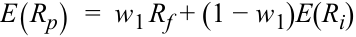

<!-- Formula Text: E(R p)  =  w 1 R f + (1 − w 1)E(R i) -->

$$E(R_p) = w_1 R_f + (1 - w_1)E(R_i)$$

<!-- Formula Text: σ P 2   =  w 1 2 σ f 2 + (1 − w 1) 2 σ i 2 + 2 w 1(1 − w 1) ρ 12 σ f σ i  =  (1 − w 1) 2 σ i 2 σ p  =  (1 − w 1) σ i -->

$$\sigma_p^2 = w_1^2 \sigma_f^2 + (1 - w_1)^2 \sigma_i^2 + 2w_1(1 - w_1)\rho_{12}\sigma_f\sigma_i = (1 - w_1)^2 \sigma_i^2$$

$$\sigma_p = (1 - w_1)\sigma_i$$

Danh mục đầu tư gồm hai tài sản được vẽ trong Bảng minh họa 9 bằng cách thay đổi $w_1$ từ 0% đến 100%. Độ lệch chuẩn của danh mục đầu tư nằm trên trục hoành và tỷ suất sinh lợi của danh mục đầu tư nằm trên trục tung. Nếu chỉ có hai tài sản này trong nền kinh tế và tài sản rủi ro đại diện cho thị trường, thì đường thẳng trong Bảng minh họa 9 được gọi là **đường phân bổ vốn (*capital allocation line* – CAL)**. Đường phân bổ vốn biểu diễn các danh mục đầu tư hiện có dành cho một nhà đầu tư. Phương trình của đường thẳng này có thể được suy ra từ hai phương trình trên bằng cách viết lại phương trình thứ hai thành $w_1 = 1 - \frac{\sigma_p}{\sigma_i}$. Thay giá trị của $w_1$ vào phương trình tính tỷ suất sinh lợi kỳ vọng, chúng ta thu được phương trình sau đây cho đường phân bổ vốn:

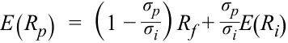

<!-- Formula Text: E(R p)  =  (1 − σ p _ σ i ) R f + σ p _ σ i E(R i) -->

$$E(R_p) = \left(1 - \frac{\sigma_p}{\sigma_i}\right) R_f + \frac{\sigma_p}{\sigma_i} E(R_i)$$

Phương trình này có thể được viết lại dưới dạng dễ sử dụng hơn:

<!-- Formula Text: E(R p)  =  R f + (E(R i) − R f) _ σ i σ p -->

$$E(R_p) = R_f + \frac{E(R_i) - R_f}{\sigma_i} \sigma_p$$

Đường phân bổ vốn có tung độ gốc (*intercept*) là $R_f$, và hệ số góc (*slope*) là $\frac{E(R_i) - R_f}{\sigma_i}$, tức là mức lợi nhuận yêu cầu tăng thêm cho mỗi đơn vị rủi ro tăng thêm, và đôi khi được gọi là cái giá thị trường của rủi ro (*market price of risk*).

<!-- PDF Page 29 -->

**Bảng minh họa 9: Đường phân bổ vốn với Hai Tài sản (*Capital Allocation Line with Two Assets*)**

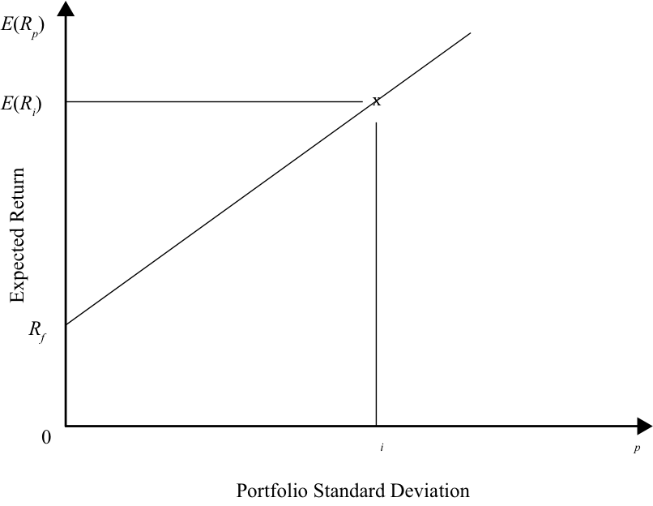

<!-- Picture Text: E ( Rp ) E ( Ri ) x Rf 0 i p Portfolio Standard Deviation Expected Return  -->

> **Chú thích hình ảnh:** Trục hoành là Độ lệch chuẩn của danh mục đầu tư (*Portfolio Standard Deviation* $\sigma_p$), trục tung là Lợi nhuận kỳ vọng (*Expected Return* $E(R_p)$). Đường thẳng bắt đầu từ tung độ gốc $R_f$ (tại $\sigma_p = 0$) đi qua điểm tài sản rủi ro $(\sigma_i, E(R_i))$.

Bởi vì phương trình có dạng tuyến tính, đồ thị của đường phân bổ vốn là một đường thẳng. Đường thẳng bắt đầu với tài sản phi rủi ro ở điểm ngoài cùng bên trái có rủi ro bằng không và tỷ suất sinh lợi phi rủi ro là $R_f$. Tại điểm đó, danh mục đầu tư chỉ bao gồm tài sản phi rủi ro. Tuy nhiên, nếu 100% được đầu tư vào danh mục gồm tất cả các tài sản rủi ro, chúng ta sẽ có tỷ suất sinh lợi là $E(R_i)$ với mức rủi ro là $\sigma_i$.

Chúng ta có thể di chuyển xa hơn dọc theo đường thẳng này để theo đuổi mức lợi nhuận cao hơn bằng cách đi vay với lãi suất phi rủi ro và đầu tư số tiền vay được vào danh mục gồm tất cả các tài sản rủi ro. Nếu vay thêm 50% tại mức lãi suất phi rủi ro, thì $w_1 = -0,50$ và 150% được phân bổ vào tài sản rủi ro, mang lại tỷ suất sinh lợi $= 1,50 E(R_i) - 0,50 R_f$, lớn hơn $E(R_i)$ bởi vì $E(R_i) > R_f$.

Đường thẳng được vẽ trong Bảng minh họa 9 bao gồm vô số cặp rủi ro – lợi nhuận hay các danh mục đầu tư. Nhà đầu tư nên chọn _một_ danh mục nào trong số các danh mục đầu tư này? Câu trả lời nằm ở việc kết hợp các đường bàng quan (*indifference curves*) từ lý thuyết hữu dụng với đường phân bổ vốn (*capital allocation line*) từ lý thuyết danh mục đầu tư. Lý thuyết hữu dụng cho chúng ta hàm hữu dụng hoặc các đường bàng quan của một cá nhân, như trong Bảng minh họa 9, và đường phân bổ vốn cho chúng ta tập hợp các khoản đầu tư khả thi (*set of feasible investments*). Việc chồng các đường bàng quan của mỗi cá nhân lên đường phân bổ vốn sẽ mang lại cho chúng ta danh mục đầu tư tối ưu (*optimal portfolio*) cho nhà đầu tư đó. Bảng minh họa 10 minh họa quy trình lựa chọn danh mục đầu tư này.

<!-- PDF Page 30 -->

**Bảng minh họa 10: Lựa chọn Danh mục Đầu tư (*Portfolio Selection*)**

<!-- Picture Text: E ( Rp ) 1 2 3 l x x a m x n x x b 0 Portfolio Standard Deviation p Expected Portfolio Return  -->

> **Chú thích hình ảnh:** Trục hoành là Độ lệch chuẩn danh mục đầu tư ($\sigma_p$), trục tung là Lợi nhuận kỳ vọng của danh mục đầu tư ($E(R_p)$). Ba đường bàng quan 1, 2, 3 được vẽ cùng với Đường phân bổ vốn (CAL). Đường 2 tiếp xúc với CAL tại điểm $m$; Đường 3 cắt CAL tại điểm $a$ và $b$ (với điểm $n$ nằm dưới điểm $m$ ở cùng mức rủi ro); Đường 1 (có điểm $l$) nằm hoàn toàn phía trên CAL.

Đường phân bổ vốn bao gồm tập hợp các danh mục đầu tư khả thi. Các điểm nằm dưới đường phân bổ vốn có thể đạt được nhưng không được bất kỳ nhà đầu tư nào ưa thích bởi vì nhà đầu tư có thể nhận được lợi nhuận cao hơn với cùng mức rủi ro bằng cách di chuyển lên đường phân bổ vốn. Các điểm nằm phía trên đường phân bổ vốn là đáng mong muốn nhưng không thể đạt được với các tài sản hiện có.

Ba đường bàng quan của cùng một cá nhân cũng được thể hiện trong Bảng minh họa 10. Đường 1 nằm phía trên đường phân bổ vốn, Đường 2 tiếp xúc (*tangential*) với đường phân bổ vốn, và Đường 3 cắt đường phân bổ vốn tại hai điểm. Đường 1 có độ hữu dụng cao nhất và Đường 3 có độ hữu dụng thấp nhất. Bởi vì Đường 1 nằm hoàn toàn phía trên đường phân bổ vốn, các điểm trên Đường 1 không thể đạt được với các tài sản hiện có trên đường phân bổ vốn. Đường 3 cắt đường phân bổ vốn tại hai Điểm, **a** và **b**. Nhà đầu tư có thể đầu tư tại Điểm **a** hoặc Điểm **b** để nhận được sự đánh đổi rủi ro – lợi nhuận và độ hữu dụng gắn liền với Đường 3. Khi so sánh các điểm có cùng mức rủi ro, hãy quan sát thấy rằng Điểm **n** trên Đường 3 có cùng mức rủi ro như Điểm **m** trên Đường 2, nhưng Điểm **m** lại có tỷ suất sinh lợi kỳ vọng cao hơn. Do đó, tất cả các nhà đầu tư sẽ chọn Đường 2 thay vì Đường 3. Đường 2 tiếp xúc với đường phân bổ vốn tại Điểm **m**. Điểm **m** nằm trên đường phân bổ vốn và có thể đầu tư được. Điểm **m** và độ hữu dụng gắn liền với Đường 2 là kết quả tốt nhất mà nhà đầu tư có thể đạt được bởi vì người đó không thể dịch chuyển lên một đường bàng quan có độ hữu dụng cao hơn. Như vậy, chúng ta đã có thể lựa chọn danh mục đầu tư tối ưu cho nhà đầu tư có các Đường bàng quan 1, 2, và 3. Điểm **m**, danh mục đầu tư tối ưu đối với một nhà đầu tư này, có thể không phải là tối ưu đối với một nhà đầu tư khác. Tuy nhiên, chúng ta có thể tuân theo cùng một quy trình để tìm ra danh mục đầu tư tối ưu cho các nhà đầu tư khác: danh mục đầu tư tối ưu chính là tiếp điểm (*point of tangency*) giữa đường phân bổ vốn và đường bàng quan của nhà đầu tư đó. Nói cách khác, danh mục đầu tư tối ưu tối đa hóa lợi nhuận trên mỗi đơn vị rủi ro (vì nó nằm trên đường phân bổ vốn), đồng thời mang lại cho nhà đầu tư sự thỏa mãn (độ hữu dụng) lớn nhất.

Để minh họa, Bảng minh họa 11 cho thấy hai đường bàng quan của hai nhà đầu tư khác nhau: Kelly với hệ số ngại rủi ro bằng 2 và Jane với hệ số ngại rủi ro bằng 4. Đường bàng quan của Kelly nằm về phía bên phải so với đường bàng quan của Jane bởi vì Kelly ít ngại rủi ro hơn Jane và có thể chấp nhận một lượng rủi ro cao hơn, tức là có khả năng chịu đựng rủi ro (*tolerance for risk*) cao hơn. Theo đó, danh mục đầu tư tối ưu của họ là khác nhau:

<!-- PDF Page 31 -->

Điểm **k** là danh mục đầu tư tối ưu cho Kelly và Điểm **j** là danh mục đầu tư tối ưu cho Jane. Ngoài ra, đối với cùng một mức lợi nhuận, độ dốc trên đường cong của Jane cao hơn của Kelly, cho thấy rằng Jane cần mức lợi nhuận tăng thêm lớn hơn để đền bù cho việc chấp nhận thêm một lượng rủi ro so với Kelly.

#### **Bảng minh họa 11: Lựa chọn Danh mục Đầu tư cho Hai Nhà đầu tư có các Mức độ Ngại rủi ro Khác nhau (*Portfolio Selection for Two Investors with Various Levels of Risk Aversion*)**

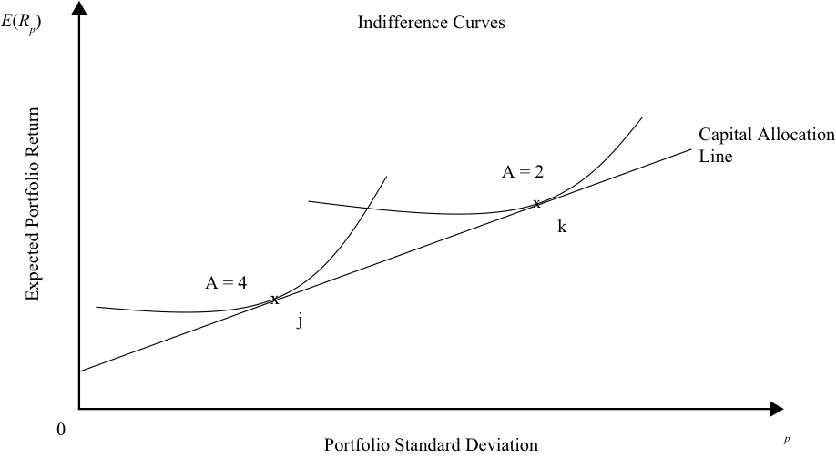

<!-- Picture Text: E ( Rp ) Indifference Curves Capital Allocation Line A = 2 x k A = 4 x j 0 Portfolio Standard Deviation p Expected Portfolio Return  -->

> **Chú thích hình ảnh:** Trục hoành là Độ lệch chuẩn danh mục đầu tư ($\sigma_p$), trục tung là Lợi nhuận kỳ vọng của danh mục đầu tư ($E(R_p)$). Đường bàng quan của Jane ($A = 4$) tiếp xúc với Đường phân bổ vốn (*Capital Allocation Line*) tại điểm $j$; đường bàng quan của Kelly ($A = 2$) tiếp xúc với Đường phân bổ vốn tại điểm $k$ ở mức rủi ro và lợi nhuận cao hơn.

## **RỦI RO DANH MỤC ĐẦU TƯ & DANH MỤC GỒM HAI TÀI SẢN RỦI RO (*PORTFOLIO RISK & PORTFOLIO OF TWO RISKY ASSETS*)**

# **<mark>7</mark>**

tính toán và diễn giải giá trị trung bình (*mean*), phương sai (*variance*), và hiệp phương sai (*covariance*) (hoặc hệ số tương quan – *correlation*) của tỷ suất sinh lợi tài sản dựa trên dữ liệu lịch sử

tính toán và diễn giải độ lệch chuẩn của danh mục đầu tư (*portfolio standard deviation*)

mô tả tác động lên rủi ro của danh mục đầu tư khi đầu tư vào các tài sản có tương quan nhỏ hơn mức tương quan hoàn hảo (*less than perfectly correlated*)

Trước đây chúng ta đã thấy rằng các nhà đầu tư là những người ngại rủi ro và đòi hỏi tỷ suất sinh lợi cao hơn cho một khoản đầu tư rủi ro hơn. Do đó, các cách thức kiểm soát rủi ro danh mục đầu tư mà không làm ảnh hưởng đến lợi nhuận là vô cùng có giá trị. Như một bước đệm cho việc quản lý rủi ro, phần này giải thích và phân tích các thành phần của rủi ro danh mục đầu tư. Cụ thể, phần này xem xét và mô tả cách một danh mục đầu tư bao gồm các tài sản có tương quan thấp có tiềm năng làm giảm rủi ro mà không nhất thiết làm giảm lợi nhuận.

### **Danh mục Đầu tư gồm Hai Tài sản Rủi ro (*Portfolio of Two Risky Assets*)**

Lợi nhuận và rủi ro của một danh mục đầu tư gồm hai tài sản đã được giới thiệu trong Phần 2–3 của bài đọc này. Trong phần này, chúng ta ôn lại ngắn gọn cách tính toán lợi nhuận và mở rộng khái niệm về rủi ro danh mục đầu tư cùng các thành phần của nó.

<!-- PDF Page 32 -->

#### **_Lợi nhuận Danh mục Đầu tư (Portfolio Return)_**

Khi nhiều tài sản riêng lẻ được kết hợp lại thành một danh mục đầu tư, chúng ta có thể tính toán tỷ suất sinh lợi của danh mục đầu tư dưới dạng bình quân gia quyền (*weighted average*) của các tỷ suất sinh lợi trong danh mục đó. Tỷ suất sinh lợi của danh mục đầu tư đơn giản là bình quân gia quyền của tỷ suất sinh lợi của các khoản đầu tư, hay tài sản riêng lẻ. Nếu Tài sản 1 có tỷ suất sinh lợi là 20% và chiếm 25% tổng vốn đầu tư của danh mục, thì mức đóng góp vào tỷ suất sinh lợi của danh mục đầu tư là 5% ($= 25\%$ của $20\%$). Nhìn chung, nếu Tài sản $i$ có tỷ suất sinh lợi là $R_i$ và có tỷ trọng là $w_i$ trong danh mục đầu tư, thì tỷ suất sinh lợi của danh mục đầu tư, $R_P$, được cho bởi:

<!-- Formula Text: R P  =  ∑ i=1 N w i R i,    ∑ i=1 N w i  =  1 -->

$$R_P = \sum_{i=1}^{N} w_i R_i, \quad \sum_{i=1}^{N} w_i = 1$$

Lưu ý rằng tổng các tỷ trọng phải bằng 1 bởi vì các tài sản trong một danh mục đầu tư, bao gồm cả tiền mặt, phải chiếm 100% tổng vốn đầu tư. Ngoài ra, lưu ý rằng đây là tỷ suất sinh lợi đơn kỳ (*single period returns*), vì vậy không có dòng tiền nào phát sinh trong kỳ và các tỷ trọng được giữ nguyên không đổi.

Khi hai tài sản riêng lẻ được kết hợp trong một danh mục đầu tư, chúng ta có thể tính toán tỷ suất sinh lợi của danh mục đầu tư dưới dạng bình quân gia quyền của tỷ suất sinh lợi của hai tài sản đó. Hãy xét Tài sản 1 và 2 với tỷ trọng lần lượt là 25% và 75% trong một danh mục đầu tư. Nếu tỷ suất sinh lợi của chúng là 20% và 5%, thì tỷ suất sinh lợi bình quân gia quyền $= (0,25 \times 20\%) + (0,75 \times 5\%) = 8,75\%$. Tổng quát hơn, tỷ suất sinh lợi của danh mục đầu tư có thể được viết như dưới đây, trong đó $R_p$ là tỷ suất sinh lợi của danh mục đầu tư, $w_1$ và $w_2$ là tỷ trọng của hai tài sản, và $R_1, R_2$ là tỷ suất sinh lợi của hai tài sản:

<!-- Formula Text: R p  =  w 1 R 1 + (1 − w 1) R 2 -->

$$R_p = w_1 R_1 + (1 - w_1) R_2$$

#### **_Rủi ro Danh mục Đầu tư (Portfolio Risk)_**

Giống như tỷ suất sinh lợi của danh mục đầu tư, chúng ta có thể tính toán phương sai của danh mục đầu tư (*portfolio’s variance*). Mặc dù tỷ suất sinh lợi của một danh mục đầu tư chỉ đơn giản là bình quân gia quyền của tỷ suất sinh lợi của từng chứng khoán, nhưng điều này không đúng với độ lệch chuẩn của một danh mục đầu tư (trừ khi tất cả các chứng khoán có tương quan hoàn hảo—tức là hệ số tương quan bằng 1). Phương sai có thể được biểu diễn tổng quát hơn cho $N$ chứng khoán trong một danh mục đầu tư bằng cách sử dụng ký hiệu từ phép tính tỷ suất sinh lợi danh mục đầu tư ở trên:

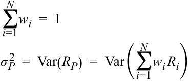

<!-- Formula Text: ∑ i=1 N w i  =  1 σ P 2   =  Var(R P)  =  Var(∑ i=1 N w i R i) -->

$$\sum_{i=1}^{N} w_i = 1$$

$$\sigma_P^2 = \text{Var}(R_P) = \text{Var}\left(\sum_{i=1}^{N} w_i R_i\right)$$

Lưu ý rằng tổng các tỷ trọng phải bằng 1. Vế phải của phương trình là phương sai của tỷ suất sinh lợi bình quân gia quyền của các chứng khoán riêng lẻ. Tỷ trọng là một hằng số, nhưng tỷ suất sinh lợi là các biến số có phương sai được ký hiệu bởi $\text{Var}(R_i)$. Chúng ta có thể viết lại phương trình như trình bày tiếp theo đây. Bởi vì hiệp phương sai (*covariance*) của một tài sản với chính nó chính là phương sai của tài sản đó, chúng ta có thể tách riêng các phương sai khỏi các hiệp phương sai trong phương trình thứ hai:

<!-- Formula Text: σ P 2   =   ∑ i,j=1 N w i w j Cov(R i, R j) σ P 2   =  ∑ i=1 N w i 2 Var(R i) +   ∑ i,j=1,i≠j N w i w j Cov(R i, R j) -->

$$\sigma_P^2 = \sum_{i,j=1}^{N} w_i w_j \text{Cov}(R_i, R_j)$$

$$\sigma_P^2 = \sum_{i=1}^{N} w_i^2 \text{Var}(R_i) + \sum_{i,j=1, i \neq j}^{N} w_i w_j \text{Cov}(R_i, R_j)$$

$\text{Cov}(R_i, R_j)$ là hiệp phương sai của các tỷ suất sinh lợi, $R_i$ và $R_j$, và có thể được biểu diễn bằng tích của hệ số tương quan giữa hai tỷ suất sinh lợi ($\rho_{1,2}$) và độ lệch chuẩn của hai tài sản. Do đó, $\text{Cov}(R_i, R_j) = \rho_{ij} \sigma_i \sigma_j$.

Đối với một danh mục đầu tư gồm hai tài sản, biểu thức tính phương sai của danh mục đầu tư được rút gọn thành công thức sau đây khi sử dụng hiệp phương sai và sau đó là sử dụng hệ số tương quan:

<!-- PDF Page 33 -->

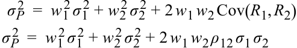

<!-- Formula Text: σ P 2   =  w 1 2 σ 1 2 + w 2 2 σ 2 2 + 2 w 1 w 2 Cov(R 1, R 2) σ P 2   =  w 1 2 σ 1 2 + w 2 2 σ 2 2 + 2 w 1 w 2 ρ 12 σ 1 σ 2 -->

$$\sigma_P^2 = w_1^2 \sigma_1^2 + w_2^2 \sigma_2^2 + 2 w_1 w_2 \text{Cov}(R_1, R_2)$$

$$\sigma_P^2 = w_1^2 \sigma_1^2 + w_2^2 \sigma_2^2 + 2 w_1 w_2 \rho_{12} \sigma_1 \sigma_2$$

Độ lệch chuẩn của một danh mục đầu tư gồm hai tài sản được tính bằng căn bậc hai của phương sai danh mục đầu tư:

<!-- Formula Text: σ P  =  √ ______________________________ w 1 2 σ 1 2 + w 2 2 σ 2 2 + 2 w 1 w 2 Cov(R 1, R 2) -->

$$\sigma_P = \sqrt{w_1^2 \sigma_1^2 + w_2^2 \sigma_2^2 + 2 w_1 w_2 \text{Cov}(R_1, R_2)}$$

hoặc,

$$\sigma_P = \sqrt{w_1^2 \sigma_1^2 + w_2^2 \sigma_2^2 + 2 w_1 w_2 \rho_{12} \sigma_1 \sigma_2}$$

#### **VÍ DỤ 3**

### **Lợi nhuận và Rủi ro của một Danh mục Đầu tư gồm Hai Tài sản (*Return and Risk of a Two-Asset Portfolio*)**

1. Giả sử là một nhà đầu tư Hoa Kỳ, bạn quyết định nắm giữ một danh mục đầu tư với 80% được đầu tư vào chỉ số cổ phiếu S&P 500 của Hoa Kỳ và 20% còn lại vào chỉ số MSCI Thị trường Mới nổi (*MSCI Emerging Markets index*). Tỷ suất sinh lợi kỳ vọng là 9,93% đối với S&P 500 và 18,20% đối với chỉ số Thị trường Mới nổi. Rủi ro (độ lệch chuẩn) là 16,21% đối với S&P 500 và 33,11% đối với chỉ số Thị trường Mới nổi. Tỷ suất sinh lợi kỳ vọng và rủi ro của danh mục đầu tư sẽ là bao nhiêu khi biết rằng hiệp phương sai giữa S&P 500 và chỉ số Thị trường Mới nổi là 0,5% hay 0,0050? Lưu ý rằng đơn vị của hiệp phương sai và phương sai được viết là $\%^2$ khi không được biểu thị dưới dạng số thập phân. Đây là các đơn vị đo lường giống như feet vuông (*squared feet*) và bản thân các con số không thực sự bị bình phương thêm lần nữa.

**Lời giải:**

Tỷ suất sinh lợi của danh mục đầu tư, $R_P = w_1 R_1 + (1 - w_1) R_2 = (0,80 \times 0,0993) + (0,20 \times 0,1820) = 0,1158 = 11,58\%$.

<!-- Formula Text: Portfolio risk  =  σ P  =  √ ______________________________ w 1 2 σ 1 2 + w 2 2 σ 2 2 + 2 w 1 w 2 Cov(R 1, R 2) σ p 2  =  w US 2   σ US 2   + w EM 2   σ EM 2   + 2 w US w EM Co v US,EM σ p 2  =  (0.80 2 × 0.1621 2) + (0.20 2 × 0.3311 2) +  (2 × 0.80 × 0.20 × 0.0050) σ p 2  =  0.01682 + 0.00439 + 0.00160  =  0.02281 σ p  =  0.15103  =  15.10% -->

$$\text{Rủi ro danh mục đầu tư} = \sigma_P = \sqrt{w_1^2 \sigma_1^2 + w_2^2 \sigma_2^2 + 2 w_1 w_2 \text{Cov}(R_1, R_2)}$$

$$\sigma_p^2 = w_{\text{US}}^2 \sigma_{\text{US}}^2 + w_{\text{EM}}^2 \sigma_{\text{EM}}^2 + 2 w_{\text{US}} w_{\text{EM}} \text{Cov}_{\text{US,EM}}$$

$$\sigma_p^2 = (0,80^2 \times 0,1621^2) + (0,20^2 \times 0,3311^2) + (2 \times 0,80 \times 0,20 \times 0,0050)$$

$$\sigma_p^2 = 0,01682 + 0,00439 + 0,00160 = 0,02281$$

$$\sigma_p = 0,15103 = 15,10\%$$

Tỷ suất sinh lợi kỳ vọng của danh mục đầu tư là 11,58% và rủi ro của danh mục đầu tư là 15,10%. Hãy quan sát kỹ ví dụ này. Nó cho thấy rằng chúng ta có thể lấy danh mục đầu tư của một nhà đầu tư Hoa Kỳ vốn chỉ đầu tư vào S&P 500, kết hợp nó với một danh mục đầu tư _rủi ro hơn_ bao gồm các chứng khoán thị trường mới nổi, và lợi nhuận của nhà đầu tư Hoa Kỳ tăng từ 9,93% lên 11,58% trong khi rủi ro của danh mục đầu tư thực tế lại giảm từ 16,21% xuống còn 15,10%. Bảng minh họa 12 mô tả cách thức sự kết hợp của hai tài sản mang lại sự đánh đổi rủi ro – lợi nhuận vượt trội. Nhà đầu tư không chỉ nhận được mức lợi nhuận cao hơn mà còn đạt được điều đó ở một mức rủi ro thấp hơn. Đó chính là sức mạnh của sự đa dạng hóa (*power of diversification*) như bạn sẽ thấy ở phần sau của bài đọc này.

<!-- PDF Page 34 -->

#### **Bảng minh họa 12: Sự kết hợp của Hai Tài sản (*Combination of Two Assets*)**

<!-- Picture Text: 20% ρ = 0.093 Emerging Markets Portfolio 10% S&P 500 10% 20% 30% Standard Deviation of Portfolio σ p Expected Portfolio Return E () R p  -->

> **Chú thích hình ảnh:** Trục hoành là Độ lệch chuẩn của danh mục đầu tư ($\sigma_p$), trục tung là Lợi nhuận kỳ vọng của danh mục đầu tư ($E(R_p)$). Đường cong nối giữa S&P 500 và Thị trường Mới nổi (*Emerging Markets*) với hệ số tương quan $\rho = 0,093$ uốn cong về phía bên trái tại điểm Danh mục đầu tư (*Portfolio*), đạt lợi nhuận cao hơn và rủi ro thấp hơn so với chỉ nắm giữ S&P 500.

#### **_Hiệp phương sai và Hệ số tương quan (Covariance and Correlation)_**

**Hiệp phương sai (*covariance*)** trong công thức tính độ lệch chuẩn của danh mục đầu tư có thể được khai triển thành $\text{Cov}(R_1, R_2) = \rho_{12}\sigma_1\sigma_2$, trong đó $\rho_{12}$ là hệ số tương quan giữa các tỷ suất sinh lợi $R_1, R_2$. Mặc dù hiệp phương sai rất quan trọng, nhưng nó lại khó diễn giải bởi vì nó không bị giới hạn ở cả hai phía (*unbounded on both sides*). Sẽ dễ hiểu hơn khi sử dụng **hệ số tương quan (*correlation coefficient*)** ($\rho_{12}$), một đại lượng có giới hạn nhưng cung cấp thông tin tương tự.

Hệ số tương quan là thước đo tính nhất quán hoặc xu hướng hai khoản đầu tư biến động theo cách tương tự nhau. Hệ số tương quan, $\rho_{12}$, có thể dương hoặc âm và nằm trong khoảng từ $-1$ đến $+1$. Hãy xem xét ba giá trị khác nhau của hệ số tương quan:

- $\rho_{12} = +1$: Tỷ suất sinh lợi của hai tài sản có tương quan _dương_ hoàn hảo (*perfectly positively correlated*). Tài sản 1 và 2 biến động cùng chiều 100% thời gian.

- $\rho_{12} = -1$: Tỷ suất sinh lợi của hai tài sản có tương quan _âm_ hoàn hảo (*perfectly negatively correlated*). Tài sản 1 và 2 biến động ngược chiều nhau 100% thời gian.

- $\rho_{12} = 0$: Tỷ suất sinh lợi của hai tài sản _không tương quan (*uncorrelated*)_. Sự biến động của Tài sản 1 không cung cấp bất kỳ dự báo nào liên quan đến sự biến động của Tài sản 2.

Hệ số tương quan giữa hai tài sản quyết định tác động lên rủi ro danh mục đầu tư khi hai tài sản được kết hợp với nhau. Để thấy cách thức hoạt động của điều này, hãy xem xét hai giá trị khác nhau của $\rho_{12}$. Bạn sẽ thấy rằng rủi ro danh mục đầu tư không bị ảnh hưởng khi hai tài sản có tương quan hoàn hảo ($\rho_{12} = +1$). Nói cách khác, độ lệch chuẩn của danh mục đầu tư chỉ đơn giản là bình quân gia quyền của độ lệch chuẩn của hai tài sản, và do đó rủi ro của danh mục đầu tư không thay đổi khi bổ sung thêm các tài sản có cùng tham số rủi ro. Tuy nhiên, rủi ro danh mục đầu tư sẽ giảm xuống khi hai tài sản không tương quan hoàn hảo ($\rho_{12} < +1$). Các giá trị đủ thấp của hệ số tương quan có thể làm cho danh mục đầu tư trở nên hoàn toàn phi rủi ro (*riskless*) dưới những điều kiện nhất định.

<!-- PDF Page 35 -->

<!-- Formula Text: σ p 2  =  w 1 2 σ 1 2 + w 2 2 σ 2 2 + 2 w 1 w 2 ρ 12 σ 1 σ 2  =  w 1 2 σ 1 2 + w 2 2 σ 2 2 + 2 w 1 w 2 σ 1 σ 2 = (w 1 σ 1 + w 2 σ 2) 2 σ p  =  w 1 σ 1 + w 2 σ 2 -->

$$\sigma_p^2 = w_1^2 \sigma_1^2 + w_2^2 \sigma_2^2 + 2 w_1 w_2 \rho_{12} \sigma_1 \sigma_2 = w_1^2 \sigma_1^2 + w_2^2 \sigma_2^2 + 2 w_1 w_2 \sigma_1 \sigma_2 = (w_1 \sigma_1 + w_2 \sigma_2)^2$$

$$\sigma_p = w_1 \sigma_1 + w_2 \sigma_2$$

Tập hợp các số hạng đầu tiên ở vế phải của phương trình đầu tiên chứa các số hạng thông thường của phương sai danh mục đầu tư. Bởi vì hệ số tương quan bằng $+1$, vế phải có thể được viết lại thành một bình phương hoàn chỉnh. Dòng thứ ba cho thấy rủi ro của danh mục đầu tư là bình quân gia quyền của rủi ro của từng tài sản riêng lẻ. Trước đó chúng ta đã chỉ ra rằng lợi nhuận của danh mục đầu tư là bình quân gia quyền của lợi nhuận của các tài sản. Bởi vì cả rủi ro và lợi nhuận đều chỉ là bình quân gia quyền của hai tài sản trong danh mục đầu tư, nên không có sự giảm thiểu rủi ro nào khi $\rho_{12} = +1$.

#### **Bây giờ giả sử $\rho_{12} < +1$**

Phân tích ở trên cho thấy rủi ro của danh mục đầu tư là bình quân gia quyền của rủi ro các tài sản khi $\rho_{12} = +1$. Khi $\rho_{12} < +1$, rủi ro của danh mục đầu tư nhỏ hơn bình quân gia quyền của rủi ro từng tài sản riêng lẻ.

Để chứng minh điều này, chúng ta bắt đầu bằng cách viết lại công thức tổng quát của rủi ro danh mục đầu tư, được biểu diễn bằng các số hạng ở bên trái dấu “$<$” dưới đây. Biểu thức ở bên phải dấu “$<$” thể hiện rủi ro danh mục đầu tư khi $\rho_{12} = +1$:

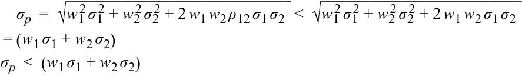

<!-- Formula Text: σ p  =  √ ____________________________ w 1 2 σ 1 2 + w 2 2 σ 2 2 + 2 w 1 w 2 ρ 12 σ 1 σ 2   <  √ _________________________ w 1 2 σ 1 2 + w 2 2 σ 2 2 + 2 w 1 w 2 σ 1 σ 2 = (w 1 σ 1 + w 2 σ 2) σ p  <  (w 1 σ 1 + w 2 σ 2) -->

$$\sigma_p = \sqrt{w_1^2 \sigma_1^2 + w_2^2 \sigma_2^2 + 2 w_1 w_2 \rho_{12} \sigma_1 \sigma_2} < \sqrt{w_1^2 \sigma_1^2 + w_2^2 \sigma_2^2 + 2 w_1 w_2 \sigma_1 \sigma_2} = (w_1 \sigma_1 + w_2 \sigma_2)$$

$$\sigma_p < (w_1 \sigma_1 + w_2 \sigma_2)$$

Vế trái nhỏ hơn vế phải bởi vì hệ số tương quan ở vế trái đối với danh mục đầu tư mới nhỏ hơn 1 ($< 1$). Do đó, rủi ro của danh mục đầu tư nhỏ hơn bình quân gia quyền của các rủi ro trong khi lợi nhuận của danh mục đầu tư vẫn là bình quân gia quyền của các lợi nhuận.

Như bạn có thể thấy, chúng ta đã đạt được sự đa dạng hóa bằng cách kết hợp hai tài sản không tương quan hoàn hảo với nhau. Đối với trường hợp cực đoan trong đó $\rho_{12} = -1$ (tức là tỷ suất sinh lợi của hai tài sản biến động ngược chiều nhau), danh mục đầu tư có thể được thiết kế để trở nên hoàn toàn phi rủi ro.

#### **VÍ DỤ 4**

### **Tác động của Hệ số tương quan lên Rủi ro Danh mục Đầu tư (*Effect of Correlation on Portfolio Risk*)**

Hai cổ phiếu có cùng mức lợi nhuận và rủi ro (độ lệch chuẩn): 10% lợi nhuận với 20% rủi ro. Bạn lập một danh mục đầu tư gồm 50% Cổ phiếu 1 và 50% Cổ phiếu 2 để xem xét tác động của hệ số tương quan lên rủi ro.

1. Tính lợi nhuận và rủi ro của danh mục đầu tư nếu hệ số tương quan là 1,0.

**Lời giải:**

$R_1 = R_2 = 10\% = 0,10$; $\sigma_1 = \sigma_2 = 20\% = 0,20$; $w_1 = w_2 = 50\% = 0,50$.
Trường hợp 1: $\rho_{12} = +1$
$$R_p = w_1 R_1 + w_2 R_2$$
$$R_p = (0,5 \times 0,1) + (0,5 \times 0,1) = 0,10 = 10\%$$
$$\sigma_p^2 = w_1^2 \sigma_1^2 + w_2^2 \sigma_2^2 + 2 w_1 w_2 \sigma_1 \sigma_2 \rho_{12}$$
$$\sigma_p^2 = (0,5^2 \times 0,2^2) + (0,5^2 \times 0,2^2) + (2 \times 0,5 \times 0,5 \times 0,2 \times 0,2 \times 1) = 0,04$$
$$\sigma_p = \sqrt{0,04} = 0,20 = 20\%$$

Phương trình này chứng minh quan điểm đã nêu trước đó rằng với hệ số tương quan bằng 1,0, rủi ro của danh mục đầu tư bằng đúng với rủi ro của các tài sản riêng lẻ.

<!-- PDF Page 36 -->

2. Tính lợi nhuận và rủi ro của danh mục đầu tư nếu hệ số tương quan là 0,0.

**Lời giải:**
$\rho_{12} = 0$
$$R_p = w_1 R_1 + w_2 R_2 = 0,10 = 10\%$$
$$\sigma_p^2 = w_1^2 \sigma_1^2 + w_2^2 \sigma_2^2 + 2 w_1 w_2 \sigma_1 \sigma_2 \rho_{12}$$
$$\sigma_p^2 = (0,5^2 \times 0,2^2) + (0,5^2 \times 0,2^2) + (2 \times 0,5 \times 0,5 \times 0,2 \times 0,2 \times 0) = 0,02$$
$$\sigma_p = \sqrt{0,02} = 0,14 = 14\%$$

Phương trình này chứng minh quan điểm đã nêu trước đó rằng khi các tài sản có hệ số tương quan nhỏ hơn 1,0, chúng có thể được kết hợp trong một danh mục đầu tư có mức rủi ro thấp hơn so với từng tài sản riêng lẻ.

3. Tính lợi nhuận và rủi ro của danh mục đầu tư nếu hệ số tương quan là –1,0.

**Lời giải:**
$\rho_{12} = -1$
$$R_p = w_1 R_1 + w_2 R_2 = 0,10 = 10\%$$
$$\sigma_p^2 = w_1^2 \sigma_1^2 + w_2^2 \sigma_2^2 + 2 w_1 w_2 \sigma_1 \sigma_2 \rho_{12}$$
$$\sigma_p^2 = (0,5^2 \times 0,2^2) + (0,5^2 \times 0,2^2) + (2 \times 0,5 \times 0,5 \times 0,2 \times 0,2 \times (-1)) = 0$$
$$\sigma_p = 0\%$$

Phương trình này chứng minh quan điểm đã nêu trước đó rằng nếu hệ số tương quan của các tài sản đủ thấp, trong trường hợp này là tương quan âm 100% hay –1,00 (có mối quan hệ nghịch đảo hoàn toàn), thì có thể thiết kế một danh mục đầu tư giúp loại bỏ hoàn toàn rủi ro. Các tài sản riêng lẻ vẫn giữ nguyên các đặc điểm rủi ro của chúng, nhưng danh mục đầu tư thì hoàn toàn phi rủi ro.

4. So sánh lợi nhuận và rủi ro của các danh mục đầu tư có hệ số tương quan khác nhau.

**Lời giải:**

Tỷ suất sinh lợi kỳ vọng là 10% trong cả ba trường hợp; tuy nhiên, tỷ suất sinh lợi sẽ biến động nhiều hơn trong Trường hợp 1 và ít biến động nhất trong Trường hợp 3. Trong trường hợp thứ nhất, không có sự đa dạng hóa rủi ro (mức rủi ro vẫn giữ nguyên như trước là 20%) và lợi nhuận giữ nguyên. Trong trường hợp thứ hai, với hệ số tương quan bằng 0, chúng ta đã đạt được sự đa dạng hóa rủi ro (rủi ro bây giờ là 14% thay vì 20%), một lần nữa với cùng mức lợi nhuận. Trong trường hợp thứ ba với hệ số tương quan bằng –1, danh mục đầu tư hoàn toàn phi rủi ro, mặc dù chúng ta vẫn tiếp tục nhận được cùng mức lợi nhuận là 10%. Ví dụ này cho thấy sức mạnh của sự đa dạng hóa mà chúng ta sẽ mở rộng thêm trong Phần 9.

#### **_Mối quan hệ giữa Rủi ro và Lợi nhuận Danh mục Đầu tư (Relationship between Portfolio Risk and Return)_**

Ví dụ trước đã minh họa tác động của hệ số tương quan lên rủi ro danh mục đầu tư trong khi giữ tỷ trọng của hai tài sản bằng nhau và không đổi. Trong phần này, chúng ta xem xét cách thức rủi ro và lợi nhuận của danh mục đầu tư thay đổi theo các tỷ trọng danh mục đầu tư khác nhau và các hệ số tương quan khác nhau.

Tài sản 1 có tỷ suất sinh lợi hàng năm là 7% và rủi ro chuẩn hóa theo năm là 12%, trong khi Tài sản 2 có tỷ suất sinh lợi hàng năm là 15% và rủi ro chuẩn hóa theo năm là 25%. Mối quan hệ này được lập bảng trong Bảng minh họa 13 cho hai tài sản và được biểu diễn bằng đồ thị trong Bảng minh họa 14.

<!-- PDF Page 37 -->

**Bảng minh họa 13: Mối quan hệ giữa Rủi ro và Lợi nhuận (*Relationship between Risk and Return*)**

|**Tỷ trọng ở Tài sản 1 (*Weight in Asset 1*) (%)**|**Lợi nhuận Danh mục (*Portfolio Return*)**|**Rủi ro Danh mục với Hệ số tương quan bằng (*Portfolio Risk with Correlation of*)**||||
|---|---|---|---|---|---|
|||**1.0**|**0.5**|**0.2**|**−1.0**|
|0|15.0|25.0|25.0|25.0|25.0|
|10|14.2|23.7|23.1|22.8|21.3|
|20|13.4|22.4|21.3|20.6|17.6|
|30|12.6|21.1|19.6|18.6|13.9|
|40|11.8|19.8|17.9|16.6|10.2|
|50|11.0|18.5|16.3|14.9|6.5|
|60|10.2|17.2|15.0|13.4|2.8|
|70|9.4|15.9|13.8|12.3|0.9|
|80|8.6|14.6|12.9|11.7|4.6|
|90|7.8|13.3|12.2|11.6|8.3|
|100|7.0|12.0|12.0|12.0|12.0|

**Bảng minh họa 14: Mối quan hệ giữa Rủi ro và Lợi nhuận (*Relationship between Risk and Return*)**

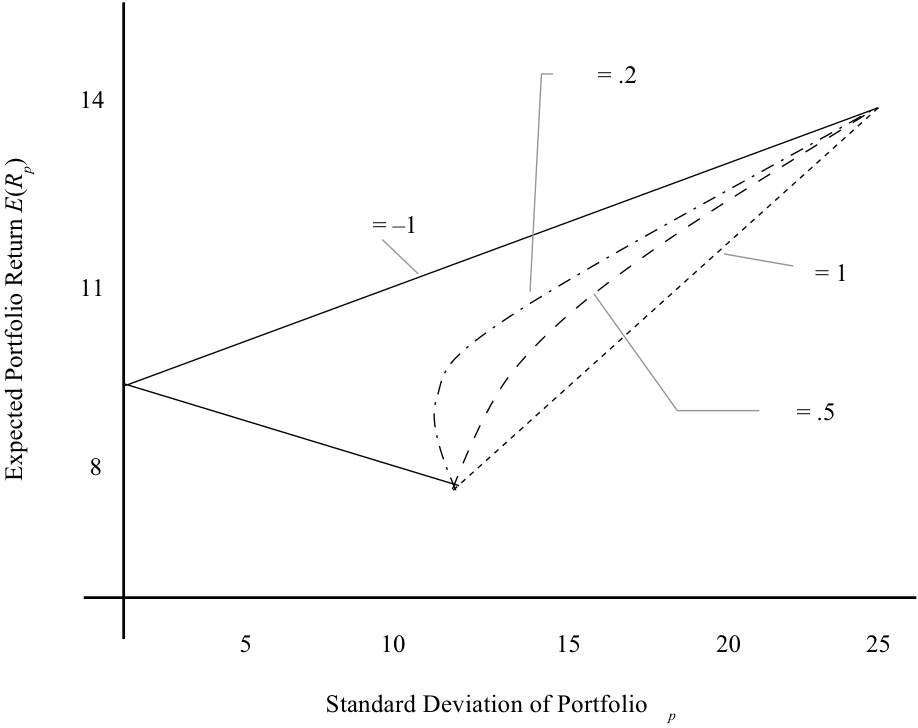

<!-- Picture Text: = .2 14  = –1  = 1 11  = .5 8 5 10 15 20 25 Standard Deviation of Portfolio p Expected Portfolio Return () ER p  -->

> **Chú thích hình ảnh:** Trục hoành là Độ lệch chuẩn của danh mục đầu tư ($\sigma_p$), trục tung là Lợi nhuận kỳ vọng của danh mục đầu tư ($E(R_p)$). Đồ thị biểu diễn các đường rủi ro – lợi nhuận ứng với bốn mức hệ số tương quan: $\rho = 1$ (đường thẳng), $\rho = 0,5$, $\rho = 0,2$ (các đường cong lồi về bên trái), và $\rho = -1$ (hai đoạn thẳng gấp khúc chạm trục tung tại $\sigma_p = 0$).

Bảng trên cho thấy lợi nhuận và rủi ro của danh mục đầu tư ứng với bốn hệ số tương quan nằm trong khoảng từ $+1,0$ đến $-1,0$ và 11 mức tỷ trọng từ 0% đến 100%. Lợi nhuận và rủi ro của danh mục đầu tư lần lượt là 15% và 25% khi 0% được đầu tư vào Tài sản 1, so với 7% và 12% khi 100% được đầu tư vào Tài sản 1. Lợi nhuận của danh mục đầu tư thay đổi theo tỷ trọng nhưng không bị ảnh hưởng bởi hệ số tương quan.

Rủi ro của danh mục đầu tư trở nên nhỏ hơn sau mỗi lần giảm hệ số tương quan, với mức rủi ro nhỏ nhất khi $\rho_{12} = -1$. Đồ thị trong Bảng minh họa 14 cho thấy mối quan hệ rủi ro – lợi nhuận là một đường thẳng khi $\rho_{12} = +1$. Khi hệ số tương quan

<!-- PDF Page 38 -->

giảm xuống, rủi ro ngày càng trở nên nhỏ hơn như trong bảng. Bản chất đường cong (*curvilinear nature*) của một danh mục các tài sản có thể nhận thấy rõ trong tất cả các tập hợp cơ hội đầu tư (ngoại trừ tại hai thái cực nơi $\rho_{12} = -1$ hoặc $+1$).

#### **VÍ DỤ 5**

### **Danh mục Đầu tư gồm Hai Tài sản (*Portfolio of Two Assets*)**

Giả sử bạn là một nhà đầu tư tại Vương quốc Anh (UK) đang nắm giữ một danh mục đầu tư gồm 60% được đầu tư vào cổ phiếu vốn hóa lớn của Anh (được đại diện bởi Chỉ số FTSE 100) và 40% vào trái phiếu Kho bạc kỳ hạn trung bình trong nước (“gilts”). Tỷ suất sinh lợi kỳ vọng của FTSE 100 là 5,5% và của trái phiếu chính phủ Anh (gilts) kỳ hạn trung bình là 0,7%. Rủi ro (độ lệch chuẩn của tỷ suất sinh lợi) lần lượt là 13,2% và 4,2%. Hệ số tương quan giữa hai tài sản là –0,01.

Tỷ suất sinh lợi kỳ vọng của danh mục đầu tư này là:

$$R_p = w_1 \times R_1 + (1 - w_1) \times R_2 = 0,6 \times 0,055 + 0,4 \times 0,007 = 0,0358 \approx 3,6\%$$

Rủi ro của danh mục đầu tư này là:

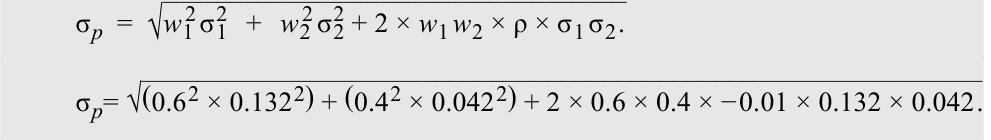

<!-- Formula Text: σ p  =  √ __________________________________ w 1 2 σ 1 2   +   w 2 2 σ 2 2 + 2 × w 1 w 2 × ρ × σ 1 σ 2 . σ p= √ ____________________________________________________________ (0.6 2 × 0.132 2) + (0.4 2 × 0.042 2) + 2 × 0.6 × 0.4 × − 0.01 × 0.132 × 0.042 . -->

$$\sigma_p = \sqrt{w_1^2 \sigma_1^2 + w_2^2 \sigma_2^2 + 2 \times w_1 w_2 \times \rho \times \sigma_1 \sigma_2}$$

$$\sigma_p = \sqrt{(0,6^2 \times 0,132^2) + (0,4^2 \times 0,042^2) + 2 \times 0,6 \times 0,4 \times (-0,01) \times 0,132 \times 0,042}$$

$$\sigma_p = 0,0808 \approx 8,1\%$$

Bạn nhận thấy rằng so với trái phiếu Kho bạc Hoa Kỳ (*US Treasury bonds*), tỷ suất sinh lợi kỳ vọng của trái phiếu chính phủ Anh (gilts) thấp hơn và rủi ro của gilts lại cao hơn. Trái phiếu Kho bạc Hoa Kỳ có tỷ suất sinh lợi kỳ vọng đối với một nhà đầu tư tại Hoa Kỳ là 1,5% và rủi ro là 4,0%. Bạn tự hỏi liệu việc thay thế gilts trong danh mục đầu tư của mình bằng trái phiếu Kho bạc Hoa Kỳ (“Treasuries”) có cải thiện hồ sơ rủi ro và lợi nhuận của danh mục đầu tư hay không.

1. Các giả định về rủi ro và lợi nhuận đã cho đối với trái phiếu Kho bạc Hoa Kỳ có cho phép bạn, với tư cách là một nhà đầu tư tại Anh, tính toán tỷ suất sinh lợi kỳ vọng và rủi ro của danh mục đầu tư khi thay thế trái phiếu chính phủ Anh bằng trái phiếu Kho bạc Hoa Kỳ hay không?

#### **Lời giải:**

Không. Tỷ suất sinh lợi kỳ vọng và rủi ro đối với Trái phiếu Kho bạc Hoa Kỳ áp dụng cho một nhà đầu tư Hoa Kỳ, người đầu tư bằng đồng đô la Mỹ (USD). Để tính toán tỷ suất sinh lợi kỳ vọng và rủi ro bằng đồng bảng Anh (sterling – GBP) cho một danh mục đầu tư tại Anh gồm cổ phiếu FTSE 100 và Trái phiếu Kho bạc Hoa Kỳ, người ta cần phải tính đến tỷ giá hối đoái (*exchange rate*) giữa đồng đô la Mỹ và đồng bảng Anh. Tỷ giá hối đoái này có độ biến động (rủi ro) riêng của nó, và kỳ vọng lợi nhuận đối với tỷ giá hối đoái GBP/USD phải được xác định rõ. Nhằm mục đích tính toán lợi nhuận và rủi ro của một tài sản nước ngoài trong danh mục đầu tư của một nhà đầu tư trong nước, tài sản nước ngoài đó có thể được xem như một “danh mục đầu tư” gồm hai tài sản. Tỷ suất sinh lợi của một tài sản nước ngoài tính bằng đồng nội tệ (*domestic currency* – tức là đồng tiền không phải ngoại tệ) có thể được phân tách thành một cấu phần lợi nhuận bằng đồng bản tệ (*local currency return component*) và một cấu phần tỷ giá hối đoái (*exchange rate component*):

$$R_D = (1 + R_{lc}) \times (1 + R_{FX}) - 1$$

Bởi vì danh mục đầu tư chịu toàn bộ rủi ro trước sự biến động của cả giá trị tài sản tính bằng đồng bản tệ và tỷ giá hối đoái tiền tệ, nên đồng ngoại tệ và tài sản đó mỗi thứ đều có tỷ trọng danh mục là 100%. Lưu ý rằng tỷ giá hối đoái phải được yết giá theo dạng đồng nội tệ/đồng ngoại tệ (*domestic currency/foreign currency*) để quy đổi tỷ suất sinh lợi bằng đồng ngoại tệ sang đồng nội tệ của nhà đầu tư. Rủi ro có thể được tính toán như sau:

<!-- PDF Page 39 -->

<!-- Formula Text: σ D  =  √ _____________________________________ w 1 2 σ lc 2    +   w 2 2 σ FX 2   + 2 × w 1 w 2 × ρ × σ lc σ FX =  √ _________________________ σ lc 2  + σ FX 2   + 2 × ρ × σ lc × σ FX . -->

$$\sigma_D = \sqrt{w_1^2 \sigma_{lc}^2 + w_2^2 \sigma_{FX}^2 + 2 \times w_1 w_2 \times \rho \times \sigma_{lc} \sigma_{FX}} = \sqrt{\sigma_{lc}^2 + \sigma_{FX}^2 + 2 \times \rho \times \sigma_{lc} \times \sigma_{FX}}$$

Giả sử trong phần tiếp theo rằng rủi ro (được đo lường bằng độ lệch chuẩn kỳ vọng) của tỷ giá hối đoái tiền tệ GBP/USD là 9,0% và tỷ suất sinh lợi của Trái phiếu Kho bạc Hoa Kỳ có hệ số tương quan với tỷ giá hối đoái GBP/USD là 0,33. Giả sử thêm rằng bạn không có dự báo nào về giá trị tương lai của tỷ giá hối đoái USD/GBP, và do đó giả định mức sinh lợi tỷ giá bằng 0%.

2. Rủi ro kỳ vọng của Trái phiếu Kho bạc Hoa Kỳ đối với bạn, với tư cách là một nhà đầu tư tại Anh, sẽ là bao nhiêu?

**Lời giải:**

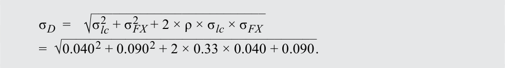

<!-- Formula Text: σ D  =    √ _________________________ σ lc 2  + σ FX 2   + 2 × ρ × σ lc × σ FX =  √ ____________________________________ 0.040 2 + 0.090 2 + 2 × 0.33 × 0.040 + 0.090 . -->

$$\sigma_D = \sqrt{\sigma_{lc}^2 + \sigma_{FX}^2 + 2 \times \rho \times \sigma_{lc} \times \sigma_{FX}} = \sqrt{0,040^2 + 0,090^2 + 2 \times 0,33 \times 0,040 \times 0,090}$$

$$\sigma_D = 0,110 = 11,0\%$$

Hệ số tương quan giữa FTSE 100, Trái phiếu Kho bạc Hoa Kỳ (*US Treasuries*), và tỷ giá hối đoái USD/GBP được mô tả trong ma trận tương quan (*correlation matrix*) sau đây.

||**FTSE 100**|**Trái phiếu Kho bạc Hoa Kỳ (*US Treasuries*)**|**GBP/USD**|
|---|---|---|---|
|FTSE 100|1.00|–0.32|–0.06|
|Trái phiếu Kho bạc Hoa Kỳ (*US Treasuries*)|–0.32|1.00|0.33|
|GBP/USD|–0.06|0.33|1.00|

3. Tỷ suất sinh lợi kỳ vọng và rủi ro đối với danh mục đầu tư của bạn sẽ là bao nhiêu nếu bạn thay thế trái phiếu chính phủ Anh (gilts) bằng Trái phiếu Kho bạc Hoa Kỳ?

   - **Lời giải:**

Tỷ suất sinh lợi kỳ vọng là bình quân gia quyền của tỷ suất sinh lợi kỳ vọng tính bằng đồng bảng Anh (GBP) của cổ phiếu vốn hóa lớn tại Anh và của Trái phiếu Kho bạc Hoa Kỳ. Hãy nhớ lại rằng tỷ suất sinh lợi của một tài sản nước ngoài tính bằng đồng nội tệ bao gồm một cấu phần ngoại tệ và một cấu phần bản thân tài sản đó. Tất cả các tỷ suất sinh lợi kỳ vọng có thể được tìm thấy ở trên.

$$R_p = w_1 \times R_1 + (1 - w_1) \times [(1 + R_{lc}) \times (1 + R_{FX}) - 1]$$

$$R_p = 0,6 \times 0,055 + 0,4 \times [(1 + 0,015) \times (1 + 0,0) - 1] = 0,039 = 3,9\%$$

Việc tính toán rủi ro của danh mục đầu tư liên quan đến một công thức phức tạp hơn một chút. Hãy nhớ lại rằng rủi ro của một danh mục đầu tư gồm hai tài sản phụ thuộc vào rủi ro và tỷ trọng của từng tài sản riêng lẻ cùng sự biến động cùng chiều (*co-movements*) giữa hai tài sản đó. Đối với một danh mục đầu tư gồm ba tài sản (một phần cổ phiếu, một phần thu nhập cố định nước ngoài, và mức tiếp xúc rủi ro ngoại tệ đi kèm), phép tính về cơ bản là giống nhau, tuy nhiên có ba cặp biến động cùng chiều giữa các tài sản thay vì chỉ một cặp.

Do đó, công thức tính độ lệch chuẩn của một danh mục đầu tư gồm ba tài sản là:

<!-- Formula Text: σ p  =  √ _______________________________________________________________________ w 1 2 σ 1 2   +   w 2 2 σ 2 2   +   w 3 2 σ 3 2 + 2 ρ 1,2 w 1 w 2 σ 1 σ 2 + 2 ρ 1,3 w 1 w 3 σ 1 σ 3 + 2 ρ 2,3 w 2 w 3 σ 2 σ 3 . -->

$$\sigma_p = \sqrt{w_1^2 \sigma_1^2 + w_2^2 \sigma_2^2 + w_3^2 \sigma_3^2 + 2 \rho_{1,2} w_1 w_2 \sigma_1 \sigma_2 + 2 \rho_{1,3} w_1 w_3 \sigma_1 \sigma_3 + 2 \rho_{2,3} w_2 w_3 \sigma_2 \sigma_3}$$

Tỷ trọng danh mục đầu tư của mức tiếp xúc rủi ro ngoại tệ bằng với tỷ trọng danh mục đầu tư của Trái phiếu Kho bạc Hoa Kỳ. Sử dụng thông tin được cung cấp ở trên, chúng ta có thể tính toán rủi ro của danh mục đầu tư gồm cổ phiếu vốn hóa lớn của Anh và Trái phiếu Kho bạc Hoa Kỳ như sau:

<!-- PDF Page 40 -->

$$\sigma_p = \left(0,6^2 \times 0,132^2 + 0,4^2 \times 0,040^2 + 0,4^2 \times 0,090^2 + 2 \times (-0,32) \times 0,6 \times 0,4 \times 0,132 \times 0,040 + 2 \times (-0,06) \times 0,6 \times 0,4 \times 0,132 \times 0,090 + 2 \times 0,33 \times 0,4 \times 0,4 \times 0,040 \times 0,090\right)^{1/2}$$

$$\sigma_p = 0,0841 \approx 8,4\%$$

So với danh mục đầu tư cổ phiếu Anh/trái phiếu chính phủ Anh (gilts), danh mục đầu tư cổ phiếu Anh/Trái phiếu Kho bạc Hoa Kỳ có tỷ suất sinh lợi kỳ vọng cao hơn, bởi vì trái phiếu chính phủ Anh đã được thay thế bằng một tài sản có kỳ vọng sinh lợi vượt trội hơn. Tuy nhiên, rủi ro của danh mục đầu tư mới lại cao hơn một chút bất chấp mức rủi ro tính theo đồng bản tệ của Trái phiếu Kho bạc Hoa Kỳ thấp hơn so với gilts. Việc sở hữu Trái phiếu Kho bạc Hoa Kỳ với tư cách là một nhà đầu tư ngoài Hoa Kỳ đồng nghĩa với việc phải chịu rủi ro tỷ giá hối đoái (*exchange rate risk*), điều cần phải được cân nhắc khi đánh giá hồ sơ rủi ro.

# **<mark>8</mark> DANH MỤC ĐẦU TƯ GỒM NHIỀU TÀI SẢN RỦI RO (*PORTFOLIO OF MANY RISKY ASSETS*)**

tính toán và diễn giải độ lệch chuẩn của danh mục đầu tư (*portfolio standard deviation*)
mô tả tác động lên rủi ro của danh mục đầu tư khi đầu tư vào các tài sản có tương quan nhỏ hơn mức tương quan hoàn hảo (*less than perfectly correlated*)

Trong phần trước, chúng ta đã thảo luận về cách hệ số tương quan giữa hai tài sản có thể ảnh hưởng đến rủi ro của một danh mục đầu tư và hệ số tương quan càng nhỏ thì rủi ro càng thấp. Phân tích ở trên có thể được mở rộng cho một danh mục đầu tư gồm nhiều tài sản rủi ro ($N$). Hãy nhớ lại các phương trình trước đó về lợi nhuận và phương sai của danh mục đầu tư:

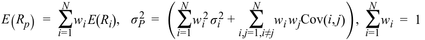

<!-- Formula Text: E(R p)  =  ∑ i=1 N w i E(R i),    σ P 2   =  (∑ i=1 N w i 2 σ i 2 +   ∑ i,j=1,i≠j N w i w jCov(i, j)),  ∑ i=1 N w i  =  1 -->

$$E(R_p) = \sum_{i=1}^{N} w_i E(R_i), \quad \sigma_P^2 = \left(\sum_{i=1}^{N} w_i^2 \sigma_i^2 + \sum_{i,j=1, i \neq j}^{N} w_i w_j \text{Cov}(i, j)\right), \quad \sum_{i=1}^{N} w_i = 1$$

Để xem xét cách thức hoạt động của một danh mục đầu tư gồm nhiều tài sản rủi ro và các cách thức mà chúng ta có thể làm giảm rủi ro của một danh mục đầu tư, hãy giả sử rằng danh mục đầu tư có tỷ trọng bằng nhau ($1/N$) cho tất cả $N$ tài sản. Ngoài ra, giả sử rằng $\bar{\sigma}^2$ và $\overline{\text{Cov}}$ là phương sai trung bình (*average variance*) và hiệp phương sai trung bình (*average covariance*). Với các tỷ trọng bằng nhau và phương sai/hiệp phương sai trung bình, chúng ta có thể viết lại phương sai của danh mục đầu tư như dưới đây (các bước trung gian được lược bỏ để tập trung vào kết quả chính):

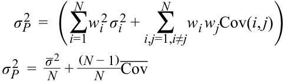

<!-- Formula Text: σ P 2   =  (∑ i=1 N w i 2 σ i 2 +   ∑ i,j=1,i≠j N w i w jCov(i, j)) σ P 2   =    _ σ  2 _ N  +  (N − 1) _ N  ‾ Cov -->

$$\sigma_P^2 = \left(\sum_{i=1}^{N} w_i^2 \sigma_i^2 + \sum_{i,j=1, i \neq j}^{N} w_i w_j \text{Cov}(i, j)\right)$$

$$\sigma_P^2 = \frac{\bar{\sigma}^2}{N} + \frac{(N - 1)}{N} \overline{\text{Cov}}$$

Phương trình ở dòng thứ hai cho thấy rằng khi $N$ trở nên lớn, số hạng đầu tiên ở vế phải với mẫu số là $N$ ngày càng trở nên nhỏ hơn, ngụ ý rằng mức đóng góp của phương sai một tài sản đơn lẻ vào phương sai của danh mục đầu tư dần dần trở nên không đáng kể (*negligible*). Tuy nhiên, số hạng thứ hai lại tiến dần đến hiệp phương sai trung bình khi $N$ tăng lên. Hoàn toàn hợp lý khi nói rằng đối với các danh mục đầu tư có số lượng lớn tài sản, hiệp phương sai giữa các tài sản chiếm gần như toàn bộ rủi ro của danh mục đầu tư.

### **Tầm quan trọng của Hệ số tương quan trong một Danh mục Đầu tư gồm Nhiều Tài sản (*Importance of Correlation in a Portfolio of Many Assets*)**

Phân tích sẽ trở nên giàu tính minh họa và thú vị hơn nếu chúng ta giả định rằng tất cả các tài sản trong danh mục đầu tư có cùng phương sai và cùng hệ số tương quan giữa các tài sản. Trong trường hợp đó, rủi ro của danh mục đầu tư có thể được viết lại thành:
