# Tập 9: Quản lý Danh mục Đầu tư (*Portfolio Management*)
## Học phần 1: Rủi ro và Lợi nhuận Danh mục Đầu tư: Phần I (*Portfolio Risk and Return: Part I*)
### Phần 3/4: Sức mạnh của Đa dạng hóa (*The Power of Diversification*) (Trang PDF 41–56)

---

<!-- PDF Page 41 -->

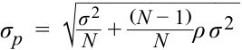

<!-- Formula Text: σ p  =  √ _____________ σ 2 _ N  +  (N − 1) _ N  ρ σ 2 -->

$$\sigma_p = \sqrt{\frac{\sigma^2}{N} + \frac{(N - 1)}{N} \rho \sigma^2}$$

Số hạng đầu tiên dưới dấu căn trở nên không đáng kể khi số lượng tài sản trong danh mục đầu tư tăng lên, để lại số hạng thứ hai (hệ số tương quan) là yếu tố quyết định chính đối với rủi ro của danh mục đầu tư. Nếu các tài sản không có mối liên hệ nào với nhau ($\rho = 0$), danh mục đầu tư có thể có mức rủi ro gần như bằng không. Trong phần tiếp theo, chúng ta sẽ xem xét lại các khái niệm này để tìm hiểu cách thức đa dạng hóa danh mục đầu tư.

## **SỨC MẠNH CỦA ĐA DẠNG HÓA (*THE POWER OF DIVERSIFICATION*)**

<!-- Picture Text: 9  -->

mô tả đặc điểm của các nhóm tài sản chính (*major asset classes*) mà nhà đầu tư xem xét khi hình thành danh mục đầu tư

mô tả tác động lên rủi ro của danh mục đầu tư khi đầu tư vào các tài sản có tương quan nhỏ hơn mức tương quan hoàn hảo (*less than perfectly correlated*)

Đa dạng hóa (*diversification*) là một trong những khái niệm quan trọng và mạnh mẽ nhất trong đầu tư. Bởi vì các nhà đầu tư là những người ngại rủi ro, họ luôn quan tâm đến việc giảm thiểu rủi ro mà tốt nhất là không làm giảm lợi nhuận. Trong những trường hợp khác, các nhà đầu tư có thể chấp nhận mức lợi nhuận thấp hơn nếu điều đó giúp làm giảm khả năng xảy ra những khoản lỗ thảm khốc (*catastrophic losses*). Trong các phần trước của bài đọc này, bạn đã tìm hiểu về tầm quan trọng của hệ số tương quan (*correlation*) và hiệp phương sai (*covariance*) trong việc quản lý rủi ro. Phần này áp dụng các khái niệm đó để khám phá những cách thức đa dạng hóa rủi ro. Chúng ta bắt đầu bằng một ví dụ đơn giản nhưng trực quan.

#### **VÍ DỤ 6**

### **Đa dạng hóa với Mưa và Nắng (*Diversification with Rain and Shine*)**

Giả sử một công ty có tên là Beachwear chuyên cho thuê thiết bị bãi biển. Tỷ suất sinh lợi hàng năm từ hoạt động kinh doanh của công ty là 20% vào những năm có nhiều ngày nắng nhưng giảm xuống mức 0% vào những năm mưa nhiều với ít ngày nắng. Xác suất của một năm nắng nhiều và một năm mưa nhiều là bằng nhau ở mức 50%. Do đó, tỷ suất sinh lợi trung bình là 10%, với 50% cơ hội đạt lợi nhuận 20% và 50% cơ hội đạt lợi nhuận 0%. Bởi vì Beachwear có thể kiếm được lợi nhuận 20% hoặc 0%, nên tỷ suất sinh lợi trung bình 10% của nó có rủi ro.

Bạn rất hào hứng với việc đầu tư vào Beachwear nhưng lại không thích rủi ro đó. Sau khi nghe nói về sự đa dạng hóa, bạn quyết định bổ sung thêm một doanh nghiệp khác vào danh mục đầu tư để giảm thiểu rủi ro đầu tư của mình.

- Có một cửa hàng đồ ăn nhẹ trên bãi biển (*Snackshop*) chuyên bán tất cả các loại thực phẩm lành mạnh mà bạn yêu thích. Bạn ước tính rằng tỷ suất sinh lợi hàng năm từ Snackshop cũng là 20% vào những năm có nhiều ngày nắng và 0% vào những năm khác. Giống như cửa hàng Beachwear, tỷ suất sinh lợi trung bình là 10%.

Bạn quyết định đầu tư 50% vào Snackshop và 50% vào Beachwear. Tỷ suất sinh lợi trung bình vẫn là 10%, với 50% của 10% từ Snackshop và 50% của 10% từ Beachwear. Vào một năm nắng nhiều, bạn sẽ kiếm được 20% ($= 50\%$ của $20\%$ từ Beachwear $+ 50\%$ của $20\%$ từ Snackshop). Vào một năm mưa nhiều, bạn sẽ kiếm được 0% ($= 50\%$ của $0\%$ từ Beachwear $+ 50\%$ của $0\%$ từ Snackshop). Kết quả được lập bảng trong Bảng minh họa 15.

<!-- PDF Page 42 -->

#### **Bảng minh họa 15**

|**Loại hình (*Type*)**|**Công ty (*Company*)**|**Phần trăm Đầu tư (*Percent Invested*)**|**Lợi nhuận trong Năm Nắng (*Return in Sunny Year*) (%)**|**Lợi nhuận trong Năm Mưa (*Return in Rainy Year*) (%)**|**Lợi nhuận Trung bình (*Average Return*) (%)**|
|---|---|---|---|---|---|
|Cổ phiếu đơn lẻ (*Single stock*)|Beachwear|100|20|0|10|
|Cổ phiếu đơn lẻ (*Single stock*)|Snackshop|100|20|0|10|
|Danh mục hai cổ phiếu (*Portfolio of two stocks*)|Beachwear|50|20|0|10|
||Snackshop|50|20|0|10|
||Tổng cộng (*Total*)|100|20|0|10|

Những kết quả này có vẻ trái ngược với trực giác. Bạn đã nghĩ rằng bằng cách bổ sung thêm một doanh nghiệp khác, bạn sẽ có thể đa dạng hóa và giảm thiểu rủi ro của mình, nhưng rủi ro vẫn hoàn toàn giống hệt như trước. Điều gì đã sai ở đây? Hãy lưu ý rằng cả hai doanh nghiệp đều ăn nên làm ra khi trời nắng và cả hai doanh nghiệp đều làm ăn kém khi trời mưa. Hệ số tương quan giữa hai doanh nghiệp là $+1,0$. Không có sự giảm thiểu rủi ro nào xảy ra khi hệ số tương quan bằng $+1,0$.

- Để giảm thiểu rủi ro, bạn phải xem xét một doanh nghiệp ăn nên làm ra vào một năm mưa nhiều. Bạn tìm thấy một công ty chuyên cho thuê đĩa DVD (*DVDrental*). Công ty DVDrental tương tự như công ty Beachwear, ngoại trừ việc tỷ suất sinh lợi hàng năm của nó là 20% vào năm mưa nhiều và 0% vào năm nắng nhiều, với tỷ suất sinh lợi trung bình là 10%. Tỷ suất sinh lợi 10% của DVDrental cũng có rủi ro giống hệt như tỷ suất sinh lợi của Beachwear.

Nếu bạn đầu tư 50% vào DVDrental và 50% vào Beachwear, thì tỷ suất sinh lợi trung bình vẫn là 10%, với 50% của 10% từ DVDrental và 50% của 10% từ Beachwear. Vào một năm nắng nhiều, bạn sẽ kiếm được 10% ($= 50\%$ của $20\%$ từ Beachwear $+ 50\%$ của $0\%$ từ DVDrental). Vào một năm mưa nhiều, bạn cũng sẽ kiếm được 10% ($= 50\%$ của $0\%$ từ Beachwear $+ 50\%$ của $20\%$ từ DVDrental). Bạn không chịu bất kỳ rủi ro nào bởi vì bạn đều kiếm được 10% trong cả những năm nắng và những năm mưa. Như vậy, bằng cách kết hợp DVDrental vào Beachwear, bạn đã làm giảm (loại bỏ hoàn toàn) rủi ro của mình mà không làm ảnh hưởng đến lợi nhuận. Kết quả được lập bảng trong Bảng minh họa 16.

#### **Bảng minh họa 16**

|**Loại hình (*Type*)**|**Công ty (*Company*)**|**Phần trăm Đầu tư (*Percent Invested*)**|**Lợi nhuận trong Năm Nắng (*Return in Sunny Year*) (%)**|**Lợi nhuận trong Năm Mưa (*Return in Rainy Year*) (%)**|**Lợi nhuận Trung bình (*Average Return*) (%)**|
|---|---|---|---|---|---|
|Cổ phiếu đơn lẻ (*Single stock*)|Beachwear|100|20|0|10|
|Cổ phiếu đơn lẻ (*Single stock*)|DVDrental|100|0|20|10|
|Danh mục hai cổ phiếu (*Portfolio of two stocks*)|Beachwear|50|20|0|10|
||DVDrental|50|0|20|10|
||Tổng cộng (*Total*)|100|10|10|10|

<!-- PDF Page 43 -->

Trong trường hợp này, hai doanh nghiệp có hệ số tương quan là –1,0. Khi hai doanh nghiệp có hệ số tương quan –1,0 được kết hợp với nhau, rủi ro luôn có thể được giảm xuống bằng không.

### **Hệ số tương quan và Đa dạng hóa Rủi ro (*Correlation and Risk Diversification*)**

Hệ số tương quan chính là chìa khóa trong việc đa dạng hóa rủi ro. Hãy lưu ý rằng tỷ suất sinh lợi từ Beachwear và DVDrental luôn biến động theo hướng ngược chiều nhau. Nếu một công ty làm ăn tốt thì công ty kia sẽ kém đi. Do đó, việc bổ sung các tài sản không hành xử giống như các tài sản khác trong danh mục đầu tư của bạn là điều tốt và có thể làm giảm rủi ro. Hai công ty trong ví dụ trên có hệ số tương quan là –1,0.

Ngay cả khi chúng ta mở rộng danh mục đầu tư ra nhiều tài sản, hệ số tương quan giữa các tài sản vẫn là yếu tố quyết định chính đối với rủi ro của danh mục đầu tư. Hệ số tương quan thấp hơn gắn liền với mức rủi ro thấp hơn. Thật không may, hầu hết các tài sản đều có hệ số tương quan dương cao. Thách thức trong việc đa dạng hóa rủi ro là tìm kiếm được những tài sản có hệ số tương quan thấp hơn nhiều so với $+1,0$.

### **Rủi ro và Hệ số tương quan Lịch sử (*Historical Risk and Correlation*)**

Khi chúng ta thảo luận về tỷ suất sinh lợi của tài sản trước đó, chúng ta đã cẩn thận phân biệt giữa tỷ suất sinh lợi lịch sử (hay quá khứ) và tỷ suất sinh lợi kỳ vọng (hay tương lai) bởi vì tỷ suất sinh lợi lịch sử có thể không phải là một chỉ báo tốt cho tỷ suất sinh lợi tương lai. Tỷ suất sinh lợi có thể dương rất cao trong giai đoạn này và âm rất sâu trong một giai đoạn khác tùy thuộc vào rủi ro của tài sản đó. Bảng minh họa 1 cho thấy tỷ suất sinh lợi đối với cổ phiếu các công ty lớn của Hoa Kỳ rất cao vào những năm 1990 nhưng lại rất thấp vào những năm 2000.

Tuy nhiên, rủi ro đối với một nhóm tài sản thường không thay đổi đột ngột từ giai đoạn này sang giai đoạn tiếp theo. Cổ phiếu vẫn luôn rủi ro ngay cả trong những giai đoạn có tỷ suất sinh lợi thấp. Tín phiếu Kho bạc (*T-bills*) luôn ít rủi ro hơn ngay cả khi chúng mang lại tỷ suất sinh lợi cao. Từ Bảng minh họa 1, chúng ta có thể thấy rằng rủi ro thường không thay đổi nhiều từ thập kỷ này sang thập kỷ tiếp theo, ngoại trừ việc rủi ro đối với trái phiếu đã cao hơn nhiều trong những thập kỷ gần đây khi so sánh với các thập kỷ trước đó. Do đó, không có gì là bất hợp lý khi giả định rằng rủi ro lịch sử (*historical risk*) có thể đóng vai trò là một đại diện tốt (*good proxy*) cho rủi ro tương lai.

Giống như rủi ro, hệ số tương quan khá ổn định giữa các tài sản trong cùng một quốc gia. Tuy nhiên, hệ số tương quan giữa các quốc gia (*intercountry correlations*) đã có xu hướng gia tăng trong vài thập kỷ qua như một hệ quả của quá trình toàn cầu hóa (*globalization*) và tự do hóa (*liberalization*) của nhiều nền kinh tế. Một hệ số tương quan trên 0,90 được coi là cao bởi vì các tài sản không mang lại nhiều cơ hội để đa dạng hóa rủi ro. Hệ số tương quan thấp—nhìn chung nhỏ hơn 0,50—là mức đáng mong muốn để đa dạng hóa danh mục đầu tư.

### **Hệ số tương quan Lịch sử giữa các Nhóm Tài sản (*Historical Correlation among Asset Classes*)**

Hệ số tương quan giữa các nhóm tài sản chính của Hoa Kỳ và cổ phiếu quốc tế được báo cáo trong Bảng minh họa 17 cho giai đoạn 1970–2017. Hệ số tương quan cao nhất là giữa cổ phiếu công ty lớn của Hoa Kỳ và cổ phiếu công ty nhỏ của Hoa Kỳ ở mức khoảng 70% (0,72), trong khi hệ số tương quan giữa cổ phiếu công ty lớn của Hoa Kỳ và cổ phiếu quốc tế là xấp xỉ 66%. Mặc dù đây là những mức tương quan cao nhất, chúng vẫn mang lại lợi ích đa dạng hóa bởi vì các hệ số tương quan này nhỏ hơn 100%. Hệ số tương quan giữa cổ phiếu quốc tế và cổ phiếu công ty nhỏ của Hoa Kỳ thấp hơn, ở mức 50%. Các mức tương quan thấp nhất

<!-- PDF Page 44 -->

là giữa cổ phiếu và trái phiếu, với một số hệ số tương quan mang giá trị âm, chẳng hạn như giữa cổ phiếu công ty nhỏ của Hoa Kỳ và trái phiếu chính phủ dài hạn của Hoa Kỳ. Tương tự, hệ số tương quan giữa tín phiếu Kho bạc và cổ phiếu gần như bằng không.4

**Bảng minh họa 17: Hệ số tương quan giữa các Tài sản Hoa Kỳ và Cổ phiếu Quốc tế (1970–2017) (*Correlation Among US Assets and International Stocks (1970–2017)*)**

|**Chuỗi tài sản (*Series*)**|**Cổ phiếu Quốc tế (*International Stocks*)**|**Cổ phiếu Công ty Lớn Hoa Kỳ (*US Large Company Stocks*)**|**Cổ phiếu Công ty Nhỏ Hoa Kỳ (*US Small Company Stocks*)**|**Trái phiếu Doanh nghiệp Dài hạn Hoa Kỳ (*US Long-Term Corporate Bonds*)**|**Trái phiếu Kho bạc Dài hạn Hoa Kỳ (*US Long-Term Treasury Bonds*)**|**Tín phiếu Kho bạc Hoa Kỳ (*US T-Bills*)**|**Lạm phát Hoa Kỳ (*US Inflation*)**|
|---|---|---|---|---|---|---|---|
|Cổ phiếu quốc tế (*International stocks*)|1.00|||||||
|Cổ phiếu công ty lớn Hoa Kỳ (*US large company stocks*)|0.66|1.00||||||
|Cổ phiếu công ty nhỏ Hoa Kỳ (*US small company stocks*)|0.50|0.72|1.00|||||
|Trái phiếu doanh nghiệp dài hạn Hoa Kỳ (*US long-term corporate bonds*)|0.02|0.23|0.06|1.00||||
|Trái phiếu Kho bạc dài hạn Hoa Kỳ (*US long-term Treasury bonds*)|−0.13|0.01|−0.15|0.89|1.00|||
|Tín phiếu Kho bạc Hoa Kỳ (*US T-bills*)|0.01|0.04|0.02|0.05|0.09|1.00||
|Lạm phát Hoa Kỳ (*US inflation*)|−0.06|−0.11|0.04|−0.32|−0.26|0.69|1.00|

_Nguồn:_ Niên giám SBBI 2018 (Bảng 12.13).

Hệ số tương quan thấp giữa cổ phiếu và trái phiếu rất hấp dẫn cho việc đa dạng hóa danh mục đầu tư. Tương tự, việc đưa các chứng khoán quốc tế vào danh mục đầu tư cũng có thể kiểm soát rủi ro danh mục đầu tư. Không có gì đáng ngạc nhiên khi hầu hết các danh mục đầu tư đa dạng hóa của nhà đầu tư đều bao gồm cổ phiếu trong nước, trái phiếu trong nước, cổ phiếu nước ngoài, trái phiếu nước ngoài, bất động sản (*real estate*), tiền mặt, và các nhóm tài sản khác.

### **Các Phương thức Đa dạng hóa (*Avenues for Diversification*)**

Lý do cho việc đa dạng hóa rất đơn giản. Bằng cách xây dựng một danh mục đầu tư gồm các tài sản không biến động cùng chiều với nhau, bạn tạo ra một danh mục đầu tư giúp giảm bớt những thăng trầm trong ngắn hạn nhưng vẫn tiếp tục tăng trưởng ổn định trong dài hạn. Do đó, đa dạng hóa làm cho danh mục đầu tư có khả năng chống chịu tốt hơn trước những biến động dữ dội trên thị trường tài chính.

Chúng tôi mô tả một số phương pháp tiếp cận để đa dạng hóa, một số phương pháp trong đó đã được thảo luận trước đây và một số phương pháp có vẻ quá hiển nhiên. Tuy nhiên, đa dạng hóa là một phần quan trọng của hoạt động đầu tư đến mức không bao giờ là thừa khi nhấn mạnh về nó, đặc biệt là khi chúng ta vẫn tiếp tục gặp và chứng kiến nhiều nhà đầu tư chưa thực hiện đa dạng hóa đúng cách.

- _Đa dạng hóa bằng các nhóm tài sản (Diversify with asset classes)._ Hệ số tương quan giữa các nhóm tài sản chính5 thường không cao, như có thể quan sát thấy từ một vài nhóm tài sản của Hoa Kỳ được liệt kê trong Bảng minh họa 17. Hệ số tương quan đối với các nhóm tài sản khác và các quốc gia khác cũng thường ở mức thấp, điều này mang lại cho các nhà đầu tư cơ hội hưởng lợi từ việc đa dạng hóa giữa nhiều nhóm tài sản để đạt được lợi ích lớn nhất từ sự đa dạng hóa. Một danh sách không đầy đủ của các nhóm tài sản bao gồm: cổ phiếu vốn hóa lớn trong nước (*domestic large caps*), cổ phiếu vốn hóa nhỏ trong nước (*domestic small caps*), cổ phiếu tăng trưởng (*growth stocks*), cổ phiếu giá trị (*value stocks*), trái phiếu doanh nghiệp trong nước, trái phiếu chính phủ dài hạn trong nước, tín phiếu Kho bạc trong nước (tiền mặt),

> 4 Trong bất kỳ khoảng thời gian ngắn nào, tín phiếu Kho bạc hoàn toàn phi rủi ro và không tương quan với các nhóm tài sản khác. Ví dụ, một tín phiếu Kho bạc Hoa Kỳ kỳ hạn 3 tháng được thanh toán bằng đúng mệnh giá khi đáo hạn bất kể điều gì xảy ra với các tài sản khác. Tuy nhiên, khi chúng ta xem xét nhiều kỳ, tỷ suất sinh lợi của tín phiếu Kho bạc có thể có liên hệ với các nhóm tài sản khác bởi vì lãi suất ngắn hạn thay đổi tùy thuộc vào sức mạnh của nền kinh tế và triển vọng lạm phát.

> 5 Các nhóm tài sản chính (*major asset classes*) được phân biệt với các nhóm tài sản phụ (*sub-classes*), chẳng hạn như cổ phiếu giá trị Hoa Kỳ và cổ phiếu tăng trưởng Hoa Kỳ.

<!-- PDF Page 45 -->

cổ phiếu thị trường mới nổi (*emerging market stocks*), trái phiếu thị trường mới nổi (*emerging market bonds*), cổ phiếu thị trường phát triển (tức là các thị trường phát triển ngoại trừ thị trường trong nước), trái phiếu thị trường phát triển, bất động sản (*real estate*), cùng vàng và các hàng hóa khác (*commodities*). Ngoài ra, các ngành công nghiệp và lĩnh vực (*industries and sectors*) cũng được sử dụng để đa dạng hóa danh mục đầu tư. Ví dụ, cổ phiếu ngành năng lượng có thể không tương quan chặt chẽ với cổ phiếu ngành chăm sóc sức khỏe. Tỷ lệ chính xác mà các tài sản này nên được đưa vào danh mục đầu tư phụ thuộc vào các đặc điểm rủi ro, lợi nhuận, và hệ số tương quan của từng loại cũng như quốc gia bản địa của nhà đầu tư.

- _Đa dạng hóa bằng các quỹ chỉ số (Diversify with index funds)._ Việc đa dạng hóa giữa các nhóm tài sản có thể trở nên tốn kém đối với những danh mục đầu tư nhỏ do số lượng chứng khoán cần thiết. Ví dụ, việc tạo lập mức tiếp xúc đa dạng hóa đối với một danh mục đơn lẻ, chẳng hạn như nhóm tài sản công ty lớn trong nước, có thể đòi hỏi một nhóm gồm ít nhất 30 cổ phiếu. Việc tiếp xúc với 10 nhóm tài sản có thể đòi hỏi tới 300 chứng khoán, gây tốn kém chi phí để giao dịch và theo dõi. Thay vào đó, có thể sẽ rất hiệu quả nếu sử dụng các quỹ hoán đổi danh mục (*exchange-traded funds* – ETFs) hoặc các quỹ tương hỗ (*mutual funds*) bám sát các chỉ số tương ứng, giúp làm giảm chi phí gắn liền với việc xây dựng một danh mục đầu tư đa dạng hóa tốt. Do đó, nhiều nhà đầu tư nên cân nhắc các quỹ tương hỗ chỉ số (*index mutual funds*) như một công cụ đầu tư thay vì các chứng khoán riêng lẻ.

- _Đa dạng hóa giữa các quốc gia (Diversification among countries)._ Các quốc gia khác nhau do trọng tâm ngành công nghiệp, chính sách kinh tế, và môi trường chính trị khác nhau. Nền kinh tế Hoa Kỳ sản xuất nhiều dịch vụ tài chính và kỹ thuật cũng như đầu tư một lượng lớn vào nghiên cứu đổi mới sáng tạo. Tuy nhiên, nền kinh tế Trung Quốc và Ấn Độ lại tập trung vào sản xuất chế tạo (*manufacturing*). Các quốc gia trong Liên minh Châu Âu là những nền dân chủ sôi động trong khi các quốc gia Đông Á đang thử nghiệm mô hình dân chủ. Do đó, tỷ suất sinh lợi tài chính ở một quốc gia theo thời gian ít có khả năng tương quan cao với tỷ suất sinh lợi ở một quốc gia khác. Tỷ suất sinh lợi của các quốc gia cũng có thể khác nhau do các đồng tiền khác nhau. Nói cách khác, tỷ suất sinh lợi của một khoản đầu tư nước ngoài có thể khác đi khi được quy đổi sang đồng tiền của quốc gia bản địa. Bởi vì tỷ suất sinh lợi tiền tệ không tương quan với tỷ suất sinh lợi cổ phiếu, chúng có thể giúp làm giảm rủi ro khi đầu tư vào một quốc gia nước ngoài ngay cả khi quốc gia đó, nếu xét riêng lẻ, là một thị trường mới nổi rất rủi ro dưới góc độ đầu tư cổ phiếu. Đầu tư vào các quốc gia nước ngoài là một phần thiết yếu của một danh mục đầu tư được đa dạng hóa tốt.

- _Đa dạng hóa bằng cách_ không _sở hữu cổ phiếu của công ty nơi bạn làm việc (Diversify by not owning your employer’s stock)._ Các công ty thường khuyến khích nhân viên của họ đầu tư vào cổ phiếu của công ty thông qua các chương trình cổ phiếu dành cho nhân viên (*employee stock plans*) và các chương trình hưu trí (*retirement plans*). Tuy nhiên, bạn nên đánh giá việc đầu tư vào công ty của mình giống như cách bạn đánh giá bất kỳ khoản đầu tư nào khác. Ngoài ra, bạn nên xem xét các khoản đầu tư phi tài chính mà bạn đã thực hiện, đặc biệt là vốn nhân lực (*human capital*) mà bạn đã đầu tư vào công ty của mình. Bởi vì bạn làm việc cho chủ sử dụng lao động của mình, bạn đã đầu tư rất nhiều vào đó rồi—thu nhập của bạn phụ thuộc vào công ty đó. Mức thu nhập của bạn, liệu chế độ đãi ngộ của bạn có được cải thiện hay liệu bạn có được thăng chức hay không, đều phụ thuộc vào việc công ty của bạn hoạt động tốt như thế nào. Nếu một đối thủ cạnh tranh đẩy công ty của bạn ra khỏi thị trường, bạn sẽ mất việc. Các khoản đầu tư tài chính bổ sung vào công ty nơi bạn làm việc sẽ càng làm tập trung khối tài sản của bạn vào một tài sản duy nhất nhiều hơn nữa và khiến bạn kém đa dạng hóa hơn.

- _Đánh giá từng tài sản trước khi thêm vào danh mục đầu tư (Evaluate each asset before adding to a portfolio)._ Mỗi khi bạn thêm một chứng khoán hoặc một nhóm tài sản vào danh mục đầu tư, hãy nhận thức rằng luôn có một chi phí gắn liền với việc đa dạng hóa. Đó là chi phí giao dịch một tài sản cũng như chi phí theo dõi một danh mục đầu tư lớn hơn. Trong một số trường hợp, các chứng khoán hoặc tài sản có thể có tên gọi khác nhau nhưng lại thuộc cùng một nhóm tài sản mà bạn đã có

<!-- PDF Page 46 -->

mức độ tiếp xúc đầy đủ. Một quy tắc tổng quát để đánh giá xem liệu một tài sản mới có nên được đưa vào một danh mục đầu tư hiện hữu hay không được dựa trên mối quan hệ đánh đổi rủi ro – lợi nhuận sau đây:

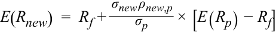

<!-- Formula Text: E(R new)  =  R f + σ new ρ new,p _ σ p × [E(R p) − R f] -->

$$E(R_{\text{new}}) = R_f + \frac{\sigma_{\text{new}} \rho_{\text{new},p}}{\sigma_p} \times [E(R_p) - R_f]$$

trong đó $E(R)$ là tỷ suất sinh lợi từ tài sản, $R_f$ là tỷ suất sinh lợi của tài sản phi rủi ro, $\sigma$ là độ lệch chuẩn, $\rho$ là hệ số tương quan, và các chỉ số dưới $\text{new}$ và $p$ lần lượt đề cập đến cổ phiếu mới và danh mục đầu tư hiện hữu. Nếu tỷ suất sinh lợi đã điều chỉnh rủi ro (*risk-adjusted return*) của tài sản mới mang lại lợi ích cho danh mục đầu tư, thì tài sản đó nên được đưa vào. Điều kiện này có thể được viết lại bằng cách sử dụng tỷ số Sharpe (*Sharpe ratio*) ở cả hai vế của phương trình như sau:

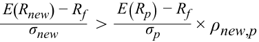

<!-- Formula Text: E(R new) − R f _ σ new > E(R p) − R f _ σ p × ρ new,p -->

$$\frac{E(R_{\text{new}}) - R_f}{\sigma_{\text{new}}} > \frac{E(R_p) - R_f}{\sigma_p} \times \rho_{\text{new},p}$$

Nếu tỷ số Sharpe của tài sản mới lớn hơn tỷ số Sharpe của danh mục đầu tư hiện tại nhân với hệ số tương quan, thì việc thêm tài sản mới vào sẽ mang lại lợi ích.

- _Mua bảo hiểm cho các danh mục đầu tư rủi ro (Buy insurance for risky portfolios)._ Điều này có thể gây ngạc nhiên, nhưng bảo hiểm (*insurance*) chính là một tài sản đầu tư—chỉ là một loại tài sản khác biệt. Bảo hiểm có mối tương quan âm với các tài sản của bạn và do đó rất có giá trị. Bảo hiểm mang lại cho bạn tỷ suất sinh lợi dương khi tài sản của bạn mất giá trị, nhưng không chi trả gì cả nếu tài sản của bạn giữ nguyên giá trị. Theo thời gian, bảo hiểm tạo ra một tỷ suất sinh lợi trung bình âm. Tuy nhiên, nhiều cá nhân sẵn sàng chấp nhận một mức lợi nhuận âm nhỏ bởi vì bảo hiểm làm giảm mức độ tiếp xúc của họ trước một khoản lỗ cực đoan. Nhìn chung, hoàn toàn hợp lý khi bổ sung một khoản đầu tư có tỷ suất sinh lợi âm nếu khoản đầu tư đó làm giảm đáng kể rủi ro (một ví dụ điển hình về sự đánh đổi giữa rủi ro và lợi nhuận).

Ngoài ra, các khoản đầu tư có tương quan âm cũng tồn tại trên thị trường. Trong lịch sử, vàng (*gold*) có tương quan âm với cổ phiếu; tuy nhiên, tỷ suất sinh lợi kỳ vọng của vàng thường nhỏ và đôi khi thậm chí là âm. Các nhà đầu tư thường đưa vàng và các hàng hóa khác vào danh mục đầu tư của họ như một cách để giảm thiểu rủi ro tổng thể của danh mục đầu tư, bao gồm cả rủi ro tiền tệ và rủi ro lạm phát.

Mua quyền chọn bán (*buying put options*) là một cách khác để giảm thiểu rủi ro. Bởi vì quyền chọn bán chi trả tiền khi tài sản cơ sở giảm giá trị (tương quan âm), chúng có thể bảo vệ danh mục đầu tư của nhà đầu tư trước những khoản lỗ thảm khốc. Tất nhiên, quyền chọn bán tốn chi phí để mua, và tỷ suất sinh lợi kỳ vọng là bằng không hoặc âm một chút ở mức cận biên.

# **<mark>10</mark>**

## **ĐƯỜNG BIÊN HIỆU QUẢ: TẬP HỢP CƠ HỘI ĐẦU TƯ & CÁC DANH MỤC ĐẦU TƯ CÓ PHƯƠNG SAI TỐI THIỂU (*EFFICIENT FRONTIER: INVESTMENT OPPORTUNITY SET & MINIMUM VARIANCE PORTFOLIOS*)**

mô tả tác động lên rủi ro của danh mục đầu tư khi đầu tư vào các tài sản có tương quan nhỏ hơn mức tương quan hoàn hảo (*less than perfectly correlated*)
mô tả và diễn giải đường biên phương sai tối thiểu (*minimum-variance frontier*) và đường biên hiệu quả (*efficient frontier*) của các tài sản rủi ro cùng với danh mục đầu tư có phương sai tối thiểu toàn cục (*global minimum-variance portfolio*)

<!-- PDF Page 47 -->

Trong phần này, chúng ta chuẩn hóa tác động của sự đa dạng hóa và mở rộng tập hợp các khoản đầu tư để bao gồm tất cả các tài sản rủi ro hiện có trong khung phân tích trung bình – phương sai (*mean–variance framework*). Việc bổ sung một tài sản phi rủi ro sẽ tạo ra một danh mục đầu tư rủi ro tối ưu (*optimal risky portfolio*) và đường phân bổ vốn (*capital allocation line* – CAL). Sau đó, chúng ta có thể suy ra danh mục đầu tư tối ưu của nhà đầu tư (*investor’s optimal portfolio*) bằng cách chồng đường phân bổ vốn lên các đường bàng quan của nhà đầu tư.

### **Tập hợp Cơ hội Đầu tư (*Investment Opportunity Set*)**

Nếu hai tài sản có tương quan hoàn hảo, tập hợp cơ hội rủi ro – lợi nhuận (*risk–return opportunity set*) được biểu diễn bằng một đường thẳng nối hai tài sản đó. Đường thẳng này chứa các danh mục đầu tư được hình thành bằng cách thay đổi tỷ trọng của mỗi tài sản được đầu tư trong danh mục. Sự tương quan này đã được mô tả bằng đường thẳng (với $\rho = 1$) trong Bảng minh họa 14. Nếu hai tài sản không tương quan hoàn hảo, rủi ro của danh mục đầu tư sẽ nhỏ hơn rủi ro bình quân gia quyền của các thành phần, và danh mục đầu tư được hình thành từ hai tài sản sẽ phình ra về phía bên trái (*bulges on the left*) như được thể hiện bởi các đường cong có hệ số tương quan ($\rho$) nhỏ hơn 1,0 trong Bảng minh họa 14. Tất cả các điểm nối hai tài sản đều có thể đạt được (hay khả thi – *feasible*). Việc bổ sung thêm các tài sản mới vào danh mục đầu tư này sẽ tạo ra ngày càng nhiều danh mục đầu tư hơn nữa, vốn là sự kết hợp tuyến tính giữa danh mục đầu tư hiện hữu và tài sản mới hoặc là sự kết hợp dạng đường cong (*curvilinear combination*), tùy thuộc vào hệ số tương quan giữa danh mục đầu tư hiện hữu và tài sản mới.

Khi số lượng các tài sản hiện có tăng lên, số lượng các sự kết hợp khả thi tăng lên nhanh chóng. Khi tất cả các tài sản có thể đầu tư (*investable assets*) được xem xét, và có hàng trăm hàng nghìn tài sản như vậy, chúng ta có thể xây dựng một tập hợp cơ hội của các khoản đầu tư (*opportunity set of investments*). Tập hợp cơ hội thông thường sẽ bao phủ tất cả các điểm nằm bên trong một đường biên (*frontier*) bởi vì hoàn toàn có thể chạm tới mọi điểm khả thi bên trong đường cong đó bằng cách tạo lập một cách khéo léo một danh mục đầu tư từ các tài sản có thể đầu tư.

Chúng ta bắt đầu với các tài sản riêng lẻ có thể đầu tư và dần dần hình thành các danh mục đầu tư có thể được vẽ trên đồ thị để tạo thành một đường cong như trong Bảng minh họa 18. Tất cả các điểm nằm trên đường cong và các điểm nằm về phía bên phải của đường cong đều có thể đạt được bằng sự kết hợp của một hoặc nhiều tài sản có thể đầu tư. Tập hợp các điểm này được gọi là **tập hợp cơ hội đầu tư (*investment opportunity set*)**. Ban đầu, tập hợp cơ hội chỉ bao gồm các tài sản trong nước (*domestic assets only*) và được gắn nhãn như vậy trong Bảng minh họa 18.

#### **Bảng minh họa 18: Tập hợp Cơ hội Đầu tư (*Investment Opportunity Set*)**

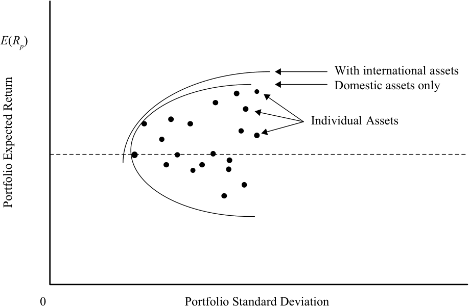

<!-- Picture Text: E ( Rp ) With international assets Domestic assets only Individual Assets 0 Portfolio Standard Deviation Portfolio Expected Return  -->

> **Chú thích hình ảnh:** Trục hoành là Độ lệch chuẩn danh mục đầu tư (*Portfolio Standard Deviation*), trục tung là Lợi nhuận kỳ vọng của danh mục đầu tư (*Portfolio Expected Return* $E(R_p)$). Các chấm tròn biểu diễn Các tài sản riêng lẻ (*Individual Assets*). Đường cong liền nét bên trong là Tập hợp cơ hội chỉ gồm các tài sản trong nước (*Domestic assets only*); đường cong nét đứt mở rộng ra phía tây bắc là Tập hợp cơ hội khi có thêm các tài sản quốc tế (*With international assets*).

<!-- PDF Page 48 -->

#### **_Bổ sung các Nhóm Tài sản (Addition of Asset Classes)_**

Bảng minh họa 18 cho thấy tác động của việc bổ sung thêm một nhóm tài sản mới, chẳng hạn như các tài sản quốc tế (*international assets*). Miễn là nhóm tài sản mới không tương quan hoàn hảo với nhóm tài sản hiện hữu, tập hợp cơ hội đầu tư sẽ mở rộng hơn nữa về phía tây bắc (*northwest*), mang lại một sự đánh đổi rủi ro – lợi nhuận vượt trội hơn.

Tập hợp cơ hội đầu tư có các tài sản quốc tế chiếm ưu thế vượt trội (*dominates*) so với tập hợp cơ hội chỉ bao gồm các tài sản trong nước. Việc bổ sung thêm các nhóm tài sản khác cũng sẽ có tác động tương tự lên tập hợp cơ hội. Do đó, chúng ta nên tiếp tục bổ sung các nhóm tài sản cho đến khi chúng không còn cải thiện thêm sự đánh đổi rủi ro – lợi nhuận nữa. Những lợi ích của sự đa dạng hóa có thể được nắm bắt trọn vẹn theo cách này trong việc xây dựng tập hợp cơ hội đầu tư, và cuối cùng là trong việc lựa chọn danh mục đầu tư tối ưu.

Trong phần thảo luận tiếp theo của mục này, chúng ta sẽ giả định rằng _tất cả_ các tài sản có thể đầu tư hiện có đối với một nhà đầu tư đều đã được đưa vào trong tập hợp cơ hội đầu tư và không cần phải dành sự chú ý đặc biệt nào cho các nhóm tài sản mới hay các cơ hội đầu tư mới nữa.

### **Các Danh mục Đầu tư có Phương sai Tối thiểu (*Minimum-Variance Portfolios*)**

Tập hợp cơ hội đầu tư bao gồm tất cả các tập hợp có thể đầu tư hiện có được thể hiện trong Bảng minh họa 19. Có một số lượng lớn các danh mục đầu tư sẵn có để đầu tư, nhưng chúng ta phải chọn ra một danh mục đầu tư tối ưu duy nhất. Trong tiểu mục này, chúng ta bắt đầu quy trình lựa chọn bằng cách thu hẹp sự lựa chọn xuống còn ít danh mục đầu tư hơn.

#### **Bảng minh họa 19: Đường biên Phương sai Tối thiểu (*Minimum-Variance Frontier*)**

<!-- Picture Text: E ( Rp ) Efficient Frontier A B X D C Minimum-Variance Frontier Global Minimum- Variance Portfolio (Z) 0 Portfolio Standard Deviation Portfolio Expected Return  -->

> **Chú thích hình ảnh:** Trục hoành là Độ lệch chuẩn danh mục đầu tư (*Portfolio Standard Deviation*), trục tung là Lợi nhuận kỳ vọng của danh mục đầu tư (*Portfolio Expected Return* $E(R_p)$). Toàn bộ đường cong bao ngoài bên trái là Đường biên phương sai tối thiểu (*Minimum-Variance Frontier*). Điểm ngoài cùng bên trái $Z$ là Danh mục đầu tư có phương sai tối thiểu toàn cục (*Global Minimum-Variance Portfolio*). Phần nhánh trên từ $Z$ qua $A$ đến $D$ là Đường biên hiệu quả (*Efficient Frontier*). Điểm $X$ nằm ngoài vùng khả thi (bên trái $A$), điểm $B$ nằm bên trong vùng khả thi (bên phải $A$), và điểm $C$ nằm ở nhánh dưới của đường biên phương sai tối thiểu.

#### **_Đường biên Phương sai Tối thiểu (Minimum-Variance Frontier)_**

Các nhà đầu tư ngại rủi ro tìm cách tối thiểu hóa rủi ro cho một mức lợi nhuận nhất định. Hãy xét các Điểm A, B, và X trong Bảng minh họa 19 và giả sử rằng chúng nằm trên cùng một đường thẳng nằm ngang theo cách dựng hình. Do đó, cả ba điểm đều có cùng tỷ suất sinh lợi kỳ vọng, $E(R_1)$, giống như tất cả các điểm khác nằm trên đường thẳng tưởng tượng nối A, B, và X. Khi được quyền lựa chọn, một nhà đầu tư sẽ chọn điểm có rủi ro tối thiểu, tức là Điểm X. Tuy nhiên, Điểm X không thể đạt được (*unattainable*) bởi vì nó không nằm trong tập hợp cơ hội đầu tư. Do đó, mức rủi ro tối thiểu

<!-- PDF Page 49 -->

mà chúng ta có thể đạt được cho mức lợi nhuận $E(R_1)$ là tại Điểm A. Điểm B và tất cả các điểm nằm về phía bên phải của Điểm A đều khả thi nhưng chúng lại có rủi ro cao hơn. Vì vậy, một nhà đầu tư ngại rủi ro sẽ chỉ chọn Điểm A thay vì bất kỳ danh mục đầu tư nào khác có cùng mức lợi nhuận.

Tương tự, Điểm C là điểm có phương sai tối thiểu đối với mức lợi nhuận kiếm được tại C. Các điểm nằm về phía bên phải của C đều có rủi ro cao hơn. Chúng ta có thể mở rộng phân tích trên cho tất cả các mức lợi nhuận khả thi. Trong mọi trường hợp, chúng ta đều thấy rằng **danh mục đầu tư có phương sai tối thiểu (*minimum-variance portfolio*)** là danh mục nằm trên đường cong liền nét được vẽ trong Bảng minh họa 19. Toàn bộ tập hợp các danh mục đầu tư có phương sai tối thiểu này được gọi là **đường biên phương sai tối thiểu (*minimum-variance frontier*)**. Đường biên phương sai tối thiểu xác định một tập hợp nhỏ hơn các danh mục đầu tư mà các nhà đầu tư muốn đầu tư vào. Lưu ý rằng không có nhà đầu tư ngại rủi ro nào lại chọn đầu tư vào một danh mục nằm về phía bên phải của đường biên phương sai tối thiểu bởi vì một danh mục đầu tư nằm ngay trên đường biên phương sai tối thiểu có thể mang lại cùng mức lợi nhuận nhưng ở một mức rủi ro thấp hơn.

#### **_Danh mục Đầu tư có Phương sai Tối thiểu Toàn cục (Global Minimum-Variance Portfolio)_**

Điểm ngoài cùng bên trái trên đường biên phương sai tối thiểu là danh mục đầu tư có phương sai nhỏ nhất trong số tất cả các danh mục đầu tư gồm các tài sản rủi ro, và được gọi là **danh mục đầu tư có phương sai tối thiểu toàn cục (*global minimum-variance portfolio*)**. Một nhà đầu tư không thể nắm giữ một danh mục đầu tư bao gồm các tài sản _rủi ro_ mà lại có mức rủi ro thấp hơn mức rủi ro của danh mục đầu tư có phương sai tối thiểu toàn cục. Hãy lưu ý sự nhấn mạnh vào cụm từ tài sản “rủi ro”. Sau này, việc đưa thêm một tài sản phi rủi ro vào sẽ cho phép chúng ta nới lỏng ràng buộc này.

#### **_Đường biên Hiệu quả của các Tài sản Rủi ro (Efficient Frontier of Risky Assets)_**

Đường biên phương sai tối thiểu mang lại cho chúng ta các danh mục đầu tư có phương sai nhỏ nhất cho một mức lợi nhuận nhất định. Tuy nhiên, các nhà đầu tư cũng muốn tối đa hóa lợi nhuận cho một mức rủi ro nhất định. Hãy quan sát Điểm A và Điểm C trên đường biên phương sai tối thiểu được thể hiện trong Bảng minh họa 19. Cả hai điểm này đều có cùng mức rủi ro. Khi được quyền lựa chọn, một nhà đầu tư sẽ chọn Danh mục A bởi vì nó có lợi nhuận cao hơn. Sẽ không ai chọn Danh mục C. Phân tích tương tự cũng áp dụng cho tất cả các điểm nằm trên đường biên phương sai tối thiểu ở phía dưới danh mục đầu tư có phương sai tối thiểu toàn cục. Do đó, các danh mục đầu tư nằm trên đường cong phía dưới danh mục có phương sai tối thiểu toàn cục và nằm về phía bên phải của nó đều không mang lại lợi ích và là những danh mục đầu tư không hiệu quả (*inefficient portfolios*) đối với một nhà đầu tư.

Đường cong nằm phía trên và về phía bên phải của danh mục đầu tư có phương sai tối thiểu toàn cục được gọi là **đường biên hiệu quả Markowitz (*Markowitz efficient frontier*)** bởi vì nó chứa tất cả các danh mục đầu tư gồm các tài sản rủi ro mà những nhà đầu tư hợp lý, ngại rủi ro (*rational, risk-averse investors*) sẽ lựa chọn.

Một quan sát quan trọng thường bị bỏ qua là độ dốc (*slope*) tại các điểm khác nhau trên đường biên hiệu quả. Khi chúng ta di chuyển sang phải từ danh mục đầu tư có phương sai tối thiểu toàn cục (Điểm Z) trong Bảng minh họa 19, có sự gia tăng về rủi ro đi kèm với sự gia tăng đồng thời về lợi nhuận. Tuy nhiên, mức tăng lợi nhuận ứng với mỗi đơn vị rủi ro tăng thêm lại liên tục giảm dần khi chúng ta di chuyển từ trái sang phải bởi vì độ dốc liên tục giảm. Độ dốc tại Điểm D nhỏ hơn độ dốc tại Điểm A, và độ dốc tại Điểm A lại nhỏ hơn độ dốc tại Điểm Z. Mức tăng lợi nhuận khi di chuyển từ Điểm Z đến Điểm A bằng với mức tăng lợi nhuận khi di chuyển từ Điểm A đến Điểm D. Có thể thấy rằng lượng rủi ro tăng thêm khi di chuyển từ Điểm A đến Điểm D gấp từ 3 đến 4 lần so với lượng rủi ro tăng thêm khi di chuyển từ Điểm Z đến Điểm A. Như vậy, các nhà đầu tư nhận được mức gia tăng lợi nhuận ngày càng giảm dần (*decreasing increases in returns*) khi họ gánh chịu thêm nhiều rủi ro.

<!-- PDF Page 50 -->

# **<mark>11</mark>**

## **ĐƯỜNG BIÊN HIỆU QUẢ: MỘT TÀI SẢN PHI RỦI RO VÀ NHIỀU TÀI SẢN RỦI RO (*EFFICIENT FRONTIER: A RISK-FREE ASSET AND MANY RISKY ASSETS*)**

giải thích việc lựa chọn danh mục đầu tư tối ưu (*optimal portfolio*), khi biết độ hữu dụng (*utility*) (hoặc mức độ ngại rủi ro) của nhà đầu tư và đường phân bổ vốn (*capital allocation line*)

Cho đến nay, chúng ta mới chỉ xem xét các tài sản rủi ro trong đó tỷ suất sinh lợi là có rủi ro hoặc không chắc chắn. Tuy nhiên, hầu hết các nhà đầu tư đều có quyền tiếp cận với một tài sản phi rủi ro (*risk-free asset*), đáng chú ý nhất là từ các chứng khoán do chính phủ phát hành. Việc bổ sung thêm một tài sản phi rủi ro làm cho tập hợp cơ hội đầu tư trở nên phong phú hơn nhiều so với tập hợp cơ hội đầu tư chỉ bao gồm các tài sản rủi ro.

### **Đường phân bổ vốn và Danh mục Đầu tư Rủi ro Tối ưu (*Capital Allocation Line and Optimal Risky Portfolio*)**

Theo định nghĩa, một tài sản phi rủi ro có rủi ro bằng không nên nó phải nằm trên trục tung (*y-axis*) trong đồ thị trung bình – phương sai. Một tài sản phi rủi ro có tỷ suất sinh lợi $R_f$ được vẽ trong Bảng minh họa 20. Tài sản này bây giờ có thể được kết hợp với một danh mục các tài sản rủi ro. Sự kết hợp giữa một tài sản phi rủi ro với một danh mục các tài sản rủi ro là một đường thẳng, giống như trong Phần 6 (xem Bảng minh họa 9). Tuy nhiên, không giống như trong Phần 6, chúng ta có nhiều danh mục đầu tư rủi ro để lựa chọn thay vì chỉ một danh mục đầu tư rủi ro duy nhất.

**Bảng minh họa 20: Danh mục Đầu tư Rủi ro Tối ưu (*Optimal Risky Portfolio*)**

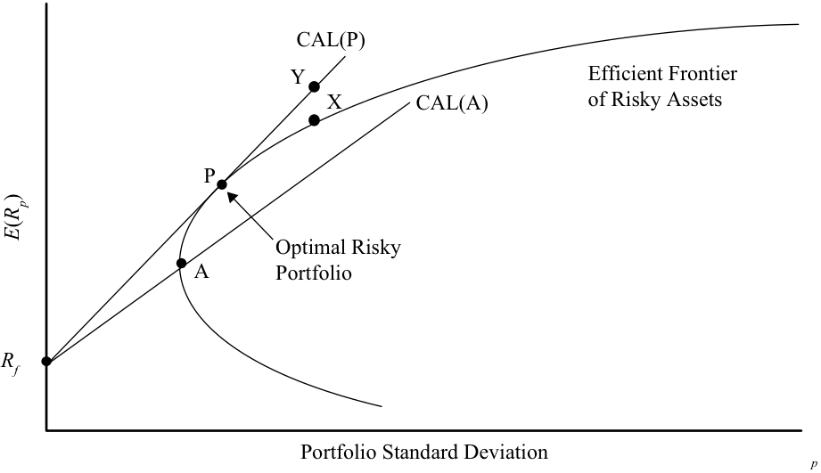

<!-- Picture Text: CAL(P) Y Efficient Frontier X CAL(A) of Risky Assets P Optimal Risky A Portfolio Rf Portfolio Standard Deviation p () ER p  -->

> **Chú thích hình ảnh:** Trục hoành là Độ lệch chuẩn danh mục đầu tư ($\sigma_p$), trục tung là Lợi nhuận kỳ vọng ($E(R_p)$). Đường $\text{CAL}(A)$ nối từ $R_f$ cắt Đường biên hiệu quả của các tài sản rủi ro (*Efficient Frontier of Risky Assets*) tại điểm $A$. Đường $\text{CAL}(P)$ nối từ $R_f$ tiếp xúc với Đường biên hiệu quả tại điểm $P$ – Danh mục đầu tư rủi ro tối ưu (*Optimal Risky Portfolio*). Điểm $Y$ trên $\text{CAL}(P)$ nằm ngay phía trên điểm $X$ của Đường biên hiệu quả ở cùng mức độ lệch chuẩn.

Tất cả các danh mục đầu tư nằm trên đường biên hiệu quả đều là những ứng cử viên để được kết hợp với tài sản phi rủi ro. Hai sự kết hợp được thể hiện trong Bảng minh họa 20: một sự kết hợp giữa tài sản phi rủi ro và Danh mục hiệu quả A, và sự kết hợp kia là giữa tài sản phi rủi ro và Danh mục hiệu quả P. Khi so sánh đường phân bổ vốn A ($\text{CAL}(A)$) và đường phân bổ vốn P ($\text{CAL}(P)$), ta thấy rằng luôn có một điểm trên $\text{CAL}(P)$ có lợi nhuận cao hơn và cùng mức rủi ro đối với mỗi điểm trên $\text{CAL}(A)$. Nói cách khác, các danh mục đầu tư trên $\text{CAL}(P)$ chiếm ưu thế vượt trội (*dominate*) so với các danh mục đầu tư trên $\text{CAL}(A)$. Do đó, một nhà đầu tư sẽ chọn $\text{CAL}(P)$ thay vì $\text{CAL}(A)$. Chúng ta muốn dịch chuyển xa hơn nữa về phía tây bắc để đạt được những danh mục đầu tư tốt hơn nữa. Tuy nhiên, không có danh mục đầu tư nào trong số đó có thể đạt được bởi vì chúng nằm phía trên đường biên hiệu quả.

<!-- PDF Page 51 -->

Thế còn các điểm khác trên đường biên hiệu quả thì sao? Ví dụ, Điểm X nằm trên đường biên hiệu quả và có tỷ suất sinh lợi cao nhất trong số tất cả các danh mục đầu tư rủi ro ở mức rủi ro của nó. Tuy nhiên, Điểm Y trên $\text{CAL}(P)$, có thể đạt được bằng cách sử dụng đòn bẩy (*leveraging*) đối với Danh mục P như đã thấy trong Phần 6, nằm phía trên Điểm X và có cùng mức rủi ro nhưng lợi nhuận cao hơn. Theo cùng cách đó, chúng ta có thể quan sát thấy rằng $\text{CAL}(P)$ không chỉ chiếm ưu thế vượt trội so với $\text{CAL}(A)$ mà còn chiếm ưu thế vượt trội so với cả đường biên hiệu quả Markowitz của các tài sản rủi ro.

$\text{CAL}(P)$ là đường phân bổ vốn tối ưu (*optimal capital allocation line*) và Danh mục P là **danh mục đầu tư rủi ro tối ưu (*optimal risky portfolio*)**. Như vậy, với việc bổ sung thêm tài sản phi rủi ro, chúng ta có thể thu hẹp việc lựa chọn các danh mục đầu tư rủi ro xuống còn một danh mục đầu tư rủi ro tối ưu duy nhất, P, nằm tại tiếp điểm của $\text{CAL}(P)$ và đường biên hiệu quả của các tài sản rủi ro.

### **Định lý Phân tách Hai Quỹ (*The Two-Fund Separation Theorem*)**

**Định lý phân tách hai quỹ (*two-fund separation theorem*)** phát biểu rằng tất cả các nhà đầu tư bất kể thị hiếu, sở thích rủi ro, và mức tài sản ban đầu sẽ đều nắm giữ một sự kết hợp của hai danh mục đầu tư hay hai quỹ: một tài sản phi rủi ro và một danh mục đầu tư tối ưu gồm các tài sản rủi ro.6

Định lý phân tách cho phép chúng ta chia bài toán đầu tư của một nhà đầu tư thành hai bước riêng biệt: quyết định đầu tư (*investment decision*) và quyết định tài trợ (*financing decision*). Trong bước đầu tiên, giống như trong phân tích trước đó, nhà đầu tư xác định danh mục đầu tư rủi ro tối ưu. Danh mục đầu tư rủi ro tối ưu được lựa chọn từ vô số các danh mục đầu tư rủi ro mà không cần xem xét đến sở thích của nhà đầu tư. Quyết định đầu tư ở bước này được dựa trên tỷ suất sinh lợi, rủi ro, và các hệ số tương quan của danh mục đầu tư rủi ro tối ưu (một danh mục duy nhất).

Đường phân bổ vốn kết nối danh mục đầu tư rủi ro tối ưu và tài sản phi rủi ro. Tất cả các danh mục đầu tư tối ưu của nhà đầu tư đều phải nằm trên đường thẳng này. Danh mục đầu tư tối ưu của từng nhà đầu tư trên $\text{CAL}(P)$ được xác định ở bước thứ hai. Việc xem xét sở thích rủi ro của từng nhà đầu tư cá nhân, bằng cách sử dụng các đường bàng quan, sẽ quyết định mức phân bổ của nhà đầu tư vào tài sản phi rủi ro (cho vay – *lending*) và vào danh mục đầu tư rủi ro tối ưu. Các danh mục đầu tư nằm vượt quá danh mục đầu tư rủi ro tối ưu đạt được bằng cách đi vay (*borrowing*) với lãi suất phi rủi ro (tức là mua ký quỹ – *buying on margin*). Do đó, sở thích rủi ro của từng nhà đầu tư cá nhân sẽ quyết định quy mô tài trợ (tức là cho chính phủ vay thay vì đầu tư vào danh mục rủi ro tối ưu hoặc đi vay để mua thêm danh mục rủi ro tối ưu).

#### **VÍ DỤ 7**

### **Lựa chọn Đúng Danh mục Đầu tư (*Choosing the Right Portfolio*)**

Trong Bảng minh họa 21, rủi ro và lợi nhuận của các điểm được đánh dấu có giá trị như sau:

|**Điểm (*Point*)**|**Lợi nhuận (*Return*) (%)**|**Rủi ro (*Risk*) (%)**|**Điểm (*Point*)**|**Lợi nhuận (*Return*) (%)**|**Rủi ro (*Risk*) (%)**|
|---|---|---|---|---|---|
|A|15|10|B|11|10|
|C|15|30|D|25|30|
|F|4|0|G (vàng – *gold*)|10|30|
|P|16|17||||

<!-- PDF Page 52 -->

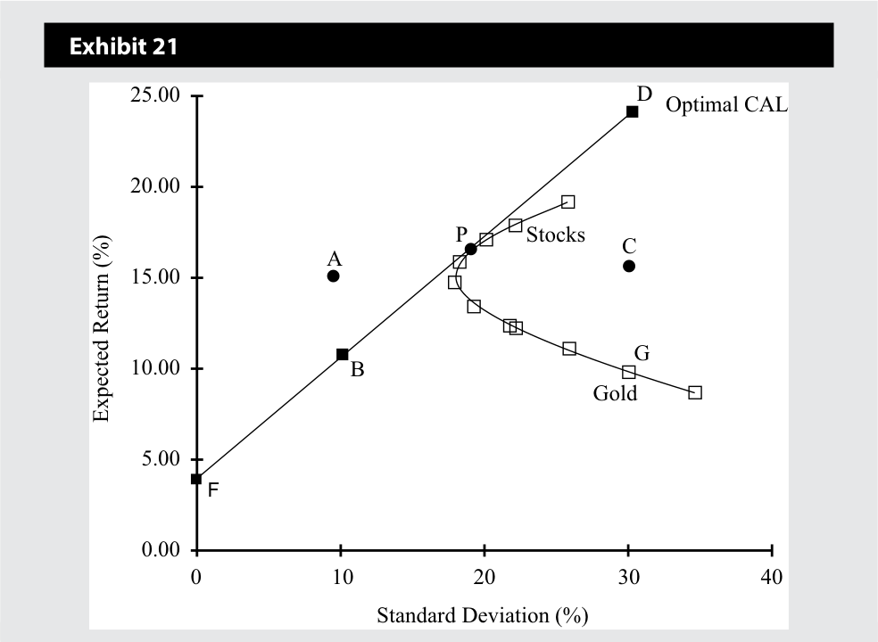

<!-- Picture Text: Exhibit 21 25.00 D Optimal CAL 20.00 P Stocks C A 15.00 G 10.00 B Gold 5.00 F 0.00 0 10 20 30 40 Standard Deviation (%) Expected Return (%)  -->

> **Chú thích hình ảnh:** Bảng minh họa 21: Trục hoành là Độ lệch chuẩn (%), trục tung là Lợi nhuận kỳ vọng (%). Đường CAL tối ưu (*Optimal CAL*) đi từ điểm $F(0, 4)$, qua $B(10, 11)$, tiếp xúc với đường biên hiệu quả tại $P(17, 16)$ (Cổ phiếu – *Stocks*), và kéo dài tới $D(30, 25)$. Điểm $A(10, 15)$ nằm phía trên đường CAL; điểm $C(30, 15)$ và $G(30, 10)$ (Vàng – *Gold*) nằm trên đường biên của tập hợp khả thi nhưng ở phía dưới đường CAL.

Hãy trả lời các câu hỏi sau đây với sự tham chiếu đến các điểm được vẽ trên Bảng minh họa 21 và giải thích câu trả lời của bạn. Nhà đầu tư đang lựa chọn một danh mục đầu tư dựa trên đồ thị này.

1. Điểm nào trong số các điểm trên không thể đạt được?

#### **Lời giải:**

Danh mục A không thể đạt được (*not attainable*) bởi vì nó nằm bên ngoài tập hợp khả thi và không nằm trên đường phân bổ vốn.

2. Danh mục đầu tư nào trong số các danh mục này sẽ không được lựa chọn bởi một nhà đầu tư hợp lý, ngại rủi ro?

#### **Lời giải:**

Danh mục G và C sẽ không được lựa chọn bởi vì D mang lại mức lợi nhuận cao hơn với cùng mức rủi ro. G và C là những điểm có thể đầu tư duy nhất không nằm trên đường phân bổ vốn.

3. Danh mục đầu tư nào trong số các danh mục này là phù hợp nhất cho một nhà đầu tư trung lập với rủi ro?

#### **Lời giải:**

Danh mục D là phù hợp nhất bởi vì một nhà đầu tư trung lập với rủi ro chỉ quan tâm đến lợi nhuận và danh mục D mang lại mức lợi nhuận cao nhất. $A = 0$ trong công thức tính độ hữu dụng.

4. Vàng nằm ở phần không hiệu quả của tập hợp khả thi. Tuy nhiên, vàng vẫn được sở hữu bởi nhiều nhà đầu tư hợp lý như một phần của một danh mục đầu tư lớn hơn. Tại sao?

#### **Lời giải:**

Vàng có thể được sở hữu như một phần của danh mục đầu tư (chứ không phải là _toàn bộ_ danh mục đầu tư) bởi vì vàng có hệ số tương quan thấp hoặc âm với nhiều tài sản rủi ro, chẳng hạn như cổ phiếu. Do đó, việc trở thành một phần của danh mục đầu tư có thể làm giảm rủi ro tổng thể mặc dù rủi ro đơn lẻ (*standalone risk*) của nó cao và lợi nhuận thấp. Lưu ý rằng giá vàng không hề ổn định—tỷ suất sinh lợi của nó rất rủi ro (30%). Ngay cả những người tìm kiếm rủi ro cũng sẽ chọn D thay vì G, vì D có cùng mức rủi ro nhưng lợi nhuận cao hơn.

<!-- PDF Page 53 -->

5. Độ hữu dụng của một nhà đầu tư tại điểm P với hệ số ngại rủi ro bằng 3 là bao nhiêu?

**Lời giải:**

- $U = E(r) - 0,5 A \sigma^2 = 0,16 - 0,5 \times 3 \times 0,0289 = 0,1167 = 11,67\%$.

## **ĐƯỜNG BIÊN HIỆU QUẢ: DANH MỤC ĐẦU TƯ TỐI ƯU CỦA NHÀ ĐẦU TƯ (*EFFICIENT FRONTIER: OPTIMAL INVESTOR PORTFOLIO*)**

# **<mark>12</mark>**

giải thích việc lựa chọn danh mục đầu tư tối ưu (*optimal portfolio*), khi biết độ hữu dụng (*utility*) (hoặc mức độ ngại rủi ro) của nhà đầu tư và đường phân bổ vốn (*capital allocation line*)

Đường $\text{CAL}(P)$ trong Bảng minh họa 22 chứa các danh mục đầu tư tốt nhất có thể hiện có dành cho các nhà đầu tư. Mỗi danh mục đầu tư trong số đó là một sự kết hợp tuyến tính giữa tài sản phi rủi ro và danh mục đầu tư rủi ro tối ưu. Trong số các danh mục đầu tư hiện có, việc lựa chọn danh mục đầu tư tối ưu của từng nhà đầu tư phụ thuộc vào sở thích rủi ro của nhà đầu tư đó. Trong Phần 4–6, chúng ta đã thảo luận rằng sở thích rủi ro của nhà đầu tư cá nhân được tích hợp vào các đường bàng quan của họ. Những đường này có thể được sử dụng để lựa chọn danh mục đầu tư tối ưu.

Bảng minh họa 22 cho thấy một đường bàng quan tiếp xúc (*tangent*) với đường phân bổ vốn, $\text{CAL}(P)$. Các đường bàng quan có độ hữu dụng cao hơn đường này đều nằm phía trên đường phân bổ vốn, vì vậy các danh mục đầu tư của chúng không thể đạt được. Các đường bàng quan nằm phía dưới đường này không được ưa thích bởi vì chúng có độ hữu dụng thấp hơn. Do đó, danh mục đầu tư tối ưu đối với nhà đầu tư có đường bàng quan này chính là danh mục C nằm trên $\text{CAL}(P)$, tại điểm tiếp xúc với đường bàng quan.

#### **Bảng minh họa 22: Danh mục Đầu tư Tối ưu của Nhà đầu tư (*Optimal Investor Portfolio*)**

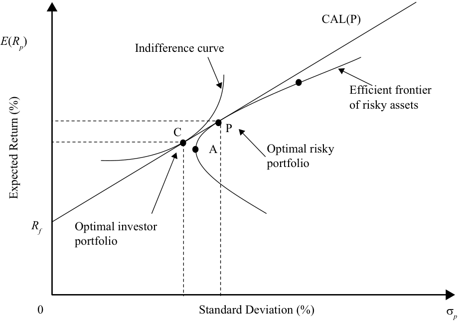

<!-- Picture Text: CAL(P) E ( Rp ) Indifference curve Efficient frontier of risky assets C P A Optimal risky portfolio Rf Optimal investor portfolio 0 Standard Deviation (%) σ p Expected Return (%)  -->

> **Chú thích hình ảnh:** Trục hoành là Độ lệch chuẩn ($\sigma_p$ %), trục tung là Lợi nhuận kỳ vọng ($E(R_p)$ %). Đường $\text{CAL}(P)$ bắt đầu từ $R_f$ tiếp xúc với Đường biên hiệu quả của các tài sản rủi ro (*Efficient frontier of risky assets*) tại điểm $P$ – Danh mục đầu tư rủi ro tối ưu (*Optimal risky portfolio*). Đường bàng quan (*Indifference curve*) tiếp xúc với $\text{CAL}(P)$ tại điểm $C$ – Danh mục đầu tư tối ưu của nhà đầu tư (*Optimal investor portfolio*).

<!-- PDF Page 54 -->

#### **VÍ DỤ 8**

### **Ví dụ Toàn diện về Lựa chọn Danh mục Đầu tư (*Comprehensive Example on Portfolio Selection*)**

Ví dụ toàn diện này ôn tập lại nhiều khái niệm đã học trong bài đọc này. Ví dụ bắt đầu với những thông tin đơn giản về các tài sản hiện có và xây dựng một danh mục đầu tư tối ưu của nhà đầu tư cho gia đình Lohrmann.

Giả sử gia đình Lohrmann chỉ có thể đầu tư vào hai tài sản rủi ro, A và B. Tỷ suất sinh lợi kỳ vọng và độ lệch chuẩn đối với tài sản A là 20% và 50%, còn tỷ suất sinh lợi kỳ vọng và độ lệch chuẩn đối với tài sản B là 15% và 33%. Hai tài sản này có hệ số tương quan với nhau bằng không.

1. Tính tỷ suất sinh lợi kỳ vọng của danh mục đầu tư và rủi ro (độ lệch chuẩn) của danh mục đầu tư nếu một nhà đầu tư đầu tư 10% vào A và 90% còn lại vào B.

#### **Lời giải:**

Chỉ số dưới “$rp$” có nghĩa là danh mục đầu tư rủi ro (*risky portfolio*).

$$R_{rp} = [0,10 \times 20\%] + [(1 - 0,10) \times 15\%] = 0,155 = 15,50\%$$

$$\sigma_{rp} = \sqrt{w_A^2 \sigma_A^2 + w_B^2 \sigma_B^2 + 2 w_A w_B \rho_{AB} \sigma_A \sigma_B}$$

$$= \sqrt{(0,10^2 \times 0,50^2) + (0,90^2 \times 0,33^2) + (2 \times 0,10 \times 0,90 \times 0,0 \times 0,50 \times 0,33)} = 0,3012 = 30,12\%$$

Lưu ý rằng hệ số tương quan bằng 0, vì vậy số hạng cuối cùng trong công thức độ lệch chuẩn bằng không.

2. Tổng quát hóa các phép tính trên cho lợi nhuận và rủi ro của danh mục đầu tư bằng cách giả định khoản đầu tư có tỷ trọng $w_A$ vào Tài sản A và khoản đầu tư có tỷ trọng $(1 - w_A)$ vào Tài sản B.

**Lời giải:**

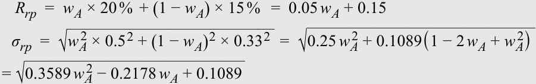

<!-- Formula Text: R rp  =  w A × 20 %  + (1 − w A) × 15 %   =  0.05 w A + 0.15 σ rp  =  √ _________________________ w A 2  × 0.5 2 + (1 − w A) 2 × 0.33 2   =  √ ____________________________ 0.25 w A 2  + 0.1089(1 − 2 w A + w A 2 ) = √ ___________________________ 0.3589 w A 2  − 0.2178 w A + 0.1089 -->

$$R_{rp} = w_A \times 20\% + (1 - w_A) \times 15\% = 0,05 w_A + 0,15$$

$$\sigma_{rp} = \sqrt{w_A^2 \times 0,5^2 + (1 - w_A)^2 \times 0,33^2} = \sqrt{0,25 w_A^2 + 0,1089(1 - 2 w_A + w_A^2)}$$

$$= \sqrt{0,3589 w_A^2 - 0,2178 w_A + 0,1089}$$

Tập hợp cơ hội đầu tư có thể được xây dựng bằng cách sử dụng các tỷ trọng khác nhau trong các biểu thức tính $E(R_{rp})$ và $\sigma_{rp}$ ở Phần 1 của ví dụ này. Bảng minh họa 23 thể hiện sự kết hợp của Tài sản A và B.

#### **Bảng minh họa 23**

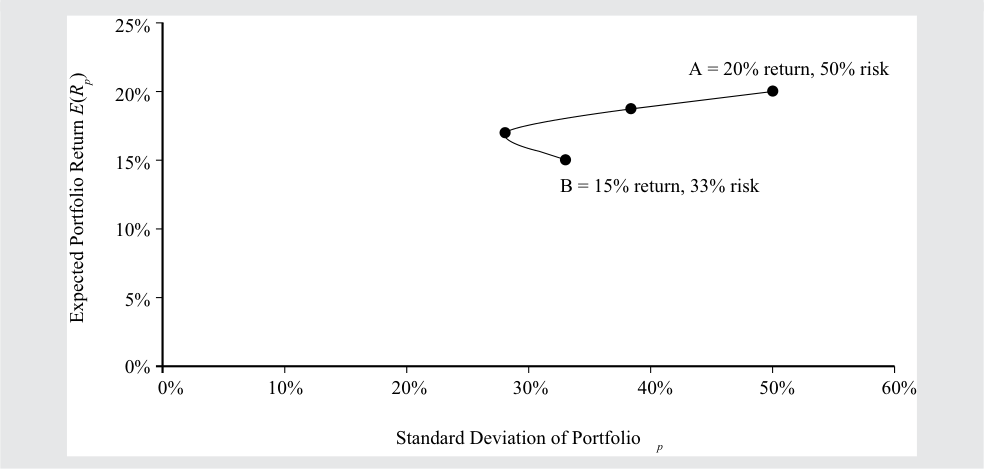

<!-- Picture Text: 25% A = 20% return, 50% risk 20% 15% B = 15% return, 33% risk 10% 5% 0% 0% 10% 20% 30% 40% 50% 60% Standard Deviation of Portfolio p Expected Portfolio Return () ER p  -->

> **Chú thích hình ảnh:** Trục hoành là Độ lệch chuẩn của danh mục đầu tư ($\sigma_p$), trục tung là Lợi nhuận kỳ vọng của danh mục đầu tư ($E(R_p)$). Đường cong nối giữa điểm $B$ (15% lợi nhuận, 33% rủi ro) và điểm $A$ (20% lợi nhuận, 50% rủi ro).

<!-- PDF Page 55 -->

3. Bây giờ hãy đưa thêm một tài sản phi rủi ro có tỷ suất sinh lợi là 3% vào. Hãy viết phương trình cho đường phân bổ vốn theo $w_A$ nối kết tài sản phi rủi ro với danh mục các tài sản rủi ro. (Gợi ý: sử dụng phương trình trong Phần 6 và thay thế các biểu thức của rủi ro và lợi nhuận danh mục đầu tư rủi ro từ Phần 2 ở trên).

#### **Lời giải:**

Phương trình của đường thẳng nối kết tài sản phi rủi ro với danh mục các tài sản rủi ro được cho dưới đây (xem Phần 6), trong đó chỉ số dưới “$rp$” đề cập đến danh mục đầu tư rủi ro thay vì “$i$”, và chỉ số dưới “$p$” đề cập đến danh mục đầu tư mới gồm hai tài sản rủi ro và một tài sản phi rủi ro.

<!-- Formula Text: E(R p)  =  R f + E(R i) − R f _ σ i σ p, Rewritten as E(R p)  =  R f + E(R rp) − R f _ σ rp σ p = 0.03 + 0.05 w A + 0.15 − 0.03 ________________________ √ ___________________________ 0.3589 w A 2  − 0.2178 w A + 0.1089   σ p = 0.03 + 0.05 w A + 0.12 ________________________ √ ___________________________ 0.3589 w A 2  − 0.2178 w A + 0.1089   σ p -->

$$E(R_p) = R_f + \frac{E(R_i) - R_f}{\sigma_i} \sigma_p, \quad \text{Được viết lại thành} \quad E(R_p) = R_f + \frac{E(R_{rp}) - R_f}{\sigma_{rp}} \sigma_p$$

$$= 0,03 + \frac{0,05 w_A + 0,15 - 0,03}{\sqrt{0,3589 w_A^2 - 0,2178 w_A + 0,1089}} \sigma_p$$

$$= 0,03 + \frac{0,05 w_A + 0,12}{\sqrt{0,3589 w_A^2 - 0,2178 w_A + 0,1089}} \sigma_p$$

Đường phân bổ vốn là đường thẳng có độ dốc lớn nhất bởi vì nó tiếp xúc với đường cong được tạo thành bởi các danh mục đầu tư của hai tài sản rủi ro. Bảng minh họa 24 thể hiện đường phân bổ vốn dựa trên một tài sản phi rủi ro được thêm vào nhóm các tài sản.

#### **Bảng minh họa 24**

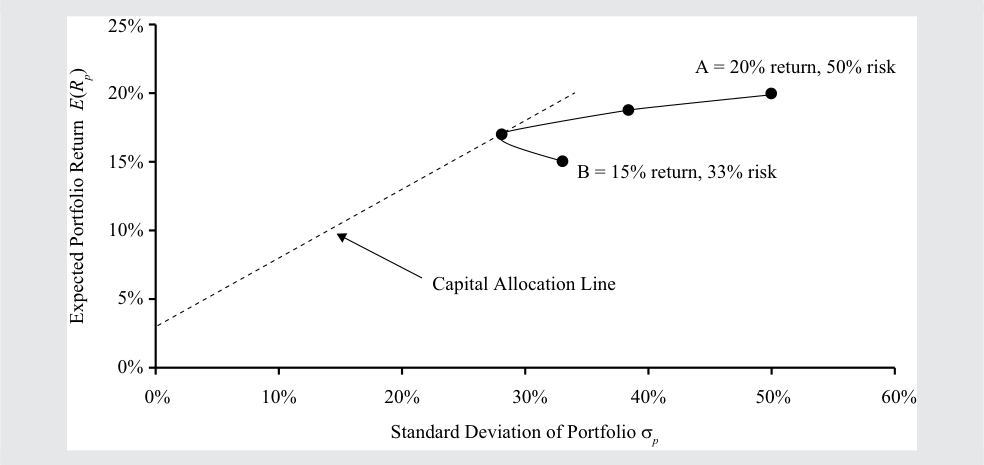

<!-- Picture Text: 25% A = 20% return, 50% risk 20% 15% B = 15% return, 33% risk 10% Capital Allocation Line 5% 0% 0% 10% 20% 30% 40% 50% 60% Standard Deviation of Portfolio σ p Expected Portfolio Return  () ER p  -->

> **Chú thích hình ảnh:** Trục hoành là Độ lệch chuẩn của danh mục đầu tư ($\sigma_p$), trục tung là Lợi nhuận kỳ vọng của danh mục đầu tư ($E(R_p)$). Đường phân bổ vốn (*Capital Allocation Line*) xuất phát từ 3% trên trục tung và tiếp xúc với đường cong nối giữa $B$ và $A$.

4. Độ dốc của đường phân bổ vốn đạt giá trị cực đại khi tỷ trọng đầu tư vào Tài sản A là 38,20%.7 Phương trình của đường phân bổ vốn sử dụng $w_A$ bằng 38,20% là gì?

#### **Lời giải:**

Bằng cách thay 38,20% cho $w_A$ vào phương trình ở Phần 3, chúng ta thu được $E(R_p) = 0,03 + 0,4978 \sigma_p$ làm phương trình đường phân bổ vốn.

> 7 Bạn có thể tối đa hóa $\frac{0,05 w_A + 0,12}{\sqrt{0,3589 w_A^2 - 0,2178 w_A + 0,1089}}$ bằng cách lấy đạo hàm bậc nhất của hệ số góc theo $w_A$ và cho nó bằng 0.

<!-- PDF Page 56 -->

5. Sau khi đã tạo lập được đường phân bổ vốn, chúng ta quay lại với gia đình Lohrmann. Độ lệch chuẩn của một danh mục đầu tư mang lại mức lợi nhuận 20% và nằm trên đường phân bổ vốn là bao nhiêu? Danh mục đầu tư này so với tài sản A thì như thế nào?

#### **Lời giải:**

Giải phương trình đường phân bổ vốn để tìm độ lệch chuẩn: $0,20 = 0,03 + 0,4978 \sigma_p \Rightarrow \sigma_p = 34,2\%$. Danh mục đầu tư có lợi nhuận 20% này có cùng mức lợi nhuận với Tài sản A nhưng có độ lệch chuẩn thấp hơn, 34,2% thay vì 50,0%.

6. Rủi ro của các danh mục đầu tư có mức lợi nhuận 3%, 9%, 15%, và 20% là bao nhiêu?

#### **Lời giải:**

Bạn có thể tìm rủi ro của danh mục đầu tư bằng cách sử dụng phương trình đường phân bổ vốn: $E(R_p) = 0,03 + 0,4978 \sigma_p$. Đối với một danh mục đầu tư có lợi nhuận 15%, hãy viết $0,15 = 0,03 + 0,4978 \sigma_p$. Giải tìm $\sigma_p$ cho kết quả là 24,1%. Bạn có thể tính toán tương tự rủi ro của các danh mục đầu tư khác với các mức lợi nhuận đã cho.

Rủi ro của danh mục đầu tư ứng với mức lợi nhuận 3% là 0,0%, ứng với mức lợi nhuận 9% là 12,1%, ứng với mức lợi nhuận 15% là 24,1%, và ứng với mức lợi nhuận 20% là 34,2%. Các điểm này được vẽ trong Bảng minh họa 25.

#### **Bảng minh họa 25**

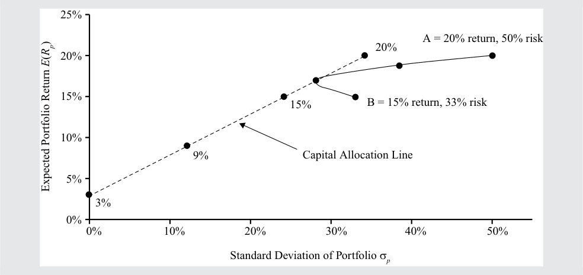

<!-- Picture Text: 25% A = 20% return, 50% risk 20% 20% 15% 15% B = 15% return, 33% risk 10% 9% Capital Allocation Line 5% 3% 0% 0% 10% 20% 30% 40% 50% Standard Deviation of Portfolio σ p Expected Portfolio Return () ER p  -->

> **Chú thích hình ảnh:** Đồ thị biểu diễn các điểm lợi nhuận 3%, 9%, 15%, và 20% nằm dọc trên Đường phân bổ vốn (*Capital Allocation Line*) cùng với đường biên giữa hai tài sản $B$ và $A$.

7. Độ hữu dụng mà gia đình Lohrmann nhận được từ một danh mục đầu tư có lợi nhuận 3%, 9%, 15%, và 20% là bao nhiêu? Hệ số ngại rủi ro của gia đình Lohrmann là 2,5.

#### **Lời giải:**

Để tìm độ hữu dụng, hãy sử dụng công thức tính độ hữu dụng với hệ số ngại rủi ro bằng 2,5:
$$\text{Độ hữu dụng (Utility)} = E(R_p) - 0,5 \times 2,5 \sigma_p^2$$
$$\text{Utility}(3\%) = 0,0300$$
$$\text{Utility}(9\%) = 0,09 - 0,5 \times 2,5 \times 0,121^2 = +0,0717$$
$$\text{Utility}(15\%) = 0,15 - 0,5 \times 2,5 \times 0,241^2 = +0,0774$$
$$\text{Utility}(20\%) = 0,20 - 0,5 \times 2,5 \times 0,341^2 = +0,0546$$

Dựa trên thông tin trên, gia đình Lohrmann chọn danh mục đầu tư có tỷ suất sinh lợi 15% và độ lệch chuẩn 24,1% bởi vì nó có
