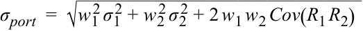
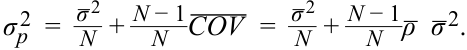

# Tập 9: Quản lý Danh mục Đầu tư (*Portfolio Management*)
## Học phần 1: Rủi ro và Lợi nhuận Danh mục Đầu tư: Phần I (*Portfolio Risk and Return: Part I*)
### Phần 4/4: Tóm tắt & Bài tập Thực hành (*Summary & Practice Problems*) (Trang PDF 57–70)

---

<!-- PDF Page 57 -->

độ hữu dụng cao nhất: $0,0774$. Cuối cùng, Bảng minh họa 26 thể hiện đường bàng quan tiếp xúc với đường phân bổ vốn để tạo ra danh mục đầu tư tối ưu của nhà đầu tư cho gia đình Lohrmann.

<!-- Picture Text: Exhibit 26 Lohrmanns’ Utility Curve 20% A = 20% return, 50% risk 20% (not to scale) 15% 15% B = 15% return, 33% risk 10% Lohrmanns’ Optimal portfolio 9% 5% Capital Allocation Line 3% 0% 0% 10% 20% 30% 40% 50% Standard Deviation of Portfolio σ p Expected Portfolio Return () ER p  -->

> **Chú thích hình ảnh:** Bảng minh họa 26: Đường cong hữu dụng của gia đình Lohrmann (*Lohrmanns’ Utility Curve*, không vẽ theo đúng tỷ lệ) tiếp xúc với Đường phân bổ vốn (*Capital Allocation Line*) tại mức lợi nhuận 15% – Danh mục đầu tư tối ưu của gia đình Lohrmann (*Lohrmanns’ Optimal portfolio*).

### **Sở thích của Nhà đầu tư và các Danh mục Đầu tư Tối ưu (*Investor Preferences and Optimal Portfolios*)**

Vị trí của một danh mục đầu tư tối ưu của nhà đầu tư phụ thuộc vào sở thích rủi ro của nhà đầu tư đó. Một nhà đầu tư rất ngại rủi ro có thể đầu tư một tỷ trọng lớn, thậm chí 100%, tài sản của mình vào tài sản phi rủi ro. Danh mục đầu tư tối ưu trong trường hợp của nhà đầu tư này sẽ nằm gần trục tung (*y-axis*). Tuy nhiên, một nhà đầu tư ít ngại rủi ro hơn có thể đầu tư một phần lớn tài sản của mình vào tài sản rủi ro tối ưu. Danh mục đầu tư tối ưu trong trường hợp của nhà đầu tư này sẽ nằm gần Điểm P hơn trong Bảng minh họa 22.

Một số nhà đầu tư ít ngại rủi ro hơn (tức là có khả năng chịu đựng rủi ro cao) có thể muốn chấp nhận nhiều rủi ro hơn nữa vì cơ hội đạt được lợi nhuận cao hơn. Một nhà đầu tư như vậy có thể vay tiền để đầu tư nhiều hơn vào danh mục đầu tư rủi ro. Nếu nhà đầu tư vay thêm một khoản tương đương 25% tài sản của mình, người đó có thể đầu tư 125% vào danh mục đầu tư rủi ro tối ưu. Danh mục đầu tư tối ưu của nhà đầu tư đối với một nhà đầu tư như vậy sẽ nằm về phía bên phải của Điểm P trên đường phân bổ vốn.

Như vậy, khi di chuyển từ tài sản phi rủi ro dọc theo đường phân bổ vốn, chúng ta sẽ bắt gặp những nhà đầu tư sẵn sàng chấp nhận nhiều rủi ro hơn. Tại Điểm P, nhà đầu tư đầu tư 100% vào danh mục đầu tư rủi ro tối ưu. Vượt quá Điểm P, nhà đầu tư chấp nhận nhiều rủi ro hơn nữa bằng cách vay tiền và đầu tư vào danh mục đầu tư rủi ro tối ưu.

Lưu ý rằng chúng ta có thể đáp ứng nhu cầu của tất cả các kiểu nhà đầu tư chỉ với hai danh mục đầu tư: tài sản phi rủi ro và danh mục đầu tư rủi ro tối ưu. Bảng minh họa 22 cũng là một minh họa cho định lý phân tách hai quỹ (*two-fund separation theorem*). Danh mục P là danh mục đầu tư rủi ro tối ưu được lựa chọn mà không cần xét đến sở thích của nhà đầu tư. Danh mục đầu tư tối ưu của nhà đầu tư được lựa chọn trên đường phân bổ vốn bằng cách chồng các đường bàng quan có tích hợp sở thích của nhà đầu tư lên đó.

# **TÓM TẮT (*SUMMARY*)**

Bài đọc này cung cấp mô tả và cách tính toán các đặc điểm đầu tư, chẳng hạn như rủi ro và lợi nhuận, mà các nhà đầu tư sử dụng khi đánh giá các tài sản để đầu tư. Tiếp theo đó là các phần nói về việc xây dựng danh mục đầu tư, lựa chọn một danh mục đầu tư rủi ro tối ưu, và sự thấu hiểu về mức độ ngại rủi ro cũng như các đường bàng quan. Cuối cùng,

<!-- PDF Page 58 -->

tiếp điểm (*tangency point*) của các đường bàng quan với đường phân bổ vốn cho phép xác định danh mục đầu tư tối ưu của nhà đầu tư. Các khái niệm trọng tâm được trình bày trong bài đọc bao gồm:

- Tỷ suất sinh lợi thời kỳ nắm giữ (*holding period return*) là phù hợp nhất cho một thời kỳ nắm giữ đơn lẻ, được xác định trước.

- Tỷ suất sinh lợi nhiều kỳ (*multiperiod returns*) có thể được tổng hợp theo nhiều cách. Mỗi phép tính lợi nhuận có những ứng dụng đặc thù để đánh giá các khoản đầu tư.

- Các nhà đầu tư ngại rủi ro (*risk-averse investors*) đưa ra các quyết định đầu tư dựa trên sự đánh đổi giữa rủi ro và lợi nhuận (*risk–return trade-off*), tối đa hóa lợi nhuận cho cùng một mức rủi ro, và tối thiểu hóa rủi ro cho cùng một mức lợi nhuận. Tuy nhiên, họ có thể quan ngại trước những sự sai lệch khỏi phân phối tỷ suất sinh lợi chuẩn (*normal return distribution*) và khỏi các giả định về tính hiệu quả vận hành (*operational efficiency*) của thị trường tài chính.

- Các nhà đầu tư là những người ngại rủi ro, và dữ liệu lịch sử xác nhận rằng các thị trường tài chính định giá tài sản dành cho những nhà đầu tư ngại rủi ro.

- Rủi ro của một danh mục đầu tư gồm hai tài sản phụ thuộc vào tỷ trọng của mỗi tài sản, độ lệch chuẩn của chúng và hệ số tương quan (hoặc hiệp phương sai) giữa tỷ suất sinh lợi của các tài sản. Khi số lượng tài sản trong một danh mục đầu tư tăng lên, hệ số tương quan giữa rủi ro của các tài sản trở thành một yếu tố quyết định quan trọng hơn đối với rủi ro của danh mục đầu tư.

- Việc kết hợp các tài sản có hệ số tương quan thấp giúp làm giảm rủi ro của danh mục đầu tư.

- Định lý phân tách hai quỹ (*two-fund separation theorem*) cho phép chúng ta tách biệt việc ra quyết định thành hai bước. Trong bước đầu tiên, danh mục đầu tư rủi ro tối ưu và đường phân bổ vốn được xác định, vốn giống nhau đối với tất cả các nhà đầu tư. Trong bước thứ hai, sở thích rủi ro của nhà đầu tư cho phép chúng ta tìm ra một danh mục đầu tư tối ưu duy nhất cho từng nhà đầu tư.

- Việc bổ sung thêm một tài sản phi rủi ro tạo ra các danh mục đầu tư chiếm ưu thế vượt trội (*dominant*) so với các danh mục đầu tư gồm các tài sản rủi ro trong mọi trường hợp ngoại trừ ngay tại danh mục đầu tư rủi ro tối ưu.

Bằng việc nắm vững nội dung của bài đọc này, bạn sẽ có thể tự tin tính toán danh mục đầu tư tối ưu của một nhà đầu tư khi biết sở thích rủi ro của nhà đầu tư đó và tập hợp các tài sản có thể đầu tư hiện có.

<!-- PDF Page 59 -->

# **TÀI LIỆU THAM KHẢO (*REFERENCES*)**

_2009 Ibbotson Stocks, Bonds, Bills, and Inflation (SBBI) Classic Yearbook_. 2009. Chicago, IL: Morningstar.

Bogle, John C. 2008. “Black Monday and Black Swans.” _Financial Analysts Journal_ 64, vol. , no. 2: 30–40. 10.2469/faj.v64.n2.9

Dimson, Elroy, Paul Marsh, and Mike Staunton. 2009. _Credit Suisse Global Investment Returns Sourcebook_. _2009._ Zurich, Switzerland: Credit Suisse Research Institute.

Taleb, Nassim N. 2007. _The Black Swan: The Impact of the Highly Improbable_. New York: Random House Inc.

<!-- PDF Page 60 -->

# **BÀI TẬP THỰC HÀNH (*PRACTICE PROBLEMS*)**

**1.** Liên quan đến chi phí giao dịch, tính thanh khoản (*liquidity*) _ít có khả năng_ tác động nhất đến:

   - **A.** giá cổ phiếu (*stock price*).

   - **B.** chênh lệch giá mua – bán (*bid–ask spreads*).

   - **C.** hoa hồng môi giới (*brokerage commissions*).

**2.** Bằng chứng về sự ngại rủi ro (*risk aversion*) được minh họa _tốt nhất_ bởi một mối quan hệ rủi ro – lợi nhuận mang tính chất:

   - **A.** ngược chiều (*negative*).

   - **B.** trung lập (*neutral*).

   - **C.** cùng chiều (*positive*).

**3.** Đối với các nhà đầu tư ngại rủi ro, một tài sản phi rủi ro (*risk-free asset*) sẽ tạo ra một giá trị độ hữu dụng bằng số (*numerical utility*):

   - **A.** giống nhau đối với tất cả các cá nhân.

   - **B.** dương đối với các nhà đầu tư ngại rủi ro.

   - **C.** bằng không đối với các nhà đầu tư tìm kiếm rủi ro.

**4.** Theo lý thuyết hữu dụng (*utility theory*), nhà đầu tư ngại rủi ro nhất sẽ có một đường bàng quan (*indifference curve*) với:

   - **A.** độ lồi lớn nhất (*most convexity*).

   - **B.** giá trị tung độ gốc nhỏ nhất (*smallest intercept value*).

   - **C.** hệ số góc lớn nhất (*greatest slope coefficient*).

**5.** Đối với hàm hữu dụng của một nhà đầu tư được biểu diễn là: $U = E(r) - \frac{1}{2} A \sigma^2$, giá trị nào sau đây của thước đo mức độ ngại rủi ro thể hiện mức độ ngại rủi ro _ít nhất_?

   - **A.** −4.

   - **B.** 0.

   - **C.** 4.

## **Thông tin sau đây liên quan đến các câu hỏi 6–7**

Một nhà hoạch định tài chính đã tạo lập dữ liệu sau đây để minh họa việc ứng dụng lý thuyết hữu dụng vào lựa chọn danh mục đầu tư:

<!-- PDF Page 61 -->

|**Khoản đầu tư (*Investment*)**|**Lợi nhuận kỳ vọng (*Expected Return*) (%)**|**Độ lệch chuẩn kỳ vọng (*Expected Standard Deviation*) (%)**|
|---|---|---|
|1|18|2|
|2|19|8|
|3|20|15|
|4|18|30|

**6.** Một nhà đầu tư trung lập với rủi ro (*risk-neutral investor*) _có nhiều khả năng nhất_ sẽ chọn:

   - **A.** Khoản đầu tư 1.

   - **B.** Khoản đầu tư 2.

   - **C.** Khoản đầu tư 3.

**7.** Nếu hàm hữu dụng của một nhà đầu tư được biểu diễn là $U = E(r) - \frac{1}{2} A \sigma^2$ và thước đo mức độ ngại rủi ro có giá trị là −2, thì nhà đầu tư tìm kiếm rủi ro (*risk-seeking investor*) _có nhiều khả năng nhất_ sẽ chọn:

   - **A.** Khoản đầu tư 2.

   - **B.** Khoản đầu tư 3.

   - **C.** Khoản đầu tư 4.

**8.** Nếu hàm hữu dụng của một nhà đầu tư được biểu diễn là $U = E(r) - \frac{1}{2} A \sigma^2$ và thước đo mức độ ngại rủi ro có giá trị là 2, thì nhà đầu tư ngại rủi ro _có nhiều khả năng nhất_ sẽ chọn:

   - **A.** Khoản đầu tư 1.

   - **B.** Khoản đầu tư 2.

   - **C.** Khoản đầu tư 3.

**9.** Nếu hàm hữu dụng của một nhà đầu tư được biểu diễn là $U = E(r) - \frac{1}{2} A \sigma^2$ và thước đo mức độ ngại rủi ro có giá trị là 4, thì nhà đầu tư ngại rủi ro _có nhiều khả năng nhất_ sẽ chọn:

   - **A.** Khoản đầu tư 1.

   - **B.** Khoản đầu tư 2.

   - **C.** Khoản đầu tư 3.

**10.** Theo lý thuyết danh mục đầu tư trung bình – phương sai (*mean–variance portfolio theory*), đường phân bổ vốn (*capital allocation line* – CAL) là sự kết hợp giữa tài sản phi rủi ro và một danh mục đầu tư gồm tất cả:

   - **A.** các tài sản rủi ro (*risky assets*).

   - **B.** các chứng khoán vốn cổ phần (*equity securities*).

   - **C.** các khoản đầu tư khả thi (*feasible investments*).

**11.** Hai nhà đầu tư cá nhân có mức độ ngại rủi ro khác nhau sẽ có các danh mục đầu tư tối ưu nằm:

   - **A.** phía dưới đường phân bổ vốn.

<!-- PDF Page 62 -->

   - **B.** trên đường phân bổ vốn.

   - **C.** phía trên đường phân bổ vốn.

**12.** Theo lý thuyết thị trường vốn (*capital market theory*), đặc điểm tài sản nào sau đây _ít có khả năng nhất_ tác động đến phương sai của một danh mục đầu tư có tỷ trọng đều (*equally weighted portfolio*) của nhà đầu tư?

   - **A.** Tỷ suất sinh lợi của tài sản (*Return on the asset*).

   - **B.** Độ lệch chuẩn của tài sản (*Standard deviation of the asset*).

   - **C.** Hiệp phương sai của tài sản đó với các tài sản khác trong danh mục đầu tư (*Covariances of the asset with the other assets in the portfolio*).

**13.** Một nhà quản lý danh mục đầu tư tạo lập danh mục đầu tư sau đây:

|**Chứng khoán (*Security*)**|**Tỷ trọng chứng khoán (*Security Weight*) (%)**|**Độ lệch chuẩn kỳ vọng (*Expected Standard Deviation*) (%)**|
|---|---|---|
|1|30|20|
|2|70|12|

Nếu hệ số tương quan của tỷ suất sinh lợi giữa hai chứng khoán là 0,40, độ lệch chuẩn kỳ vọng của danh mục đầu tư _gần nhất_ với:

   - **A.** 10,7%.

   - **B.** 11,3%.

   - **C.** 12,1%.

**14.** Một nhà quản lý danh mục đầu tư tạo lập danh mục đầu tư sau đây:

|**Chứng khoán (*Security*)**|**Tỷ trọng chứng khoán (*Security Weight*) (%)**|**Độ lệch chuẩn kỳ vọng (*Expected Standard Deviation*) (%)**|
|---|---|---|
|1|30|20|
|2|70|12|

Nếu hiệp phương sai của tỷ suất sinh lợi giữa hai chứng khoán là −0,0240, độ lệch chuẩn kỳ vọng của danh mục đầu tư _gần nhất_ với:

   - **A.** 2,4%.

   - **B.** 7,5%.

   - **C.** 9,2%.

## **Thông tin sau đây liên quan đến các câu hỏi 15–16**

Một nhà quản lý danh mục đầu tư tạo lập danh mục đầu tư sau đây:

<!-- PDF Page 63 -->

|**Chứng khoán (*Security*)**|**Tỷ trọng chứng khoán (*Security Weight*) (%)**|**Độ lệch chuẩn kỳ vọng (*Expected Standard Deviation*) (%)**|
|---|---|---|
|1|30|20|
|2|70|12|

**15.** Nếu độ lệch chuẩn của danh mục đầu tư là 14,40%, hệ số tương quan giữa hai chứng khoán bằng:

   - **A.** -1,0.

   - **B.** 0,0.

   - **C.** 1,0.

**16.** Nếu độ lệch chuẩn của danh mục đầu tư là 14,40%, hiệp phương sai giữa hai chứng khoán bằng:

   - **A.** 0,0006.

   - **B.** 0,0240.

   - **C.** 1,0000.

## **Thông tin sau đây liên quan đến các câu hỏi 17–19**

Một nhà quản lý danh mục đầu tư tạo lập danh mục đầu tư sau đây:

|**Chứng khoán (*Security*)**|**Lợi nhuận hàng năm kỳ vọng (*Expected Annual Return*) (%)**|**Độ lệch chuẩn kỳ vọng (*Expected Standard Deviation*) (%)**|
|---|---|---|
|1|16|20|
|2|12|20|

**17.** Nếu danh mục đầu tư gồm hai chứng khoán có tỷ suất sinh lợi kỳ vọng là 15%, tỷ trọng được đầu tư vào Chứng khoán 1 là:

   - **A.** 25%.

   - **B.** 50%.

   - **C.** 75%.

**18.** Nếu hệ số tương quan của tỷ suất sinh lợi giữa hai chứng khoán là −0,15, độ lệch chuẩn kỳ vọng của một danh mục đầu tư có tỷ trọng đều (*equal-weighted portfolio*) _gần nhất_ với:

   - **A.** 13,04%.

   - **B.** 13,60%.

   - **C.** 13,87%.

**19.** Nếu hai chứng khoán không tương quan (*uncorrelated*), độ lệch chuẩn kỳ vọng của một

<!-- PDF Page 64 -->

danh mục đầu tư có tỷ trọng đều _gần nhất_ với:

   - **A.** 14,00%.

   - **B.** 14,14%.

   - **C.** 20,00%.

## **Thông tin sau đây liên quan đến các câu hỏi 20–21**

Một chuyên gia phân tích đã đưa ra các dự phóng tỷ suất sinh lợi sau đây cho từng kịch bản trong ba kịch bản có khả năng xảy ra ngang nhau:

|**Tài sản (*Asset*)**|**Kịch bản 1 (*Outcome 1*) (%)**|**Kịch bản 2 (*Outcome 2*) (%)**|**Kịch bản 3 (*Outcome 3*) (%)**|**Lợi nhuận kỳ vọng (*Expected Return*) (%)**|
|---|---|---|---|---|
|1|12|0|6|6|
|2|12|6|0|6|
|3|0|6|12|6|

**20.** Nếu chuyên gia phân tích xây dựng các danh mục đầu tư gồm hai tài sản có tỷ trọng bằng nhau, cặp tài sản nào có độ lệch chuẩn kỳ vọng _thấp nhất_?

   - **A.** Tài sản 1 và Tài sản 2.

   - **B.** Tài sản 1 và Tài sản 3.

   - **C.** Tài sản 2 và Tài sản 3.

**21.** Nếu chuyên gia phân tích xây dựng các danh mục đầu tư gồm hai tài sản có tỷ trọng bằng nhau, cặp tài sản nào mang lại mức giảm thiểu rủi ro _ít nhất_?

   - **A.** Tài sản 1 và Tài sản 2.

   - **B.** Tài sản 1 và Tài sản 3.

   - **C.** Tài sản 2 và Tài sản 3.

**22.** Khi số lượng tài sản trong một danh mục đầu tư có tỷ trọng đều tăng lên, mức đóng góp của phương sai từng tài sản riêng lẻ vào độ biến động của danh mục đầu tư sẽ:

   - **A.** tăng lên.

   - **B.** giảm xuống.

   - **C.** giữ nguyên không đổi.

**23.** Đối với một danh mục đầu tư có tỷ trọng đều được tạo thành từ một số lượng lớn các tài sản, yếu tố nào sau đây đóng góp _nhiều nhất_ vào độ biến động của danh mục đầu tư?

   - **A.** Phương sai trung bình của các tài sản riêng lẻ.

   - **B.** Độ lệch chuẩn của các tài sản riêng lẻ.

   - **C.** Hiệp phương sai trung bình giữa tất cả các cặp tài sản.

<!-- PDF Page 65 -->

**24.** Hệ số tương quan giữa các tài sản trong một danh mục đầu tư gồm hai tài sản tăng lên trong một đợt suy giảm của thị trường. Nếu không có sự thay đổi nào về tỷ trọng của mỗi tài sản được nắm giữ trong danh mục hoặc độ lệch chuẩn kỳ vọng của các tài sản riêng lẻ, thì độ biến động của danh mục đầu tư _có nhiều khả năng nhất_ sẽ:

   - **A.** tăng lên.

   - **B.** giảm xuống.

   - **C.** giữ nguyên không đổi.

**25.** Phát biểu nào sau đây là _kém chính xác nhất_? Đường biên hiệu quả (*efficient frontier*) là tập hợp tất cả các tài sản rủi ro có thể đạt được với:

   - **A.** tỷ suất sinh lợi kỳ vọng cao nhất cho một mức rủi ro nhất định.

   - **B.** lượng rủi ro thấp nhất cho một mức lợi nhuận nhất định.

   - **C.** tỷ suất sinh lợi kỳ vọng cao nhất so với lãi suất phi rủi ro.

**26.** Danh mục đầu tư nằm trên đường biên phương sai tối thiểu (*minimum-variance frontier*) có độ lệch chuẩn thấp nhất là:

   - **A.** không thể đạt được (*unattainable*).

   - **B.** danh mục đầu tư rủi ro tối ưu (*optimal risky portfolio*).

   - **C.** danh mục đầu tư có phương sai tối thiểu toàn cục (*global minimum-variance portfolio*).

**27.** Tập hợp các danh mục đầu tư nằm trên đường biên phương sai tối thiểu chiếm ưu thế vượt trội so với tất cả các tập hợp danh mục đầu tư nằm phía dưới danh mục đầu tư có phương sai tối thiểu toàn cục là:

   - **A.** đường phân bổ vốn (*capital allocation line*).

   - **B.** đường biên hiệu quả Markowitz (*Markowitz efficient frontier*).

   - **C.** tập hợp các danh mục đầu tư rủi ro tối ưu (*set of optimal risky portfolios*).

**28.** Đường phân bổ vốn vượt trội (*dominant capital allocation line*) là sự kết hợp giữa tài sản phi rủi ro và:

   - **A.** danh mục đầu tư rủi ro tối ưu (*optimal risky portfolio*).

   - **B.** danh mục đầu tư có sử dụng đòn bẩy gồm các tài sản rủi ro (*levered portfolio of risky assets*).

   - **C.** danh mục đầu tư có phương sai tối thiểu toàn cục (*global minimum-variance portfolio*).

**29.** So với đường biên hiệu quả của các tài sản rủi ro, đường phân bổ vốn vượt trội có tỷ suất sinh lợi cao hơn đối với các mức rủi ro lớn hơn danh mục đầu tư rủi ro tối ưu nhờ vào khả năng của nhà đầu tư trong việc:

   - **A.** cho vay với lãi suất phi rủi ro (*lend at the risk-free rate*).

   - **B.** đi vay với lãi suất phi rủi ro (*borrow at the risk-free rate*).

   - **C.** mua tài sản phi rủi ro (*purchase the risk-free asset*).

**30.** Theo lý thuyết trung bình – phương sai, danh mục đầu tư tối ưu được quyết định bởi yếu tố nào của từng nhà đầu tư cá nhân?

   - **A.** Lãi suất phi rủi ro (*risk-free rate*).

<!-- PDF Page 66 -->

   - **B.** Lãi suất đi vay (*borrowing rate*).

   - **C.** Sở thích rủi ro (*risk preference*).

<!-- PDF Page 67 -->

# **LỜI GIẢI (*SOLUTIONS*)**

1. **C là đáp án đúng.** Hoa hồng môi giới (*brokerage commissions*) được thương lượng với công ty môi giới. Tính thanh khoản của một chứng khoán tác động đến tính hiệu quả vận hành của chi phí giao dịch. Cụ thể, tính thanh khoản tác động đến chênh lệch giá mua – bán (*bid–ask spread*) và có thể tác động đến giá cổ phiếu (nếu khả năng bán cổ phiếu bị suy giảm bởi sự không chắc chắn gắn liền với việc có thể bán được cổ phiếu đó).

2. **C là đáp án đúng.** Dữ liệu lịch sử qua các khoảng thời gian dài chỉ ra rằng tồn tại một mối quan hệ rủi ro – lợi nhuận cùng chiều (*positive risk–return relationship*), vốn là sự phản ánh mức độ ngại rủi ro của nhà đầu tư.

3. **A là đáp án đúng.** Một tài sản phi rủi ro có phương sai bằng không và không phụ thuộc vào việc nhà đầu tư là người trung lập với rủi ro, tìm kiếm rủi ro hay ngại rủi ro. Nghĩa là, khi biết hàm hữu dụng của một khoản đầu tư được biểu diễn là $U = E(r) - \frac{1}{2} A \sigma^2$, trong đó $A$ là thước đo mức độ ngại rủi ro, thì dấu của $A$ không còn liên quan nếu phương sai bằng không (giống như phương sai của một tài sản phi rủi ro).

4. **C là đáp án đúng.** Nhà đầu tư ngại rủi ro nhất có đường bàng quan với độ dốc lớn nhất (*greatest slope*).

5. **A là đáp án đúng.** Một giá trị âm trong hàm hữu dụng đã cho chỉ ra rằng nhà đầu tư là một người tìm kiếm rủi ro (*risk seeker*).

6. **C là đáp án đúng.** Khoản đầu tư 3 có tỷ suất sinh lợi cao nhất. Rủi ro không liên quan đối với một nhà đầu tư trung lập với rủi ro, người sẽ có thước đo mức độ ngại rủi ro bằng 0. Với hàm hữu dụng đã cho, nhà đầu tư trung lập với rủi ro sẽ thu được độ hữu dụng lớn nhất từ Khoản đầu tư 3.

|**Khoản đầu tư (*Investment*)**|**Lợi nhuận kỳ vọng (*Expected Return*) (%)**|**Độ lệch chuẩn kỳ vọng (*Expected Standard Deviation*) (%)**|**Độ hữu dụng (*Utility*) $A = 0$**|
|---|---|---|---|
|1|18|2|0.1800|
|2|19|8|0.1900|
|3|20|15|0.2000|
|4|18|30|0.1800|

7. **C là đáp án đúng.** Khoản đầu tư 4 mang lại giá trị độ hữu dụng cao nhất ($0,2700$) đối với một nhà đầu tư tìm kiếm rủi ro có thước đo mức độ ngại rủi ro bằng −2.

|**Khoản đầu tư (*Investment*)**|**Lợi nhuận kỳ vọng (*Expected Return*) (%)**|**Độ lệch chuẩn kỳ vọng (*Expected Standard Deviation*) (%)**|**Độ hữu dụng (*Utility*) $A = -2$**|
|---|---|---|---|
|1|18|2|0.1804|
|2|19|8|0.1964|
|3|20|15|0.2225|
|4|18|30|0.2700|

8. **B là đáp án đúng.** Khoản đầu tư 2 mang lại giá trị độ hữu dụng cao nhất ($0,1836$) đối với một nhà đầu tư ngại rủi ro có thước đo mức độ ngại rủi ro bằng 2.

<!-- PDF Page 68 -->

|**Khoản đầu tư (*Investment*)**|**Lợi nhuận kỳ vọng (*Expected Return*) (%)**|**Độ lệch chuẩn kỳ vọng (*Expected Standard Deviation*) (%)**|**Độ hữu dụng (*Utility*) $A = 2$**|
|---|---|---|---|
|1|18|2|0.1796|
|2|19|8|0.1836|
|3|20|15|0.1775|
|4|18|30|0.0900|

9. **A là đáp án đúng.** Khoản đầu tư 1 mang lại giá trị độ hữu dụng cao nhất ($0,1792$) đối với một nhà đầu tư ngại rủi ro có thước đo mức độ ngại rủi ro bằng 4.

|**Khoản đầu tư (*Investment*)**|**Lợi nhuận kỳ vọng (*Expected Return*) (%)**|**Độ lệch chuẩn kỳ vọng (*Expected Standard Deviation*) (%)**|**Độ hữu dụng (*Utility*) $A = 4$**|
|---|---|---|---|
|1|18|2|0.1792|
|2|19|8|0.1772|
|3|20|15|0.1550|
|4|18|30|0.0000|

10. **A là đáp án đúng.** Đường CAL là sự kết hợp giữa tài sản phi rủi ro có rủi ro bằng không và danh mục gồm tất cả các tài sản rủi ro nhằm tạo ra tập hợp các khoản đầu tư khả thi. Việc cho phép đi vay với lãi suất phi rủi ro và đầu tư vào danh mục gồm tất cả các tài sản rủi ro sẽ mang lại các danh mục đầu tư có thể đạt được và chiếm ưu thế vượt trội so với các tài sản rủi ro nằm phía dưới đường CAL.

11. **B là đáp án đúng.** Đường CAL đại diện cho tập hợp tất cả các khoản đầu tư khả thi. Đường bàng quan của mỗi nhà đầu tư xác định sự kết hợp tối ưu giữa tài sản phi rủi ro và danh mục gồm tất cả các tài sản rủi ro, do đó phải nằm trên đường CAL.

12. **A là đáp án đúng.** Tỷ suất sinh lợi của tài sản không được sử dụng để tính phương sai của danh mục đầu tư [chỉ có tỷ trọng của các tài sản, độ lệch chuẩn (hoặc phương sai), và hiệp phương sai (hoặc hệ số tương quan) mới được sử dụng].

13. **C là đáp án đúng.**

$$\sigma_{\text{port}} = \sqrt{w_1^2 \sigma_1^2 + w_2^2 \sigma_2^2 + 2 w_1 w_2 \rho_{1,2} \sigma_1 \sigma_2}$$

$$= \sqrt{(0,3)^2 (20\%)^2 + (0,7)^2 (12\%)^2 + 2 (0,3)(0,7)(0,40)(20\%)(12\%)}$$
$$= (0,3600\% + 0,7056\% + 0,4032\%)^{0,5} = (1,4688\%)^{0,5} = 12,11\%$$

14. **A là đáp án đúng.**

<!-- Formula Text: σ port  =  √ ______________________________ w 1 2 σ 1 2 + w 2 2 σ 2 2 + 2 w 1 w 2 Cov(R 1 R 2) -->

$$\sigma_{\text{port}} = \sqrt{w_1^2 \sigma_1^2 + w_2^2 \sigma_2^2 + 2 w_1 w_2 \text{Cov}(R_1, R_2)}$$

$$= \sqrt{(0,3)^2 (20\%)^2 + (0,7)^2 (12\%)^2 + 2 (0,3)(0,7)(-0,0240)}$$

$$= (0,3600\% + 0,7056\% - 1,008\%)^{0,5} = (0,0576\%)^{0,5} = 2,40\%$$

15. **C là đáp án đúng.** Độ lệch chuẩn của danh mục đầu tư ở mức 14,40% chính là mức bình quân gia quyền ($0,3 \times 20\% + 0,7 \times 12\% = 14,40\%$), điều này chỉ có thể xảy ra nếu hệ số tương quan giữa hai chứng khoán bằng 1,0.

16. **B là đáp án đúng.** Độ lệch chuẩn của danh mục đầu tư ở mức 14,40% là bình quân gia quyền, điều này chỉ có thể xảy ra nếu hệ số tương quan giữa hai chứng khoán bằng 1,0. Nếu hệ số tương quan bằng 1,0, thì hiệp phương sai phải bằng 0,0240, được tính như sau: $\text{Cov}(R_1, R_2) = \rho_{12} \sigma_1 \sigma_2 = (1,0)(20\%)(12\%) = 2,40\% = 0,0240$.

<!-- PDF Page 69 -->

17. **C là đáp án đúng.**

$$R_p = w_1 \times R_1 + (1 - w_1) \times R_2$$
$$R_p = w_1 \times 16\% + (1 - w_1) \times 12\%$$
$$15\% = 0,75(16\%) + 0,25(12\%)$$

18. **A là đáp án đúng.**

$$\sigma_{\text{port}} = \sqrt{w_1^2 \sigma_1^2 + w_2^2 \sigma_2^2 + 2 w_1 w_2 \rho_{1,2} \sigma_1 \sigma_2}$$
$$= \sqrt{(0,5)^2 (20\%)^2 + (0,5)^2 (20\%)^2 + 2 (0,5)(0,5)(-0,15)(20\%)(20\%)}$$
$$= (1,0000\% + 1,0000\% - 0,3000\%)^{0,5} = (1,7000\%)^{0,5} = 13,04\%$$

19. **B là đáp án đúng.**

<!-- Formula Text: σ port  =  √ ____________________________ w 1 2 σ 1 2 + w 2 2 σ 2 2 + 2 w 1 w 2 ρ 1,2 σ 1 σ 2 = √ ___________________________________________________ (0.5) 2 (20%) 2 + (0.5) 2 (20%) 2 + 2(0.5)(0.5)(0.00)(20%)(20%) = (1.0000 %  + 1.0000 %  − 0.0000%) 0.5  =  (2.0000%) 0.5  =  14.14% -->

$$\sigma_{\text{port}} = \sqrt{w_1^2 \sigma_1^2 + w_2^2 \sigma_2^2 + 2 w_1 w_2 \rho_{1,2} \sigma_1 \sigma_2}$$
$$= \sqrt{(0,5)^2 (20\%)^2 + (0,5)^2 (20\%)^2 + 2(0,5)(0,5)(0,00)(20\%)(20\%)}$$
$$= (1,0000\% + 1,0000\% - 0,0000\%)^{0,5} = (2,0000\%)^{0,5} = 14,14\%$$

20. **C là đáp án đúng.** Một danh mục đầu tư có tỷ trọng đều gồm Tài sản 2 và Tài sản 3 sẽ có độ lệch chuẩn danh mục thấp nhất, bởi vì ứng với mỗi kịch bản, danh mục đầu tư đều có cùng mức tỷ suất sinh lợi kỳ vọng là 6% (chúng có tương quan âm hoàn hảo).

21. **A là đáp án đúng.** Một danh mục đầu tư có tỷ trọng đều gồm Tài sản 1 và Tài sản 2 có mức độ biến động cao nhất trong ba cặp. Cả ba cặp đều có cùng tỷ suất sinh lợi kỳ vọng; tuy nhiên, danh mục gồm Tài sản 1 và Tài sản 2 mang lại mức giảm thiểu rủi ro ít nhất.

22. **B là đáp án đúng.** Mức đóng góp của phương sai (hoặc độ lệch chuẩn) của từng tài sản riêng lẻ vào độ biến động của danh mục đầu tư giảm xuống khi số lượng tài sản trong danh mục đầu tư có tỷ trọng đều tăng lên. Mức đóng góp của các thước đo biến động cùng chiều giữa các tài sản (tức là hiệp phương sai và hệ số tương quan) tăng lên khi số lượng tài sản trong danh mục đầu tư có tỷ trọng đều tăng lên. Phương trình sau đây đối với phương sai của một danh mục đầu tư có tỷ trọng đều minh họa những điểm này: $\sigma_p^2 = \frac{\bar{\sigma}^2}{N} + \frac{N - 1}{N} \overline{\text{COV}} = \frac{\bar{\sigma}^2}{N} + \frac{N - 1}{N} \bar{\rho} \bar{\sigma}^2$.

23. **C là đáp án đúng.** Các thước đo biến động cùng chiều giữa các tài sản tăng lên (tức là hiệp phương sai và hệ số tương quan) khi số lượng tài sản trong danh mục đầu tư có tỷ trọng đều tăng lên. Mức đóng góp của phương sai (hoặc độ lệch chuẩn) của từng tài sản riêng lẻ vào độ biến động của danh mục đầu tư giảm xuống khi số lượng tài sản trong danh mục đầu tư có tỷ trọng đều tăng lên. Phương trình sau đây đối với phương sai của một danh mục đầu tư có tỷ trọng đều minh họa những điểm này:

<!-- Formula Text: σ p 2  =    _ σ  2 _ N  +  N − 1 _ N   ‾ COV   =    _ σ  2 _ N  +  N − 1 _ N   _ ρ    _ σ  2. -->

$$\sigma_p^2 = \frac{\bar{\sigma}^2}{N} + \frac{N - 1}{N} \overline{\text{COV}} = \frac{\bar{\sigma}^2}{N} + \frac{N - 1}{N} \bar{\rho} \bar{\sigma}^2$$

24. **A là đáp án đúng.** Hệ số tương quan cao hơn sẽ tạo ra ít lợi ích đa dạng hóa hơn với điều kiện là các thành phần khác của độ lệch chuẩn danh mục đầu tư không thay đổi (tức là tỷ trọng và độ lệch chuẩn của các tài sản riêng lẻ).

25. **C là đáp án đúng.** Đường biên hiệu quả không tính đến lãi suất phi rủi ro. Đường biên hiệu quả là tập hợp tất cả các tài sản rủi ro có thể đạt được với tỷ suất sinh lợi kỳ vọng cao nhất cho một mức rủi ro nhất định hoặc lượng rủi ro thấp nhất cho một mức lợi nhuận nhất định.

26. **C là đáp án đúng.** Danh mục đầu tư có phương sai tối thiểu toàn cục (*global minimum-variance portfolio*) là danh mục nằm trên đường biên phương sai tối thiểu có độ lệch chuẩn thấp nhất. Mặc dù

<!-- PDF Page 70 -->

danh mục đầu tư này có thể đạt được, nhưng khi xét đến tài sản phi rủi ro, danh mục đầu tư có phương sai tối thiểu toàn cục không phải là danh mục đầu tư rủi ro tối ưu.

27. **B là đáp án đúng.** Đường biên hiệu quả Markowitz (*Markowitz efficient frontier*) có tỷ suất sinh lợi cao hơn cho một mức rủi ro nhất định. Xét theo danh mục đầu tư có phương sai tối thiểu, đường biên hiệu quả Markowitz là tập hợp các danh mục đầu tư nằm phía trên danh mục đầu tư có phương sai tối thiểu toàn cục và chiếm ưu thế vượt trội so với các danh mục đầu tư nằm phía dưới danh mục có phương sai tối thiểu toàn cục.

28. **A là đáp án đúng.** Việc sử dụng đòn bẩy và sự kết hợp giữa tài sản phi rủi ro với tài sản rủi ro tối ưu sẽ chiếm ưu thế vượt trội so với đường biên hiệu quả của các tài sản rủi ro (đường biên hiệu quả Markowitz).

29. **B là đáp án đúng.** Đường CAL chiếm ưu thế vượt trội so với đường biên hiệu quả tại mọi điểm ngoại trừ ngay tại danh mục đầu tư rủi ro tối ưu. Khả năng của nhà đầu tư trong việc mua thêm danh mục đầu tư rủi ro tối ưu bằng cách đi vay (tức là mua ký quỹ – *buying on margin*) tại mức lãi suất phi rủi ro giúp cho việc đạt được các mức tỷ suất sinh lợi cao hơn ở những mức rủi ro lớn hơn tài sản rủi ro tối ưu trở nên khả thi.

30. **C là đáp án đúng.** Sự kết hợp tối ưu của mỗi nhà đầu tư cá nhân giữa tài sản phi rủi ro và tài sản rủi ro tối ưu được quyết định bởi sở thích rủi ro (*risk preference*) của nhà đầu tư đó.
