# Tập 9: Quản lý Danh mục Đầu tư (Portfolio Management)
## Learning Module 2 Portfolio Risk and Return: Part II (Trang PDF 71–130)

---

# Tập 9: Quản lý Danh mục Đầu tư (*Volume 9: Portfolio Management*)
## Học phần 2: Rủi ro và Tỷ suất sinh lợi của Danh mục Đầu tư: Phần II (*Learning Module 2: Portfolio Risk and Return: Part II*)
### Phần 1/4: Giới thiệu (*Introduction*) (Trang PDF 71–86)

---

<!-- PDF Page 71 -->

#### H Ọ C P H Ầ N (*L E A R N I N G M O D U L E*)

# **<mark>2</mark>** 

### **Rủi ro và Tỷ suất sinh lợi của Danh mục Đầu tư: Phần II (*Portfolio Risk and Return: Part II*)** 

###### **Bởi Vijay Singal, PhD, CFA.** 

_Vijay Singal, PhD, CFA, công tác tại Đại học Công nghệ Virginia – Virginia Tech (Hoa Kỳ)._ 

|**MỤC TIÊU**|**HỌC TẬP (*LEARNING OUTCOMES*)**|
|---|---|
|**_Mức độ thành thạo_**|**_Ứng viên cần có khả năng:_**|
||mô tả hệ quả của việc kết hợp một tài sản phi rủi ro với một danh mục các tài sản rủi ro (*describe the implications of combining a risk-free asset with a portfolio of risky assets*)|
||giải thích đường phân bổ vốn (*capital allocation line* – CAL) và đường thị trường vốn (*capital market line* – CML)|
||giải thích rủi ro hệ thống (*systematic risk*) và rủi ro phi hệ thống (*nonsystematic risk*), bao gồm lý do tại sao một nhà đầu tư không nên kỳ vọng nhận thêm tỷ suất sinh lợi khi gánh chịu rủi ro phi hệ thống|
||giải thích các mô hình tạo tỷ suất sinh lợi (*return generating models*, bao gồm cả mô hình thị trường – *market model*) và công dụng của chúng|
||tính toán và diễn giải hệ số beta (*calculate and interpret beta*)|
||giải thích mô hình định giá tài sản vốn (*capital asset pricing model* – CAPM), bao gồm các giả định của mô hình, và đường thị trường chứng khoán (*security market line* – SML)|
||tính toán và diễn giải tỷ suất sinh lợi kỳ vọng (*expected return*) của một tài sản bằng cách sử dụng CAPM|
||mô tả và minh họa các ứng dụng của CAPM và SML|
||tính toán và diễn giải tỷ số Sharpe (*Sharpe ratio*), tỷ số Treynor (*Treynor ratio*), $M^2$, và alpha của Jensen (*Jensen’s alpha*)|

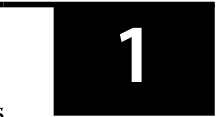

<!-- Picture Text: 1  -->

##### **GIỚI THIỆU (*INTRODUCTION*)** 

Mục tiêu của chúng ta trong bài đọc này là xác định danh mục đầu tư rủi ro tối ưu (*optimal risky portfolio*) cho tất cả các nhà đầu tư bằng cách sử dụng mô hình định giá tài sản vốn (*capital asset pricing model* – CAPM). Nền tảng của bài đọc này là việc tính toán rủi ro và tỷ suất sinh lợi của một danh mục đầu tư cũng như vai trò của hệ số tương quan (*correlation*) trong việc đa dạng hóa rủi ro danh mục (*diversifying portfolio risk*) và đạt đến đường biên hiệu quả (*efficient frontier*). Đường biên hiệu quả và đường phân bổ vốn (*capital allocation line* – CAL) bao gồm các danh mục đầu tư nhìn chung được chấp nhận 

<!-- PDF Page 72 -->

đối với tất cả các nhà đầu tư. Bằng cách kết hợp các đường bàng quan (*indifference curves*) cá nhân của một nhà đầu tư với đường phân bổ vốn do thị trường xác định, chúng ta có thể minh họa rằng danh mục rủi ro tối ưu duy nhất cho một nhà đầu tư là danh mục bao gồm tất cả các tài sản rủi ro (tức là thị trường – *the market*). 

Ngoài ra, chúng ta thảo luận về đường thị trường vốn (*capital market line* – CML), một trường hợp đặc biệt của đường phân bổ vốn được sử dụng cho các danh mục của nhà đầu tư thụ động (*passive investor portfolios*). Chúng ta cũng phân biệt giữa rủi ro hệ thống (*systematic risk*) và rủi ro phi hệ thống (*nonsystematic risk*), đồng thời giải thích tại sao các nhà đầu tư được đền bù khi gánh chịu rủi ro hệ thống nhưng lại không nhận được sự đền bù nào khi gánh chịu rủi ro phi hệ thống. Chúng ta thảo luận chi tiết về CAPM, một mô hình đơn giản để ước tính tỷ suất sinh lợi của tài sản chỉ dựa trên rủi ro hệ thống của tài sản đó. Cuối cùng, chúng ta minh họa cách CAPM cho phép lựa chọn chứng khoán (*security selection*) để xây dựng một danh mục đầu tư tối ưu cho nhà đầu tư bằng cách thay đổi cơ cấu tài sản vượt ra ngoài một danh mục thị trường thụ động. 

Bài đọc được cấu trúc như sau. Trong Phần 2, chúng ta thảo luận về các hệ quả của việc kết hợp một tài sản phi rủi ro với danh mục thị trường và đưa ra cách diễn giải về đường thị trường vốn. Phần 3 phân rã tổng rủi ro (*total risk*) thành rủi ro hệ thống và rủi ro phi hệ thống, đồng thời thảo luận về đặc điểm và sự khác biệt giữa hai loại rủi ro này. Chúng ta cũng giới thiệu các mô hình tạo tỷ suất sinh lợi (*return-generating models*), bao gồm mô hình đơn chỉ số (*single-index model*), và minh họa cách tính hệ số beta. Trong Phần 4, chúng ta giới thiệu mô hình định giá tài sản vốn và đường thị trường chứng khoán (*security market line* – SML). Việc chúng ta tập trung vào CAPM không có nghĩa là CAPM là mô hình định giá tài sản khả thi duy nhất. Mặc dù CAPM là một điểm khởi đầu xuất sắc, các bài đọc nâng cao hơn sẽ mở rộng những thảo luận này và phát triển phân tích sang các mô hình khác có tính đến nhiều nhân tố giải thích (*multiple explanatory factors*). Phần 5 đề cập đến một số phát triển lý thuyết hậu CAPM. Phần 6 trình bày các thước đo đánh giá hiệu quả hoạt động của danh mục đầu tư có tính đến yếu tố rủi ro. Phần 7 trình bày một số ứng dụng của CAPM trong việc xây dựng danh mục đầu tư (*portfolio construction*). Phần tóm tắt và các bài tập thực hành sẽ khép lại bài đọc. 

## **<mark>2</mark>** 

##### **LÝ THUYẾT THỊ TRƯỜNG VỐN: TÀI SẢN PHI RỦI RO VÀ TÀI SẢN RỦI RO (*CAPITAL MARKET THEORY: RISK-FREE AND RISKY ASSETS*)** 

mô tả hệ quả của việc kết hợp một tài sản phi rủi ro với một danh mục các tài sản rủi ro (*describe the implications of combining a risk-free asset with a portfolio of risky assets*)

giải thích đường phân bổ vốn (*capital allocation line* – CAL) và đường thị trường vốn (*capital market line* – CML)

Bạn đã học cách kết hợp một tài sản phi rủi ro với một tài sản rủi ro và với nhiều tài sản rủi ro để tạo ra một đường phân bổ vốn (*capital allocation line* – CAL). Trong phần này, chúng ta sẽ mở rộng thảo luận về nhiều tài sản rủi ro và xem xét một trường hợp đặc biệt của đường phân bổ vốn, được gọi là đường thị trường vốn (*capital market line* – CML). Trong khi thảo luận về đường thị trường vốn, chúng ta sẽ định nghĩa thị trường và vai trò của nó trong quản lý danh mục đầu tư thụ động (*passive portfolio management*). Sử dụng các khái niệm này, chúng ta sẽ minh họa cách các danh mục đầu tư có sử dụng đòn bẩy (*leveraged portfolios*) có thể làm gia tăng cả rủi ro lẫn tỷ suất sinh lợi. 

###### **Danh mục gồm Tài sản Phi rủi ro và Tài sản Rủi ro (*Portfolio of Risk-Free and Risky Assets*)** 

Mặc dù các nhà đầu tư luôn mong muốn một tài sản mang lại tỷ suất sinh lợi cao nhất và có rủi ro thấp nhất, nhưng một tài sản như vậy không tồn tại. Như lý thuyết thị trường vốn về rủi ro – tỷ suất sinh lợi đã minh họa, một người phải chấp nhận rủi ro cao hơn để kiếm được tỷ suất sinh lợi cao hơn. Tuy nhiên, chúng ta có thể cải thiện danh mục đầu tư của một nhà đầu tư bằng cách mở rộng tập hợp cơ hội (*opportunity set*) của các tài sản rủi ro vì điều này cho phép nhà đầu tư lựa chọn một cơ cấu tài sản vượt trội hơn. 

<!-- PDF Page 73 -->

Tương tự, danh mục đầu tư của một nhà đầu tư sẽ được cải thiện nếu một tài sản phi rủi ro được thêm vào cơ cấu. Nói cách khác, sự kết hợp giữa tài sản phi rủi ro và một tài sản rủi ro có thể mang lại sự đánh đổi rủi ro – tỷ suất sinh lợi (*risk–return trade-off*) tốt hơn so với việc chỉ đầu tư vào một loại tài sản duy nhất bởi vì tài sản phi rủi ro có độ tương quan bằng không (*zero correlation*) với tài sản rủi ro. Sự kết hợp này được gọi là **đường phân bổ vốn (*capital allocation line* – CAL)** (và được minh họa trong Bảng minh họa 2). Việc chồng các đường bàng quan (*indifference curves*) của nhà đầu tư lên đường phân bổ vốn sẽ dẫn đến danh mục đầu tư tối ưu của nhà đầu tư (*optimal investor portfolio*). 

Các nhà đầu tư với mức độ ngại rủi ro (*risk aversion*) khác nhau sẽ chọn các danh mục đầu tư khác nhau. Những nhà đầu tư rất ngại rủi ro (*highly risk-averse investors*) chọn đầu tư phần lớn tài sản của họ vào tài sản phi rủi ro và kiếm được tỷ suất sinh lợi thấp vì họ không sẵn lòng chấp nhận mức rủi ro cao hơn. Ngược lại, những nhà đầu tư ít ngại rủi ro hơn (*less risk-averse investors*) sẽ đầu tư nhiều tài sản của họ hơn vào tài sản rủi ro, vốn được kỳ vọng sẽ mang lại tỷ suất sinh lợi cao hơn. Hiển nhiên, tỷ suất sinh lợi cao hơn không thể đi kèm mà không có rủi ro cao hơn, nhưng nhà đầu tư ít ngại rủi ro sẵn sàng chấp nhận phần rủi ro tăng thêm đó. 

###### **_Kết hợp một Tài sản Phi rủi ro với một Danh mục các Tài sản Rủi ro (Combining a Risk-Free Asset with a Portfolio of Risky Assets)_** 

Chúng ta có thể mở rộng phân tích từ một tài sản rủi ro sang một danh mục gồm nhiều tài sản rủi ro. Để thuận tiện, giả sử rằng danh mục đầu tư chứa tất cả các tài sản rủi ro hiện có ($N$), mặc dù một nhà đầu tư có thể không muốn đưa tất cả các tài sản này vào danh mục vì sở thích cụ thể của mình. Nếu một tài sản không được đưa vào danh mục đầu tư, tỷ trọng (*weight*) của nó sẽ bằng không. Các đặc điểm rủi ro – tỷ suất sinh lợi của một danh mục gồm $N$ tài sản rủi ro được cho bởi các phương trình sau: 

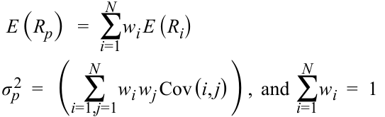

$$E(R_p) = \sum_{i=1}^{N} w_i E(R_i)$$

$$\sigma_p^2 = \left( \sum_{i=1, j=1}^{N} w_i w_j \text{Cov}(i, j) \right), \quad \text{và} \quad \sum_{i=1}^{N} w_i = 1$$

<!-- Formula Text: E (R p)   =  ∑ i=1 N w i E (R i) σ p 2  =   (  ∑ i=1,j=1 N w i w j Cov (i, j) ) ,  and ∑ i=1 N w i  =  1 -->

Tỷ suất sinh lợi kỳ vọng của danh mục đầu tư, $E(R_p)$, là trung bình có trọng số của tỷ suất sinh lợi kỳ vọng của từng tài sản riêng lẻ, trong đó $w_i$ là tỷ trọng phân bổ vào tài sản $i$ và $E(R_i)$ là tỷ suất sinh lợi kỳ vọng của tài sản $i$. Tuy nhiên, rủi ro của danh mục đầu tư ($\sigma_p$) phụ thuộc vào tỷ trọng của từng tài sản riêng lẻ, rủi ro của từng tài sản riêng lẻ, và mối tương quan qua lại giữa chúng. **Hiệp phương sai (*covariance*)** giữa tài sản $i$ và $j$, $\text{Cov}(i, j)$, là một thước đo thống kê về mối quan hệ qua lại giữa từng cặp tài sản trong danh mục và có thể được biểu diễn như sau, trong đó $\rho_{ij}$ là **hệ số tương quan (*correlation*)** giữa tài sản $i$ và $j$, còn $\sigma_i$ là rủi ro của tài sản $i$: 

$$\text{Cov}(i, j) = \rho_{ij}\sigma_i\sigma_j$$

Lưu ý từ phương trình dưới đây rằng hệ số tương quan của một tài sản với chính nó bằng 1; do đó: 

$$\text{Cov}(i, i) = \rho_{ii}\sigma_i\sigma_i = \sigma_i^2$$

Bằng cách thay thế các biểu thức hiệp phương sai ở trên, chúng ta có thể viết lại phương trình phương sai của danh mục đầu tư (*portfolio variance*) như sau: 

$$\sigma_p^2 = \left( \sum_{i=1}^{N} w_i^2 \sigma_i^2 + \sum_{i, j=1, i \neq j}^{N} w_i w_j \rho_{ij} \sigma_i \sigma_j \right)$$

<!-- Formula Text: σ p 2  =   (∑ i=1 N w i 2 σ i 2 +   ∑ i,j=1,i≠j N w i w j ρ ij σ i σ j) -->

Nhận định cho rằng các danh mục đầu tư có rủi ro thấp hơn các tài sản mà chúng nắm giữ có vẻ trái với trực giác. Tuy nhiên, những danh mục như vậy hoàn toàn có thể được xây dựng miễn là các tài sản trong danh mục không tương quan hoàn toàn (*not perfectly correlated*) với nhau. Để minh họa tác động của tỷ trọng tài sản lên các đặc điểm của danh mục đầu tư, hãy xem xét một danh mục đơn giản gồm hai tài sản với tỷ trọng bằng không ở tất cả các tài sản khác. Giả sử Tài sản 1 có tỷ suất sinh lợi là 10% và độ lệch chuẩn (rủi ro) là 20%. Tài sản 2 có tỷ suất sinh lợi là 5% và độ lệch chuẩn (rủi ro) là 10%. Hơn nữa, hệ số tương quan giữa hai tài sản này bằng không. Bảng minh họa 1 cho thấy rủi ro và tỷ suất sinh lợi của Danh mục X với tỷ trọng 25% ở Tài sản 1 và 75% ở Tài sản 2, Danh mục Y với tỷ trọng 50% ở mỗi tài sản trong hai tài sản, và Danh mục Z với tỷ trọng 75% ở Tài sản 1 và 25% ở Tài sản 2. 

<!-- PDF Page 74 -->

**Bảng minh họa 1: Rủi ro và Tỷ suất sinh lợi của Danh mục Đầu tư (*Exhibit 1: Portfolio Risk and Return*)** 

|**Danh mục (*Portfolio*)**|**Tỷ trọng ở Tài sản 1 (*Weight in Asset 1*) (%)**|**Tỷ trọng ở Tài sản 2 (*Weight in Asset 2*) (%)**|**Tỷ suất sinh lợi Danh mục (*Portfolio Return*) (%)**|**Độ lệch chuẩn Danh mục (*Portfolio Standard Deviation*) (%)**|
|---|---|---|---|---|
|X|25.0|75.0|6.25|9.01|
|Y|50.0|50.0|7.50|11.18|
|Z|75.0|25.0|8.75|15.21|
|Tỷ suất sinh lợi (*Return*)|10.0|5.0|||
|Độ lệch chuẩn (*Standard deviation*)|20.0|10.0|||
|Hệ số tương quan giữa Tài sản 1 và 2 (*Correlation between Assets 1 and 2*)||0.0|||

Từ ví dụ này, chúng ta quan sát thấy rằng ba danh mục đầu tư khá khác biệt nhau về mặt rủi ro và tỷ suất sinh lợi. Danh mục X có tỷ suất sinh lợi 6.25% và độ lệch chuẩn chỉ 9.01%, trong khi độ lệch chuẩn của Danh mục Z cao hơn tới hơn hai phần ba (15.21%), mặc dù tỷ suất sinh lợi chỉ cao hơn một chút so với mức một phần ba (8.75%). Các danh mục này có thể trở nên khác biệt hơn nữa khi các tài sản khác được thêm vào cơ cấu. 

Hãy xem xét ba danh mục tài sản rủi ro A, B và C như trong Bảng minh họa 2, có thể đã được ba cố vấn đầu tư khác nhau giới thiệu cho một nhà đầu tư đại diện. Mỗi danh mục được kết hợp với tài sản phi rủi ro để tạo ra ba đường phân bổ vốn: CAL(A), CAL(B) và CAL(C). Bảng minh họa cho thấy Danh mục C vượt trội hơn hai danh mục còn lại vì nó có tỷ suất sinh lợi kỳ vọng lớn hơn tại bất kỳ mức rủi ro cho trước nào. Kết quả là, nhà đầu tư sẽ chọn danh mục nằm trên đường phân bổ vốn của Danh mục C. Sự kết hợp giữa tài sản phi rủi ro và Danh mục rủi ro C được lựa chọn cho một nhà đầu tư phụ thuộc vào mức độ ngại rủi ro của nhà đầu tư đó. 

**Bảng minh họa 2: Tài sản Phi rủi ro và Danh mục các Tài sản Rủi ro (*Exhibit 2: Risk-Free Asset and Portfolio of Risky Assets*)** 

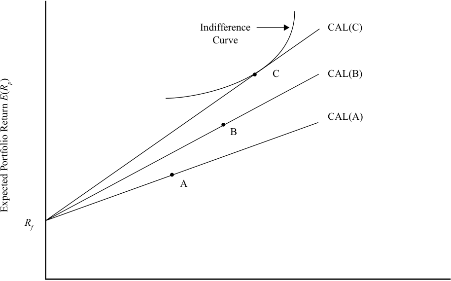

<!-- Picture Text: Indifference CAL(C) Curve C CAL(B) CAL(A) B A Rf Expected Portfolio Return ()  ER p  -->

> **Chú thích hình ảnh:** Trục tung: Tỷ suất sinh lợi kỳ vọng của danh mục $E(R_p)$ (*Expected Portfolio Return*); Trục hoành: Độ lệch chuẩn của danh mục $\sigma_p$ (*Portfolio Standard Deviation*). Các đường trên đồ thị gồm: Đường bàng quan (*Indifference Curve*), các đường phân bổ vốn $\text{CAL(C)}$, $\text{CAL(B)}$, $\text{CAL(A)}$ đi qua lãi suất phi rủi ro $R_f$ và các danh mục tương ứng $C$, $B$, $A$.

Độ lệch chuẩn của Danh mục (*Portfolio Standard Deviation*) ($\sigma_p$) 

<!-- PDF Page 75 -->

###### **_Liệu có Tồn tại một Danh mục Rủi ro Tối ưu Duy nhất? (Does a Unique Optimal Risky Portfolio Exist?)_** 

Chúng ta giả định rằng tất cả các nhà đầu tư đều có cùng kỳ vọng kinh tế và do đó có cùng kỳ vọng về giá cả, dòng tiền và các đặc điểm đầu tư khác. Giả định này được gọi là **tính đồng nhất của kỳ vọng (*homogeneity of expectations*)**. Với những đặc điểm đầu tư này, mọi người đều thực hiện cùng một quá trình tính toán và sẽ đi đến cùng một danh mục rủi ro tối ưu. Do đó, nếu giả định kỳ vọng đồng nhất, chỉ có duy nhất một danh mục tối ưu tồn tại. Tuy nhiên, nếu các nhà đầu tư có những kỳ vọng khác nhau, họ có thể đi đến các danh mục rủi ro tối ưu khác nhau. Để minh họa, chúng ta bắt đầu với biểu thức tính giá của một tài sản: 

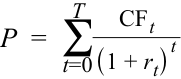

$$P = \sum_{t=0}^{T} \frac{CF_t}{(1 + r_t)^t}$$

<!-- Formula Text: P  =  ∑ t=0 T CF t _ (1 + r t) t -->

trong đó $CF_t$ là dòng tiền tại thời điểm cuối kỳ $t$ và $r_t$ là lãi suất chiết khấu (*discount rate*) hay tỷ suất sinh lợi yêu cầu (*required rate of return*) đối với tài sản đó trong kỳ $t$. Kỳ $t$ đề cập đến tất cả các kỳ bắt đầu từ hiện tại cho đến khi tài sản ngừng tồn tại vào cuối thời điểm $T$. Bởi vì thời điểm hiện tại là cuối kỳ 0, cũng chính là đầu kỳ 1, nên có $(T + 1)$ dòng tiền và $(T + 1)$ tỷ suất sinh lợi yêu cầu. Các điều kiện này dựa trên giả định rằng một dòng tiền, chẳng hạn như khoản đầu tư ban đầu, có thể xảy ra ngay bây giờ ($t = 0$). Tuy nhiên, thông thường $CF_0$ bằng không. 

Chúng ta sử dụng công thức tính giá tài sản để ước tính giá trị nội tại (*intrinsic value*) của một tài sản. Giả sử rằng tài sản chúng ta đang định giá là một cổ phiếu của Siemens AG được giao dịch trên sàn Xetra. Trong trường hợp cổ phiếu công ty, không có ngày đáo hạn, vì vậy $T$ có thể cực kỳ lớn, nghĩa là chúng ta sẽ cần ước tính một số lượng lớn các dòng tiền và tỷ suất sinh lợi. May mắn thay, mẫu số làm giảm tầm quan trọng của các dòng tiền ở xa trong tương lai, vì vậy có thể chỉ cần ước tính, chẳng hạn, 20 dòng tiền hàng năm và 20 tỷ suất sinh lợi là đủ. Siemens sẽ kiếm được bao nhiêu vào năm tới và năm sau nữa? Thị trường sản phẩm mà Siemens hoạt động sẽ trông như thế nào sau 5 năm nữa? Các nhà phân tích và nhà đầu tư khác nhau sẽ có những ước tính của riêng họ và chúng có thể rất khác nhau. Ngoài ra, khi chúng ta đi sâu hơn vào tương lai, những vấn đề nghiêm trọng hơn trong việc ước tính doanh thu, chi phí và tốc độ tăng trưởng tương lai sẽ phát sinh. Do đó, việc giả định rằng các ước tính dòng tiền cho Siemens sẽ khác nhau giữa các nhà đầu tư này là hoàn toàn hợp lý. Ngoài tử số (dòng tiền), chúng ta còn cần phải ước tính mẫu số, tức các tỷ suất sinh lợi yêu cầu. Chúng ta biết rằng các công ty rủi ro hơn sẽ đòi hỏi tỷ suất sinh lợi cao hơn vì rủi ro và tỷ suất sinh lợi có tương quan dương. Cổ phiếu Siemens rủi ro hơn một tài sản phi rủi ro, nhưng rủi ro hơn bao nhiêu? Và mức đền bù cho phần rủi ro tăng thêm đó nên là bao nhiêu? Một lần nữa, hiển nhiên là các nhà phân tích khác nhau sẽ nhìn nhận mức độ rủi ro của Siemens theo cách khác nhau và do đó, đi đến các tỷ suất sinh lợi yêu cầu khác nhau. 

Cổ phiếu Siemens đóng cửa ở mức €111.84 trên sàn Xetra vào ngày 31 tháng 8 năm 2018. Mức giá giao dịch đại diện cho giá trị mà một nhà đầu tư cận biên (*marginal investor*) gắn cho một cổ phiếu của Siemens, giả sử tương ứng với kỳ vọng của Nhà phân tích A. Tuy nhiên, Nhà phân tích B có thể nghĩ rằng mức giá nên là €95, và Nhà phân tích C có thể nghĩ rằng mức giá nên là €125. Với mức giá €111.84, tỷ suất sinh lợi kỳ vọng của Siemens là khá khác nhau đối với ba nhà phân tích. Nhà phân tích B, người tin rằng giá nên là €95, kết luận rằng Siemens đang được định giá quá cao (*overvalued*) và có thể gán tỷ trọng bằng 0 cho Siemens trong danh mục khuyến nghị mặc dù vốn hóa thị trường (*market capitalization*) của Siemens vượt quá €100 tỷ tại ngày báo giá. Ngược lại, Nhà phân tích C, với mức định giá €125, cho rằng Siemens đang bị định giá thấp (*undervalued*) và có thể phân bổ tỷ trọng lớn (*overweight*) đáng kể cho Siemens trong danh mục đầu tư. 

Cuộc thảo luận của chúng ta minh họa rằng các nhà phân tích có thể đi đến những mức định giá khác nhau, đòi hỏi việc phân bổ các tỷ trọng tài sản khác nhau trong một danh mục đầu tư. Với sự tồn tại của nhiều loại tài sản (*asset classes*) và vô số tài sản trong mỗi loại tài sản, người ta có thể hình dung rằng mỗi nhà đầu tư sẽ có danh mục rủi ro tối ưu của riêng mình tùy thuộc vào các giả định cơ sở trong tính toán định giá của họ. Do đó, những người tham gia thị trường sẽ có các danh mục rủi ro tối ưu của riêng họ và có thể khác biệt nhau. 

<!-- PDF Page 76 -->

Nếu các nhà đầu tư có các định giá tài sản khác nhau, thì việc xây dựng một danh mục rủi ro tối ưu duy nhất là không thể. Nếu chúng ta đưa ra một giả định đơn giản hóa về tính đồng nhất trong kỳ vọng của nhà đầu tư (*homogeneity in investor expectations*), chúng ta sẽ có một danh mục rủi ro tối ưu duy nhất như đã đề cập trước đó. Ngay cả khi các nhà đầu tư có những kỳ vọng khác nhau, giá thị trường vẫn là một đại diện (*proxy*) cho những gì mà nhà đầu tư cận biên, có đầy đủ thông tin kỳ vọng, và danh mục thị trường (*market portfolio*) sẽ trở thành trường hợp cơ sở, chuẩn tham chiếu (*benchmark*), hay danh mục tham chiếu mà các danh mục khác có thể được đem ra so sánh và đánh giá. Đối với Siemens, giá thị trường là €111.84 mỗi cổ phiếu và vốn hóa thị trường vào khoảng €108 tỷ. Khi xây dựng danh mục thị trường, tỷ trọng của Siemens trong danh mục thị trường sẽ bằng giá trị thị trường của nó chia cho tổng giá trị của tất cả các tài sản khác được đưa vào danh mục thị trường. 

## **<mark>3</mark>** 

##### **LÝ THUYẾT THỊ TRƯỜNG VỐN: ĐƯỜNG THỊ TRƯỜNG VỐN (*CAPITAL MARKET THEORY: THE CAPITAL MARKET LINE*)** 

giải thích đường phân bổ vốn (*capital allocation line* – CAL) và đường thị trường vốn (*capital market line* – CML)

Trong phần trước, chúng ta đã thảo luận về cách tài sản phi rủi ro có thể được kết hợp với một danh mục rủi ro để tạo ra đường phân bổ vốn (CAL). Trong phần này, chúng ta thảo luận về một đường CAL cụ thể sử dụng danh mục thị trường làm danh mục rủi ro tối ưu và được gọi là đường thị trường vốn (*capital market line* – CML). Chúng ta cũng thảo luận về ý nghĩa của danh mục thị trường và các ứng dụng của đường thị trường vốn (CML). 

###### **Danh mục Đầu tư Thụ động và Chủ động (*Passive and Active Portfolios*)** 

Trong tiểu mục trên, chúng ta đã giả định ba mức định giá khả dĩ cho mỗi cổ phiếu của Siemens: €95, €111.84 và €125. Mức định giá nào là đúng? 

Nếu thị trường là một **thị trường hiệu quả về mặt thông tin (*informationally efficient market*)**, thì mức giá trên thị trường, €111.84, là một ước tính không chệch (*unbiased estimate*) của tất cả các dòng tiền chiết khấu trong tương lai (hãy nhớ lại công thức tính giá của một tài sản). Nói cách khác, mức giá đã tổng hợp và phản ánh tất cả các thông tin được công bố rộng rãi, và các nhà đầu tư không thể kỳ vọng kiếm được mức tỷ suất sinh lợi lớn hơn tỷ suất sinh lợi yêu cầu đối với tài sản đó. Tuy nhiên, nếu mức giá đã phản ánh tất cả thông tin công khai sẵn có và không có cách nào để chiến thắng thị trường (*outperform the market*), thì chẳng có mấy ý nghĩa khi bỏ thời gian và tiền bạc vào việc đánh giá Siemens để tìm ra mức giá của riêng bạn bằng cách sử dụng các ước tính dòng tiền và tỷ suất sinh lợi của chính bạn. 

Trong trường hợp đó, một cách tiếp cận đơn giản và thuận tiện để đầu tư là dựa vào mức giá do thị trường thiết lập. Các danh mục đầu tư dựa trên giả định về giá thị trường không chệch được gọi là danh mục đầu tư thụ động (*passive portfolios*). Các danh mục thụ động phổ biến nhất là sao chép và bám sát (*replicate and track*) các chỉ số thị trường (*market indexes*), vốn được xây dựng một cách thụ động dựa trên giá thị trường và vốn hóa thị trường. Ví dụ về các chỉ số thị trường là Chỉ số S&P 500, Nikkei 300 và CAC 40. Các danh mục đầu tư thụ động dựa trên các chỉ số thị trường được gọi là quỹ chỉ số (*index funds*) và nhìn chung có chi phí thấp vì không cần bỏ ra nỗ lực đáng kể nào trong việc định giá các chứng khoán nằm trong chỉ số. 

Trái ngược với sự phụ thuộc của các nhà đầu tư thụ động vào giá thị trường và các quỹ chỉ số, các nhà đầu tư chủ động (*active investors*) có thể không dựa vào định giá của thị trường. Họ tự tin hơn vào khả năng của bản thân trong việc ước tính dòng tiền, tốc độ tăng trưởng và lãi suất chiết khấu. Dựa trên những ước tính này, họ định giá tài sản và xác định xem liệu một tài sản có được định giá hợp lý (*fairly valued*) hay không. Trong một danh mục đầu tư được quản lý chủ động (*actively managed portfolio*), các tài sản đang bị định giá thấp (*undervalued*), hoặc có cơ hội mang lại tỷ suất sinh lợi cao hơn mức bình thường, sẽ có tỷ trọng dương (tức là phân bổ tỷ trọng cao hơn – *overweight* so với tỷ trọng thị trường trong chỉ số chuẩn), trong khi các tài sản khác sẽ có tỷ trọng bằng không, 

<!-- PDF Page 77 -->

hoặc thậm chí là tỷ trọng âm nếu việc bán khống (*short selling*) được cho phép (tức là một số tài sản sẽ được phân bổ tỷ trọng thấp hơn – *underweighted* so với tỷ trọng thị trường trong chỉ số chuẩn). (**Bán khống (*Short selling*)** là một giao dịch trong đó các chứng khoán đi vay được bán ra với ý định mua lại chúng ở mức giá thấp hơn vào một ngày sau đó và hoàn trả lại cho bên cho vay.) Phong cách đầu tư này được gọi là quản lý đầu tư chủ động (*active investment management*), và các danh mục đầu tư được gọi là danh mục đầu tư chủ động (*active portfolios*). Hầu hết các quỹ tương hỗ mở (*open-end mutual funds*) và quỹ phòng hộ (*hedge funds*) đều thực hành quản lý đầu tư chủ động, và hầu hết các nhà phân tích đều tin rằng đầu tư chủ động mang lại giá trị gia tăng. Việc các nhà phân tích này đúng hay sai vẫn là chủ đề của những cuộc tranh luận chưa có hồi kết. 

###### **“Thị trường” là gì? (*What Is the “Market”?*)** 

Trong phần thảo luận trước, chúng ta đã đề cập đến “thị trường” (*the “market”*) nhiều lần mà chưa thực sự định nghĩa nó. Danh mục rủi ro tối ưu và đường thị trường vốn phụ thuộc vào định nghĩa về thị trường. Vậy thị trường là gì? 

Về mặt lý thuyết, thị trường bao gồm tất cả các tài sản rủi ro hoặc bất cứ thứ gì có giá trị, bao gồm cổ phiếu, trái phiếu, bất động sản và thậm chí cả vốn nhân lực (*human capital*). Tuy nhiên, không phải tất cả các tài sản đều có thể giao dịch được (*tradable*), và không phải tất cả các tài sản có thể giao dịch đều có thể đầu tư được (*investable*). Ví dụ, đền Taj Mahal ở Ấn Độ là một tài sản nhưng không phải là một tài sản có thể giao dịch. Tương tự, vốn nhân lực là một tài sản không thể giao dịch. Hơn nữa, các tài sản có thể giao dịch được nhưng lại không thể đầu tư được do các hạn chế áp đặt lên một số đối tượng nhà đầu tư nhất định. Ví dụ, tất cả các cổ phiếu niêm yết trên Sở Giao dịch Chứng khoán Thượng Hải đều có thể giao dịch. Tuy nhiên, trong khi cổ phiếu Hạng A (*Class A shares*) được niêm yết bằng đồng Nhân dân tệ (RMB) và mở cửa cho các nhà đầu tư trong nước cùng các nhà đầu tư nước ngoài đủ điều kiện, thì cổ phiếu Hạng B (*Class B shares*) được niêm yết bằng đồng USD và mở cửa cho các nhà đầu tư nước ngoài cùng các nhà đầu tư trong nước nắm giữ tài khoản giao dịch ngoại tệ. 

Nếu chúng ta xem xét tất cả cổ phiếu, trái phiếu, tài sản bất động sản, hàng hóa, v.v., có lẽ có đến hàng trăm nghìn tài sản có thể giao dịch và có thể đầu tư. “Thị trường” nên bao gồm càng nhiều tài sản càng tốt; chúng ta nhấn mạnh từ “có thể” (*possible*) bởi vì việc đưa tất cả các tài sản vào một danh mục rủi ro duy nhất là điều không thực tế. Mặc dù những tiến bộ trong công nghệ và sự kết nối liên thông giữa các thị trường đã giúp việc tiếp cận các thị trường cổ phiếu lớn trở nên dễ dàng hơn nhiều, chúng ta vẫn chưa thể dễ dàng đầu tư vào các loại tài sản khác như trái phiếu và bất động sản ngoại trừ ở những quốc gia phát triển nhất. 

Trong phần còn lại của bài đọc này, chúng ta sẽ định nghĩa “thị trường” theo nghĩa khá hẹp vì làm như vậy mang tính thực tiễn và thuận tiện. Thông thường, một chỉ số thị trường chứng khoán trong nước hoặc khu vực được sử dụng làm đại diện (*proxy*) cho thị trường do hoạt động giao dịch sôi động của cổ phiếu và vì thị trường trong nước hoặc khu vực là dễ quan sát nhất đối với các nhà đầu tư bản địa. Cho mục đích của chúng ta, chúng ta sẽ sử dụng Chỉ số S&P 500 làm đại diện cho thị trường. S&P 500 thường được các nhà phân tích sử dụng làm chuẩn tham chiếu (*benchmark*) cho hiệu quả hoạt động của thị trường trên toàn Hoa Kỳ. Nó bao gồm 500 cổ phiếu lớn nhất có trụ sở tại Hoa Kỳ, và các cổ phiếu này được tính tỷ trọng theo vốn hóa thị trường của chúng (giá nhân với số lượng cổ phiếu đang lưu hành). 

Tính đến giữa năm 2018, các cổ phiếu trong S&P 500 chiếm khoảng 80% tổng vốn hóa thị trường cổ phiếu tại Hoa Kỳ, và bởi vì thị trường chứng khoán Hoa Kỳ chiếm khoảng 40% thị trường thế giới, nên S&P 500 đại diện cho khoảng 32% lượng cổ phiếu được giao dịch công khai trên toàn cầu. Định nghĩa về thị trường của chúng ta không bao gồm các thị trường chứng khoán ngoài Hoa Kỳ, thị trường trái phiếu, bất động sản và nhiều loại tài sản khác; do đó, tỷ suất sinh lợi “thị trường” và phần bù rủi ro “thị trường” (*“market” risk premium*) lần lượt đề cập đến tỷ suất sinh lợi cổ phiếu Hoa Kỳ và phần bù rủi ro cổ phiếu Hoa Kỳ. Tuy nhiên, việc sử dụng đại diện này là đủ cho cuộc thảo luận của chúng ta, và tương đối dễ dàng để mở rộng sang bao gồm các tài sản có thể giao dịch khác. 

###### **Đường Thị trường Vốn (*The Capital Market Line* – CML)** 

Một đường phân bổ vốn (CAL) bao gồm tất cả các sự kết hợp khả dĩ giữa tài sản phi rủi ro và danh mục rủi ro tối ưu của một nhà đầu tư. **Đường thị trường vốn (*capital market line* – CML)** là một trường hợp đặc biệt của đường phân bổ vốn, trong đó danh mục rủi ro chính là danh mục thị trường (*market portfolio*). Tài sản phi rủi ro 

<!-- PDF Page 78 -->

là một chứng khoán nợ không có rủi ro vỡ nợ (*default risk*), không có rủi ro lạm phát (*inflation risk*), không có rủi ro thanh khoản (*liquidity risk*), không có rủi ro lãi suất (*interest rate risk*), và không có bất kỳ loại rủi ro nào khác. Tín phiếu Kho bạc Hoa Kỳ (*US Treasury bills*) thường được sử dụng làm đại diện cho tỷ suất sinh lợi phi rủi ro, $R_f$. 

Chỉ số S&P 500 là một đại diện của danh mục thị trường, vốn là danh mục rủi ro tối ưu. Do đó, tỷ suất sinh lợi kỳ vọng của danh mục rủi ro là tỷ suất sinh lợi kỳ vọng của thị trường, được biểu diễn là $E(R_m)$. Đường thị trường vốn được thể hiện trong Bảng minh họa 3, trong đó độ lệch chuẩn ($\sigma_p$), hay tổng rủi ro, nằm trên trục hoành ($x$) và tỷ suất sinh lợi kỳ vọng của danh mục, $E(R_p)$, nằm trên trục tung ($y$). Về mặt đồ thị, danh mục thị trường là điểm nằm trên đường biên hiệu quả Markowitz (*Markowitz efficient frontier*) nơi một đường thẳng kẻ từ tài sản phi rủi ro tiếp xúc (*tangent*) với đường biên hiệu quả Markowitz. Tất cả các điểm nằm phía bên trong đường biên hiệu quả Markowitz đều là các danh mục không hiệu quả (*inefficient portfolios*) ở chỗ chúng cung cấp cùng một mức tỷ suất sinh lợi nhưng với mức rủi ro cao hơn, hoặc mức tỷ suất sinh lợi thấp hơn với cùng một mức rủi ro. Khi được vẽ cùng nhau, tiếp điểm mà tại đó đường CML tiếp xúc với đường biên hiệu quả Markowitz chính là sự kết hợp tối ưu của các tài sản rủi ro, dựa trên giá thị trường và vốn hóa thị trường. Danh mục rủi ro tối ưu chính là danh mục thị trường. 

**Bảng minh họa 3: Đường Thị trường Vốn (*Exhibit 3: Capital Market Line*)** 

<!-- Picture Text: CML Points above the CML are not achievable Efficient E ( Rm ) frontier M Individual Securities Rf Standard Deviation of Portfolio σ p Expected Portfolio Return ()  ER p  -->

> **Chú thích hình ảnh:** Trục tung: Tỷ suất sinh lợi kỳ vọng của danh mục $E(R_p)$; Trục hoành: Độ lệch chuẩn của danh mục $\sigma_p$. Đường thị trường vốn ($\text{CML}$) xuất phát từ $R_f$ và tiếp xúc với Đường biên hiệu quả (*Efficient frontier*) tại danh mục thị trường $M$ có tỷ suất sinh lợi kỳ vọng $E(R_m)$. Các điểm nằm phía trên đường CML là không thể đạt được (*Points above the CML are not achievable*), và phía dưới đường biên hiệu quả là các Chứng khoán riêng lẻ (*Individual Securities*).

Điểm cắt trục tung ($y$) của đường CML là tỷ suất sinh lợi phi rủi ro ($R_f$) bởi vì đó là mức tỷ suất sinh lợi gắn liền với rủi ro bằng không. Đường CML đi qua điểm được đại diện bởi tỷ suất sinh lợi thị trường, $E(R_m)$. Theo lý thuyết thị trường vốn, bất kỳ điểm nào nằm phía trên đường CML đều không thể đạt được (*not achievable*) và bất kỳ điểm nào nằm phía dưới đường CML đều bị lấn át (*dominated*) và kém ưu việt hơn (*inferior*) so với bất kỳ điểm nào nằm trên đường CML. 

Lưu ý rằng chúng ta xác định CML và CAL là các đường thẳng mặc dù chúng là sự kết hợp của hai tài sản. Không giống như sự kết hợp của hai tài sản rủi ro (thường không phải là một đường thẳng), sự kết hợp giữa tài sản phi rủi ro và một danh mục rủi ro là một đường thẳng, như được minh họa dưới đây thông qua việc tính toán rủi ro và tỷ suất sinh lợi của sự kết hợp này. 

Các đặc điểm rủi ro và tỷ suất sinh lợi của danh mục đầu tư được đại diện bởi đường CML có thể được tính toán bằng cách sử dụng các biểu thức tỷ suất sinh lợi và rủi ro cho danh mục gồm hai tài sản: 

$$E(R_p) = w_1 R_f + (1 - w_1) E(R_m),$$

<!-- PDF Page 79 -->

và 

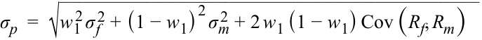

$$\sigma_p = \sqrt{w_1^2 \sigma_f^2 + (1 - w_1)^2 \sigma_m^2 + 2 w_1 (1 - w_1) \text{Cov}(R_f, R_m)}$$

<!-- Formula Text: σ p  =  √ ___________________________________________ w 1 2 σ f 2 + (1 − w 1) 2 σ m 2  + 2 w 1 (1 − w 1) Cov (R f, R m) -->

Tỷ trọng đầu tư vào tài sản phi rủi ro được ký hiệu là $w_1$, và phần còn lại được đầu tư vào danh mục thị trường, $(1 - w_1)$. Rủi ro của tài sản phi rủi ro được ký hiệu là $\sigma_f$, rủi ro của thị trường là $\sigma_m$, rủi ro của danh mục đầu tư là $\sigma_p$, và hiệp phương sai giữa tài sản phi rủi ro và danh mục thị trường được biểu diễn bởi $\text{Cov}(R_f, R_m)$. Theo định nghĩa, độ lệch chuẩn của tài sản phi rủi ro bằng không. Bởi vì rủi ro của nó bằng không, tài sản phi rủi ro không đồng biến thiên (*co-vary*) hay biến động cùng với bất kỳ tài sản nào khác. Do đó, hiệp phương sai của nó với tất cả các tài sản khác, bao gồm cả danh mục thị trường, đều bằng không, làm cho số hạng thứ nhất và thứ ba dưới dấu căn bậc hai bằng không. Kết quả là, tỷ suất sinh lợi của danh mục và độ lệch chuẩn của danh mục có thể được rút gọn và viết lại như sau: 

$$E(R_p) = w_1 R_f + (1 - w_1) E(R_m),$$

và 

$$\sigma_p = (1 - w_1)\sigma_m$$

<!-- Formula Text: σp = (1 – w1)σm -->

Bằng phương pháp thế, chúng ta có thể biểu diễn $E(R_p)$ theo $\sigma_p$. Thay thế cho $w_1$, chúng ta nhận được: 

$$E(R_p) = R_f + \left( \frac{E(R_m) - R_f}{\sigma_m} \right) \times \sigma_p$$

<!-- Formula Text: E (R p)   =  R f +  ( E (R m)  − R f _ σ m )  × σ p -->

Lưu ý rằng biểu thức này có dạng phương trình đường thẳng, $y = a + bx$. Điểm cắt trục tung ($y$-intercept) là lãi suất phi rủi ro, và độ dốc (*slope*) của đường thẳng — được gọi là cái giá thị trường của rủi ro (*market price of risk*) — là $[E(R_m) - R_f]/\sigma_m$. Đường CML có độ dốc dương bởi vì tỷ suất sinh lợi rủi ro của thị trường lớn hơn tỷ suất sinh lợi phi rủi ro. Khi quy mô tổng vốn đầu tư dành cho thị trường tăng lên — tức là khi chúng ta di chuyển lên phía trên dọc theo đường thẳng — cả độ lệch chuẩn (rủi ro) và tỷ suất sinh lợi kỳ vọng đều tăng lên. 

###### **VÍ DỤ 1 (*EXAMPLE 1*)** 

###### **Rủi ro và Tỷ suất sinh lợi trên đường CML (*Risk and Return on the CML*)** 

Ông Miles là một nhà đầu tư lần đầu tham gia thị trường và muốn xây dựng một danh mục đầu tư chỉ sử dụng Tín phiếu Kho bạc Hoa Kỳ (*US T-bills*) và một quỹ chỉ số bám sát Chỉ số S&P 500. Tín phiếu Kho bạc có tỷ suất sinh lợi là 5%. Chỉ số S&P 500 có độ lệch chuẩn là 20% và tỷ suất sinh lợi kỳ vọng là 15%. 

1. Hãy vẽ đường CML và đánh dấu các điểm mà tại đó tỷ trọng đầu tư vào thị trường lần lượt là 0%, 25%, 75% và 100%. 

###### **Lời giải (*Solution*):** 

Chúng ta tính phương trình cho đường CML là $E(R_p) = 5\% + 0.50 \times \sigma_p$ bằng cách thay các thông tin đã cho vào phương trình CML tổng quát. Điểm cắt trục tung của đường thẳng là 5%, và độ dốc của nó là 0.50. Chúng ta có thể vẽ đường CML bằng cách lấy tùy ý hai điểm bất kỳ trên đường thẳng thỏa mãn phương trình trên. 

Ngoài ra, đường CML có thể được vẽ bằng cách nối điểm tỷ suất sinh lợi phi rủi ro 5% trên trục tung ($y$) với danh mục thị trường tại tọa độ (20%, 15%). Đường CML được thể hiện trong Bảng minh họa 4. 

<!-- PDF Page 80 -->

###### **Bảng minh họa 4: Rủi ro và Tỷ suất sinh lợi trên đường CML (*Exhibit 4: Risk and Return on the CML*)** 

<!-- Picture Text: CML 100% in market 75% Rm  = 15% M 25% 0% in market Slope = .5 Rf  = 5% σ m  = 20 Standard Deviation of Portfolio σ p Expected Portfolio Return () ER p  -->

> **Chú thích hình ảnh:** Trục tung: Tỷ suất sinh lợi kỳ vọng của danh mục $E(R_p)$; Trục hoành: Độ lệch chuẩn của danh mục $\sigma_p$. Đường $\text{CML}$ có độ dốc (*Slope*) $= 0.5$, đi từ điểm $0\%$ vào thị trường ($R_f = 5\%$), qua các điểm $25\%$, $75\%$, đến điểm $M$ ($100\%$ vào thị trường, với $R_m = 15\%$ và $\sigma_m = 20$).

2. Ông Miles cũng quan tâm đến việc xác định chính xác mức rủi ro và tỷ suất sinh lợi tại mỗi điểm. 

###### **Lời giải (*Solution*):** 

Tỷ suất sinh lợi khi đầu tư 0% vào thị trường 

$= 5\%$, đây chính là tỷ suất sinh lợi phi rủi ro. 

Độ lệch chuẩn khi đầu tư 0% vào thị trường 

$= 0\%$ bởi vì Tín phiếu Kho bạc không có rủi ro. 

Tỷ suất sinh lợi khi đầu tư 25% vào thị trường $= (0.75 \times 5\%) + (0.25 \times 15\%) = 7.5\%$. 

Độ lệch chuẩn khi đầu tư 25% vào thị trường $= 0.25 \times 20\% = 5\%$. 

Tỷ suất sinh lợi khi đầu tư 75% vào thị trường $= (0.25 \times 5\%) + (0.75 \times 15\%) = 12.50\%$. 

Độ lệch chuẩn khi đầu tư 75% vào thị trường $= 0.75 \times 20\% = 15\%$. 

Tỷ suất sinh lợi khi đầu tư 100% vào thị trường 

$= 15\%$, đây chính là tỷ suất sinh lợi của S&P 500. 

Độ lệch chuẩn khi đầu tư 100% vào thị trường $= 20\%$, đây chính là rủi ro của S&P 500. 

<!-- PDF Page 81 -->

##### **LÝ THUYẾT THỊ TRƯỜNG VỐN: ĐƯỜNG CML – CÁC DANH MỤC ĐẦU TƯ SỬ DỤNG ĐÒN BẨY (*CAPITAL MARKET THEORY: CML - LEVERAGED PORTFOLIOS*)** 

## **<mark>4</mark>** 

giải thích đường phân bổ vốn (*capital allocation line* – CAL) và đường thị trường vốn (*capital market line* – CML)

Trong ví dụ trước, ông Miles đã đánh giá khoản đầu tư trong khoảng từ 0% đến 100% vào thị trường và phần còn lại vào Tín phiếu Kho bạc. Đoạn thẳng nối $R_f$ và $M$ (danh mục thị trường) trong Bảng minh họa 4 minh họa các danh mục đầu tư này với các mức đầu tư tương ứng. Tại $R_f$, nhà đầu tư đang đầu tư toàn bộ tài sản của mình vào các chứng khoán phi rủi ro, tương đương với việc cho vay (*lending*) 100% ở mức lãi suất phi rủi ro. Tại Điểm $M$, nhà đầu tư nắm giữ danh mục thị trường và không cho vay bất kỳ khoản tiền nào ở mức lãi suất phi rủi ro. Sự kết hợp giữa tài sản phi rủi ro và danh mục thị trường, có thể đạt được tại các điểm nằm giữa hai giới hạn này, được gọi là các danh mục “cho vay” (*“lending” portfolios*). Thực chất, nhà đầu tư đang cho vay một phần tài sản của mình ở mức lãi suất phi rủi ro. 

Nếu ông Miles sẵn sàng chấp nhận rủi ro cao hơn, ông có thể dịch chuyển sang phía bên phải của danh mục thị trường (Điểm $M$ trong Bảng minh họa 4) bằng cách vay tiền (*borrowing money*) và mua thêm Danh mục M. Giả sử rằng ông có thể vay tiền ở cùng mức lãi suất phi rủi ro, $R_f$, bằng với mức lãi suất mà ông có thể đầu tư. Khi đó, ông có thể bổ sung số tiền đi vay vào khối tài sản sẵn có của mình và xây dựng một danh mục đi vay (*borrowing portfolio*). Nếu đường thẳng nối $R_f$ và $M$ được kéo dài về phía bên phải của Điểm $M$, phần kéo dài này của đường thẳng đại diện cho các danh mục đi vay. Khi một người di chuyển càng xa về phía bên phải của Điểm $M$, một lượng tiền đi vay ngày càng lớn đang được đầu tư vào thị trường. Điều này có nghĩa là có một khoản đầu tư *âm* (*negative investment*) vào tài sản phi rủi ro, được gọi là một *vị thế sử dụng đòn bẩy* (*leveraged position*) trong danh mục rủi ro. Điểm cụ thể được lựa chọn trên đường CML sẽ phụ thuộc vào hàm hữu dụng (*utility function*) của cá nhân đó, mà đến lượt nó lại được quyết định bởi sở thích về rủi ro và tỷ suất sinh lợi của người đó. 

###### **VÍ DỤ 2 (*EXAMPLE 2*)** 

###### **Rủi ro và Tỷ suất sinh lợi của Danh mục Sử dụng Đòn bẩy với Lãi suất Cho vay và Đi vay Bằng nhau (*Risk and Return of a Leveraged Portfolio with Equal Lending and Borrowing Rates*)** 

1. Ông Miles quyết định dành ra một phần nhỏ tài sản của mình để đầu tư vào một danh mục có rủi ro lớn hơn các khoản đầu tư trước đây vì ông dự đoán rằng thị trường chung sẽ tạo ra tỷ suất sinh lợi hấp dẫn trong tương lai. Ông giả định rằng mình có thể vay tiền ở mức lãi suất 5% và đạt được cùng mức tỷ suất sinh lợi trên S&P 500 như trước: tỷ suất sinh lợi kỳ vọng là 15% với độ lệch chuẩn là 20%. 

Hãy tính rủi ro và tỷ suất sinh lợi kỳ vọng của ông nếu ông vay thêm một khoản bằng 25%, 50% và 100% số tiền đầu tư ban đầu của mình. 

###### **Lời giải (*Solution*):** 

Độ lệch chuẩn và tỷ suất sinh lợi của danh mục sử dụng đòn bẩy có thể được tính toán theo cách tương tự như trước bằng các phương trình sau: 

$$E(R_p) = w_1 R_f + (1 - w_1) E(R_m)$$

và 

<!-- PDF Page 82 -->

$$\sigma_p = (1 - w_1)\sigma_m$$

Tỷ trọng đầu tư vào Tín phiếu Kho bạc trở thành số âm thay vì số dương bởi vì ông Miles đang đi vay tiền. Nếu vay thêm 25% khoản đầu tư ban đầu, $w_1 = -0.25$, và $(1 - w_1) = 1.25$, v.v. 

Tỷ suất sinh lợi với $w_1 = -0.25$: $(-0.25 \times 5\%) + (1.25 \times 15\%) = 17.5\%$. 

Độ lệch chuẩn với $w_1 = -0.25$: $1.25 \times 20\% = 25\%$. 

Tỷ suất sinh lợi với $w_1 = -0.50$: $(-0.50 \times 5\%) + (1.50 \times 15\%) = 20.0\%$. 

Độ lệch chuẩn với $w_1 = -0.50$: $1.50 \times 20\% = 30\%$. 

Tỷ suất sinh lợi với $w_1 = -1.00$: $(-1.00 \times 5\%) + (2.00 \times 15\%) = 25.0\%$. 

Độ lệch chuẩn với $w_1 = -1.00$: $2.00 \times 20\% = 40\%$. 

Lưu ý rằng khoản đầu tư âm (đi vay) vào tài sản phi rủi ro mang lại tỷ suất sinh lợi kỳ vọng cao hơn cho danh mục đầu tư, nhưng mức tỷ suất sinh lợi cao hơn đó cũng gắn liền với rủi ro cao hơn. 

###### **Các Danh mục Sử dụng Đòn bẩy với Lãi suất Cho vay và Đi vay Khác nhau (*Leveraged Portfolios with Different Lending and Borrowing Rates*)** 

Mặc dù chúng ta đã giả định rằng ông Miles có thể đi vay ở cùng mức lãi suất như chính phủ Hoa Kỳ, nhưng trên thực tế nhiều khả năng ông sẽ phải trả mức lãi suất cao hơn chính phủ bởi vì khả năng trả nợ của ông không chắc chắn như của chính phủ. Bây giờ hãy xem xét trường hợp mặc dù ông Miles có thể đầu tư (cho vay) ở mức lãi suất $R_f$, nhưng ông chỉ có thể đi vay ở mức $R_b$, một mức lãi suất cao hơn lãi suất phi rủi ro. 

Với lãi suất cho vay và đi vay khác nhau, đường CML sẽ không còn là một đường thẳng duy nhất nữa. Đường này sẽ có độ dốc là $[E(R_m) - R_f]/\sigma_m$ giữa Điểm $R_f$ và Điểm $M$, nơi lãi suất cho vay là $R_f$, nhưng sẽ có độ dốc nhỏ hơn là $[E(R_m) - R_b]/\sigma_m$ tại các điểm nằm bên phải Điểm $M$, nơi lãi suất đi vay là $R_b$. Bảng minh họa 5 minh họa đường CML với lãi suất cho vay và đi vay khác nhau. 

<!-- PDF Page 83 -->

###### **Bảng minh họa 5: Đường CML với Lãi suất Cho vay và Đi vay Khác nhau (*Exhibit 5: CML with Different Lending and Borrowing Rates*)** 

<!-- Picture Text: Market portfolio, M Lending E ( Rm )  – Rb σ m Borrowing E ( Rm )  – Rf Rf Slope = σ m Standard Deviation of Portfolio σ p Expected Portfolio Return () ER p  -->

> **Chú thích hình ảnh:** Trục tung: Tỷ suất sinh lợi kỳ vọng của danh mục $E(R_p)$; Trục hoành: Độ lệch chuẩn của danh mục $\sigma_p$. Đồ thị đường CML bị gấp khúc tại Danh mục thị trường $M$ (*Market portfolio, M*): đoạn Cho vay (*Lending*) bên trái $M$ xuất phát từ $R_f$ có độ dốc $\text{Slope} = \frac{E(R_m) - R_f}{\sigma_m}$, và đoạn Đi vay (*Borrowing*) bên phải $M$ có độ dốc thoải hơn là $\frac{E(R_m) - R_b}{\sigma_m}$.

Các phương trình cho hai đoạn thẳng được cho dưới đây. 

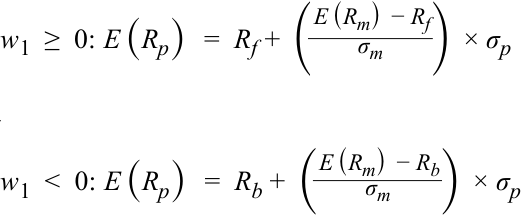

$$w_1 \ge 0: \quad E(R_p) = R_f + \left( \frac{E(R_m) - R_f}{\sigma_m} \right) \times \sigma_p$$

và 

$$w_1 < 0: \quad E(R_p) = R_b + \left( \frac{E(R_m) - R_b}{\sigma_m} \right) \times \sigma_p$$

<!-- Formula Text: w 1  ≥  0: E (R p)   =  R f +  ( E (R m)  − R f _ σ m )  × σ p d w 1  <  0: E (R p)   =  R b +  ( E (R m)  − R b _ σ m )  × σ p -->

Phương trình đầu tiên dành cho đoạn thẳng nơi khoản đầu tư vào tài sản phi rủi ro bằng không hoặc dương — tức là tại Điểm $M$ hoặc phía bên trái của Điểm $M$ trong Bảng minh họa 5. Phương trình thứ hai dành cho đoạn thẳng nơi hoạt động đi vay, hay đầu tư âm vào tài sản phi rủi ro, diễn ra. Lưu ý rằng sự khác biệt duy nhất giữa hai phương trình nằm ở mức lãi suất được sử dụng cho việc đi vay và cho vay. 

Tất cả các danh mục đầu tư thụ động sẽ nằm trên đường CML gấp khúc (*kinked CML*) này, mặc dù khoản đầu tư vào tài sản phi rủi ro có thể là dương (cho vay), bằng không (không cho vay cũng không đi vay), hoặc âm (đi vay). Đòn bẩy cho phép những nhà đầu tư ít ngại rủi ro hơn gia tăng mức rủi ro mà họ gánh chịu bằng cách vay tiền và đầu tư hơn 100% vào danh mục thụ động. 

###### **VÍ DỤ 3 (*EXAMPLE 3*)** 

###### **Danh mục Sử dụng Đòn bẩy với Lãi suất Cho vay và Đi vay Khác nhau (*Leveraged Portfolio with Different Lending and Borrowing Rates*)** 

1. Ông Miles liên hệ với nhà môi giới của mình để vay tiền thế chấp bằng các chứng khoán nắm giữ trong danh mục đầu tư. Mặc dù khoản vay của ông Miles sẽ được đảm bảo bằng các chứng khoán trong danh mục, lãi suất mà nhà môi giới áp dụng khi cho khách hàng vay là 7%. Giả sử lãi suất phi rủi ro là 5% và tỷ suất sinh lợi thị trường là 15% với độ lệch chuẩn là 20%, hãy ước tính tỷ suất sinh lợi kỳ vọng và rủi ro của ông Miles nếu ông đầu tư 25% và 75% vào thị trường, và nếu ông quyết định 

<!-- PDF Page 84 -->

vay thêm 25% và 75% số tiền đầu tư ban đầu của mình rồi đầu tư số tiền đó vào thị trường. 

###### **Lời giải (*Solution*):** 

Độ lệch chuẩn và tỷ suất sinh lợi của danh mục không sử dụng đòn bẩy (*unleveraged portfolio*) được tính bằng các phương trình tương tự như trước: 

$$E(R_p) = w_1 R_f + (1 - w_1) E(R_m), \quad \text{và}$$

$$\sigma_p = (1 - w_1)\sigma_m$$

Kết quả không thay đổi. Độ dốc của đường thẳng đối với danh mục không sử dụng đòn bẩy là 0.50, giống hệt như trước: 

Tỷ suất sinh lợi khi đầu tư 25% vào thị trường $= (0.75 \times 5\%) + (0.25 \times 15\%) = 7.5\%$. 

Độ lệch chuẩn khi đầu tư 25% vào thị trường $= 0.25 \times 20\% = 5\%$. 

Tỷ suất sinh lợi khi đầu tư 75% vào thị trường $= (0.25 \times 5\%) + (0.75 \times 15\%) = 12.5\%$. 

Độ lệch chuẩn khi đầu tư 75% vào thị trường $= 0.75 \times 20\% = 15\%$. 

Đối với danh mục sử dụng đòn bẩy (*leveraged portfolio*), mọi thứ vẫn giữ nguyên ngoại trừ việc $R_f$ được thay thế bằng $R_b$. 

$$E(R_p) = w_1 R_b + (1 - w_1) E(R_m),$$

và 

$$\sigma_p = (1 - w_1)\sigma_m.$$

Tỷ suất sinh lợi với $w_1 = -0.25$: $(-0.25 \times 7\%) + (1.25 \times 15\%) = 17.0\%$. 

Độ lệch chuẩn với $w_1 = -0.25$: $1.25 \times 20\% = 25\%$. 

Tỷ suất sinh lợi với $w_1 = -0.75$: $(-0.75 \times 7\%) + (1.75 \times 15\%) = 21.0\%$. 

Độ lệch chuẩn với $w_1 = -0.75$: $1.75 \times 20\% = 35\%$. 

Rủi ro và tỷ suất sinh lợi của danh mục sử dụng đòn bẩy cao hơn so với danh mục không sử dụng đòn bẩy. Khi ông Miles vay thêm nhiều tiền hơn để đầu tư vào thị trường, tỷ suất sinh lợi kỳ vọng tăng lên nhưng độ lệch chuẩn của danh mục cũng tăng theo. Độ dốc của đường thẳng đối với danh mục sử dụng đòn bẩy là 0.40, so với 0.50 của danh mục không sử dụng đòn bẩy, có nghĩa là cứ mỗi 1% rủi ro tăng thêm, nhà đầu tư nhận được mức tăng 0.40% trong tỷ suất sinh lợi kỳ vọng ở phần danh mục có đòn bẩy, so với mức tăng 0.50% trong tỷ suất sinh lợi kỳ vọng ở phần danh mục không có đòn bẩy. Chỉ những nhà đầu tư ít ngại rủi ro hơn mới lựa chọn các danh mục sử dụng đòn bẩy. 

<!-- PDF Page 85 -->

##### **RỦI RO HỆ THỐNG VÀ RỦI RO PHI HỆ THỐNG (*SYSTEMATIC AND NONSYSTEMATIC RISK*)** 

## **<mark>5</mark>** 

giải thích rủi ro hệ thống (*systematic risk*) và rủi ro phi hệ thống (*nonsystematic risk*), bao gồm lý do tại sao một nhà đầu tư không nên kỳ vọng nhận thêm tỷ suất sinh lợi khi gánh chịu rủi ro phi hệ thống

Khi xây dựng một danh mục đầu tư, điều quan trọng là phải hiểu khái niệm tương quan (*correlation*) và cách mà mức tương quan nhỏ hơn 1 (không hoàn hảo) có thể giúp đa dạng hóa rủi ro của một danh mục đầu tư. Hệ quả là, rủi ro của một tài sản khi được nắm giữ đơn lẻ có thể lớn hơn rủi ro của chính tài sản đó khi nó là một phần của danh mục đầu tư. Bởi vì rủi ro của một tài sản thay đổi từ môi trường này sang môi trường khác, nhà đầu tư nên xem xét loại rủi ro nào và rủi ro đó nên được định giá (*priced*) ra sao? Phần này giải quyết câu hỏi về định giá rủi ro bằng cách phân rã tổng rủi ro của một chứng khoán hoặc một danh mục đầu tư thành rủi ro hệ thống (*systematic risk*) và rủi ro phi hệ thống (*nonsystematic risk*). Ý nghĩa của các loại rủi ro này, cách tính toán chúng, và sự liên quan của chúng đến việc định giá tài sản cũng sẽ được thảo luận. 

###### **Rủi ro Hệ thống và Rủi ro Phi hệ thống (*Systematic Risk and Nonsystematic Risk*)** 

Rủi ro hệ thống (*systematic risk*), còn được gọi là rủi ro không thể đa dạng hóa (*non-diversifiable risk*) hay rủi ro thị trường (*market risk*), là loại rủi ro tác động đến toàn bộ thị trường hoặc nền kinh tế. Ngược lại, rủi ro phi hệ thống (*nonsystematic risk*) là rủi ro gắn liền với một công ty hoặc một ngành đơn lẻ và còn được gọi là rủi ro đặc thù của công ty (*company-specific risk*), rủi ro đặc thù của ngành (*industry-specific risk*), rủi ro có thể đa dạng hóa (*diversifiable risk*), hay rủi ro riêng biệt (*idiosyncratic risk*). 

**Rủi ro hệ thống (*Systematic risk*)** là rủi ro không thể tránh khỏi và vốn có trong tổng thể thị trường. Nó không thể đa dạng hóa được vì nó bao gồm các nhân tố rủi ro mang tính bản chất bên trong thị trường và ảnh hưởng đến toàn bộ thị trường nói chung. Ví dụ về các nhân tố cấu thành rủi ro hệ thống bao gồm lãi suất, lạm phát, chu kỳ kinh tế, bất ổn chính trị và thiên tai trên diện rộng. Những sự kiện này ảnh hưởng đến toàn bộ thị trường và không có cách nào để tránh khỏi tác động của chúng. Rủi ro hệ thống có thể được khuếch đại thông qua việc lựa chọn chứng khoán hoặc sử dụng đòn bẩy, hoặc được giảm bớt bằng cách đưa vào các chứng khoán có độ tương quan thấp với danh mục đầu tư, giả định rằng chúng chưa có mặt trong danh mục đó. 

**Rủi ro phi hệ thống (*Nonsystematic risk*)** là rủi ro mang tính cục bộ hoặc giới hạn ở một tài sản hay một ngành cụ thể mà không nhất thiết ảnh hưởng đến các tài sản nằm ngoài loại tài sản đó. Ví dụ về rủi ro phi hệ thống có thể bao gồm sự thất bại của một cuộc thử nghiệm thuốc hoặc một vụ tai nạn máy bay. Tất cả những sự kiện này sẽ ảnh hưởng trực tiếp đến các công ty tương ứng và có thể cả ngành của chúng, nhưng không có tác động gì đến các tài sản hoàn toàn tách biệt với những ngành này. Nhà đầu tư có thể tránh được rủi ro phi hệ thống thông qua đa dạng hóa (*diversification*) bằng cách hình thành một danh mục gồm các tài sản không có độ tương quan cao với nhau. 

Chúng ta sẽ xây dựng các biểu thức cho từng loại rủi ro ở phần sau của bài đọc này. Bạn sẽ thấy rằng tổng của phương sai hệ thống (*systematic variance*) và phương sai phi hệ thống (*nonsystematic variance*) bằng tổng phương sai (*total variance*) của chứng khoán hoặc danh mục đầu tư: 

$$\text{Tổng phương sai (Total variance)} = \text{Phương sai hệ thống (Systematic variance)} + \text{Phương sai phi hệ thống (Nonsystematic variance)}$$

Mặc dù mối quan hệ đẳng thức này là giữa các phương sai (*variances*), bạn sẽ thường xuyên bắt gặp các tài liệu đề cập đến tổng rủi ro như là tổng của rủi ro hệ thống và rủi ro phi hệ thống. Trong những trường hợp đó, các phát biểu này đang đề cập đến phương sai chứ không phải độ lệch chuẩn (*standard deviation*). 

###### **_Định giá Rủi ro (Pricing of Risk)_** 

Việc định giá (*pricing*) hay xác định giá trị (*valuing*) một tài sản tương đương với việc ước tính tỷ suất sinh lợi kỳ vọng của nó. Nếu một tài sản có giá trị cuối kỳ (*terminal value*) đã biết trước, chẳng hạn như mệnh giá của một trái phiếu, thì mức giá hiện tại thấp hơn hàm ý tỷ suất sinh lợi tương lai cao hơn, và mức giá hiện tại cao hơn hàm ý tỷ suất sinh lợi 

<!-- PDF Page 86 -->

tương lai thấp hơn. Mối quan hệ giữa giá và tỷ suất sinh lợi cũng có thể được quan sát thấy trong biểu thức định giá đã trình bày ở Phần 2.1.2. Do đó, đôi khi chúng ta sẽ sử dụng thuật ngữ giá và tỷ suất sinh lợi thay thế cho nhau khi thảo luận về cái giá của rủi ro (*price of risk*). 

Hãy xem xét một tài sản có cả rủi ro hệ thống và rủi ro phi hệ thống. Giả sử rằng cả hai loại rủi ro này đều được định giá — tức là bạn nhận được tỷ suất sinh lợi đền bù cho cả rủi ro hệ thống lẫn rủi ro phi hệ thống. Bạn sẽ làm gì? Nhận thức được rằng rủi ro phi hệ thống có thể được triệt tiêu thông qua đa dạng hóa, bạn sẽ mua những tài sản có lượng rủi ro phi hệ thống lớn. Sau khi đã mua những tài sản có rủi ro phi hệ thống đó, bạn sẽ đa dạng hóa, hay làm giảm rủi ro đó, bằng cách đưa thêm vào các tài sản khác không có độ tương quan cao. Trong quá trình đó, bạn sẽ giảm thiểu rủi ro phi hệ thống và cuối cùng loại bỏ hoàn toàn nó ra khỏi danh mục đầu tư của mình. Bây giờ bạn sẽ có một danh mục đầu tư đã được đa dạng hóa chỉ còn chứa rủi ro hệ thống, thế nhưng bạn vẫn được đền bù cho phần rủi ro phi hệ thống mà bạn không còn nắm giữ nữa. Giống như tất cả mọi người khác, bạn sẽ có động cơ để gánh nhận ngày càng nhiều rủi ro có thể đa dạng hóa bởi vì bạn được đền bù cho nó mặc dù bạn hoàn toàn có thể loại bỏ nó. Nhu cầu đối với rủi ro có thể đa dạng hóa sẽ tiếp tục tăng lên cho đến khi giá của nó trở nên vô hạn và tỷ suất sinh lợi kỳ vọng của nó giảm xuống bằng không. Điều này có nghĩa là giả định ban đầu của chúng ta về một mức tỷ suất sinh lợi khác không cho rủi ro có thể đa dạng hóa là không chính xác, và giả định đúng phải là tỷ suất sinh lợi bằng không cho rủi ro có thể đa dạng hóa. Do đó, theo lý thuyết, trong một thị trường hiệu quả, không có phần thưởng tăng thêm nào (*no incremental reward*) kiếm được từ việc gánh chịu rủi ro có thể đa dạng hóa. 

Chúng ta đã lập luận rằng các nhà đầu tư không nên được đền bù cho việc gánh chịu rủi ro phi hệ thống. Do đó, những nhà đầu tư đang nắm giữ rủi ro phi hệ thống phải đa dạng hóa để triệt tiêu nó bằng cách đầu tư vào nhiều ngành, nhiều quốc gia và nhiều loại tài sản khác nhau. Bởi vì tỷ suất sinh lợi trong tương lai là chưa biết trước và không thể chỉ chọn toàn những khoản đầu tư chiến thắng, việc đa dạng hóa giúp bù đắp tỷ suất sinh lợi kém ở một loại tài sản này bằng việc thu về tỷ suất sinh lợi tốt ở một loại tài sản khác, qua đó làm giảm rủi ro tổng thể của danh mục đầu tư. Ngược lại, các nhà đầu tư phải được đền bù cho việc chấp nhận rủi ro hệ thống bởi vì loại rủi ro đó không thể được triệt tiêu bằng đa dạng hóa. Nếu các nhà đầu tư không nhận được một mức tỷ suất sinh lợi tương xứng với lượng rủi ro hệ thống mà họ đang gánh chịu, họ sẽ từ chối chấp nhận rủi ro hệ thống. 

Tóm lại, theo lý thuyết, rủi ro hệ thống hay rủi ro không thể đa dạng hóa được định giá (*is priced*) và các nhà đầu tư được đền bù khi nắm giữ tài sản hoặc danh mục đầu tư chỉ dựa trên rủi ro hệ thống của khoản đầu tư đó. Các nhà đầu tư không nhận được bất kỳ tỷ suất sinh lợi nào cho việc chấp nhận rủi ro phi hệ thống hay rủi ro có thể đa dạng hóa. Do đó, vì lợi ích của chính mình, các nhà đầu tư ngại rủi ro chỉ nên nắm giữ các danh mục đầu tư đã được đa dạng hóa tốt (*well-diversified portfolios*). 

###### **VÍ DỤ 4 (*EXAMPLE 4*)** 

###### **Rủi ro Hệ thống và Rủi ro Phi hệ thống (*Systematic and Nonsystematic Risk*)** 

**1.** Hãy mô tả các thành phần rủi ro hệ thống và rủi ro phi hệ thống của các tài sản sau đây: 

   - **A.** Một tài sản phi rủi ro, chẳng hạn như tín phiếu Kho bạc kỳ hạn 3 tháng 

   - **B.** Danh mục thị trường, chẳng hạn như S&P 500. 

**2.** Hãy xem xét hai tài sản A và B. Tài sản A có tổng rủi ro gấp đôi Tài sản B. Đối với Tài sản A, rủi ro hệ thống chiếm hai phần ba tổng rủi ro. Đối với Tài sản B, toàn bộ tổng rủi ro đều là rủi ro hệ thống. Tài sản nào sẽ có tỷ suất sinh lợi kỳ vọng cao hơn? 

###### **Lời giải cho câu 1A (*Solution to 1A*):** 

Theo định nghĩa, một tài sản phi rủi ro không có rủi ro. Do đó, một tài sản phi rủi ro có rủi ro hệ thống bằng không và rủi ro phi hệ thống bằng không. 

---

# Tập 9: Quản lý Danh mục Đầu tư (*Volume 9: Portfolio Management*)
## Học phần 2: Rủi ro và Tỷ suất sinh lợi của Danh mục Đầu tư: Phần II (*Learning Module 2: Portfolio Risk and Return: Part II*)
### Phần 2/4: Các Mô hình Tạo Tỷ suất sinh lợi (*Return Generating Models*) (Trang PDF 87–100)

---

<!-- PDF Page 87 -->

#### **Lời giải cho câu 1B (*Solution to 1B*):** 

Như chúng ta đã đề cập trước đó, danh mục thị trường là một danh mục đã được đa dạng hóa, một danh mục mà trong đó không còn phần rủi ro nào có thể được triệt tiêu thêm qua đa dạng hóa nữa. Chúng ta cũng đã mô tả nó như một danh mục hiệu quả (*efficient portfolio*). Do đó, một danh mục thị trường không chứa bất kỳ rủi ro phi hệ thống nào. 

#### **Lời giải cho câu 2 (*Solution to 2*):** 

Dựa trên các dữ kiện đã cho, rủi ro hệ thống của Tài sản A lớn hơn một phần ba so với rủi ro hệ thống của Tài sản B (vì $\frac{2}{3} \times 2 = \frac{4}{3}$ tổng rủi ro của B, so với $1$ lần ở B). Bởi vì chỉ có rủi ro hệ thống mới được định giá hay nhận được tỷ suất sinh lợi đền bù, nên tỷ suất sinh lợi kỳ vọng của Tài sản A phải cao hơn. 

## **CÁC MÔ HÌNH TẠO TỶ SUẤT SINH LỢI (*RETURN GENERATING MODELS*)** 

# **<mark>6</mark>** 

giải thích các mô hình tạo tỷ suất sinh lợi (*return generating models*, bao gồm cả mô hình thị trường – *market model*) và công dụng của chúng

Như đã đề cập trước đó, để hình thành danh mục thị trường, bạn cần kết hợp tất cả các tài sản rủi ro hiện có. Việc nắm được các hệ số tương quan giữa những tài sản đó cho phép chúng ta ước tính rủi ro của danh mục đầu tư. Bạn cũng đã biết rằng một danh mục được đa dạng hóa hoàn toàn sẽ bao gồm tất cả các loại tài sản (*asset classes*) và về cơ bản là tất cả các tài sản nằm trong những loại tài sản đó. Khối lượng công việc cần thiết để xây dựng danh mục thị trường là vô cùng đồ sộ. Ví dụ, đối với một danh mục gồm 1,000 tài sản, chúng ta sẽ cần 1,000 ước tính tỷ suất sinh lợi, 1,000 ước tính độ lệch chuẩn, và 499,500 ($1,000 \times 999 \div 2$) hệ số tương quan. Các câu hỏi liên quan khác nảy sinh từ phân tích này là liệu chúng ta có thực sự cần tới tất cả 1,000 tài sản đó hay không và điều gì sẽ xảy ra nếu có sai số trong các ước tính này. 

Một phương pháp thay thế để xây dựng danh mục tối ưu đơn giản và dễ triển khai hơn. Nhà đầu tư bắt đầu với một danh mục đã biết, chẳng hạn như S&P 500, và sau đó thêm từng tài sản khác vào dựa trên độ lệch chuẩn, tỷ suất sinh lợi kỳ vọng của tài sản đó, và tác động của nó lên rủi ro cũng như tỷ suất sinh lợi của danh mục. Quá trình này tiếp diễn cho đến khi việc thêm vào một tài sản mới không còn tạo ra tác động đáng kể đến hiệu quả hoạt động của danh mục. Quá trình này chỉ đòi hỏi các ước tính về rủi ro hệ thống cho từng tài sản bởi vì các nhà đầu tư sẽ không được đền bù cho rủi ro phi hệ thống. Tỷ suất sinh lợi kỳ vọng có thể được tính toán bằng cách sử dụng các mô hình tạo tỷ suất sinh lợi (*return-generating models*), như chúng ta sẽ thảo luận trong phần này. Bên cạnh việc sử dụng các mô hình tạo tỷ suất sinh lợi, chúng ta cũng sẽ phân rã tổng phương sai thành phương sai hệ thống và phương sai phi hệ thống, đồng thời thiết lập một mối quan hệ chính thức giữa rủi ro hệ thống và tỷ suất sinh lợi. Trong phần tiếp theo, chúng ta sẽ mở rộng cuộc thảo luận này và giới thiệu CAPM như là mô hình tạo tỷ suất sinh lợi được ưa chuộng. 

### **Các Mô hình Tạo Tỷ suất sinh lợi (*Return-Generating Models*)** 

Một **mô hình tạo tỷ suất sinh lợi (*return-generating model*)** là một mô hình có thể cung cấp ước tính về tỷ suất sinh lợi kỳ vọng của một chứng khoán khi biết trước một số tham số nhất định. Nếu rủi ro hệ thống là tham số có liên quan duy nhất đối với tỷ suất sinh lợi, thì mô hình tạo tỷ suất sinh lợi sẽ ước tính tỷ suất sinh lợi kỳ vọng cho bất kỳ tài sản nào khi biết mức rủi ro hệ thống. 

Cũng như bất kỳ mô hình nào, chất lượng của các ước tính về tỷ suất sinh lợi kỳ vọng sẽ phụ thuộc vào chất lượng của các ước tính đầu vào và độ chính xác của mô hình. Bởi vì rất khó để quyết định những nhân tố nào là phù hợp cho việc tạo ra tỷ suất sinh lợi, dạng tổng quát nhất của mô hình tạo tỷ suất sinh lợi là một mô hình đa nhân tố (*multi-factor model*). Một **mô hình đa nhân tố (*multi-factor model*)** cho phép xem xét nhiều hơn một biến số khi ước tính tỷ suất sinh lợi và có thể được xây dựng bằng cách sử dụng các loại nhân tố khác nhau, chẳng hạn như các nhân tố kinh tế vĩ mô (*macroeconomic*), nhân tố cơ bản (*fundamental*) và nhân tố thống kê (*statistical*). 

<!-- PDF Page 88 -->

Các mô hình nhân tố kinh tế vĩ mô (*macroeconomic factor models*) sử dụng các nhân tố kinh tế có tương quan với tỷ suất sinh lợi của chứng khoán. Các nhân tố này có thể bao gồm tăng trưởng kinh tế, lãi suất, tỷ lệ lạm phát, năng suất, việc làm và niềm tin của người tiêu dùng. Các mối quan hệ trong quá khứ với tỷ suất sinh lợi được ước tính để thu được các ước lượng tham số, mà đến lượt chúng lại được sử dụng để tính toán tỷ suất sinh lợi kỳ vọng. Các mô hình nhân tố cơ bản (*fundamental factor models*) phân tích và sử dụng các mối quan hệ giữa tỷ suất sinh lợi chứng khoán và các yếu tố nền tảng cơ bản của công ty, chẳng hạn như lợi nhuận (*earnings*), tăng trưởng lợi nhuận (*earnings growth*), khả năng tạo dòng tiền, đầu tư vào nghiên cứu, quảng cáo và số lượng bằng sáng chế. Cuối cùng, trong một mô hình nhân tố thống kê (*statistical factor model*), dữ liệu tỷ suất sinh lợi lịch sử và chéo (*historical and cross-sectional return data*) được phân tích để xác định các nhân tố giải thích được phương sai hoặc hiệp phương sai trong các tỷ suất sinh lợi quan sát được. Tuy nhiên, các nhân tố thống kê này có thể có hoặc không có mối liên hệ kinh tế hay cơ bản nào với tỷ suất sinh lợi. Ví dụ, liên đoàn mà đội vô địch giải bóng bầu dục Mỹ Super Bowl trực thuộc — dù là Liên đoàn Bóng bầu dục Mỹ (*American Football Conference*) hay Liên đoàn Bóng bầu dục Quốc gia (*National Football Conference*) — có thể là một nhân tố trong tỷ suất sinh lợi cổ phiếu Hoa Kỳ, nhưng dường như không có mối liên hệ kinh tế rõ ràng nào tồn tại giữa liên đoàn của đội chiến thắng và tỷ suất sinh lợi cổ phiếu Hoa Kỳ. Hơn nữa, việc khai phá dữ liệu (*data mining*) có thể tạo ra nhiều nhân tố giả mạo (*spurious factors*) hoàn toàn không mang bất kỳ ý nghĩa kinh tế nào. Do hạn chế này, các nhà phân tích ưa chuộng các mô hình nhân tố kinh tế vĩ mô và nhân tố cơ bản hơn trong việc xác định và ước lượng các mô hình tạo tỷ suất sinh lợi. 

Một mô hình tạo tỷ suất sinh lợi tổng quát được biểu diễn theo cách sau: 

$$E(R_i) - R_f = \sum_{j=1}^{k} \beta_{ij} E(F_j) = \beta_{i1}[E(R_m) - R_f] + \sum_{j=2}^{k} \beta_{ij} E(F_j)$$

<!-- Formula Text: E (R i)  − R f  =  ∑ j=1 k β ij E (F j)   =  β i1 [E (R m)  − R f]  + ∑ j=2 k β ij E (F j) -->

Mô hình có $k$ nhân tố: $E(F_1), E(F_2), \dots, E(F_k)$. Các hệ số $\beta_{ij}$ là các trọng số nhân tố (*factor weights*, đôi khi được gọi là hệ số tải nhân tố – *factor loadings*) gắn liền với mỗi nhân tố. Vế trái của mô hình là tỷ suất sinh lợi vượt trội kỳ vọng (*expected excess return*, tức là tỷ suất sinh lợi kỳ vọng vượt trên lãi suất phi rủi ro). Vế phải cung cấp các nhân tố rủi ro sẽ tạo ra tỷ suất sinh lợi hoặc phần bù (*premium*) cần thiết để gánh chịu rủi ro đó. Chúng ta đã tách riêng một nhân tố, $E(R_m)$, đại diện cho tỷ suất sinh lợi thị trường. Tất cả các mô hình đều bao gồm tỷ suất sinh lợi của danh mục thị trường như một nhân tố cốt lõi. 

##### **_Mô hình Ba Nhân tố và Bốn Nhân tố (Three-Factor and Four-Factor Models)_** 

Eugene Fama và Kenneth French$^1$ đã đề xuất rằng một mô hình tạo tỷ suất sinh lợi cho tỷ suất sinh lợi cổ phiếu nên bao gồm vốn hóa thị trường tương đối của công ty (“quy mô” – *“size”*) và giá trị sổ sách trên giá trị thị trường tương đối (*relative book-to-market value*) của công ty bên cạnh hệ số beta. Fama và French nhận thấy rằng tỷ suất sinh lợi trong quá khứ có thể được giải thích tốt hơn bằng mô hình của họ so với các mô hình khác hiện có vào thời điểm đó, đáng chú ý nhất là mô hình định giá tài sản vốn (CAPM). Mark Carhart (1997) đã mở rộng mô hình Fama và French bằng cách bổ sung thêm một nhân tố nữa: quán tính giá (*momentum*), được định nghĩa là tỷ suất sinh lợi cổ phiếu tương đối trong quá khứ. 

##### **_Mô hình Đơn Chỉ số (The Single-Index Model)_** 

Dạng đơn giản nhất của mô hình tạo tỷ suất sinh lợi là mô hình tuyến tính đơn nhân tố (*single-factor linear model*), trong đó chỉ có một nhân tố duy nhất được xem xét. Cách triển khai phổ biến nhất là mô hình đơn chỉ số (*single-index model*), sử dụng nhân tố thị trường dưới dạng sau: $E(R_i) - R_f = \beta_i [E(R_m) - R_f]$. 

Mặc dù mô hình đơn chỉ số rất đơn giản, nhưng nó lại khớp một cách hoàn hảo với đường thị trường vốn (CML). Hãy nhớ lại rằng đường CML là tuyến tính, với điểm cắt trục tung là $R_f$ và độ dốc là $[E(R_m) - R_f]/\sigma_m$. Chúng ta có thể viết lại phương trình CML bằng cách chuyển điểm cắt trục tung sang vế trái của phương trình, sắp xếp lại các số hạng, và khái quát hóa chỉ số dưới từ $p$ sang $i$, cho bất kỳ chứng khoán nào: 

$$E(R_i) - R_f = \left( \frac{\sigma_i}{\sigma_m} \right) [E(R_m) - R_f]$$

<!-- Formula Text: E (R i)  − R f  =   ( σ i _ σ m )  [E (R m)  − R f] -->

<!-- PDF Page 89 -->

Hệ số tải nhân tố hay trọng số nhân tố, $\sigma_i / \sigma_m$, phản ánh tỷ số giữa tổng rủi ro của chứng khoán trên tổng rủi ro của thị trường. Để hiểu rõ hơn về hệ số tải nhân tố và để minh họa rằng đường CML có thể rút gọn về một mô hình đơn chỉ số, chúng ta hãy phân rã tổng rủi ro thành các thành phần của nó. 

### **Phân rã Tổng Rủi ro cho Mô hình Đơn Chỉ số (*Decomposition of Total Risk for a Single-Index Model*)** 

Với sự ra đời của các mô hình tạo tỷ suất sinh lợi, đặc biệt là mô hình đơn chỉ số, chúng ta có thể phân rã tổng phương sai thành phương sai hệ thống và phương sai phi hệ thống. Thay vì sử dụng tỷ suất sinh lợi kỳ vọng trong mô hình đơn chỉ số, chúng ta hãy sử dụng tỷ suất sinh lợi thực tế (*realized returns*). Chênh lệch giữa tỷ suất sinh lợi kỳ vọng và tỷ suất sinh lợi thực tế được quy cho các biến động phi thị trường (*non-market changes*), dưới dạng một phần dư sai số (*error term*), $e_i$, trong phương trình thứ hai dưới đây: 

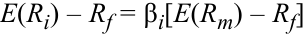

$$E(R_i) - R_f = \beta_i [E(R_m) - R_f]$$

<!-- Formula Text: E(Ri) – Rf = βi[E(Rm) – Rf] -->

và 

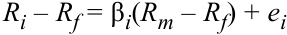

$$R_i - R_f = \beta_i (R_m - R_f) + e_i$$

<!-- Formula Text: Ri – Rf = βi(Rm – Rf) + ei -->

Phương sai của tỷ suất sinh lợi thực tế có thể được biểu diễn trong phương trình dưới đây (lưu ý rằng $R_f$ là một hằng số). Chúng ta có thể lược bỏ thêm số hạng hiệp phương sai trong phương trình này bởi vì, theo định nghĩa, bất kỳ tỷ suất sinh lợi phi thị trường nào cũng đều không tương quan với thị trường. Do đó, chúng ta có thể phân rã tổng phương sai thành phương sai hệ thống và phương sai phi hệ thống trong phương trình thứ hai dưới đây: 

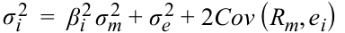

$$\sigma_i^2 = \beta_i^2 \sigma_m^2 + \sigma_e^2 + 2\text{Cov}(R_m, e_i)$$

<!-- Formula Text: σ i 2  =  β i 2 σ m 2  + σ e 2 + 2Cov (R m, e i) -->

Tổng phương sai $=$ Phương sai hệ thống $+$ Phương sai phi hệ thống, có thể được viết dưới dạng: 

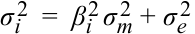

$$\sigma_i^2 = \beta_i^2 \sigma_m^2 + \sigma_e^2$$

<!-- Formula Text: σ i 2  =  β i 2 σ m 2  + σ e 2 -->

Tổng rủi ro có thể được biểu diễn như sau: 

$$\sigma_i = \sqrt{\beta_i^2 \sigma_m^2 + \sigma_e^2}$$

<!-- Formula Text: σ i  =  √ _ β i 2 σ m 2  + σ e 2 -->

Bởi vì rủi ro phi hệ thống bằng không đối với các danh mục đầu tư đã được đa dạng hóa tốt, chẳng hạn như danh mục thị trường, nên tổng rủi ro của danh mục thị trường và các danh mục tương tự khác chỉ còn là rủi ro hệ thống, tức là $\beta_i \sigma_m$. Bây giờ chúng ta có thể quay lại đường CML đã thảo luận ở tiểu mục trước và thay thế $\sigma_i$ bằng $\beta_i \sigma_m$ vì đường CML giả định rằng thị trường là một danh mục đã được đa dạng hóa. Bằng cách thực hiện phép thế này vào phương trình trên, chúng ta thu được mô hình đơn chỉ số sau đây: 

$$E(R_i) - R_f = \left( \frac{\sigma_i}{\sigma_m} \right) \times [E(R_m) - R_f] = \left( \frac{\beta_i \sigma_m}{\sigma_m} \right) \times [E(R_m) - R_f],$$

<!-- Formula Text: E (R i)  − R f  =   ( σ i _ σ m )  ×  [E (R m)  − R f]   =   ( β i σ m _ σ m  )  ×  [E (R m)  − R f] , -->

$$E(R_i) - R_f = \beta_i [E(R_m) - R_f]$$

Như vậy, đường CML, vốn chỉ đúng cho các danh mục đầu tư được đa dạng hóa tốt, hoàn toàn nhất quán với mô hình đơn chỉ số. 

Tóm lại, tổng phương sai có thể được phân rã thành phương sai hệ thống và phương sai phi hệ thống, và đường CML cũng chính là mô hình đơn chỉ số đối với các danh mục đầu tư đã được đa dạng hóa. 

### **Các Mô hình Tạo Tỷ suất sinh lợi: Mô hình Thị trường (*Return-Generating Models: The Market Model*)** 

Cách triển khai phổ biến nhất của mô hình đơn chỉ số là **mô hình thị trường (*market model*)**, trong đó tỷ suất sinh lợi thị trường là nhân tố duy nhất hay chỉ số duy nhất. Về nguyên tắc, mô hình thị trường và mô hình đơn chỉ số là tương tự nhau. Điểm khác biệt là mô hình thị trường dễ làm việc hơn và thường được sử dụng để ước tính rủi ro beta và tính toán tỷ suất sinh lợi bất thường (*abnormal returns*). Mô hình thị trường có dạng: 

$$R_i = \alpha_i + \beta_i R_m + e_i$$

<!-- PDF Page 90 -->

Để nhất quán với phần trước, $\alpha_i = R_f(1 - \beta_i)$. Hệ số chặn (*intercept*), $\alpha_i$, và hệ số góc (*slope coefficient*), $\beta_i$, có thể được ước tính bằng cách sử dụng tỷ suất sinh lợi lịch sử của chứng khoán và của thị trường. Các ước lượng tham số này sau đó được sử dụng để dự báo tỷ suất sinh lợi đặc thù của công ty (*company-specific returns*) mà một chứng khoán có thể kiếm được trong một kỳ tương lai. Giả sử rằng một phép hồi quy tỷ suất sinh lợi hàng ngày trong lịch sử của Wal-Mart theo tỷ suất sinh lợi hàng ngày của S&P 500 cho ra $\alpha_i$ bằng $0.0001$ và $\beta_i$ bằng $0.9$. Do đó, tỷ suất sinh lợi hàng ngày kỳ vọng của Wal-Mart $= 0.0001 + 0.90 \times R_m$. Nếu vào một ngày nhất định, thị trường tăng 1% và cổ phiếu của Wal-Mart tăng 2%, thì tỷ suất sinh lợi đặc thù công ty ($e_i$) của Wal-Mart trong ngày hôm đó $= R_i - E(R_i) = R_i - (\alpha_i + \beta_i R_m) = 0.02 - (0.0001 + 0.90 \times 0.01) = 0.0109$, hay $1.09\%$. Nói cách khác, Wal-Mart đã kiếm được một mức tỷ suất sinh lợi bất thường (*abnormal return*) là 1.09% vào ngày hôm đó. 

# **<mark>7</mark> TÍNH TOÁN VÀ DIỄN GIẢI HỆ SỐ BETA (*CALCULATION AND INTERPRETATION OF BETA*)** 

tính toán và diễn giải hệ số beta (*calculate and interpret beta*)

Chúng ta bắt đầu với mô hình đơn chỉ số đã được giới thiệu trước đó sử dụng tỷ suất sinh lợi thực tế và viết lại nó như sau: 

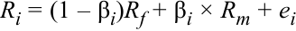

$$R_i = (1 - \beta_i)R_f + \beta_i \times R_m + e_i$$

<!-- Formula Text: Ri = (1 – βi)Rf + βi × Rm + ei -->

Bởi vì rủi ro hệ thống phụ thuộc vào độ tương quan giữa tài sản và thị trường, chúng ta có thể đi đến một thước đo rủi ro hệ thống từ hiệp phương sai giữa $R_i$ và $R_m$, trong đó $R_i$ được định nghĩa bằng phương trình trên. Lưu ý rằng lãi suất phi rủi ro là một hằng số, vì vậy số hạng đầu tiên trong $R_i$ sẽ bị triệt tiêu. 

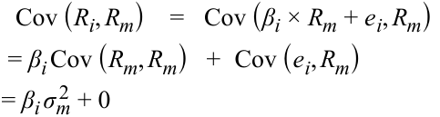

$$\text{Cov}(R_i, R_m) = \text{Cov}(\beta_i \times R_m + e_i, R_m) = \beta_i \text{Cov}(R_m, R_m) + \text{Cov}(e_i, R_m) = \beta_i \sigma_m^2 + 0$$

<!-- Formula Text: Cov (R i, R m)    =   Cov (β i × R m + e i, R m) = β i Cov (R m, R m)   +  Cov (e i, R m) = β i σ m 2  + 0 -->

Số hạng đầu tiên là beta nhân với phương sai của $R_m$. Bởi vì phần dư sai số không tương quan với thị trường, số hạng thứ hai bị triệt tiêu. Khi đó, chúng ta có thể viết lại phương trình theo beta như sau: 

$$\beta_i = \frac{\text{Cov}(R_i, R_m)}{\sigma_m^2} = \frac{\rho_{i,m} \sigma_i \sigma_m}{\sigma_m^2} = \frac{\rho_{i,m} \sigma_i}{\sigma_m}$$

<!-- Formula Text: β i  = Cov (R i, R m) _ σ m 2 = ρ i,m σ i σ m _ σ m 2 = ρ i,m σ i _ σ m -->

Công thức trên cho thấy biểu thức tính hệ số beta, $\beta_i$, tương tự như hệ số tải nhân tố trong mô hình đơn chỉ số đã trình bày trước đó. Ví dụ, nếu hệ số tương quan giữa một tài sản và thị trường là 0.70 và tài sản cùng thị trường có độ lệch chuẩn của tỷ suất sinh lợi lần lượt là 0.25 và 0.15, thì beta của tài sản sẽ là $(0.70)(0.25)/0.15 = 1.17$. Nếu hiệp phương sai của tài sản với thị trường và phương sai thị trường được cho lần lượt là 0.026250 và 0.02250, thì phép tính sẽ là $0.026250/0.02250 = 1.17$. Hệ số beta trong mô hình thị trường bao gồm một sự điều chỉnh cho hệ số tương quan giữa tài sản $i$ và thị trường bởi vì mô hình thị trường bao quát tất cả các tài sản trong khi đường CML chỉ áp dụng cho các danh mục đầu tư đã được đa dạng hóa hoàn toàn. 

Như được thể hiện trong phương trình trên, **hệ số beta (*beta*)** là một thước đo mức độ nhạy cảm (*sensitivity*) của tỷ suất sinh lợi của một tài sản đối với toàn bộ thị trường nói chung và được tính bằng hiệp phương sai giữa tỷ suất sinh lợi của tài sản $i$ và tỷ suất sinh lợi của thị trường chia cho phương sai của tỷ suất sinh lợi thị trường; biểu thức đó tương đương với tích số giữa hệ số tương quan của tài sản với thị trường nhân với tỷ số độ lệch chuẩn của tỷ suất sinh lợi (tức là tỷ số giữa độ lệch chuẩn của tài sản trên độ lệch chuẩn của thị trường). Như chúng ta đã chỉ ra, hệ số beta nắm bắt rủi ro hệ thống của một tài sản, hay phần rủi ro của một tài sản không thể bị loại bỏ thông qua đa dạng hóa. Các phương sai và hệ số tương quan cần thiết để tính toán beta thường dựa trên tỷ suất sinh lợi lịch sử. 

<!-- PDF Page 91 -->

Một hệ số beta dương cho biết tỷ suất sinh lợi của một tài sản đi theo xu hướng chung của thị trường, trong khi một hệ số beta âm cho thấy tỷ suất sinh lợi của một tài sản nhìn chung đi theo xu hướng ngược lại với xu hướng của thị trường. Nói cách khác, một hệ số beta dương cho biết tỷ suất sinh lợi của tài sản biến động cùng chiều với thị trường, trong khi một hệ số beta âm cho biết tỷ suất sinh lợi của tài sản biến động ngược chiều với thị trường. Hệ số beta của một tài sản phi rủi ro bằng không bởi vì hiệp phương sai của nó với các tài sản khác bằng không. Nói cách khác, hệ số beta bằng không cho biết tỷ suất sinh lợi của tài sản không có sự tương quan nào với các biến động trên thị trường. Hệ số beta của thị trường có thể được tính bằng cách thay thế $\sigma_m$ cho $\sigma_i$ ở tử số. Ngoài ra, hệ số tương quan của bất kỳ tài sản nào với chính nó đều bằng 1, vì vậy hệ số beta của thị trường bằng 1: 

$$\beta_i = \frac{\rho_{i,m} \sigma_i}{\sigma_m} = \frac{\rho_{m,m} \sigma_m}{\sigma_m} = 1$$

<!-- Formula Text: β i  = ρ i,m σ i _ σ m    = ρ m,m σ m _ σ m    =  1 -->

Bởi vì hệ số beta của thị trường bằng 1, nên hệ số beta trung bình của các cổ phiếu trên thị trường, theo định nghĩa, cũng bằng 1. Xét về mặt tương quan, hầu hết các cổ phiếu, đặc biệt là ở các thị trường phát triển, có xu hướng tương quan cao với thị trường, với hệ số tương quan vượt quá 0.70. Một số chỉ số thị trường rộng lớn của Hoa Kỳ, chẳng hạn như S&P 500, Dow Jones 30 và NASDAQ 100, thậm chí còn có mức tương quan cao hơn nữa, vượt quá 0.90. Hệ số tương quan giữa các nhóm ngành (*sectors*) khác nhau cũng rất cao, điều này cho thấy các công ty có những phản ứng tương tự trước cùng những thay đổi về kinh tế và thị trường. Hệ quả là, trên thực tế, việc tìm kiếm các tài sản có hệ số beta âm một cách nhất quán là điều hiếm gặp do tác động bao trùm của thị trường lên tất cả các tài sản. 

##### **VÍ DỤ 5 (*EXAMPLE 5*)** 

### **Tính toán Hệ số Beta (*Calculation of Beta*)** 

Giả sử rằng rủi ro (độ lệch chuẩn) của thị trường là 25%, hãy tính hệ số beta cho các tài sản sau đây: 

Chúng ta sử dụng công thức tính beta để trả lời các câu hỏi trên: $\beta_i = \frac{\rho_{i,m} \sigma_i}{\sigma_m}$

1. Một tín phiếu Kho bạc Hoa Kỳ ngắn hạn. 

#### **Lời giải (*Solution*):** 

Theo định nghĩa, tín phiếu Kho bạc Hoa Kỳ ngắn hạn có rủi ro bằng không. Do đó, hệ số beta của nó bằng không. 

2. Vàng, có độ lệch chuẩn bằng với độ lệch chuẩn của thị trường nhưng có hệ số tương quan với thị trường bằng không. 

#### **Lời giải (*Solution*):** 

Bởi vì hệ số tương quan của vàng với thị trường bằng không, nên hệ số beta của nó bằng không. 

3. Một thị trường mới nổi mới chưa được đưa vào định nghĩa về “thị trường” hiện tại — độ lệch chuẩn của thị trường mới nổi này là 60%, và hệ số tương quan với thị trường là $-0.1$. 

#### **Lời giải (*Solution*):** 

Hệ số beta của thị trường mới nổi là $-0.1 \times 0.60 \div 0.25 = -0.24$. 

<!-- PDF Page 92 -->

4. Một đợt phát hành cổ phiếu lần đầu ra công chúng (*initial public offering* – IPO) hoặc đợt phát hành cổ phiếu mới có độ lệch chuẩn là 40% và hệ số tương quan với thị trường là 0.7 (các cổ phiếu IPO thường rất rủi ro nhưng có độ tương quan tương đối thấp với thị trường). 

#### **Lời giải (*Solution*):** 

Hệ số beta của cổ phiếu phát hành lần đầu ra công chúng là $0.7 \times 0.40 \div 0.25 = 1.12$. 

### **Ước lượng Hệ số Beta (*Estimation of Beta*)** 

Một cách tiếp cận thay thế và mang tính thực tiễn hơn là ước lượng trực tiếp hệ số beta bằng cách sử dụng mô hình thị trường đã mô tả ở trên. Mô hình thị trường, $R_i = \alpha_i + \beta_i R_m + e_i$, được ước lượng bằng cách sử dụng phân tích hồi quy (*regression analysis*), vốn là một quy trình thống kê đánh giá mối quan hệ giữa một biến số cho trước (biến phụ thuộc – *dependent variable*) và một hoặc nhiều biến số khác (biến độc lập – *independent variables*). Tỷ suất sinh lợi lịch sử của chứng khoán ($R_i$) và tỷ suất sinh lợi lịch sử của thị trường ($R_m$) là các đầu vào được sử dụng để ước lượng hai tham số $\alpha_i$ và $\beta_i$. 

Phân tích hồi quy tương tự như việc biểu diễn tất cả các cặp kết hợp giữa tỷ suất sinh lợi của tài sản và tỷ suất sinh lợi của thị trường $(R_i, R_m)$ lên đồ thị rồi vẽ một đường thẳng đi qua tất cả các điểm sao cho tối thiểu hóa tổng bình phương các độ lệch tuyến tính (*sum of squared linear deviations*) so với đường thẳng đó. Bảng minh họa 6 minh họa mô hình thị trường và các tham số ước lượng được. Hệ số chặn, $\alpha_i$ (đôi khi được gọi là hằng số), và hệ số góc, $\beta_i$, là tất cả những gì cần thiết để xác định đường đặc trưng chứng khoán (*security characteristic line*) và thu được các ước lượng beta. 

**Bảng minh họa 6: Ước lượng Beta Sử dụng Đồ thị Tỷ suất sinh lợi Chứng khoán và Thị trường (*Exhibit 6: Beta Estimation Using a Plot of Security and Market Returns*)** 

<!-- Picture Text: Ri Slope = β i  [Beta] Rm Market Return Security Return  -->

> **Chú thích hình ảnh:** Trục tung: Tỷ suất sinh lợi chứng khoán $R_i$ (*Security Return*); Trục hoành: Tỷ suất sinh lợi thị trường $R_m$ (*Market Return*). Đường thẳng hồi quy đi qua đám mây điểm có độ dốc $\text{Slope} = \beta_i$ [Beta] và cắt trục tung tại $\alpha_i$.

Mặc dù các ước lượng beta rất quan trọng để dự báo mức rủi ro trong tương lai, nhưng có nhiều lo ngại về độ chính xác của chúng. Nhìn chung, các giai đoạn ước lượng ngắn hơn (ví dụ: 12 tháng) thể hiện các hệ số beta gần với mức rủi ro hệ thống hiện tại của tài sản hơn. Tuy nhiên, các ước lượng beta trong giai đoạn ngắn hơn cũng kém chính xác hơn so với các ước lượng beta được đo lường trong khoảng thời gian từ 3 đến 5 năm bởi vì chúng có thể bị ảnh hưởng bởi các sự kiện đặc biệt trong 

<!-- PDF Page 93 -->

khoảng thời gian ngắn đó. Mặc dù các ước lượng beta trong giai đoạn dài hơn có độ chính xác cao hơn, nhưng chúng có thể là một đại diện kém cho các kỳ vọng trong tương lai, đặc biệt nếu đã có những thay đổi lớn xảy ra đối với tài sản đó. Do đó, cần phải nhận thức rằng các ước lượng beta, dù thu được thông qua tính toán công thức hay phân tích hồi quy, có thể đại diện hoặc không đại diện cho mức rủi ro hệ thống hiện tại hay tương lai của một tài sản. 

### **Hệ số Beta và Tỷ suất sinh lợi Kỳ vọng (*Beta and Expected Return*)** 

Mặc dù mô hình đơn chỉ số, còn được gọi là **mô hình định giá tài sản vốn (*capital asset pricing model* – CAPM)**, sẽ được thảo luận chi tiết hơn trong phần tiếp theo, chúng ta sẽ sử dụng CAPM trong phần này để ước tính tỷ suất sinh lợi khi biết hệ số beta của tài sản. Phương trình CAPM thường được viết với lãi suất phi rủi ro nằm ở vế phải: 

$$E(R_i) = R_f + \beta_i [E(R_m) - R_f]$$

Mô hình cho thấy yếu tố quyết định chính đối với tỷ suất sinh lợi kỳ vọng của một chứng khoán là hệ số beta của nó, hay mức độ tương quan của chứng khoán đó với thị trường. Hệ số beta của một tài sản càng cao thì tỷ suất sinh lợi kỳ vọng của nó sẽ càng cao. Các tài sản có hệ số beta lớn hơn 1 có tỷ suất sinh lợi kỳ vọng cao hơn tỷ suất sinh lợi thị trường, trong khi các tài sản có hệ số beta nhỏ hơn 1 có tỷ suất sinh lợi kỳ vọng thấp hơn tỷ suất sinh lợi thị trường. 

Trong một số trường hợp nhất định, các tài sản có thể đòi hỏi mức tỷ suất sinh lợi thấp hơn cả tỷ suất sinh lợi phi rủi ro. Ví dụ, nếu hệ số beta của một tài sản là số âm, tỷ suất sinh lợi yêu cầu sẽ thấp hơn lãi suất phi rủi ro. Khi được kết hợp với thị trường, tài sản này làm giảm rủi ro của toàn bộ danh mục đầu tư, điều này khiến cho tài sản trở nên rất có giá trị. Bảo hiểm (*insurance*) là một tài sản như vậy. Bảo hiểm mang lại tỷ suất sinh lợi dương khi tài sản của người được bảo hiểm bị sụt giảm do một tổn thất thảm khốc. Khi không có tổn thất như vậy xảy ra hoặc khi tài sản của người được bảo hiểm đang tăng trưởng, người được bảo hiểm phải đóng phí bảo hiểm (*insurance premium*). Do đó, bảo hiểm có hệ số beta âm và tỷ suất sinh lợi kỳ vọng âm, nhưng lại giúp làm giảm rủi ro tổng thể. 

##### **VÍ DỤ 6 (*EXAMPLE 6*)** 

### **Tính toán Tỷ suất sinh lợi Kỳ vọng (*Calculation of Expected Return*)** 

Alpha Natural Resources (ANR), một nhà sản xuất than đá, mua lại một công ty sản xuất than đá lớn nhưng thuộc sở hữu tư nhân tại Trung Quốc. Kết quả của thương vụ mua lại xuyên biên giới đối với một công ty tư nhân này là độ lệch chuẩn tỷ suất sinh lợi của ANR giảm từ 50% xuống 30% và hệ số tương quan của nó với thị trường giảm từ 0.95 xuống 0.75. Giả sử rằng độ lệch chuẩn và tỷ suất sinh lợi của thị trường không đổi ở mức tương ứng là 25% và 10%, và lãi suất phi rủi ro là 3%. 

1. Hãy tính hệ số beta của cổ phiếu ANR và tỷ suất sinh lợi kỳ vọng của nó trước thương vụ mua lại. 

#### **Lời giải (*Solution*):** 

Sử dụng công thức tính $\beta_i$, chúng ta có thể tính $\beta_i$ và sau đó tính tỷ suất sinh lợi. 

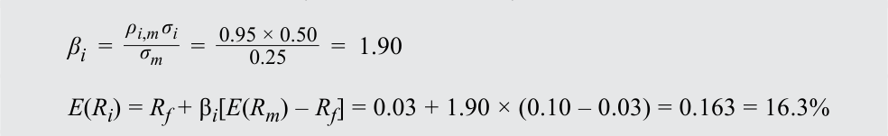

$$\beta_i = \frac{\rho_{i,m} \sigma_i}{\sigma_m} = \frac{0.95 \times 0.50}{0.25} = 1.90$$

$$E(R_i) = R_f + \beta_i [E(R_m) - R_f] = 0.03 + 1.90 \times (0.10 - 0.03) = 0.163 = 16.3\%$$

<!-- Formula Text: β i  = ρ i,m σ i _ σ m    =   0.95 × 0.50 _ 0.25 =  1.90 E(Ri) = Rf + βi[E(Rm) – Rf] = 0.03 + 1.90 × (0.10 – 0.03) = 0.163 = 16.3% -->

2. Hãy tính tỷ suất sinh lợi kỳ vọng sau thương vụ mua lại. 

#### **Lời giải (*Solution*):** 

Chúng ta thực hiện quy trình tương tự nhưng với hệ số tương quan và độ lệch chuẩn sau thương vụ mua lại. 

<!-- PDF Page 94 -->

$$\beta_i = \frac{\rho_{i,m} \sigma_i}{\sigma_m} = \frac{0.75 \times 0.30}{0.25} = 0.90$$

<!-- Formula Text: β i  = ρ i,m σ i _ σ m    =   0.75 × 0.30 _ 0.25 =  0.90 -->

$$E(R_i) = R_f + \beta_i [E(R_m) - R_f] = 0.03 + 0.90 \times (0.10 - 0.03) = 0.093 = 9.3\%$$

Phần bù rủi ro thị trường (*market risk premium*) là 7% ($10\% - 3\%$). Khi hệ số beta thay đổi, mức thay đổi trong tỷ suất sinh lợi kỳ vọng của chứng khoán bằng phần bù rủi ro thị trường nhân với mức thay đổi của beta. Trong kịch bản này, beta của ANR đã giảm đi 1.0, vì vậy tỷ suất sinh lợi kỳ vọng mới của ANR thấp hơn 7 điểm phần trăm. 

Ông Miles quan sát thấy nhu cầu mạnh mẽ đối với máy nghe nhạc iPod và điện thoại iPhone nên muốn đầu tư vào cổ phiếu Apple. Thật không may, ông Miles không biết mình nên kỳ vọng mức tỷ suất sinh lợi bao nhiêu từ khoản đầu tư này. Ông được cung cấp thông tin về lãi suất phi rủi ro là 3%, tỷ suất sinh lợi thị trường là 10%, và hệ số beta của Apple là 1.5. 

3. Hãy tính tỷ suất sinh lợi kỳ vọng của Apple. 

#### **Lời giải (*Solution*):** 

$$E(R_i) = R_f + \beta_i [E(R_m) - R_f] = 0.03 + 1.5 \times (0.10 - 0.03) = 0.135 = 13.5\%$$

4. Một nhà phân tích khi xem xét cùng thông tin đó lại quyết định rằng hiệu quả hoạt động trong quá khứ của Apple không đại diện cho hiệu quả hoạt động trong tương lai của công ty. Ông nhận định rằng, với sự gia tăng trong vốn hóa thị trường của Apple, cổ phiếu Apple hiện vận động giống với thị trường hơn nhiều so với trước đây và cho rằng hệ số beta của Apple nên gần với mức 1.1 hơn. Tỷ suất sinh lợi kỳ vọng của nhà phân tích này đối với cổ phiếu Apple là bao nhiêu? 

#### **Lời giải (*Solution*):** 

$$E(R_i) = R_f + \beta_i [E(R_m) - R_f] = 0.03 + 1.1 \times (0.10 - 0.03) = 0.107 = 10.7\%$$

Ví dụ này minh họa sự thiếu gắn kết giữa việc ước lượng tỷ suất sinh lợi trong quá khứ và việc phóng chiếu sang tương lai. Các nhà đầu tư cần nhận thức rõ những hạn chế của việc sử dụng tỷ suất sinh lợi quá khứ để ước tính tỷ suất sinh lợi tương lai. 

# **<mark>8</mark>** 

## **MÔ HÌNH ĐỊNH GIÁ TÀI SẢN VỐN: CÁC GIẢ ĐỊNH VÀ ĐƯỜNG THỊ TRƯỜNG CHỨNG KHOÁN (*CAPITAL ASSET PRICING MODEL: ASSUMPTIONS AND THE SECURITY MARKET LINE*)** 

giải thích mô hình định giá tài sản vốn (*capital asset pricing model* – CAPM), bao gồm các giả định của mô hình, và đường thị trường chứng khoán (*security market line* – SML)

tính toán và diễn giải tỷ suất sinh lợi kỳ vọng (*expected return*) của một tài sản bằng cách sử dụng CAPM

Mô hình định giá tài sản vốn (CAPM) là một trong những đổi mới quan trọng nhất trong lý thuyết danh mục đầu tư. Mô hình này đơn giản nhưng mạnh mẽ; trực quan nhưng sâu sắc. CAPM được giới thiệu một cách độc lập bởi William Sharpe, John Lintner, Jack Treynor và Jan Mossin, đồng thời được xây dựng dựa trên công trình nghiên cứu trước đó của Harry Markowitz về đa dạng hóa và lý thuyết danh mục đầu tư hiện đại (*modern portfolio theory*).$^2$ Mô hình cung cấp một mối quan hệ tuyến tính giữa tỷ suất sinh lợi kỳ vọng và beta, 

<!-- PDF Page 95 -->

giúp xác định chính xác tỷ suất sinh lợi kỳ vọng khi biết hệ số beta của một tài sản. Qua đó, mô hình thực hiện bước chuyển đổi từ tổng rủi ro sang rủi ro hệ thống — yếu tố quyết định chính của tỷ suất sinh lợi kỳ vọng. Hãy nhớ lại phương trình sau: 

$$E(R_i) = R_f + \beta_i [E(R_m) - R_f]$$

Mô hình CAPM khẳng định rằng tỷ suất sinh lợi kỳ vọng của các tài sản chỉ khác nhau do rủi ro hệ thống của chúng được đo lường bằng hệ số beta. Hai tài sản có cùng hệ số beta sẽ có cùng tỷ suất sinh lợi kỳ vọng bất kể bản chất của hai tài sản đó là gì. Dựa trên mối quan hệ giữa rủi ro và tỷ suất sinh lợi, tất cả các tài sản đều chỉ được xác định bởi rủi ro beta của chúng, điều mà chúng ta sẽ giải thích khi mô tả các giả định. 

Trong phần còn lại của mục này, chúng ta sẽ xem xét các giả định được đưa ra để đi đến mô hình CAPM và những hạn chế mà các giả định đó kéo theo. Thứ hai, chúng ta sẽ triển khai CAPM thông qua đường thị trường chứng khoán (SML) để định giá bất kỳ danh mục hoặc tài sản nào, dù hiệu quả hay không hiệu quả. Cuối cùng, chúng ta sẽ thảo luận về các cách thức ứng dụng CAPM vào hoạt động đầu tư, định giá và hoạch định ngân sách vốn (*capital budgeting*). 

### **Các Giả định của Mô hình CAPM (*Assumptions of the CAPM*)** 

Tương tự như tất cả các mô hình khác, CAPM bỏ qua nhiều sự phức tạp của thị trường tài chính bằng cách đưa ra các giả định đơn giản hóa. Những giả định này cho phép chúng ta thu được những hiểu biết sâu sắc quan trọng về cách thức tài sản được định giá mà không làm phức tạp hóa quá trình phân tích.Một khi các mối quan hệ cơ bản đã được thiết lập, chúng ta có thể nới lỏng các giả định và xem xét cách thức những nhận định của chúng ta cần được điều chỉnh. Một số giả định này mang tính bó buộc, trong khi những giả định khác lại khá vô hại. Và một số giả định khác chỉ ảnh hưởng đến một tập hợp tài sản cụ thể hoặc chỉ ảnh hưởng không đáng kể đến các mối quan hệ được giả thuyết. 

**1.** **_Các nhà đầu tư là những cá nhân ngại rủi ro, tối đa hóa mức hữu dụng và có lý trí (Investors are risk-averse, utility-maximizing, rational individuals)._** 

Ngại rủi ro (*risk aversion*) có nghĩa là các nhà đầu tư kỳ vọng được đền bù cho việc chấp nhận rủi ro. Lưu ý rằng giả định này không đòi hỏi các nhà đầu tư phải có cùng mức độ ngại rủi ro; nó chỉ yêu cầu họ là những người ngại rủi ro. Tối đa hóa mức hữu dụng (*utility maximization*) hàm ý rằng các nhà đầu tư muốn tỷ suất sinh lợi cao hơn chứ không phải tỷ suất sinh lợi thấp hơn, và các nhà đầu tư luôn muốn có thêm nhiều của cải hơn (tức là các nhà đầu tư không bao giờ cảm thấy đủ). Các nhà đầu tư được hiểu là có lý trí (*rational*) ở chỗ họ đánh giá và phân tích đúng đắn các thông tin sẵn có để đi đến những quyết định hợp lý. Mặc dù các nhà đầu tư có lý trí có thể sử dụng cùng một thông tin để đi đến những ước tính khác nhau về rủi ro kỳ vọng và tỷ suất sinh lợi kỳ vọng, tính đồng nhất giữa các nhà đầu tư (xem Giả định 4) đòi hỏi các nhà đầu tư phải là những cá nhân có lý trí. 

Sự ngại rủi ro và tối đa hóa mức hữu dụng nhìn chung được chấp nhận là phản ánh đúng góc nhìn thực tế về thế giới. Tuy nhiên, tính duy lý (*rationality*) giữa các nhà đầu tư đã bị đặt dấu hỏi bởi vì các nhà đầu tư có thể để những thiên kiến cá nhân (*personal biases*) và kinh nghiệm của họ làm gián đoạn quá trình ra quyết định, dẫn đến các khoản đầu tư dưới mức tối ưu (*suboptimal investments*). Tuy nhiên, các kết quả của mô hình vẫn không bị ảnh hưởng bởi hành vi phi lý trí như vậy miễn là nó không tác động đến giá cả một cách đáng kể (tức là giao dịch của các nhà đầu tư phi lý trí tự triệt tiêu lẫn nhau hoặc bị áp đảo bởi giao dịch của các nhà đầu tư có lý trí). 

**2.** **_Thị trường không có ma sát, bao gồm việc không có chi phí giao dịch và không có thuế (Markets are frictionless, including no transaction costs and no taxes)._** 

Thị trường không có ma sát (*frictionless markets*) cho phép chúng ta tách biệt việc phân tích ra khỏi các đặc điểm vận hành của thị trường. Bằng cách đó, chúng ta không để mối quan hệ rủi ro – tỷ suất sinh lợi bị ảnh hưởng bởi, chẳng hạn như, khối lượng giao dịch trên Sở Giao dịch Chứng khoán New York hay chênh lệch giữa giá mua và giá bán. Cụ thể, các thị trường không có ma sát sẽ không có chi phí giao dịch (*transaction costs*), thuế (*taxes*), hoặc bất kỳ chi phí hay hạn chế nào đối với việc bán khống (*short selling*). Chúng ta cũng giả định rằng có thể đi vay và cho vay ở mức lãi suất phi rủi ro. 

<!-- PDF Page 96 -->

Chi phí giao dịch của nhiều định chế tài chính lớn là không đáng kể, và nhiều định chế không phải nộp thuế. Ngay cả sự hiện diện của chi phí giao dịch khác không, thuế, hoặc việc không thể đi vay ở mức lãi suất phi rủi ro cũng không làm ảnh hưởng trọng yếu đến các kết luận chung của CAPM. Tuy nhiên, chi phí bán khống hoặc các hạn chế đối với hoạt động bán khống có thể tạo ra độ chệch phóng đại lên trên (*upward bias*) đối với giá tài sản, có khả năng đe dọa các kết luận quan trọng của CAPM. 

##### **3.** **_Các nhà đầu tư lập kế hoạch cho cùng một kỳ nắm giữ duy nhất (Investors plan for the same single holding period)._** 

CAPM là một mô hình đơn kỳ (*single-period model*), và tất cả các quyết định của nhà đầu tư đều được đưa ra trên cơ sở một kỳ duy nhất đó. Giả định về một kỳ duy nhất được áp dụng nhằm tạo sự thuận tiện bởi vì việc làm việc với các mô hình đa kỳ (*multi-period models*) khó khăn hơn nhiều. Tuy nhiên, một mô hình đơn kỳ không cho phép quá trình học hỏi diễn ra, và các quyết định sai lầm có thể tiếp diễn. Ngoài ra, việc tối đa hóa mức hữu dụng vào cuối một chân trời thời gian đa kỳ có thể đòi hỏi những quyết định trong một số kỳ nhất định trông có vẻ dưới mức tối ưu khi được xem xét từ góc độ đơn kỳ. Dù vậy, giả định về một kỳ nắm giữ duy nhất không làm hạn chế nghiêm trọng khả năng ứng dụng của CAPM vào các bối cảnh đa kỳ. 

##### **4.** **_Các nhà đầu tư có kỳ vọng hoặc niềm tin đồng nhất (Investors have homogeneous expectations or beliefs)._** 

Giả định này có nghĩa là tất cả các nhà đầu tư đều phân tích chứng khoán theo cùng một cách, sử dụng cùng các phân phối xác suất và cùng các dữ liệu đầu vào cho dòng tiền tương lai. Thêm vào đó, vì họ là những cá nhân có lý trí, các nhà đầu tư sẽ đi đến cùng một mức định giá. Bởi vì định giá của họ đối với tất cả các tài sản là giống hệt nhau, họ sẽ tạo ra cùng một danh mục rủi ro tối ưu duy nhất, mà chúng ta gọi là danh mục thị trường (*market portfolio*). 

Giả định về niềm tin đồng nhất có thể được nới lỏng miễn là sự khác biệt trong kỳ vọng không tạo ra các danh mục rủi ro tối ưu khác biệt nhau một cách đáng kể. 

**5.** **_Tất cả các khoản đầu tư đều có thể chia nhỏ vô hạn (All investments are infinitely divisible)._** 

Giả định này hàm ý rằng một cá nhân có thể đầu tư ít hoặc nhiều tùy ý vào một tài sản. Giả thiết này cho phép mô hình dựa vào các hàm liên tục (*continuous functions*) thay vì các hàm bước nhảy rời rạc (*discrete jump functions*). Giả định này chỉ được đưa ra nhằm mục đích thuận tiện và có tác động không đáng kể đến các kết luận của mô hình. 

**6.** **_Các nhà đầu tư là những người chấp nhận giá (Investors are price takers)._** 

Mô hình CAPM giả định rằng có rất nhiều nhà đầu tư và không có nhà đầu tư nào đủ lớn để gây ảnh hưởng đến giá cả. Do đó, các nhà đầu tư là những người chấp nhận giá (*price takers*), và chúng ta giả định rằng giá chứng khoán không bị ảnh hưởng bởi các giao dịch của nhà đầu tư. Giả định này nhìn chung là đúng bởi vì ngay cả khi các nhà đầu tư có thể tác động đến giá của các cổ phiếu nhỏ, thì những cổ phiếu đó cũng không đủ lớn để ảnh hưởng đến các kết quả chính của CAPM. 

Mục tiêu chính của những giả định này là tạo ra một nhà đầu tư cận biên (*marginal investor*) lựa chọn một cách có lý trí một danh mục hiệu quả theo trung bình – phương sai (*mean–variance-efficient portfolio*) theo một cách thức có thể dự đoán được. Chúng ta giả định loại bỏ mọi sự thiếu hiệu quả trên thị trường từ cả góc độ vận hành lẫn góc độ thông tin. Mặc dù một số giả định này có vẻ thiếu thực tế, nhưng việc nới lỏng hầu hết chúng sẽ chỉ có ảnh hưởng nhỏ đến mô hình và các kết quả của nó. Hơn nữa, CAPM, với tất cả những hạn chế và điểm yếu của mình, vẫn cung cấp một chuẩn tham chiếu (*benchmark*) để so sánh và để tạo ra các ước tính tỷ suất sinh lợi ban đầu. 

<!-- PDF Page 97 -->

### **Đường Thị trường Chứng khoán (*The Security Market Line*)** 

Trong tiểu mục này, chúng ta áp dụng CAPM vào việc định giá chứng khoán. **Đường thị trường chứng khoán (*security market line* – SML)** là biểu diễn đồ thị của mô hình định giá tài sản vốn (CAPM) với hệ số beta — phản ánh rủi ro hệ thống — nằm trên trục hoành ($x$) và tỷ suất sinh lợi kỳ vọng nằm trên trục tung ($y$). Sử dụng cùng khái niệm như đường thị trường vốn, đường SML cắt trục tung ($y$) tại mức lãi suất phi rủi ro, và độ dốc của đường thẳng này là phần bù rủi ro thị trường (*market risk premium*), $R_m - R_f$. Hãy nhớ lại rằng đường thị trường vốn (CML) không áp dụng cho tất cả các chứng khoán hay tài sản mà chỉ áp dụng cho các danh mục nằm trên đường biên hiệu quả. Đường biên hiệu quả đưa ra các sự kết hợp tối ưu giữa tỷ suất sinh lợi kỳ vọng và tổng rủi ro. Ngược lại, đường thị trường chứng khoán (SML) áp dụng cho bất kỳ chứng khoán nào, dù hiệu quả hay không. Tổng rủi ro và rủi ro hệ thống chỉ bằng nhau đối với các danh mục hiệu quả bởi vì những danh mục đó không còn rủi ro có thể đa dạng hóa. 

Bảng minh họa 7 là biểu diễn đồ thị của CAPM, tức đường thị trường chứng khoán. Như đã trình bày ở phần trước của bài đọc này, hệ số beta của thị trường bằng 1 (trục $x$) và thị trường kiếm được tỷ suất sinh lợi kỳ vọng là $R_m$ (trục $y$). Sử dụng đường thẳng này, chúng ta có thể tính toán tỷ suất sinh lợi kỳ vọng của một tài sản. Ví dụ tiếp theo minh họa các phép tính beta và tỷ suất sinh lợi. 

**Bảng minh họa 7: Đường Thị trường Chứng khoán (*Exhibit 7: The Security Market Line*)** 

<!-- Picture Text: E ( Ri ) SML M E ( Rm ) β i =  β m Slope =  Rm  –  Rf Rf β i 1.0 Beta Expected Return  -->

> **Chú thích hình ảnh:** Trục tung: Tỷ suất sinh lợi kỳ vọng $E(R_i)$ (*Expected Return*); Trục hoành: Hệ số Beta $\beta_i$ (*Beta*). Đường thị trường chứng khoán ($\text{SML}$) xuất phát từ lãi suất phi rủi ro $R_f$, đi qua danh mục thị trường $M$ tại tọa độ $(\beta_m = 1.0, E(R_m))$, và có độ dốc $\text{Slope} = R_m - R_f$.

##### **VÍ DỤ 7 (*EXAMPLE 7*)** 

### **Đường Thị trường Chứng khoán và Tỷ suất sinh lợi Kỳ vọng (*Security Market Line and Expected Return*)** 

1. Giả sử lãi suất phi rủi ro là 3%, tỷ suất sinh lợi kỳ vọng của danh mục thị trường là 13%, và độ lệch chuẩn của nó là 23%. Một công ty Ấn Độ, Bajaj Auto, có độ lệch chuẩn là 50% nhưng không tương quan với thị trường. Hãy tính hệ số beta và tỷ suất sinh lợi kỳ vọng của Bajaj Auto. 

#### **Lời giải (*Solution*):** 

Sử dụng công thức tính $\beta_i$, chúng ta có thể tính $\beta_i$ và sau đó tính tỷ suất sinh lợi. 

<!-- PDF Page 98 -->

$$\beta_i = \frac{\rho_{i,m} \sigma_i}{\sigma_m} = \frac{0.0 \times 0.50}{0.23} = 0$$

<!-- Formula Text: β i  = ρ i,m σ i _ σ m    =   0.0 × 0.50 _ 0.23    =  0 -->

$$E(R_i) = R_f + \beta_i [E(R_m) - R_f] = 0.03 + 0 \times (0.13 - 0.03) = 0.03 = 3.0\%$$

Do có hệ số tương quan bằng không với danh mục thị trường, hệ số beta của Bajaj Auto bằng không. Bởi vì hệ số beta bằng không, tỷ suất sinh lợi kỳ vọng của Bajaj Auto bằng lãi suất phi rủi ro, tức là 3%. 

2. Giả sử lãi suất phi rủi ro là 3%, tỷ suất sinh lợi kỳ vọng của danh mục thị trường là 13%, và độ lệch chuẩn của nó là 23%. Một công ty Đức, Mueller Metals, có độ lệch chuẩn là 50% và hệ số tương quan với thị trường là 0.65. Hãy tính hệ số beta và tỷ suất sinh lợi kỳ vọng của Mueller Metals. 

#### **Lời giải (*Solution*):** 

Sử dụng công thức tính $\beta_i$, chúng ta có thể tính $\beta_i$ và sau đó tính tỷ suất sinh lợi. 

$$\beta_i = \frac{\rho_{i,m} \sigma_i}{\sigma_m} = \frac{0.65 \times 0.50}{0.23} = 1.41$$

<!-- Formula Text: β i  = ρ i,m σ i _ σ m    =   0.65 × 0.50 _ 0.23 =  1.41 -->

$$E(R_i) = R_f + \beta_i [E(R_m) - R_f] = 0.03 + 1.41 \times (0.13 - 0.03) = 0.171 = 17.1\%$$

Do có mức độ tương quan cao với thị trường, hệ số beta của Mueller Metals là 1.41 và tỷ suất sinh lợi kỳ vọng là 17.1%. Bởi vì Mueller Metals có rủi ro hệ thống lớn hơn rủi ro của thị trường, nó có tỷ suất sinh lợi kỳ vọng vượt quá tỷ suất sinh lợi kỳ vọng của thị trường. 

##### **_Hệ số Beta của Danh mục Đầu tư (Portfolio Beta)_** 

Như chúng ta đã nêu ở trên, đường thị trường chứng khoán áp dụng cho tất cả các chứng khoán. Nhưng còn sự kết hợp của các chứng khoán, chẳng hạn như một danh mục đầu tư, thì sao? Hãy xét hai chứng khoán 1 và 2, với tỷ trọng $w_1$ ở Chứng khoán 1 và phần còn lại ở Chứng khoán 2. Tỷ suất sinh lợi của hai chứng khoán và tỷ suất sinh lợi của danh mục đầu tư có thể được viết như sau: 

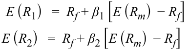

$$E(R_1) = R_f + \beta_1 [E(R_m) - R_f]$$

$$E(R_2) = R_f + \beta_2 [E(R_m) - R_f]$$

<!-- Formula Text: E (R 1)   =  R f + β 1 [E (R m)  − R f] E (R 2)   =  R f + β 2 [E (R m)  − R f] -->

$$E(R_p) = w_1 E(R_1) + w_2 E(R_2)$$

$$= w_1 R_f + w_1 \beta_1 [E(R_m) - R_f] + w_2 R_f + w_2 \beta_2 [E(R_m) - R_f]$$

$$= R_f + (w_1 \beta_1 + w_2 \beta_2) [E(R_m) - R_f]$$

<!-- Formula Text: E (R p)   =  w 1 E (R 1)  + w 2 E (R 2) = w 1 R f + w 1 β 1 [E (R m)  − R f]  + w 2 R f + w 2 β 2 [E (R m)  − R f] = R f +  (w 1 β 1 + w 2 β 2)  [E (R m)  − R f] -->

Phương trình cuối cùng đưa ra biểu thức cho tỷ suất sinh lợi kỳ vọng của danh mục đầu tư. Từ phương trình này, chúng ta có thể kết luận rằng hệ số beta của danh mục đầu tư $= w_1 \beta_1 + w_2 \beta_2$. Nhìn chung, hệ số beta của danh mục đầu tư là tổng có trọng số của các hệ số beta của các chứng khoán thành phần và được cho bởi: 

$$\beta_p = \sum_{i=1}^{n} w_i \beta_i; \quad \sum_{i=1}^{n} w_i = 1$$

<!-- Formula Text: β p  =  ∑ i=1 n w i β i; ∑ i=1 n w i  =  1 -->

Tỷ suất sinh lợi của danh mục đầu tư theo mô hình CAPM là: 

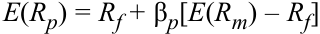

$$E(R_p) = R_f + \beta_p [E(R_m) - R_f]$$

<!-- Formula Text: E(Rp) = Rf + βp[E(Rm) – Rf] -->

Phương trình này cho thấy tồn tại một mối quan hệ tuyến tính giữa tỷ suất sinh lợi kỳ vọng của một danh mục đầu tư và rủi ro hệ thống của danh mục đó được đo lường bằng $\beta_p$. 

<!-- PDF Page 99 -->

##### **VÍ DỤ 8 (*EXAMPLE 8*)** 

### **Hệ số Beta và Tỷ suất sinh lợi của Danh mục Đầu tư (*Portfolio Beta and Return*)** 

1. Bạn đầu tư 20% tiền của mình vào tài sản phi rủi ro, 30% vào danh mục thị trường, và 50% vào RedHat, một cổ phiếu Hoa Kỳ có hệ số beta là 2.0. Cho biết lãi suất phi rủi ro là 4% và tỷ suất sinh lợi thị trường là 16%, hệ số beta và tỷ suất sinh lợi kỳ vọng của danh mục đầu tư là bao nhiêu? 

### **Lời giải (*Solution*):** 

Hệ số beta của tài sản phi rủi ro $= 0$, hệ số beta của thị trường $= 1$, và hệ số beta của RedHat là $2.0$. Hệ số beta của danh mục đầu tư là: 

$$\beta_p = w_1 \beta_1 + w_2 \beta_2 + w_3 \beta_3 = (0.20 \times 0.0) + (0.30 \times 1.0) + (0.50 \times 2.0) = 1.30$$

$$E(R_p) = R_f + \beta_p [E(R_m) - R_f] = 0.04 + 1.30 \times (0.16 - 0.04) = 0.196 = 19.6\%$$

Hệ số beta của danh mục đầu tư là 1.30, và tỷ suất sinh lợi kỳ vọng của nó là 19.6%. 

### **Phương pháp Thay thế (*Alternate Method*):** 

Một phương pháp khác để tính tỷ suất sinh lợi của danh mục đầu tư là tính tỷ suất sinh lợi của từng chứng khoán riêng lẻ rồi sử dụng công thức tỷ suất sinh lợi danh mục (tức trung bình có trọng số của tỷ suất sinh lợi các chứng khoán) để tính tỷ suất sinh lợi tổng thể của danh mục. 

Tỷ suất sinh lợi của tài sản phi rủi ro $= 4\%$; tỷ suất sinh lợi của thị trường $= 16\%$

Tỷ suất sinh lợi của RedHat dựa trên beta của nó $= 0.04 + 2.0 \times (0.16 - 0.04) = 0.28$

Tỷ suất sinh lợi của danh mục $= (0.20 \times 0.04) + (0.30 \times 0.16) + (0.50 \times 0.28) = 0.196 = 19.6\%$

Không có gì đáng ngạc nhiên, tỷ suất sinh lợi của danh mục đầu tư là 19.6%, giống như đã tính ở phương pháp đầu tiên. 

## **MÔ HÌNH ĐỊNH GIÁ TÀI SẢN VỐN: CÁC ỨNG DỤNG (*CAPITAL ASSET PRICING MODEL: APPLICATIONS*)** 

# **<mark>9</mark>** 

tính toán và diễn giải tỷ suất sinh lợi kỳ vọng (*expected return*) của một tài sản bằng cách sử dụng CAPM

mô tả và minh họa các ứng dụng của CAPM và SML

Mô hình CAPM đưa ra những dự đoán mạnh mẽ và hấp dẫn về mặt trực giác đối với rủi ro cũng như mối quan hệ giữa rủi ro và tỷ suất sinh lợi. CAPM không chỉ quan trọng dưới góc độ lý thuyết mà còn được sử dụng rộng rãi trên thực tế. Trong phần này, chúng ta sẽ thảo luận về một số ứng dụng phổ biến của mô hình. Khi áp dụng các công cụ này vào các kịch bản khác nhau, điều quan trọng là phải hiểu rằng CAPM và SML là các hàm số đưa ra chỉ báo về mức tỷ suất sinh lợi trên thị trường *nên* là bao nhiêu (*should be*) ứng với một mức rủi ro nhất định. Tỷ suất sinh lợi thực tế (*actual return*) có thể rất khác so với tỷ suất sinh lợi kỳ vọng. 

<!-- PDF Page 100 -->

Các ứng dụng của CAPM bao gồm ước tính tỷ suất sinh lợi kỳ vọng cho hoạch định ngân sách vốn (*capital budgeting*), so sánh tỷ suất sinh lợi thực tế của một danh mục đầu tư hoặc nhà quản lý danh mục với tỷ suất sinh lợi CAPM để thẩm định hiệu quả hoạt động (*performance appraisal*), và phân tích các ước tính tỷ suất sinh lợi thay thế cùng tỷ suất sinh lợi CAPM làm cơ sở cho việc lựa chọn chứng khoán (*security selection*). Các ứng dụng này được thảo luận chi tiết hơn trong phần này. 

### **Ước tính Tỷ suất sinh lợi Kỳ vọng (*Estimate of Expected Return*)** 

Khi biết rủi ro hệ thống của một tài sản, tỷ suất sinh lợi kỳ vọng có thể được tính toán bằng cách sử dụng CAPM. Hãy nhớ lại rằng giá của một tài sản là tổng của tất cả các dòng tiền tương lai được chiết khấu theo tỷ suất sinh lợi yêu cầu, trong đó lãi suất chiết khấu hay tỷ suất sinh lợi yêu cầu phải tương xứng với rủi ro của tài sản đó. Tỷ suất sinh lợi kỳ vọng thu được từ CAPM thông thường là ước tính đầu tiên mà các nhà đầu tư sử dụng để định giá các tài sản như cổ phiếu, trái phiếu, bất động sản và các tài sản tương tự khác. Tỷ suất sinh lợi yêu cầu từ CAPM cũng được sử dụng cho việc hoạch định ngân sách vốn và xác định tính khả thi về mặt kinh tế (*economic feasibility*) của các dự án. Một lần nữa, hãy nhớ lại rằng khi tính giá trị hiện tại ròng (*net present value* – NPV) của một dự án, các khoản đầu tư và doanh thu ròng được coi là các dòng tiền và được chiết khấu theo tỷ suất sinh lợi yêu cầu. Tỷ suất sinh lợi yêu cầu, dựa trên rủi ro của dự án, được tính toán bằng cách sử dụng CAPM. 

Bởi vì rủi ro và tỷ suất sinh lợi là nền tảng cho hầu hết mọi khía cạnh của việc ra quyết định đầu tư, không có gì ngạc nhiên khi CAPM được sử dụng để ước tính tỷ suất sinh lợi kỳ vọng trong nhiều kịch bản. Các ví dụ khác bao gồm việc các ủy ban quản lý nhà nước tính toán chi phí vốn (*cost of capital*) cho các công ty chịu sự điều tiết (*regulated companies*) và việc thiết lập mức phí bảo hiểm hợp lý (*fair insurance premiums*). Ví dụ tiếp theo trình bày một ứng dụng của CAPM vào hoạch định ngân sách vốn. 

##### **VÍ DỤ 9 (*EXAMPLE 9*)** 

### **Ứng dụng của CAPM vào Hoạch định Ngân sách Vốn (*Application of the CAPM to Capital Budgeting*)** 

GlaxoSmithKline Plc đang xem xét tính khả thi về mặt kinh tế của việc phát triển một loại thuốc mới. Khoản đầu tư ban đầu vào Năm 1 là 500 triệu đô la. Khoản đầu tư vào Năm 2 là 200 triệu đô la. Có 50% khả năng loại thuốc này sẽ được phát triển và thành công. Nếu điều đó xảy ra, GlaxoSmithKline phải chi thêm 100 triệu đô la vào Năm 3, nhưng thu nhập từ dự án trong Năm 3 sẽ là 500 triệu đô la, chưa tính khoản đầu tư của năm thứ ba. Trong các Năm 4, 5 và 6, công ty sẽ kiếm được 400 triệu đô la mỗi năm nếu loại thuốc này thành công. Vào cuối Năm 6, công ty dự định bán toàn bộ bản quyền đối với loại thuốc này với giá 600 triệu đô la. Nếu loại thuốc này không thành công, không có khoản đầu tư nào của GlaxoSmithKline có thể thu hồi được (*salvaged*). Giả sử rằng tỷ suất sinh lợi thị trường là 12%, lãi suất phi rủi ro là 2%, và rủi ro beta của dự án là 2.3. Tất cả các dòng tiền đều phát sinh vào cuối mỗi năm. 

1. Hãy tính các dòng tiền hàng năm kỳ vọng bằng cách sử dụng xác suất thành công. 

#### **Lời giải (*Solution*):** 

Có 50% khả năng các dòng tiền trong các Năm 3–6 sẽ xảy ra. Có tính đến yếu tố đó, các dòng tiền hàng năm kỳ vọng là: 

Năm 1: $-\$500\text{ triệu}$ (dòng tiền ra – *outflow*) 

Năm 2: $-\$200\text{ triệu}$ (dòng tiền ra – *outflow*) 

Năm 3: $50\%\text{ của } -\$100\text{ triệu}$ (dòng tiền ra) $+ 50\%\text{ của } \$500\text{ triệu} = \$200\text{ triệu}$ 

Năm 4: $50\%\text{ của } \$400\text{ triệu} = \$200\text{ triệu}$ 

Năm 5: $50\%\text{ của } \$400\text{ triệu} = \$200\text{ triệu}$ 

---

# Tập 9: Quản lý Danh mục Đầu tư (*Volume 9: Portfolio Management*)
## Học phần 2: Rủi ro và Tỷ suất sinh lợi của Danh mục Đầu tư: Phần II (*Learning Module 2: Portfolio Risk and Return: Part II*)
### Phần 3/4: Vượt ra ngoài CAPM: Những Hạn chế và Mở rộng của CAPM (*Beyond CAPM: Limitations and Extensions of CAPM*) (Trang PDF 101–115)

---

<!-- PDF Page 101 -->

Năm 6: $50\%\text{ của } \$400\text{ triệu} + 50\%\text{ của } \$600\text{ triệu} = \$500\text{ triệu}$ 

2. Hãy tính tỷ suất sinh lợi kỳ vọng. 

#### **Lời giải (*Solution*):** 

Tỷ suất sinh lợi kỳ vọng hay tỷ suất sinh lợi yêu cầu đối với dự án có thể được tính bằng cách sử dụng CAPM, tức là $= 0.02 + 2.3 \times (0.12 - 0.02) = 0.25$ (hay $25\%$). 

3. Hãy tính giá trị hiện tại ròng (*net present value* – NPV). 

#### **Lời giải (*Solution*):** 

Giá trị hiện tại ròng là giá trị chiết khấu của tất cả các dòng tiền: 

$$\text{NPV} = \sum_{t=0}^{T} \frac{CF_t}{(1 + r_t)^t} = \frac{-500}{(1 + 0.25)} + \frac{-200}{(1 + 0.25)^2} + \frac{200}{(1 + 0.25)^3} + \frac{200}{(1 + 0.25)^4} + \frac{200}{(1 + 0.25)^5} + \frac{500}{(1 + 0.25)^6}$$

$$= -400 - 128 + 102.40 + 81.92 + 65.54 + 131.07 = -147.07.$$

Bởi vì giá trị hiện tại ròng là số âm ($-\$147.07\text{ triệu}$), dự án này không nên được GlaxoSmithKline chấp nhận. 

## **VƯỢT RA NGOÀI CAPM: NHỮNG HẠN CHẾ VÀ MỞ RỘNG CỦA CAPM (*BEYOND CAPM: LIMITATIONS AND EXTENSIONS OF CAPM*)** 

# **<mark>10</mark>** 

mô tả và minh họa các ứng dụng của CAPM và SML (*describe and demonstrate applications of the CAPM and the SML*)

Nhìn chung, các mô hình tạo tỷ suất sinh lợi cho phép chúng ta ước tính tỷ suất sinh lợi của một tài sản khi biết các đặc điểm của nó, trong đó các đặc điểm tài sản cần thiết để ước tính tỷ suất sinh lợi được quy định cụ thể trong mô hình. Việc ước tính tỷ suất sinh lợi của một tài sản là rất quan trọng cho việc ra quyết định đầu tư. Các mô hình này cũng rất quan trọng với vai trò là chuẩn tham chiếu (*benchmark*) để đánh giá hiệu quả hoạt động của danh mục đầu tư, chứng khoán hoặc nhà quản lý danh mục. Các mô hình tạo tỷ suất sinh lợi đã được giới thiệu ngắn gọn trong Phần 3.2.1, và một trong những mô hình đó, mô hình định giá tài sản vốn (CAPM), đã được thảo luận chi tiết trong Phần 4. 

Mục đích của phần này là giúp người đọc nhận thức được rằng, mặc dù CAPM là một khái niệm và mô hình quan trọng, nhưng CAPM không phải là mô hình tạo tỷ suất sinh lợi duy nhất. Trong phần này, chúng ta sẽ xem xét lại và làm nổi bật những hạn chế của CAPM, đồng thời giới thiệu sơ lược về các mô hình tạo tỷ suất sinh lợi giải quyết được một số hạn chế đó. 

### **Những Hạn chế của Mô hình CAPM (*Limitations of the CAPM*)** 

Mô hình CAPM chịu những hạn chế cả về mặt lý thuyết lẫn thực tiễn. Những hạn chế về mặt lý thuyết (*theoretical limitations*) vốn có sẵn trong cấu trúc của mô hình, trong khi những hạn chế về mặt thực tiễn (*practical limitations*) là những hạn chế phát sinh khi triển khai áp dụng mô hình. 

<!-- PDF Page 102 -->

##### **_Những Hạn chế về mặt Lý thuyết của CAPM (Theoretical Limitations of the CAPM)_** 

- Mô hình đơn nhân tố (*Single-factor model*): Chỉ có rủi ro hệ thống hay rủi ro beta mới được định giá trong CAPM. Như vậy, CAPM tuyên bố rằng không có đặc điểm đầu tư nào khác cần được xem xét khi ước tính tỷ suất sinh lợi. Hệ quả là, mô hình này mang tính quy chuẩn (*prescriptive*) và dễ hiểu, dễ áp dụng, mặc dù nó rất gò bó và thiếu linh hoạt. 

- Mô hình đơn kỳ (*Single-period model*): CAPM là một mô hình đơn kỳ không xem xét đến các hệ quả đa kỳ hay các mục tiêu đầu tư của các kỳ tương lai, điều này có thể dẫn đến các quyết định đầu tư thiển cận (*myopic*) và dưới mức tối ưu (*suboptimal*). Ví dụ, việc vỡ nợ các khoản thanh toán lãi trong kỳ hiện tại có thể là tối ưu để tối đa hóa tỷ suất sinh lợi hiện tại, nhưng hậu quả có thể rất tiêu cực trong kỳ tiếp theo. Một mô hình đơn kỳ như CAPM không có khả năng nắm bắt các nhân tố biến thiên theo thời gian và trải dài qua nhiều kỳ. 

##### **_Những Hạn chế về mặt Thực tiễn của CAPM (Practical Limitations of the CAPM)_** 

Bên cạnh những hạn chế về mặt lý thuyết, việc triển khai áp dụng CAPM còn làm nảy sinh một số lo ngại thực tiễn, một vài trong số đó được liệt kê dưới đây. 

- Danh mục thị trường (*Market portfolio*): Danh mục thị trường thực sự (*true market portfolio*) theo CAPM bao gồm tất cả các tài sản, cả tài chính và phi tài chính, có nghĩa là nó cũng bao gồm nhiều tài sản không thể đầu tư được (*not investable*), chẳng hạn như vốn nhân lực và các tài sản ở những nền kinh tế đóng. Richard Roll$^3$ đã lưu ý rằng một lý do khiến CAPM không thể kiểm định được (*not testable*) là vì danh mục thị trường thực sự là không thể quan sát được (*unobservable*). 

- Đại diện cho danh mục thị trường (*Proxy for a market portfolio*): Khi không có một danh mục thị trường thực sự, những người tham gia thị trường thường sử dụng các chỉ số đại diện (*proxies*). Tuy nhiên, các đại diện này lại khác nhau giữa các nhà phân tích, quốc gia của nhà đầu tư, v.v. và tạo ra các ước tính tỷ suất sinh lợi khác nhau cho cùng một tài sản, điều vốn không được phép trong CAPM. 

- Ước lượng rủi ro beta (*Estimation of beta risk*): Cần có một lịch sử dữ liệu tỷ suất sinh lợi dài (từ 3 đến 5 năm) để ước lượng rủi ro beta. Tuy nhiên, trạng thái lịch sử của công ty có thể không phải là một sự đại diện chính xác cho trạng thái hiện tại hoặc tương lai của công ty đó. Tổng quát hơn, CAPM là một mô hình *tiên nghiệm / dự phóng* (*ex ante* model), thế nhưng nó thường được áp dụng bằng cách sử dụng dữ liệu *hậu nghiệm / quá khứ* (*ex post* data). Ngoài ra, việc sử dụng các giai đoạn khác nhau để ước lượng sẽ dẫn đến các ước lượng beta khác nhau. Ví dụ, hệ số beta 3 năm khó có thể giống với hệ số beta 5 năm, và hệ số beta được ước lượng bằng tỷ suất sinh lợi hàng ngày khó có thể giống với hệ số beta được ước lượng bằng tỷ suất sinh lợi hàng tháng. Do đó, chúng ta có khả năng ước tính ra các mức tỷ suất sinh lợi khác nhau cho cùng một tài sản tùy thuộc vào ước lượng rủi ro beta được sử dụng trong mô hình. 

- Mô hình CAPM là một công cụ dự báo tỷ suất sinh lợi kém (*The CAPM is a poor predictor of returns*): Nếu CAPM là một mô hình tốt, ước tính của nó về tỷ suất sinh lợi tài sản phải gắn liền chặt chẽ với tỷ suất sinh lợi thực tế. Tuy nhiên, bằng chứng thực nghiệm ủng hộ cho CAPM là rất yếu.$^4$ Nói cách khác, các kiểm định đối với CAPM cho thấy tỷ suất sinh lợi của tài sản không chỉ được quyết định bởi rủi ro hệ thống. Khả năng dự báo tỷ suất sinh lợi kém khi sử dụng CAPM là một hạn chế nghiêm trọng bởi vì các mô hình tạo tỷ suất sinh lợi được dùng để ước tính tỷ suất sinh lợi trong tương lai. 

- Tính đồng nhất trong kỳ vọng của nhà đầu tư (*Homogeneity in investor expectations*): CAPM giả định rằng tồn tại tính đồng nhất trong kỳ vọng của nhà đầu tư để mô hình tạo ra một danh mục rủi ro tối ưu duy nhất (thị trường) và một đường thị trường chứng khoán duy nhất. Nếu không có giả định này, sẽ có vô số danh mục rủi ro tối ưu và vô số đường thị trường chứng khoán. Rõ ràng, các nhà đầu tư có thể xử lý cùng một thông tin theo cách hợp lý và đi đến các danh mục rủi ro tối ưu khác nhau. 

<!-- PDF Page 103 -->

### **Các Mở rộng đối với Mô hình CAPM (*Extensions to the CAPM*)** 

Trước những hạn chế của CAPM, không có gì ngạc nhiên khi các mô hình khác đã được đề xuất nhằm giải quyết một số hạn chế này. Những mô hình mới này cũng không tránh khỏi những hạn chế của riêng chúng, điều mà chúng ta sẽ đề cập trong khi thảo luận về các mô hình. Chúng ta chia các mô hình thành hai nhóm — các mô hình lý thuyết (*theoretical models*) và các mô hình thực tiễn (*practical models*) — và đưa ra một ví dụ cho mỗi loại. 

##### **_Các Mô hình Lý thuyết (Theoretical Models)_** 

Các mô hình lý thuyết dựa trên cùng nguyên lý như CAPM nhưng mở rộng số lượng các nhân tố rủi ro. Ví dụ tiêu biểu nhất của một mô hình lý thuyết là lý thuyết định giá kinh doanh chênh lệch giá (*arbitrage pricing theory* – APT), được phát triển bởi Stephen Ross.$^5$ Giống như CAPM, APT đề xuất một mối quan hệ tuyến tính giữa tỷ suất sinh lợi kỳ vọng và rủi ro: 

$$E(R_p) = R_F + \lambda_1 \beta_{p,1} + \dots + \lambda_K \beta_{p,K}$$

trong đó: 

- $E(R_p) =$ tỷ suất sinh lợi kỳ vọng của danh mục $p$ 

- $R_F =$ lãi suất phi rủi ro 

- $\lambda_j =$ phần bù rủi ro (*risk premium*, tức tỷ suất sinh lợi kỳ vọng vượt trên lãi suất phi rủi ro) đối với nhân tố $j$ 

- $\beta_{p,j} =$ độ nhạy (*sensitivity*) của danh mục đối với nhân tố $j$ 

- $K =$ số lượng các nhân tố rủi ro 

Tuy nhiên, không giống như CAPM, APT cho phép nhiều nhân tố rủi ro — nhiều tương ứng với số lượng nhân tố có liên quan đến một tài sản cụ thể. Hơn nữa, ngoài lãi suất phi rủi ro, các nhân tố rủi ro không nhất thiết phải giống nhau chung cho mọi tài sản mà có thể thay đổi từ tài sản này sang tài sản khác. Điều kiện không có kinh doanh chênh lệch giá (*no-arbitrage condition*) trên các thị trường tài sản được sử dụng để xác định các nhân tố rủi ro và ước lượng các hệ số beta cho các nhân tố rủi ro đó. 

Mặc dù thanh thoát về mặt lý thuyết, linh hoạt và ưu việt hơn CAPM, nhưng APT không được sử dụng phổ biến trên thực tế bởi vì nó không chỉ định cụ thể bất kỳ nhân tố rủi ro nào và việc xác định các nhân tố rủi ro cũng như ước lượng hệ số beta cho từng tài sản trong danh mục trở nên rất khó khăn. Vì vậy, dưới góc độ thực tiễn, CAPM được ưa chuộng hơn APT. 

##### **_Các Mô hình Thực tiễn (Practical Models)_** 

Nếu rủi ro beta trong CAPM không giải thích được tỷ suất sinh lợi, thì những nhân tố nào giải thích được? Các mô hình thực tiễn tìm cách trả lời câu hỏi này thông qua các nghiên cứu sâu rộng. Như đã đề cập trong Phần 3.2.1, ví dụ tiêu biểu nhất của một mô hình như vậy là mô hình bốn nhân tố (*four-factor model*) được đề xuất bởi Fama và French (1992) và Carhart (1997). 

Dựa trên phân tích về mối quan hệ giữa tỷ suất sinh lợi trong quá khứ và hàng loạt các nhân tố khác nhau, Fama và French (1992) đã đề xuất rằng ba nhân tố dường như giải thích tỷ suất sinh lợi của tài sản tốt hơn so với việc chỉ dùng rủi ro hệ thống. Ba nhân tố đó là quy mô tương đối (*relative size*), giá trị sổ sách trên giá trị thị trường tương đối (*relative book-to-market value*), và hệ số beta của tài sản. Với sự bổ sung của Carhart (1997) về tỷ suất sinh lợi cổ phiếu tương đối trong quá khứ, mô hình có thể được viết như sau: 

$$E(R_{it}) = \alpha_i + \beta_{i,\text{MKT}}\text{MKT}_t + \beta_{i,\text{SMB}}\text{SMB}_t + \beta_{i,\text{HML}}\text{HML}_t + \beta_{i,\text{UMD}}\text{UMD}_t$$

<!-- PDF Page 104 -->

trong đó: 

- $E(R_i) =$ tỷ suất sinh lợi của một tài sản vượt trên tỷ suất sinh lợi tín phiếu Kho bạc kỳ hạn 1 tháng 

- $\text{MKT} =$ tỷ suất sinh lợi vượt trội của danh mục thị trường (*excess return on the market portfolio*) 

- $\text{SMB} =$ chênh lệch tỷ suất sinh lợi giữa các cổ phiếu vốn hóa nhỏ và các cổ phiếu vốn hóa lớn (quy mô – *size*, viết tắt của *Small Minus Big*) 

- $\text{HML} =$ chênh lệch tỷ suất sinh lợi giữa các cổ phiếu có tỷ số giá trị sổ sách trên giá trị thị trường cao và các cổ phiếu có tỷ số giá trị sổ sách trên giá trị thị trường thấp (giá trị so với tăng trưởng – *value versus growth*, viết tắt của *High Minus Low*) 

- $\text{UMD} =$ chênh lệch tỷ suất sinh lợi giữa các cổ phiếu chiến thắng và các cổ phiếu thua cuộc trong năm trước đó (quán tính giá – *momentum*, viết tắt của *Up Minus Down*) 

Phân tích lịch sử cho thấy hệ số gắn với $\text{MKT}$ không khác biệt có ý nghĩa thống kê so với 0, điều này hàm ý rằng tỷ suất sinh lợi cổ phiếu không liên quan đến thị trường. Các nhân tố giải thích tỷ suất sinh lợi cổ phiếu là quy mô (các công ty nhỏ hơn có hiệu quả vượt trội hơn các công ty lớn hơn), tỷ số giá trị sổ sách trên giá trị thị trường (các công ty giá trị – *value companies* vượt trội hơn các công ty hào nhoáng/tăng trưởng – *glamour companies*), và quán tính giá (các cổ phiếu chiến thắng trong quá khứ vượt trội hơn các cổ phiếu thua cuộc trong quá khứ). 

Mô hình bốn nhân tố đã được chứng minh là dự báo tỷ suất sinh lợi tài sản tốt hơn nhiều so với CAPM và được sử dụng rộng rãi trong việc ước tính tỷ suất sinh lợi cho các cổ phiếu Hoa Kỳ. 

Có hai nhận xét cần được lưu ý. Thứ nhất, mô hình này không được nâng đỡ bởi một lý thuyết về cân bằng thị trường (*theory of market equilibrium*) như trường hợp của CAPM. Thứ hai, không có gì đảm bảo rằng mô hình này sẽ tiếp tục hoạt động tốt trong tương lai. 

# **<mark>11</mark>** 

## **CÁC THƯỚC ĐO THẨM ĐỊNH HIỆU QUẢ HOẠT ĐỘNG CỦA DANH MỤC ĐẦU TƯ (*PORTFOLIO PERFORMANCE APPRAISAL MEASURES*)** 

tính toán và diễn giải tỷ số Sharpe (*Sharpe ratio*), tỷ số Treynor (*Treynor ratio*), $M^2$, và alpha của Jensen (*Jensen’s alpha*)

Trong ngành đầu tư, **đánh giá hiệu quả hoạt động (*performance evaluation*)** đề cập đến việc đo lường (*measurement*), phân tích quy thuộc/đóng góp (*attribution*), và thẩm định (*appraisal*) các kết quả đầu tư. Cụ thể, đánh giá hiệu quả hoạt động cung cấp thông tin về tỷ suất sinh lợi và rủi ro của các danh mục đầu tư trong (các) giai đoạn đầu tư xác định. Bằng cách cung cấp dữ liệu và phân tích chính xác về các quyết định đầu tư cũng như hệ quả của chúng, việc đánh giá hiệu quả hoạt động cho phép các nhà quản lý danh mục thực hiện các biện pháp khắc phục nhằm cải thiện quy trình quản lý và ra quyết định đầu tư. Thông tin đánh giá hiệu quả hoạt động giúp hiểu rõ và kiểm soát rủi ro đầu tư, và do đó sẽ dẫn đến việc quản trị rủi ro tốt hơn. Đánh giá hiệu quả hoạt động tìm cách trả lời các câu hỏi sau: 

- Hiệu quả hoạt động trong quá khứ của danh mục đầu tư là gì, và có thể kỳ vọng điều gì trong tương lai? 

Trả lời câu hỏi này là chủ đề của đo lường hiệu quả hoạt động (*performance measurement*). *Đo lường hiệu quả hoạt động quan tâm đến việc đo lường tỷ suất sinh lợi và rủi ro*. 

- Danh mục đầu tư đã tạo ra hiệu quả hoạt động quan sát được bằng cách nào, và đâu là những nguồn kỳ vọng sẽ tạo ra hiệu quả hoạt động kỳ vọng trong tương lai? 

<!-- PDF Page 105 -->

Trả lời câu hỏi này là chủ đề của phân tích quy thuộc hiệu quả hoạt động (*performance attribution*). *Phân tích quy thuộc hiệu quả hoạt động quan tâm đến việc xác định và định lượng các nguồn tạo ra hiệu quả hoạt động của một danh mục đầu tư*. 

- Hiệu quả hoạt động quan sát được của danh mục đầu tư là kết quả của kỹ năng đầu tư (*investment skill*) hay sự may mắn (*luck*)? 

Trả lời câu hỏi này là chủ đề của thẩm định hiệu quả hoạt động (*performance appraisal*). *Thẩm định hiệu quả hoạt động quan tâm đến việc xác định và đo lường kỹ năng đầu tư*. 

Thông tin do việc đánh giá hiệu quả hoạt động cung cấp được tất cả các bên liên quan (*stakeholders*) trong quy trình quản lý đầu tư hết sức quan tâm vì giá trị của nó trong việc đánh giá chất lượng tổng thể của quy trình quản lý đầu tư cũng như từng quyết định đầu tư riêng lẻ. 

Trong bài đọc này, việc thẩm định hiệu quả hoạt động chỉ dựa trên mô hình CAPM. Tuy nhiên, rất dễ dàng để mở rộng phân tích này sang các mô hình đa nhân tố có thể bao gồm các nhân tố ngành hoặc các nhân tố đặc biệt khác. Bốn tỷ số thường được sử dụng trong thẩm định hiệu quả hoạt động. 

### **Tỷ số Sharpe (*The Sharpe Ratio*)** 

Hiệu quả hoạt động có hai thành phần: rủi ro và tỷ suất sinh lợi. Mặc dù tối đa hóa tỷ suất sinh lợi là một mục tiêu đáng khen ngợi, nhưng việc chỉ so sánh tỷ suất sinh lợi của một danh mục đầu tư với tỷ suất sinh lợi của thị trường là chưa đủ. Bởi vì các nhà đầu tư là những người ngại rủi ro, họ sẽ đòi hỏi sự đền bù cho mức rủi ro cao hơn dưới hình thức tỷ suất sinh lợi cao hơn. Một thước đo hiệu quả hoạt động được sử dụng phổ biến là **tỷ số Sharpe (*Sharpe ratio*)**, được định nghĩa là phần bù rủi ro của danh mục đầu tư chia cho rủi ro của nó. Một đặc điểm hấp dẫn của tỷ số Sharpe là việc sử dụng nó có thể được biện minh trên cơ sở lý thuyết *tiên nghiệm* (*ex ante* – trước khi sự việc xảy ra) và các giá trị *hậu nghiệm* (*ex post* – sau khi sự việc xảy ra) có thể dễ dàng được xác định bằng cách sử dụng dữ liệu thị trường sẵn có. Tỷ số Sharpe cũng dễ diễn giải, về bản chất là một tỷ số hiệu quả liên hệ giữa phần thưởng với những rủi ro đã gánh chịu. Đây là thước đo thẩm định được công nhận và sử dụng rộng rãi nhất. 

Phương trình dưới đây định nghĩa tỷ số Sharpe *tiên nghiệm* (*ex ante*) theo ba dữ liệu đầu vào: (1) tỷ suất sinh lợi kỳ vọng của danh mục đầu tư, $E(R_p)$; (2) lãi suất phi rủi ro, $R_f$; và (3) độ lệch chuẩn tỷ suất sinh lợi *tiên nghiệm* của danh mục đầu tư (độ biến động tỷ suất sinh lợi – *return volatility*), $\sigma_p$, một thước đo định lượng của tổng rủi ro. 

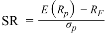

$$\text{SR} = \frac{E(R_p) - R_F}{\sigma_p}$$

<!-- Formula Text: SR  = E (R p)  − R F _ σ p -->

Tỷ số Sharpe cũng có thể được sử dụng trên cơ sở *hậu nghiệm* (*ex post*) để đánh giá tỷ suất sinh lợi lịch sử đã điều chỉnh theo rủi ro (*historical risk-adjusted returns*). Giả sử chúng ta có một mẫu dữ liệu lịch sử có thể được sử dụng để xác định tỷ suất sinh lợi trung bình mẫu của danh mục, $\bar{R}_p$; độ lệch chuẩn của tỷ suất sinh lợi mẫu, ở đây được ký hiệu là $\hat{\sigma}_p$ ($s_p$ là một ký hiệu quen thuộc trong các ngữ cảnh khác); và lãi suất phi rủi ro trung bình mẫu, $\bar{R}_f$. Khi đó, tỷ số Sharpe *hậu nghiệm* (hay thực tế hoặc lịch sử) có thể được xác định bằng cách sử dụng công thức sau: 

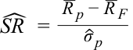

$$\widehat{\text{SR}} = \frac{\bar{R}_p - \bar{R}_F}{\hat{\sigma}_p}$$

<!-- Formula Text: ˆ SR   = _ R  p − _ R  F _ ˆ σ  p -->

Nhớ lại đường CAL ở phần đầu của bài đọc, ta có thể thấy rằng tỷ số Sharpe, còn được gọi là tỷ số phần thưởng trên độ biến thiên (*reward-to-variability ratio*), đơn giản chính là độ dốc của đường phân bổ vốn (CAL). Tuy nhiên, lưu ý rằng tỷ số này sử dụng *tổng rủi ro* (*total risk*) của danh mục đầu tư chứ không phải rủi ro hệ thống của nó. Việc sử dụng tổng rủi ro là phù hợp nếu danh mục đó là tổng danh mục đầu tư của một nhà đầu tư — tức là nhà đầu tư đó không sở hữu bất kỳ tài sản nào khác. Tỷ số Sharpe của thị trường và của các danh mục khác cũng có thể được tính toán theo cách tương tự. Danh mục có tỷ số Sharpe cao nhất có hiệu quả hoạt động điều chỉnh theo rủi ro tốt nhất, và danh mục có tỷ số Sharpe thấp nhất có hiệu quả hoạt động điều chỉnh theo rủi ro kém nhất, với điều kiện là tử số phải dương đối với tất cả các danh mục so sánh. Nếu tử số là số âm, tỷ số sẽ ít âm hơn đối với các danh mục rủi ro hơn, dẫn đến kết quả xếp hạng không chính xác. 

<!-- PDF Page 106 -->

Tuy nhiên, tỷ số Sharpe mắc phải hai hạn chế. Thứ nhất, nó sử dụng tổng rủi ro làm thước đo rủi ro trong khi chỉ có rủi ro hệ thống mới được định giá. Thứ hai, bản thân con số của tỷ số này (ví dụ: 0.2 hoặc 0.3) không mang lại nhiều thông tin trực quan. Để xếp hạng các danh mục đầu tư, tỷ số Sharpe của một danh mục phải được đem so sánh với tỷ số Sharpe của một danh mục khác. Dù vậy, sự dễ dàng trong tính toán vẫn giúp tỷ số Sharpe trở thành một công cụ phổ biến. 

### **Tỷ số Treynor (*The Treynor Ratio*)** 

**Tỷ số Treynor (*Treynor ratio*)** là một sự mở rộng đơn giản của tỷ số Sharpe và giải quyết được hạn chế đầu tiên của tỷ số Sharpe bằng cách thay thế hệ số beta (rủi ro hệ thống) cho tổng rủi ro. Các công thức tỷ số Treynor *tiên nghiệm* (*ex ante*) và *hậu nghiệm* (*ex post*) được cung cấp dưới đây. 

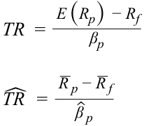

$$\text{TR} = \frac{E(R_p) - R_f}{\beta_p} \qquad \widehat{\text{TR}} = \frac{\bar{R}_p - \bar{R}_f}{\hat{\beta}_p}$$

<!-- Formula Text: TR  = E (R p)  − R f _ β p ˆ TR   = _ R  p − _ R  f _ ˆ β  p -->

Giống hệt như tỷ số Sharpe, tử số phải dương thì tỷ số Treynor mới cho ra kết quả có ý nghĩa. Ngoài ra, tỷ số Treynor không hoạt động đúng đối với các tài sản có beta âm — tức là mẫu số cũng phải dương để thu được các ước tính và thứ hạng chính xác. Mặc dù cả tỷ số Sharpe và tỷ số Treynor đều cho phép xếp hạng các danh mục đầu tư, nhưng không tỷ số nào cung cấp thông tin về ý nghĩa kinh tế (*economic significance*) của sự khác biệt trong hiệu quả hoạt động. Ví dụ, giả sử tỷ số Sharpe của một danh mục là 0.75 và tỷ số Sharpe của một danh mục khác là 0.80. Danh mục thứ hai vượt trội hơn, nhưng sự khác biệt đó có thực sự đáng kể không? Thêm vào đó, chúng ta không biết liệu một trong hai danh mục đó có tốt hơn danh mục thị trường thụ động hay không. Hai thước đo còn lại, $M^2$ và alpha của Jensen (*Jensen’s alpha*), nỗ lực giải quyết vấn đề đó bằng cách so sánh các danh mục đồng thời cung cấp thông tin về mức độ vượt trội (*overperformance*) hay kém hiệu quả (*underperformance*). 

### **Thước đo $M^2$: Hiệu quả Hoạt động Điều chỉnh theo Rủi ro (*$M^2$: Risk-Adjusted Performance – RAP*)** 

**$M^2$** cung cấp một thước đo tỷ suất sinh lợi của danh mục đã được điều chỉnh theo tổng rủi ro của danh mục đó trong mối tương quan với một chuẩn tham chiếu (*benchmark*) nào đó. Vào năm 1997, chủ nhân giải Nobel kinh tế Franco Modigliani và cháu gái của ông, Leah Modigliani, đã phát triển thước đo mà họ gọi là thước đo hiệu quả hoạt động điều chỉnh theo rủi ro (*risk-adjusted performance measure*), hay RAP. Thước đo RAP kể từ đó đã trở nên phổ biến hơn dưới tên gọi $M^2$ để phản ánh hai chữ cái đầu trong họ Modigliani của hai ông cháu. Nó có liên hệ với tỷ số Sharpe và xếp hạng các danh mục đầu tư giống hệt như tỷ số Sharpe, nhưng có ưu điểm hữu ích là được biểu thị bằng đơn vị phần trăm lợi thế tỷ suất sinh lợi rất quen thuộc với giả định có cùng mức tổng rủi ro như thị trường. 

$M^2$ vay mượn ý tưởng từ lý thuyết thị trường vốn bằng cách giả định một danh mục đầu tư được tăng đòn bẩy (*leveraged* – đi vay) hoặc giảm đòn bẩy (*de-leveraged* – cho vay) cho đến khi độ biến động của nó (được đo bằng độ lệch chuẩn) khớp bằng với độ biến động của thị trường. Sự điều chỉnh này tạo ra một tỷ số đòn bẩy đặc thù theo danh mục (*portfolio-specific leverage ratio*) giúp cân bằng rủi ro của danh mục với rủi ro của thị trường. Khi đó, tỷ suất sinh lợi vượt trội của danh mục nhân với tỷ số đòn bẩy rồi cộng với lãi suất phi rủi ro sẽ được đem so sánh với tỷ suất sinh lợi thực tế của thị trường để xác định xem danh mục đó hoạt động vượt trội hay kém hơn thị trường trên cơ sở đã điều chỉnh theo rủi ro. 

Các phương trình dưới đây cung cấp công thức *tiên nghiệm* và *hậu nghiệm* cho $M^2$, trong đó $\sigma_m$ là độ lệch chuẩn của danh mục thị trường và $\sigma_m / \sigma_p$ là tỷ số đòn bẩy đặc thù theo danh mục. Bởi vì tỷ số Sharpe được định nghĩa là: 

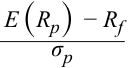

$$\frac{E(R_p) - R_f}{\sigma_p}$$

<!-- Formula Text: E (R p)  − R f _ σ p -->

<!-- PDF Page 107 -->

nên phương trình cho thấy $M^2$ có thể được hiểu là sự đổi thang đo (*rescaling*) của tỷ số Sharpe giúp cho việc so sánh giữa các danh mục khác nhau trở nên dễ dàng hơn. Lý do khiến $M^2$ và tỷ số Sharpe xếp hạng các danh mục giống hệt nhau là bởi vì, trong một khoảng thời gian cho trước — và đối với bất kỳ phép so sánh nào với danh mục thị trường — cả lãi suất phi rủi ro lẫn độ biến động của thị trường đều là hằng số trong tất cả các phép so sánh. Chỉ có tỷ số Sharpe là khác nhau, vì vậy chính nó quyết định mọi thứ hạng. 

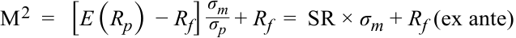

$$M^2 = [E(R_p) - R_f] \frac{\sigma_m}{\sigma_p} + R_f = \text{SR} \times \sigma_m + R_f \quad (\text{tiên nghiệm – ex ante})$$

<!-- Formula Text: M 2  =   [E (R p)  − R f] σ m _ σ p  + R f  =  SR × σ m + R f (ex ante) -->

$$\widehat{M}^2 = (\bar{R}_p - \bar{R}_f) \frac{\hat{\sigma}_m}{\hat{\sigma}_p} + \bar{R}_f = \widehat{\text{SR}} \times \hat{\sigma}_m + \bar{R}_f \quad (\text{hậu nghiệm – ex post})$$

<!-- Formula Text: ˆ M 2  =   ( _ R  p − _ R  f) ˆ σ  m _ ˆ σ  p  + R f  =  ˆ SR ×  ˆ σ  m + R f (ex post) -->

Ví dụ, giả sử rằng $\bar{R}_f = 4.0\%$, $\bar{R}_p = 14.0\%$, $\hat{\sigma}_p = 25.0\%$ và $\hat{\sigma}_m = 20.0\%$. Tỷ số Sharpe là $0.4$: 

$$\widehat{\text{SR}} = \frac{0.14 - 0.04}{0.25} = 0.4,$$

<!-- Formula Text: ˆ SR  =   0.14 − 0.04 _ 0.25 = 0.4, -->

và $\widehat{M}^2$ là $12.0\%$: $\widehat{M}^2 = 0.4(0.2) + 0.04 = 0.12 = 12.0\%$. Nếu tỷ suất sinh lợi thị trường là $10\%$, thì danh mục đã hoạt động vượt trội hơn thị trường trên cơ sở điều chỉnh theo rủi ro một mức là $12.0\% - 10.0\% = 2.0\%$. Khoảng chênh lệch này giữa hiệu quả hoạt động đã điều chỉnh theo rủi ro của danh mục và hiệu quả hoạt động của thị trường thường được gọi là **alpha của $M^2$ (*$M^2$ alpha*)**. 

Tỷ số Sharpe của danh mục thị trường là: 

$$\widehat{\text{SR}} = \frac{0.10 - 0.04}{0.20} = 0.3.$$

<!-- Formula Text: ˆ SR  =   0.10 − 0.04 _ 0.20 -->

So sánh tỷ số Sharpe của danh mục đầu tư với tỷ số Sharpe của danh mục thị trường cho thấy quỹ đã hoạt động vượt trội hơn thị trường. Nhưng mức chênh lệch $2.0\%$ giữa $M^2$ và tỷ suất sinh lợi của thị trường cho chúng ta biết mức độ vượt trội đã điều chỉnh theo rủi ro dưới dạng tỷ lệ phần trăm tỷ suất sinh lợi. 

### **Alpha của Jensen (*Jensen’s Alpha*)** 

Giống như tỷ số Treynor, alpha của Jensen (*Jensen’s alpha*) dựa trên rủi ro hệ thống. Chúng ta có thể đo lường rủi ro hệ thống của một danh mục bằng cách ước lượng mô hình thị trường, được thực hiện bằng cách hồi quy tỷ suất sinh lợi hàng ngày của danh mục theo tỷ suất sinh lợi hàng ngày của thị trường. Hệ số gắn với tỷ suất sinh lợi thị trường là một ước lượng về rủi ro beta của danh mục đầu tư. Chúng ta có thể tính toán tỷ suất sinh lợi điều chỉnh theo rủi ro của danh mục bằng cách sử dụng hệ số beta của danh mục và mô hình CAPM. Chênh lệch giữa tỷ suất sinh lợi thực tế của danh mục và tỷ suất sinh lợi điều chỉnh theo rủi ro được tính toán là một thước đo hiệu quả hoạt động của danh mục so với danh mục thị trường và được gọi là alpha của Jensen (*Jensen’s alpha*). Theo định nghĩa, $\alpha_m$ của thị trường bằng không. Alpha của Jensen cũng chính là khoảng cách theo chiều dọc tính từ đường SML đo lường tỷ suất sinh lợi vượt trội ở cùng mức rủi ro như của thị trường và được cho bởi: 

$$\alpha_p = R_p - \{ R_f + \beta_p [E(R_m) - R_f] \}$$

Nếu giai đoạn đánh giá kéo dài, nó có thể bao gồm nhiều mức lãi suất phi rủi ro khác nhau, trong trường hợp đó $R_f$ đại diện cho lãi suất phi rủi ro trung bình. Hơn nữa, các tỷ suất sinh lợi trong phương trình đều là tỷ suất sinh lợi thực tế đã thực hiện (*realized, actual returns*). Dấu của $\alpha_p$ cho biết liệu danh mục có hoạt động vượt trội hơn thị trường hay không. Nếu $\alpha_p$ dương, thì danh mục đã hoạt động vượt trội hơn thị trường; nếu $\alpha_p$ âm, danh mục đã hoạt động kém hơn thị trường. Alpha của Jensen thường được sử dụng để đánh giá hầu hết các nhà quản lý định chế, các quỹ hưu trí và các quỹ tương hỗ. Các giá trị alpha có thể được sử dụng để xếp hạng các nhà quản lý khác nhau và hiệu quả hoạt động của các danh mục của họ, cũng như độ lớn của mức kém hiệu quả hay vượt trội. Ví dụ, nếu alpha của một danh mục là 2% và alpha của một danh mục khác là 5%, thì danh mục thứ hai đã hoạt động vượt trội hơn danh mục thứ nhất 3 điểm phần trăm và vượt trội hơn thị trường 5 điểm phần trăm. Alpha của Jensen là số tiền tối đa mà bạn nên sẵn lòng trả cho nhà quản lý để quản lý tiền của bạn. Cũng giống như các thước đo thẩm định hiệu quả hoạt động khác, alpha của Jensen có cả dạng *tiên nghiệm* (*ex ante*) và dạng *hậu nghiệm* (*ex post*). Ngữ cảnh sử dụng 

<!-- PDF Page 108 -->

thông thường sẽ làm rõ dạng nào đang được đề cập đến. Khi chúng ta muốn nhấn mạnh đến alpha của Jensen *hậu nghiệm* (*ex post*) dựa trên hệ số beta ước lượng, $\hat{\beta}_p$, và tỷ suất sinh lợi thị trường trung bình, ký hiệu $\hat{\alpha}_p$ sẽ được sử dụng. 

##### **VÍ DỤ 10 (*EXAMPLE 10*)** 

### **Đánh giá Hiệu quả Hoạt động của Danh mục Đầu tư (*Portfolio Performance Evaluation*)** 

1. Một quỹ hưu trí của Anh đã thuê ba nhà quản lý đầu tư, mỗi người chịu trách nhiệm đầu tư vào một phần ba trong tổng số tất cả các loại tài sản để quỹ hưu trí có một danh mục đầu tư được đa dạng hóa tốt. Thông tin về các nhà quản lý được cho dưới đây. 

|**Nhà quản lý (*Manager*)**|**Tỷ suất sinh lợi trung bình (*Average Return*)**|$\hat{\sigma}$|$\hat{\beta}$|
|---|---|---|---|
|X|10%|20%|1.1|
|Y|11|10|0.7|
|Z|12|25|0.6|
|Thị trường (*Market* – M)|9|19||
|Lãi suất phi rủi ro ($R_f$)|3|||

Hãy tính tỷ suất sinh lợi kỳ vọng cho mỗi nhà quản lý, dựa trên việc sử dụng tỷ suất sinh lợi thị trường trung bình và mô hình CAPM. Sau đó, hãy tính tỷ số Sharpe, tỷ số Treynor, alpha của $M^2$ (*$M^2$ alpha*), và alpha của Jensen (*Jensen’s alpha*) (hậu nghiệm – *ex post*) cho các nhà quản lý này. Hãy phân tích kết quả của bạn và vẽ đồ thị biểu diễn tỷ suất sinh lợi và hệ số beta của các danh mục này. 

### **Lời giải (*Solution*):** 

Trong mỗi trường hợp, các phép tính chi tiết chỉ được trình bày cho Nhà quản lý X. Tất cả các đáp án được lập thành bảng dưới đây. Lưu ý rằng $\beta$ của thị trường bằng 1 và cả $\sigma$ lẫn $\beta$ của lãi suất phi rủi ro đều bằng không. 

Tỷ suất sinh lợi kỳ vọng: $E(R_X) = R_f + \beta_X [E(R_m) - R_f] = 0.03 + 1.10 \times (0.09 - 0.03) = 0.096 = 9.6\%$

$$\widehat{\text{SR}} = \frac{\bar{R}_X - \bar{R}_f}{\hat{\sigma}_X} = \frac{0.10 - 0.03}{0.20} = 0.35$$

$$\widehat{\text{TR}} = \frac{\bar{R}_X - \bar{R}_f}{\hat{\beta}_X} = \frac{0.10 - 0.03}{1.1} = 0.064$$

$$\widehat{M}^2 = (\bar{R}_X - \bar{R}_f) \frac{\hat{\sigma}_m}{\hat{\sigma}_X} + \bar{R}_f = \widehat{\text{SR}} \times \hat{\sigma}_m + \bar{R}_f = 0.35 \times 0.19 + 0.03 = 0.0965 = 9.65\%$$

Vì tỷ suất sinh lợi thị trường là 9%, nên alpha của $M^2$ (*$M^2$ alpha*) là $0.65\%$ ($9.65\% - 9\%$). 

$$\hat{\alpha}_X = \bar{R}_X - [\bar{R}_f + \hat{\beta}_X (\bar{R}_m - \bar{R}_f)] = 0.10 - (0.03 + 1.1 \times 0.06) = 0.004 = 0.40\%$$

<!-- PDF Page 109 -->

**Bảng minh họa 8: Các Thước đo Đánh giá Hiệu quả Hoạt động của Danh mục Đầu tư (*Exhibit 8: Measures of Portfolio Performance Evaluation*)** 

|**Nhà quản lý (*Manager*)**|$\bar{R}_i$|$\hat{\sigma}_i$|$\hat{\beta}_i$|**$E(R_i)$**|**Tỷ số Sharpe (*Sharpe Ratio*)**|**Tỷ số Treynor (*Treynor Ratio*)**|**Alpha của $M^2$ (*$M^2$ alpha*)**|$\hat{\alpha}_i$|
|---|---|---|---|---|---|---|---|---|
|X|10.0%|20.0%|1.10|9.6%|0.35|0.064|0.65%|0.40%|
|Y|11.0|10.0|0.70|7.2|0.80|0.114|9.20|3.80|
|Z|12.0|25.0|0.60|6.6|0.36|0.150|0.84|5.40|
|M|9.0|19.0|1.00|9.0|0.32|0.060|0.00|0.00|
|$R_f$|3.0|0.0|0.00|3.0|–|–|–|0.00|

Chúng ta hãy bắt đầu với việc phân tích tài sản phi rủi ro. Bởi vì tài sản phi rủi ro có rủi ro bằng không và hệ số beta bằng không, việc tính toán tỷ số Sharpe, tỷ số Treynor, hay $M^2$ là không thể thực hiện được vì tất cả các thước đo này đều đòi hỏi rủi ro của danh mục ở mẫu số. Tuy nhiên, hệ số alpha của tài sản phi rủi ro bằng không. Chuyển sang danh mục thị trường, chúng ta thấy rằng các thước đo hiệu quả hoạt động tuyệt đối — tỷ số Sharpe và tỷ số Treynor — đều mang giá trị dương đối với danh mục thị trường. Các tỷ số này đều dương miễn là danh mục kiếm được tỷ suất sinh lợi vượt trên tỷ suất sinh lợi của tài sản phi rủi ro. Alpha của $\widehat{M}^2$ và $\hat{\alpha}_i$ là các thước đo hiệu quả hoạt động tương đối so với thị trường, vì vậy cả hai đều bằng không đối với danh mục thị trường. 

Cả ba nhà quản lý đều có tỷ số Sharpe và tỷ số Treynor lớn hơn của thị trường, đồng thời alpha của $M^2$ và $\alpha_i$ của cả ba nhà quản lý đều dương; do đó, quỹ hưu trí có thể hài lòng với hiệu quả hoạt động của họ. Trong số ba nhà quản lý, Nhà quản lý X có hiệu quả hoạt động kém nhất, bất kể tổng rủi ro hay rủi ro hệ thống được xem xét để đo lường hiệu quả hoạt động. Thứ hạng tương đối được trình bày trong Bảng minh họa 9. 

**Bảng minh họa 9: Xếp hạng các Danh mục Đầu tư theo Thước đo Hiệu quả Hoạt động (*Exhibit 9: Ranking of Portfolios by Performance Measure*)** 

|**Hạng (*Rank*)**|**Tỷ số Sharpe (*Sharpe Ratio*)**|**Tỷ số Treynor (*Treynor Ratio*)**|**Alpha của $M^2$ (*$M^2$ alpha*)**|**$\alpha_i$**|
|---|---|---|---|---|
|1|Y|Z|Y|Z|
|2|Z|Y|Z|Y|
|3|X|X|X|X|
|4|M|M|M|M|
|5|–|–|–|$R_f$|

So sánh Y và Z, chúng ta có thể quan sát thấy rằng Y hoạt động tốt hơn nhiều so với Z khi xét đến tổng rủi ro. Y có tỷ số Sharpe là 0.80, so với tỷ số Sharpe là 0.36 của Z. Tương tự, alpha của $M^2$ đối với Y cao hơn (9.20%) so với đối với Z (0.84%). Ngược lại, khi rủi ro hệ thống được sử dụng, Z lại vượt trội hơn Y. Tỷ số Treynor của Z cao hơn (0.150) so với của Y (0.114), và alpha của Jensen cũng cao hơn đối với Z (5.40%) so với Y (3.80%), điều này cho thấy Z đã làm tốt hơn Y trong việc tạo ra tỷ suất sinh lợi vượt trội tương ứng với rủi ro hệ thống. 

Bảng minh họa 10 xác nhận những quan sát này ở chỗ cả ba nhà quản lý đều hoạt động vượt trội hơn chuẩn tham chiếu vì cả ba điểm đều nằm phía trên đường SML. Trong số ba danh mục, Z hoạt động tốt nhất khi chúng ta xét đến tỷ suất sinh lợi điều chỉnh theo rủi ro (hệ thống) bởi vì trong Bảng minh họa 10, đó là điểm nằm ở phía tây bắc (*northwest* – phía trên bên trái) so với các danh mục X và Y. 

<!-- PDF Page 110 -->

##### **Bảng minh họa 10: Các Danh mục Đầu tư Dọc theo Đường SML (*Exhibit 10: Portfolios Along the SML*)** 

<!-- Picture Text: Ri SML 15% Z Y X 10% M 5% Rf  = 3% β i 1.0 2.0 Beta Return on Investment  -->

> **Chú thích hình ảnh:** Trục tung: Tỷ suất sinh lợi đầu tư $R_i$ (*Return on Investment*); Trục hoành: Hệ số Beta $\beta_i$ (*Beta*). Đường $\text{SML}$ bắt đầu từ $R_f = 3\%$ và đi qua điểm $M$ tại $(\beta = 1.0, R_m = 9\%)$. Ba danh mục $Z$, $Y$, $X$ đều nằm phía trên đường SML.

Khi nào chúng ta sử dụng các thước đo hiệu quả hoạt động theo tổng rủi ro như tỷ số Sharpe và $M^2$, và khi nào chúng ta sử dụng các thước đo hiệu quả hoạt động theo rủi ro beta như tỷ số Treynor và alpha của Jensen? Tổng rủi ro là phù hợp đối với một nhà đầu tư khi người đó nắm giữ một danh mục đầu tư chưa được đa dạng hóa hoàn toàn, vốn không phải là một danh mục đáng mong ước. Trong những trường hợp như vậy, tỷ số Sharpe và $M^2$ là các thước đo hiệu quả hoạt động thích hợp. Do đó, nếu quỹ hưu trí chỉ chọn duy nhất một nhà quản lý quỹ để quản lý toàn bộ tài sản của mình, quỹ nên chọn Nhà quản lý Y. Các thước đo hiệu quả hoạt động gắn với rủi ro beta — tỷ số Treynor và alpha của Jensen — là phù hợp khi nhà đầu tư nắm giữ một danh mục đã được đa dạng hóa tốt với rủi ro có thể đa dạng hóa ở mức không đáng kể. Nói cách khác, nếu quỹ hưu trí đã được đa dạng hóa tốt và chỉ có rủi ro hệ thống của danh mục là quan trọng, quỹ nên chọn Nhà quản lý Z. 

Các thước đo đánh giá hiệu quả hoạt động giả định rằng danh mục thị trường là chuẩn tham chiếu (*benchmark*) chính xác. Kết quả là, một sai sót trong việc chọn chuẩn tham chiếu có thể khiến kết quả bị sai lệch. Ví dụ, việc đánh giá một quỹ bất động sản so với chỉ số S&P 500 là không chính xác vì bất động sản có những đặc điểm khác với cổ phiếu. Ngoài các sai sót trong việc chọn chuẩn tham chiếu, sai số cũng có thể xảy ra trong việc đo lường rủi ro và tỷ suất sinh lợi của danh mục thị trường cũng như của các danh mục đang được đánh giá. Cuối cùng, nhiều ước tính dựa trên dữ liệu lịch sử. Mọi dự phóng dựa trên các ước tính như vậy đều ngầm giả định rằng mức hiệu quả hoạt động này sẽ tiếp tục duy trì trong tương lai. 

# **<mark>12</mark>** 

## **CÁC ỨNG DỤNG CỦA CAPM TRONG XÂY DỰNG DANH MỤC ĐẦU TƯ (*APPLICATIONS OF THE CAPM IN PORTFOLIO CONSTRUCTION*)** 

tính toán và diễn giải tỷ suất sinh lợi kỳ vọng (*expected return*) của một tài sản bằng cách sử dụng CAPM

mô tả và minh họa các ứng dụng của CAPM và SML

<!-- PDF Page 111 -->

Phần này giới thiệu các ứng dụng của CAPM trong việc xây dựng danh mục đầu tư (*portfolio construction*). Trước tiên, đường đặc trưng chứng khoán (*security characteristic line* – SCL), đường biểu diễn bằng đồ thị hệ số alpha của Jensen *hậu nghiệm* (*ex post*), sẽ được mô tả. Nếu chúng ta nới lỏng giả định rằng các nhà đầu tư có cùng kỳ vọng về rủi ro và tỷ suất sinh lợi, thì một hệ số alpha của Jensen dương có thể được diễn giải như một chỉ báo về thông tin vượt trội hoặc năng lực đầu tư vượt trội. Phần thảo luận về lựa chọn chứng khoán (*security selection*) sẽ đề cập đến khả năng đó. Phần cuối cùng tóm tắt cách thức CAPM và các khái niệm liên quan có thể được áp dụng vào việc xây dựng danh mục đầu tư. 

### **Đường Đặc trưng Chứng khoán (*Security Characteristic Line*)** 

Tương tự như đường SML, chúng ta có thể vẽ một **đường đặc trưng chứng khoán (*security characteristic line* – SCL)** cho một chứng khoán. Đường SCL là đồ thị biểu diễn tỷ suất sinh lợi vượt trội của chứng khoán (*excess return of the security*) theo tỷ suất sinh lợi vượt trội của thị trường (*excess return of the market*). Trong Bảng minh họa 8 (và Bảng minh họa 11), alpha của Jensen là hệ số chặn (điểm cắt trục tung) và hệ số beta là độ dốc. Phương trình của đường thẳng này có thể thu được bằng cách sắp xếp lại các số hạng trong biểu thức tính alpha của Jensen và thay thế chỉ số dưới $p$ bằng $i$: 

$$R_i - R_f = \alpha_i + \beta_i (R_m - R_f)$$

Để làm ví dụ, đường SCL được vẽ trong Bảng minh họa 11 bằng cách sử dụng danh mục của Nhà quản lý X từ Bảng minh họa 8. Đường đặc trưng chứng khoán cũng có thể được ước lượng bằng cách hồi quy tỷ suất sinh lợi vượt trội của chứng khoán, $R_i - R_f$, theo tỷ suất sinh lợi vượt trội của thị trường, $R_m - R_f$. 

**Bảng minh họa 11: Đường Đặc trưng Chứng khoán (*Exhibit 11: The Security Characteristic Line*)** 

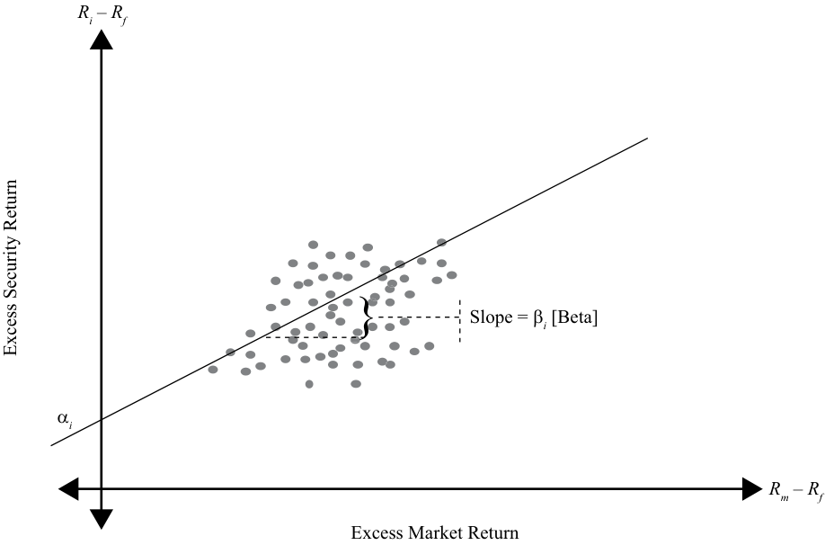

<!-- Picture Text: Ri  –  Rf Slope = β i  [Beta] α i Rm  –  Rf Excess Market Return Excess Security Return  -->

> **Chú thích hình ảnh:** Trục tung: Tỷ suất sinh lợi vượt trội của chứng khoán $R_i - R_f$ (*Excess Security Return*); Trục hoành: Tỷ suất sinh lợi vượt trội của thị trường $R_m - R_f$ (*Excess Market Return*). Đường đặc trưng chứng khoán ($\text{SCL}$) cắt trục tung tại $\alpha_i$ và có độ dốc $\text{Slope} = \beta_i$ [Beta].

### **Lựa chọn Chứng khoán (*Security Selection*)** 

Khi thảo luận về CAPM, chúng ta đã giả định rằng các nhà đầu tư có kỳ vọng đồng nhất (*homogeneous expectations*) và là những nhà đầu tư có lý trí, ngại rủi ro, luôn tối đa hóa mức hữu dụng. Với những giả định này, chúng ta đã có thể khẳng định rằng tất cả các nhà đầu tư đều gán cùng một giá trị cho tất cả các tài sản và do đó, có cùng một danh mục rủi ro tối ưu duy nhất, chính là danh mục thị trường. Nói cách khác, chúng ta đã giả định rằng có sự đồng thuận chung trong niềm tin về dòng tiền 

<!-- PDF Page 112 -->

tương lai của một tài sản và tỷ suất sinh lợi yêu cầu. Khi biết tỷ suất sinh lợi yêu cầu, chúng ta có thể chiết khấu các dòng tiền tương lai của tài sản để đi đến giá trị hiện tại, hay mức giá của nó, vốn được sự đồng thuận của tất cả hoặc hầu hết các nhà đầu tư. 

Trong phần này, chúng ta đưa vào tính không đồng nhất (*heterogeneity*) trong niềm tin của các nhà đầu tư. Bởi vì các nhà đầu tư là những người chấp nhận giá (*price takers*), người ta giả định rằng sự không đồng nhất như vậy không làm ảnh hưởng đáng kể đến giá thị trường của một tài sản. Sự khác biệt trong niềm tin có thể liên quan đến các dòng tiền tương lai, rủi ro hệ thống của tài sản, hoặc cả hai. Bởi vì giá hiện tại của một tài sản là giá trị chiết khấu của các dòng tiền tương lai, sự khác biệt trong niềm tin có thể dẫn đến một mức giá do nhà đầu tư ước tính (*investor-estimated price*) khác với mức giá được tính theo CAPM (*CAPM-calculated price*). Mức giá tính theo CAPM chính là giá thị trường hiện tại bởi vì nó phản ánh niềm tin của tất cả các nhà đầu tư khác trên thị trường. Nếu mức giá hiện tại do nhà đầu tư ước tính cao hơn (thấp hơn) giá thị trường, tài sản đó được coi là đang bị định giá thấp – *undervalued* (định giá quá cao – *overvalued*). Do đó, CAPM là một công cụ hiệu quả để xác định xem một tài sản đang bị định giá thấp hay định giá quá cao và liệu nhà đầu tư nên mua hay bán tài sản đó. 

Mặc dù việc đánh giá hiệu quả hoạt động của danh mục đầu tư là nhìn về quá khứ (*backward looking*) còn việc lựa chọn chứng khoán là hướng tới tương lai (*forward looking*), chúng ta vẫn có thể áp dụng các khái niệm của đánh giá danh mục đầu tư vào việc lựa chọn chứng khoán. Thước đo tốt nhất để áp dụng là alpha của Jensen bởi vì nó sử dụng rủi ro hệ thống và có ý nghĩa ngay cả trên cơ sở tuyệt đối. Một hệ số alpha của Jensen dương cho biết một chứng khoán ưu việt, trong khi một hệ số alpha của Jensen âm cho biết một chứng khoán có khả năng hoạt động kém hơn thị trường khi đã điều chỉnh theo rủi ro. 

Một cách khác để trình bày cùng thông tin đó là sử dụng đường thị trường chứng khoán (SML). Các nhà đầu tư tiềm năng có thể biểu diễn tỷ suất sinh lợi kỳ vọng (ước tính) và hệ số beta của một chứng khoán lên đồ thị cùng với đường SML và sử dụng mối quan hệ này để quyết định xem chứng khoán đó đang bị định giá quá cao hay định giá thấp trên thị trường.$^6$ Bảng minh họa 12 hiển thị một số chứng khoán cùng với đường SML. Tất cả các chứng khoán phản ánh quan điểm đồng thuận của thị trường đều là các điểm nằm ngay trên đường SML (tức là được định giá hợp lý – *properly valued*). Nếu một điểm đại diện cho tỷ suất sinh lợi ước tính của một tài sản nằm phía trên đường SML (Điểm A và Điểm C), tài sản đó có mức rủi ro thấp tương ứng với lượng tỷ suất sinh lợi kỳ vọng và sẽ là một lựa chọn tốt để đầu tư (tức đang bị định giá thấp – *undervalued*). Ngược lại, nếu điểm đại diện cho một tài sản cụ thể nằm phía dưới đường SML (Điểm B), cổ phiếu đó được coi là bị định giá quá cao (*overvalued*). Tỷ suất sinh lợi của nó không đền bù xứng đáng cho mức độ rủi ro và không nên được xem xét để đầu tư mua vào. Tất nhiên, có thể thực hiện một vị thế bán (*short position*) đối với Tài sản B nếu việc bán khống được cho phép. 

> 6 Trong bài đọc này, chúng ta không xem xét đến chi phí giao dịch, vốn là yếu tố quan trọng bất cứ khi nào những sự chệch hướng khỏi danh mục thụ động được cân nhắc. Do đó, độ lớn của mức định giá thấp hay định giá quá cao cần được xem xét trong mối tương quan với chi phí giao dịch trước khi đưa ra quyết định đầu tư. 

<!-- PDF Page 113 -->

##### **Bảng minh họa 12: Lựa chọn Chứng khoán Sử dụng Đường SML (*Exhibit 12: Security Selection Using SML*)** 

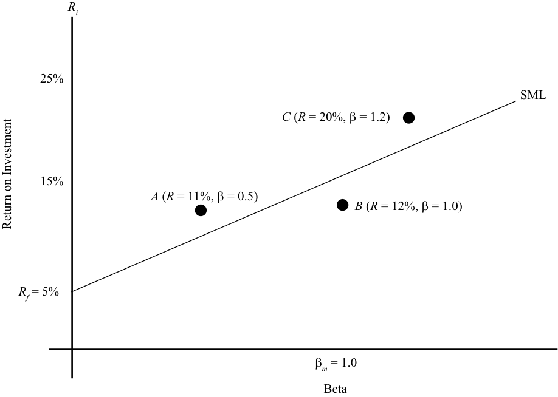

<!-- Picture Text: Ri 25% SML C  ( R  = 20%, β = 1.2) 15% A  ( R  = 11%, β = 0.5) B  ( R  = 12%, β = 1.0) Rf  = 5% β m  = 1.0 Beta Return on Investment  -->

> **Chú thích hình ảnh:** Trục tung: Tỷ suất sinh lợi đầu tư $R_i$ (*Return on Investment*); Trục hoành: Hệ số Beta (*Beta*). Đường $\text{SML}$ bắt đầu từ $R_f = 5\%$ và đi qua $(\beta_m = 1.0, 15\%)$. Điểm $A$ ($R = 11\%, \beta = 0.5$) và Điểm $C$ ($R = 20\%, \beta = 1.2$) nằm phía trên đường SML (định giá thấp); Điểm $B$ ($R = 12\%, \beta = 1.0$) nằm phía dưới đường SML (định giá quá cao).

### **Các Hàm ý của Mô hình CAPM đối với việc Xây dựng Danh mục Đầu tư (*Implications of the CAPM for Portfolio Construction*)** 

Dựa trên mô hình CAPM, các nhà đầu tư nên nắm giữ một sự kết hợp giữa tài sản phi rủi ro và danh mục thị trường. Danh mục thị trường thực sự bao gồm một số lượng lớn các chứng khoán, và một nhà đầu tư sẽ phải sở hữu tất cả chúng để được đa dạng hóa hoàn toàn. Bởi vì việc sở hữu tất cả các chứng khoán hiện có là điều không thực tế, trong phần này, chúng ta sẽ xem xét một phương pháp thay thế để xây dựng một danh mục đầu tư có thể không đòi hỏi một số lượng lớn chứng khoán nhưng vẫn được đa dạng hóa đầy đủ. Bảng minh họa 13 cho thấy mức giảm thiểu rủi ro khi chúng ta thêm ngày càng nhiều chứng khoán vào một danh mục đầu tư. Như có thể thấy từ bảng minh họa, phần lớn rủi ro phi hệ thống có thể được triệt tiêu qua đa dạng hóa chỉ với khoảng 30 chứng khoán. Tuy nhiên, các chứng khoán này phải được lựa chọn ngẫu nhiên và đại diện cho các loại tài sản khác nhau thì danh mục đầu tư mới đa dạng hóa rủi ro một cách hiệu quả. Nếu không, nhà đầu tư có lẽ sẽ tốt hơn nếu sử dụng một chỉ số (ví dụ: S&P 500 cho một danh mục cổ phiếu vốn hóa lớn được đa dạng hóa và các chỉ số khác cho các loại tài sản khác). 

<!-- PDF Page 114 -->

##### **Bảng minh họa 13: Đa dạng hóa theo Số lượng Cổ phiếu (*Exhibit 13: Diversification with Number of Stocks*)** 

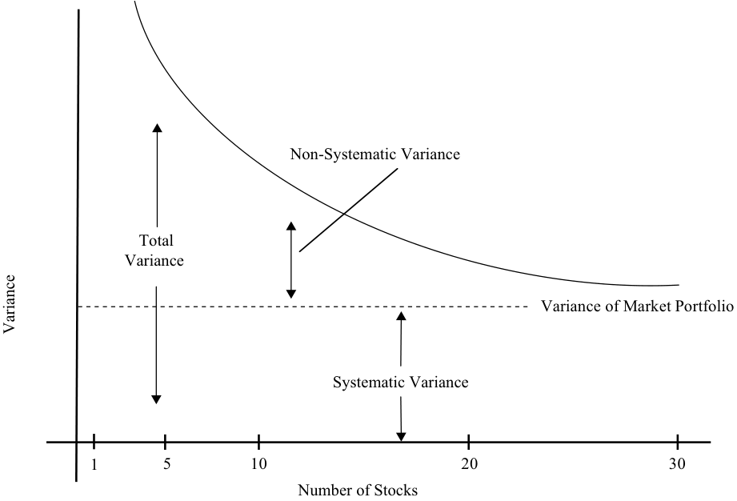

<!-- Picture Text: Non-Systematic Variance Total Variance Variance of Market Portfolio Systematic Variance 1 5 10 20 30 Number of Stocks Variance  -->

> **Chú thích hình ảnh:** Trục tung: Phương sai (*Variance*); Trục hoành: Số lượng cổ phiếu (*Number of Stocks*: $1, 5, 10, 20, 30$). Tổng phương sai (*Total Variance*) bằng tổng của Phương sai hệ thống (*Systematic Variance* – không đổi ở mức Phương sai của danh mục thị trường *Variance of Market Portfolio*) và Phương sai phi hệ thống (*Non-Systematic Variance* – giảm nhanh về gần $0$ khi số lượng cổ phiếu tiến tới $30$).

Hãy bắt đầu xây dựng danh mục đầu tư tối ưu với một danh mục chứng khoán như S&P 500. Mặc dù S&P 500 là một danh mục gồm 500 chứng khoán, nhưng nó là một điểm khởi đầu tốt bởi vì nó luôn sẵn có như một chứng khoán đơn lẻ để giao dịch. Ngược lại, nó chỉ đại diện cho các tập đoàn lớn được giao dịch trên các thị trường chứng khoán Hoa Kỳ và do đó, không bao hàm toàn bộ thị trường toàn cầu. Tuy nhiên, bởi vì S&P 500 là danh mục cơ sở (*base portfolio*), chúng ta coi nó như là thị trường cho mô hình CAPM. 

Bất kỳ chứng khoán nào không nằm trong S&P 500 đều có thể được đánh giá để xác định xem liệu nó có nên được tích hợp vào danh mục đầu tư hay không. Quyết định đó dựa trên hệ số $\alpha_i$ của chứng khoán, được tính toán bằng cách sử dụng CAPM với S&P 500 đóng vai trò là danh mục thị trường. Lưu ý rằng chứng khoán $i$ không nhất thiết phải bị định giá sai thì mới có hệ số $\alpha_i$ khác không; $\alpha_i$ có thể dương đơn giản chỉ vì nó không có độ tương quan cao với S&P 500 và tỷ suất sinh lợi của nó đủ lớn so với lượng rủi ro hệ thống mà nó chứa đựng. Ví dụ, giả sử một thị trường chứng khoán mới, ABC, chỉ mở cửa cho các nhà đầu tư nước ngoài và đang được xem xét để đưa vào danh mục đầu tư. Chúng ta ước lượng các tham số mô hình của ABC trong mối tương quan với S&P 500 và tìm thấy $\alpha_i$ xấp xỉ 3%, với $\beta_i$ là 0.60. Bởi vì $\alpha_i$ dương, ABC nên được thêm vào danh mục đầu tư. Các chứng khoán có hệ số $\alpha_i$ âm đáng kể có thể được bán khống để tối đa hóa tỷ suất sinh lợi điều chỉnh theo rủi ro. Tuy nhiên, để thuận tiện, chúng ta sẽ giả định rằng các vị thế âm không được phép thực hiện trong danh mục đầu tư. 

Bên cạnh các chứng khoán được định giá đúng nhưng được đưa vào danh mục nhờ sự vượt trội về rủi ro – tỷ suất sinh lợi của chúng, các chứng khoán đã có sẵn trong danh mục (S&P 500) có thể đang bị định giá thấp hoặc định giá quá cao dựa trên những kỳ vọng của nhà đầu tư không trùng khớp với thị trường. Các chứng khoán trong S&P 500 đang bị định giá quá cao ($\alpha_i$ âm) nên được loại bỏ khỏi danh mục S&P 500, nếu có thể loại trừ từng chứng khoán riêng lẻ, và vị thế ở các chứng khoán trong S&P 500 đang bị định giá thấp ($\alpha_i$ dương) nên được gia tăng. 

Điều này đưa chúng ta đến câu hỏi tiếp theo: Tỷ trọng tương đối (*relative weight*) của các chứng khoán trong danh mục đầu tư nên là bao nhiêu? Bởi vì chúng ta quan tâm đến việc tối đa hóa tỷ suất sinh lợi điều chỉnh theo rủi ro, các chứng khoán có $\alpha_i$ cao hơn nên có tỷ trọng cao hơn, và các chứng khoán có rủi ro phi hệ thống lớn hơn nên được phân bổ tỷ trọng ít hơn trong danh mục. Một phân tích hoàn chỉnh về tối ưu hóa danh mục đầu tư nằm ngoài phạm vi của bài đọc này, nhưng các nguyên tắc sau đây 

<!-- PDF Page 115 -->

sẽ rất hữu ích. Tỷ trọng ở mỗi chứng khoán ngoài thị trường (*nonmarket security*) phải tỷ lệ thuận với $\frac{\alpha_i}{\sigma_{ei}^2}$, trong đó mẫu số là phương sai phi hệ thống của chứng khoán $i$. Tổng tỷ trọng của các chứng khoán ngoài thị trường trong danh mục đầu tư tỷ lệ thuận với: 

$$\frac{\sum_{i=1}^{N} w_i \alpha_i}{\sum_{i=1}^{N} w_i^2 \sigma_{ei}^2}$$

Tỷ trọng trong danh mục thị trường là một hàm số của: 

$$\frac{E(R_m)}{\sigma_m^2}$$

Tỷ số thông tin (*information ratio*), $\frac{\alpha_i}{\sigma_{ei}}$ (tức là alpha chia cho rủi ro phi hệ thống), đo lường tỷ suất sinh lợi bất thường trên mỗi đơn vị rủi ro tăng thêm do chứng khoán đó đóng góp vào một danh mục đã được đa dạng hóa tốt. Tỷ số thông tin càng lớn thì chứng khoán đó càng có giá trị. 

##### **VÍ DỤ 11 (*EXAMPLE 11*)** 

### **Danh mục Đầu tư Tối ưu của Nhà đầu tư với Niềm tin Không Đồng nhất (*Optimal Investor Portfolio with Heterogeneous Beliefs*)** 

Một nhà đầu tư Nhật Bản đang nắm giữ chỉ số Nikkei 225, đây là phiên bản danh mục thị trường của cô ấy. Cô cho rằng ba cổ phiếu P, Q và R, vốn không nằm trong chỉ số Nikkei 225, đang bị định giá thấp và nên trở thành một phần trong danh mục đầu tư của mình. Cô có các thông tin sau đây về các cổ phiếu này, chỉ số Nikkei 225 và lãi suất phi rủi ro (thông tin được cho theo thứ tự: tỷ suất sinh lợi kỳ vọng, độ lệch chuẩn và hệ số beta): 

- P: 15%, 30%, 1.5 
- Q: 18%, 25%, 1.2 
- R: 16%, 23%, 1.1 
- Nikkei 225: 12%, 18%, 1.0 
- Lãi suất phi rủi ro: 2%, 0%, 0.0 

1. Hãy tính alpha của Jensen cho P, Q và R. 

### **Lời giải (*Solution*):** 

- Alpha ($\alpha$) của Cổ phiếu P: $R_i - [R_f + \beta_i (R_m - R_f)] = 0.15 - (0.02 + 1.5 \times 0.10) = -0.02$ 
- Alpha ($\alpha$) của Cổ phiếu Q: $R_i - [R_f + \beta_i (R_m - R_f)] = 0.18 - (0.02 + 1.2 \times 0.10) = 0.04$ 
- Alpha ($\alpha$) của Cổ phiếu R: $R_i - [R_f + \beta_i (R_m - R_f)] = 0.16 - (0.02 + 1.1 \times 0.10) = 0.03$ 

2. Hãy tính phương sai phi hệ thống (*nonsystematic variance*) cho P, Q và R. 

### **Lời giải (*Solution*):** 

Tổng phương sai $=$ Phương sai hệ thống $+$ Phương sai phi hệ thống. Từ Phần 3.2.2, chúng ta viết phương trình dưới dạng $\sigma_{ei}^2 = \sigma_i^2 - \beta_i^2 \sigma_m^2$. 

Phương sai phi hệ thống của Cổ phiếu P $= (0.30 \times 0.30) - (1.5 \times 1.5 \times 0.18 \times 0.18) = 0.09 - 0.0729$ 

---

# Tập 9: Quản lý Danh mục Đầu tư (*Volume 9: Portfolio Management*)
## Học phần 2: Rủi ro và Tỷ suất sinh lợi của Danh mục Đầu tư: Phần II (*Learning Module 2: Portfolio Risk and Return: Part II*)
### Phần 4/4: Tóm tắt & Bài tập Thực hành (*Summary & Practice Problems*) (Trang PDF 116–130)

---

<!-- PDF Page 116 -->

#### $= 0.0171$ 

Phương sai phi hệ thống của Cổ phiếu Q $= (0.25 \times 0.25) - (1.2 \times 1.2 \times 0.18 \times 0.18) = 0.0625 - 0.0467$ 

$= 0.0158$ 

Phương sai phi hệ thống của Cổ phiếu R $= (0.23 \times 0.23) - (1.1 \times 1.1 \times 0.18 \times 0.18) = 0.0529 - 0.0392$ 

$= 0.0137$ 

3. Có cổ phiếu nào trong ba cổ phiếu trên nên được đưa vào danh mục đầu tư không? Nếu có, cổ phiếu nào nên có tỷ trọng cao nhất trong danh mục đầu tư? 

### **Lời giải (*Solution*):** 

Cổ phiếu P có hệ số $\alpha$ âm và không nên được đưa vào danh mục đầu tư, trừ khi có thể thực hiện một vị thế âm thông qua hoạt động bán khống (*short selling*). Cổ phiếu Q và R có hệ số $\alpha$ dương; do đó, chúng nên được đưa vào danh mục đầu tư với tỷ trọng dương. 

Tỷ trọng tương đối của Q là $0.04 / 0.0158 = 2.53$. 

Tỷ trọng tương đối của R là $0.03 / 0.0137 = 2.19$. 

Cổ phiếu Q sẽ có tỷ trọng lớn nhất trong số các chứng khoán ngoài thị trường (*nonmarket securities*) được thêm vào danh mục đầu tư. Xét về mặt tương đối, tỷ trọng của Q sẽ lớn hơn 15.5% so với tỷ trọng của R ($2.53 / 2.19 = 1.155$). Khi số lượng chứng khoán tăng lên, việc phân tích sẽ trở nên phức tạp hơn. Tuy nhiên, sự đóng góp của mỗi chứng khoán tăng thêm vào việc cải thiện sự đánh đổi rủi ro – tỷ suất sinh lợi (*risk–return tradeoff*) sẽ giảm dần và cuối cùng biến mất, mang lại kết quả là một danh mục đầu tư đã được đa dạng hóa tốt. 

# **TÓM TẮT (*SUMMARY*)** 

Trong bài đọc này, chúng ta đã thảo luận chi tiết về mô hình định giá tài sản vốn (CAPM) và đề cập đến các chủ đề liên quan như đường thị trường vốn (CML). Bài đọc bắt đầu bằng cách diễn giải đường CML, công dụng của danh mục thị trường như một chiến lược quản lý thụ động, và việc sử dụng đòn bẩy đối với danh mục thị trường để đạt được tỷ suất sinh lợi kỳ vọng cao hơn. Tiếp theo, chúng ta đã thảo luận về rủi ro hệ thống và rủi ro phi hệ thống cũng như lý do tại sao một nhà đầu tư không nên kỳ vọng được đền bù khi gánh chịu rủi ro phi hệ thống. Phần thảo luận về rủi ro hệ thống và rủi ro phi hệ thống được nối tiếp bằng phần giới thiệu về hệ số beta và các mô hình tạo tỷ suất sinh lợi. Chủ đề rộng lớn này sau đó được chia nhỏ thành cuộc thảo luận về CAPM và, cụ thể hơn, mối quan hệ giữa hệ số beta và tỷ suất sinh lợi kỳ vọng. Phần cuối cùng bao gồm các ứng dụng của CAPM vào hoạch định ngân sách vốn, đánh giá hiệu quả hoạt động của danh mục đầu tư, và lựa chọn chứng khoán. Những điểm nổi bật của bài đọc như sau: 

- Đường thị trường vốn (*capital market line* – CML) là một trường hợp đặc biệt của đường phân bổ vốn (*capital allocation line* – CAL), trong đó danh mục hiệu quả chính là danh mục thị trường (*market portfolio*). 

- Việc thu được một danh mục rủi ro tối ưu duy nhất là không thể nếu các nhà đầu tư được phép có những niềm tin không đồng nhất (*heterogeneous beliefs*) bởi vì những niềm tin như vậy sẽ dẫn đến các mức giá tài sản không đồng nhất. 

<!-- PDF Page 117 -->

- Các nhà đầu tư có thể sử dụng đòn bẩy (*leverage*) cho danh mục đầu tư của mình bằng cách vay tiền và đầu tư vào thị trường. 

- Rủi ro hệ thống (*systematic risk*) là rủi ro ảnh hưởng đến toàn bộ thị trường hoặc nền kinh tế và không thể đa dạng hóa được (*not diversifiable*). 

- Rủi ro phi hệ thống (*nonsystematic risk*) mang tính cục bộ và có thể được triệt tiêu thông qua đa dạng hóa bằng cách kết hợp các tài sản có độ tương quan thấp. 

- Rủi ro beta (*beta risk*), hay rủi ro hệ thống, được định giá (*is priced*) và mang lại tỷ suất sinh lợi, trong khi rủi ro phi hệ thống không được định giá. 

- Tỷ suất sinh lợi kỳ vọng của một tài sản phụ thuộc vào rủi ro beta của nó và có thể được tính toán bằng cách sử dụng mô hình CAPM, được cho bởi công thức $E(R_i) = R_f + \beta_i [E(R_m) - R_f]$. 

- Đường thị trường chứng khoán (*security market line* – SML) là một sự triển khai của CAPM và áp dụng cho tất cả các chứng khoán, bất kể chúng có hiệu quả hay không. 

- Tỷ suất sinh lợi kỳ vọng từ CAPM có thể được sử dụng để đưa ra các quyết định hoạch định ngân sách vốn (*capital budgeting decisions*). 

- Các danh mục đầu tư có thể được đánh giá bằng một số thước đo dựa trên CAPM, chẳng hạn như tỷ số Sharpe (*Sharpe ratio*), tỷ số Treynor (*Treynor ratio*), $M^2$, và alpha của Jensen (*Jensen’s alpha*). 

- Đường SML có thể hỗ trợ trong việc lựa chọn chứng khoán (*security selection*) và xây dựng danh mục đầu tư tối ưu (*optimal portfolio construction*). 

Bằng việc nắm vững nội dung của bài đọc này, bạn sẽ cảm thấy tự tin khi phân rã tổng phương sai thành phương sai hệ thống và phương sai phi hệ thống, phân tích rủi ro beta, sử dụng mô hình CAPM, cũng như đánh giá các danh mục đầu tư và từng chứng khoán riêng lẻ. 

<!-- PDF Page 118 -->

# **TÀI LIỆU THAM KHẢO (*REFERENCES*)** 

- Carhart, Mark. 1997. “On Persistence in Mutual Fund Performance.” _Journal of Finance_, vol. 52, no. 1: 57–82. 10.2307/2329556 

- Fama, Eugene và Kenneth French. 1992. “The Cross-Section of Expected Stock Returns.” _Journal of Finance_, vol. 47, no. 2: 427–466. 10.2307/2329112 

<!-- PDF Page 119 -->

# **BÀI TẬP THỰC HÀNH (*PRACTICE PROBLEMS*)** 

**1.** Đường biểu diễn tổng rủi ro và tỷ suất sinh lợi kỳ vọng của các tổ hợp danh mục đầu tư gồm một tài sản phi rủi ro và bất kỳ tài sản rủi ro nào là: 

   - **A.** đường thị trường chứng khoán (*security market line*). 

   - **B.** đường phân bổ vốn (*capital allocation line*). 

   - **C.** đường đặc trưng chứng khoán (*security characteristic line*). 

**2.** Danh mục đầu tư gồm một tài sản phi rủi ro và một tài sản rủi ro có sự đánh đổi rủi ro – tỷ suất sinh lợi tốt hơn so với việc chỉ đầu tư vào một loại tài sản duy nhất bởi vì hệ số tương quan giữa tài sản phi rủi ro và tài sản rủi ro bằng: 

   - **A.** $-1.0$. 

   - **B.** $0.0$. 

   - **C.** $1.0$. 

**3.** Theo lý thuyết thị trường vốn, danh mục đầu tư tối ưu của một nhà đầu tư là sự kết hợp giữa một tài sản phi rủi ro và một tài sản rủi ro có: 

   - **A.** tỷ suất sinh lợi kỳ vọng cao nhất. 

   - **B.** đường bàng quan (*indifference curve*) cao nhất. 

   - **C.** độ dốc đường phân bổ vốn cao nhất. 

**4.** Những nhà đầu tư rất ngại rủi ro (*highly risk-averse investors*) _nhiều khả năng nhất_ sẽ đầu tư phần lớn tài sản của họ vào: 

   - **A.** các tài sản rủi ro. 

   - **B.** các tài sản phi rủi ro. 

   - **C.** danh mục rủi ro tối ưu. 

**5.** Đường thị trường vốn (CML) là đồ thị biểu diễn rủi ro và tỷ suất sinh lợi của các tổ hợp danh mục đầu tư bao gồm tài sản phi rủi ro và: 

   - **A.** bất kỳ danh mục rủi ro nào. 

   - **B.** danh mục thị trường (*the market portfolio*). 

   - **C.** danh mục sử dụng đòn bẩy (*the leveraged portfolio*). 

**6.** Phát biểu nào sau đây định nghĩa _chính xác nhất_ về danh mục thị trường trong lý thuyết thị trường vốn? Danh mục thị trường bao gồm tất cả: 

   - **A.** các tài sản rủi ro (*risky assets*). 

   - **B.** các tài sản có thể giao dịch (*tradable assets*). 

   - **C.** các tài sản có thể đầu tư (*investable assets*). 

**7.** Theo lý thuyết thị trường vốn, danh mục rủi ro tối ưu: 

   - **A.** là danh mục thị trường (*is the market portfolio*). 

<!-- PDF Page 120 -->

|**B.** có tỷ suất sinh lợi kỳ vọng cao nhất. **C.** có phương sai kỳ vọng thấp nhất.|
|---|
|**8.** So với các danh mục nằm trên đường CML, bất kỳ danh mục nào nằm phía trên đường CML đều được coi là:|
|**A.** kém ưu việt hơn (*inferior*).|
|**B.** không hiệu quả (*inefficient*).|
|**C.** không thể đạt được (*unachievable*).|
|**9.** Một danh mục nằm trên đường thị trường vốn (CML) có tỷ suất sinh lợi lớn hơn tỷ suất sinh lợi của danh mục thị trường đại diện cho một:|
|**A.** danh mục cho vay (*lending portfolio*).|
|**B.** danh mục đi vay (*borrowing portfolio*).|
|**C.** danh mục không thể đạt được (*unachievable portfolio*).|
|**10.** Liên quan đến đường thị trường vốn, một danh mục nằm trên đường CML có tỷ suất sinh lợi nhỏ hơn tỷ suất sinh lợi của danh mục thị trường đại diện cho một:|
|**A.** danh mục cho vay (*lending portfolio*).|
|**B.** danh mục đi vay (*borrowing portfolio*).|
|**C.** danh mục không thể đạt được (*unachievable portfolio*).|
|**11.** Loại rủi ro nào sau đây _nhiều khả năng nhất_ có thể tránh được bằng cách hình thành một danh mục đầu tư đa dạng hóa?|
|**A.** Tổng rủi ro (*Total risk*).|
|**B.** Rủi ro hệ thống (*Systematic risk*).|
|**C.** Rủi ro phi hệ thống (*Nonsystematic risk*).|
|**12.** Sự kiện nào sau đây _nhiều khả năng nhất_ là một ví dụ về rủi ro phi hệ thống?|
|**A.** Lãi suất sụt giảm.|
|**B.** Giám đốc điều hành (CEO) từ chức.|
|**C.** Giá trị của đồng đô la Mỹ tăng lên.|
|**13.** Liên quan đến việc định giá rủi ro trong lý thuyết thị trường vốn, phát biểu nào sau đây là _chính xác nhất_?|
|**A.** Tất cả rủi ro đều được định giá.|
|**B.** Rủi ro hệ thống được định giá (*Systematic risk is priced*).|
|**C.** Rủi ro phi hệ thống được định giá.|
|**14.** Tổng của phương sai hệ thống và phương sai phi hệ thống của tỷ suất sinh lợi của một tài sản bằng với ... của tài sản đó: **A.** hệ số beta.|

<!-- PDF Page 121 -->

- **B.** tổng rủi ro (*total risk*). 

- **C.** tổng phương sai (*total variance*). 

## **Thông tin sau đây liên quan đến các câu hỏi 15–17** 

Một nhà phân tích thu thập các thông tin sau: 

|**Chứng khoán (*Security*)**|**Tỷ suất sinh lợi Hàng năm Kỳ vọng (*Expected Annual Return*) (%)**|**Độ lệch chuẩn Kỳ vọng (*Expected Standard Deviation*) (%)**|**Hệ số tương quan giữa Chứng khoán và Thị trường (*Correlation between Security and the Market*)**|
|---|---|---|---|
|Chứng khoán 1|11|25|0.6|
|Chứng khoán 2|11|20|0.7|
|Chứng khoán 3|14|20|0.8|
|Thị trường (*Market*)|10|15|1.0|

**15.** Chứng khoán nào có tổng rủi ro _cao nhất_? 

   - **A.** Chứng khoán 1. 

   - **B.** Chứng khoán 2. 

   - **C.** Chứng khoán 3. 

**16.** Chứng khoán nào có thước đo hệ số beta _cao nhất_? 

   - **A.** Chứng khoán 1. 

   - **B.** Chứng khoán 2. 

   - **C.** Chứng khoán 3. 

**17.** Chứng khoán nào có lượng rủi ro thị trường (*market risk*) _ít nhất_? 

   - **A.** Chứng khoán 1. 

   - **B.** Chứng khoán 2. 

   - **C.** Chứng khoán 3. 

**18.** Liên quan đến các mô hình tạo tỷ suất sinh lợi, số hạng hệ số chặn (*intercept term*) của mô hình thị trường là ... ước lượng của tài sản: 

   - **A.** hệ số beta. 

   - **B.** hệ số alpha. 

   - **C.** phương sai. 

**19.** Liên quan đến các mô hình tạo tỷ suất sinh lợi, số hạng hệ số góc (*slope term*) của mô hình thị trường là một ước lượng về ... của tài sản: 

   - **A.** tổng rủi ro. 

<!-- PDF Page 122 -->

   - **B.** rủi ro hệ thống (*systematic risk*). 

   - **C.** rủi ro phi hệ thống. 

**20.** Liên quan đến các mô hình tạo tỷ suất sinh lợi, phát biểu nào sau đây là _chính xác nhất_? Các mô hình tạo tỷ suất sinh lợi được sử dụng để ước tính trực tiếp: 

   - **A.** tỷ suất sinh lợi kỳ vọng của một chứng khoán. 

   - **B.** tỷ trọng của các chứng khoán trong một danh mục đầu tư. 

   - **C.** các tham số của đường thị trường vốn. 

**21.** Theo lý thuyết thị trường vốn, hệ số beta trung bình của tất cả các tài sản trên thị trường là: 

   - **A.** nhỏ hơn 1.0. 

   - **B.** bằng 1.0. 

   - **C.** lớn hơn 1.0. 

**22.** Liên quan đến mô hình định giá tài sản vốn (CAPM), yếu tố quyết định chính đối với tỷ suất sinh lợi kỳ vọng của một tài sản riêng lẻ là: 

   - **A.** hệ số beta của tài sản (*asset’s beta*). 

   - **B.** phần bù rủi ro thị trường. 

   - **C.** độ lệch chuẩn của tài sản. 

**23.** Liên quan đến mô hình định giá tài sản vốn (CAPM), giá trị beta nào sau đây của một tài sản _nhiều khả năng nhất_ sẽ dẫn đến tỷ suất sinh lợi kỳ vọng cho tài sản đó thấp hơn lãi suất phi rủi ro? 

   - **A.** $-0.5$ 

   - **B.** $0.0$ 

   - **C.** $0.5$ 

**24.** Liên quan đến mô hình định giá tài sản vốn (CAPM), phần bù rủi ro thị trường (*market risk premium*): 

   - **A.** nhỏ hơn tỷ suất sinh lợi vượt trội của thị trường (*excess market return*). 

   - **B.** bằng với tỷ suất sinh lợi vượt trội của thị trường. 

   - **C.** lớn hơn tỷ suất sinh lợi vượt trội của thị trường. 

**25.** Đồ thị của mô hình định giá tài sản vốn (CAPM) là: 

   - **A.** đường thị trường vốn (*capital market line*). 

   - **B.** đường thị trường chứng khoán (*security market line*). 

   - **C.** đường đặc trưng chứng khoán (*security characteristic line*). 

**26.** Theo lý thuyết thị trường vốn, các tài sản riêng lẻ được định giá đúng (*correctly priced*) có thể được biểu diễn trên: 

   - **A.** đường thị trường vốn. 

<!-- PDF Page 123 -->

   - **B.** đường thị trường chứng khoán (*security market line*). 

   - **C.** đường phân bổ vốn. 

## **Thông tin sau đây liên quan đến các câu hỏi 27–30** 

Một nhà phân tích thu thập các thông tin sau: 

|**Chứng khoán (*Security*)**|**Độ lệch chuẩn Kỳ vọng (*Expected Standard Deviation*) (%)**|**Hệ số Beta (*Beta*)**|
|---|---|---|
|Chứng khoán 1|25|1.50|
|Chứng khoán 2|15|1.40|
|Chứng khoán 3|20|1.60|

**27.** Liên quan đến mô hình định giá tài sản vốn (CAPM), nếu phần bù rủi ro thị trường kỳ vọng là 6% và lãi suất phi rủi ro là 3%, tỷ suất sinh lợi kỳ vọng của Chứng khoán 1 _gần nhất_ với: 

   - **A.** 9.0%. 

   - **B.** 12.0%. 

   - **C.** 13.5%. 

**28.** Liên quan đến mô hình định giá tài sản vốn (CAPM), nếu tỷ suất sinh lợi kỳ vọng của Chứng khoán 2 bằng 11.4% và lãi suất phi rủi ro là 3%, tỷ suất sinh lợi kỳ vọng của thị trường _gần nhất_ với: 

   - **A.** 8.4%. 

   - **B.** 9.0%. 

   - **C.** 10.3%. 

**29.** Liên quan đến mô hình định giá tài sản vốn (CAPM), nếu phần bù rủi ro thị trường kỳ vọng là 6% thì chứng khoán có tỷ suất sinh lợi kỳ vọng _cao nhất_ là: 

   - **A.** Chứng khoán 1. 

   - **B.** Chứng khoán 2. 

   - **C.** Chứng khoán 3. 

**30.** Liên quan đến mô hình định giá tài sản vốn (CAPM), sự sụt giảm trong tỷ suất sinh lợi kỳ vọng của thị trường sẽ có tác động _lớn nhất_ đến tỷ suất sinh lợi kỳ vọng của: 

   - **A.** Chứng khoán 1. 

   - **B.** Chứng khoán 2. 

   - **C.** Chứng khoán 3. 

<!-- PDF Page 124 -->

**31.** Theo lý thuyết thị trường vốn, phát biểu nào sau đây mô tả _đúng nhất_ tác động của giả định về tính đồng nhất (*homogeneity assumption*)? Bởi vì tất cả các nhà đầu tư đều có cùng kỳ vọng kinh tế về các dòng tiền tương lai cho tất cả các tài sản, các nhà đầu tư sẽ đầu tư vào: 

   - **A.** cùng một danh mục rủi ro tối ưu (*the same optimal risky portfolio*). 

   - **B.** Chỉ số Standard and Poor’s 500. 

   - **C.** các tài sản có cùng một mức rủi ro. 

**32.** Theo lý thuyết thị trường vốn, giả định nào sau đây cho phép sự tồn tại của danh mục thị trường? Tất cả các nhà đầu tư: 

   - **A.** là những người chấp nhận giá (*are price takers*). 

   - **B.** có kỳ vọng đồng nhất (*have homogeneous expectations*). 

   - **C.** lập kế hoạch cho cùng một kỳ nắm giữ duy nhất. 

**33.** Ba nhà quản lý quỹ cổ phiếu có hồ sơ hiệu quả hoạt động được tóm tắt trong bảng sau: 

||**Tỷ suất sinh lợi Hàng năm Trung bình (*Mean Annual Return*) (%)**|**Độ lệch chuẩn của Tỷ suất sinh lợi (*Standard Deviation of Return*) (%)**|
|---|---|---|
|Nhà quản lý 1|14.38|10.53|
|Nhà quản lý 2|9.25|6.35|
|Nhà quản lý 3|13.10|8.23|

Cho biết lãi suất phi rủi ro là 2.60%, nhà quản lý nào có hiệu quả hoạt động tốt nhất dựa trên tỷ số Sharpe? 

   - **A.** Nhà quản lý 1 

   - **B.** Nhà quản lý 2 

   - **C.** Nhà quản lý 3 

**34.** Thước đo hiệu quả hoạt động nào sau đây là nhất quán với mô hình CAPM? 

   - **A.** $M^2$. 

   - **B.** Tỷ số Sharpe (*Sharpe ratio*). 

   - **C.** Alpha của Jensen (*Jensen’s alpha*). 

**35.** Thước đo hiệu quả hoạt động nào sau đây _không_ đòi hỏi thước đo đó phải được đem so sánh với một giá trị khác? 

   - **A.** Tỷ số Sharpe. 

   - **B.** Tỷ số Treynor. 

   - **C.** Alpha của Jensen. 

**36.** Thước đo hiệu quả hoạt động nào sau đây là phù hợp _nhất_ đối với một nhà đầu tư _chưa_ được đa dạng hóa hoàn toàn? 

   - **A.** $M^2$. 

<!-- PDF Page 125 -->

   - **B.** Tỷ số Treynor. 

   - **C.** Alpha của Jensen. 

**37.** Độ dốc của đường đặc trưng chứng khoán (*security characteristic line*) là ... của một tài sản: 

   - **A.** hệ số beta. 

   - **B.** tỷ suất sinh lợi vượt trội. 

   - **C.** phần bù rủi ro. 

**38.** Các nhà phân tích ước tính tỷ suất sinh lợi của một tài sản lớn hơn tỷ suất sinh lợi kỳ vọng được tạo ra bởi mô hình định giá tài sản vốn (CAPM) nên coi tài sản đó là đang: 

   - **A.** bị định giá quá cao (*overvalued*). 

   - **B.** bị định giá thấp (*undervalued*). 

   - **C.** được định giá hợp lý (*properly valued*). 

**39.** Hệ số chặn (*intercept*) của đường thẳng phù hợp nhất (*best fit line*) được hình thành bằng cách vẽ đồ thị tỷ suất sinh lợi vượt trội của danh mục của nhà quản lý theo tỷ suất sinh lợi vượt trội của thị trường được mô tả _đúng nhất_ là ... của Jensen: 

   - **A.** hệ số beta. 

   - **B.** tỷ số. 

   - **C.** hệ số alpha. 

**40.** Các nhà quản lý danh mục đầu tư đang tối đa hóa tỷ suất sinh lợi điều chỉnh theo rủi ro sẽ tìm cách đầu tư _nhiều hơn_ vào các chứng khoán có: 

   - **A.** giá trị alpha của Jensen thấp hơn. 

   - **B.** giá trị alpha của Jensen bằng 0. 

   - **C.** giá trị alpha của Jensen cao hơn. 

**41.** Các nhà quản lý danh mục đầu tư đang tối đa hóa tỷ suất sinh lợi điều chỉnh theo rủi ro sẽ tìm cách đầu tư _ít hơn_ vào các chứng khoán có: 

   - **A.** giá trị phương sai phi hệ thống thấp hơn. 

   - **B.** giá trị phương sai phi hệ thống bằng 0. 

   - **C.** giá trị phương sai phi hệ thống cao hơn. 

<!-- PDF Page 126 -->

# **LỜI GIẢI (*SOLUTIONS*)** 

1. **B là đáp án đúng.** Đường phân bổ vốn (CAL) biểu diễn tỷ suất sinh lợi kỳ vọng và tổng rủi ro của các tổ hợp kết hợp giữa tài sản phi rủi ro và một tài sản rủi ro (hoặc một danh mục các tài sản rủi ro). 

2. **B là đáp án đúng.** Một danh mục gồm tài sản phi rủi ro và một tài sản rủi ro hoặc một danh mục các tài sản rủi ro có thể mang lại sự đánh đổi rủi ro – tỷ suất sinh lợi tốt hơn so với việc chỉ đầu tư vào một loại tài sản duy nhất, bởi vì tài sản phi rủi ro có hệ số tương quan bằng không ($0.0$) với tài sản rủi ro. 

3. **B là đáp án đúng.** Các nhà đầu tư sẽ có các danh mục đầu tư tối ưu khác nhau tùy thuộc vào các đường bàng quan (*indifference curves*) của họ. Danh mục tối ưu cho mỗi nhà đầu tư là danh mục mang lại mức hữu dụng (*utility*) cao nhất; tức là tại điểm mà đường CAL tiếp xúc với đường bàng quan cao nhất có thể đạt được của cá nhân nhà đầu tư đó. 

4. **B là đáp án đúng.** Mặc dù danh mục rủi ro tối ưu là danh mục thị trường, những nhà đầu tư rất ngại rủi ro vẫn chọn đầu tư phần lớn tài sản của họ vào tài sản phi rủi ro. 

5. **B là đáp án đúng.** Mặc dù đường phân bổ vốn bao gồm tất cả các tổ hợp kết hợp khả dĩ giữa tài sản phi rủi ro và bất kỳ danh mục rủi ro nào, đường thị trường vốn (CML) là một trường hợp đặc biệt của đường phân bổ vốn, sử dụng danh mục thị trường làm danh mục rủi ro tối ưu. 

6. **A là đáp án đúng.** Thị trường bao gồm tất cả các tài sản rủi ro, hay bất cứ thứ gì có giá trị; tuy nhiên, không phải tất cả các tài sản đều có thể giao dịch được, và không phải tất cả các tài sản có thể giao dịch đều có thể đầu tư được. 

7. **A là đáp án đúng.** Danh mục rủi ro tối ưu chính là danh mục thị trường. Lý thuyết thị trường vốn giả định rằng các nhà đầu tư có kỳ vọng đồng nhất (*homogeneous expectations*), có nghĩa là tất cả các nhà đầu tư đều phân tích chứng khoán theo cùng một cách và là những người có lý trí. Tức là, các nhà đầu tư sử dụng cùng các phân phối xác suất, sử dụng cùng các dữ liệu đầu vào cho dòng tiền tương lai, và đi đến cùng các mức định giá. Bởi vì định giá của họ đối với tất cả các tài sản là giống hệt nhau, tất cả các nhà đầu tư sẽ đầu tư vào cùng một danh mục rủi ro tối ưu (tức là danh mục thị trường). 

8. **C là đáp án đúng.** Về mặt lý thuyết, bất kỳ điểm nào nằm phía trên đường CML đều không thể đạt được (*unachievable*) và bất kỳ điểm nào nằm phía dưới đường CML đều bị lấn át và kém ưu việt hơn so với bất kỳ điểm nào nằm trên đường CML. 

9. **B là đáp án đúng.** Khi một người di chuyển càng xa về phía bên phải của điểm M trên đường thị trường vốn, một lượng tiền đi vay ngày càng lớn đang được đầu tư vào danh mục thị trường. Điều này có nghĩa là có khoản đầu tư âm vào tài sản phi rủi ro, được gọi là vị thế sử dụng đòn bẩy (*leveraged position*) trong danh mục rủi ro (tức danh mục đi vay – *borrowing portfolio*). 

10. **A là đáp án đúng.** Các tổ hợp kết hợp giữa tài sản phi rủi ro và danh mục thị trường nằm trên đường CML nơi tỷ suất sinh lợi nhỏ hơn tỷ suất sinh lợi của danh mục thị trường được gọi là các danh mục ‘cho vay’ (*‘lending’ portfolios*). 

11. **C là đáp án đúng.** Các nhà đầu tư có khả năng tránh được rủi ro phi hệ thống bằng cách hình thành một danh mục gồm các tài sản không có độ tương quan cao với nhau, qua đó làm giảm tổng rủi ro và chỉ còn chịu rủi ro hệ thống. 

12. **B là đáp án đúng.** Rủi ro phi hệ thống mang tính đặc thù đối với một công ty (như việc CEO từ chức), trong khi rủi ro hệ thống ảnh hưởng đến toàn bộ nền kinh tế. 

13. **B là đáp án đúng.** Chỉ có rủi ro hệ thống mới được định giá (*priced*). Các nhà đầu tư không nhận được bất kỳ tỷ suất sinh lợi nào cho việc chấp nhận rủi ro phi hệ thống hay rủi ro có thể đa dạng hóa. 

<!-- PDF Page 127 -->

14. **C là đáp án đúng.** Tổng của phương sai hệ thống và phương sai phi hệ thống bằng tổng phương sai (*total variance*) của tài sản. Các cách nói đề cập đến tổng rủi ro như là tổng của rủi ro hệ thống và rủi ro phi hệ thống thực chất là đang nói đến phương sai chứ không phải rủi ro (độ lệch chuẩn). 

15. **A là đáp án đúng.** Chứng khoán 1 có tổng rủi ro cao nhất $= 0.25$ (hay $25\%$) so với Chứng khoán 2 và Chứng khoán 3 có tổng rủi ro là $0.20$ (hay $20\%$). 

16. **C là đáp án đúng.** Chứng khoán 3 có giá trị beta cao nhất: 

$$\beta_3 = \frac{\rho_{3,m} \sigma_3}{\sigma_m} = \frac{(0.80)(20\%)}{15\%} = 1.07$$

so với Chứng khoán 1 và Chứng khoán 2 có giá trị beta lần lượt là $1.00$ và $0.93$. 

17. **B là đáp án đúng.** Chứng khoán 2 có giá trị beta thấp nhất: 

$$\beta_2 = \frac{\rho_{2,m} \sigma_2}{\sigma_m} = \frac{(0.70)(20\%)}{15\%} = 0.93$$

so với Chứng khoán 1 và 3 có giá trị beta lần lượt là $1.00$ và $1.07$. 

18. **B là đáp án đúng.** Trong mô hình thị trường, $R_i = \alpha_i + \beta_i R_m + e_i$, hệ số chặn, $\alpha_i$, và hệ số góc, $\beta_i$, được ước lượng bằng cách sử dụng tỷ suất sinh lợi lịch sử của chứng khoán và của thị trường. 

19. **B là đáp án đúng.** Trong mô hình thị trường, $R_i = \alpha_i + \beta_i R_m + e_i$, hệ số góc, $\beta_i$, là một ước lượng về rủi ro hệ thống hay rủi ro thị trường của tài sản. 

20. **A là đáp án đúng.** Trong mô hình thị trường, $R_i = \alpha_i + \beta_i R_m + e_i$, hệ số chặn, $\alpha_i$, và hệ số góc, $\beta_i$, được ước lượng bằng cách sử dụng tỷ suất sinh lợi lịch sử của chứng khoán và của thị trường. Các ước lượng tham số này sau đó được sử dụng để dự báo tỷ suất sinh lợi đặc thù của doanh nghiệp/kỳ vọng mà một chứng khoán có thể kiếm được trong một kỳ tương lai. 

21. **B là đáp án đúng.** Hệ số beta trung bình của tất cả các tài sản trên thị trường, theo định nghĩa, bằng $1.0$. 

22. **A là đáp án đúng.** Mô hình CAPM chỉ ra rằng yếu tố quyết định chính đối với tỷ suất sinh lợi kỳ vọng của một tài sản riêng lẻ là hệ số beta của nó, hay mức độ tương quan của tài sản đó với thị trường. 

23. **A là đáp án đúng.** Nếu hệ số beta của một tài sản là số âm, tỷ suất sinh lợi yêu cầu sẽ thấp hơn lãi suất phi rủi ro trong mô hình CAPM. Khi được kết hợp với tỷ suất sinh lợi thị trường dương, tài sản này làm giảm rủi ro của toàn bộ danh mục đầu tư, điều này khiến cho tài sản trở nên rất có giá trị. Bảo hiểm là một ví dụ về tài sản có beta âm. 

24. **B là đáp án đúng.** Trong mô hình CAPM, phần bù rủi ro thị trường là chênh lệch giữa tỷ suất sinh lợi của thị trường và lãi suất phi rủi ro, cũng chính là tỷ suất sinh lợi vượt trội của thị trường (*excess market return*). 

25. **B là đáp án đúng.** Đường thị trường chứng khoán (SML) là biểu diễn đồ thị của mô hình định giá tài sản vốn (CAPM), với rủi ro beta nằm trên trục hoành ($x$) và tỷ suất sinh lợi kỳ vọng nằm trên trục tung ($y$). 

26. **B là đáp án đúng.** Đường thị trường chứng khoán áp dụng cho bất kỳ chứng khoán nào, dù hiệu quả hay không. Đường CAL và đường CML sử dụng tổng rủi ro của tài sản (hoặc danh mục tài sản) thay vì rủi ro hệ thống của nó — vốn là loại rủi ro duy nhất được định giá. 

27. **B là đáp án đúng.** Tỷ suất sinh lợi kỳ vọng của Chứng khoán 1, sử dụng CAPM, là $12.0\% = 3\% + 1.5(6\%)$; $E(R_i) = R_f + \beta_i [E(R_m) - R_f]$. 

28. **B là đáp án đúng.** Phần bù rủi ro kỳ vọng của Chứng khoán 2 là $8.4\%$ ($11.4\% - 3\%$), cho biết rằng phần bù rủi ro thị trường kỳ vọng là $6\%$; do đó, vì lãi suất phi rủi ro 

<!-- PDF Page 128 -->

là $3\%$ nên tỷ suất sinh lợi kỳ vọng của thị trường là $9\%$. Cụ thể, sử dụng CAPM, $E(R_i) = R_f + \beta_i [E(R_m) - R_f]$, $11.4\% = 3\% + 1.4(X\%)$, trong đó $X\% = (11.4\% - 3\%)/1.4 = 6.0\% =$ phần bù rủi ro thị trường. 

29. **C là đáp án đúng.** Chứng khoán 3 có hệ số beta cao nhất; do đó, bất kể giá trị của lãi suất phi rủi ro là bao nhiêu, Chứng khoán 3 sẽ có tỷ suất sinh lợi kỳ vọng cao nhất: 

$$E(R_i) = R_f + \beta_i [E(R_m) - R_f]$$

30. **C là đáp án đúng.** Chứng khoán 3 có hệ số beta cao nhất; do đó, bất kể lãi suất phi rủi ro là bao nhiêu, tỷ suất sinh lợi kỳ vọng của Chứng khoán 3 sẽ nhạy cảm nhất trước sự thay đổi trong tỷ suất sinh lợi kỳ vọng của thị trường. 

31. **A là đáp án đúng.** Giả định về tính đồng nhất đề cập đến việc tất cả các nhà đầu tư đều có cùng kỳ vọng kinh tế về các dòng tiền tương lai. Nếu tất cả các nhà đầu tư có cùng kỳ vọng, thì tất cả các nhà đầu tư sẽ đầu tư vào cùng một danh mục rủi ro tối ưu, do đó hàm ý sự tồn tại của chỉ một danh mục tối ưu duy nhất (tức là danh mục thị trường). 

32. **B là đáp án đúng.** Giả định kỳ vọng đồng nhất (*homogeneous expectations assumption*) có nghĩa là tất cả các nhà đầu tư đều phân tích chứng khoán theo cùng một cách và là những người có lý trí. Tức là, họ sử dụng cùng các phân phối xác suất, sử dụng cùng các dữ liệu đầu vào cho dòng tiền tương lai, và đi đến cùng các mức định giá. Bởi vì định giá của họ đối với tất cả các tài sản là giống hệt nhau, họ sẽ tạo ra cùng một danh mục rủi ro tối ưu, chính là danh mục thị trường. 

33. **C là đáp án đúng.** Tỷ số Sharpe ($\widehat{\text{SR}}$) là tỷ suất sinh lợi vượt trội trung bình của danh mục trên mỗi đơn vị rủi ro, trong đó tỷ số Sharpe cao hơn cho biết hiệu quả hoạt động tốt hơn: 

$$\widehat{\text{SR}}_1 = \frac{\bar{R}_p - \bar{R}_f}{\hat{\sigma}_p} = \frac{14.38 - 2.60}{10.53} = 1.12$$

$$\widehat{\text{SR}}_2 = \frac{\bar{R}_p - \bar{R}_f}{\hat{\sigma}_p} = \frac{9.25 - 2.60}{6.35} = 1.05$$

$$\widehat{\text{SR}}_3 = \frac{\bar{R}_p - \bar{R}_f}{\hat{\sigma}_p} = \frac{13.10 - 2.60}{8.23} = 1.28$$

<!-- Formula Text: ˆ SR  1  = _ R  p − _ R  f _ ˆ σ  p    =   14.38 − 2.60 _ 10.53 =  1.12 ˆ SR  2  = _ R  p − _ R  f _ ˆ σ  p    =   9.25 − 2.60 _ 6.35 =  1.05 ˆ SR  3  = _ R  p − _ R  f _ ˆ σ  p    =   13.10 − 2.60 _ 8.23 =  1.28 -->

34. **C là đáp án đúng.** Alpha của Jensen điều chỉnh theo rủi ro hệ thống, còn $M^2$ và Tỷ số Sharpe điều chỉnh theo tổng rủi ro. 

35. **C là đáp án đúng.** Dấu của hệ số alpha của Jensen cho biết liệu danh mục đầu tư có hoạt động vượt trội hơn thị trường hay không. Nếu alpha dương, danh mục đã hoạt động vượt trội hơn thị trường; nếu alpha âm, danh mục đã hoạt động kém hơn thị trường. 

36. **A là đáp án đúng.** $M^2$ điều chỉnh rủi ro bằng cách sử dụng độ lệch chuẩn (tức là tổng rủi ro). 

37. **A là đáp án đúng.** Đường đặc trưng chứng khoán (SCL) là đồ thị biểu diễn tỷ suất sinh lợi vượt trội của chứng khoán theo tỷ suất sinh lợi vượt trội của thị trường. Trong đồ thị như vậy, alpha của Jensen là hệ số chặn và hệ số beta là độ dốc. 

38. **B là đáp án đúng.** Nếu tỷ suất sinh lợi ước tính của một tài sản nằm phía trên đường SML (tỷ suất sinh lợi kỳ vọng), tài sản đó có mức rủi ro thấp hơn tương ứng với lượng tỷ suất sinh lợi kỳ vọng và sẽ là một lựa chọn tốt để đầu tư (tức là đang bị định giá thấp – *undervalued*). 

39. **C là đáp án đúng.** Điều này là do đồ thị biểu diễn tỷ suất sinh lợi vượt trội của chứng khoán theo tỷ suất sinh lợi vượt trội của thị trường. Trong đồ thị như vậy, alpha của Jensen là hệ số chặn (*intercept*) và hệ số beta là độ dốc (*slope*). 

<!-- PDF Page 129 -->

40. **C là đáp án đúng.** Bởi vì các nhà quản lý quan tâm đến việc tối đa hóa tỷ suất sinh lợi điều chỉnh theo rủi ro, các chứng khoán có giá trị alpha của Jensen ($\alpha_i$) cao hơn nên được phân bổ tỷ trọng cao hơn. 

41. **C là đáp án đúng.** Bởi vì các nhà quản lý quan tâm đến việc tối đa hóa tỷ suất sinh lợi điều chỉnh theo rủi ro, các chứng khoán có rủi ro phi hệ thống (phương sai phi hệ thống) lớn hơn nên được phân bổ tỷ trọng ít hơn trong danh mục đầu tư. 

<!-- PDF Page 130 -->
