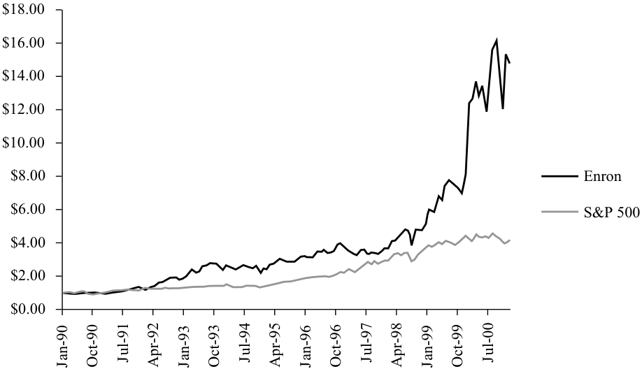
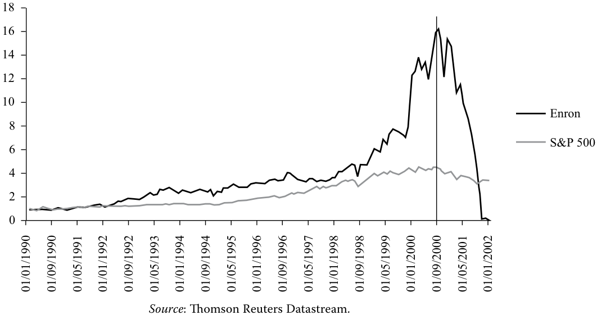
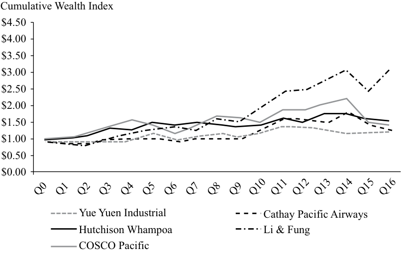
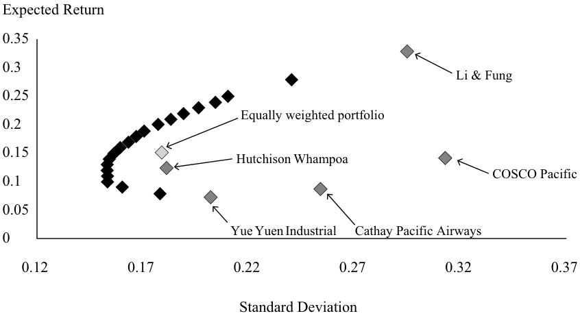
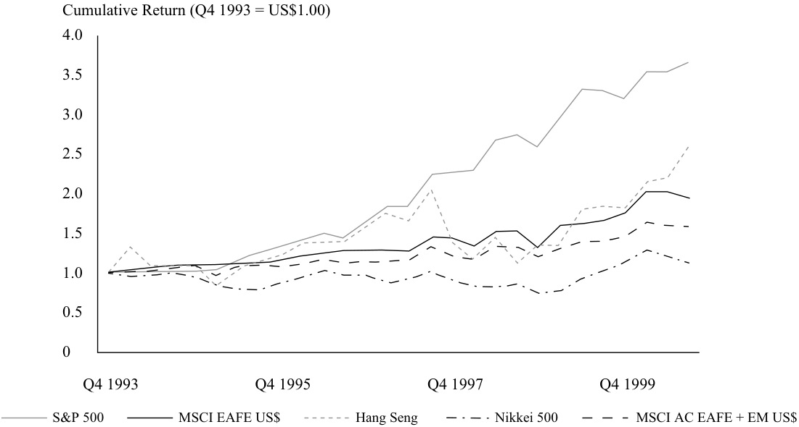
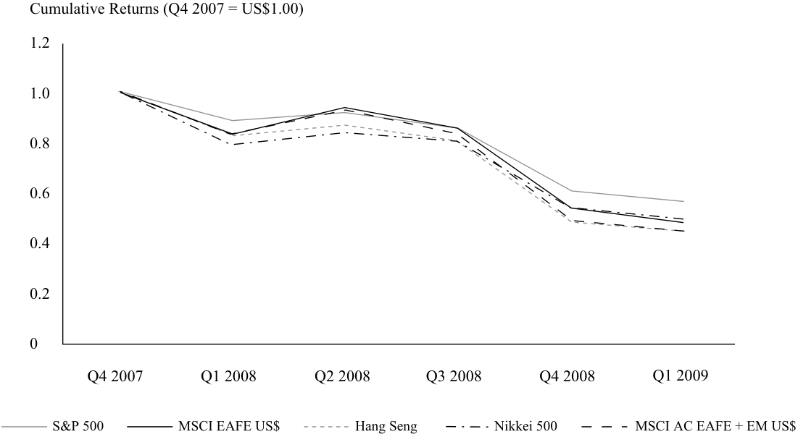

# Tập 9: Quản lý Danh mục Đầu tư (Portfolio Management)
## Learning Module 3 Portfolio Management: An Overview (Trang PDF 131–168)

---

# Tập 9: Quản lý Danh mục Đầu tư (*Portfolio Management*)
## Học phần 3: Quản lý Danh mục Đầu tư: Tổng quan (*Portfolio Management: An Overview*)
### Phần 1/3: Giới thiệu (*Introduction*) (Trang PDF 131–144)

---

<!-- PDF Page 131 -->

#### H Ọ C P H Ầ N (*L E A R N I N G M O D U L E*)

# **<mark>3</mark>** 

### **Quản lý Danh mục Đầu tư: Tổng quan (*Portfolio Management: An Overview*)** 

**bởi Owen M. Concannon, CFA, Robert M. Conroy, DBA, CFA, Alistair Byrne, PhD, CFA, và Vahan Janjigian, PhD, CFA.** 

_Owen M. Concannon, CFA, làm việc tại Neuberger Berman (Hoa Kỳ). Robert M. Conroy, DBA, CFA, làm việc tại Trường Kinh doanh Darden, Đại học Virginia (Hoa Kỳ). Alistair Byrne, PhD, CFA, làm việc tại State Street Global Advisors (Vương quốc Anh). Vahan Janjigian, PhD, CFA, làm việc tại Greenwich Wealth Management, LLC (Hoa Kỳ)._ 

###### **<mark>MỤC TIÊU HỌC TẬP (*LEARNING OUTCOMES*)</mark>** 

|**_Mức độ thành thạo_**|**_Ứng viên cần có khả năng:_**|
|---|---|
||mô tả cách tiếp cận theo danh mục trong đầu tư (*portfolio approach to investing*)|
||mô tả các bước trong quy trình quản lý danh mục đầu tư (*portfolio management process*)|
||mô tả các loại hình nhà đầu tư cùng những đặc điểm và nhu cầu riêng biệt của từng loại|
||mô tả các quỹ hưu trí đóng góp xác định (*defined contribution*) và phúc lợi xác định (*defined benefit pension plans*)|
||mô tả các khía cạnh của ngành quản lý tài sản (*asset management industry*)|
||mô tả các quỹ tương hỗ (*mutual funds*) và so sánh chúng với các sản phẩm đầu tư góp vốn chung khác (*other pooled investment products*)|

<!-- Picture Text: 1  -->

##### **GIỚI THIỆU (*INTRODUCTION*)** 

Bài đọc này cung cấp một cái nhìn tổng quan về quản lý danh mục đầu tư (*portfolio management*) và ngành quản lý tài sản (*asset management industry*), bao gồm các loại hình nhà đầu tư cũng như các chương trình và sản phẩm đầu tư. Cách tiếp cận theo danh mục đầu tư (*portfolio approach*) đóng vai trò rất quan trọng đối với các nhà đầu tư trong việc đạt được các mục tiêu tài chính của họ. Chúng tôi phác thảo các bước trong quy trình quản lý danh mục đầu tư khi quản lý danh mục đầu tư của một khách hàng. Tiếp theo, chúng tôi so sánh nhu cầu tài chính của các loại hình nhà đầu tư khác nhau: nhà đầu tư cá nhân (*individual investors*) và nhà đầu tư tổ chức (*institutional investors*). Sau đó, chúng tôi mô tả cả quỹ hưu trí đóng góp xác định (*defined contribution pension plans*) và quỹ hưu trí phúc lợi xác định (*defined benefit pension plans*). Ngành quản lý tài sản1 (*asset management industry*), đóng vai trò là mối liên kết 

> 1 Lưu ý rằng cả hai thuật ngữ “quản lý đầu tư (*investment management*)” và “quản lý tài sản (*asset management*)” đều được sử dụng phổ biến xuyên suốt chương trình giảng dạy CFA. Các thuật ngữ này thường được sử dụng thay thế cho nhau trên thực tế. 

<!-- PDF Page 132 -->

thiết yếu giữa bên cung cấp và bên tìm kiếm nguồn vốn đầu tư trên toàn thế giới, sẽ được thảo luận một cách khái quát. Cuối cùng, chúng tôi mô tả các quỹ tương hỗ (*mutual funds*) và các loại sản phẩm đầu tư góp vốn chung (*pooled investment products*) khác do các nhà quản lý tài sản cung cấp. 

## **<mark>2</mark>** 

##### **GÓC NHÌN DANH MỤC ĐẦU TƯ: ĐA DẠNG HÓA VÀ GIẢM THIỂU RỦI RO (*PORTFOLIO PERSPECTIVE: DIVERSIFICATION AND RISK REDUCTION*)** 

mô tả cách tiếp cận theo danh mục trong đầu tư (*describe the portfolio approach to investing*) 

Một trong những thách thức lớn nhất mà các cá nhân và tổ chức phải đối mặt là quyết định đầu tư như thế nào cho các nhu cầu trong tương lai. Đối với các cá nhân, mục tiêu có thể là tài trợ cho nhu cầu nghỉ hưu. Đối với các tổ chức như công ty bảo hiểm, mục tiêu là tài trợ cho các khoản nợ phải trả trong tương lai dưới dạng các khoản bồi thường bảo hiểm, trong khi các quỹ hiến tặng (*endowments*) tìm cách tạo ra thu nhập để đáp ứng các nhu cầu hoạt động liên tục của các tổ chức như trường đại học. Bất kể mục tiêu cuối cùng là gì, tất cả đều đối mặt với cùng một tập hợp các thách thức vượt ra ngoài việc chỉ lựa chọn loại tài sản (*asset classes*) nào để đầu tư. Cuối cùng, những thách thức đó xoay quanh việc xây dựng các nguyên tắc cơ bản giúp xác định cách thức tư duy về đầu tư. Một câu hỏi quan trọng là: Chúng ta nên đầu tư vào các chứng khoán riêng lẻ, đánh giá từng chứng khoán một cách biệt lập, hay nên áp dụng cách tiếp cận theo danh mục đầu tư (*portfolio approach*)? “Cách tiếp cận theo danh mục đầu tư (*portfolio approach*)” có nghĩa là đánh giá các chứng khoán riêng lẻ trong mối tương quan với sự đóng góp của chúng vào các đặc tính đầu tư của toàn bộ danh mục. Trong phần tiếp theo, chúng tôi minh họa một số lý do tại sao góc nhìn danh mục đầu tư đa dạng hóa lại quan trọng. 

###### **Ví dụ lịch sử về Đa dạng hóa danh mục đầu tư: Tránh thảm họa (*Historical Example of Portfolio Diversification: Avoiding Disaster*)** 

Đa dạng hóa danh mục đầu tư (*portfolio diversification*) giúp các nhà đầu tư tránh được những kết quả đầu tư thảm khốc. Lợi ích này được minh họa thuyết phục nhất bằng cách xem xét điều gì có thể xảy ra khi các cá nhân _không_ đa dạng hóa. 

Chúng ta thường không thể quan sát cách các cá nhân quản lý các khoản đầu tư cá nhân của họ. Tuy nhiên, trong trường hợp của các danh mục hưu trí cá nhân 401(k) tại Hoa Kỳ,2 chúng ta có thể thấy được kết quả từ các quyết định đầu tư của các cá nhân. Khi kiểm tra các danh mục hưu trí của họ, chúng tôi nhận thấy rằng một số người tham gia cá nhân đã đưa ra các quyết định đầu tư dưới mức tối ưu (*sub-optimal investment decisions*). 

Trong suốt những năm 1990, Tập đoàn Enron (*Enron Corporation*) là một trong những tập đoàn được ngưỡng mộ nhất tại Hoa Kỳ. Một vị thế nắm giữ cổ phiếu Enron mang lại tỷ suất sinh lợi hơn 27 phần trăm mỗi năm từ năm 1990 đến tháng 9 năm 2000, so với mức 13 phần trăm của Chỉ số S&P 500 (*S&P 500 Index*) trong cùng khoảng thời gian đó. 

> 2 Tại Hoa Kỳ, chương trình 401(k) là chương trình tiết kiệm hưu trí cá nhân do người sử dụng lao động tài trợ. Chúng cho phép các cá nhân tiết kiệm một phần thu nhập hiện tại và hoãn thuế cho đến thời điểm rút tiền tiết kiệm và tiền lãi. Trong một số trường hợp, công ty tài trợ cũng sẽ thực hiện các khoản đóng góp đối ứng (*matching contributions*) dưới dạng tiền mặt hoặc cổ phiếu. Các cá nhân, trong những giới hạn nhất định, có quyền kiểm soát các quỹ được đầu tư và do đó có thể thể hiện sở thích của mình về việc đầu tư vào tài sản nào. 

<!-- PDF Page 133 -->

**Bảng minh họa 1: Giá trị của 1 Đô la Mỹ được đầu tư từ tháng 1 năm 1990 đến tháng 9 năm 2000 – Enron so với Chỉ số Tổng hợp S&P 500 (*S&P 500 Composite Index*) (01/01/1990 = 1,00 US$)** 

> **Chú thích hình ảnh:** Biểu đồ so sánh sự tăng trưởng của 1,00 US$ đầu tư vào cổ phiếu Enron và Chỉ số S&P 500 từ tháng 1/1990 đến tháng 9/2000 (trục tung từ $0.00 đến $18.00; trục hoành từ Jan-90 đến Jul-00).

<!-- Picture Text: $18.00 $16.00 $14.00 $12.00 $10.00 $8.00 Enron $6.00 S&P 500 $4.00 $2.00 $0.00 Jan-90 Oct-90 Jul-91 Apr-92 Jan-93 Oct-93 Jul-94 Apr-95 Jan-96 Oct-96 Jul-97 Apr-98 Jan-99 Oct-99 Jul-00  -->

_Nguồn_ : Thomson Reuters Datastream. 

Trong khoảng thời gian này, hàng ngàn nhân viên của Enron đã tham gia vào chương trình hưu trí 401(k) của công ty. Chương trình này cho phép nhân viên trích một phần thu nhập của họ vào một tài khoản được hoãn thuế (*tax-deferred account*). Enron tham gia bằng cách đóng góp đối ứng (*matching*) với các khoản đóng góp của nhân viên. Enron thực hiện khoản đối ứng này bằng cách gửi các khoản tiền theo yêu cầu dưới dạng cổ phiếu Enron. Enron hạn chế việc bán số cổ phiếu do công ty đóng góp cho đến khi nhân viên bước sang tuổi 50. Vào tháng 1 năm 2001, các tài khoản hưu trí 401(k) của nhân viên được định giá hơn 2 tỷ đô la Mỹ, trong đó 1,3 tỷ đô la Mỹ (tương đương 62 phần trăm) là cổ phiếu Enron. Mặc dù Enron hạn chế việc bán các cổ phiếu do công ty đóng góp, nhưng chưa đến 150 triệu đô la Mỹ trong tổng số 1,3 tỷ đô la Mỹ cổ phiếu chịu sự hạn chế này. Hàm ý ở đây là các nhân viên của Enron đã tiếp tục nắm giữ một lượng lớn cổ phiếu Enron ngay cả khi họ hoàn toàn tự do bán chúng và đầu tư số tiền thu được vào các tài sản khác. 

Một cá nhân điển hình là Roger Bruce,3 một người nghỉ hưu 67 tuổi của Enron, người đã nắm giữ toàn bộ 2 triệu đô la Mỹ tiền quỹ hưu trí của mình dưới dạng cổ phiếu Enron. Từ tháng 1 năm 2001 đến tháng 1 năm 2002, giá cổ phiếu của Enron đã sụt giảm từ khoảng 90 đô la Mỹ một cổ phiếu xuống còn bằng không. 

<!-- PDF Page 134 -->

**Bảng minh họa 2: Giá trị của 1 Đô la Mỹ được đầu tư từ tháng 1 năm 1990 đến tháng 1 năm 2002 – Enron so với Chỉ số Tổng hợp S&P 500 (*S&P 500 Composite Index*) (1/1/1990 = 1,00 US$)** 

> **Chú thích hình ảnh:** Biểu đồ giá trị của 1,00 US$ đầu tư vào Enron và S&P 500 kéo dài đến tháng 1/2002, cho thấy giá trị khoản đầu tư vào Enron tăng vọt lên mức đỉnh khoảng 16 US$ vào năm 2000 trước khi lao dốc về 0 vào đầu năm 2002.

<!-- Picture Text: 18 16 14 12 10 Enron 8 S&P 500 6 4 2 0 Source : Thomson Reuters Datastream. 01/01/1990 01/09/1990 01/05/1991 01/01/1992 01/09/1992 01/05/1993 01/01/1994 01/09/1994 01/05/1995 01/01/1996 01/09/1996 01/05/1997 01/01/1998 01/09/1998 01/05/1999 01/01/2000 01/09/2000 01/05/2001 01/01/2002  -->

Những nhân viên và người nghỉ hưu đã đầu tư toàn bộ hoặc phần lớn tiền tiết kiệm hưu trí của mình vào cổ phiếu Enron, giống như ông Bruce, đã phải hứng chịu sự khánh kiệt về tài chính. Bài học đắt giá mà các nhân viên Enron rút ra được từ trải nghiệm này là “đừng bỏ tất cả trứng vào một giỏ.”4 Thật không may, một nhân viên Enron điển hình lại bỏ hầu hết số trứng của mình vào cùng một giỏ. Tiền lương và tài sản tài chính của hầu hết nhân viên đều phụ thuộc vào khả năng tồn tại tiếp tục của Enron; do đó, bất kỳ kiệt quệ tài chính (*financial distress*) nào xảy ra với Enron cũng sẽ gây ra tác động trọng yếu đến sức khỏe tài chính của người nhân viên. Sự phá sản của Enron đã dẫn đến việc đóng cửa các hoạt động kinh doanh, sa thải hàng ngàn nhân viên, và cổ phiếu của công ty trở nên vô giá trị. Do đó, sự sụp đổ của Enron là một thảm họa đối với người nhân viên Enron điển hình. 

Nhân viên của Enron không phải là những nạn nhân duy nhất của việc đầu tư quá mức vào cổ phiếu của một công ty đơn lẻ. Trong các chương trình hưu trí đóng góp xác định (*defined contribution retirement plans*) tại Owens Corning, Northern Telecom, Corning, và ADC Telecommunications, tất cả nhân viên đều nắm giữ hơn 25 phần trăm tài sản của họ bằng cổ phiếu của chính công ty trong khoảng thời gian (từ tháng 3 năm 2000 đến tháng 12 năm 2001) mà giá cổ phiếu của các công ty này đã sụt giảm gần 90 phần trăm. Tin tốt trong câu chuyện này là những nhân viên tham gia vào các chương trình 401(k) có đóng góp đối ứng của người sử dụng lao động kể từ năm 2001 đã cắt giảm đáng kể tỷ trọng nắm giữ cổ phiếu của công ty nơi họ làm việc. 

Như vậy, bằng cách áp dụng cách tiếp cận danh mục đầu tư đa dạng hóa, các nhà đầu tư có thể phân tán bớt một phần rủi ro. Các nhà đầu tư hợp lý (*rational investors*) luôn quan tâm đến sự đánh đổi giữa rủi ro và tỷ suất sinh lợi (*risk–return trade-off*) của các khoản đầu tư của mình. Cách tiếp cận theo danh mục đầu tư cung cấp cho các nhà đầu tư một phương thức để giảm thiểu rủi ro gắn liền với khối tài sản của họ mà không nhất thiết làm giảm tỷ suất sinh lợi kỳ vọng (*expected rate of return*). 

###### **Danh mục đầu tư: Giảm thiểu rủi ro (*Portfolios: Reduce Risk*)** 

Ngoài việc tránh được một thảm họa tiềm tàng gắn liền với việc đầu tư quá mức vào một chứng khoán đơn lẻ, các danh mục đầu tư nhìn chung còn mang lại tỷ suất sinh lợi kỳ vọng tương đương với mức **độ biến động (*volatility*)** tổng thể của tỷ suất sinh lợi thấp hơn—được đại diện bởi một thước đo như độ lệch chuẩn (*standard deviation*). Hãy xem xét 

<!-- PDF Page 135 -->

ví dụ đơn giản sau: Giả sử bạn muốn thực hiện một khoản đầu tư vào các công ty niêm yết trên Sở Giao dịch Chứng khoán Hồng Kông (HKSE) và bạn bắt đầu với một mẫu gồm năm công ty.5 Tỷ suất sinh lợi tích lũy (*cumulative returns*) trong 16 quý tài chính được thể hiện trong Bảng minh họa 3. 

**Bảng minh họa 3: Chỉ số Tài sản Tích lũy (*Cumulative Wealth Index*) của mẫu các cổ phiếu niêm yết trên HKSE (số tiền ban đầu = 1,00 US$)** 

> **Chú thích hình ảnh:** Biểu đồ Chỉ số Tài sản Tích lũy (*Cumulative Wealth Index*) từ Q0 đến Q16 (bắt đầu từ 1,00 US$) của 5 cổ phiếu trên sàn HKSE: Yue Yuen Industrial, Cathay Pacific Airways, Hutchison Whampoa, Li & Fung, và COSCO Pacific.

<!-- Picture Text: Cumulative Wealth Index $4.50 $4.00 $3.50 $3.00 $2.50 $2.00 $1.50 $1.00 $0.50 $0.00 Yue Yuen Industrial Cathay Pacific Airways Hutchison Whampoa Li & Fung COSCO Pacific Q0 Q1 Q2 Q3 Q4 Q5 Q6 Q7 Q8 Q9 Q10 Q11 Q12 Q13 Q14 Q15 Q16  -->

_Nguồn_ : Thomson Reuters Datastream. 

Tỷ suất sinh lợi hàng quý riêng lẻ của từng cổ phiếu trong số năm cổ phiếu được trình bày trong Bảng minh họa 4. Giá trị trung bình năm hóa (*annualized means*) và độ lệch chuẩn năm hóa (*annualized standard deviations*) của từng cổ phiếu cũng được hiển thị.6 

**Bảng minh họa 4: Tỷ suất sinh lợi hàng quý (tính bằng phần trăm) của mẫu các cổ phiếu niêm yết trên HKSE qua 16 quý tài chính** 

||**Yue Yuen** **Industrial**|**Cathay** **Pacific** **Airways**|**Hutchison** **Whampoa**|**Li & Fung**|**COSCO Pacific**|**Danh mục đầu tư** **trọng số đều** **(*Equally Weighted Portfolio*)**|
|---|---|---|---|---|---|---|
|Q1|–11,1%|–2,3%|0,6%|–13,2%|–1,1%|–5,4%|
|Q2|–0,5|–5,4|10,8|1,7|21,0|5,5|
|Q3|5,7|6,8|19,1|13,8|15,5|12,2|
|Q4|5,3|4,6|–2,1|16,9|12,4|7,4|
|Q5|17,2|2,4|12,6|14,5|–7,9|7,8|
|Q6|–17,6|–10,4|–0,9|4,4|–16,7|–8,2|
|Q7|12,6|7,4|4,2|–10,9|15,4|5,7|
|Q8|7,5|–0,4|–3,6|29,2|21,9|10,9|
|Q9|–7,9|1,3|–5,1|–2,0|–1,6|–3,1|
|Q10|8,2|27,5|0,1|26,0|–10,1|10,3|
|Q11|18,3|24,3|16,5|22,8|25,7|21,5|
|Q12|0,1|–2,6|–6,7|–0,4|0,3|–1,8|

5 Một mẫu gồm năm công ty từ một nhóm ngành tương tự đã được lựa chọn một cách ngẫu nhiên cho mục đích minh họa. 

> 6 Tỷ suất sinh lợi trung bình hàng quý được năm hóa bằng cách nhân mức trung bình hàng quý với 4. Độ lệch chuẩn hàng quý được năm hóa bằng cách lấy độ lệch chuẩn hàng quý nhân với 2 (tức $\sqrt{4}$). 

<!-- PDF Page 136 -->

||**Yue Yuen** **Industrial**|**Cathay** **Pacific** **Airways**|**Hutchison** **Whampoa**|**Li & Fung**|**COSCO Pacific**|**Danh mục đầu tư** **trọng số đều** **(*Equally Weighted Portfolio*)**|
|---|---|---|---|---|---|---|
|Q13|–6,2|–4,2|16,7|11,9|11,1|5,8|
|Q14|–8,0|17,9|–1,8|12,4|8,4|5,8|
|Q15|3,5|–20,1|–8,5|–20,3|–31,5|–15,4|
|Q16|2,1|–11,8|–2,6|24,2|–6,1|1,2|
|Tỷ suất sinh lợi trung bình năm (*Mean annual return*)|7,3%|8,7%|12,3%|32,8%|14,2%|15,1%|
|Độ lệch chuẩn năm (*Annual standard deviation*)|20,2%|25,4%|18,1%|29,5%|31,3%|17,9%|
|Tỷ lệ đa dạng hóa (*Diversification ratio*)||||||71,9%|

_Nguồn:_ Thomson Reuters Datastream. 

Giả sử bạn muốn đầu tư vào một trong năm chứng khoán này vào năm tới. Có sự khác biệt rất lớn về sự đánh đổi giữa rủi ro và tỷ suất sinh lợi đối với năm cổ phiếu được chọn. Nếu bạn tin rằng tương lai sẽ lặp lại quá khứ, thì việc chọn Li & Fung sẽ là một lựa chọn tốt. Trong bốn năm trước đó, Li & Fung đã mang lại sự đánh đổi tốt nhất giữa tỷ suất sinh lợi và rủi ro. Nói cách khác, cổ phiếu này cung cấp nhiều tỷ suất sinh lợi nhất trên mỗi đơn vị rủi ro. Tuy nhiên, nếu không có lý do gì để tin rằng tương lai sẽ lặp lại quá khứ, thì nhiều khả năng rủi ro và tỷ suất sinh lợi của một chứng khoán được chọn sẽ giống như việc chọn ngẫu nhiên một chứng khoán. Khi chúng ta chọn ngẫu nhiên một chứng khoán trong mỗi quý, chúng ta thu được tỷ suất sinh lợi năm hóa trung bình là 15,1 phần trăm và độ lệch chuẩn năm hóa trung bình là 24,9 phần trăm; các con số này bây giờ sẽ lần lượt trở thành tỷ suất sinh lợi kỳ vọng và độ lệch chuẩn của bạn. 

Thay vào đó, bạn có thể đầu tư vào một danh mục đầu tư có trọng số đều (*equally weighted portfolio*) gồm năm cổ phiếu này, nghĩa là bạn sẽ đầu tư cùng một số tiền đô la vào mỗi chứng khoán trong mỗi quý. Tỷ suất sinh lợi hàng quý của danh mục đầu tư có trọng số đều chỉ đơn giản là mức trung bình cộng của tỷ suất sinh lợi của các cổ phiếu riêng lẻ. Như được báo cáo trong Bảng minh họa 4, danh mục đầu tư có trọng số đều có tỷ suất sinh lợi trung bình là 15,1 phần trăm và độ lệch chuẩn là 17,9 phần trăm. Đúng như kỳ vọng, tỷ suất sinh lợi của danh mục có trọng số đều bằng với tỷ suất sinh lợi của chứng khoán được chọn ngẫu nhiên. Tuy nhiên, điều tương tự lại không đúng đối với độ lệch chuẩn của danh mục đầu tư. Nghĩa là, độ lệch chuẩn của một danh mục đầu tư có trọng số đều không đơn thuần là trung bình cộng độ lệch chuẩn của các cổ phiếu riêng lẻ. Trong một bài đọc nâng cao hơn, chúng tôi sẽ chứng minh chi tiết hơn về mặt toán học cách thức một danh mục đầu tư như vậy mang lại độ lệch chuẩn của tỷ suất sinh lợi thấp hơn mức trung bình của các thành phần riêng lẻ nhờ vào mối tương quan (*correlations*) hoặc sự tương tác giữa các chứng khoán riêng lẻ. 

Bởi vì tỷ suất sinh lợi trung bình là như nhau, một thước đo đơn giản về giá trị của sự đa dạng hóa được tính bằng tỷ số giữa độ lệch chuẩn của danh mục đầu tư có trọng số đều với độ lệch chuẩn của chứng khoán được chọn ngẫu nhiên. Tỷ số này có thể được gọi là **tỷ lệ đa dạng hóa (*diversification ratio*)**. Trong trường hợp này, độ lệch chuẩn của danh mục đầu tư có trọng số đều xấp xỉ bằng 72 phần trăm độ lệch chuẩn trung bình của 5 cổ phiếu (24,9%). Tỷ lệ đa dạng hóa giữa độ lệch chuẩn của danh mục đầu tư so với độ lệch chuẩn của tài sản riêng lẻ đo lường lợi ích giảm thiểu rủi ro của một phương pháp xây dựng danh mục đầu tư đơn giản: phân bổ trọng số đều (*equal weighting*). Ngay cả khi các công ty được chọn từ một nhóm ngành tương tự nhau, chúng ta vẫn thấy được mức giảm thiểu rủi ro đáng kể. Một hiệu ứng danh mục đầu tư thậm chí còn lớn hơn (tức là tỷ lệ đa dạng hóa thấp hơn) có thể đạt được nếu chúng ta chọn các công ty từ những ngành hoàn toàn khác nhau. 

Ví dụ này minh họa một trong những ý tưởng cốt lõi về danh mục đầu tư: Danh mục đầu tư tác động đến rủi ro nhiều hơn là tác động đến tỷ suất sinh lợi (*Portfolios affect risk more than returns*). Trong phần trước, danh mục đầu tư đã giúp tránh được những tác động của rủi ro giảm giá (*downside risk*) gắn liền với việc đầu tư vào cổ phiếu của một công ty đơn lẻ. Trong phần này, chúng tôi đã mở rộng khái niệm giảm thiểu rủi ro thông qua danh mục đầu tư để minh họa lý do tại sao các cá nhân và tổ chức nên nắm giữ danh mục đầu tư. 

<!-- PDF Page 137 -->

##### **GÓC NHÌN DANH MỤC ĐẦU TƯ: SỰ ĐÁNH ĐỔI RỦI RO – LỢI NHUẬN, BẢO VỆ RỦI RO GIẢM GIÁ, LÝ THUYẾT DANH MỤC ĐẦU TƯ HIỆN ĐẠI (*PORTFOLIO PERSPECTIVE: RISK-RETURN TRADE-OFF, DOWNSIDE PROTECTION, MODERN PORTFOLIO THEORY*)** 

## **<mark>3</mark>** 

mô tả cách tiếp cận theo danh mục trong đầu tư (*describe the portfolio approach to investing*) 

Trong phần trước, chúng ta đã so sánh một danh mục đầu tư có trọng số đều với việc lựa chọn một chứng khoán đơn lẻ. Trong phần này, chúng ta xem xét các cách kết hợp bổ sung của cùng một tập hợp cổ phiếu đó và quan sát sự đánh đổi giữa độ biến động tỷ suất sinh lợi của danh mục và tỷ suất sinh lợi kỳ vọng (gọi tắt là sự đánh đổi rủi ro – lợi nhuận, *risk–return trade-offs*). Nếu chúng ta lựa chọn các danh mục đầu tư có sự kết hợp tốt nhất giữa rủi ro và tỷ suất sinh lợi (lấy các số liệu thống kê lịch sử làm kỳ vọng cho tương lai), chúng ta sẽ tạo ra tập hợp các danh mục đầu tư được hiển thị trong Bảng minh họa 5. 

**Bảng minh họa 5: Các danh mục đầu tư tối ưu (*Optimal Portfolios*) cho mẫu các cổ phiếu niêm yết trên HKSE** 

> **Chú thích hình ảnh:** Đồ thị đường biên hiệu quả (*Optimal Portfolios*) biểu diễn Tỷ suất sinh lợi kỳ vọng (*Expected Return* trên trục tung) theo Độ lệch chuẩn (*Standard Deviation* trên trục hoành) của 5 cổ phiếu trên HKSE và danh mục đầu tư có trọng số đều (*Equally weighted portfolio*).

<!-- Picture Text: Expected Return 0.35 0.3 Li & Fung 0.25 Equally weighted portfolio 0.2 0.15 Hutchison Whampoa COSCO Pacific 0.1 0.05 0 Yue Yuen Industrial Cathay Pacific Airways 0.12 0.17 0.22 0.27 0.32 0.37 Standard Deviation  -->

_Nguồn_ : Thomson Reuters Datastream. 

Ngoài việc minh họa rằng cách tiếp cận danh mục đầu tư đa dạng hóa làm giảm rủi ro, Bảng minh họa 5 còn cho thấy cấu trúc thành phần (*composition*) của danh mục đầu tư đóng vai trò rất quan trọng. Ví dụ, một danh mục đầu tư có trọng số đều (20 phần trăm danh mục vào mỗi chứng khoán) của năm cổ phiếu có tỷ suất sinh lợi kỳ vọng là 15,1 phần trăm và độ lệch chuẩn là 17,9 phần trăm. Thay vào đó, một danh mục đầu tư với 25 phần trăm vào Yue Yuen Industrial (Holdings), 3 phần trăm vào Cathay Pacific, 52 phần trăm vào Hutchison Whampoa, 20 phần trăm vào Li & Fung, và 0 phần trăm vào COSCO Pacific sẽ tạo ra một danh mục có tỷ suất sinh lợi kỳ vọng là 15,1 phần trăm và độ lệch chuẩn là 15,6 phần trăm. So với một danh mục đầu tư có trọng số đều đơn giản, danh mục này mang lại sự đánh đổi được cải thiện giữa rủi ro và tỷ suất sinh lợi bởi vì đạt được một mức rủi ro thấp hơn cho cùng một mức tỷ suất sinh lợi. 

###### **Ví dụ lịch sử về Danh mục đầu tư: Không nhất thiết bảo vệ khỏi rủi ro giảm giá (*Historical Portfolio Example: Not Necessarily Downside Protection*)** 

Một lý do chính khiến các danh mục đầu tư có thể giảm thiểu rủi ro một cách hiệu quả là việc kết hợp các chứng khoán có tỷ suất sinh lợi không biến động cùng chiều với nhau sẽ tạo ra sự đa dạng hóa. Đôi khi một nhóm nhỏ các tài sản sẽ tăng giá trị cùng lúc với việc một nhóm khác giảm giá trị. 

<!-- PDF Page 138 -->

Thực tế là các biến động này có thể bù trừ cho nhau tạo ra lợi ích đa dạng hóa tiềm năng mà chúng ta gán cho các danh mục đầu tư. Tuy nhiên, một vấn đề quan trọng là mô hình đồng biến động (*co-movement*) hay tương quan (*correlation pattern*) của tỷ suất sinh lợi các chứng khoán trong danh mục có thể thay đổi theo chiều hướng bất lợi cho nhà đầu tư. Chúng tôi sử dụng dữ liệu tỷ suất sinh lợi lịch sử từ một tập hợp các chỉ số toàn cầu để chỉ ra tác động của việc thay đổi các mô hình đồng biến động. 

Khi xem xét tỷ suất sinh lợi của một tập hợp các chỉ số cổ phiếu toàn cầu trong 15 năm qua, chúng ta quan sát thấy sự sụt giảm lợi ích đa dạng hóa do sự thay đổi trong mô hình đồng biến động của tỷ suất sinh lợi. Bảng minh họa 6 và Bảng minh họa 7 cho thấy tỷ suất sinh lợi tích lũy của một tập hợp gồm năm chỉ số toàn cầu7 trong hai khoảng thời gian khác nhau. So sánh khoảng thời gian đầu tiên, từ Quý 4 năm 1993 đến hết Quý 3 năm 2000 (như thể hiện trong Bảng minh họa 6), với khoảng thời gian sau, từ Quý 1 năm 2006 đến hết Quý 1 năm 2009 (như thể hiện trong Bảng minh họa 7), chúng tôi chỉ ra rằng mức độ biến động cùng chiều của các chỉ số cổ phiếu toàn cầu này đã gia tăng theo thời gian. 

**Bảng minh họa 6: Tỷ suất sinh lợi của các Chỉ số Cổ phiếu Toàn cầu từ Quý 4/1993 đến Quý 3/2000** 

> **Chú thích hình ảnh:** Biểu đồ Tỷ suất sinh lợi tích lũy (*Cumulative Return*, Q4 1993 = 1,00 US$) từ Q4 1993 đến Q3 2000 của 5 chỉ số: S&P 500, MSCI EAFE US$, Hang Seng, Nikkei 500, và MSCI AC EAFE + EM US$.

<!-- Picture Text: Cumulative Return (Q4 1993 = US$1.00) 4.0 3.5 3.0 2.5 2.0 1.5 1.0 0.5 0 Q4 1993 Q4 1995 Q4 1997 Q4 1999 S&P 500 MSCI EAFE US$ Hang Seng Nikkei 500 MSCI AC EAFE + EM US$  -->

_Nguồn_ : Thomson Reuters Datastream. 

> 7 S&P 500, Hang Seng và Nikkei 500 là các chỉ số cổ phiếu tổng hợp diện rộng được thiết kế để đo lường hiệu quả hoạt động của cổ phiếu tại Hoa Kỳ, Đặc khu Hành chính Hồng Kông và Nhật Bản. MSCI là viết tắt của Morgan Stanley Capital International. EAFE đề cập đến các thị trường phát triển ở Châu Âu, Châu Úc và Viễn Đông (*Europe, Australasia, and the Far East*). AC chỉ tất cả các quốc gia (*all countries*), và EM là các thị trường mới nổi (*emerging markets*). Tất cả tỷ suất sinh lợi của chỉ số đều tính bằng đô la Mỹ. 

<!-- PDF Page 139 -->

**Bảng minh họa 7: Tỷ suất sinh lợi của các Chỉ số Cổ phiếu Toàn cầu từ Quý 1/2006 đến Quý 1/2009** 

> **Chú thích hình ảnh:** Biểu đồ Tỷ suất sinh lợi tích lũy (*Cumulative Returns*, Q1 2006 = 1,00 US$) từ Q1 2006 đến Q1 2009 của 5 chỉ số toàn cầu, cho thấy xu hướng biến động đồng pha rõ rệt hơn so với giai đoạn 1993–2000.

<!-- Picture Text: Cumulative Returns (Q1 2006 = US$1.00) 2.5 2.0 1.5 1.0 0.5 0 Q1 2006 Q3 2007 Q1 2009 S&P 500 MSCI EAFE US$ Hang Seng Nikkei 500 MSCI AC EAFE + EM US$  -->

_Nguồn_ : Thomson Reuters Datastream. 

Phần sau của khoảng thời gian thứ hai, từ Quý 4 năm 2007 đến Quý 1 năm 2009, là giai đoạn giá cổ phiếu toàn cầu sụt giảm nghiêm trọng. Bảng minh họa 8 cho thấy tỷ suất sinh lợi trung bình hàng năm và độ lệch chuẩn của tỷ suất sinh lợi trong khoảng thời gian này. 

**Bảng minh họa 8: Tỷ suất sinh lợi của các Chỉ số Cổ phiếu Toàn cầu** 

||**Q4 1993–**|**Q3 2000**|**Q1 2006–**|**Q1 2009**|**Q4 2007–**|**Q1 2009**|
|---|---|---|---|---|---|---|
|**Chỉ số Toàn cầu (*Global Index*)**|**Trung bình (*Mean*)**|**Độ lệch chuẩn (*Stand. Dev.*)**|**Trung bình (*Mean*)**|**Độ lệch chuẩn (*Stand. Dev.*)**|**Trung bình (*Mean*)**|**Độ lệch chuẩn (*Stand. Dev.*)**|
|S&P 500|20,5%|13,9%|–6,3%|21,1%|–40,6%|23,6%|
|MSCI EAFE US$|10,9|14,2|–3,5|29,4|–48,0|35,9|
|Hang Seng|20,4|35,0|5,1|34,2|–53,8|34,0|
|Nikkei 500|3,3|18,0|–13,8|27,6|–48,0|30,0|
|MSCI AC EAFE + EM US$|7,6|13,2|–4,9|30,9|–52,0|37,5|
|Chỉ số được chọn ngẫu nhiên (*Randomly selected index*)|12,6%|18,9%|–4,7%|28,6%|–48,5%|32,2%|
|Danh mục đầu tư trọng số đều (*Equally weighted portfolio*)|12,6%|14,2%|–4,7%|27,4%|–48,5%|32,0%|
|Tỷ lệ đa dạng hóa (*Diversification ratio*)||75,1%||95,8%||99,4%|

_Nguồn:_ Thomson Reuters Datastream. 

Trong giai đoạn từ Quý 4 năm 2007 đến hết Quý 1 năm 2009, tỷ suất sinh lợi trung bình của danh mục đầu tư có trọng số đều, bao gồm cả cổ tức, là −48,5 phần trăm. Ngoài việc làm giảm rủi ro phải nhận mức tỷ suất sinh lợi của thị trường có kết quả tệ nhất, lợi ích đa dạng hóa là rất nhỏ. Bảng minh họa 9 cho thấy tỷ suất sinh lợi tích lũy hàng quý của từng chỉ số trong số năm chỉ số trong khoảng thời gian này. Tất cả các chỉ số đều đồng loạt sụt giảm. Bài học rút ra là mặc dù đa dạng hóa danh mục đầu tư nhìn chung có làm giảm rủi ro, nhưng nó không nhất thiết mang lại cùng một mức độ giảm thiểu rủi ro trong những thời kỳ thị trường hỗn loạn nghiêm trọng giống như khi nền kinh tế và các thị trường đang vận hành ‘bình thường’. Trên thực tế, nếu nền kinh tế hoặc các thị trường sụp đổ hoàn toàn (điều đã từng xảy ra nhiều lần trên thế giới), thì sự đa dạng hóa chỉ là một lời hứa hão huyền. Khi đối mặt với hiệu ứng lây lan trên toàn thế giới (*worldwide contagion*), đa dạng hóa đã trở nên kém hiệu quả, như được minh họa vào cuối năm 2008. 

<!-- PDF Page 140 -->

###### **Bảng minh họa 9: Tỷ suất sinh lợi của các Chỉ số Cổ phiếu Toàn cầu từ Quý 4/2007 đến Quý 1/2009** 

> **Chú thích hình ảnh:** Biểu đồ Tỷ suất sinh lợi tích lũy (*Cumulative Returns*, Q4 2007 = 1,00 US$) từ Q4 2007 đến Q1 2009 cho thấy cả 5 chỉ số cổ phiếu toàn cầu đều lao dốc đồng loạt trong cuộc khủng hoảng tài chính toàn cầu năm 2008.

<!-- Picture Text: Cumulative Returns (Q4 2007 = US$1.00) 1.2 1.0 0.8 0.6 0.4 0.2 0 Q4 2007 Q1 2008 Q2 2008 Q3 2008 Q4 2008 Q1 2009 S&P 500 MSCI EAFE US$ Hang Seng Nikkei 500 MSCI AC EAFE + EM US$  -->

_Nguồn_ : Thomson Reuters Datastream. 

###### **KIỂM TRA KIẾN THỨC (*KNOWLEDGE CHECK*)** 

Các danh mục đầu tư có _nhiều khả năng nhất_ sẽ mang lại: 

- **A.** sự giảm thiểu rủi ro (*risk reduction*). 

- **B.** sự loại bỏ rủi ro (*risk elimination*). 

- **C.** sự bảo vệ khỏi rủi ro giảm giá (*downside protection*). 

###### **Lời giải:** 

A là đáp án đúng. Việc kết hợp các tài sản vào một danh mục đầu tư sẽ làm giảm độ biến động của danh mục đó. Tuy nhiên, cách tiếp cận theo danh mục đầu tư không nhất thiết mang lại sự bảo vệ khỏi rủi ro giảm giá hoặc loại bỏ hoàn toàn mọi rủi ro. 

###### **Danh mục đầu tư: Lý thuyết Danh mục Đầu tư Hiện đại (*Portfolios: Modern Portfolio Theory*)** 

Khái niệm đa dạng hóa đã tồn tại từ rất lâu và có sức hấp dẫn lớn về mặt trực giác. Tuy nhiên, lý thuyết thực sự làm nền tảng cho khái niệm cơ bản này và việc ứng dụng nó vào đầu tư chỉ mới xuất hiện vào năm 1952 với việc xuất bản bài báo kinh điển của Harry Markowitz về lựa chọn danh mục đầu tư (*portfolio selection*).8 Bài báo đã đặt nền móng cho những gì ngày nay được gọi là **lý thuyết danh mục đầu tư hiện đại (*modern portfolio theory* – MPT)**. Kết luận chính của MPT là các nhà đầu tư không những nên nắm giữ các danh mục đầu tư mà còn phải tập trung vào cách thức các chứng khoán riêng lẻ trong danh mục có mối liên hệ với nhau như thế nào. Ngoài lợi ích đa dạng hóa của danh mục đầu tư đối với nhà đầu tư, công trình nghiên cứu của William Sharpe (1964), John Lintner (1965), và Jack Treynor (1961) đã chứng minh vai trò của danh mục đầu tư trong việc xác định phần bù rủi ro (*risk premium*) thích hợp của từng tài sản riêng lẻ (tức là phần tỷ suất sinh lợi vượt trội so với lãi suất phi rủi ro mà các nhà đầu tư kỳ vọng để bù đắp cho 

<!-- PDF Page 141 -->

rủi ro của tài sản đó). Theo lý thuyết thị trường vốn (*capital market theory*), rủi ro được định giá (*priced risk*) của một chứng khoán riêng lẻ chịu ảnh hưởng bởi việc nắm giữ nó trong một danh mục đầu tư được đa dạng hóa tốt. Các nghiên cứu ban đầu đã mang lại góc nhìn sâu sắc rằng rủi ro của một tài sản cần được đo lường trong mối tương quan với phần rủi ro hệ thống (*systematic risk*) hay rủi ro không thể đa dạng hóa (*non-diversifiable risk*) còn lại, vốn phải là rủi ro duy nhất tác động đến giá của tài sản. Quan điểm về rủi ro này là cơ sở của mô hình định giá tài sản vốn (*capital asset pricing model* – CAPM), được thảo luận chi tiết hơn trong các bài đọc khác. Mặc dù MPT có những hạn chế, các khái niệm và trực giác được minh họa trong lý thuyết này vẫn tiếp tục là nền tảng kiến thức cho các nhà quản lý danh mục đầu tư. 

##### **CÁC BƯỚC TRONG QUY TRÌNH QUẢN LÝ DANH MỤC ĐẦU TƯ (*STEPS IN THE PORTFOLIO MANAGEMENT PROCESS*)** 

## **<mark>4</mark>** 

mô tả các bước trong quy trình quản lý danh mục đầu tư (*describe the steps in the portfolio management process*) 

Trong phần trước, chúng ta đã thảo luận về cách tiếp cận theo danh mục trong đầu tư. Khi thiết lập và quản lý danh mục đầu tư của khách hàng, có những bước quan trọng nhất định cần được tuân thủ trong quy trình. Chúng tôi mô tả các bước này trong phần dưới đây. 

- Bước Lập kế hoạch (*The Planning Step*) 

   - Tìm hiểu nhu cầu của khách hàng (*Understanding the client’s needs*) 

   - Lập bản tuyên bố chính sách đầu tư (*Preparation of an investment policy statement* – IPS) 

- Bước Thực thi (*The Execution Step*) 

   - Phân bổ tài sản (*Asset allocation*) 

   - Phân tích chứng khoán (*Security analysis*) 

   - Xây dựng danh mục đầu tư (*Portfolio construction*) 

- Bước Phản hồi (*The Feedback Step*) 

   - Giám sát và tái cân bằng danh mục đầu tư (*Portfolio monitoring and rebalancing*) 

   - Đo lường và báo cáo hiệu quả hoạt động (*Performance measurement and reporting*) 

###### **Bước Một: Bước Lập kế hoạch (*Step One: The Planning Step*)** 

Bước đầu tiên trong quy trình đầu tư là tìm hiểu nhu cầu của khách hàng (các mục tiêu và ràng buộc – *objectives and constraints*) và xây dựng một **bản tuyên bố chính sách đầu tư (*investment policy statement* – IPS)**. Một nhà quản lý danh mục đầu tư khó có thể đạt được kết quả phù hợp cho khách hàng nếu không hiểu trước về nhu cầu của họ. IPS là một tài liệu lập kế hoạch bằng văn bản mô tả các mục tiêu đầu tư của khách hàng và các ràng buộc áp dụng đối với danh mục đầu tư của khách hàng đó. IPS có thể nêu rõ một tiêu chuẩn tham chiếu (*benchmark*)—chẳng hạn như một mức tỷ suất sinh lợi cụ thể hoặc hiệu quả hoạt động của một chỉ số thị trường cụ thể—có thể được sử dụng trong giai đoạn phản hồi để đánh giá hiệu quả của các khoản đầu tư và liệu các mục tiêu đã đạt được hay chưa. IPS cần được rà soát và cập nhật định kỳ (ví dụ: ba năm một lần hoặc khi có sự thay đổi lớn trong mục tiêu, ràng buộc hoặc hoàn cảnh của khách hàng). 

<!-- PDF Page 142 -->

###### **Bước Hai: Bước Thực thi (*Step Two: The Execution Step*)** 

Bước tiếp theo là nhà quản lý danh mục đầu tư xây dựng một danh mục đầu tư phù hợp dựa trên IPS của khách hàng. Bước thực thi danh mục đầu tư bao gồm việc trước tiên quyết định phân bổ tài sản mục tiêu (*target asset allocation*), nhằm xác định tỷ trọng của các loại tài sản sẽ được đưa vào danh mục. Bước này được nối tiếp bằng việc phân tích, lựa chọn và mua các chứng khoán đầu tư riêng lẻ. 

###### **_Phân bổ tài sản (Asset Allocation)_** 

Bước tiếp theo trong quy trình là đánh giá các đặc tính rủi ro và tỷ suất sinh lợi của các khoản đầu tư hiện có. Chuyên gia phân tích hình thành các kỳ vọng về kinh tế và thị trường vốn (*economic and capital market expectations*) để có thể sử dụng nhằm đưa ra đề xuất phân bổ các loại tài sản phù hợp cho khách hàng. Các quyết định cần được đưa ra trong việc **phân bổ tài sản (*asset allocation*)** của danh mục đầu tư bao gồm sự phân phối giữa cổ phiếu (*equities*), chứng khoán thu nhập cố định (*fixed-income securities*), và tiền mặt (*cash*); các phân lớp tài sản phụ (*sub-asset classes*), chẳng hạn như trái phiếu doanh nghiệp và trái phiếu chính phủ; và tỷ trọng theo khu vực địa lý trong từng loại tài sản. Các tài sản thay thế (*alternative assets*)—chẳng hạn như bất động sản (*real estate*), hàng hóa (*commodities*), quỹ phòng hộ (*hedge funds*), và vốn cổ phần tư nhân (*private equity*)—cũng có thể được đưa vào. 

Các nhà kinh tế học và chiến lược gia thị trường có thể thiết lập góc nhìn từ trên xuống (*top-down view*) về các điều kiện kinh tế và xu hướng thị trường chung. Tỷ suất sinh lợi của các loại tài sản khác nhau có khả năng chịu ảnh hưởng bởi các điều kiện kinh tế; ví dụ, cổ phiếu có thể hoạt động tốt khi tăng trưởng kinh tế mạnh mẽ bất ngờ, trong khi trái phiếu có thể có kết quả kém nếu lạm phát gia tăng. Các nhà kinh tế học và chiến lược gia sẽ cố gắng dự báo những điều kiện này. 

**Từ trên xuống (*Top down*)** — Một **phân tích từ trên xuống (*top-down analysis*)** bắt đầu bằng việc xem xét các điều kiện kinh tế vĩ mô. Dựa trên môi trường kinh tế hiện tại và dự báo, các chuyên gia phân tích đánh giá các thị trường và các ngành với mục đích đầu tư vào những thị trường và ngành được kỳ vọng sẽ hoạt động tốt. Cuối cùng, các công ty cụ thể trong những ngành này sẽ được xem xét để đầu tư. 

**Từ dưới lên (*Bottom up*)** — Thay vì nhấn mạnh vào các chu kỳ kinh tế hoặc phân tích ngành, một **phân tích từ dưới lên (*bottom-up analysis*)** tập trung vào các hoàn cảnh cụ thể của từng công ty, chẳng hạn như chất lượng ban lãnh đạo và triển vọng kinh doanh. Phương pháp này ít quan tâm đến các xu hướng kinh tế rộng lớn hơn so với trường hợp phân tích từ trên xuống, mà thay vào đó tập trung vào các yếu tố đặc thù của công ty. 

###### **_Phân tích chứng khoán (Security Analysis)_** 

Góc nhìn từ trên xuống (*top-down view*) có thể được kết hợp với những nhận định chuyên sâu từ dưới lên (*bottom-up insights*) của các chuyên gia phân tích chứng khoán, những người chịu trách nhiệm xác định các khoản đầu tư hấp dẫn trong các lĩnh vực thị trường cụ thể. Họ sẽ sử dụng kiến thức chi tiết của mình về các công ty và các ngành mà họ phụ trách để đánh giá mức độ kỳ vọng và rủi ro của các dòng tiền mà mỗi chứng khoán sẽ tạo ra. Kiến thức này cho phép các chuyên gia phân tích đưa ra mức định giá (*valuation*) cho chứng khoán và xác định các khoản đầu tư được ưu tiên. 

###### **_Xây dựng danh mục đầu tư (Portfolio Construction)_** 

Sau đó, nhà quản lý danh mục đầu tư sẽ xây dựng danh mục đầu tư, có tính đến phân bổ tài sản mục tiêu, phân tích chứng khoán và các yêu cầu của khách hàng như đã nêu trong IPS. Một mục tiêu then chốt sẽ là đạt được các lợi ích của sự đa dạng hóa (tức là tránh bỏ tất cả trứng vào một giỏ). Các quyết định cần phải được đưa ra về tỷ trọng loại tài sản (*asset class weightings*), tỷ trọng nhóm ngành trong một loại tài sản (*sector weightings*), cũng như việc lựa chọn và phân bổ tỷ trọng của từng chứng khoán hoặc tài sản riêng lẻ. Tầm quan trọng tương đối của các quyết định này đối với hiệu quả hoạt động của danh mục đầu tư phụ thuộc ít nhất một phần vào chiến lược đầu tư được lựa chọn; ví dụ, hãy xem xét 

<!-- PDF Page 143 -->

một nhà đầu tư chủ động điều chỉnh tỷ trọng nhóm ngành tài sản dựa theo dự báo về hiệu quả hoạt động của ngành và một nhà đầu tư không làm như vậy. Mặc dù tất cả các quyết định đều có ảnh hưởng đến hiệu quả hoạt động của danh mục, nhưng quyết định phân bổ tài sản (*asset allocation decision*) thường được xem là có tác động lớn nhất. 

Bảng minh họa 10 cho thấy tỷ trọng danh mục đầu tư tổng quát của các quỹ hiến tặng (*endowment funds*) thuộc Đại học Yale và Đại học Virginia tính đến tháng 6 năm 2017. Như bạn có thể thấy, các danh mục đầu tư này chú trọng mạnh mẽ vào các tài sản thay thế như quỹ phòng hộ (*hedge funds*), vốn cổ phần tư nhân (*private equity*), và bất động sản (*real estate*)—đặc biệt là Đại học Yale. 

**Bảng minh họa 10: Tỷ trọng Danh mục Đầu tư của Quỹ Hiến tặng (*Endowment Portfolio Weights*), Tháng 6 năm 2017** 

|**Loại tài sản (*Asset Class*)**|**Quỹ Hiến tặng Đại học Yale** **(*Yale University Endowment*)**|**Quỹ Hiến tặng Đại học Virginia** **(*University of Virginia Endowment*)**|
|---|---|---|
|Cổ phiếu đại chúng (*Public equity*)|19,1%|26,7%|
|Thu nhập cố định (*Fixed income*)|4,6|9,1|
|Vốn cổ phần tư nhân (*Private equity*)|14,2|15,7|
|Tài sản thực (*Real assets*, ví dụ: bất động sản)|18,7|12,1|
|Sinh lợi tuyệt đối (*Absolute return*, ví dụ: quỹ phòng hộ)|25,1|19,6|
|Tiền mặt (*Cash*)|1,2|2,3|
|Khác (*Other*)|17,2|14,5|
|Giá trị danh mục đầu tư (*Portfolio value*)|27,2 tỷ US$|8,6 tỷ US$|

_Nguồn:_ “Báo cáo thường niên Quỹ Hiến tặng Yale 2017” (tr. 2): www.yale.edu/investments/Yale_Endowment_17.pdf; “Báo cáo thường niên Công ty Quản lý Đầu tư Đại học Virginia 2017” (tr. 26): http://uvm-web.eservices.virginia.edu/public/reports/FinancialStatements_2017.pdf. 

Quản trị rủi ro (*risk management*) là một phần quan trọng của quy trình xây dựng danh mục đầu tư. Mức độ chấp nhận rủi ro (*risk tolerance*) của khách hàng sẽ được quy định rõ trong IPS, và nhà quản lý danh mục đầu tư phải đảm bảo rằng danh mục đầu tư nhất quán với mức độ đó. Như đã lưu ý ở trên, nhà quản lý sẽ áp dụng góc nhìn danh mục đầu tư đa dạng hóa: Điều quan trọng không phải là rủi ro của bất kỳ khoản đầu tư đơn lẻ nào, mà là cách tất cả các khoản đầu tư hoạt động cùng nhau dưới dạng một danh mục. 

Các quỹ hiến tặng được trình bày ở trên là những nhà đầu tư có mức độ chấp nhận rủi ro tương đối cao. Hãy đối chiếu sự phân bổ tài sản của các quỹ hiến tặng này với cơ cấu danh mục đầu tư của các công ty bảo hiểm được thể hiện trong Bảng minh họa 11. Bạn sẽ nhận thấy rằng phần lớn tài sản bảo hiểm được đầu tư vào các khoản đầu tư thu nhập cố định (*fixed-income investments*), thường có chất lượng cao. Lưu ý rằng danh mục đầu tư của Đại học Yale có chưa đến 5 phần trăm được đầu tư vào thu nhập cố định, phần còn lại được đầu tư vào các tài sản tăng trưởng như cổ phiếu, bất động sản và quỹ phòng hộ. Sự phân bổ này tương phản rõ rệt với danh mục đầu tư của Công ty Bảo hiểm Nhân thọ Tương hỗ Massachusetts (*Massachusetts Mutual Life Insurance Company* – MassMutual), với 80 phần trăm được đầu tư vào trái phiếu, khoản vay thế chấp, các khoản cho vay và tiền mặt—phản ánh mức độ chấp nhận rủi ro và các ràng buộc khác nhau (các công ty bảo hiểm nhân thọ phải đối mặt với các ràng buộc pháp lý đối với các khoản đầu tư của họ). 

<!-- PDF Page 144 -->

**Bảng minh họa 11: Danh mục đầu tư của MassMutual, Tháng 12 năm 2017****9** 

|**Các loại tài sản (*Asset Classes*)**|**Tỷ trọng danh mục (*Portfolio %*)**|
|---|---|
|Trái phiếu (*Bonds*)|56%|
|Cổ phiếu ưu đãi và cổ phiếu phổ thông (*Preferred and common shares*)|9|
|Khoản vay thế chấp (*Mortgages*)|14|
|Bất động sản (*Real estate*)|1|
|Khoản vay theo hợp đồng bảo hiểm (*Policy loans*)|8|
|Hợp danh (*Partnerships*)|5|
|Tài sản khác (*Other assets*)|5|
|Tiền mặt (*Cash*)|2|

_Nguồn:_ “Báo cáo thường niên Tập đoàn Tài chính MassMutual 2017” (tr. 8): www.massmutual.com/mmfg/docs/annual_report/index.html. 

Giai đoạn xây dựng danh mục đầu tư cũng bao gồm hoạt động giao dịch (*trading*). Một khi nhà quản lý danh mục đầu tư đã quyết định mua những chứng khoán nào và với số lượng bao nhiêu, các chứng khoán đó phải được mua. Tại nhiều công ty đầu tư, nhà quản lý danh mục đầu tư sẽ chuyển các lệnh giao dịch cho một nhà giao dịch bên mua (*buy-side trader*)—một đồng nghiệp chuyên về giao dịch chứng khoán—người sẽ liên hệ với một nhà môi giới chứng khoán (*stockbroker*) hoặc nhà tạo lập/kinh doanh chứng khoán (*dealer*) để thực hiện các giao dịch đó. 

###### **Bước Ba: Bước Phản hồi (*Step Three: The Feedback Step*)** 

Cuối cùng, bước phản hồi hỗ trợ nhà quản lý danh mục đầu tư trong việc tái cân bằng (*rebalancing*) danh mục đầu tư do sự thay đổi trong, ví dụ, điều kiện thị trường hoặc hoàn cảnh của khách hàng. 

###### **_Giám sát và Tái cân bằng Danh mục Đầu tư (Portfolio Monitoring and Rebalancing)_** 

Một khi danh mục đầu tư đã được xây dựng, nó cần được giám sát, rà soát và điều chỉnh lại cấu trúc thành phần khi phân tích chứng khoán thay đổi do biến động giá chứng khoán và những thay đổi trong các yếu tố cơ bản (*fundamental factors*). Khi tỷ trọng chứng khoán và tài sản đã trôi dạt (*drifted*) khỏi các mức dự kiến ban đầu do biến động của thị trường, việc tái cân bằng (*rebalancing*) ở một mức độ nào đó có thể là cần thiết. Danh mục đầu tư cũng có thể cần được điều chỉnh lại nếu thấy rõ rằng nhu cầu hoặc hoàn cảnh của khách hàng đã thay đổi. 

###### **_Đánh giá và Báo cáo Hiệu quả Hoạt động (Performance Evaluation and Reporting)_** 

Cuối cùng, hiệu quả hoạt động (*performance*) của danh mục đầu tư phải được đánh giá, bao gồm việc xem xét liệu các mục tiêu của khách hàng đã đạt được hay chưa. Ví dụ, nhà đầu tư sẽ muốn biết liệu yêu cầu về tỷ suất sinh lợi (*return requirement*) đã đạt được hay chưa và danh mục đầu tư đã hoạt động như thế nào so với bất kỳ tiêu chuẩn tham chiếu (*benchmark*) nào đã được thiết lập. Việc phân tích hiệu quả hoạt động có thể gợi ý rằng các mục tiêu của khách hàng cần được xem xét lại và có lẽ cần thực hiện những thay đổi đối với IPS. Như chúng ta sẽ thảo luận trong phần tiếp theo, có rất nhiều sản phẩm đầu tư mà khách hàng có thể sử dụng để đáp ứng nhu cầu đầu tư của mình. Nhiều sản phẩm trong số này là các danh mục đầu tư đã được đa dạng hóa mà nhà đầu tư có thể mua. 

> 9 Định nghĩa các loại tài sản: Trái phiếu (*Bonds*)—Các công cụ nợ của doanh nghiệp và chính phủ cũng như các loại chứng khoán được đảm bảo bằng thế chấp (*mortgage-backed securities*) và đảm bảo bằng tài sản (*asset-backed securities*) khác nhau; Cổ phiếu ưu đãi và cổ phiếu phổ thông (*Preferred and Common Shares*)—Các khoản đầu tư vào vốn cổ phần ưu đãi và phổ thông; Khoản vay thế chấp (*Mortgages*)—Các khoản cho vay thế chấp được đảm bảo bằng nhiều loại bất động sản thương mại cũng như các gói khoản vay thế chấp nhà ở trọn gói (*residential mortgage whole loan pools*); Bất động sản (*Real Estate*)—Các khoản đầu tư vào bất động sản; Khoản vay theo hợp đồng bảo hiểm (*Policy Loans*)—Các khoản vay của chủ hợp đồng bảo hiểm được đảm bảo bằng hợp đồng bảo hiểm và hợp đồng niên kim; Hợp danh (*Partnerships*)—Các khoản đầu tư vào các công ty hợp danh và công ty trách nhiệm hữu hạn; Tiền mặt (*Cash*)—Tiền mặt, các khoản đầu tư ngắn hạn, các khoản phải thu từ chứng khoán và công cụ phái sinh. Các khoản tương đương tiền (*cash equivalents*) có kỳ hạn ngắn (dưới một năm) hoặc có tính thanh khoản cao và có thể dễ dàng bán ngay. 

---

# Tập 9: Quản lý Danh mục Đầu tư (*Portfolio Management*)
## Học phần 3: Quản lý Danh mục Đầu tư: Tổng quan (*Portfolio Management: An Overview*)
### Phần 2/3: Các Loại Hình Nhà Đầu Tư (*Types of Investors*) (Trang PDF 145–159)

---

<!-- PDF Page 145 -->

## **CÁC LOẠI HÌNH NHÀ ĐẦU TƯ (*TYPES OF INVESTORS*)** 

# **<mark>5</mark>** 

mô tả các loại hình nhà đầu tư cùng những đặc điểm và nhu cầu riêng biệt của từng loại (*describe types of investors and distinctive characteristics and needs of each*) 

mô tả các quỹ hưu trí đóng góp xác định và phúc lợi xác định (*describe defined contribution and defined benefit pension plans*) 

Quy trình quản lý danh mục đầu tư được mô tả trong phần trước có thể áp dụng cho các loại hình khách hàng đầu tư khác nhau. Những khách hàng như vậy được chia làm hai nhóm chính là các nhà đầu tư cá nhân (hay bán lẻ – *individual or retail investors*) và các nhà đầu tư tổ chức (*institutional investors*). Mỗi phân khúc này đều có những đặc điểm và nhu cầu riêng biệt, như được thảo luận trong các tiểu mục tiếp theo. 

### **Nhà đầu tư cá nhân (*Individual Investors*)** 

Các nhà đầu tư cá nhân có nhiều động cơ khác nhau để đầu tư và xây dựng danh mục đầu tư. Các mục tiêu ngắn hạn có thể bao gồm chi trả cho việc học hành của con cái, tiết kiệm cho một khoản mua sắm lớn (chẳng hạn như xe cộ hoặc nhà cửa), hoặc khởi nghiệp kinh doanh. Mục tiêu nghỉ hưu—đầu tư để tạo ra nguồn thu nhập khi nghỉ hưu—là một phần quan trọng trong kế hoạch đầu tư của hầu hết các cá nhân. Nhiều nhân viên của các công ty đại chúng và tư nhân đầu tư cho việc nghỉ hưu thông qua các **quỹ hưu trí đóng góp xác định (*defined contribution pension plans* – DC plans)**. Các chương trình DC là các chương trình hưu trí đứng tên người lao động, thường được tài trợ bởi cả người lao động và người sử dụng lao động. Các ví dụ bao gồm chương trình 401(k) tại Hoa Kỳ, chương trình hưu trí cá nhân theo nhóm (*group personal pension schemes*) tại Vương quốc Anh, và chương trình hưu trí bắt buộc (*superannuation plans*) tại Úc. Với các chương trình DC, các cá nhân sẽ đầu tư một phần tiền lương của mình trong thời gian làm việc, kỳ vọng sẽ rút từ nguồn quỹ tích lũy được để trang trải thu nhập trong thời gian nghỉ hưu hoặc chuyển giao một phần tài sản cho những người thừa kế của họ. Điểm mấu chốt của chương trình DC là người lao động chấp nhận rủi ro đầu tư và rủi ro lạm phát, đồng thời chịu trách nhiệm đảm bảo rằng có đủ tài sản trong chương trình để đáp ứng nhu cầu của họ khi nghỉ hưu. 

Một số cá nhân sẽ đầu tư để tìm kiếm sự tăng trưởng (*growth*) và do đó sẽ tìm kiếm các tài sản có tiềm năng mang lại lãi vốn (*capital gains*). Những người khác, chẳng hạn như những người đã nghỉ hưu, có thể cần rút một khoản thu nhập từ tài sản của họ và do đó có thể chọn đầu tư nhiều hơn vào các chứng khoán thu nhập cố định và cổ phiếu trả cổ tức. Nhu cầu đầu tư của các cá nhân sẽ phụ thuộc một phần vào hoàn cảnh tài chính tổng thể của họ, chẳng hạn như triển vọng việc làm và việc họ có sở hữu nhà ở riêng hay không. Họ cũng có thể cần xem xét các vấn đề như xây dựng một khoản dự trữ tiền mặt (*cash reserve*) và mua các hợp đồng bảo hiểm phù hợp trước khi thực hiện các khoản đầu tư dài hạn hơn. 

Các nhà quản lý tài sản phục vụ các nhà đầu tư cá nhân thường phân phối sản phẩm của họ trực tiếp tới nhà đầu tư hoặc thông qua các bên trung gian như cố vấn tài chính (*financial advisers*) và/hoặc các nhà cung cấp chương trình hưu trí. Mạng lưới phân phối cho các nhà đầu tư cá nhân rất khác nhau trên phạm vi toàn cầu. Tại Hoa Kỳ, các cố vấn tài chính hoạt động độc lập hoặc làm việc cho các công ty môi giới – tự doanh (*broker–dealers*), ngân hàng và công ty tín thác (*trust companies*) cấp quốc gia hoặc khu vực. Ngoài ra, nhiều nhà quản lý tài sản phân phối các chiến lược đầu tư tới các nhà đầu tư thông qua các công ty môi giới trực tuyến và lưu ký lớn. 

Tại Châu Âu, việc phân phối sản phẩm đầu tư bán lẻ bị phân mảnh và thay đổi tùy theo từng quốc gia/khu vực. Ví dụ, tại Châu Âu lục địa, việc phân phối chủ yếu được thúc đẩy thông qua các cố vấn tài chính liên kết với các ngân hàng bán lẻ và ngân hàng tư nhân (*private banks*). Tại Vương quốc Anh, các sản phẩm được bán thông qua các cố vấn độc lập cũng như thông qua các cố vấn đại diện cho một ngân hàng hoặc tập đoàn bảo hiểm. Phân phối bán lẻ ở Thụy Sĩ và các nước Bắc Âu chủ yếu được thực hiện thông qua các ngân hàng khu vực lớn và các ngân hàng tư nhân. Ngược lại với Hoa Kỳ và Châu Âu, tại nhiều thị trường Châu Á, hoạt động phân phối bán lẻ bị chi phối bởi các ngân hàng bán lẻ khu vực lớn và các ngân hàng toàn cầu có bộ phận ngân hàng tư nhân (*private banking divisions*). 

<!-- PDF Page 146 -->

Trên toàn cầu, nhiều công ty quản lý gia sản (*wealth management firms*) và các nhà quản lý tài sản nhắm mục tiêu đến các nhà đầu tư có giá trị tài sản ròng cao (*high-net-worth investors*). Những khách hàng này thường đòi hỏi các giải pháp đầu tư được cá nhân hóa cao hơn bên cạnh các dịch vụ lập kế hoạch thuế và di sản (*tax and estate planning services*). 

### **Nhà đầu tư tổ chức (*Institutional Investors*)** 

Các nhà đầu tư tổ chức chủ yếu bao gồm các quỹ hưu trí phúc lợi xác định (*defined benefit pension plans*), các quỹ hiến tặng và quỹ tài trợ (*endowments and foundations*), các ngân hàng (*banks*), các công ty bảo hiểm (*insurance companies*), các công ty đầu tư (*investment companies*), và các quỹ đầu tư quốc gia (*sovereign wealth funds*). Mỗi tổ chức này đều có những mục tiêu, sở thích phân bổ tài sản và nhu cầu chiến lược đầu tư riêng biệt. 

##### **_Quỹ hưu trí phúc lợi xác định (Defined Benefit Pension Plans)_** 

Các chương trình hưu trí thường được phân loại thành đóng góp xác định (*defined contribution* – DC) hoặc phúc lợi xác định (*defined benefit* – DB). Trước đó chúng ta đã mô tả các chương trình DC, có liên quan đến các nhà đầu tư cá nhân. **Quỹ hưu trí phúc lợi xác định (*Defined benefit pension plans* – DB plans)** là các chương trình do công ty tài trợ, cung cấp cho người lao động một mức phúc lợi được xác định trước khi nghỉ hưu. Khoản phúc lợi trong tương lai được xác định bởi vì chương trình DB yêu cầu đơn vị tài trợ chương trình (*plan sponsor*) phải chỉ rõ nghĩa vụ được tính theo mức phúc lợi thu nhập hưu trí phải trả cho những người tham gia. Nhìn chung, người sử dụng lao động chịu trách nhiệm về các khoản đóng góp vào chương trình DB và gánh chịu rủi ro liên quan đến việc tài trợ đầy đủ cho các khoản phúc lợi đã cam kết với người lao động. Các chương trình này có cam kết chi trả lương hưu cho các thành viên, và tài sản của các chương trình này được dùng để tài trợ cho các khoản thanh toán đó. Các nhà quản lý chương trình cần đảm bảo rằng sẽ có đủ tài sản để chi trả các khoản phúc lợi hưu trí khi chúng đến hạn. Chương trình có thể có thời hạn đầu tư (*time horizon*) dài vô thời hạn nếu các thành viên mới vẫn tiếp tục được kết nạp, hoặc có thời hạn hữu hạn nếu chương trình đã đóng cửa không nhận thêm thành viên mới. Trong một số trường hợp, các nhà quản lý chương trình cố gắng khớp tài sản của quỹ với các khoản nợ phải trả (*match the fund’s assets to its liabilities*) bằng cách, ví dụ, đầu tư vào các trái phiếu sẽ tạo ra các dòng tiền tương ứng với các khoản thanh toán lương hưu dự kiến trong tương lai. Có thể có nhiều triết lý đầu tư khác nhau đối với các quỹ hưu trí, tùy thuộc vào trạng thái tài trợ (*funded status*) và các biến số khác. 

Một xu hướng đang diễn ra là các đơn vị tài trợ chương trình ngày càng ưa chuộng các chương trình DC hơn các chương trình DB bởi vì các chương trình DC thường có chi phí/rủi ro thấp hơn đối với công ty. Do đó, các chương trình DB đang dần mất thị phần tài sản hưu trí vào tay các chương trình DC. Tuy nhiên, các chương trình DB, cả khu vực công và tư nhân, vẫn là những nguồn vốn đầu tư có quy mô đáng kể đối với các nhà quản lý tài sản. Như Bảng minh họa 12 cho thấy, tổng tài sản hưu trí toàn cầu đạt hơn 41 nghìn tỷ đô la Mỹ vào cuối năm 2017. Hoa Kỳ, Vương quốc Anh và Nhật Bản đại diện cho ba thị trường hưu trí lớn nhất thế giới, chiếm hơn 76% tổng tài sản hưu trí toàn cầu. 

**Bảng minh họa 12: Tài sản Hưu trí Toàn cầu (tính đến cuối năm 2017)** 

|**Quốc gia/Khu vực (*Country/Region*)**|**Tổng tài sản (tỷ US$) (*Total Assets (US$ billions)*)**|
|---|---|
|Hoa Kỳ (*United States*)|25.411|
|Vương quốc Anh (*United Kingdom*)|3.111|
|Nhật Bản (*Japan*)|3.054|
|Úc (*Australia*)|1.924|
|Canada|1.769|
|Hà Lan (*Netherlands*)|1.598|
|Thụy Sĩ (*Switzerland*)|906|
|Hàn Quốc (*South Korea*)|725|
|Đức (*Germany*)|472|
|Brazil|269|
|Nam Phi (*South Africa*)|258|

<!-- PDF Page 147 -->

|**Quốc gia/Khu vực (*Country/Region*)**|**Tổng tài sản (tỷ US$) (*Total Assets (US$ billions)*)**|
|---|---|
|Phần Lan (*Finland*)|233|
|Malaysia|227|
|Chile|205|
|Mexico|177|
|Ý (*Italy*)|184|
|Pháp (*France*)|167|
|Trung Quốc đại lục (*Chinese mainland*)|177|
|Đặc khu Hành chính Hồng Kông (*Hong Kong SAR*)|164|
|Ireland|157|
|Ấn Độ (*India*)|120|
|Tây Ban Nha (*Spain*)|44|
|Tổng cộng (*Total*)|**41.355**|

_Lưu ý:_ Cột số liệu không cộng chính xác tuyệt đối do làm tròn số. _Nguồn:_ Willis Towers Watson. 

Xét theo khu vực địa lý, Hoa Kỳ và Úc có tỷ trọng tài sản hưu trí nằm trong các chương trình DC cao hơn, trong khi Canada, Nhật Bản, Hà Lan và Vương quốc Anh vẫn nghiêng nhiều về các chương trình DB (xem Bảng minh họa 13). 

**Bảng minh họa 13: Loại hình Quỹ Hưu trí theo Khu vực Địa lý (*Pension Plan Type by Geography*)** 

> **Chú thích hình ảnh:** Biểu đồ cột ngang so sánh tỷ lệ phần trăm tài sản hưu trí giữa chương trình DB và DC tại nhóm P7 (52% DB / 48% DC), Hoa Kỳ (40% DB / 60% DC), Vương quốc Anh (82% DB / 18% DC), Thụy Sĩ (không có dữ liệu), Hà Lan (94% DB / 6% DC), Nhật Bản (96% DB / 4% DC), Canada (95% DB / 5% DC), và Úc (13% DB / 87% DC).

<!-- Picture Text: P7 52% 48% United States 40% 60% UK 82% 18% Switzerland 0% Netherlands 94% 6% Japan 96% 4 % Canada 95% 5% Australia 13% 87% DB DC  -->

_Lưu ý_ : “P7” đại diện cho sự kết hợp của bảy quốc gia được liệt kê. Không có dữ liệu cho Thụy Sĩ trong nghiên cứu này. 

_Nguồn_ : Willis Towers Watson và các nguồn thứ cấp. 

##### **_Quỹ Hiến tặng và Quỹ Tài trợ (Endowments and Foundations)_** 

Các quỹ hiến tặng (*endowments*) là các quỹ của các tổ chức phi lợi nhuận giúp các tổ chức này cung cấp những dịch vụ được chỉ định. Ngược lại, các quỹ tài trợ (*foundations*) là các pháp nhân cấp phát tài trợ (*grant-making entities*). Các quỹ hiến tặng và quỹ tài trợ cộng lại đại diện cho khối tài sản ước tính khoảng 1,6 nghìn tỷ đô la Mỹ tại Hoa Kỳ, vốn là thị trường chính của các quỹ hiến tặng và quỹ tài trợ. 

Các quỹ hiến tặng và quỹ tài trợ thường phân bổ một phần đáng kể tài sản của mình vào các khoản đầu tư thay thế (*alternative investments*) (Bảng minh họa 14). Sự phân bổ lớn vào các khoản đầu tư thay thế này chủ yếu phản ánh thời hạn đầu tư thường rất dài của các quỹ hiến tặng và quỹ tài trợ, cũng như sự phổ biến của các mô hình phân bổ tài sản dành riêng cho quỹ hiến tặng được phát triển bởi các nhà quản lý quỹ hiến tặng của Đại học Yale là David Swensen và Dean Takahashi. 

<!-- PDF Page 148 -->

**Bảng minh họa 14: Phân bổ Tài sản của các Quỹ Hiến tặng Trường Cao đẳng, Đại học và các Quỹ Tài trợ Liên kết tại Hoa Kỳ (tính đến ngày 30 tháng 6 năm 2017, tính theo trọng số đô la)** 

|**Loại tài sản (*Asset Class*)**|**Tỷ lệ phân bổ (%) (*Percentage Allocation*)**|
|---|---|
|Cổ phiếu trong nước (*Domestic equity*)|15|
|Thu nhập cố định (*Fixed income*)|7|
|Cổ phiếu nước ngoài (*Foreign equity*)|20|
|Đầu tư thay thế (*Alternatives*)|54|
|Tiền mặt (*Cash*)|4|

_Nguồn:_ Hiệp hội Quốc gia các Quản trị viên Ngân sách Cao đẳng và Đại học (*National Association of College and University Budget Officers*) và Viện Commonfund (*Commonfund Institute*). 

Một mục tiêu đầu tư điển hình của một quỹ hiến tặng hoặc quỹ tài trợ là duy trì giá trị vốn thực (đã điều chỉnh theo lạm phát – *real inflation-adjusted capital value*) của quỹ đồng thời tạo ra thu nhập để tài trợ cho các mục tiêu của tổ chức. Hầu hết các quỹ tài trợ và quỹ hiến tặng đều được thành lập với mục đích tồn tại vĩnh viễn (*perpetual lives*). Bảng minh họa 15 mô tả cách tiếp cận của quỹ hiến tặng Đại học Yale nhằm cân bằng giữa nhu cầu chi tiêu ngắn hạn với việc đảm bảo các thế hệ tương lai cũng được hưởng lợi từ quỹ hiến tặng, đồng thời trình bày cách tiếp cận của Quỹ Wellcome Trust. Cách tiếp cận đầu tư được thực hiện có xem xét đến các mục tiêu và ràng buộc của tổ chức (ví dụ: không đầu tư vào thuốc lá đối với một quỹ hiến tặng y tế). 

##### **Bảng minh họa 15: Các Quy tắc Chi tiêu (*Spending Rules*)** 

Các ví dụ về quy tắc chi tiêu dưới đây là những đoạn trích từ quỹ hiến tặng Đại học Yale (tại Hoa Kỳ) và từ Quỹ Wellcome Trust (tại Vương quốc Anh). 

#### **_Quỹ Hiến tặng Đại học Yale (Yale University Endowment)_** 

Quy tắc chi tiêu (*spending rule*) là trọng tâm của kỷ luật tài khóa đối với một tổ chức nhận hiến tặng. Các chính sách chi tiêu xác định sự dung hòa của một tổ chức giữa các mục tiêu đối lập nhau: vừa cung cấp sự hỗ trợ đáng kể cho các hoạt động hiện tại, vừa bảo toàn sức mua (*purchasing power*) của các tài sản thuộc Quỹ Hiến tặng. Quy tắc chi tiêu phải được định nghĩa rõ ràng và áp dụng một cách nhất quán thì khái niệm cân bằng ngân sách mới có ý nghĩa. 

Chính sách chi tiêu của Quỹ Hiến tặng, vốn phân bổ thu nhập từ Quỹ Hiến tặng cho các hoạt động vận hành, cân bằng hai mục tiêu cạnh tranh nhau là cung cấp một dòng thu nhập ổn định cho ngân sách hoạt động và bảo vệ giá trị thực của Quỹ Hiến tặng theo thời gian. Chính sách chi tiêu quản lý sự đánh đổi giữa hai mục tiêu này bằng cách kết hợp một tỷ lệ chi tiêu mục tiêu dài hạn (*long-term spending rate target*) với một quy tắc làm mượt (*smoothing rule*), giúp điều chỉnh mức chi tiêu trong bất kỳ năm nào một cách từ từ để phản ứng lại những thay đổi trong giá trị thị trường của Quỹ Hiến tặng. 

Tỷ lệ chi tiêu mục tiêu được Hội đồng Quản trị Đại học Yale (*Yale Corporation*) phê duyệt hiện ở mức 5,25%. Theo quy tắc làm mượt, mức chi tiêu của Quỹ Hiến tặng trong một năm nhất định bằng tổng của 80% mức chi tiêu của năm trước đó cộng với 20% của tỷ lệ chi tiêu dài hạn mục tiêu nhân với giá trị thị trường vào thời điểm cuối năm tài chính của hai năm trước đó. 

_Nguồn_ : Báo cáo thường niên Quỹ Hiến tặng Yale 2017 (tr. 18) [http://investments.yale.edu/endowment-update/] 

<!-- PDF Page 149 -->

#### **_Quỹ Wellcome Trust (Wellcome Trust)_** 

Mục tiêu đầu tư tổng thể của chúng tôi là tạo ra tỷ suất sinh lợi thực (*real return*) 4,5% trong dài hạn. 

Mục tiêu này nhằm đáp ứng sự gia tăng thực tế trong chi tiêu hàng năm đồng thời bảo lưu nền tảng vốn (*capital base*) của Quỹ tín thác để cân bằng nhu cầu của những người thụ hưởng hiện tại và tương lai. 

Chúng tôi sử dụng chiến lược tỷ suất sinh lợi tuyệt đối (*absolute return strategy*) này bởi vì nó giúp gắn kết việc phân bổ tài sản với các yêu cầu tài trợ vốn và cung cấp một khuôn khổ cạnh tranh để đánh giá từng khoản đầu tư riêng lẻ. 

_Nguồn_ : Trang web của Wellcome Trust (https://wellcome.ac.uk/about-us/investments) 

##### **_Ngân hàng (Banks)_** 

Ngân hàng là các định chế tài chính trung gian nhận tiền gửi và cho vay tiền. Các ngân hàng thường có các khoản dự trữ dôi dư (*excess reserves*) được đầu tư vào các công cụ thu nhập cố định tương đối thận trọng và có thời hạn (hoặc thời lượng – *duration*) rất ngắn, với mục tiêu kiếm được phần tỷ suất sinh lợi vượt trội trên mức nghĩa vụ trả lãi cho người gửi tiền. Thanh khoản (*liquidity*) là mối quan tâm sống còn đối với các ngân hàng vốn luôn phải sẵn sàng đáp ứng yêu cầu rút tiền của người gửi tiền. Nhiều ngân hàng lớn có các bộ phận quản lý tài sản cung cấp các sản phẩm bán lẻ và tổ chức cho khách hàng của họ. 

##### **_Công ty Bảo hiểm (Insurance Companies)_** 

Các công ty bảo hiểm nhận phí bảo hiểm (*premiums*) cho các hợp đồng bảo hiểm mà họ phát hành, và họ cần đầu tư các khoản phí bảo hiểm này theo cách thức cho phép họ chi trả các yêu cầu bồi thường (*claims*). 

Các công ty bảo hiểm có thể được phân chia thành hai loại hình chính: các công ty bảo hiểm nhân thọ (*life insurers*) và các công ty bảo hiểm tài sản và thiệt hại (*property and casualty* – P&C insurers, hay bảo hiểm phi nhân thọ). Phí bảo hiểm thu từ các chủ hợp đồng bảo hiểm tạo thành tài khoản chung (*general account*) của công ty bảo hiểm. Để chi trả bồi thường cho các chủ hợp đồng, các hướng dẫn quản lý nhà nước quy định rằng tài khoản chung của một công ty bảo hiểm thường phải được đầu tư một cách thận trọng vào một danh mục phân bổ đa dạng các chứng khoán thu nhập cố định. Việc phân bổ danh mục đầu tư của tài khoản chung có sự khác biệt giữa các công ty bảo hiểm nhân thọ, bảo hiểm P&C và các công ty bảo hiểm chuyên biệt khác (ví dụ: tái bảo hiểm – *reinsurance*) do sự khác nhau cả về thời lượng của các khoản nợ phải trả (*duration of liabilities*) lẫn các cân nhắc về thanh khoản đặc thù giữa các loại hình bảo hiểm.10 Ngược lại với tài khoản chung, tài khoản thặng dư (*surplus account*) của một công ty bảo hiểm là phần chênh lệch giữa tài sản và nợ phải trả của công ty đó. Tài khoản thặng dư của công ty bảo hiểm thường nhắm tới mức tỷ suất sinh lợi cao hơn so với tài khoản chung và do đó thường đầu tư vào các loại tài sản ít thận trọng hơn, chẳng hạn như cổ phiếu đại chúng và vốn cổ phần tư nhân, bất động sản, cơ sở hạ tầng và các quỹ phòng hộ. 

Nhiều công ty bảo hiểm có các đội ngũ quản lý danh mục đầu tư nội bộ (*in-house portfolio management teams*) chịu trách nhiệm quản lý tài sản của tài khoản chung. Một số công ty bảo hiểm cung cấp các dịch vụ và sản phẩm quản lý danh mục đầu tư bên cạnh các sản phẩm bảo hiểm của họ. Một xu hướng ngày càng tăng trong số các công ty bảo hiểm (đặc biệt là tại Hoa Kỳ) là thuê ngoài (*outsourcing*) một số trách nhiệm quản lý danh mục đầu tư—chủ yếu là các loại tài sản thay thế phức tạp—cho các nhà quản lý tài sản độc lập không liên kết. Một số công ty bảo hiểm còn quản lý các khoản đầu tư cho khách hàng bên thứ ba, thường thông qua các công ty con có thương hiệu riêng biệt. 

##### **_Quỹ Đầu tư Quốc gia (Sovereign Wealth Funds)_** 

Các quỹ đầu tư quốc gia (*Sovereign wealth funds* – SWFs) là các quỹ hoặc pháp nhân đầu tư thuộc sở hữu nhà nước chuyên đầu tư vào các tài sản tài chính hoặc tài sản thực. Các quỹ SWF thường không quản lý các nghĩa vụ nợ phải trả cụ thể, chẳng hạn như lương hưu, và có thời hạn cũng như mục tiêu đầu tư đa dạng dựa trên việc tài trợ cho các mục tiêu của chính phủ (ví dụ: ổn định ngân sách hoặc các dự án 

> 10 Các công ty bảo hiểm nhân thọ nói chung có các khoản nợ phải trả với thời hạn dài hơn so với các công ty bảo hiểm tài sản và thiệt hại (P&C).

<!-- PDF Page 150 -->

phát triển trong tương lai). Tài sản của các quỹ SWF đã tăng hơn gấp đôi từ năm 2007 đến tháng 3 năm 2018, đạt tổng cộng hơn 7,6 nghìn tỷ đô la Mỹ.11 Bảng minh họa 16 liệt kê 10 quỹ SWF lớn nhất trên thế giới. Các quỹ SWF lớn nhất có xu hướng tập trung ở Châu Á và tại những quốc gia giàu tài nguyên thiên nhiên. 

**Bảng minh họa 16: Các Quỹ Đầu tư Quốc gia Lớn nhất (tính đến tháng 8 năm 2018, đơn vị: tỷ US$)** 

|**Quốc gia/Vùng lãnh thổ (*Place*)**|**Quỹ Đầu tư Quốc gia (Năm thành lập) (*Sovereign Wealth Fund (Inception Year)*)**|**Tài sản (*Assets*)**|
|---|---|---|
|Na Uy (*Norway*)|Government Pension Fund—Global (1990)|1.058|
|Trung Quốc đại lục (*Chinese Mainland*)|China Investment Corporation (2007)|941|
|UAE – Abu Dhabi|Abu Dhabi Investment Authority (1976)|683|
|Kuwait|Kuwait Investment Authority (1953)|592|
|Đặc khu Hành chính Hồng Kông (*Hong Kong SAR*)|Hong Kong Monetary Authority Investment Portfolio (1993)|523|
|Ả Rập Xê Út (*Saudi Arabia*)|SAMA Foreign Holdings (1952)|516|
|Trung Quốc đại lục (*Chinese Mainland*)|SAFE Investment Company (1997)|441|
|Singapore|Government of Singapore Investment Authority (1981)|390|
|Singapore|Temasek Holdings (1974)|375|
|Ả Rập Xê Út (*Saudi Arabia*)|Public Investment Fund (2008)|360|
|**Tổng tài sản SWF đang được quản lý** **(*Total SWF Assets under Management*)**||**8.109**|

_Nguồn:_ Viện SWF (*SWF Institute* – www.swfinstitute.org). 

Nhu cầu đầu tư rất khác nhau giữa các nhóm khách hàng. Với một số nhóm khách hàng, chúng ta có thể đưa ra những nhận định khái quát. Ở các nhóm khác, nhu cầu lại thay đổi tùy theo từng khách hàng cụ thể. Bảng minh họa 17 tóm tắt các nhu cầu trong từng nhóm. 

##### **Bảng minh họa 17: Tóm tắt Nhu cầu Đầu tư theo Loại hình Khách hàng (*Summary of Investment Needs by Client Type*)** 

|**Khách hàng (*Client*)**|**Thời hạn đầu tư (*Time Horizon*)**|**Mức độ chấp nhận rủi ro (*Risk Tolerance*)**|**Nhu cầu thu nhập (*Income Needs*)**|**Nhu cầu thanh khoản (*Liquidity Needs*)**|
|---|---|---|---|---|
|Nhà đầu tư cá nhân (*Individual investors*)|Thay đổi tùy theo cá nhân|Thay đổi tùy theo cá nhân|Thay đổi tùy theo cá nhân|Thay đổi tùy theo cá nhân|
|Quỹ hưu trí phúc lợi xác định (*Defined benefit pension plans*)|Thường là dài hạn|Thường khá cao|Cao đối với các quỹ đã trưởng thành (*mature funds*); thấp đối với các quỹ đang tăng trưởng (*growing funds*)|Thay đổi tùy theo mức độ trưởng thành của quỹ|
|Quỹ hiến tặng và quỹ tài trợ (*Endowments and foundations*)|Rất dài hạn|Thường cao|Để đáp ứng các cam kết chi tiêu|Thường khá thấp|
|Ngân hàng (*Banks*)|Ngắn hạn|Khá thấp|Để trả lãi tiền gửi và chi phí hoạt động|Cao để đáp ứng việc hoàn trả tiền gửi|
|Công ty bảo hiểm (*Insurance companies*)|Ngắn hạn đối với bảo hiểm tài sản và thiệt hại (P&C); dài hạn đối với công ty bảo hiểm nhân thọ|Thường khá thấp|Thường thấp|Cao để đáp ứng các yêu cầu bồi thường|

> 11 Nguồn: Preqin.

<!-- PDF Page 151 -->

|**Khách hàng (*Client*)**|**Thời hạn đầu tư (*Time Horizon*)**|**Mức độ chấp nhận rủi ro (*Risk Tolerance*)**|**Nhu cầu thu nhập (*Income Needs*)**|**Nhu cầu thanh khoản (*Liquidity Needs*)**|
|---|---|---|---|---|
|Công ty đầu tư (*Investment companies*)|Thay đổi tùy theo quỹ|Thay đổi tùy theo quỹ|Thay đổi tùy theo quỹ|Cao để đáp ứng các yêu cầu mua lại chứng chỉ quỹ (*redemptions*)|
|Quỹ đầu tư quốc gia (*Sovereign wealth funds*)|Thay đổi tùy theo quỹ|Thay đổi tùy theo quỹ|Thay đổi tùy theo quỹ|Thay đổi tùy theo quỹ|

## **NGÀNH QUẢN LÝ TÀI SẢN (*THE ASSET MANAGEMENT INDUSTRY*)** 

# **<mark>6</mark>** 

mô tả các khía cạnh của ngành quản lý tài sản (*describe aspects of the asset management industry*) 

Quy trình quản lý danh mục đầu tư và các loại hình nhà đầu tư là những cấu phần rộng lớn của ngành quản lý tài sản (*asset management industry*), vốn là một bộ phận cấu thành không thể tách rời của lĩnh vực dịch vụ tài chính toàn cầu. Vào cuối năm 2017, ngành này đã quản lý hơn 79 nghìn tỷ đô la Mỹ tài sản thuộc sở hữu của một phạm vi rộng lớn các nhà đầu tư tổ chức và cá nhân (Bảng minh họa 18).12 Mặc dù gần 80% tài sản được quản lý chuyên nghiệp trên thế giới nằm ở Bắc Mỹ và Châu Âu, nhưng các thị trường phát triển nhanh nhất lại nằm ở Châu Á và Mỹ Latinh. 

**Bảng minh họa 18: Tổng Tài sản Đang Quản lý (*Assets under Management* – AUM) Toàn cầu theo Khu vực (cuối năm 2017)** 

||**Quy mô thị trường (nghìn tỷ US$)** **(*Market Size (US$ trillions)*)**|**Thị phần (%)** **(*Market Share (%)*)**|
|---|---|---|
|Bắc Mỹ (*North America*)|37,4|47%|
|Châu Âu (*Europe*)|22,2|28|
|Nhật Bản và Úc (*Japan and Australia*)|6,2|8|
|Trung Quốc đại lục (*Chinese mainland*)|4,2|5|
|Châu Á (không bao gồm Nhật Bản, Úc và Trung Quốc đại lục)|3,5|4|
|Mỹ Latinh (*Latin America*)|1,8|2|
|Trung Đông và Châu Phi (*Middle East and Africa*)|1,4|2|
|**Tổng AUM Toàn cầu (*Total Global AUM*)**|79,2|100%|

_Lưu ý:_ Tổng AUM Toàn cầu trong bảng minh họa này đại diện cho các tài sản được quản lý chuyên nghiệp để đổi lấy một khoản phí. Tổng số 79,2 nghìn tỷ đô la Mỹ bao gồm một số tài sản ở nước ngoài (*offshore assets*) không được thể hiện trong các danh mục khu vực cụ thể ở trên. 

_Nguồn:_ Boston Consulting Group. 

Ngành quản lý tài sản có tính cạnh tranh rất cao. Tập hợp các công ty trong ngành rất rộng lớn, trải dài từ các nhà quản lý tài sản độc lập “thuần túy (*pure-play*)” cho đến các ngân hàng thương mại đa năng, các công ty bảo hiểm và các công ty môi giới cung cấp dịch vụ quản lý tài sản bên cạnh các hoạt động kinh doanh cốt lõi của họ. Với bản chất ngày càng toàn cầu hóa của ngành, nhiều nhà quản lý tài sản có các văn phòng nghiên cứu đầu tư và phân phối trên khắp thế giới. Một nhà quản lý tài sản thường được gọi là một 

> 12 Boston Consulting Group, “Global Asset Management 2018: The Digital Metamorphosis” (Tháng 7 năm 2018).

<!-- PDF Page 152 -->

**định chế bên mua (*buy-side firm*)** bởi vì họ sử dụng (mua) dịch vụ của các định chế bên bán. Một **định chế bên bán (*sell-side firm*)** là một công ty môi giới/tự doanh (*broker/dealer*) chuyên bán chứng khoán cũng như cung cấp các báo cáo nghiên cứu và khuyến nghị đầu tư độc lập cho khách hàng của họ (tức là các định chế bên mua). 

Các nhà quản lý tài sản cung cấp một phạm vi rộng lớn các chiến lược. Các nhà quản lý tài sản chuyên biệt (*specialist asset managers*) có thể tập trung vào một loại tài sản cụ thể (ví dụ: cổ phiếu thị trường mới nổi) hoặc một phong cách đầu tư cụ thể (ví dụ: đầu tư định lượng – *quantitative investing*), trong khi các nhà quản lý “dịch vụ trọn gói (*full service*)” thường cung cấp nhiều loại tài sản và phong cách đầu tư đa dạng. Một loại hình công ty quản lý tài sản khác là “đa chuyên biệt (*multi-boutique*)”, trong đó một công ty mẹ (*holding company*) sở hữu một số công ty quản lý tài sản thường có các chiến lược đầu tư chuyên biệt. Cấu trúc đa chuyên biệt cho phép từng công ty quản lý tài sản riêng lẻ giữ lại văn hóa đầu tư độc đáo của riêng mình—và thường là cả cổ phần sở hữu—đồng thời vẫn được hưởng lợi từ các dịch vụ chia sẻ tập trung của công ty mẹ (ví dụ: công nghệ, bán hàng và tiếp thị, vận hành, và dịch vụ pháp lý). 

### **Quản lý Chủ động so với Quản lý Thụ động (*Active versus Passive Management*)** 

Các nhà quản lý tài sản có thể cung cấp dịch vụ quản lý chủ động (*active management*) hoặc quản lý thụ động (*passive management*). Tính đến cuối năm 2017, quản lý chủ động vượt xa quản lý thụ động xét về tổng tài sản đang quản lý trên toàn cầu cũng như doanh thu toàn ngành (Bảng minh họa 19), mặc dù quản lý thụ động đã cho thấy sự tăng trưởng đáng kể. 

**Bảng minh họa 19: Tài sản và Doanh thu của Ngành Quản lý Tài sản Toàn cầu (tính đến cuối năm 2017)** 

|**Danh mục (*Category*)**|**Tài sản (nghìn tỷ US$)** **(*Assets (US$ trillions)*)**|**Doanh thu (tỷ US$)** **(*Revenue (US$ billions)*)**|**Thị phần theo Tài sản (%)** **(*Market Share by Assets (%)*)**|**Thị phần theo Doanh thu (%)** **(*Market Share by Revenue (%)*)**|
|---|---|---|---|---|
|**Quản lý Chủ động (*Actively Managed*)**|**64**|**258**|**80%**|**94%**|
|Đầu tư thay thế (*Alternatives*)|12|117|15|43|
|Chuyên biệt chủ động (*Active Specialties*)|15|55|19|20|
|Đa tài sản (*Multi Asset Class*)|11|27|14|10|
|Cốt lõi (*Core*)|26|59|33|21|
|**Quản lý Thụ động (*Passively Managed*)**|**16**|**17**|**20%**|**6%**|
|**Tổng cộng (*Total*)**|**80**|**275**|**100%**|**100%**|

_Lưu ý:_ Một số cột có thể không cộng chính xác tuyệt đối do làm tròn số. _Nguồn:_ Boston Consulting Group. 

Thông qua nghiên cứu cơ bản (*fundamental research*), nghiên cứu định lượng (*quantitative research*), hoặc kết hợp cả hai, các nhà quản lý tài sản chủ động nhìn chung cố gắng đạt hiệu quả vượt trội (*outperform*) so với các tiêu chuẩn tham chiếu hiệu quả hoạt động (*performance benchmarks*) đã được xác định trước, chẳng hạn như chỉ số S&P 500, hoặc đối với các danh mục đa tài sản là một sự kết hợp của nhiều tiêu chuẩn tham chiếu. Ngược lại với các nhà quản lý chủ động, các nhà quản lý thụ động cố gắng mô phỏng lại (*replicate*) tỷ suất sinh lợi của một chỉ số thị trường. Bất chấp sự trỗi dậy của quản lý thụ động về mặt thị phần tài sản, thị phần doanh thu toàn ngành của nó vẫn còn nhỏ do mức phí quản lý thấp so với quản lý chủ động. Như Bảng minh họa 19 cho thấy, quản lý thụ động chiếm một phần năm tổng tài sản đang quản lý trên toàn cầu nhưng chỉ chiếm 6% doanh thu của ngành. 

Các nhà quản lý tài sản đang ngày càng cung cấp thêm các chiến lược khác vượt ra ngoài các mức tiếp xúc rủi ro tính theo trọng số vốn hóa thị trường truyền thống (*traditional market-cap-weighted exposures*). Một số chiến lược khác này, thường được gọi là **smart beta** (beta thông minh), dựa trên các nhân tố (*factors*) như quy mô (*size*), giá trị (*value*), quán tính giá (*momentum*), hoặc các đặc điểm về cổ tức (*dividend characteristics*). Smart beta liên quan đến việc sử dụng các chiến lược đơn giản, minh bạch, dựa trên quy tắc (*rules-based strategies*) làm cơ sở cho các quyết định đầu tư. Thông thường, các chiến lược smart beta có mức phí quản lý cao hơn đôi chút và tốc độ vòng quay danh mục (*portfolio turnover*) cao hơn so với các chiến lược thụ động tính theo trọng số vốn hóa thị trường. 

<!-- PDF Page 153 -->

### **Nhà quản lý Tài sản Truyền thống so với Thay thế (*Traditional versus Alternative Asset Managers*)** 

Các nhà quản lý tài sản thường được phân loại là “truyền thống (*traditional*)” hoặc “thay thế (*alternative*).” Các nhà quản lý truyền thống nhìn chung tập trung vào các chiến lược đầu tư chỉ mua (*long-only*) đối với cổ phiếu, chứng khoán thu nhập cố định và đa tài sản, tạo ra phần lớn doanh thu từ phí quản lý tính theo quy mô tài sản (*asset-based management fees*). Tuy nhiên, các nhà quản lý tài sản thay thế lại tập trung vào các chiến lược quỹ phòng hộ (*hedge fund*), vốn cổ phần tư nhân (*private equity*), và vốn mạo hiểm (*venture capital*), cùng nhiều chiến lược khác, đồng thời tạo ra doanh thu từ cả phí quản lý và phí hiệu quả hoạt động (*performance fees*, hay còn gọi là “lãi chia phần – *carried interest*”). Như Bảng minh họa 19 chứng minh, các nhà quản lý tài sản thay thế nắm giữ một tỷ trọng tương đối thấp trong tổng tài sản đang quản lý trên toàn cầu nhưng lại tạo ra một tỷ trọng doanh thu cao không tương xứng trong tổng doanh thu toàn ngành. 

Ngày càng có nhiều dấu hiệu cho thấy ranh giới giữa các nhà quản lý truyền thống và thay thế đang dần trở nên mờ nhạt. Nhiều nhà quản lý truyền thống đã giới thiệu các sản phẩm đầu tư thay thế có biên lợi nhuận cao hơn cho khách hàng. Đồng thời, các nhà quản lý tài sản thay thế, nhằm tìm cách giảm thiểu sự biến động doanh thu gắn liền với phí hiệu quả hoạt động, đã ngày càng cung cấp nhiều phiên bản bán lẻ cho các chiến lược đầu tư thay thế dành cho tổ chức của họ (thường được gọi là “tài sản thay thế có tính thanh khoản – *liquid alternatives*”) cũng như các chiến lược đầu tư chỉ mua (*long-only*). Những tài sản thay thế có tính thanh khoản này thường được cung cấp thông qua các sản phẩm đầu tư góp vốn chung chịu sự quản lý chặt chẽ (ví dụ: quỹ tương hỗ) và thường có đặc điểm là sử dụng ít đòn bẩy hơn, không thu phí hiệu quả hoạt động, và nắm giữ các tài sản có tính thanh khoản cao hơn so với các sản phẩm thay thế điển hình. 

### **Cấu trúc Sở hữu (*Ownership Structure*)** 

Cấu trúc sở hữu của một công ty quản lý tài sản có thể đóng vai trò quan trọng trong việc giữ chân và tạo động lực cho đội ngũ nhân sự chủ chốt. Các nhà quản lý danh mục đầu tư có vốn cá nhân cùng đầu tư vào công ty hoặc vào chính các chiến lược đầu tư của họ thường được các nhà đầu tư tiềm năng đánh giá tích cực vì nhận thấy có sự đồng nhất về lợi ích (*alignment of interests*) giữa ban quản lý và khách hàng. 

Phần lớn các công ty quản lý tài sản thuộc sở hữu tư nhân (*privately owned*), thường là bởi những cá nhân đã sáng lập ra công ty hoặc đóng vai trò chủ chốt trong việc điều hành công ty. Các công ty thuộc sở hữu tư nhân thường được cấu trúc dưới dạng công ty trách nhiệm hữu hạn (*limited liability companies*) hoặc công ty hợp danh hữu hạn (*limited partnerships*). 

Mặc dù ít phổ biến hơn về mặt số lượng so với các nhà quản lý thuộc sở hữu tư nhân, các công ty quản lý tài sản niêm yết đại chúng (*publicly traded asset managers*) lại nắm giữ khối lượng tài sản đang quản lý vô cùng lớn. Một hình thức sở hữu phổ biến trong ngành được đại diện bởi các bộ phận quản lý tài sản thuộc các tập đoàn dịch vụ tài chính đa ngành quy mô lớn, nơi cung cấp dịch vụ quản lý tài sản song hành cùng các dịch vụ bảo hiểm và ngân hàng. 

### **Các Xu hướng trong Ngành Quản lý Tài sản (*Asset Management Industry Trends*)** 

Ngành quản lý tài sản đang không ngừng phát triển và tiếp tục được định hình bởi các xu hướng kinh tế – xã hội, sự dịch chuyển trong nhu cầu của nhà đầu tư, những tiến bộ về công nghệ và sự mở rộng của các thị trường vốn toàn cầu. Ba xu hướng chính mà chúng tôi thảo luận trong phần này bao gồm sự tăng trưởng của đầu tư thụ động (*passive investing*), “dữ liệu lớn (*big data*)” trong quy trình đầu tư, và sự nổi lên của các cố vấn robot (*robo-advisers*) trong ngành quản lý gia sản. 

##### **_Sự tăng trưởng của Đầu tư Thụ động (Growth of Passive Investing)_** 

Như chúng ta đã thấy trong Bảng minh họa 19, các tài sản được quản lý thụ động chiếm gần một phần năm tổng tài sản đang quản lý trên toàn cầu vào cuối năm 2017. Việc quản lý các tài sản thụ động tập trung ở một nhóm tương đối nhỏ các nhà quản lý tài sản và có xu hướng tập trung vào các chiến lược cổ phiếu. Như được hiển thị trong Bảng minh họa 20, ba nhà quản lý đứng đầu chiếm tới 70% tài sản của toàn ngành. Một chất xúc tác quan trọng hỗ trợ sự tăng trưởng của đầu tư thụ động là chi phí thấp cho các nhà đầu tư—phí quản lý đối với các quỹ chỉ số (hoặc các quỹ thụ động khác) thường chỉ bằng một phần nhỏ so với phí của các chiến lược chủ động. Một chất xúc tác khác là thách thức mà nhiều nhà quản lý tài sản chủ động phải đối mặt trong việc tạo ra alpha kỳ vọng (*ex ante alpha*), đặc biệt là tại các thị trường được định giá hiệu quả hơn, chẳng hạn như thị trường cổ phiếu vốn hóa lớn của Hoa Kỳ (*large-cap US equities*). 

<!-- PDF Page 154 -->

**Bảng minh họa 20: Năm Nhà quản lý Sản phẩm Giao dịch trên Sàn (*ETP*) Hàng đầu Toàn cầu (tính đến ngày 30 tháng 7 năm 2017)** 

|**Nhà cung cấp ETP (*ETP Provider*)**|**Tài sản (tỷ US$) (*Assets (US$ billions)*)**|**Thị phần (%) (*Market Share (%)*)**|
|---|---|---|
|iShares|1.583|37|
|Vanguard|803|19|
|State Street Global Advisors|596|14|
|PowerShares|132|3|
|Nomura|100|2|

_Nguồn:_ ETFGI. 

##### **_Việc sử dụng “Dữ liệu Lớn” trong Quy trình Đầu tư (Use of “Big Data” in the Investment Process)_** 

Sự phổ biến của dữ liệu mới là vô cùng phi thường: Vào năm 2013, IBM ước tính rằng 90% toàn bộ khối lượng dữ liệu của thế giới được tạo ra chỉ trong vòng hai năm trước đó. Việc số hóa dữ liệu cùng sự gia tăng theo cấp số nhân về năng lực tính toán và dung lượng lưu trữ dữ liệu đã mở rộng thêm các nguồn thông tin bổ sung cho các nhà quản lý tài sản. Một lượng dữ liệu khổng lồ chứa đựng những thông tin có giá trị tiềm năng đối với các nhà đầu tư được tạo ra và thu thập hàng ngày. Những dữ liệu này bao gồm cả dữ liệu có cấu trúc (*structured data*)—chẳng hạn như dữ liệu sổ lệnh (*order book data*) và tỷ suất sinh lợi chứng khoán—và dữ liệu thiếu cấu trúc dễ nhận biết (*unstructured data*), được tạo ra bởi vô số hoạt động trên internet và ở những nơi khác (ví dụ: thông tin tìm kiếm được tổng hợp). Thuật ngữ “dữ liệu lớn (*big data*)” được sử dụng để chỉ những tập dữ liệu khổng lồ này và việc phân tích chúng. 

Các nhà quản lý tài sản đang sử dụng các kỹ thuật thống kê tiên tiến và học máy (*machine-learning techniques*) để giúp xử lý và phân tích những nguồn dữ liệu mới này. Các kỹ thuật như vậy được sử dụng trong cả các quy trình đầu tư định hướng theo phân tích cơ bản (*fundamentally driven*) lẫn định hướng theo phân tích định lượng (*quantitatively driven*). Ví dụ, máy tính được sử dụng để “đọc” các bản công bố kết quả kinh doanh và dữ liệu kinh tế nhanh hơn nhiều so với con người và phản ứng ngay bằng các chiến lược giao dịch ngắn hạn. 

Các nhà cung cấp dịch vụ nghiên cứu bên thứ ba đang cung cấp một phạm vi rộng lớn các dữ liệu mới có liên quan cho các nhà quản lý tài sản, chẳng hạn như dữ liệu được sử dụng cho các mô hình chuỗi thời gian (*time-series*) và mô hình dự báo (*predictive models*). Trong số các nguồn dữ liệu mới phổ biến nhất là dữ liệu mạng xã hội (*social media data*) cùng dữ liệu hình ảnh và cảm biến (*imagery and sensor data*). 

- **Dữ liệu mạng xã hội (*Social media data*)** . Các kênh truyền thông và nội dung theo thời gian thực, chẳng hạn như Twitter và Facebook, cung cấp các thông báo có ý nghĩa về thị trường và về từng công ty cụ thể cho các nhà đầu tư và nhà quản lý tài sản. Ngoài ra, việc tổng hợp và phân tích người dùng mạng xã hội có thể hỗ trợ cho các chỉ báo tâm lý thị trường (*market sentiment indicators*) quan trọng (ví dụ: các biến động thị trường có tính xu hướng trong ngắn hạn) và chỉ ra các xu hướng người dùng cụ thể tiềm năng liên quan đến sản phẩm và dịch vụ. 

- **Dữ liệu hình ảnh và cảm biến (*Imagery and sensor data*)** . Hình ảnh vệ tinh và các thiết bị định vị địa lý (*geolocation devices*) cung cấp lượng dữ liệu thời gian thực khổng lồ cho các chuyên gia đầu tư. Khi chi phí phóng và duy trì vệ tinh giảm xuống, ngày càng có nhiều vệ tinh được phóng lên để theo dõi các cảm biến và hình ảnh có liên quan đến các cân nhắc về kinh tế (ví dụ: điều kiện thời tiết, mô hình lưu thông tàu chở hàng) và các cân nhắc đặc thù của công ty (ví dụ: công suất/mức độ sử dụng bãi đậu xe của các nhà bán lẻ, việc theo dõi lượng khách hàng bán lẻ). 

Thách thức đối với các nhà quản lý tài sản là khám phá ra dữ liệu có tiềm năng dự báo và thực hiện điều đó nhanh hơn các thành viên khác cùng tham gia thị trường. Nhiều thành viên thị trường đang tham gia vào một “cuộc chạy đua vũ trang về thông tin (*information arms race*)” đòi hỏi những khoản đầu tư đáng kể vào nguồn nhân lực chuyên môn hóa (ví dụ: lập trình viên, nhà khoa học dữ liệu), công nghệ và cơ sở hạ tầng công nghệ thông tin để chuyển đổi một cách hiệu quả các dạng dữ liệu có cấu trúc và phi cấu trúc khác nhau thành các quyết định ở cấp độ danh mục đầu tư và cấp độ chứng khoán có khả năng tạo ra alpha. 

<!-- PDF Page 155 -->

##### **_Cố vấn Robot: Một Kênh Quản lý Gia sản Đang Mở rộng (Robo-Advisers: An Expanding Wealth Management Channel)_** 

Các cố vấn robot (*robo-advisers*) đại diện cho các giải pháp công nghệ sử dụng tự động hóa và các thuật toán đầu tư để cung cấp một số dịch vụ quản lý gia sản—đáng chú ý là lập kế hoạch đầu tư, phân bổ tài sản, thu hoạch lỗ thuế (*tax loss harvesting*), và lựa chọn chiến lược đầu tư. Các dịch vụ đầu tư và tư vấn do cố vấn robot cung cấp thường phản ánh các mục tiêu đầu tư chung và sở thích chấp nhận rủi ro của nhà đầu tư (thường thu thập được từ một bảng câu hỏi khảo sát nhà đầu tư). Các nền tảng cố vấn robot trải rộng từ các nền tảng tư vấn đầu tư kỹ thuật số hoàn toàn cho đến các gói dịch vụ kết hợp (*hybrid offerings*) cung cấp cả tư vấn đầu tư kỹ thuật số lẫn dịch vụ của một cố vấn tài chính là con người. 

Vào cuối năm 2017, các cố vấn robot đã quản lý khối tài sản ước tính khoảng 180 tỷ đô la Mỹ,13 và những người tham gia thị trường kỳ vọng con số đó sẽ tăng trưởng đáng kể theo thời gian. Sự tăng trưởng nhanh chóng dự kiến này của tài sản do cố vấn robot quản lý dựa trên một số xu hướng của ngành: 

- **Nhu cầu ngày càng tăng từ các nhà đầu tư “khá giả đại chúng (*mass affluent*)” và nhà đầu tư trẻ tuổi** : Dịch vụ tư vấn đầu tư truyền thống thường chưa phục vụ đầy đủ các nhà đầu tư trẻ tuổi và thuộc tầng lớp “khá giả đại chúng” có mức tài sản có thể đầu tư tương đối thấp hơn. Nhờ tính hiệu quả của các cố vấn robot và khả năng mở rộng quy mô (*scalability*) của công nghệ, dịch vụ tư vấn đầu tư được cá nhân hóa nhưng chuẩn hóa giờ đây có thể được cung cấp cho nhiều đối tượng và quy mô nhà đầu tư khác nhau. 

- **Chi phí thấp hơn (*Lower fees*)** : Chi phí tư vấn đầu tư kỹ thuật số do các cố vấn robot cung cấp thường chỉ bằng một phần nhỏ so với các kênh tư vấn đầu tư truyền thống nhờ khả năng mở rộng quy mô. Ví dụ, tại Hoa Kỳ, một cố vấn tài chính điển hình có thể tính phí tư vấn hàng năm là 1%14 dựa trên tài sản của khách hàng, trong khi phí của cố vấn robot thường chỉ ở mức trung bình 0,20% mỗi năm.15 Ngoài ra, các cố vấn robot thường dựa vào các lựa chọn đầu tư cơ sở có mức phí thấp hơn trong danh mục, chẳng hạn như các quỹ chỉ số (*index funds*) hoặc quỹ ETF, khi xây dựng danh mục đầu tư cho khách hàng. 

- **Các doanh nghiệp mới gia nhập ngành (*New entrants*)** : Phản ánh rào cản gia nhập ngành thấp, các công ty quản lý gia sản lớn đã giới thiệu các giải pháp cố vấn robot để phục vụ một số phân khúc khách hàng nhất định và thu hút thế hệ nhà đầu tư mới. Ngoài những công ty quản lý gia sản lớn này, các đơn vị gia nhập ngành ít truyền thống hơn khác, chẳng hạn như các công ty bảo hiểm và các nhà quản lý tài sản, đang phát triển các giải pháp để bán chéo (*cross-sell*) cho tệp khách hàng hiện hữu của họ. Nhiều nhà quan sát thị trường kỳ vọng rằng các công ty phi tài chính (các tập đoàn công nghệ hàng đầu) cũng sẽ trở thành những người chơi chủ chốt trong ngành cố vấn robot khi họ tìm cách thương mại hóa quyền truy cập vào dữ liệu người dùng của mình. 

## **LỢI ÍCH GÓP VỐN CHUNG – QUỸ TƯƠNG HỖ (*POOLED INTEREST - MUTUAL FUNDS*)** 

<!-- Picture Text: 7  -->

- mô tả các quỹ tương hỗ và so sánh chúng với các sản phẩm đầu tư góp vốn chung khác (*describe mutual funds and compare them with other pooled investment products*) 

Trong ngành quản lý tài sản, một thách thức mà tất cả các nhà đầu tư phải đối mặt là tìm ra tập hợp các sản phẩm đầu tư phù hợp để đáp ứng nhu cầu của mình. Có một tập hợp đa dạng các sản phẩm đầu tư dành cho các nhà đầu tư, trải dài từ một tài khoản môi giới đơn giản trong đó 

> 13 S&P Global Market Intelligence. 

> 14 http://www.riainabox.com/blog/2016-ria-industry-study-average-investment-advisory-fee-is-0-99-percent. 

> 15 Deloitte, “Robo-Advisors Capitalizing on a Growing Opportunity” (https://www2.deloitte.com/content/dam/Deloitte/us/Documents/strategy/us-cons-robo-advisors.pdf). 

<!-- PDF Page 156 -->

cá nhân tự tạo lập danh mục đầu tư của riêng mình bằng cách tập hợp các chứng khoán riêng lẻ, cho đến các tổ chức lớn thuê các nhà quản lý danh mục đầu tư riêng biệt để đáp ứng nhu cầu quản lý đầu tư của khách hàng. Trong số các sản phẩm đầu tư chính được cung cấp bởi các nhà quản lý tài sản là các quỹ tương hỗ (*mutual funds*) và các sản phẩm đầu tư góp vốn chung (*pooled investment products*) khác, chẳng hạn như tài khoản được quản lý riêng (*separately managed accounts*), quỹ hoán đổi danh mục (*exchange-traded funds*), quỹ phòng hộ (*hedge funds*), và quỹ vốn cổ phần tư nhân/quỹ đầu tư mạo hiểm (*private equity/venture capital funds*). 

### **Quỹ Tương hỗ (*Mutual Funds*)** 

Thay vì tự mình tập hợp một danh mục đầu tư, các nhà đầu tư cá nhân và tổ chức có thể giao phó việc lựa chọn và quản lý danh mục đầu tư của họ cho một bên thứ ba. Một cách để thực hiện điều này là thông qua một **quỹ tương hỗ (*mutual fund*)**. Loại quỹ này là một quỹ đầu tư góp vốn chung (*comingled investment pool*), trong đó mỗi nhà đầu tư vào quỹ đều có quyền thụ hưởng theo tỷ lệ (*pro-rata claim*) đối với thu nhập và giá trị của quỹ. Giá trị của một quỹ tương hỗ được gọi là “giá trị tài sản ròng (*net asset value* – NAV).” Giá trị này được tính toán hàng ngày dựa trên giá đóng cửa của các chứng khoán trong danh mục đầu tư. 

Quỹ tương hỗ đại diện cho một sản phẩm đầu tư chính yếu của các nhà đầu tư cá nhân trên toàn cầu. Theo Hiệp hội các Quỹ Đầu tư Quốc tế (*International Investment Funds Association*), tổng tài sản của các quỹ mở được quản lý theo luật định (*regulated open-end funds*) trên toàn thế giới đạt 50 nghìn tỷ đô la Mỹ tính đến quý đầu tiên của năm 2018. Bảng minh họa 21 cho thấy sự tăng trưởng của các quỹ mở toàn cầu trong năm năm qua theo khu vực. Quỹ tương hỗ mang lại một số lợi thế, bao gồm mức đầu tư tối thiểu thấp, danh mục đầu tư được đa dạng hóa, tính thanh khoản hàng ngày, cùng việc báo cáo hiệu quả hoạt động và báo cáo thuế được chuẩn hóa. 

**Bảng minh họa 21: Các Quỹ Mở Được Quản lý trên Toàn thế giới: Tổng Tài sản Ròng (tính đến cuối năm, đơn vị: nghìn tỷ US$)** 

||**2011**|**2012**|**2013**|**2014**|**2015**|**2016**|**Q1 2018**|
|---|---|---|---|---|---|---|---|
|**Thế giới (*World*)**|**27,9**|**31,9**|**36,3**|**38,0**|**38,2**|**40,4**|**50,0**|
|Châu Mỹ (*Americas*)|14,6|16,5|18,9|20,0|19,6|21,1|24,9|
|Châu Âu (*Europe*)|10,3|11,9|13,6|13,8|13,7|14,1|18,1|
|Châu Á và Thái Bình Dương (*Asia and Pacific*)|2,9|3,3|3,7|4,1|4,7|5,0|6,8|
|Châu Phi (*Africa*)|0,1|0,1|0,1|0,1|0,1|0,1|0,2|

_Lưu ý:_ Các thành phần có thể không cộng chính xác bằng tổng số do làm tròn số. Các quỹ mở được quản lý bao gồm quỹ tương hỗ (*mutual funds*), quỹ hoán đổi danh mục (*exchange-traded funds* – ETFs), và các quỹ định chế (*institutional funds*). _Nguồn:_ Hiệp hội các Quỹ Đầu tư Quốc tế (*International Investment Funds Association* – IIFA). 

Quỹ tương hỗ là một trong những phương tiện đầu tư (*investment vehicles*) quan trọng nhất đối với các cá nhân và tổ chức. Cách tốt nhất để hiểu một quỹ tương hỗ vận hành như thế nào là xem xét một ví dụ đơn giản. Giả sử một công ty đầu tư muốn thành lập một quỹ tương hỗ với quy mô mục tiêu là 10 triệu đô la Mỹ. Công ty có thể đạt được mục tiêu này thông qua các khoản đầu tư từ năm cá nhân và hai tổ chức. Khoản đầu tư của từng bên như sau: 

|**Nhà đầu tư (*Investor*)**|**Số tiền đầu tư (US$)** **(*Amount Invested (US$)*)**|**Phần trăm trong Tổng số** **(*Percent of Total*)**|**Số lượng cổ phần/chứng chỉ quỹ** **(*Number of Shares*)**|
|---|---|---|---|
|_Cá nhân (Individuals)_||||
|A|1,0 triệu $|10%|10.000|
|B|1,0|10|10.000|
|C|0,5|5|5.000|
|D|2,0|20|20.000|
|E|0,5|5|5.000|
|_Tổ chức (Institutions)_||||
|X|2,0|20|20.000|

<!-- PDF Page 157 -->

|**Nhà đầu tư (*Investor*)**|**Số tiền đầu tư (US$)** **(*Amount Invested (US$)*)**|**Phần trăm trong Tổng số** **(*Percent of Total*)**|**Số lượng cổ phần/chứng chỉ quỹ** **(*Number of Shares*)**|
|---|---|---|---|
|Y|3,0|30|30.000|
|**Tổng cộng (*Totals*)**|**10,0 triệu $**|**100%**|**100.000**|

Dựa trên mức giá trị 10 triệu đô la Mỹ (giá trị tài sản ròng – NAV), công ty đầu tư ấn định tổng cộng 100.000 cổ phần (chứng chỉ quỹ) ở mức giá trị ban đầu là 100 đô la Mỹ mỗi cổ phần ($\text{10 triệu US\$} / 100.000 = \text{100 US\$}$). Công ty đầu tư sẽ bổ nhiệm một nhà quản lý danh mục đầu tư chịu trách nhiệm đầu tư số tiền 10 triệu đô la Mỹ này. Về sau, tổng giá trị của quỹ hay giá trị tài sản ròng sẽ phụ thuộc vào giá trị của các tài sản có trong danh mục đầu tư. 

Quỹ có thể được thiết lập dưới dạng quỹ mở (*open-end fund*) hoặc quỹ đóng (*closed-end fund*). Nếu đó là một **quỹ mở (*open-end fund*)**, quỹ sẽ chấp nhận thêm tiền đầu tư mới và phát hành thêm cổ phần ở mức giá trị bằng với giá trị tài sản ròng của quỹ tại thời điểm đầu tư. Ví dụ, giả sử vào một ngày sau đó, giá trị tài sản ròng của quỹ tăng lên 12 triệu đô la Mỹ và giá trị tài sản ròng trên mỗi cổ phần mới là 120 đô la Mỹ. Một nhà đầu tư mới, F, muốn đầu tư 0,96 triệu đô la Mỹ vào quỹ. Nếu tổng giá trị tài sản trong quỹ hiện là 12 triệu đô la Mỹ hay 120 đô la Mỹ mỗi cổ phần, thì để tiếp nhận khoản đầu tư mới này, quỹ sẽ tạo thêm 8.000 ($\text{0,96 triệu US\$} / \text{120 US\$}$) cổ phần mới. Sau khoản đầu tư này, giá trị tài sản ròng của quỹ sẽ là 12,96 triệu đô la Mỹ và sẽ có tổng cộng 108.000 cổ phần. 

Tiền vốn cũng có thể được rút ra ở mức giá trị tài sản ròng trên mỗi cổ phần. Giả sử vào cùng ngày hôm đó, Nhà đầu tư E muốn rút toàn bộ số cổ phần của mình trong quỹ tương hỗ. Để đáp ứng việc rút vốn này, quỹ sẽ phải thanh lý 0,6 triệu đô la Mỹ tài sản để thu hồi và hủy 5.000 cổ phần ở mức giá trị tài sản ròng là 120 đô la Mỹ mỗi cổ phần ($\text{0,6 triệu US\$} / \text{120 US\$}$). Sự kết hợp của dòng tiền vào và dòng tiền ra trong cùng ngày hôm đó sẽ như sau: 

|**Loại giao dịch (*Type*)**|**Khoản đầu tư (US$) (*Investment (US$)*)**|**Số cổ phần (*Shares*)**|
|---|---|---|
|Dòng tiền vào (Nhà đầu tư F mua)|$960.000|8.000|
|Dòng tiền ra (Nhà đầu tư E bán)|–$600.000|–5.000|
|Ròng (*Net*)|$360.000|3.000|

Mức chênh lệch ròng của các dòng tiền vào và ra trong ngày hôm đó sẽ là 360.000 đô la Mỹ tiền vốn mới cần được đem đi đầu tư và 3.000 cổ phần mới được tạo thêm. Tuy nhiên, số lượng cổ phần nắm giữ và giá trị cổ phần của tất cả các nhà đầu tư còn lại, ngoại trừ Nhà đầu tư E, sẽ vẫn giữ nguyên như cũ. 

Một phương án thay thế cho việc thiết lập quỹ dưới dạng quỹ mở là tạo ra một **quỹ đóng (*closed-end fund*)**, trong đó quỹ không tiếp nhận thêm tiền đầu tư mới. Các nhà đầu tư mới tham gia đầu tư bằng cách mua lại các cổ phần hiện hữu, và các nhà đầu tư trong quỹ thanh lý khoản đầu tư bằng cách bán cổ phần của họ cho các nhà đầu tư khác. Do đó, số lượng cổ phần đang lưu hành không thay đổi. Một hệ quả của nền tảng số lượng cổ phần cố định này là, không giống như các quỹ mở nơi các cổ phần mới được tạo ra và bán ở mức giá trị tài sản ròng hiện hành trên mỗi cổ phần, các quỹ đóng có thể được giao dịch ở mức giá cao hơn (phần bù – *premium*) hoặc thấp hơn (chiết khấu – *discount*) so với giá trị tài sản ròng tùy thuộc vào nhu cầu đối với cổ phần của quỹ. 

Mỗi loại quỹ đều có những ưu điểm và nhược điểm riêng. Cấu trúc quỹ mở giúp quỹ dễ dàng phát triển quy mô nhưng lại tạo ra áp lực cho nhà quản lý danh mục đầu tư trong việc quản lý các dòng tiền vào và ra. Một hệ quả của cấu trúc này là nhu cầu phải thanh lý những tài sản mà nhà quản lý danh mục có thể không muốn bán vào thời điểm đó để đáp ứng các yêu cầu mua lại chứng chỉ quỹ (*redemptions*). Ngược lại, các dòng tiền vào đòi hỏi phải tìm kiếm các tài sản mới để đầu tư. Vì vậy, các quỹ mở có xu hướng không đầu tư hết toàn bộ số tiền mà thường giữ lại một lượng tiền mặt để đáp ứng các khoản rút vốn không được bù đắp hết bởi các khoản đầu tư mới. Các quỹ đóng không gặp phải những vấn đề này, nhưng chúng lại bị hạn chế về khả năng tăng trưởng quy mô. Trong tổng giá trị tài sản ròng của tất cả các quỹ tương hỗ tại Hoa Kỳ vào cuối năm 2017 (19 nghìn tỷ đô la Mỹ), chỉ có xấp xỉ 1 phần trăm là dưới hình thức các quỹ đóng. 

<!-- PDF Page 158 -->

Ngoài việc phân chia thành quỹ mở hoặc quỹ đóng, các quỹ tương hỗ còn có thể được phân loại thành quỹ có phí bán hàng (*load funds*) hoặc quỹ không có phí bán hàng (*no-load funds*). Sự khác biệt chính giữa hai loại này là việc nhà đầu tư có phải trả một khoản phí bán hàng (gọi là “*load*”) để mua, nắm giữ, hoặc bán lại cổ phần trong quỹ hay không. Trong trường hợp của **quỹ không có phí bán hàng (*no-load fund*)**, nhà đầu tư không mất phí khi đầu tư vào quỹ hoặc khi rút vốn, nhưng sẽ có một khoản phí hàng năm dựa trên tỷ lệ phần trăm giá trị tài sản ròng của quỹ. **Quỹ có phí bán hàng (*Load funds*)** là những quỹ mà ngoài khoản phí hàng năm, một khoản phí tính theo tỷ lệ phần trăm sẽ được thu khi đầu tư vào quỹ và/hoặc khi rút vốn khỏi quỹ. Thêm vào đó, các quỹ có phí bán hàng thường được bán thông qua các nhà môi giới bán lẻ, những người nhận được một phần của khoản phí trả trước (*upfront fee*) này. Nhìn chung, số lượng và tầm quan trọng của các quỹ có phí bán hàng đã giảm sút theo thời gian. 

# **<mark>8</mark>** 

## **LỢI ÍCH GÓP VỐN CHUNG – CÁC LOẠI QUỸ TƯƠNG HỖ (*POOLED INTEREST - TYPE OF MUTUAL FUNDS*)** 

mô tả các quỹ tương hỗ và so sánh chúng với các sản phẩm đầu tư góp vốn chung khác (*describe mutual funds and compare them with other pooled investment products*) 

Phần tiếp theo giới thiệu các loại quỹ tương hỗ chính được phân biệt theo loại tài sản mà chúng đầu tư vào: quỹ thị trường tiền tệ (*money market funds*), quỹ tương hỗ trái phiếu (*bond mutual funds*), quỹ tương hỗ cổ phiếu (*stock mutual funds*), và quỹ lai hoặc quỹ cân bằng (*hybrid or balanced funds*). 

### **Quỹ Thị trường Tiền tệ (*Money Market Funds*)** 

Quỹ thị trường tiền tệ (*money market funds*) là các quỹ tương hỗ đầu tư vào các công cụ thị trường tiền tệ ngắn hạn như tín phiếu kho bạc (*treasury bills*), chứng chỉ tiền gửi (*certificates of deposit*), và thương phiếu (*commercial paper*). Chúng hướng tới mục tiêu mang lại sự an toàn cho vốn gốc, mức độ thanh khoản cao và tỷ suất sinh lợi tương đương với lãi suất thị trường tiền tệ. Nhiều quỹ hoạt động trên cơ sở giá trị tài sản ròng không đổi (*constant net asset value* – CNAV), nơi giá mỗi cổ phần được duy trì ở mức 1 đô la (hoặc mức tương đương bằng đồng nội tệ). Những quỹ khác hoạt động trên cơ sở giá trị tài sản ròng biến đổi (*variable net asset value* – VNAV), nơi đơn giá chứng chỉ quỹ có thể thay đổi. Tại Hoa Kỳ, có hai loại quỹ thị trường tiền tệ cơ bản: chịu thuế (*taxable*) và miễn thuế (*tax-free*). Các quỹ thị trường tiền tệ chịu thuế đầu tư vào các khoản nợ doanh nghiệp ngắn hạn chất lượng cao và nợ của chính phủ liên bang. Các quỹ thị trường tiền tệ miễn thuế đầu tư vào các khoản nợ ngắn hạn của chính quyền tiểu bang và địa phương. Mặc dù các quỹ thị trường tiền tệ đã là một sản phẩm thay thế cho các tài khoản tiết kiệm ngân hàng kể từ đầu những năm 1980, nhưng chúng không được bảo hiểm theo cùng một cách như tiền gửi ngân hàng. 

### **Quỹ Tương hỗ Trái phiếu (*Bond Mutual Funds*)** 

Quỹ tương hỗ trái phiếu (*bond mutual fund*) là một quỹ đầu tư bao gồm một danh mục các trái phiếu riêng lẻ và, đôi khi, có cả cổ phiếu ưu đãi. Giá trị tài sản ròng của quỹ là tổng giá trị của từng trái phiếu trong danh mục chia cho số lượng cổ phần của quỹ. Các nhà đầu tư vào quỹ tương hỗ nắm giữ các cổ phần, đại diện cho phần sở hữu hoặc quyền lợi theo tỷ lệ (*pro-rata share or interest*) của họ trong danh mục đầu tư. Sự khác biệt lớn nhất giữa quỹ tương hỗ trái phiếu và quỹ thị trường tiền tệ là kỳ hạn (*maturity*) của các tài sản cơ sở. Trong một quỹ thị trường tiền tệ, kỳ hạn có thể ngắn chỉ qua đêm (*overnight*) và hiếm khi dài hơn 90 ngày. Tuy nhiên, một quỹ tương hỗ trái phiếu nắm giữ các trái phiếu có kỳ hạn ngắn từ một năm và dài tới 30 năm (hoặc lâu hơn). Bảng minh họa 22 trình bày các danh mục chung của quỹ tương hỗ trái phiếu.16 

> 16 Tại Hoa Kỳ, các phán quyết tư pháp về thẩm quyền đánh thuế của liên bang đã tạo ra sự phân biệt giữa trái phiếu chịu thuế (liên bang) và trái phiếu được miễn thuế (liên bang), đồng thời tạo ra sự phân biệt tương tự đối với các quỹ tương hỗ trái phiếu của Hoa Kỳ. 

<!-- PDF Page 159 -->

##### **Bảng minh họa 22: Các Quỹ Tương hỗ Trái phiếu (*Bond Mutual Funds*)** 

|**Loại Quỹ Tương hỗ Trái phiếu (*Type of Bond Mutual Fund*)**|**Chứng khoán Nắm giữ (*Securities Held*)**|
|---|---|
|Toàn cầu (*Global*)|Nợ chính phủ, nợ doanh nghiệp và nợ chứng khoán hóa (*securitized debt*) trong nước và nước ngoài|
|Chính phủ (*Government*)|Trái phiếu chính phủ và các trái phiếu khác có liên kết với chính phủ|
|Doanh nghiệp (*Corporate*)|Nợ doanh nghiệp (*Corporate debt*)|
|Lợi suất cao (*High yield*)|Nợ doanh nghiệp dưới mức đầu tư (*Below investment-grade corporate debt*)|
|Bảo vệ khỏi lạm phát (*Inflation protected*)|Nợ chính phủ được bảo vệ khỏi lạm phát (*Inflation-protected government debt*)|
|Trái phiếu miễn thuế quốc gia (*National tax-free bonds*)|Trái phiếu miễn thuế quốc gia (ví dụ: trái phiếu đô thị của Hoa Kỳ – *US municipal bonds*)|

### **Quỹ Tương hỗ Cổ phiếu (*Stock Mutual Funds*)** 

Xét theo lịch sử, loại quỹ tương hỗ lớn nhất dựa trên giá trị thị trường của tài sản đang quản lý là các quỹ cổ phiếu (*stock/equity funds*). 

Có hai loại quỹ tương hỗ cổ phiếu. Loại thứ nhất là quỹ được quản lý chủ động (*actively managed fund*), trong đó nhà quản lý danh mục đầu tư tìm kiếm hiệu quả hoạt động vượt trội thông qua việc lựa chọn các cổ phiếu thích hợp để đưa vào danh mục. Quản lý thụ động (*passive management*) được áp dụng bởi các quỹ chỉ số (*index funds*), vốn rất khác biệt so với các quỹ được quản lý chủ động. Mục tiêu của chúng là khớp với hoặc bám sát (*match or track*) hiệu quả hoạt động của các chỉ số khác nhau. Quỹ chỉ số đầu tiên được giới thiệu vào năm 1976 bởi Tập đoàn Vanguard (*Vanguard Group*). 

Có một số điểm khác biệt chính giữa các quỹ được quản lý chủ động và các quỹ chỉ số. Thứ nhất, phí quản lý đối với các quỹ được quản lý chủ động cao hơn so với các quỹ chỉ số. Mức phí cao hơn của các quỹ được quản lý chủ động phản ánh mục tiêu đạt kết quả vượt trội so với một chỉ số, trong khi quỹ chỉ số chỉ đơn giản nhắm tới việc khớp với tỷ suất sinh lợi của chỉ số đó. Cần có mức phí cao hơn để chi trả cho các hoạt động nghiên cứu được thực hiện nhằm chủ động lựa chọn chứng khoán. Điểm khác biệt thứ hai là mức độ giao dịch trong một quỹ được quản lý chủ động cao hơn nhiều so với trong một quỹ chỉ số; tùy thuộc vào khu vực pháp lý, điều này sẽ dẫn đến các hệ quả về thuế. Các quỹ tương hỗ thường được yêu cầu phải phân phối toàn bộ thu nhập và lãi vốn đã thực hiện (*realized capital gains*) trong danh mục đầu tư, vì vậy quỹ được quản lý chủ động có xu hướng có nhiều cơ hội hiện thực hóa lãi vốn hơn. Điều này dẫn đến mức thuế cao hơn so với một quỹ chỉ số vốn sử dụng chiến lược mua và nắm giữ (*buy-and-hold strategy*). Do đó, có ít hoạt động mua và bán hơn trong một quỹ chỉ số và ít khả năng phát sinh các khoản phân phối lãi vốn đã thực hiện hơn. 

### **Quỹ Lai/Quỹ Cân bằng (*Hybrid/Balanced Funds*)** 

Quỹ lai hay quỹ cân bằng (*hybrid or balanced funds*) là các quỹ tương hỗ đầu tư vào cả trái phiếu và cổ phiếu. Các loại quỹ này chiếm một phần nhỏ trong tổng mức đầu tư vào các quỹ tương hỗ tại Hoa Kỳ nhưng lại phổ biến hơn ở Châu Âu. Tuy nhiên, các loại quỹ này đã ngày càng trở nên phổ biến cùng với sự phát triển của các quỹ theo chu kỳ sống (*lifecycle funds*). Các quỹ theo chu kỳ sống hay quỹ Ngày mục tiêu (*Lifecycle or Target Date funds*) quản lý cơ cấu tài sản (*asset mix*) dựa trên một ngày nghỉ hưu mong muốn. Ví dụ, nếu một nhà đầu tư 40 tuổi vào năm 2019 và dự định nghỉ hưu ở tuổi 67, anh ta có thể đầu tư vào một quỹ tương hỗ có ngày mục tiêu là năm 2046 và quỹ sẽ quản lý cơ cấu tài sản phù hợp trong suốt 27 năm tiếp theo. Vào năm 2019, quỹ có thể đầu tư 90 phần trăm vào cổ phiếu và 10 phần trăm vào trái phiếu. Tuy nhiên, khi thời gian trôi qua, quỹ sẽ dần dần thay đổi cơ cấu giữa cổ phiếu và trái phiếu để phản ánh tỷ lệ kết hợp phù hợp dựa trên khoảng thời gian còn lại cho đến khi nghỉ hưu. 

---

# Tập 9: Quản lý Danh mục Đầu tư (*Portfolio Management*)
## Học phần 3: Quản lý Danh mục Đầu tư: Tổng quan (*Portfolio Management: An Overview*)
### Phần 3/3: Lợi ích Góp vốn Chung – Các Sản phẩm Đầu tư Khác (*Pooled Interest - Other Investment Products*) (Trang PDF 160–168)

---

<!-- PDF Page 160 -->

# **<mark>9</mark>** 

### **LỢI ÍCH GÓP VỐN CHUNG – CÁC SẢN PHẨM ĐẦU TƯ KHÁC (*POOLED INTEREST - OTHER INVESTMENT PRODUCTS*)** 

mô tả các quỹ tương hỗ và so sánh chúng với các sản phẩm đầu tư góp vốn chung khác (*describe mutual funds and compare them with other pooled investment products*) 

Một dịch vụ quản lý quỹ dành cho các tổ chức hoặc các nhà đầu tư cá nhân có khối tài sản lớn là **tài khoản được quản lý riêng (*separately managed account* – SMA)**, thường được gọi là “tài khoản được quản lý (*managed account*),” “tài khoản trọn gói (*wrap account*),” hoặc “tài khoản được quản lý cá nhân (*individually managed account*).” 

Các tài khoản SMA được quản lý độc quyền vì lợi ích của một cá nhân hoặc một tổ chức duy nhất. Không giống như quỹ tương hỗ, các tài sản của một tài khoản SMA thuộc quyền sở hữu trực tiếp của cá nhân hoặc tổ chức đó. Nhược điểm chính của tài khoản SMA là mức đầu tư tối thiểu theo yêu cầu thường cao hơn nhiều so với một quỹ tương hỗ. 

Các nhà đầu tư tổ chức lớn nhìn chung là những đối tượng sử dụng tài khoản SMA chủ đạo. Các tài khoản SMA cho phép các nhà quản lý tài sản thực thi một chiến lược đầu tư phù hợp với các mục tiêu cụ thể, các ràng buộc danh mục đầu tư và các cân nhắc về thuế (nếu có) của nhà đầu tư. Ví dụ, một quỹ hưu trí công cộng đầu tư vào chiến lược cổ phiếu giá trị vốn hóa lớn của một nhà quản lý tài sản có thể có ưu tiên đầu tư có trách nhiệm với xã hội (*socially responsible investment preference*). Trong trường hợp này, đơn vị tài trợ quỹ hưu trí có thể muốn loại trừ một số ngành nhất định, chẳng hạn như thuốc lá và quốc phòng, đồng thời đưa thêm vào danh mục các công ty được đánh giá là tích cực theo các tiêu chí về môi trường, xã hội và quản trị (*environmental, social, and governance* – ESG) khác. 

#### **Quỹ Hoán đổi Danh mục (*Exchange-Traded Funds*)** 

Quỹ hoán đổi danh mục (*Exchange-traded funds* – ETFs) là các quỹ đầu tư được giao dịch trên các sở giao dịch chứng khoán (tương tự như các cổ phiếu riêng lẻ) và nhìn chung được cấu trúc dưới dạng các quỹ mở (*open-end funds*). ETF đại diện cho một trong những sản phẩm đầu tư phát triển nhanh nhất trong ngành quản lý tài sản. Theo BlackRock, tổng tài sản ETF toàn cầu đã tăng từ 428 tỷ đô la Mỹ vào năm 2005 lên 4,9 nghìn tỷ đô la Mỹ tính đến tháng 6 năm 2018. Các nhà đầu tư dài hạn—cả tổ chức lẫn cá nhân bán lẻ—sử dụng ETF để xây dựng một sự phân bổ tài sản đa dạng hóa. Mặc dù ETF có cấu trúc tương tự như các quỹ tương hỗ mở, nhưng vẫn tồn tại một số điểm khác biệt chính giữa hai sản phẩm này. Một điểm khác biệt liên quan đến giá giao dịch (*transaction price*). Bởi vì được giao dịch trên các sở giao dịch, ETF có thể được giao dịch (và được định giá) liên tục trong phiên (*intraday*). Nghĩa là, các nhà đầu tư ETF mua cổ phần (chứng chỉ quỹ) từ các nhà đầu tư khác giống hệt như khi họ mua hoặc bán cổ phiếu. Các nhà đầu tư ETF cũng có thể bán khống (*short*) cổ phần hoặc mua cổ phần bằng giao dịch ký quỹ (*purchase on margin*). Ngược lại, các quỹ tương hỗ thường chỉ có thể được mua hoặc bán một lần mỗi ngày, và việc bán khống hoặc mua cổ phần bằng ký quỹ không được phép thực hiện. Các nhà đầu tư quỹ tương hỗ mua cổ phần quỹ trực tiếp từ quỹ, và tất cả các khoản đầu tư đều được thanh toán ở mức giá trị tài sản ròng (*net asset value* – NAV). Trên thực tế, giá thị trường của ETF thường có khả năng bám rất sát giá trị tài sản ròng của các khoản đầu tư cơ sở. 

Những điểm khác biệt chính khác giữa ETF và quỹ tương hỗ liên quan đến chi phí giao dịch, cách thức xử lý cổ tức và số tiền đầu tư tối thiểu. Cổ tức của ETF được chi trả ra cho các cổ đông nắm giữ chứng chỉ quỹ, trong khi các quỹ tương hỗ thường tái đầu tư cổ tức. Cuối cùng, số tiền đầu tư tối thiểu theo yêu cầu đối với ETF thường nhỏ hơn so với quỹ tương hỗ. 

#### **Quỹ Phòng hộ (*Hedge Funds*)** 

**Quỹ phòng hộ (*Hedge funds*)** là các phương tiện đầu tư tư nhân thường sử dụng đòn bẩy (*leverage*), công cụ phái sinh (*derivatives*), cùng các chiến lược đầu tư mua và bán khống (*long and short investment strategies*). Nguồn gốc của các quỹ phòng hộ có thể được truy nguyên từ năm 1949 với một quỹ do A.W. Jones & Co. quản lý. Quỹ này đã đưa ra một chiến lược 

<!-- PDF Page 161 -->

bù trừ không tương quan (*non-correlated offset*) đối với vị thế “chỉ mua (*long-only*)” điển hình của hầu hết các danh mục đầu tư. Kể từ đó, ngành công nghiệp quỹ phòng hộ đã phát triển đáng kể, với tổng tài sản quỹ phòng hộ toàn cầu đạt 3,3 nghìn tỷ đô la Mỹ tính đến tháng 5 năm 2017. 

Các chiến lược đầu tư của quỹ phòng hộ rất đa dạng và có thể trải rộng từ các chiến lược ngách cụ thể (ví dụ: mua–bán khống cổ phiếu ngành dịch vụ tài chính) cho đến các cách tiếp cận đa chiến lược trên phạm vi toàn cầu (*global multi-strategy approaches*). Do đó, các quỹ phòng hộ thường được các nhà đầu tư sử dụng cho mục đích đa dạng hóa danh mục đầu tư. Nhìn chung, các quỹ phòng hộ có chung một vài đặc điểm nổi bật: 

- _Bán khống (Short selling)_ : Nhiều quỹ phòng hộ thực hiện các vị thế bán khống trực tiếp hoặc tổng hợp (*synthetically*) bằng cách sử dụng các công cụ phái sinh như quyền chọn (*options*), hợp đồng tương lai (*futures*), và hợp đồng hoán đổi rủi ro tín dụng (*credit default swaps* – CDS). 

- _Tìm kiếm tỷ suất sinh lợi tuyệt đối (Absolute return seeking):_ Các quỹ phòng hộ thường tìm kiếm tỷ suất sinh lợi dương trong mọi môi trường thị trường. 

- _Đòn bẩy (Leverage):_ Nhiều quỹ phòng hộ sử dụng đòn bẩy tài chính (vay ngân hàng) hoặc đòn bẩy ngầm định (*implicit leverage* – thông qua việc sử dụng các công cụ phái sinh). Việc sử dụng và mức độ đòn bẩy phụ thuộc vào chiến lược đầu tư đang được triển khai. 

- _Tương quan thấp (Low correlation):_ Một số quỹ phòng hộ trong lịch sử đã thể hiện mối tương quan tỷ suất sinh lợi thấp với các loại tài sản cổ phiếu và/hoặc thu nhập cố định truyền thống. 

- _Cấu trúc phí (Fee structures):_ Các quỹ phòng hộ thường tính hai khoản phí riêng biệt: phí quản lý truyền thống tính theo quy mô tài sản (*asset-based management fee* hay *AUM fee*) và phí khuyến khích (hay phí hiệu quả hoạt động – *incentive or performance fee*), theo đó quỹ phòng hộ được hưởng một phần trong số lãi vốn đã thực hiện của quỹ.17 Các quỹ phòng hộ theo truyền thống thường tính phí quản lý 2% và phí khuyến khích lên tới 20%, mặc dù đã có áp lực giảm xuống đối với các mức phí này trong bối cảnh cạnh tranh gia tăng và sự xuất hiện của các sản phẩm cạnh tranh. 

Các quỹ phòng hộ không dễ dàng tiếp cận đối với tất cả các nhà đầu tư. Chúng thường yêu cầu mức đầu tư tối thiểu cao và thường bị hạn chế về tính thanh khoản bằng cách chỉ cho phép rút vốn định kỳ (ví dụ: hàng quý) hoặc yêu cầu cam kết nắm giữ cố định trong thời gian dài (*lock-up period*). 

#### **Quỹ Vốn Cổ phần Tư nhân và Quỹ Đầu tư Mạo hiểm (*Private Equity and Venture Capital Funds*)** 

**Quỹ vốn cổ phần tư nhân (*Private equity funds*)** và **quỹ đầu tư mạo hiểm (*venture capital funds*)** là các quỹ đầu tư thay thế tìm cách mua lại, tối ưu hóa và cuối cùng là bán các công ty trong danh mục đầu tư (*portfolio companies*) để tạo ra lợi nhuận. Tính đến tháng 12 năm 2017, tổng tài sản đang quản lý trong ngành vốn cổ phần tư nhân đạt 3,1 nghìn tỷ đô la Mỹ, mức cao kỷ lục trong lịch sử.18 Hầu hết các quỹ vốn cổ phần tư nhân và quỹ đầu tư mạo hiểm đều có vòng đời xấp xỉ 7–10 năm (nhưng thường kèm theo các điều khoản gia hạn theo hợp đồng). Không giống như hầu hết các nhà quản lý tài sản truyền thống giao dịch các chứng khoán đại chúng, các công ty vốn cổ phần tư nhân và đầu tư mạo hiểm thường áp dụng cách tiếp cận “trực tiếp tham gia điều hành (*hands-on*)” đối với các công ty trong danh mục đầu tư của họ thông qua sự kết hợp giữa kỹ thuật tài chính (*financial engineering*, ví dụ: hiện thực hóa các khoản cộng hưởng tiết kiệm chi phí, thay đổi cấu trúc vốn), bổ nhiệm ban giám đốc điều hành và các thành viên hội đồng quản trị, cũng như đóng góp đáng kể vào việc phát triển chiến lược kinh doanh của công ty mục tiêu. Giai đoạn đầu tư cuối cùng, thường được gọi là giai đoạn “thoái vốn (*exit*)” hoặc “thu hoạch (*harvesting*)”, diễn ra khi một quỹ vốn cổ phần tư nhân hoặc quỹ đầu tư mạo hiểm thoái vốn khỏi các công ty trong danh mục thông qua việc sáp nhập với một công ty khác, được mua lại bởi một công ty khác, hoặc phát hành cổ phiếu lần đầu ra công chúng (*initial public offering* – IPO). 

> 17 Phí hiệu quả hoạt động thường phải tuân theo các điều khoản mức đỉnh giá trị cao nhất (*high-water mark provisions*), ngăn không cho nhà quản lý nhận được phí hiệu quả hoạt động trừ khi giá trị của quỹ vào cuối một kỳ đo lường được xác định trước cao hơn giá trị của quỹ vào đầu kỳ đo lường đó. Tính không thể dự đoán được của hiệu quả hoạt động trong tương lai dẫn đến sự không chắc chắn trong doanh thu từ phí hiệu quả hoạt động, khiến nguồn thu này được xem là kém tin cậy hơn so với doanh thu có được từ phí quản lý. 

> 18 https://www.pionline.com/article/20180724/ONLINE/180729930/preqin-private-equity-aum-grows-20-in-2017-to-record-306-trillion# (truy cập ngày 13 tháng 11 năm 2018). 

<!-- PDF Page 162 -->

Giống như hầu hết các quỹ đầu tư thay thế, phần lớn các quỹ vốn cổ phần tư nhân và quỹ đầu tư mạo hiểm được cấu trúc dưới dạng các công ty hợp danh hữu hạn (*limited partnerships*). Các thỏa thuận hợp danh hữu hạn này tồn tại giữa nhà quản lý quỹ, được gọi là thành viên hợp danh (*general partner* – GP), và các nhà đầu tư vào quỹ, được gọi là thành viên góp vốn hữu hạn (*limited partners* – LPs). Các quỹ này tạo ra doanh thu thông qua một số loại phí: 

- _Phí quản lý (Management fees):_ Phí được tính dựa trên số vốn cam kết (*committed capital*, hoặc đôi khi là giá trị tài sản ròng hay số vốn đã đầu tư) và thường dao động từ 1–3% mỗi năm. Đôi khi các khoản phí này sẽ giảm dần sau một vài năm bước vào giai đoạn đầu tư của quỹ. 

- _Phí giao dịch (Transaction fees):_ Phí do các công ty trong danh mục đầu tư trả cho quỹ để đổi lấy các dịch vụ tư vấn doanh nghiệp và tái cấu trúc khác nhau. Thông thường, một tỷ lệ phần trăm của phí giao dịch được chia sẻ với các LP bằng cách khấu trừ vào phí quản lý. 

- _Lãi chia phần (Carried interest):_ Lãi chia phần là phần chia lợi nhuận của GP (thường là 20%) từ việc bán các công ty trong danh mục đầu tư. Hầu hết các GP không được nhận khoản phí khuyến khích này cho đến khi các LP đã thu hồi đủ số vốn đầu tư ban đầu của họ. 

- _Thu nhập đầu tư (Investment income):_ Thu nhập đầu tư bao gồm lợi nhuận được tạo ra trên phần vốn do chính GP đóng góp vào quỹ. 

## **TÓM TẮT (*SUMMARY*)** 

- Cách tiếp cận theo danh mục trong đầu tư (*portfolio approach to investing*) có thể ưu việt hơn so với việc chỉ đơn thuần đầu tư vào các chứng khoán riêng lẻ. 

- Vấn đề của việc chỉ tập trung vào các chứng khoán riêng lẻ là cách tiếp cận này có thể dẫn đến việc nhà đầu tư “bỏ tất cả trứng của mình vào một giỏ.” 

- Các danh mục đầu tư mang lại những lợi ích đa dạng hóa quan trọng, cho phép giảm thiểu rủi ro mà không nhất thiết làm ảnh hưởng hoặc làm suy giảm tỷ suất sinh lợi. 

- Tìm hiểu nhu cầu của khách hàng và lập bản tuyên bố chính sách đầu tư (*investment policy statement* – IPS) đại diện cho những bước đầu tiên của quy trình quản lý danh mục đầu tư. Các bước đó được nối tiếp bởi phân bổ tài sản (*asset allocation*), phân tích chứng khoán (*security analysis*), xây dựng danh mục đầu tư (*portfolio construction*), giám sát và tái cân bằng danh mục đầu tư (*portfolio monitoring and rebalancing*), cũng như đo lường và báo cáo hiệu quả hoạt động (*performance measurement and reporting*). 

- Các loại hình nhà đầu tư bao gồm nhà đầu tư cá nhân và nhà đầu tư tổ chức. Các nhà đầu tư tổ chức bao gồm các quỹ hưu trí phúc lợi xác định (*defined benefit pension plans*), các quỹ hiến tặng và quỹ tài trợ (*endowments and foundations*), các ngân hàng (*banks*), các công ty bảo hiểm (*insurance companies*), và các quỹ đầu tư quốc gia (*sovereign wealth funds*). 

- Ngành quản lý tài sản là một bộ phận cấu thành không thể tách rời của lĩnh vực dịch vụ tài chính toàn cầu. Các nhà quản lý tài sản cung cấp dịch vụ quản lý chủ động, quản lý thụ động, hoặc cả hai. Các nhà quản lý tài sản thường được phân loại là truyền thống hoặc thay thế, mặc dù ranh giới giữa truyền thống và thay thế đã trở nên mờ nhạt. 

- Ba xu hướng chính trong ngành quản lý tài sản bao gồm sự tăng trưởng của đầu tư thụ động, việc sử dụng “dữ liệu lớn (*big data*)” trong quy trình đầu tư, và các cố vấn robot (*robo-advisers*) trong ngành quản lý gia sản. 

- Các nhà đầu tư sử dụng nhiều loại sản phẩm đầu tư khác nhau trong danh mục đầu tư của mình. Chúng bao gồm các quỹ tương hỗ (*mutual funds*), tài khoản được quản lý riêng (*separately managed accounts*), quỹ hoán đổi danh mục (*exchange-traded funds*), quỹ phòng hộ (*hedge funds*), cùng các quỹ vốn cổ phần tư nhân và quỹ đầu tư mạo hiểm (*private equity and venture capital funds*). 

<!-- PDF Page 163 -->

## **TÀI LIỆU THAM KHẢO (*REFERENCES*)** 

Lintner, John. 1965. “The Valuation of Risk Assets and the Selection of Risky Investments in Stock Portfolios and Capital Budgets.” _Review of Economics and Statistics_, tập 47, số 1 (Tháng 2): 13–37. 10.2307/1924119 

Markowitz, Harry M. 1952. “Portfolio Selection.” _Journal of Finance_, tập 7, số 1 (Tháng 3): 77–91. 10.2307/2975974 

Sharpe, William F. 1964. “Capital Asset Prices: A Theory of Market Equilibrium under Conditions of Risk.” _Journal of Finance_, tập 19, số 3 (Tháng 9): 425–442. 10.2307/2977928 

Singletary, Michelle. 2001. “Cautionary Tale of an Enron Employee Who Went for Broke.” Seattlepi.com (10 Tháng 12): http://www.seattlepi.com/money/49894_singletary10.shtml. 

Treynor, J. L. 1961. “Toward a Theory of Market Value of Risky Assets.” Bản thảo chưa xuất bản. 

<!-- PDF Page 164 -->

## **BÀI TẬP THỰC HÀNH (*PRACTICE PROBLEMS*)** 

|**1.** Các nhà đầu tư nên sử dụng cách tiếp cận theo danh mục đầu tư để:|
|---|
|**A.** giảm thiểu rủi ro (*reduce risk*).|
|**B.** giám sát rủi ro (*monitor risk*).|
|**C.** loại bỏ rủi ro (*eliminate risk*).|
|**2.** Đâu là lý do _tốt nhất_ để một nhà đầu tư quan tâm đến cấu trúc thành phần (*composition*) của một danh mục đầu tư?|
|**A.** Giảm thiểu rủi ro (*Risk reduction*).|
|**B.** Bảo vệ khỏi rủi ro giảm giá (*Downside risk protection*).|
|**C.** Tránh các thảm họa đầu tư (*Avoidance of investment disasters*).|
|**3.** Liên quan đến việc hình thành các danh mục đầu tư, phát biểu nào sau đây là _chính xác nhất_?|
|**A.** Danh mục đầu tư tác động đến rủi ro ít hơn so với tỷ suất sinh lợi.|
|**B.** Danh mục đầu tư tác động đến rủi ro nhiều hơn so với tỷ suất sinh lợi.|
|**C.** Danh mục đầu tư tác động đến rủi ro và tỷ suất sinh lợi như nhau.|
|**4.** Liên quan đến quy trình quản lý danh mục đầu tư, việc phân bổ tài sản (*asset allocation*) được xác định trong:|
|**A.** bước lập kế hoạch (*planning step*).|
|**B.** bước phản hồi (*feedback step*).|
|**C.** bước thực thi (*execution step*).|
|**5.** Bước lập kế hoạch của quy trình quản lý danh mục đầu tư _ít có khả năng nhất_ bao gồm việc đánh giá yếu tố nào sau đây của khách hàng?|
|**A.** chứng khoán (*securities*).|
|**B.** các ràng buộc (*constraints*).|
|**C.** mức độ chấp nhận rủi ro (*risk tolerance*).|
|**6.** Liên quan đến quy trình quản lý danh mục đầu tư, việc tái cân bằng (*rebalancing*) cấu trúc thành phần của một danh mục đầu tư _có nhiều khả năng nhất_ sẽ diễn ra trong:|
|**A.** bước lập kế hoạch (*planning step*).|
|**B.** bước phản hồi (*feedback step*).|
|**C.** bước thực thi (*execution step*).|
|**7.** Một chuyên gia phân tích thu thập các thông tin sau đây về phân bổ tài sản của ba|

<!-- PDF Page 165 -->

danh mục đầu tư: 

|**Danh mục (*Portfolio*)**|**Thu nhập cố định (*Fixed Income*) (%)**|**Cổ phiếu (*Equity*) (%)**|**Tài sản thay thế (*Alternative Assets*) (%)**|
|---|---|---|---|
|1|25|60|15|
|2|60|25|15|
|3|15|60|25|

Danh mục đầu tư nào _có nhiều khả năng nhất_ sẽ phù hợp với một khách hàng có mức độ chấp nhận rủi ro cao? 

   - **A.** Danh mục 1. 

   - **B.** Danh mục 2. 

   - **C.** Danh mục 3. 

**8.** Tổ chức nào sau đây _trên mức trung bình_ sẽ có nhu cầu thanh khoản lớn nhất? 

   - **A.** Các ngân hàng (*Banks*). 

   - **B.** Các công ty đầu tư (*Investment companies*). 

   - **C.** Các công ty bảo hiểm phi nhân thọ (*Non-life insurance companies*). 

**9.** Nhà đầu tư tổ chức nào sau đây _có nhiều khả năng nhất_ sẽ có thời hạn đầu tư dài nhất? 

   - **A.** Quỹ hưu trí phúc lợi xác định (*Defined benefit plan*). 

   - **B.** Quỹ hiến tặng của trường đại học (*University endowment*). 

   - **C.** Công ty bảo hiểm nhân thọ (*Life insurance company*). 

**10.** Một quỹ hưu trí phúc lợi xác định có số lượng lớn người đã nghỉ hưu _nhiều khả năng_ sẽ có nhu cầu cao về: 

   - **A.** thu nhập (*income*). 

   - **B.** thanh khoản (*liquidity*). 

   - **C.** bảo hiểm (*insurance*). 

**11.** Nhà đầu tư tổ chức nào sau đây _có nhiều khả năng nhất_ trực tiếp quản lý các khoản đầu tư trong các quỹ tương hỗ? 

   - **A.** Các công ty bảo hiểm (*Insurance companies*). 

   - **B.** Các công ty đầu tư (*Investment companies*). 

   - **C.** Các quỹ hiến tặng của trường đại học (*University endowments*). 

**12.** Sản phẩm đầu tư nào sau đây _có nhiều khả năng nhất_ được giao dịch tại đúng mức giá trị tài sản ròng trên mỗi cổ phần (*net asset value per share*) của chúng? 

   - **A.** Quỹ hoán đổi danh mục (*Exchange traded funds*). 

   - **B.** Quỹ tương hỗ mở (*Open-end mutual funds*). 

   - **C.** Quỹ tương hỗ đóng (*Closed-end mutual funds*). 

<!-- PDF Page 166 -->

**13.** Sản phẩm tài chính nào sau đây _ít có khả năng nhất_ có khoản phân phối lãi vốn (*capital gain distribution*)? 

   - **A.** Quỹ hoán đổi danh mục (*Exchange traded funds*). 

   - **B.** Quỹ tương hỗ mở (*Open-end mutual funds*). 

   - **C.** Quỹ tương hỗ đóng (*Closed-end mutual funds*). 

**14.** Hình thức đầu tư góp vốn chung nào sau đây chịu sự quản lý pháp lý _ít nhất_? 

   - **A.** Quỹ phòng hộ (*Hedge funds*). 

   - **B.** Quỹ hoán đổi danh mục (*Exchange traded funds*). 

   - **C.** Quỹ tương hỗ đóng (*Closed-end mutual funds*). 

**15.** Khoản đầu tư góp vốn chung nào sau đây _có nhiều khả năng nhất_ mang đặc điểm là chỉ thực hiện một vài khoản đầu tư quy mô lớn? 

   - **A.** Quỹ phòng hộ (*Hedge funds*). 

   - **B.** Quỹ mua lại (*Buyout funds*). 

   - **C.** Quỹ đầu tư mạo hiểm (*Venture capital funds*). 

<!-- PDF Page 167 -->

## **LỜI GIẢI (*SOLUTIONS*)** 

1. A là đáp án đúng. Việc kết hợp các tài sản vào một danh mục đầu tư sẽ làm giảm độ biến động của danh mục đó. Cụ thể, “các cá nhân và tổ chức nên nắm giữ danh mục đầu tư để giảm thiểu rủi ro.” Tuy nhiên, như đã được minh họa trong bài đọc, mức độ giảm thiểu rủi ro có thể không lớn bằng trong một giai đoạn biến động kinh tế nghiêm trọng. 

2. A là đáp án đúng. Việc kết hợp các tài sản vào một danh mục đầu tư sẽ làm giảm độ biến động của danh mục đó. Cách tiếp cận theo danh mục đầu tư không nhất thiết mang lại sự bảo vệ khỏi rủi ro giảm giá hoặc đảm bảo rằng danh mục đầu tư sẽ luôn tránh được thua lỗ. 

3. B là đáp án đúng. Như đã được minh họa trong bài đọc, các danh mục đầu tư làm giảm rủi ro nhiều hơn là làm tăng tỷ suất sinh lợi. 

4. C là đáp án đúng. Các mục tiêu và ràng buộc của khách hàng được thiết lập trong bản tuyên bố chính sách đầu tư (*IPS*) và được sử dụng để xác định phân bổ tài sản mục tiêu của khách hàng, việc này diễn ra trong bước thực thi (*execution step*) của quy trình quản lý danh mục đầu tư. 

5. A là đáp án đúng. Các chứng khoán được phân tích trong bước thực thi (*execution step*). Trong bước lập kế hoạch (*planning step*), các mục tiêu và ràng buộc của khách hàng được sử dụng để xây dựng bản tuyên bố chính sách đầu tư. 

6. B là đáp án đúng. Việc giám sát và tái cân bằng danh mục đầu tư diễn ra trong bước phản hồi (*feedback step*) của quy trình quản lý danh mục đầu tư. 

7. C là đáp án đúng. Danh mục 3 có cùng mức tiếp xúc cổ phiếu như Danh mục 1 và có mức tiếp xúc cao hơn với các tài sản thay thế, vốn có độ biến động lớn hơn (như đã thảo luận trong phần bài đọc so sánh các quỹ hiến tặng của Đại học Yale và Đại học Virginia). 

8. A là đáp án đúng. Các khoản dự trữ dôi dư được đầu tư bởi các ngân hàng cần phải có tính thanh khoản tương đối cao. Mặc dù các công ty đầu tư và các công ty bảo hiểm phi nhân thọ đều có nhu cầu thanh khoản cao, nhưng xét trên mức trung bình thì nhu cầu thanh khoản của các ngân hàng là lớn nhất. 

9. B là đáp án đúng. Hầu hết các quỹ tài trợ và quỹ hiến tặng đều được thành lập với ý định tồn tại vĩnh viễn (*perpetual lives*). Mặc dù các quỹ hưu trí phúc lợi xác định và các công ty bảo hiểm nhân thọ có danh mục đầu tư với thời hạn dài, nhưng chúng không phải là vĩnh viễn. 

10. A là đáp án đúng. Thu nhập (*income*) là cần thiết để đáp ứng nghĩa vụ dòng tiền chi trả cho những người đã nghỉ hưu. Mặc dù các quỹ hưu trí phúc lợi xác định có nhu cầu về thu nhập, nhưng nhu cầu về thanh khoản thường khá thấp. Một người nghỉ hưu có thể cần bảo hiểm nhân thọ; tuy nhiên, bản thân một quỹ hưu trí phúc lợi xác định thì không cần bảo hiểm. 

11. B là đáp án đúng. Các công ty đầu tư (*investment companies*) quản lý các khoản đầu tư trong các quỹ tương hỗ. Mặc dù các quỹ hiến tặng và các công ty bảo hiểm có thể sở hữu chứng chỉ quỹ tương hỗ, nhưng họ không phát hành hoặc mua lại cổ phần của các quỹ tương hỗ. 

12. B là đáp án đúng. Các quỹ mở được giao dịch tại đúng mức giá trị tài sản ròng trên mỗi cổ phần (*NAV per share*) của chúng, trong khi các quỹ đóng và các quỹ hoán đổi danh mục (*ETFs*) có thể được giao dịch ở mức giá có phần bù (*premium*) hoặc chiết khấu (*discount*). 

13. A là đáp án đúng. Các quỹ hoán đổi danh mục (*ETFs*) không có các khoản phân phối lãi vốn (*capital gain distributions*). Nếu một nhà đầu tư bán cổ phần của một quỹ ETF (hoặc quỹ tương hỗ mở hay quỹ tương hỗ đóng), nhà đầu tư đó có thể có một khoản lãi vốn hoặc lỗ vốn trên số cổ phần đã bán; tuy nhiên, khoản lãi (hoặc lỗ) từ giao dịch bán đó không phải là một khoản phân phối từ quỹ. 

<!-- PDF Page 168 -->

14. A là đáp án đúng. Các quỹ phòng hộ (*hedge funds*) hiện được miễn trừ khỏi các yêu cầu báo cáo của một công ty đầu tư đại chúng điển hình. 

15. B là đáp án đúng. Các quỹ mua lại (*buyout funds*) hay các công ty vốn cổ phần tư nhân chỉ thực hiện một vài khoản đầu tư quy mô lớn vào các công ty tư nhân với ý định bán lại các công ty đã được tái cấu trúc sau ba đến năm năm. Các quỹ đầu tư mạo hiểm (*venture capital funds*) cũng có thời hạn đầu tư ngắn; tuy nhiên, các quỹ này bao gồm nhiều khoản đầu tư nhỏ vào các công ty với kỳ vọng rằng chỉ một vài khoản đầu tư sẽ mang lại khoản sinh lời lớn (và phần lớn sẽ thất bại). 
