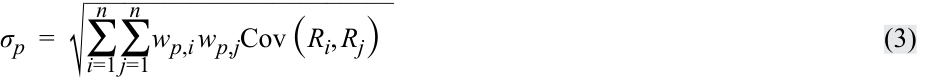
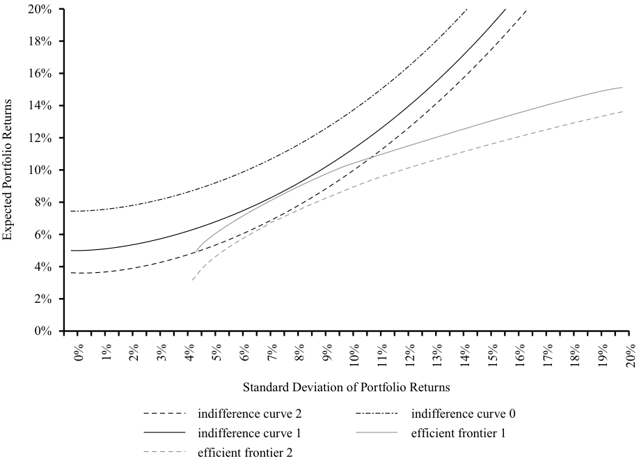

# Tập 9: Quản lý Danh mục Đầu tư (*Portfolio Management*)
## Học phần 4: Cơ bản về Lập kế hoạch và Xây dựng Danh mục Đầu tư (*Basics of Portfolio Planning and Construction*)
### Phần 2/3: Thu thập Thông tin Khách hàng (*Gathering Client Information*) (Trang PDF 185–200)

---

<!-- PDF Page 185 -->

ít hơn khi thị trường cổ phiếu hoạt động không tốt. Tương tự, người lao động cũng nên cảnh giác với việc nắm giữ các vị thế cổ phiếu tập trung vào vốn cổ phần của chính công ty nơi họ làm việc. Nếu công ty sử dụng lao động gặp khó khăn, nhân viên của công ty không những có thể bị mất việc làm mà danh mục đầu tư của họ cũng có thể phải hứng chịu sự sụt giảm giá trị nghiêm trọng. 

## **THU THẬP THÔNG TIN KHÁCH HÀNG (*GATHERING CLIENT INFORMATION*)** 

# **<mark>5</mark>** 

mô tả các mục tiêu rủi ro và tỷ suất sinh lợi cũng như cách thức xây dựng chúng cho một khách hàng 

mô tả các ràng buộc đầu tư về thanh khoản, thời hạn đầu tư, các vấn đề về thuế, các yếu tố pháp lý và quy định, cùng các hoàn cảnh đặc thù và hàm ý của chúng đối với việc lựa chọn tài sản trong danh mục đầu tư 

Như đã lưu ý trước đó, điều quan trọng đối với các nhà quản lý danh mục đầu tư và cố vấn đầu tư là phải hiểu rõ khách hàng của mình (*know their clients*). Ví dụ, tại Liên minh Châu Âu (EU), chỉ thị MiFID II yêu cầu các định chế tài chính trung gian phải thực hiện việc thu thập thông tin thực tế (*fact finding*) một cách kỹ lưỡng. Điều này được yêu cầu không chỉ trong trường hợp quản lý gia sản dịch vụ trọn gói (*full-service wealth management*) hoặc trong bối cảnh lập bản IPS, mà còn trong cả các hình thức trung gian tài chính “nhẹ nhàng hơn”, chẳng hạn như các mối quan hệ tư vấn (*advisory relationships* – trong đó khách hàng đưa ra quyết định đầu tư sau khi tham vấn cố vấn đầu tư hoặc nhà môi giới của họ) hoặc các mối quan hệ chỉ thực hiện lệnh (*execution-only relationships* – trong đó khách hàng tự đưa ra quyết định đầu tư một cách độc lập). 

Hoạt động thu thập thông tin thực tế về khách hàng nên diễn ra ngay từ khi bắt đầu mối quan hệ với khách hàng. Quy trình này sẽ bao gồm việc thu thập thông tin về hoàn cảnh của khách hàng cũng như thảo luận về các mục tiêu và yêu cầu của khách hàng. 

Những dữ liệu quan trọng cần thu thập từ một khách hàng phải bao quát tình hình gia đình và việc làm cũng như thông tin tài chính. Nếu khách hàng là một cá nhân, cũng có thể cần phải biết về tình hình và các yêu cầu của vợ/chồng hoặc các thành viên khác trong gia đình khách hàng. Tình trạng sức khỏe của khách hàng và những người phụ thuộc của họ cũng là thông tin có liên quan. Trong mối quan hệ với khách hàng tổ chức, điều quan trọng là phải biết về các bên liên quan chủ chốt (*key stakeholders*) trong tổ chức cũng như quan điểm và yêu cầu của họ là gì. Việc thu thập thông tin có thể được thực hiện theo cách không chính thức hoặc có thể bao gồm các cuộc phỏng vấn có cấu trúc, bảng câu hỏi khảo sát, hoặc phân tích dữ liệu. Nhiều cố vấn sẽ thu thập dữ liệu bằng phương thức điện tử và sử dụng các hệ thống chuyên dụng để ghi nhận dữ liệu và tạo ra các báo cáo được cá nhân hóa. 

Việc lưu trữ hồ sơ tốt (*good recordkeeping*) là rất quan trọng và có thể mang tính quyết định trong trường hợp bất kỳ khía cạnh nào của mối quan hệ với khách hàng xảy ra tranh chấp ở giai đoạn sau này. 

##### **VÍ DỤ 7** 

### **Marie Gascon: Mô tả các Ràng buộc (*Marie Gascon: Description of Constraints*)** 

Marie Gascon tiếp tục thảo luận về các yêu cầu đầu tư của mình với cố vấn tài chính của cô. Cố vấn bắt đầu phác thảo phần các ràng buộc của bản IPS. 

Gascon dự kiến rằng cô sẽ tiếp tục làm việc cho công ty dầu khí và mức thu nhập tương đối cao của cô sẽ tiếp tục duy trì trong tương lai gần có thể thấy trước. Gascon và chồng cô dự định không sinh thêm con nhưng kỳ vọng rằng con trai của họ sẽ học đại học vào năm 18 tuổi. Họ dự kiến rằng chi phí học tập của con trai có thể được trang trải từ thu nhập tiền lương của họ. 

Khoản dự trữ khẩn cấp 100.000 € của Gascon được xem là đủ để làm khoản dự phòng cho các khoản chi tiêu bất ngờ và các tình huống khẩn cấp. Khoản tiết kiệm hưu trí 900.000 € của cô đã được đóng góp vào tài khoản quỹ hưu trí đóng góp xác định (DC) của cô để tài trợ cho việc nghỉ hưu. Theo quy định của Pháp, các khoản đóng góp vào quỹ hưu trí 

<!-- PDF Page 186 -->

được trích trả từ thu nhập gộp (tức là thu nhập trước khi khấu trừ thuế), và tỷ suất sinh lợi của quỹ hưu trí được miễn thuế, nhưng các khoản chi trả lương hưu từ quỹ cho người nghỉ hưu sẽ bị đánh thuế như thu nhập của người nghỉ hưu. 

Liên quan đến danh mục đầu tư tiết kiệm hưu trí của Gascon, hãy tham chiếu lại Ví dụ 2 nếu cần và giải quyết các câu hỏi sau: 

1. Liên quan đến vấn đề thanh khoản, 

   - **A.** tối đa 50% danh mục đầu tư nên được đầu tư vào các tài sản có tính thanh khoản. 

   - **B.** danh mục đầu tư nên được đầu tư hoàn toàn vào các tài sản có tính thanh khoản vì nhu cầu chi tiêu cao. 

   - **C.** danh mục đầu tư không có nhu cầu về thanh khoản bởi vì không có các yêu cầu chi tiêu ngắn hạn. 

#### **Lời giải:** 

C là đáp án đúng. Các tài sản này dành cho mục đích sử dụng khi nghỉ hưu, tức là còn 20 năm nữa. Bất kỳ nhu cầu chi tiêu ngắn hạn nào cũng sẽ được đáp ứng từ các tài sản khác hoặc từ thu nhập tiền lương. 

2. Thời hạn đầu tư gần nhất với mức nào sau đây? 

   - **A.** 5 năm. 

   - **B.** 20 năm. 

   - **C.** 40 năm. 

#### **Lời giải:** 

B là đáp án đúng. Thời hạn đầu tư có liên quan là tính đến ngày nghỉ hưu, tức là 20 năm nữa. Các tài sản có thể không bị thanh lý tại thời điểm đó, nhưng việc tái cấu trúc lại danh mục đầu tư là điều được dự kiến khi Gascon bắt đầu rút thu nhập từ danh mục. 

3. Liên quan đến vấn đề thuế, danh mục đầu tư 

   - **A.** nên chú trọng vào lãi vốn bởi vì thu nhập định kỳ phải chịu thuế. 

   - **B.** nên chú trọng vào thu nhập định kỳ bởi vì lãi vốn phải chịu thuế. 

   - **C.** được miễn thuế và do đó bàng quan giữa thu nhập định kỳ và lãi vốn. 

#### **Lời giải:** 

C là đáp án đúng. Bởi vì không phải nộp thuế bên trong quỹ hưu trí, nên việc tỷ suất sinh lợi đến dưới hình thức thu nhập định kỳ hay lãi vốn không có gì khác biệt. 

4. Các yếu tố pháp lý và quy định quản lý chính áp dụng cho danh mục đầu tư là 

   - **A.** luật chứng khoán Hoa Kỳ. 

   - **B.** luật ngân hàng Châu Âu. 

   - **C.** các quy định về quỹ hưu trí của Pháp. 

#### **Lời giải:** 

C là đáp án đúng. Việc quản lý danh mục đầu tư sẽ phải tuân thủ bất kỳ quy tắc nào liên quan đến các quỹ hưu trí của Pháp. 

5. Liên quan đến các nhu cầu đặc thù, danh mục đầu tư nên 

   - **A.** có tỷ trọng cao vào các cổ phiếu ngành dầu khí và hàng hóa khác. 

   - **B.** chỉ được đầu tư vào các khoản đầu tư có trách nhiệm và bền vững. 

<!-- PDF Page 187 -->

   - **C.** không có mức tiếp xúc đáng kể với các cổ phiếu ngành dầu khí và hàng hóa khác. 

#### **Lời giải:** 

C là đáp án đúng. Vốn nhân lực (*human capital* – tức là thu nhập từ sức lao động trong tương lai) của Gascon chịu ảnh hưởng bởi triển vọng của ngành dầu khí. Nếu danh mục đầu tư của cô có mức tiếp xúc đáng kể với cổ phiếu dầu khí, cô sẽ làm gia tăng thêm một mức tiếp xúc rủi ro mà bản thân cô vốn đã gánh chịu sẵn. 

Ví dụ 8, ví dụ cuối cùng dựa trên trường hợp của Marie Gascon, cho thấy cách thức các thông tin thu được từ quá trình thu thập thông tin thực tế có thể được đưa vào phần mục tiêu và ràng buộc của một bản IPS như thế nào. 

##### **VÍ DỤ 8** 

### **Marie Gascon: Đề cương một Bản IPS (*Marie Gascon: Outline of an IPS*)** 

Dưới đây là một đoạn trích đã được giản lược từ bản IPS mà người cố vấn chuẩn bị cho Marie Gascon, bao gồm các mục tiêu và ràng buộc. 

##### **_Các Mục tiêu Rủi ro (Risk Objectives):_** 

- Danh mục đầu tư có thể gánh chịu mức rủi ro tương đối cao trong quá trình tìm cách đáp ứng các yêu cầu về tỷ suất sinh lợi. Với thời hạn đầu tư 20 năm cùng khối tài sản và thu nhập đáng kể, khách hàng có khả năng chấp nhận rủi ro trên mức trung bình. Khách hàng là một nhà đầu tư am hiểu kiến thức, có mức độ sẵn lòng chấp nhận rủi ro trên mức trung bình. Do đó, mức độ chấp nhận rủi ro của khách hàng ở trên mức trung bình, giải thích cho mục tiêu rủi ro của danh mục đầu tư đã nêu ở trên. 

- Danh mục đầu tư cần được đa dạng hóa tốt xét theo các loại tài sản và mức độ tập trung của các vị thế trong cùng một loại tài sản. Mặc dù khách hàng có mức độ chấp nhận rủi ro trên mức trung bình, các tài sản đầu tư vẫn cần được đa dạng hóa để kiểm soát rủi ro tổn thất thảm khốc (*catastrophic loss*). 

##### **_Các Mục tiêu Tỷ suất sinh lợi (Return Objectives):_** 

- Yêu cầu về tỷ suất sinh lợi dài hạn của danh mục đầu tư là 6,2% mỗi năm, tính theo giá trị danh nghĩa và sau khi trừ phí (*net of fees*), nhằm đáp ứng mục tiêu thu nhập hưu trí của khách hàng. 

##### **_Các Ràng buộc (Constraints):_** 

- _Thanh khoản (Liquidity)_ : Danh mục đầu tư bao gồm các tài sản thuộc quỹ hưu trí, và không có nhu cầu thanh khoản trong ngắn hạn đến trung hạn. 

- _Thời hạn Đầu tư (Time Horizon)_ : Danh mục đầu tư sẽ được đầu tư với thời hạn 20 năm. Khách hàng dự định nghỉ hưu sau 20 năm nữa, và tại thời điểm đó một khoản thu nhập sẽ được rút ra từ danh mục đầu tư. 

- _Tình trạng Thuế (Tax Status)_ : Theo luật pháp của Pháp, các khoản đóng góp vào quỹ được thực hiện từ thu nhập trước thuế và tỷ suất sinh lợi tạo ra trong quỹ được miễn thuế. Do đó, khách hàng hoàn toàn bàng quan giữa thu nhập định kỳ và lãi vốn bên trong quỹ. 

- _Các Yếu tố Pháp lý và Quy định (Legal and Regulatory Factors)_ : Việc quản lý danh mục đầu tư phải tuân thủ các quy định về quỹ hưu trí của Pháp. 

- _Các Nhu cầu Đặc thù (Unique Needs)_ : Khách hàng là một nhà điều hành trong ngành dầu khí. Danh mục đầu tư cần nỗ lực tối thiểu hóa các mức tiếp xúc tăng thêm đối với ngành dầu khí và các cổ phiếu có liên quan. 

<!-- PDF Page 188 -->

# **<mark>6</mark>** 

## **XÂY DỰNG DANH MỤC ĐẦU TƯ VÀ CÁC KỲ VỌNG THỊ TRƯỜNG VỐN (*PORTFOLIO CONSTRUCTION AND CAPITAL MARKET EXPECTATIONS*)** 

giải thích việc xác định các loại tài sản trong mối liên hệ với phân bổ tài sản; mô tả các nguyên tắc xây dựng danh mục đầu tư và vai trò của phân bổ tài sản trong mối liên hệ với IPS 

Một khi bản IPS đã được biên soạn xong, nhà quản lý đầu tư có thể xây dựng một danh mục đầu tư phù hợp. Phân bổ tài sản chiến lược (*strategic asset allocation*) là trọng tâm truyền thống của những bước đầu tiên trong quá trình xây dựng danh mục đầu tư. Phân bổ tài sản chiến lược được biểu thị dưới dạng tỷ lệ phần trăm phân bổ vào các loại tài sản (*asset classes*). Một **loại tài sản (*asset class*)** là một nhóm các tài sản có các đặc điểm, thuộc tính và mối quan hệ rủi ro – lợi nhuận tương tự nhau. **Phân bổ tài sản chiến lược (*strategic asset allocation* – SAA)** là tập hợp các mức tiếp xúc với những loại tài sản được phép đầu tư theo quy định của IPS, được kỳ vọng sẽ giúp đạt được các mục tiêu dài hạn của khách hàng xét trên hồ sơ rủi ro và các ràng buộc đầu tư của khách hàng đó. Một bản SAA có thể bao gồm một chính sách phòng vệ (*hedging*) các rủi ro của danh mục đầu tư chưa được bao quát một cách tường minh bởi tỷ trọng của các loại tài sản. Những ví dụ hiển nhiên là các tỷ lệ phòng vệ rủi ro (*hedge ratios*) đối với mức tiếp xúc ngoại tệ, hoặc việc quản lý rủi ro lãi suất phát sinh từ sự lệch pha giữa tài sản và nợ phải trả (*asset-liability mismatch*), cũng như việc phòng vệ rủi ro lạm phát. Các danh mục đầu tư “phủ ngoài (*overlay* portfolios)” sử dụng các công cụ phái sinh thường được dùng cho mục đích này. 

Sự tập trung vào SAA là kết quả của một số nguyên tắc đầu tư quan trọng. Nguyên tắc thứ nhất là rủi ro hệ thống (*systematic risk*) của một danh mục đầu tư giải thích cho phần lớn sự thay đổi giá trị của danh mục đó trong dài hạn. **Rủi ro hệ thống (*Systematic risk*)** là rủi ro liên quan đến hệ thống kinh tế (ví dụ: rủi ro liên quan đến chu kỳ kinh doanh) không thể bị loại bỏ bằng cách nắm giữ một danh mục đầu tư đa dạng hóa. Rủi ro này khác với **rủi ro phi hệ thống (*nonsystematic risk*)**, được định nghĩa là những rủi ro đặc thù riêng biệt của từng tài sản cụ thể, vốn có thể tránh được bằng cách nắm giữ các tài sản khác có những rủi ro bù trừ lẫn nhau. Nguyên tắc thứ hai là tỷ suất sinh lợi của các nhóm tài sản tương tự nhau (ví dụ: các khoản trái quyền nợ dài hạn) phản ánh một cách có thể dự đoán được mức tiếp xúc với những tập hợp nhân tố hệ thống nhất định (ví dụ: đối với các khoản trái quyền nợ, đó là những thay đổi bất ngờ của lãi suất). Như vậy, SAA là một phương tiện cung cấp cho nhà đầu tư mức tiếp xúc với các rủi ro hệ thống của các loại tài sản theo những tỷ trọng nhằm đáp ứng được các mục tiêu rủi ro và tỷ suất sinh lợi. 

Quy trình xây dựng một phân bổ tài sản chiến lược được dựa trên bản IPS (đã được thảo luận) và các kỳ vọng thị trường vốn (*capital market expectations*). 

### **Kỳ vọng Thị trường Vốn (*Capital Market Expectations*)** 

**Kỳ vọng thị trường vốn (*Capital market expectations*)** là những kỳ vọng của nhà đầu tư liên quan đến triển vọng rủi ro và tỷ suất sinh lợi của các loại tài sản, bất kể nhà đầu tư định nghĩa các loại tài sản đó rộng hay hẹp như thế nào. Khi được kết hợp với các mục tiêu đầu tư của khách hàng, kết quả thu được sẽ là phân bổ tài sản chiến lược dự kiến cho phép khách hàng đạt được các mục tiêu đầu tư của mình (ít nhất là trong các điều kiện thị trường vốn bình thường). 

Theo truyền thống, các kỳ vọng thị trường vốn được lượng hóa dưới dạng tỷ suất sinh lợi kỳ vọng của các loại tài sản, độ lệch chuẩn của tỷ suất sinh lợi, và hệ số tương quan giữa các cặp loại tài sản. Về mặt hình thức, tỷ suất sinh lợi kỳ vọng của một loại tài sản bao gồm lãi suất phi rủi ro (*risk-free rate*) và một hoặc nhiều phần bù rủi ro (*risk premiums*) gắn liền với loại tài sản đó. Trên thực tế, tỷ suất sinh lợi kỳ vọng được xây dựng theo nhiều cách khác nhau, bao gồm việc sử dụng các ước lượng lịch sử, phân tích kinh tế, và các loại mô hình định giá khác nhau. Các ước lượng về độ lệch chuẩn và hệ số tương quan thường được dựa trên dữ liệu lịch sử và các mô hình rủi ro. 

<!-- PDF Page 189 -->

## **PHÂN BỔ TÀI SẢN CHIẾN LƯỢC (*STRATEGIC ASSET ALLOCATION*)** 

# **<mark>7</mark>** 

giải thích việc xác định các loại tài sản trong mối liên hệ với phân bổ tài sản; mô tả các nguyên tắc xây dựng danh mục đầu tư và vai trò của phân bổ tài sản trong mối liên hệ với IPS 

Theo truyền thống, các nhà đầu tư phân biệt tiền mặt, cổ phiếu, trái phiếu (chính phủ và doanh nghiệp), và bất động sản là những loại tài sản chính. Trong những năm gần đây, danh sách này đã được mở rộng thêm với vốn cổ phần tư nhân (*private equity*), quỹ phòng hộ (*hedge funds*), trái phiếu lợi suất cao và trái phiếu thị trường mới nổi (*high-yield and emerging market bonds*), cùng hàng hóa (*commodities*). Ngoài ra, những tài sản như tác phẩm nghệ thuật và quyền sở hữu trí tuệ có thể được coi là các loại tài sản đối với những nhà đầu tư sẵn sàng áp dụng một cách tiếp cận mang tính đổi mới sáng tạo hơn và chấp nhận một mức độ kém thanh khoản nhất định. Việc gộp các loại tài sản mới như vậy cũng như các quỹ phòng hộ và vốn cổ phần tư nhân dưới tiêu đề chung là “các khoản đầu tư thay thế (*alternative investments*)” đã trở thành thông lệ được chấp nhận rộng rãi. 

Bởi vì phân bổ tài sản chiến lược được xây dựng từ các loại tài sản, nên quyết định về việc định nghĩa các loại tài sản đó như thế nào là một quyết định rất quan trọng. Việc định nghĩa các loại tài sản cũng quyết định mức độ mà nhà đầu tư kiểm soát các đặc tính rủi ro và tỷ suất sinh lợi của danh mục đầu tư cuối cùng. Ví dụ, việc tách trái phiếu thành trái phiếu chính phủ và trái phiếu doanh nghiệp, sau đó tiếp tục tách trái phiếu doanh nghiệp thành trái phiếu hạng đầu tư (*investment grade*) và trái phiếu dưới hạng đầu tư (lợi suất cao – *high yield*), đồng thời tách trái phiếu chính phủ thành trái phiếu chính phủ trong nước và nước ngoài, sẽ tạo ra bốn danh mục trái phiếu. Đối với các danh mục này, các kỳ vọng rủi ro – lợi nhuận có thể được thiết lập rõ ràng và hệ số tương quan với các loại tài sản khác (và, trong bối cảnh quản lý tài sản – nợ phải trả, là tương quan với các khoản nợ phải trả) có thể được ước lượng. Một nhà quản lý đầu tư muốn xem xét một cách tường minh các đặc tính rủi ro – lợi nhuận của những danh mục trái phiếu đó trong phân bổ tài sản chiến lược có thể chọn cách đối xử với chúng như những loại tài sản riêng biệt. Tương tự, đối với cổ phiếu, một số nhà đầu tư phân biệt giữa cổ phiếu thị trường mới nổi và cổ phiếu thị trường phát triển, giữa cổ phiếu trong nước và cổ phiếu quốc tế, hoặc giữa cổ phiếu vốn hóa lớn và cổ phiếu vốn hóa nhỏ. Trong một số môi trường pháp lý dành cho các nhà đầu tư tổ chức, các định nghĩa về loại tài sản là bắt buộc, qua đó buộc các nhà quản lý đầu tư phải xác lập rõ kỳ vọng rủi ro – lợi nhuận (và áp dụng quản trị rủi ro) trên các loại tài sản đã được chỉ định. Ngược lại, việc phân loại rộng hơn đối với các loại tài sản sẽ nhường quyền phân bổ giữa các danh mục trái phiếu và cổ phiếu khác nhau cho các nhà quản lý chịu trách nhiệm trực tiếp về các loại tài sản đó. 

Khi định nghĩa các loại tài sản, có một số tiêu chí cần được áp dụng. Về mặt trực giác, một loại tài sản nên bao gồm các tài sản tương đối đồng nhất (*homogeneous assets*) với nhau trong khi vẫn mang lại sự đa dạng hóa tương đối so với các loại tài sản khác. Xét về mặt thống kê, các kỳ vọng về rủi ro và tỷ suất sinh lợi phải tương tự nhau, và các hệ số tương quan từng cặp (*paired correlations*) của các tài sản phải tương đối cao bên trong cùng một loại tài sản nhưng phải thấp hơn khi so với các tài sản thuộc các loại tài sản khác. Đồng thời, các loại tài sản, trong khi phải loại trừ lẫn nhau (*mutually exclusive*), khi cộng gộp lại phải xấp xỉ bao quát đủ tập hợp đầu tư khả thi (*investable universe*) có liên quan. Việc áp dụng các tiêu chí này đảm bảo rằng quy trình phân bổ tài sản chiến lược đã xem xét tất cả các phương án đầu tư thay thế hiện có. 

##### **VÍ DỤ 9** 

### **Xác định các Loại Tài sản (*Specifying Asset Classes*)** 

Phân bổ tài sản chiến lược của nhiều nhà đầu tư tổ chức tạo ra sự phân biệt giữa cổ phiếu trong nước và cổ phiếu quốc tế hoặc giữa cổ phiếu thị trường phát triển và cổ phiếu thị trường mới nổi. Thông thường, cổ phiếu còn được tách thành các khung quy mô vốn hóa thị trường khác nhau, tạo ra, ví dụ, một loại tài sản như cổ phiếu vốn hóa nhỏ trong nước (*domestic small-cap equity*). 

<!-- PDF Page 190 -->

Ma trận tương quan trong Bảng minh họa 5 cho thấy các hệ số tương quan từng cặp của tỷ suất sinh lợi hàng tháng giữa các loại tài sản cổ phiếu khác nhau và các loại tài sản khác. Cụ thể, các hệ số tương quan này được đo lường trong giai đoạn từ tháng 12 năm 2000 đến hết tháng 8 năm 2018. Ngoài ra, bảng minh họa còn cho thấy độ biến động năm hóa (*annualized volatility*) của tỷ suất sinh lợi hàng tháng. 

##### **Bảng minh họa 5: Ma trận Tương quan các Loại Tài sản (*Asset Class Correlation Matrix*)** 

|**Hệ số tương quan (*Correlations*)**|**Cổ phiếu Hoa Kỳ (*US Equities*)**|**Cổ phiếu Thị trường Mới nổi (*Emerging Markets Equities*)**|**Cổ phiếu Châu Âu (*European Equities*)**|**Cổ phiếu Nhật Bản (*Japanese Equities*)**|**Cổ phiếu Vốn hóa Nhỏ Hoa Kỳ (*US Small-Cap Equities*)**|**Hàng hóa (*Commodities*)**|**Trái phiếu Chính phủ Châu Âu (*European Gov’t. Bonds*)**|**Trái phiếu Kho bạc Hoa Kỳ (*US Treasuries*)**|**Tín dụng Hoa Kỳ (*US Credits*)**|**Tín dụng Lợi suất Cao Hoa Kỳ (*US High-Yield Credit*)**|
|---|---|---|---|---|---|---|---|---|---|---|
|Cổ phiếu Hoa Kỳ (*US Equities*)|1,00|0,78|0,88|0,59|0,89|0,32|0,08|–0,37|0,19|0,66|
|Cổ phiếu Thị trường Mới nổi (*Emerging Markets Equities*)|0,78|1,00|0,84|0,64|0,75|0,46|0,21|–0,24|0,34|0,70|
|Cổ phiếu Châu Âu (*European Equities*)|0,88|0,84|1,00|0,64|0,79|0,43|0,16|–0,28|0,29|0,68|
|Cổ phiếu Nhật Bản (*Japanese Equities*)|0,59|0,64|0,64|1,00|0,57|0,32|0,24|–0,18|0,29|0,52|
|Cổ phiếu Vốn hóa Nhỏ Hoa Kỳ (*US Small-Cap Equities*)|0,89|0,75|0,79|0,57|1,00|0,32|0,09|–0,36|0,19|0,69|
|Hàng hóa (*Commodities*)|0,32|0,46|0,43|0,32|0,32|1,00|0,13|–0,18|0,12|0,36|
|Trái phiếu Chính phủ Châu Âu (*European Gov’t. Bonds*)|0,08|0,21|0,16|0,24|0,09|0,13|1,00|0,45|0,60|0,30|
|Trái phiếu Kho bạc Hoa Kỳ (*US Treasuries*)|–0,37|–0,24|–0,28|–0,18|–0,36|–0,18|0,45|1,00|0,58|–0,19|
|Tín dụng Hoa Kỳ (*US Credits*)|0,19|0,34|0,29|0,29|0,19|0,12|0,60|0,58|1,00|0,54|
|Tín dụng Lợi suất Cao Hoa Kỳ (*US High-Yield Credit*)|0,66|0,70|0,68|0,52|0,69|0,36|0,30|–0,19|0,54|1,00|
|Độ biến động (*Volatility*)|14,3%|21,6%|18,4%|15,6%|18,4%|22,3%|4,9%|4,4%|5,5%|9,3%|

_Các hệ số tương quan và độ biến động đã được tính toán bằng cách sử dụng tỷ suất sinh lợi hàng tháng từ tháng 12 năm 2000 đến hết tháng 8 năm 2018, không phòng vệ rủi ro tỷ giá, tính bằng USD._ 

_Nguồn:_ MSCI, Bloomberg, S&P. 

Chỉ dựa trên những thông tin được cung cấp, hãy giải quyết các yêu cầu sau: 

1. Hãy đối chiếu các hệ số tương quan giữa các loại tài sản cổ phiếu với nhau và các hệ số tương quan giữa các loại tài sản cổ phiếu với Trái phiếu Kho bạc Hoa Kỳ (*US Treasuries*). 

#### **Lời giải:** 

Ma trận cho thấy mối tương quan rất mạnh giữa các loại tài sản cổ phiếu với nhau. Ví dụ, hệ số tương quan giữa cổ phiếu Châu Âu và cổ phiếu Hoa Kỳ là 0,88. Tuy nhiên, hệ số tương quan của cổ phiếu với trái phiếu lại thấp hơn nhiều. Ví dụ, cổ phiếu Hoa Kỳ, cổ phiếu thị trường mới nổi, cổ phiếu Châu Âu, và cổ phiếu Nhật Bản đều có tương quan âm với trái phiếu chính phủ Hoa Kỳ (lần lượt là –0,37; –0,24; –0,28; và –0,18). Tuy nhiên, cần lưu ý rằng các hệ số tương quan có thể thay đổi theo thời gian và các giá trị được hiển thị có thể mang tính đặc thù đối với giai đoạn mẫu được sử dụng. 

<!-- PDF Page 191 -->

2. Tỷ suất sinh lợi hàng tháng của loại tài sản cổ phiếu nào có sự khác biệt lớn nhất so với cổ phiếu Hoa Kỳ? 

#### **Lời giải:** 

Trong số các loại tài sản cổ phiếu được liệt kê trong bảng, hệ số tương quan giữa cổ phiếu Hoa Kỳ và cổ phiếu Nhật Bản là thấp nhất, ở mức 0,59. Ngược lại, các hệ số tương quan giữa cổ phiếu Hoa Kỳ với cổ phiếu thị trường mới nổi, cổ phiếu Châu Âu, và cổ phiếu vốn hóa nhỏ Hoa Kỳ đều từ 0,78 trở lên. 

Nếu sử dụng hệ số tương quan làm thước đo, Ví dụ 9 có xu hướng chỉ ra rằng chỉ có cổ phiếu Nhật Bản (và ở mức độ thấp hơn là thị trường mới nổi) mới có sự phân hóa rõ nét so với các cổ phiếu khác. Vậy tại sao các nhà đầu tư vẫn thường chia nhỏ cổ phiếu ra thành nhiều phân nhóm? Ngoài bất kỳ lý do pháp lý nào, một lời giải thích có thể là việc phân tách thành các loại tài sản nhỏ hơn như vậy tương ứng với cách thức cấu trúc phân bổ tài sản trong thực tế của các danh mục đầu tư. Nhiều nhà quản lý đầu tư chỉ có chuyên môn sâu độc quyền trong những lĩnh vực cụ thể của thị trường, chẳng hạn như cổ phiếu thị trường mới nổi, cổ phiếu vốn hóa nhỏ của Hoa Kỳ, hoặc tín dụng hạng đầu tư quốc tế. Việc đưa các định nghĩa về loại tài sản của quá trình phân bổ tài sản đồng bộ với các sản phẩm đầu tư thực tế hiện có trên thị trường có thể giúp đơn giản hóa mọi việc dưới góc độ tổ chức vận hành. 

Hồ sơ rủi ro – lợi nhuận của phân bổ tài sản chiến lược phụ thuộc vào tỷ suất sinh lợi kỳ vọng và rủi ro của từng loại tài sản riêng lẻ, cũng như mối tương quan giữa các loại tài sản đó. Nhìn chung, việc bổ sung thêm các loại tài sản có độ tương quan thấp sẽ cải thiện sự đánh đổi giữa rủi ro và tỷ suất sinh lợi (mang lại nhiều tỷ suất sinh lợi hơn cho cùng một mức rủi ro tương tự). Thông thường, phân bổ tài sản chiến lược cho các nhà đầu tư ngại rủi ro (*risk-averse investors*) sẽ có tỷ trọng lớn vào trái phiếu chính phủ và tiền mặt, trong khi những nhà đầu tư có mức độ sẵn lòng và khả năng chấp nhận rủi ro cao hơn sẽ phân bổ nhiều tài sản của mình hơn vào các loại tài sản có rủi ro, chẳng hạn như cổ phiếu và nhiều loại hình đầu tư thay thế. 

Thông lệ phổ biến là đại diện cho các loại tài sản bằng cách sử dụng các tiêu chuẩn tham chiếu (*benchmarks*) và các tập hợp cổ phiếu (*universes*) được tính toán bởi các nhà cung cấp chỉ số như FTSE, MSCI, hoặc Bloomberg. Một chính sách sàng lọc tiêu cực (*negative screening*) hoặc chọn lọc **tốt nhất trong nhóm ngành (*best-in-class*)** (đã thảo luận trước đó) sẽ làm giới hạn số lượng chứng khoán có thể lựa chọn, có khả năng tác động đến các ước lượng về rủi ro và tỷ suất sinh lợi kỳ vọng của các loại tài sản này. Một số ví dụ về việc loại trừ có thể là các công ty sản xuất vũ khí gây tranh cãi hoặc các công ty thuốc lá, hay các khoản đầu tư vào một số quốc gia nhất định. Khi những sự loại trừ như vậy được áp dụng, các ước lượng về rủi ro và tỷ suất sinh lợi dựa trên các tiêu chuẩn tham chiếu loại tài sản thông thường có sẵn (“*off-the-shelf*”) có thể không còn phù hợp để áp dụng nữa. Các chỉ số tham chiếu riêng biệt phản ánh những sự loại trừ đó có thể được cung cấp bởi các tổ chức xây dựng chỉ số nhằm giảm thiểu vấn đề này. 

ABP là quỹ hưu trí dành cho các nhân viên khu vực chính phủ Hà Lan. Quỹ này cung cấp cho giáo viên, cảnh sát, quân nhân và các công chức khác một chương trình hưu trí phúc lợi xác định (DB), nhắm tới mức lương hưu bằng 70% thu nhập thực trung bình trong suốt sự nghiệp của người lao động. Tính đến quý đầu tiên của năm 2018, ABP có 405 tỷ € tài sản đang được quản lý. Phân bổ tài sản chiến lược tính đến giai đoạn này được trình bày trong Bảng minh họa 6. 

**Bảng minh họa 6: Phân bổ Tài sản Chiến lược của Quỹ ABP (*Strategic Asset Allocation for ABP*)** 

|**Cổ phiếu (*Equity*)**||
|---|---|
|Cổ phiếu, các quốc gia phát triển (*Equities, developed countries*)|27%|
|Cổ phiếu, các thị trường mới nổi (*Equities, emerging markets*)|9%|
|**_Tổng cổ phiếu (Total equity)_**|**_36%_**|

<!-- PDF Page 192 -->

|**Loại tài sản**|**Tỷ trọng**|
|---|---|
|**Đầu tư thay thế (*Alternatives*)**||
|Bất động sản (*Real estate*)|10%|
|Vốn cổ phần tư nhân (*Private equity*)|5%|
|Quỹ phòng hộ (*Hedge funds*)|4%|
|Hàng hóa (*Commodities*)|5%|
|Cơ sở hạ tầng (*Infrastructure*)|3%|
|**_Tổng đầu tư thay thế (Total alternatives)_**|**_27%_**|
|**Chứng khoán thu nhập cố định (*Fixed-income securities*)**||
|Trái phiếu chính phủ (*Government bonds*)|13%|
|Trái phiếu doanh nghiệp (*Corporate bonds*)|13%|
|Trái phiếu liên kết lạm phát (*Inflation-linked bonds*)|8%|
|Trái phiếu thị trường mới nổi (*Emerging market bonds*)|3%|
|**_Tổng thu nhập cố định (Total fixed income)_**|**_37%_**|
|**Tổng cộng (*Total*)**|100%|

_Nguồn:_ Báo cáo Quý 1 năm 2018 của ABP. 

Một phân bổ tài sản chiến lược là kết quả của việc kết hợp các ràng buộc và mục tiêu được nêu rõ trong bản IPS với các kỳ vọng thị trường vốn dài hạn liên quan đến các loại tài sản. Phân bổ tài sản chiến lược hay danh mục đầu tư chính sách (*policy portfolio*) sau đó sẽ được triển khai thành các danh mục đầu tư thực tế. Bảng minh họa 7 minh họa về mặt khái niệm cách thức các mục tiêu và ràng buộc đầu tư cùng các kỳ vọng thị trường vốn dài hạn kết hợp lại với nhau để tạo thành một danh mục đầu tư chính sách. 

**Bảng minh họa 7: Quy trình Phân bổ Tài sản Chiến lược (*Strategic Asset Allocation Process*)** 

> **Chú thích hình ảnh:** Sơ đồ quy trình Phân bổ Tài sản Chiến lược (*Strategic Asset Allocation*): Sự kết hợp giữa Kỳ vọng Thị trường Vốn Dài hạn (*Long-Term Capital Market Expectations*) và Các Mục tiêu & Ràng buộc Đầu tư (*Investment Objectives and Constraints - IPS*) thông qua Tối ưu hóa và/hoặc Mô phỏng (*Optimization and/or Simulation*) để tạo ra Phân bổ Tài sản Chiến lược (*Strategic Asset Allocation*).

<!-- Picture Text: Long-Term Capital Market Investment Objectives Expectations and Constraints (IPS) Optimization and/or Simulation Strategic Asset Allocation  -->

Trong một số khuôn khổ được sử dụng trên thực tế, phân bổ tài sản là một bộ phận cấu thành không thể tách rời của bản tuyên bố chính sách đầu tư. Tuy nhiên, cách trình bày này tách biệt việc phân bổ tài sản ra khỏi bản tuyên bố chính sách đầu tư bởi vì các mục tiêu và ràng buộc đầu tư của khách hàng có bản chất định tính khác biệt so với các kỳ vọng thị trường vốn, do đó đòi hỏi các loại hình phân tích khác nhau, các nguồn thông tin khác nhau, và các chu kỳ rà soát đánh giá khác nhau. 

Sự kết hợp giữa các mục tiêu/ràng buộc đầu tư và các kỳ vọng thị trường vốn về mặt lý thuyết diễn ra bằng cách sử dụng các kỹ thuật tối ưu hóa (*optimization techniques*). Trong phần này, chúng tôi áp dụng phương pháp tối ưu hóa kỳ vọng – phương sai (*mean–variance optimization*) cho một tập hợp mẫu gồm các mục tiêu và ràng buộc đầu tư, 

<!-- PDF Page 193 -->

sử dụng một tập hợp đầu tư đi kèm với các kỳ vọng thị trường tương ứng. Chúng ta giả định rằng các nhà đầu tư khi lựa chọn từ một loạt các phương án phân bổ tài sản có tỷ suất sinh lợi tương đương nhau sẽ ưa thích những phương án có rủi ro thấp hơn. Khi lựa chọn từ các phương án phân bổ có mức độ rủi ro tương đương nhau, các nhà đầu tư sẽ ưa thích những phương án có tỷ suất sinh lợi cao nhất. Về mặt hình thức, các mục tiêu rủi ro và tỷ suất sinh lợi của nhà đầu tư có thể được mô tả dưới dạng một hàm hữu dụng (*utility function*), trong đó độ hữu dụng (*utility*) tăng lên khi tỷ suất sinh lợi kỳ vọng cao hơn và rủi ro thấp hơn. Giả định này có thể mang lại một phương trình độ hữu dụng kỳ vọng như được trình bày trong Phương trình 1.4 

$$U_p = E(R_p) - \lambda \sigma_p^2 \tag{1}$$

<!-- Formula Text: U p  =  E (R p)  − λ σ p 2 (1) -->

trong đó 

$$U_p = \text{độ hữu dụng kỳ vọng của nhà đầu tư từ danh mục đầu tư}$$

<!-- Formula Text: Up = the investor’s expected utility from the portfolio -->

$E(R_p) =$ tỷ suất sinh lợi kỳ vọng của danh mục đầu tư (*the expected return of the portfolio*) 

$$\sigma_p = \text{độ lệch chuẩn tỷ suất sinh lợi của danh mục đầu tư}$$

<!-- Formula Text: σp = the standard deviation of returns of the portfolio -->

$\lambda =$ một thước đo mức độ ngại rủi ro của nhà đầu tư (*a measure of the investor’s risk aversion*) 

> 4 Thông thường, hệ số $\lambda$ được viết dưới dạng $\frac{1}{2}\lambda$ hoặc $0,005\lambda$ tùy theo quy ước đơn vị tính phần trăm hay số thập phân trong chương trình CFA.

Hàm hữu dụng này biểu thị mối quan hệ đồng biến (*positive relationship*) giữa độ hữu dụng và tỷ suất sinh lợi kỳ vọng của danh mục đầu tư (tức là tỷ suất sinh lợi kỳ vọng cao hơn làm tăng độ hữu dụng, khi các yếu tố khác không đổi) và mối quan hệ nghịch biến (*negative relationship*) giữa độ hữu dụng và độ biến động tỷ suất sinh lợi của danh mục được đo lường bằng phương sai tỷ suất sinh lợi của danh mục đầu tư. Mối quan hệ nghịch biến càng mạnh thì mức độ ngại rủi ro (*risk aversion*) của nhà đầu tư càng lớn. Danh mục đầu tư được hiểu là đại diện cho một phương án phân bổ tài sản cụ thể. Phương án phân bổ tài sản mang lại độ hữu dụng kỳ vọng cao nhất chính là phương án tối ưu cho nhà đầu tư xét trên mức độ ngại rủi ro của người đó. 

Ứng với các giá trị khác nhau của $U_p$, một đường cong có thể được vẽ ra để nối kết những tổ hợp rủi ro và tỷ suất sinh lợi kỳ vọng cùng tạo ra mức độ hữu dụng đó: một đường bàng quan (*indifference curve*). Một nhà đầu tư sẽ đạt được độ hữu dụng ngang bằng nhau từ tất cả các tổ hợp rủi ro – lợi nhuận nằm trên đường cong đó. 

Các kỳ vọng thị trường vốn, được quy định cụ thể bằng tỷ suất sinh lợi kỳ vọng, độ lệch chuẩn của tỷ suất sinh lợi, và hệ số tương quan của các loại tài sản, sẽ được chuyển hóa thành một đường biên hiệu quả (*efficient frontier*) của các danh mục đầu tư. Tỷ suất sinh lợi kỳ vọng của một danh mục đầu tư đa tài sản được cho bởi công thức: 

$$E(R_p) = \sum_{i=1}^{n} w_i E(R_i) \tag{2}$$

<!-- Formula Text: E (R p)   =  ∑ i=1 n w i E (R i) (2) -->

trong đó $w_i$ bằng tỷ trọng của loại tài sản $i$ trong danh mục đầu tư, và rủi ro của danh mục được cho bởi công thức: 

$$\sigma_p = \sqrt{\sum_{i=1}^{n} \sum_{j=1}^{n} w_{p,i} w_{p,j} \text{Cov}(R_i, R_j)} \tag{3}$$

<!-- Formula Text: σ p  =  √ _______________________ ∑ i=1 n ∑ j=1 n w p,i w p,jCov (R i, R j) (3) -->

Hiệp phương sai (*covariance*) giữa tỷ suất sinh lợi của loại tài sản $i$ và $j$ được tính bằng tích số giữa hệ số tương quan của hai loại tài sản đó với độ lệch chuẩn tỷ suất sinh lợi của chúng: 

$$\text{Cov}(R_i, R_j) = \rho_{i,j} \sigma_i \sigma_j \tag{4}$$

trong đó 

$\text{Cov}(R_i, R_j) =$ hiệp phương sai giữa tỷ suất sinh lợi của loại tài sản $i$ và $j$ (*the covariance between the return of asset classes $i$ and $j$*) 

$$\rho_{i,j} = \text{hệ số tương quan giữa tỷ suất sinh lợi của loại tài sản } i \text{ và } j$$

<!-- Formula Text: ρi,j = the correlation between the returns of asset classes i and j -->

Các danh mục đầu tư kết quả có thể được biểu diễn dưới dạng một đám mây các điểm phân tán trên một biểu đồ mô tả rủi ro và tỷ suất sinh lợi kỳ vọng của chúng. Bởi vì rủi ro của một danh mục đầu tư là một hàm đồng biến theo rủi ro của các tài sản thành phần và các hệ số tương quan giữa chúng, nên một danh mục đầu tư bao gồm các tài sản rủi ro có độ tương quan thấp sẽ có mức rủi ro thấp hơn so với một danh mục gồm các tài sản có độ rủi ro tương tự nhưng có độ tương quan cao. Do đó, hoàn toàn có thể xây dựng các danh mục đầu tư khác nhau có tỷ suất sinh lợi kỳ vọng bằng nhau nhưng có các mức độ rủi ro khác nhau. Đường cong nối kết những 

<!-- PDF Page 194 -->

danh mục đầu tư có mức rủi ro tối thiểu ứng với mỗi mức tỷ suất sinh lợi kỳ vọng (nằm phía trên **danh mục đầu tư có phương sai tối thiểu – *minimum-variance portfolio***, tức danh mục có phương sai nhỏ nhất xét trên toàn bộ tập hợp) chính là đường biên hiệu quả (*efficient frontier*). Rõ ràng là đường biên hiệu quả sẽ dịch chuyển “lên phía trên (*upward*)” khi có thêm nhiều tài sản có độ tương quan thấp với mức tỷ suất sinh lợi kỳ vọng đủ tốt được đưa thêm vào cơ cấu danh mục, bởi vì điều đó làm giảm rủi ro trong các danh mục đầu tư ứng với các mức tỷ suất sinh lợi kỳ vọng ngang bằng nhau. Tương tự, khi kỳ vọng tỷ suất sinh lợi của các loại tài sản tăng lên trong khi các giả định về độ biến động và hệ số tương quan giữ nguyên không đổi, đường biên hiệu quả sẽ dịch chuyển lên phía trên bởi vì mỗi danh mục đầu tư đều có khả năng tạo ra tỷ suất sinh lợi cao hơn cho cùng một mức độ rủi ro. 

Cả đường biên hiệu quả và một họ các đường bàng quan đều có thể được vẽ trên không gian rủi ro – lợi nhuận (*risk–return space*). Trong Bảng minh họa 8, các đường cong màu sẫm lõm nhìn từ phía dưới lên đại diện cho các đường biên hiệu quả gắn liền với các mức tỷ suất sinh lợi kỳ vọng giả định khác nhau. Các đường cong màu nhạt hơn là các đường bàng quan. Điểm mà tại đó đường biên hiệu quả giao cắt (tiếp xúc) với đường bàng quan có mức độ hữu dụng cao nhất có thể đạt được (tức là tiếp điểm – *point of tangency*) đại diện cho phương án phân bổ tài sản tối ưu cho khách hàng/nhà đầu tư. Trong Bảng minh họa 8, đường biên hiệu quả 1 (*efficient frontier 1*) có tiếp điểm với đường bàng quan 1 (*indifference curve 1*). Các mức độ hữu dụng cao hơn, chẳng hạn như những mức gắn liền với đường bàng quan 0 (*indifference curve 0*), rõ ràng là không thể đạt tới được với các tài sản cơ sở tạo nên đường biên hiệu quả này. Rõ ràng là khi các kỳ vọng thị trường vốn thay đổi, sự thay đổi này sẽ làm dịch chuyển đường biên hiệu quả ra khỏi vị trí ban đầu của nó. Trên biểu đồ, sự dịch chuyển này được minh họa bằng đường biên hiệu quả 2 (*efficient frontier 2*), phản ánh các kỳ vọng thị trường vốn khác đi. Đường biên hiệu quả mới này có tiếp điểm với đường bàng quan 2 (*indifference curve 2*), vốn gắn liền với một mức độ hữu dụng kỳ vọng thấp hơn. Bởi vì tiếp điểm đại diện cho phân bổ tài sản chiến lược, điều này hàm ý rằng việc phân bổ tài sản cần phải được điều chỉnh lại. Tương tự, nếu các mục tiêu hoặc ràng buộc đầu tư thay đổi, các đường bàng quan sẽ thay đổi hình dạng và vị trí của chúng. Sự thay đổi này sẽ một lần nữa làm dịch chuyển vị trí của tiếp điểm, và do đó làm thay đổi sự phân bổ tài sản. 

**Bảng minh họa 8: Đường biên Hiệu quả của Phân bổ Tài sản Chiến lược (*Strategic Asset Allocation Efficient Frontier*)** 

> **Chú thích hình ảnh:** Đồ thị biểu diễn Tỷ suất sinh lợi kỳ vọng của danh mục (*Expected Portfolio Returns* trên trục tung, từ 0% đến 20%) theo Độ lệch chuẩn tỷ suất sinh lợi của danh mục (*Standard Deviation of Portfolio Returns* trên trục hoành, từ 0% đến 20%), cho thấy các tiếp điểm giữa đường biên hiệu quả 1 & 2 (*efficient frontier 1, 2*) với các đường bàng quan 0, 1, 2 (*indifference curve 0, 1, 2*).

<!-- Picture Text: 20% 18% 16% 14% 12% 10% 8% 6% 4% 2% 0% Standard Deviation of Portfolio Returns indifference curve 2 indifference curve 0 indifference curve 1 efficient frontier 1 efficient frontier 2 Expected Portfolio Returns 0% 1% 2% 3% 4% 5% 6% 7% 8% 9% 10% 11% 12% 13% 14% 15% 16% 17% 18% 19% 20%  -->

<!-- PDF Page 195 -->

Khuôn khổ này mô tả cách thức dung hòa về mặt lý thuyết giữa các mục tiêu của nhà đầu tư và các kỳ vọng thị trường vốn. Tuy nhiên, đây sẽ không phải là quy trình chính xác tuyệt đối được tuân theo trên thực tế. Thứ nhất, một bản IPS không nhất thiết phải chuyển hóa các mục tiêu và ràng buộc đầu tư của khách hàng thành một hàm hữu dụng toán học. Thay vào đó, một bản IPS đưa ra các mức ngưỡng giới hạn (*threshold levels*) cho rủi ro và tỷ suất sinh lợi kỳ vọng, kết hợp với một số ràng buộc bổ sung không thể nắm bắt hết được trong mô hình này. Thứ hai, mô hình được minh họa là một mô hình đơn kỳ (*single-period model*), trong khi trên thực tế, các ràng buộc từ bản IPS sẽ khiến việc sử dụng các mô hình đa kỳ (*multi-period models*) trở nên phù hợp hơn. Các bài toán đa kỳ có thể được giải quyết một cách hiệu quả hơn bằng cách sử dụng phương pháp mô phỏng (*simulation*). 

##### **VÍ DỤ 10** 

### **Tiếp cận Phân bổ Tài sản Chiến lược (SAA) cho một Nhà đầu tư Cá nhân (*Approaching a SAA for a Private Investor*)** 

1. Rainer Gottschalk gần đây đã bán công ty xây dựng nhà ở địa phương của mình tại miền nam nước Đức cho một tập đoàn xây dựng nhà ở lớn có phạm vi hoạt động trên toàn quốc. Sau khi bán công ty, ông nhận công việc làm giám đốc khu vực cho chính tập đoàn xây dựng toàn quốc đó. Gottschalk hiện đang cân nhắc về tương lai tài chính của bản thân và gia đình mình. Ông rất hào hứng với công việc mới—ông yêu thích vai trò mới của mình, và vị trí này mang lại cho ông nguồn thu nhập đủ để đáp ứng các nhu cầu thanh khoản ngắn hạn và trung hạn của gia đình. Gottschalk có quan điểm rất mạnh mẽ rằng ông không nên đầu tư số tiền thu được từ việc bán công ty của mình vào bất động sản bởi vì thu nhập của ông vốn đã phụ thuộc vào tình hình của thị trường bất động sản. Đồng thời, phản ánh các giá trị của gia đình, ông cảm thấy mạnh mẽ rằng tiền tiết kiệm của mình không nên hỗ trợ cho ngành công nghiệp thuốc lá. Do đó, ông muốn phần phân bổ cổ phiếu của mình phải loại trừ bất kỳ cổ phiếu nào của các nhà sản xuất hoặc nhà bán lẻ sản phẩm thuốc lá. Gottschalk tham vấn một cố vấn tài chính từ ngân hàng của ông về cách thức đầu tư tiền để nghỉ hưu với khối tài sản sung túc sau 20 năm nữa. 

Bản IPS do cố vấn của ông xây dựng đề xuất một mục tiêu tỷ suất sinh lợi là 5%, với độ lệch chuẩn là 10%. Bộ phận quản lý tài sản của ngân hàng cung cấp cho Gottschalk và cố vấn của ông các dữ liệu sau đây (Bảng minh họa 9, Bảng 1) về các kỳ vọng thị trường. Người cố vấn ước tính rằng việc loại trừ ngành thuốc lá ra khỏi tập hợp đầu tư sẽ làm ảnh hưởng đến tỷ suất sinh lợi kỳ vọng của cổ phiếu Châu Âu ở mức –0,2% và làm thay đổi độ lệch chuẩn hàng năm ở mức +0,1%. Tác động lên cổ phiếu thị trường mới nổi và lên cấu trúc tương quan được đánh giá là không đáng kể. Gottschalk chấp nhận kết quả của những tính toán này như được trình bày trong Bảng minh họa 9, Bảng 2. 

**Bảng minh họa 9: Các Ước lượng về Rủi ro, Tỷ suất sinh lợi và Hệ số tương quan (*Risk, Return, and Correlation Estimates*)** 

||**Tỷ suất sinh lợi kỳ vọng (*Expected Return*)**|**Độ lệch chuẩn (*Standard Deviation*)**|**Ma trận tương quan: Cổ phiếu Châu Âu (*European Equities*)**|**Ma trận tương quan: Cổ phiếu Thị trường Mới nổi (*Emerging Mkt Equities*)**|**Ma trận tương quan: Trái phiếu Chính phủ Châu Âu (*European Govt Bonds*)**|
|---|---|---|---|---|---|
|**Bảng 1 (*Panel 1*)**||||||
|Cổ phiếu Châu Âu (*European equities*)|6,0%|15,0%|1,00|0,78|–0,08|
|Cổ phiếu thị trường mới nổi (*Emerging market equities*)|8,0%|20,1%|0,78|1,00|–0,07|
|Trái phiếu chính phủ Châu Âu (*European government bonds*)|2,0%|7,8%|–0,08|–0,07|1,00|
|**Bảng 2 (*Panel 2*)**||||||

<!-- PDF Page 196 -->

||**Tỷ suất sinh lợi kỳ vọng (*Expected Return*)**|**Độ lệch chuẩn (*Standard Deviation*)**|**Ma trận tương quan: Cổ phiếu Châu Âu (*European Equities*)**|**Ma trận tương quan: Cổ phiếu Thị trường Mới nổi (*Emerging Mkt Equities*)**|**Ma trận tương quan: Trái phiếu Chính phủ Châu Âu (*European Govt Bonds*)**|
|---|---|---|---|---|---|
|Cổ phiếu Châu Âu (*European equities*)|5,8%|15,1%|1,00|0,78|–0,08|
|Cổ phiếu thị trường mới nổi (*Emerging market equities*)|8,0%|20,1%|0,78|1,00|–0,07|
|Trái phiếu chính phủ Châu Âu (*European government bonds*)|2,00%|7,8%|–0,08|–0,07|1,00|

_Độ lệch chuẩn và hệ số tương quan được tính toán trong giai đoạn từ tháng 3 năm 1999 đến tháng 8 năm 2018. Tất cả dữ liệu tính bằng đồng euro không phòng vệ rủi ro tỷ giá._ 

_Nguồn:_ MSCI, Bloomberg. 

Để minh họa các khả năng có thể xảy ra, người cố vấn trình bày cho Gottschalk biểu đồ sau đây (Bảng minh họa 10), trong đó các điểm tạo thành vùng đường cong tô đậm phác thảo các đặc tính rủi ro – lợi nhuận của những danh mục đầu tư có thể được xây dựng từ ba loại tài sản này. Một đường thẳng tưởng tượng nối kết các điểm có độ lệch chuẩn thấp nhất ứng với mỗi mức tỷ suất sinh lợi có thể đạt được sẽ chính là đường biên hiệu quả (*efficient frontier*). Hai đường thẳng vuông góc hiển thị mục tiêu rủi ro và mục tiêu tỷ suất sinh lợi. Gottschalk cần nhắm tới các danh mục đầu tư mang lại tỷ suất sinh lợi kỳ vọng ít nhất là 5% (đường thẳng nằm ngang hoặc phía trên đường đó) và độ lệch chuẩn của tỷ suất sinh lợi từ 10% trở xuống (đường thẳng đứng hoặc phía bên trái đường đó). *(Lưu ý: Trong văn bản gốc có chỗ ghi nhầm 6% và 12%, nhưng trên biểu đồ và phần giải thích ngay bên dưới xác nhận mục tiêu IPS là tỷ suất sinh lợi 5% và độ lệch chuẩn 10%).* 

##### **Bảng minh họa 10: Đường biên Hiệu quả (*Efficient Frontier*)** 

> **Chú thích hình ảnh:** Đồ thị Đường biên Hiệu quả (*Efficient Frontier*) biểu diễn Tỷ suất sinh lợi kỳ vọng của danh mục (*Expected Portfolio Return*, từ 0% đến 8%) theo Độ lệch chuẩn tỷ suất sinh lợi của danh mục (*Standard Deviation of Portfolio Return*, từ 0% đến 25%), cùng đường mục tiêu rủi ro (*Risk objective* tại 10%) và đường mục tiêu tỷ suất sinh lợi (*Return objective* tại 5%).

<!-- Picture Text: Expected Portfolio Return 8% 7% 6% 5% 4% 3% 2% 1% 0% 0% 5% 10% 15% 20% 25% Standard Deviation of Portfolio Return Portfolio risk and expected return Risk objective Return objective Exhibit 10 shows that no portfolio satisfies the two objectives (return of 5% and standard deviation of 10%) exactly, because the highest expected return that can be attained at a maximum volatility of 10% is 4.9%. This difference, Gottschalk and the adviser agree, is acceptable. The portfolio that would correspond with this expected return consists of 16% European stocks, 38% emerging market equities, and 46% government bonds.  -->

Bảng minh họa 10 cho thấy không có danh mục đầu tư nào thỏa mãn chính xác tuyệt đối cả hai mục tiêu (tỷ suất sinh lợi 5% và độ lệch chuẩn 10%), bởi vì mức tỷ suất sinh lợi kỳ vọng cao nhất có thể đạt được tại mức độ biến động tối đa 10% là 4,9%. Khoản chênh lệch nhỏ này, theo sự thống nhất giữa Gottschalk và người cố vấn, là hoàn toàn có thể chấp nhận được. Danh mục đầu tư tương ứng với mức tỷ suất sinh lợi kỳ vọng này bao gồm 16% cổ phiếu Châu Âu, 38% cổ phiếu thị trường mới nổi, và 46% trái phiếu chính phủ. 

<!-- PDF Page 197 -->

## **CÁC NGUYÊN TẮC XÂY DỰNG DANH MỤC ĐẦU TƯ (*PORTFOLIO CONSTRUCTION PRINCIPLES*)** 

# **<mark>8</mark>** 

mô tả các nguyên tắc xây dựng danh mục đầu tư và vai trò của phân bổ tài sản trong mối liên hệ với IPS 

Bản thân sự phân bổ tài sản chiến lược chưa đại diện cho một danh mục đầu tư thực tế. Đó mới chỉ là bước đầu tiên trong việc triển khai một chiến lược đầu tư. Đối với các nhà quản lý danh mục đầu tư theo định hướng định lượng, bước tiếp theo thường là lập ngân sách rủi ro (*risk budgeting*). 

Như được sử dụng trong bài đọc này, **lập ngân sách rủi ro (*risk budgeting*)** là quy trình quyết định tổng lượng rủi ro sẽ gánh chịu trong một danh mục đầu tư (ngân sách rủi ro tổng thể – *overall risk budget*) và chia nhỏ lượng rủi ro đó vào các nguồn tạo ra tỷ suất sinh lợi đầu tư (ví dụ: phân bổ tài sản chiến lược, phân bổ tài sản chiến thuật, và lựa chọn chứng khoán). Bởi vì quyết định về tổng lượng rủi ro có thể gánh chịu đã được đưa ra khi xây dựng bản IPS, nên ở giai đoạn này chúng ta quan tâm đến việc phân chia nhỏ lượng rủi ro đó. 

Ngoài các mức tiếp xúc với các nhân tố rủi ro hệ thống được chỉ định trong phân bổ tài sản chiến lược, tỷ suất sinh lợi của một chiến lược đầu tư còn phụ thuộc vào hai nguồn khác: phân bổ tài sản chiến thuật (*tactical asset allocation*) và lựa chọn chứng khoán (*security selection*). **Phân bổ tài sản chiến thuật (*Tactical asset allocation* – TAA)** là quyết định chủ đích đi chệch khỏi các mức tiếp xúc chính sách đối với các nhân tố rủi ro hệ thống (tức là các tỷ trọng chính sách của các loại tài sản) với ý định gia tăng giá trị dựa trên các dự báo về tỷ suất sinh lợi trong ngắn hạn của các loại tài sản đó. Chẳng hạn, một nhà đầu tư có thể quyết định tạm thời đầu tư nhiều hơn vào cổ phiếu so với mức mà SAA quy định nếu nhà đầu tư đó dự đoán rằng cổ phiếu sẽ mang lại tỷ suất sinh lợi cao hơn trong ngắn hạn so với các loại tài sản khác. **Lựa chọn chứng khoán (*Security selection*)** là nỗ lực nhằm tạo ra tỷ suất sinh lợi cao hơn so với tiêu chuẩn tham chiếu của loại tài sản bằng cách lựa chọn những chứng khoán có tỷ suất sinh lợi kỳ vọng cao hơn. Ví dụ, một nhà quản lý đầu tư có thể quyết định bổ sung thêm nhiều cổ phiếu IBM vào danh mục đầu tư của mình hơn so với tỷ trọng của cổ phiếu đó trong tiêu chuẩn tham chiếu cổ phiếu nếu bà kỳ vọng cổ phiếu này sẽ hoạt động tốt hơn tiêu chuẩn tham chiếu. Để có tiền tài trợ cho giao dịch mua này, bà có thể bán đi một cổ phiếu khác được kỳ vọng là sẽ hoạt động kém hơn so với tiêu chuẩn tham chiếu hoặc kém hơn IBM. Hiển nhiên, việc quyết định đi chệch khỏi các tỷ trọng chính sách hoặc lựa chọn các chứng khoán nhằm đánh bại tiêu chuẩn tham chiếu sẽ tạo ra thêm sự không chắc chắn về tỷ suất sinh lợi. Rủi ro này nằm ngoài và vượt lên trên mức rủi ro vốn có trong danh mục đầu tư chính sách. Do đó, một chính sách đầu tư cần phải thiết lập các giới hạn rủi ro (*risk limits*) và mức sinh lời mong muốn cho từng hoạt động trong số ba hoạt động này. 

Việc lập ngân sách rủi ro hàm ý rằng nhà quản lý danh mục đầu tư phải lựa chọn, đối với mỗi loại tài sản, xem có nên triển khai hoạt động lựa chọn chứng khoán như một công cụ tạo ra tỷ suất sinh lợi hay không. Sự lựa chọn này nhìn chung được gọi là sự lựa chọn giữa quản lý chủ động hay quản lý thụ động (*active or passive management*). Trái ngược với phân bổ tài sản chiến lược, nơi các mức tiếp xúc với các nguồn rủi ro hệ thống được lựa chọn và định cỡ quy mô, việc lựa chọn chứng khoán không được đền đáp bằng một khoản phần bù sinh lời dài hạn cho rủi ro. Lựa chọn chứng khoán là một trò chơi có tổng bằng không (*zero-sum game*): Tất cả các nhà đầu tư trong cùng một loại tài sản đang cạnh tranh với nhau để xác định một số lượng thường là rất hạn chế các tài sản đang bị định giá sai (*misvalued*). Tính tổng thể, tỷ suất sinh lợi gộp (*gross returns*) của tất cả những người tham gia thị trường khi tính trung bình sẽ đúng bằng tỷ suất sinh lợi của thị trường (phần thưởng cho việc gánh chịu rủi ro hệ thống). Điều này hàm ý rằng nhà đầu tư chủ động trung bình sẽ đạt mức ngang bằng với tỷ suất sinh lợi thị trường và phần lợi nhuận vượt trội so với thị trường của nhà đầu tư này chính là phần thua lỗ so với thị trường của nhà đầu tư khác. Tuy nhiên, bởi vì các nhà quản lý chủ động có xu hướng giao dịch nhiều hơn và phải trả lương cho nhân sự (bao gồm cả chính bản thân họ) để tạo ra các ý tưởng đầu tư hoặc thông tin dẫn đến các ý tưởng đó, nên nhà quản lý chủ động trung bình sẽ có hiệu quả hoạt động kém hơn thị trường sau khi đã trừ đi các chi phí (*net of costs*). Thực tế này không hàm ý rằng không có những nhà quản lý đầu tư tài năng, những người với một mức độ nhất quán nhất định có thể đánh bại các tiêu chuẩn tham chiếu của họ. Nó cũng không hàm ý rằng tất cả các nhà quản lý thụ động sẽ đều có thể khớp hoàn toàn với tiêu chuẩn tham chiếu. Tốc độ vòng quay (*turnover*) của một chỉ số càng cao, nhà quản lý thụ động sẽ càng phải chịu nhiều chi phí giao dịch hơn, khiến cho nhiệm vụ bám sát tỷ suất sinh lợi của chỉ số càng trở nên khó khăn hơn. 

<!-- PDF Page 198 -->

Khả năng gia tăng một lượng giá trị đáng kể từ việc lựa chọn chứng khoán phụ thuộc vào kỹ năng của nhà quản lý và tính hiệu quả về mặt thông tin (*informational efficiency*) của thị trường đối với loại tài sản mà kỹ năng của người đó có liên quan. Một loại tài sản hoặc một phân nhóm của loại tài sản đó (chẳng hạn như thị trường cổ phiếu, trái phiếu, hoặc bất động sản khu vực hay một nhóm quy mô vốn hóa trong thị trường chứng khoán) càng hiệu quả, thì nhà quản lý tài sản càng phải có kỹ năng xuất sắc hơn mới có thể gia tăng giá trị. Nói một cách khái quát, một thị trường hiệu quả (*efficient market*) là một thị trường trong đó giá cả, xét trên mức trung bình, phản ánh rất nhanh chóng các thông tin mới xuất hiện. Điều đó đòi hỏi sự tham gia đông đảo của các nhà đầu tư giao dịch đánh đổi rủi ro lấy tỷ suất sinh lợi kỳ vọng, hành động dựa trên những kỳ vọng hợp lý (*rational expectations*), sử dụng các mô hình định giá giống nhau hoặc tương tự nhau, và có cơ hội ngang nhau trong việc tiếp cận các thông tin có liên quan. Rõ ràng, thị trường cổ phiếu vốn hóa lớn của Hoa Kỳ sẽ khá hiệu quả. Ngược lại, một số thị trường trái phiếu và cổ phiếu khu vực không có các hệ thống kỹ thuật và quy định quản lý đủ mạnh cho việc phổ biến thông tin nhằm phục vụ tất cả các nhà đầu tư một cách kịp thời. Các nhà quản lý có kỹ năng tốt sẽ có khả năng khai thác những sự kém hiệu quả phát sinh từ đó. 

Đôi khi sự lựa chọn giữa quản lý chủ động và quản lý thụ động thực chất đã được đưa ra một cách ngầm định ngay khi loại tài sản đó được đưa vào phân bổ tài sản. Thị trường của một số tài sản—chẳng hạn như thị trường bất động sản chưa niêm yết và tài sản cơ sở hạ tầng—kém thanh khoản đến mức rất khó có thể mua được một mức tiếp xúc đa dạng hóa. Kết quả là, không thể tham gia vào thị trường đó mà không thực hiện việc lựa chọn tài sản/chứng khoán cụ thể. 

Khi danh mục đầu tư được xây dựng và giá trị của nó thay đổi theo tỷ suất sinh lợi của các loại tài sản và chứng khoán mà nó đầu tư vào, tỷ trọng của các loại tài sản sẽ dần dần trôi dạt lệch khỏi các tỷ trọng chính sách trong phân bổ tài sản chiến lược. Quá trình này được gọi là sự trôi dạt tỷ trọng (*drift*). Định kỳ, hoặc khi một mức ngưỡng sai lệch nhất định so với tỷ trọng chính sách (biên độ cho phép – *bandwidth*) bị vi phạm, danh mục đầu tư cần phải được tái cân bằng (*rebalanced*) quay trở về các tỷ trọng chính sách. Tập hợp các quy tắc hướng dẫn quy trình khôi phục lại các mức tiếp xúc ban đầu của danh mục đầu tư đối với các nhân tố rủi ro hệ thống được gọi là **chính sách tái cân bằng (*rebalancing policy*)**. Ngay cả khi không có một ngân sách rủi ro chính thức, việc xây dựng một chính sách tái cân bằng vẫn là một yếu tố quan trọng của hoạt động quản trị rủi ro, như ví dụ sau đây minh họa. 

##### **VÍ DỤ 11** 

### **Phân bổ Tài sản Chiến lược và Chiến thuật cho một Tổ chức Từ thiện Châu Âu (*Strategic and Tactical Asset Allocation for a European Charity*)** 

Một tổ chức từ thiện Châu Âu có sự phân bổ tài sản vào thời điểm đầu năm bao gồm các loại tài sản và tỷ trọng được trình bày trong Bảng minh họa 11. 

**Bảng minh họa 11: Phân bổ Tài sản của một Tổ chức Từ thiện Châu Âu (đầu năm)** 

|**Loại tài sản (*Asset Class*)**|**Tỷ trọng Chính sách (*Policy Weight*)**|**Hành lang dao động (*Corridor +/–*)**|**Giới hạn Trên (*Upper Limit*)**|**Giới hạn Dưới (*Lower Limit*)**|
|---|---|---|---|---|
|Cổ phiếu Châu Âu (*European equities*)|30,0%|2,0%|32,0%|28,0%|
|Cổ phiếu quốc tế (*International equities*)|15,0%|2,0%|17,0%|13,0%|
|Trái phiếu chính phủ Châu Âu (*European government bonds*)|20,0%|2,0%|22,0%|18,0%|
|Trái phiếu doanh nghiệp (*Corporate bonds*)|20,0%|2,0%|22,0%|18,0%|
|Tiền mặt và các công cụ thị trường tiền tệ (*Cash and money market instruments*)|15,0%|2,0%|17,0%|13,0%|
|Tổng cộng (*Total*)|100,0%||||

Như Bảng minh họa 11 cho thấy, tổ chức từ thiện này có một chính sách quy định rằng tỷ trọng của các loại tài sản không được lệch khỏi tỷ trọng chính sách quá 2% (hành lang dao động – *corridor*). Các giới hạn trên và giới hạn dưới tương ứng cho tỷ trọng của các loại tài sản được hiển thị trong các cột 

<!-- PDF Page 199 -->

ngoài cùng bên phải của bảng. Có hai lý do khiến tỷ trọng thực tế của loại tài sản lệch khỏi tỷ trọng chính sách: do sự lựa chọn có chủ đích (phân bổ tài sản chiến thuật hay định thời điểm thị trường – *market timing*) và do hệ quả từ sự phân hóa tỷ suất sinh lợi của các loại tài sản khác nhau (sự trôi dạt – *drift*). Trong ví dụ này, tỷ trọng của các loại tài sản bắt đầu năm hoàn toàn khớp với các tỷ trọng chính sách. 

Sau nửa năm, danh mục đầu tư có trạng thái như được hiển thị trong Bảng minh họa 12. 

**Bảng minh họa 12: Phân bổ Tài sản của một Tổ chức Từ thiện Châu Âu (sáu tháng sau)** 

|**Loại tài sản (*Asset Class*)**|**Tỷ trọng Chính sách (*Policy Weight*)**|**Hành lang dao động (*Corridor +/–*)**|**Giới hạn Trên (*Upper Limit*)**|**Giới hạn Dưới (*Lower Limit*)**|**Tỷ suất sinh lợi trong kỳ (*Period Return*)**|**Tỷ trọng Cuối kỳ (*Ending Weight*)**|
|---|---|---|---|---|---|---|
|Cổ phiếu Châu Âu (*European equities*)|30,0%|2,0%|32,0%|28,0%|15,0%|32,4%|
|Cổ phiếu quốc tế (*International equities*)|15,0%|2,0%|17,0%|13,0%|10,0%|15,5%|
|Trái phiếu chính phủ Châu Âu (*European government bonds*)|20,0%|2,0%|22,0%|18,0%|0,5%|18,9%|
|Trái phiếu doanh nghiệp (*Corporate bonds*)|20,0%|2,0%|22,0%|18,0%|1,5%|19,1%|
|Tiền mặt và các công cụ thị trường tiền tệ (*Cash and money market instruments*)|15,0%|2,0%|17,0%|13,0%|1,0%|14,2%|
|Tổng cộng (*Total*)|100,0%||||6,6%|100,0%|

1. Hãy thảo luận về tỷ suất sinh lợi của danh mục đầu tư và nhận xét về những thay đổi chính trong tỷ trọng tài sản. 

#### **Lời giải:** 

Danh mục đầu tư đã tạo ra mức tỷ suất sinh lợi tính trên các tỷ trọng đầu kỳ (tỷ trọng chính sách) là 6,55%, làm tròn thành 6,6% ($= 0,30 \times 15\% + 0,15 \times 10\% + 0,20 \times 0,5\% + 0,20 \times 1,5\% + 0,15 \times 1,0\%$), chủ yếu được dẫn dắt bởi thị trường cổ phiếu tăng trưởng mạnh. Tỷ suất sinh lợi của trái phiếu trầm lắng hơn, dẫn đến sự trôi dạt (*drift*) đáng kể trong tỷ trọng của các loại tài sản. Cụ thể, tỷ trọng cổ phiếu Châu Âu đã vượt quá giới hạn trên (*upper limit*) của mức tỷ trọng thực tế được phép nắm giữ. 

2. Ủy ban đầu tư quyết định không cắt giảm cổ phiếu Châu Âu quay về mức tỷ trọng chính sách (30%) và không bổ sung thêm tiền vào các khoản đầu tư thu nhập cố định và tiền mặt để đưa chúng về tỷ trọng chính sách. Mặc dù việc tái cân bằng hoàn toàn này sẽ mang tính thận trọng, ủy ban quyết định thực hiện phân bổ tài sản chiến thuật (*tactical asset allocation*) dựa trên quan điểm cho rằng thị trường này sẽ tiếp tục tăng trưởng mạnh trong suốt phần còn lại của năm. Ủy ban quyết định chỉ đưa cổ phiếu Châu Âu quay trở lại vừa đủ nằm trong phạm vi biên độ cho phép (mức tỷ trọng danh mục là 32%) và cộng số tiền thu được từ việc bán bớt đó vào khoản mục tiền mặt. Bảng minh họa 13 cho thấy kết quả sau nửa năm tiếp theo. 

**Bảng minh họa 13: Phân bổ Tài sản của một Tổ chức Từ thiện Châu Âu (sau sáu tháng tiếp theo)** 

|**Loại tài sản (*Asset Class*)**|**Tỷ trọng Chính sách (*Policy Weight*)**|**Tỷ trọng Đầu kỳ (*Starting Weight*)**|**Hành lang dao động (*Corridor +/–*)**|**Giới hạn Trên (*Upper Limit*)**|**Giới hạn Dưới (*Lower Limit*)**|**Tỷ suất sinh lợi trong kỳ (*Period Return*)**|**Tỷ trọng Cuối kỳ (*Ending Weight*)**|
|---|---|---|---|---|---|---|---|
|Cổ phiếu Châu Âu (*European equities*)|30,0%|32,0%|2,0%|32,0%|28,0%|–9,0%|29,7%|
|Cổ phiếu quốc tế (*International equities*)|15,0%|15,5%|2,0%|17,0%|13,0%|–6,0%|14,9%|
|Trái phiếu chính phủ Châu Âu (*European government bonds*)|20,0%|18,9%|2,0%|22,0%|18,0%|4,0%|20,0%|
|Trái phiếu doanh nghiệp (*Corporate bonds*)|20,0%|19,1%|2,0%|22,0%|18,0%|4,0%|20,2%|

<!-- PDF Page 200 -->

|**Loại tài sản (*Asset Class*)**|**Tỷ trọng Chính sách (*Policy Weight*)**|**Tỷ trọng Đầu kỳ (*Starting Weight*)**|**Hành lang dao động (*Corridor +/–*)**|**Giới hạn Trên (*Upper Limit*)**|**Giới hạn Dưới (*Lower Limit*)**|**Tỷ suất sinh lợi trong kỳ (*Period Return*)**|**Tỷ trọng Cuối kỳ (*Ending Weight*)**|
|---|---|---|---|---|---|---|---|
|Tiền mặt và các công cụ thị trường tiền tệ (*Cash and money market instruments*)|15,0%|14,6%|2,0%|17,0%|13,0%|2,0%|15,2%|
|Tổng cộng (*Total*)|100,0%|||||–2,0%|100,0%|

Quyết định trước đó về việc không tái cân bằng hoàn toàn về các tỷ trọng chính sách đã không mang lại kết quả tích cực. Trái ngược với kỳ vọng của ủy ban đầu tư, cả cổ phiếu Châu Âu và cổ phiếu quốc tế đều hoạt động kém hiệu quả trong khi trái phiếu lại phục hồi. Tỷ suất sinh lợi của danh mục đầu tư là −2,0%. 

Có bao nhiêu phần trong mức tỷ suất sinh lợi này có thể được quy cho quyết định phân bổ tài sản chiến thuật? 

#### **Lời giải:** 

Bởi vì phân bổ tài sản chiến thuật là quyết định có chủ đích nhằm đi chệch khỏi các tỷ trọng chính sách, nên mức đóng góp tỷ suất sinh lợi từ phân bổ tài sản chiến thuật bằng đúng phần chênh lệch giữa tỷ suất sinh lợi thực tế và mức tỷ suất sinh lợi lẽ ra đã đạt được nếu tỷ trọng của các loại tài sản bằng đúng với các tỷ trọng chính sách. Bảng minh họa 14 cho thấy mức chênh lệch này là −0,30%. 

**Bảng minh họa 14: Tỷ suất sinh lợi từ Phân bổ Tài sản Chiến thuật (*Returns to Tactical Asset Allocation*)** 

||**Tỷ trọng Chính sách (*Policy Weight*)**|**Tỷ trọng Đầu kỳ (*Starting Weight*)**|**Chênh lệch Tỷ trọng (*Weights Difference*)**|**Tỷ suất sinh lợi trong kỳ (*Period Return*)**|**Đóng góp của TAA (*TAA Contribution*)**|
|---|---|---|---|---|---|
|**Loại tài sản (*Asset Class*)**|**I**|**II**|**III (= II – I)**|**IV**|**V (= III × IV)**|
|Cổ phiếu Châu Âu (*European equities*)|30,0%|32,0%|2,0%|–9,0%|–0,18%|
|Cổ phiếu quốc tế (*International equities*)|15,0%|15,5%|0,5%|–6,0%|–0,03%|
|Trái phiếu chính phủ Châu Âu (*European government bonds*)|20,0%|18,9%|–1,1%|4,0%|–0,05%|
|Trái phiếu doanh nghiệp (*Corporate bonds*)|20,0%|19,1%|–0,9%|4,0%|–0,04%|
|Tiền mặt và các công cụ thị trường tiền tệ (*Cash and money market instruments*)|15,0%|14,6%|–0,4%|2,0%|–0,01%|
|Tổng cộng (*Total*)|100,0%|||–2,0%|–0,30%|

Quy trình thực thi một chiến lược đầu tư tiếp tục với việc lựa chọn (các) nhà quản lý phù hợp cho từng loại tài sản và phân bổ vốn cho họ. Khi đó, quy trình quản lý danh mục đầu tư đã bước sâu vào giai đoạn thực thi (*execution stage*). 

Hiệu quả hoạt động của các nhà quản lý đầu tư sẽ được giám sát, cũng như kết quả của việc phân bổ tài sản chiến thuật và chiến lược. Khi tỷ trọng của các loại tài sản di chuyển ra bên ngoài hành lang dao động (*corridors*) của chúng, tiền sẽ được chuyển từ các loại tài sản đã trở nên quá lớn so với SAA sang những loại tài sản đang bị thiếu hụt tỷ trọng. Các nhà quản lý cũng như bản thân sự phân bổ tài sản chiến lược sẽ được rà soát đánh giá dựa trên kết quả của quy trình giám sát. Ngoài ra, các kỳ vọng thị trường vốn có thể thay đổi, cũng giống như hoàn cảnh và các mục tiêu của khách hàng. Những thay đổi này có thể dẫn đến một sự điều chỉnh đối với phân bổ tài sản chiến lược. 
