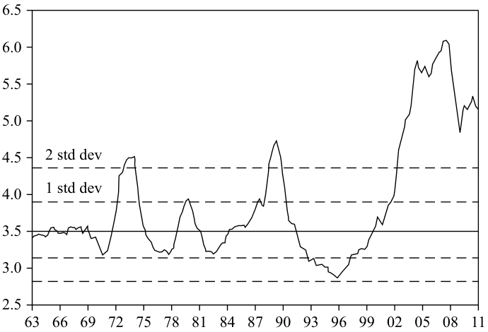

# Tập 9: Quản lý Danh mục Đầu tư (Portfolio Management)
## Learning Module 5 The Behavioral Biases of Individuals (Trang PDF 213–248)

---

# Tập 9: Quản lý Danh mục Đầu tư (Volume 9: Portfolio Management)
## Học phần 5: Các Thiên lệch Hành vi của Cá nhân (Learning Module 5: The Behavioral Biases of Individuals)
### Phần 1/3: Giới thiệu (Introduction) (Trang PDF 213–226)

---

<!-- PDF Page 213 -->

H Ọ C P H Ầ N (L E A R N I N G M O D U L E)

# **<mark>5</mark>** 

### **Các Thiên lệch Hành vi của Cá nhân (The Behavioral Biases of Individuals)** 

**Tác giả: Michael M. Pompian, CFA.** 

_Michael M. Pompian, CFA, làm việc tại Sunpointe Investments (Hoa Kỳ)._ 

##### **<mark>KẾT QUẢ HỌC TẬP (LEARNING OUTCOMES)</mark>** 

**_Thành thạo – Ứng viên cần có khả năng:_**
- So sánh và đối chiếu các sai lầm nhận thức (*cognitive errors*) và các thiên lệch cảm xúc (*emotional biases*).
- Thảo luận về các thiên lệch hành vi (*behavioral biases*) thường được ghi nhận và những hàm ý của chúng đối với việc ra quyết định tài chính.
- Mô tả cách thức các thiên lệch hành vi của nhà đầu tư có thể dẫn đến các đặc điểm thị trường không thể giải thích được bằng tài chính truyền thống (*traditional finance*).

#### **GIỚI THIỆU (INTRODUCTION)** 

**<mark>1</mark>** 

Các nghiên cứu đã chứng minh rằng khi con người đối mặt với những quyết định phức tạp, họ thường dựa vào các phán đoán và sở thích cơ bản để đơn giản hóa tình huống thay vì hành động một cách hoàn toàn hợp lý (*rationally*). Mặc dù những cách tiếp cận như vậy diễn ra nhanh chóng và hấp dẫn về mặt trực giác, nhưng chúng có thể dẫn đến các kết quả dưới mức tối ưu (*suboptimal outcomes*). Trái ngược với khối lượng nghiên cứu này, lý thuyết kinh tế và tài chính truyền thống nhìn chung giả định rằng các cá nhân hành động hợp lý bằng cách xem xét tất cả các thông tin sẵn có trong quá trình ra quyết định, đưa họ đến các kết quả tối ưu và củng cố tính hiệu quả của thị trường (*market efficiency*). Tài chính hành vi (*behavioral finance*) thách thức những giả định này bằng cách kết hợp các nghiên cứu về cách các cá nhân và thị trường thực sự hành xử. Trong bài đọc này, chúng ta khám phá một khái niệm nền tảng của tài chính hành vi: các thiên lệch hành vi (*behavioral biases*). Các chuyên gia đầu tư có thể cải thiện kết quả kinh tế bằng cách thấu hiểu những thiên lệch này, nhận diện chúng ở bản thân và những người khác, đồng thời học các chiến lược để giảm thiểu chúng. 

Bài đọc được trình bày như sau. Phần 2 mô tả và khái quát hóa các đặc điểm của thiên lệch hành vi. Phần 3 và Phần 4 thảo luận về các thiên lệch hành vi cụ thể trong hai nhóm lớn: sai lầm nhận thức (*cognitive errors*) và thiên lệch cảm xúc (*emotional biases*). Phần thảo luận bao gồm mô tả về từng thiên lệch, các hệ quả tiềm tàng, cùng hướng dẫn cách phát hiện và giảm thiểu tác động của thiên lệch đó. Phần 5 thảo luận về các bất thường thị trường (*market anomalies*), vốn về bản chất là sự biểu hiện tổng hợp của các thiên lệch cá nhân giữa những người tham gia thị trường tài chính. Phần tóm tắt và các bài tập thực hành sẽ khép lại bài đọc. 

<!-- PDF Page 214 -->

## **<mark>2</mark>** 

#### **CÁC NHÓM THIÊN LỆCH HÀNH VI (BEHAVIORAL BIAS CATEGORIES)** 

*So sánh và đối chiếu các sai lầm nhận thức (cognitive errors) và các thiên lệch cảm xúc (emotional biases)*

Nhìn chung, các thiên lệch hành vi tồn tại dưới hai dạng: lập luận nhận thức sai lầm, được gọi là **sai lầm nhận thức (*cognitive errors*)**, và những thiên lệch dựa trên cảm giác hoặc xúc cảm, được gọi là **thiên lệch cảm xúc (*emotional biases*)**. Cả hai dạng thiên lệch này, bất kể nguồn gốc của chúng là gì, đều có thể khiến các quyết định chệch hướng khỏi những gì được giả định bởi lý thuyết tài chính truyền thống. 

Các sai lầm nhận thức thường có thể được sửa chữa hoặc loại bỏ thông qua thông tin tốt hơn, giáo dục và lời khuyên tư vấn. Mặt khác, các thiên lệch cảm xúc khó sửa chữa hơn vì chúng bắt nguồn từ những bốc đồng (*impulses*) và trực giác (*intuitions*). Chúng phát sinh một cách tự phát hơn là thông qua nỗ lực có ý thức và thậm chí có thể không được mong muốn bởi chính cá nhân đang cảm nhận chúng. Do đó, thường chỉ có thể nhận biết một thiên lệch cảm xúc và thích nghi (*adapt*) với nó. Sự phân biệt giữa nhận thức và cảm xúc sẽ giúp chúng ta xác định khi nào và bằng cách nào để điều chỉnh các thiên lệch hành vi trong việc ra quyết định tài chính. 

Các nhà nghiên cứu đã xác định được rất nhiều thiên lệch hành vi. Bài đọc này không cố gắng liệt kê tất cả chúng. Thay vào đó, bài đọc thảo luận về một số thiên lệch được công bố rộng rãi và được ghi nhận nhiều hơn trong khuôn khổ nhận thức – cảm xúc (*cognitive–emotional framework*). Ngoài ra, chúng ta giới hạn trọng tâm vào việc đánh giá sự hiện diện hay vắng mặt — chứ không phải mức độ lớn nhỏ (*magnitude*) — của từng thiên lệch được thảo luận. Nghĩa là, chúng ta sẽ không cố gắng đo lường mức độ biểu hiện mạnh mẽ của thiên lệch đó, mà thay vào đó chúng ta sẽ mô tả thiên lệch hành vi, các hệ quả tiềm tàng của nó, cùng việc phát hiện và điều chỉnh thiên lệch hành vi đó. Khi phát hiện một thiên lệch, chúng ta sẽ xác định các phát ngôn hoặc quá trình suy nghĩ có thể chỉ báo thiên lệch đó. Các bài kiểm tra chẩn đoán với mức độ phức tạp khác nhau hiện có sẵn để phát hiện các thiên lệch nhưng nằm ngoài phạm vi của bài đọc này. 

Cuối cùng, các cá nhân được quan tâm trong bài đọc này là “những người tham gia thị trường tài chính” (*financial market participants* – FMP) tham gia vào việc ra quyết định tài chính. Những đối tượng này bao gồm cả các nhà đầu tư cá nhân và các chuyên gia dịch vụ tài chính. 

## **<mark>3</mark>** 

#### **CÁC SAI LẦM NHẬN THỨC (COGNITIVE ERRORS)** 

*Thảo luận về các thiên lệch hành vi thường được ghi nhận và những hàm ý của chúng đối với việc ra quyết định tài chính*

Chúng ta phân loại các sai lầm nhận thức thành hai nhóm: “các thiên lệch duy trì niềm tin” (*belief perseverance biases*) và “các sai lầm xử lý thông tin” (*processing errors*). 

Sự duy trì niềm tin (*belief perseverance*) là xu hướng bám chặt vào những niềm tin đã có từ trước của một người bằng cách mắc các lỗi thống kê, lỗi xử lý thông tin hoặc lỗi trí nhớ. Các thiên lệch duy trì niềm tin được thảo luận bao gồm: thiên lệch bảo thủ (*conservatism*), thiên lệch xác nhận (*confirmation*), thiên lệch đại diện (*representativeness*), ảo tưởng kiểm soát (*illusion of control*), và thiên lệch nhận thức muộn (*hindsight*). 

Các sai lầm xử lý thông tin (*processing errors*) mô tả cách thức thông tin có thể được xử lý và sử dụng một cách phi logic hoặc phi lý trí trong việc ra quyết định tài chính. Các sai lầm xử lý thông tin được thảo luận bao gồm: thiên lệch neo giữ và điều chỉnh (*anchoring and adjustment*), thiên lệch kế toán tâm lý (*mental accounting*), thiên lệch khung tham chiếu (*framing*), và thiên lệch sẵn có (*availability*). 

<!-- PDF Page 215 -->

##### **Các Thiên lệch Duy trì Niềm tin (Belief Perseverance Biases)** 

Các thiên lệch duy trì niềm tin là kết quả của sự khó chịu về mặt tâm lý xảy ra khi thông tin mới mâu thuẫn với những niềm tin hoặc nhận thức đã có từ trước, được gọi là **sự bất hòa nhận thức (*cognitive dissonance*)**. Để giải quyết sự khó chịu này, con người có thể phớt lờ hoặc sửa đổi thông tin mâu thuẫn và chỉ xem xét những thông tin xác nhận niềm tin hoặc suy nghĩ hiện tại của họ. 

###### **_Thiên lệch Bảo thủ (Conservatism Bias)_** 

**Thiên lệch bảo thủ (*Conservatism bias*)** là một thiên lệch duy trì niềm tin trong đó con người duy trì các quan điểm hoặc dự báo trước đó của mình bằng cách kết hợp không đầy đủ các thông tin mới, mang tính mâu thuẫn. Theo thuật ngữ thống kê Bayes (*Bayesian terms*), họ có xu hướng đặt trọng số quá cao (*overweight*) cho xác suất tiền nghiệm (*prior probability*) của sự kiện và đặt trọng số quá thấp (*underweight*) cho thông tin mới, dẫn đến các niềm tin đã điều chỉnh về xác suất và kết quả phản ứng dưới mức (*underreact*) trước thông tin mới. 

###### _Hệ quả của Thiên lệch Bảo thủ (Consequences of Conservatism Bias)_ 

Do hậu quả của thiên lệch bảo thủ, các FMP có thể thực hiện những điều sau: 

- Duy trì hoặc chậm cập nhật một quan điểm hoặc một dự báo, ngay cả khi được cung cấp thông tin mới; và 

- Duy trì niềm tin trước đó thay vì đối mặt với sự căng thẳng tâm lý của việc cập nhật niềm tin trước dữ liệu phức tạp. Hành vi này liên quan đến một sự khó khăn tiềm ẩn trong việc xử lý thông tin mới. 

_Cách Phát hiện và Hướng dẫn Khắc phục Thiên lệch Bảo thủ (Detection of and Guidance for Overcoming Conservatism Bias)_ 

Tác động của thiên lệch bảo thủ có thể được điều chỉnh hoặc giảm bớt bằng cách phân tích và phân bổ trọng số hợp lý cho thông tin mới. Bước đầu tiên là nhận thức được rằng có một thiên lệch đang tồn tại, đặc biệt là đối với những thông tin mang tính kỹ thuật, trừu tượng và/hoặc thống kê, bởi vì **chi phí nhận thức (*cognitive cost*)** liên quan đến việc xử lý các dạng thông tin đó cao hơn so với các loại thông tin khác. 

Khi thông tin mới được đưa ra, FMP nên đặt những câu hỏi như: “Thông tin này làm thay đổi dự báo của tôi như thế nào?” hoặc “Thông tin này có tác động gì đến dự báo của tôi?” Các FMP nên tiến hành phân tích cẩn thận có kết hợp thông tin mới và sau đó phản ứng một cách thích hợp. Việc cập nhật các niềm tin trước đó dưới ánh sáng của thông tin mới này hoàn toàn nhất quán với các nguyên lý của Quy tắc Bayes (*Bayes’ Rule*), trong đó các xác suất cập nhật được suy ra bằng cách kết hợp một cách có hệ thống các ước tính trước đó và thông tin mới. 

Nếu thông tin khó diễn giải hoặc khó hiểu, các FMP nên tìm kiếm sự hướng dẫn từ một người có thể giải thích cách diễn giải thông tin đó hoặc có thể giải thích những hàm ý của nó. 

###### **_Thiên lệch Xác nhận (Confirmation Bias)_** 

**Thiên lệch xác nhận (*Confirmation bias*)** đề cập đến xu hướng tìm kiếm và chú ý đến những gì xác nhận cho các niềm tin trước đó, đồng thời phớt lờ hoặc đánh giá thấp bất cứ điều gì mâu thuẫn với chúng. Là một phản ứng đối với sự bất hòa nhận thức, thiên lệch xác nhận phản ánh khuynh hướng tự biện minh cho bản thân về những gì chúng ta muốn tin. 

Hầu hết các cố vấn quản lý gia sản cá nhân (*private wealth advisers*) giàu kinh nghiệm đều từng làm việc với một khách hàng tự thực hiện một số nghiên cứu và khăng khăng đòi thêm một khoản đầu tư cụ thể vào danh mục đầu tư. Khách hàng đó có thể khăng khăng tiếp tục nắm giữ khoản đầu tư, ngay cả khi người cố vấn khuyến nghị ngược lại, bởi vì nghiên cứu tiếp theo của khách hàng chỉ tìm kiếm những thông tin xác nhận niềm tin của anh ta rằng khoản đầu tư đó vẫn có giá trị tốt. Thiên lệch xác nhận không chỉ giới hạn ở các nhà đầu tư cá nhân; tất cả các FMP đều nên cảnh giác với những thiên lệch xác nhận tiềm tàng bên trong chính bản thân mình. 

<!-- PDF Page 216 -->

###### **VÍ DỤ 1 (EXAMPLE 1)** 

##### **Thiên lệch Xác nhận (Confirmation Bias)** 

Một nhà quản lý danh mục đầu tư tại Sarter Investment Advisors đã khuyến nghị cổ phiếu của Real Media Inc., một công ty sản xuất và phân phối truyền hình giả định, phần lớn dựa trên công trình phân tích và định giá thuyết phục từ một chuyên gia phân tích nghiên cứu cổ phiếu hàng đầu. Khách hàng của Sarter đã sở hữu cổ phiếu này trong vài năm. 

Gần đây, cổ phiếu này đã có thành quả kém hơn đáng kể so với thị trường (*underperformed*) do công ty không đạt được mức ước tính lợi nhuận của các nhà phân tích và cũng do phản ứng trước sự thay đổi nhân sự quản lý cấp cao. Các đồng nghiệp của nhà quản lý danh mục đầu tư tin rằng sự kém hiệu quả này là kết quả của việc Real Media mất thị phần vào tay một đối thủ cạnh tranh có công nghệ và hệ thống phân phối vượt trội. Đối thủ cạnh tranh này là một công ty đại chúng có cổ phiếu giao dịch trên sàn, nhưng các nhà quản lý danh mục đầu tư và chuyên gia phân tích của Sarter vẫn chưa thực hiện nghiên cứu về công ty đó. 

Sau một đợt công bố kết quả lợi nhuận kém khả quan khác từ Real Media, nhà quản lý danh mục đầu tư đã trao đổi với chuyên gia phân tích nghiên cứu cổ phiếu mà công trình của người này là nguồn cơ sở chính cho khoản đầu tư. Chuyên gia phân tích nghiên cứu cổ phiếu này — người vẫn duy trì khuyến nghị mua (*buy rating*) đối với cổ phiếu — tin rằng Real Media hiện là một khoản đầu tư hấp dẫn hơn bao giờ hết bởi vì giá cổ phiếu của nó đã giảm trong khi các ước tính lợi nhuận của ông vẫn không thay đổi. Kết quả của cuộc trò chuyện là nhà quản lý danh mục đầu tư cảm thấy yên tâm và tiếp tục nắm giữ vị thế. 

Nhà quản lý danh mục đầu tư này đang chịu ảnh hưởng của thiên lệch xác nhận (*confirmation bias*). Thay vì trao đổi với một chuyên gia phân tích nghiên cứu có khuyến nghị bán (*sell rating*) đối với cổ phiếu hoặc tiến hành nghiên cứu về đối thủ cạnh tranh để xem xét một góc nhìn khác, nhà quản lý danh mục đầu tư lại nói chuyện với một người có cùng quan điểm mà cô ấy đã chia sẻ từ trước. 

###### **Hệ quả của Thiên lệch Xác nhận (Consequences of Confirmation Bias)** 

Do hậu quả của thiên lệch xác nhận, các FMP có thể thực hiện những điều sau: 

- Chỉ xem xét thông tin tích cực về một khoản đầu tư hiện có trong khi phớt lờ bất kỳ thông tin tiêu cực nào về khoản đầu tư đó. 

- Xây dựng các tiêu chí sàng lọc (*screening criteria*) trong khi phớt lờ thông tin bác bỏ tính hợp lệ của các tiêu chí đó hoặc ủng hộ các tiêu chí khác. Kết quả là, một số khoản đầu tư tốt không đáp ứng tiêu chí sàng lọc có thể bị bỏ qua, và ngược lại, một số khoản đầu tư tồi đáp ứng tiêu chí sàng lọc lại có thể được thực hiện. 

- Đa dạng hóa danh mục đầu tư dưới mức cần thiết (*under-diversify portfolios*). Các FMP có thể bị thuyết phục về giá trị cổ phiếu của một công ty duy nhất. Họ phớt lờ tin tức tiêu cực, và họ chỉ thu thập cũng như xử lý những thông tin xác nhận rằng công ty đó là một khoản đầu tư tốt. Họ xây dựng một vị thế lớn hơn mức thích hợp và nắm giữ một danh mục đầu tư kém đa dạng hóa. 

- Nắm giữ một tỷ trọng tài sản đầu tư lớn một cách bất cân xứng vào cổ phiếu của công ty nơi họ đang làm việc, bởi vì họ tin tưởng vào công ty của mình và bị thuyết phục về triển vọng thuận lợi của nó. Thông tin thuận lợi được trích dẫn, và thông tin bất lợi bị phớt lờ. Nếu người nhân viên thừa nhận thông tin bất lợi, sự khó chịu về mặt tâm lý đi kèm có thể khiến công việc trở nên rất khó khăn đối với nhân viên đó. 

###### **Cách Phát hiện và Hướng dẫn Khắc phục Thiên lệch Xác nhận (Detection of and Guidance for Overcoming Confirmation Bias)** 

Tác động của thiên lệch xác nhận có thể được điều chỉnh hoặc giảm bớt bằng cách chủ động tìm kiếm thông tin thách thức các niềm tin hiện tại. 

<!-- PDF Page 217 -->

Một bước hữu ích khác là kiểm chứng chéo (*corroborate*) một quyết định đầu tư. Ví dụ, nếu việc lựa chọn đầu tư dựa trên các tiêu chí xác nhận một niềm tin hiện có, chẳng hạn như các cổ phiếu phá vỡ mức đỉnh 52 tuần (*52-week highs*), thì thông thường nên kiểm chứng quyết định đó bằng nghiên cứu từ một góc nhìn hoặc nguồn khác (ví dụ: nghiên cứu cơ bản về công ty, ngành hoặc lĩnh vực). 

###### **_Thiên lệch Đại diện (Representativeness Bias)_** 

**Thiên lệch đại diện (*Representativeness bias*)** đề cập đến xu hướng phân loại thông tin mới dựa trên những trải nghiệm và cách phân loại trong quá khứ. Thông tin mới có thể giống hoặc có vẻ *đại diện* (*representative*) cho các yếu tố quen thuộc đã được phân loại, nhưng trên thực tế, nó có thể rất khác biệt. Trong những trường hợp này, phản xạ phân loại có thể đánh lừa, tạo ra một sự hiểu biết không chính xác làm thiên lệch mọi suy nghĩ trong tương lai về thông tin đó. *Sự bỏ qua tỷ lệ cơ sở* (*base-rate neglect*) và *sự bỏ qua quy mô mẫu* (*sample-size neglect*) là hai dạng của thiên lệch đại diện áp dụng cho các FMP. 

Trong **sự bỏ qua tỷ lệ cơ sở (*base-rate neglect*)**, tỷ lệ xuất hiện của một hiện tượng trong một tổng thể lớn hơn — tức tỷ lệ cơ sở (*base rate*) của nó — bị bỏ qua để ưu tiên cho thông tin cụ thể. Thông tin cụ thể, riêng lẻ có thể gây hiểu lầm so với tỷ lệ cơ sở hoặc thông tin chung phù hợp hơn. Các FMP thường đi theo con đường sai lầm này bởi vì nghiên cứu chuyên sâu thường được thực hiện trên một chứng khoán hoặc chiến lược riêng lẻ, khiến các FMP bỏ sót hoặc phớt lờ thông tin chung về “nhóm” (*class*) mà khoản đầu tư đó thuộc về, chẳng hạn như một ngành, lĩnh vực hoặc khu vực địa lý. 

Dạng thứ hai của thiên lệch đại diện là **sự bỏ qua quy mô mẫu (*sample-size neglect*)**, trong đó các FMP giả định một cách không chính xác rằng các quy mô mẫu nhỏ là *đại diện* cho các tổng thể. Những cá nhân dễ mắc lỗi bỏ qua quy mô mẫu thường nhanh chóng coi các đặc tính được phản ánh trong các mẫu nhỏ là những đặc tính mô tả chính xác các tập hợp dữ liệu lớn, từ đó đặt trọng số quá cao cho thông tin trong mẫu nhỏ. 

###### **VÍ DỤ 2 (EXAMPLE 2)** 

##### **Thiên lệch Đại diện (Representativeness Bias)** 

Jacques Verte đang đánh giá triển vọng tương lai của Công ty APM, một nhà sản xuất phụ tùng ô tô lớn đang gặp một số khó khăn. Trong suốt 50 năm qua, rất ít nhà sản xuất phụ tùng ô tô bị phá sản, ngay cả trong những giai đoạn khó khăn. Tuy nhiên, một số tiêu đề báo chí gần đây đã làm nổi bật những khó khăn về kinh doanh và tài chính của APM, với một số nhà bình luận cho rằng APM có thể sẽ phải đóng cửa ngừng kinh doanh. 

1. Kịch bản nào sau đây có khả năng xảy ra cao hơn? Giải thích tại sao. 

   - **A.** APM sẽ giải quyết được những khó khăn của mình. 

   - **B.** APM sẽ đóng cửa ngừng kinh doanh. 

###### **Lời giải:** 

Kịch bản A có khả năng xảy ra cao hơn. Tỷ lệ cơ sở (*base rate*), dựa trên dữ liệu của 50 năm, cho thấy có nhiều công ty phụ tùng ô tô sống sót qua thời kỳ khó khăn hơn là bị phá sản. Do đó, khả năng APM sẽ giải quyết được những khó khăn của mình cao hơn là phải đóng cửa ngừng kinh doanh. 

2. Nếu Verte chịu ảnh hưởng của thiên lệch đại diện, anh ta có khả năng phân loại APM vào kịch bản A hay B cao hơn? Giải thích tại sao. 

###### **Lời giải:** 

Nếu Verte chịu ảnh hưởng của thiên lệch đại diện, anh ta có khả năng sẽ chọn Kịch bản B, dự đoán rằng công ty sẽ đóng cửa ngừng kinh doanh vì những tiêu đề báo chí mà anh ta đã đọc. Khi phân loại APM là có khả năng đóng cửa ngừng kinh doanh, Verte 

<!-- PDF Page 218 -->

sẽ mắc lỗi bỏ qua tỷ lệ cơ sở (*base-rate neglect*) do phớt lờ tỷ lệ cơ sở thấp của việc các nhà sản xuất phụ tùng ô tô bị phá sản ngay cả trong những thời kỳ khó khăn. 

###### **Hệ quả của Thiên lệch Đại diện (Consequences of Representativeness Bias)** 

Do hậu quả của thiên lệch đại diện, các FMP có thể thực hiện những điều sau: 

- Áp dụng một quan điểm hoặc một dự báo gần như chỉ dựa trên thông tin cụ thể, riêng lẻ hoặc dựa trên một mẫu nhỏ; và 

- Cập nhật niềm tin bằng cách sử dụng các phân loại đơn giản thay vì đối mặt với sự căng thẳng tâm lý của việc cập nhật niềm tin trước chi phí nhận thức cao của dữ liệu phức tạp. 

###### **Cách Phát hiện và Hướng dẫn Khắc phục Thiên lệch Đại diện (Detection of and Guidance on Overcoming Representativeness Bias)** 

Khi các FMP cảm thấy rằng sự bỏ qua tỷ lệ cơ sở hoặc sự bỏ qua quy mô mẫu có thể là một vấn đề, họ nên đặt câu hỏi sau: “Xác suất để X (khoản đầu tư đang được xem xét) thuộc về Nhóm A (nhóm mà nó có vẻ giống hoặc được coi là đại diện) so với Nhóm B (nhóm mà về mặt thống kê nó có khả năng thuộc về cao hơn) là bao nhiêu?” Câu hỏi này, hoặc một câu hỏi tương tự, sẽ giúp các FMP suy nghĩ thấu đáo xem liệu họ có đang không xem xét các xác suất tỷ lệ cơ sở hay đang bỏ qua quy luật số nhỏ (*law of small numbers*) và do đó đánh giá không chính xác một tình huống cụ thể hay không. Có thể cần phải thực hiện thêm nghiên cứu để thu thập thông tin về tỷ lệ cơ sở và/hoặc mở rộng quy mô mẫu quan sát. 

###### **_Thiên lệch Ảo tưởng Kiểm soát (Illusion of Control Bias)_** 

Trong **thiên lệch ảo tưởng kiểm soát (*illusion of control bias*)**, con người có xu hướng tin rằng họ có thể kiểm soát hoặc gây ảnh hưởng đến các kết quả trong khi trên thực tế, họ không thể. Nhiều nhà nghiên cứu đã phát hiện ra những tình huống mà ở đó con người tự nhận thấy mình sở hữu nhiều quyền kiểm soát hơn thực tế, suy diễn ra các mối liên hệ nhân quả ở những nơi không hề tồn tại mối liên hệ nào, hoặc thể hiện sự chắc chắn lớn đến đáng ngạc nhiên trong các dự đoán của họ về kết quả của những sự kiện ngẫu nhiên (*chance events*). Một ví dụ kinh điển là việc con người thích tự chọn các con số xổ số của riêng mình hơn là những con số ngẫu nhiên được chọn sẵn cho họ. 

###### **VÍ DỤ 3 (EXAMPLE 3)** 

##### **Thiên lệch Ảo tưởng Kiểm soát (Illusion of Control Bias)** 

Adelia Scott là cố vấn quản lý gia sản tại Sarter Investment Advisors (Sarter), một công ty tư vấn đầu tư dành cho các cá nhân có giá trị tài sản ròng cao (*high-net-worth individuals*). Scott gặp gỡ một khách hàng có 30% tài khoản của mình nằm ở cổ phiếu của công ty nơi ông đang làm việc. Khách hàng này không chịu bất kỳ yêu cầu bắt buộc nắm giữ cổ phiếu nào đối với nhân viên. 

Ghi chú từ các cuộc họp trước cho thấy ban đầu khách hàng đã đồng ý đa dạng hóa vị thế tập trung này trong khoảng thời gian 5 năm. Tuy nhiên, Scott khuyến nghị một lộ trình nhanh hơn, dựa trên các nghiên cứu gần đây chỉ ra rằng triển vọng tăng trưởng trong tương lai của công ty đã xấu đi đáng kể do xu hướng ngành và các điều kiện kinh tế vĩ mô. 

Khi được cung cấp thông tin này, khách hàng miễn cưỡng thay đổi kế hoạch đa dạng hóa của mình, viện dẫn lịch sử tăng trưởng hai con số của công ty và niềm tin của ông rằng tốc độ tăng trưởng này sẽ tiếp tục trong tương lai gần. Khách hàng nhận xét: “Hãy tin tôi, nhóm của tôi và tôi sẽ không để những dự báo mà cô đang trích dẫn trở thành sự thật đâu.” 

Khách hàng này đang chịu ảnh hưởng của thiên lệch ảo tưởng kiểm soát (*illusion of control bias*). Ông không sẵn lòng tin vào ý kiến của Scott bởi vì ông tin rằng bản thân ông và nhóm của mình có thể kiểm soát được thành quả hoạt động và giá cổ phiếu của công ty. 

<!-- PDF Page 219 -->

###### **Hệ quả của Ảo tưởng Kiểm soát (Consequences of Illusion of Control)** 

Do hậu quả của thiên lệch ảo tưởng kiểm soát, các FMP có thể thực hiện những điều sau: 

- Đa dạng hóa danh mục đầu tư không đầy đủ. Các nghiên cứu đã phát hiện ra rằng một số nhà đầu tư thích đầu tư vào những công ty mà họ cảm thấy mình có quyền kiểm soát, chẳng hạn như các công ty nơi họ làm việc, dẫn đến việc họ nắm giữ các vị thế tập trung. Trên thực tế, hầu hết các nhà đầu tư có rất ít hoặc không có quyền kiểm soát nào đối với công ty mà họ làm việc. Nếu công ty hoạt động kém hiệu quả, những nhà đầu tư này có thể phải gánh chịu cả việc mất việc làm lẫn thua lỗ đầu tư. 

- Giao dịch nhiều hơn mức cẩn trọng (*prudent*). Các nhà nghiên cứu đã phát hiện ra rằng vòng quay danh mục đầu tư (*portfolio turnover*) có tương quan âm với tỷ suất sinh lợi đầu tư. 

- Xây dựng các mô hình tài chính và dự báo quá chi tiết. Các FMP có thể yêu cầu các mô hình chi tiết trước khi đưa ra quyết định đầu tư, vì tin rằng các dự báo từ những mô hình này kiểm soát được sự bất định. Mặc dù việc hiểu biết sâu sắc hơn về một khoản đầu tư, tổ chức phát hành hoặc ngành thường hữu ích, nhưng việc gia tăng độ phức tạp của mô hình không kiểm soát được rủi ro và sự bất định vốn có của các kết quả đầu tư. 

###### **Cách Phát hiện và Hướng dẫn Khắc phục Thiên lệch Ảo tưởng Kiểm soát (Detection of and Guidelines for Overcoming Illusion of Control Bias)** 

Ý tưởng đầu tiên và cơ bản nhất mà các nhà đầu tư cần nhận thức được là đầu tư là một hoạt động mang tính xác suất (*probabilistic activity*). Ngay cả những công ty quản lý đầu tư lớn nhất cũng có rất ít quyền kiểm soát đối với kết quả của các khoản đầu tư mà họ thực hiện. Các công ty phải chịu tác động của các lực lượng kinh tế vĩ mô và ngành, cũng như hành động của các đối thủ cạnh tranh, khách hàng và nhà cung cấp. 

Thứ hai, lời khuyên là nên tìm kiếm các quan điểm trái chiều. Khi bạn suy ngẫm về một khoản đầu tư mới, hãy dành một chút thời gian để nghĩ về những yếu tố cân nhắc có thể chống lại việc thực hiện khoản đầu tư đó. Hãy tự hỏi bản thân: Các rủi ro giảm giá (*downside risks*) là gì? Điều gì có thể diễn ra sai lầm? Khi nào tôi sẽ bán? Việc trao đổi với một người có quan điểm đối lập, chẳng hạn như một chuyên gia phân tích nghiên cứu cổ phiếu có khuyến nghị bán đối với cổ phiếu đang xét, thường rất hữu ích. 

###### **_Thiên lệch Nhận thức Muộn (Hindsight Bias)_** 

**Thiên lệch nhận thức muộn (*Hindsight bias*)** đề cập đến việc tin rằng các sự kiện trong quá khứ là có thể dự đoán được và hợp lý để kỳ vọng. Hành vi này bắt nguồn từ một thực tế hiển nhiên là những kết quả đã thực sự xảy ra thì dễ nhận thấy hơn nhiều so với những kết quả đã không xảy ra. Tương tự như vậy, con người có xu hướng nhớ về những dự đoán của chính mình về tương lai là chính xác hơn so với thực tế bởi vì họ bị thiên lệch bởi sự hiểu biết về những gì đã thực sự diễn ra. Những quyết định được lập luận kém nhưng có kết quả tích cực có thể được nhớ lại như những bước đi chiến thuật xuất sắc, và những kết quả tồi tệ của các quyết định được lập luận chặt chẽ có thể bị mô tả là những sai lầm có thể tránh được. 

###### **VÍ DỤ 4 (EXAMPLE 4)** 

##### **Thiên lệch Nhận thức Muộn (Hindsight Bias)** 

Beverly Bolo, một chuyên gia phân tích tại một công ty tư vấn đầu tư, đang thuyết trình trước các khách hàng để giải thích về kết quả đầu tư của công ty trong các đợt suy thoái kinh tế vĩ mô trong quá khứ cùng nhiều chủ đề khác. Trong bài thuyết trình, Bolo chỉ ra rằng “sự xuất hiện của cuộc suy thoái vừa qua là điều hiển nhiên khi kiểm tra đường cong lợi suất (*yield curve*) và các chỉ báo dẫn dắt (*leading indicators*) khác tám tháng trước khi đợt suy thoái bắt đầu.” 

Nhận xét của Bolo thể hiện thiên lệch nhận thức muộn (*hindsight bias*). Các cuộc suy thoái, giống như bất kỳ sự kiện nào khác, có vẻ hiển nhiên khi nhìn lại sau khi sự việc đã xảy ra (*in hindsight*) nhưng hầu như hiếm khi được dự đoán chính xác. Bolo có thể bổ sung cho nhận xét của mình bằng cách khám phá xem các chỉ báo dẫn dắt này đã gợi ý rằng một cuộc suy thoái sắp xảy ra thường xuyên như thế nào so với tần suất một cuộc suy thoái thực sự diễn ra sau đó. 

<!-- PDF Page 220 -->

###### **Hệ quả của Thiên lệch Nhận thức Muộn (Consequences of Hindsight Bias)** 

Do hậu quả của thiên lệch nhận thức muộn, các FMP có thể thực hiện những điều sau: 

- Đánh giá quá cao mức độ mà họ đã dự đoán chính xác một kết quả đầu tư, hoặc khả năng có thể dự đoán của một kết quả nói chung. Thiên lệch này có liên quan mật thiết đến thiên lệch quá tự tin (*overconfidence bias*), sẽ được thảo luận ở phần sau của bài đọc. 

- Đánh giá không công bằng thành quả của nhà quản lý tiền tệ hoặc chứng khoán. Dựa trên khả năng nhìn lại những gì đã diễn ra trên thị trường chứng khoán, thành quả hoạt động bị đem ra so sánh với những gì đã thực sự xảy ra thay vì so với những kỳ vọng tại thời điểm khoản đầu tư được thực hiện. 

###### **Cách Phát hiện và Hướng dẫn Khắc phục Thiên lệch Nhận thức Muộn (Detection of and Guidelines for Overcoming Hindsight Bias)** 

Một khi đã được thấu hiểu, thiên lệch nhận thức muộn sẽ có thể được nhận diện. Các FMP nên đặt những câu hỏi như: “Tôi đang viết lại lịch sử hay đang thành thật với chính mình về những sai lầm mà tôi đã mắc phải?” 

Để đề phòng thiên lệch nhận thức muộn, các FMP nên ghi chép cẩn thận các quyết định đầu tư của mình và những lý do chính để đưa ra các quyết định đó bằng văn bản tại hoặc vào khoảng thời điểm quyết định được đưa ra. Việc tham khảo những hồ sơ bằng văn bản này thay vì dựa vào trí nhớ thường sẽ tạo ra một sự kiểm tra chính xác hơn nhiều đối với các quyết định trong quá khứ. 

##### **Các Sai lầm Xử lý Thông tin (Processing Errors)** 

Các sai lầm xử lý thông tin (*processing errors*) đề cập đến việc thông tin được xử lý và sử dụng một cách phi logic hoặc phi lý trí. Trái ngược với các thiên lệch duy trì niềm tin, các sai lầm xử lý thông tin ít liên quan hơn đến các lỗi trí nhớ hoặc lỗi trong việc gán và cập nhật xác suất; thay vào đó, chúng liên quan chặt chẽ hơn đến những khiếm khuyết trong cách thức bản thân thông tin được xử lý. 

###### **_Thiên lệch Neo giữ và Điều chỉnh (Anchoring and Adjustment Bias)_** 

**Thiên lệch neo giữ và điều chỉnh (*Anchoring and adjustment bias*)** đề cập đến việc dựa vào một mẩu thông tin ban đầu để đưa ra các ước tính, phán đoán và quyết định tiếp theo. Khi được yêu cầu ước tính một giá trị có độ lớn chưa biết, con người thường bắt đầu với một con số mặc định ban đầu nào đó — một “mỏ neo” (*anchor*) — rồi sau đó họ điều chỉnh tăng hoặc giảm từ con số này. Bất kể mỏ neo ban đầu được chọn như thế nào, con người có xu hướng điều chỉnh các mỏ neo của mình không đủ mức (*adjust insufficiently*) và tạo ra các giá trị xấp xỉ cuối cùng bị thiên lệch. Thiên lệch neo giữ và điều chỉnh có liên quan mật thiết đến thiên lệch bảo thủ. Quy tắc Bayes một lần nữa cung cấp hướng dẫn về cách thức thông tin mới nên được kết hợp vào việc thay đổi các niềm tin trước đó. 

###### **VÍ DỤ 5 (EXAMPLE 5)** 

##### **Thiên lệch Neo giữ và Điều chỉnh (Anchoring and Adjustment Bias)** 

Aiden Smythe là một chuyên gia phân tích nghiên cứu cổ phiếu tại một công ty môi giới. Smythe phụ trách theo dõi Industrial Lift Plc, một công ty sản xuất máy móc xây dựng. Hoạt động kinh doanh của công ty rất nhạy cảm với các điều kiện kinh tế vĩ mô, đặc biệt là hoạt động xây dựng phi nhà ở (*non-residential construction*). Năm ngoái, Industrial Lift đã báo cáo mức lợi nhuận trên mỗi cổ phiếu (EPS) là £1,00 trong bối cảnh mức độ hoạt động xây dựng phi nhà ở nhìn chung rất mạnh mẽ. Smythe đang cập nhật ước tính EPS của mình cho năm nay. Hoạt động xây dựng phi nhà ở đã sụt giảm nghiêm trọng trong hai tháng qua, và một số nhà kinh tế học lo ngại rằng một cuộc suy thoái có khả năng xảy ra. Do đó, Smythe dự báo rằng EPS sẽ giảm 10% so với mức của năm trước, và công bố mức ước tính £0,90 cho năm nay. 

Ước tính của Smythe thể hiện thiên lệch neo giữ và điều chỉnh (*anchoring and adjustment*). Mỏ neo của Smythe là mức EPS £1,00 của năm trước, bất chấp khả năng có sự thay đổi trọng yếu trong các điều kiện cơ bản. 

<!-- PDF Page 221 -->

###### **Hệ quả của Thiên lệch Neo giữ và Điều chỉnh (Consequences of Anchoring and Adjustment Bias)** 

Do hậu quả của thiên lệch neo giữ và điều chỉnh, các FMP có thể bám quá sát vào các ước tính ban đầu của mình khi tiếp nhận thông tin mới. Tư duy này không chỉ giới hạn ở các điều chỉnh giảm (*downside adjustments*); hiện tượng tương tự cũng xảy ra đối với các điều chỉnh tăng (*upside adjustments*). 

###### **Cách Phát hiện và Hướng dẫn Khắc phục Thiên lệch Neo giữ và Điều chỉnh (Detection of and Guidelines for Overcoming Anchoring and Adjustment Bias)** 

Hành động chính mà các FMP có thể thực hiện là có ý thức đặt ra những câu hỏi có thể làm bộc lộ thiên lệch neo giữ và điều chỉnh. Ví dụ về những câu hỏi như vậy bao gồm: “Tôi đang tiếp tục nắm giữ cổ phiếu này dựa trên phân tích hợp lý, hay tôi đang cố gắng đạt được một mức giá mà tôi đang neo vào, chẳng hạn như giá mua ban đầu hoặc mức đỉnh lịch sử (*high water mark*)?” và “Tôi đang đưa ra dự báo này dựa trên các đại lượng đã quan sát được trước đây hay dựa trên các điều kiện kỳ vọng trong tương lai?” 

Điều quan trọng cần nhớ là doanh thu và lợi nhuận của một công ty trong một giai đoạn nhất định phản ánh các điều kiện trong giai đoạn đó. Nếu các điều kiện trong tương lai khác với quá khứ, doanh thu và lợi nhuận nhiều khả năng cũng sẽ khác đi, đôi khi là khác biệt một cách triệt để. Tương tự như vậy, giá chứng khoán phản ánh nhận thức của nhà đầu tư về tương lai tại một thời điểm nhất định; giá vốn (*cost basis*) của một nhà đầu tư cụ thể, các mức thị trường trong quá khứ và các điều kiện khác dựa trên quá khứ thường không còn liên quan. Các FMP nên xem xét cơ sở của bất kỳ khuyến nghị đầu tư nào để xem liệu nó có bị neo vào các ước tính trước đó hay một con số “mặc định” nào đó hay không. 

###### **_Thiên lệch Kế toán Tâm lý (Mental Accounting Bias)_** 

**Thiên lệch kế toán tâm lý (*Mental accounting bias*)** đề cập đến việc chia tiền trong tâm trí thành các “tài khoản” (*accounts*) có ảnh hưởng đến các quyết định, mặc dù tiền có **tính có thể thay thế cho nhau (*fungible*)** (Thaler 1980). Mặc dù lý thuyết tài chính truyền thống giả định rằng các FMP xem xét toàn bộ danh mục đầu tư của họ một cách tổng thể (*holistically*) trong bối cảnh rủi ro – tỷ suất sinh lợi, nhưng Statman (1999, 2008) lập luận rằng sự khó khăn mà các cá nhân gặp phải trong việc giải quyết sự tương tác giữa các khoản đầu tư khác nhau dẫn đến kế toán tâm lý: Các nhà đầu tư xây dựng danh mục đầu tư theo định dạng kim tự tháp phân tầng (*layered pyramid format*), với mỗi tầng giải quyết một mục tiêu tài chính cụ thể. 

###### **VÍ DỤ 6 (EXAMPLE 6)** 

##### **Thiên lệch Kế toán Tâm lý (Mental Accounting Bias)** 

Kendra Liu, một nhà đầu tư cá nhân, sở hữu cổ phiếu của New Horizons Ltd., một công ty dược phẩm. Một loại thuốc trong danh mục nghiên cứu và phát triển (*R&D pipeline*) của công ty đó bất ngờ thành công trong một cuộc thử nghiệm lâm sàng, dẫn đến giá cổ phiếu tăng gấp đôi chỉ sau một đêm. Liu bán một nửa vị thế của mình tại New Horizons và sử dụng số tiền thu được để mua cổ phiếu của Cutting Edge Ltd., một công ty công nghệ sinh học vốn hóa nhỏ (*small-cap*). Liu tin rằng khoản đầu tư vào Cutting Edge là một “ván cược rủi ro cao, phần thưởng lớn” có thể dẫn đến mất trắng toàn bộ, nhưng cô cảm thấy thoải mái khi thực hiện khoản đầu tư này bởi vì cô đang sử dụng số tiền thu được từ việc bán cổ phiếu New Horizons Ltd. — khoản tiền mà đằng nào cô cũng không kỳ vọng là mình sẽ có được. 

Khoản đầu tư của Liu vào Cutting Edge thể hiện thiên lệch kế toán tâm lý (*mental accounting bias*). Cô đã phân loại khoản lãi từ New Horizons vào một tài khoản tâm lý dựa trên nguồn gốc của nó, mặc dù tiền có tính có thể thay thế cho nhau (*fungible*). Liu nên đầu tư số tiền thu được theo một cách thức nhất quán với chiến lược danh mục đầu tư tổng thể (*holistic portfolio strategy*). 

###### **Hệ quả của Thiên lệch Kế toán Tâm lý (Consequences of Mental Accounting Bias)** 

Do hậu quả của thiên lệch kế toán tâm lý, các FMP có thể thực hiện những điều sau: 

- Bỏ qua các cơ hội giảm thiểu rủi ro bằng cách kết hợp các tài sản có tương quan thấp (*low correlations*). Các vị thế triệt tiêu lẫn nhau (*offsetting positions*) giữa các tầng danh mục đầu tư hoặc các tài khoản tâm lý khác nhau có thể dẫn đến thành quả tổng hợp dưới mức tối ưu. 

<!-- PDF Page 222 -->

- Phân biệt một cách phi lý trí giữa tỷ suất sinh lợi có nguồn gốc từ thu nhập (*income*) và tỷ suất sinh lợi có nguồn gốc từ sự tăng giá vốn (*capital appreciation*). Mặc dù nhiều nhà đầu tư cảm thấy cần phải bảo toàn vốn gốc (*principal*), nhưng họ lại tập trung vào ý tưởng chi tiêu phần thu nhập mà vốn gốc tạo ra. Kết quả là, nhiều FMP chạy theo các dòng thu nhập, vô tình gây rủi ro cho vốn gốc trong quá trình đó. 

- Phân tách một cách phi lý trí tài sản (*wealth*) hoặc danh mục đầu tư thành vốn gốc đầu tư và lợi nhuận đầu tư. Một số FMP có thể tin rằng có thể chấp nhận rủi ro lớn hơn đối với phần lợi nhuận (từ thu nhập hoặc tăng giá vốn) so với phần vốn gốc đóng góp ban đầu. Một cách nói giảm nói tránh phổ biến cho kịch bản này, bắt nguồn từ thế giới sòng bạc, là “chơi bằng tiền của nhà cái” (*playing with house money*). 

###### **Cách Phát hiện và Hướng dẫn Khắc phục Thiên lệch Kế toán Tâm lý (Detection of and Guidelines for Overcoming Mental Accounting Bias)** 

Một cách hiệu quả để phát hiện và khắc phục hành vi kế toán tâm lý là nhận ra những nhược điểm của nó. Nhược điểm chính là mối tương quan giữa các khoản đầu tư không được xem xét, dẫn đến việc chấp nhận rủi ro ngoài ý muốn. Các FMP nên thực hiện bài tập gộp tất cả các tài sản của mình vào chung một bảng tính (*spreadsheet*) (không có tiêu đề hay nhãn tài khoản) để thấy được sự phân bổ tài sản tổng thể. Bài tập này thường mang lại những thông tin gây ngạc nhiên khi nhìn nhận dưới góc độ một chỉnh thể, chẳng hạn như số dư tiền mặt cao hơn dự kiến. Bước hợp lý tiếp theo sẽ là tạo ra một chiến lược danh mục đầu tư có tính đến tất cả các tài sản. 

###### **_Thiên lệch Khung tham chiếu (Framing Bias)_** 

**Thiên lệch khung tham chiếu (*Framing bias*)** là một thiên lệch xử lý thông tin trong đó một người trả lời một câu hỏi theo cách khác nhau dựa trên cách thức mà câu hỏi đó được đặt ra hoặc được đóng khung (*framed*). Thông thường, người ta có thể đóng khung một vấn đề ra quyết định nhất định theo nhiều hơn một cách. 

Ví dụ, một tình huống có thể được trình bày trong bối cảnh *lợi ích/lãi* (*gain context* — một trong bốn công ty khởi nghiệp thành công) hoặc trong bối cảnh *thua lỗ/thất bại* (*loss context* — ba trong bốn công ty khởi nghiệp thất bại). Với khung tham chiếu đầu tiên, một FMP có thể áp dụng một góc nhìn tích cực và thực hiện các khoản đầu tư mạo hiểm (*venture capital investments*). Với khung tham chiếu thứ hai, FMP đó có thể sẽ không đầu tư. 

Khung tham chiếu hẹp (*narrow framing*) xảy ra khi con người đánh giá thông tin dựa trên một *khung tham chiếu hẹp* — nghĩa là đánh mất cái nhìn toàn cảnh (*big picture*) để ưu tiên cho một hoặc hai điểm cụ thể. Ví dụ, một nhà đầu tư có thể chỉ tập trung duy nhất vào đội ngũ quản lý điều hành của một công ty, mà bỏ qua hoặc thậm chí gạt bỏ các đặc tính quan trọng khác như đặc điểm ngành, thành quả hoạt động cơ bản và định giá. 

###### **VÍ DỤ 7 (EXAMPLE 7)** 

##### **Tác động của Thiên lệch Khung tham chiếu (Effects of Framing Bias)** 

Các khung ra quyết định khá phổ biến trong bối cảnh hành vi của nhà đầu tư. Các bảng câu hỏi khảo sát mức độ chấp nhận rủi ro (*risk tolerance questionnaires*) có thể minh họa cách thức thiên lệch khung tham chiếu xảy ra trong thực tế và cách các FMP nên nhận thức về tác động của nó. 

Giả sử một nhà đầu tư chuẩn bị làm một bảng câu hỏi khảo sát mức độ chấp nhận rủi ro với mục đích xác định xem cô ấy thuộc “nhóm rủi ro” (*risk category*) nào. Nhóm rủi ro sẽ quyết định việc phân bổ tài sản và các loại hình đầu tư phù hợp. Thông tin sau đây được cung cấp cho mỗi người làm bảng khảo sát: 

Trong khoảng thời gian 10 năm, Danh mục đầu tư ABC có tỷ suất sinh lợi trung bình hàng năm là 10% với độ lệch chuẩn hàng năm là 16%. Giả định phân phối tỷ suất sinh lợi chuẩn (*normal return distribution*), trong một năm nhất định có xác suất 67% là tỷ suất sinh lợi sẽ rơi vào trong khoảng một độ lệch chuẩn tính từ giá trị trung bình, xác suất 95% là tỷ suất sinh lợi sẽ rơi vào trong khoảng hai độ lệch chuẩn tính từ giá trị trung bình, và xác suất 99,7% là tỷ suất sinh lợi sẽ rơi vào trong khoảng ba độ lệch chuẩn tính từ giá trị trung bình. Do đó, có 

<!-- PDF Page 223 -->

67% cơ hội là tỷ suất sinh lợi thu được từ Danh mục đầu tư ABC sẽ nằm trong khoảng từ $-6\%$ đến $26\%$, 95% cơ hội là tỷ suất sinh lợi sẽ nằm trong khoảng từ $-22\%$ đến $42\%$, và 99,7% cơ hội là tỷ suất sinh lợi sẽ nằm trong khoảng từ $-38\%$ đến $58\%$. 

Hai câu hỏi sau đây tập trung vào các Danh mục đầu tư giả định ABC, DEF và XYZ. Rủi ro và tỷ suất sinh lợi của mỗi danh mục đầu tư là như nhau trong cả hai câu hỏi, nhưng cách trình bày thông tin lại khác nhau. 

**1.** Dựa trên bảng sau đây, danh mục đầu tư nào phù hợp với mức độ chấp nhận rủi ro và mong muốn về tỷ suất sinh lợi dài hạn của bạn? 

|**Danh mục đầu tư (Portfolio)**|**Khoảng tỷ suất sinh lợi với xác suất 95% (95% Probability Return Range)**|**Tỷ suất sinh lợi trung bình 10 năm (10-Year Average Return)**|
|---|---|---|
|XYZ|0,5% đến 6,5%|3,5%|
|DEF|−18,0% đến 30,0%|6,0%|
|ABC|−22,0% đến 42,0%|10,0%|

**2.** Dựa trên bảng sau đây, danh mục đầu tư nào phù hợp với mức độ chấp nhận rủi ro và mong muốn về tỷ suất sinh lợi dài hạn của bạn? 

|**Danh mục đầu tư (Portfolio)**|**Tỷ suất sinh lợi trung bình 10 năm (10-Year Average Return)**|**Độ lệch chuẩn của tỷ suất sinh lợi (Standard Deviation of Returns)**|
|---|---|---|
|XYZ|3,5%|1,5%|
|DEF|6,0%|12,0%|
|ABC|10,0%|16,0%|

Một nhà đầu tư có thể chọn các danh mục đầu tư khác nhau khi được hỏi Câu hỏi 1 so với Câu hỏi 2. Danh mục đầu tư XYZ có thể trông hấp dẫn hơn trong câu hỏi đầu tiên — vốn sử dụng hai độ lệch chuẩn để xác định khoảng biến thiên của tỷ suất sinh lợi và thể hiện rủi ro — so với trong câu hỏi thứ hai, vốn chỉ hiển thị các độ lệch chuẩn. Ngoài ra, trong câu hỏi thứ hai, tỷ suất sinh lợi được trình bày trước và thước đo rủi ro được trình bày sau. Do đó, cách các câu hỏi được đóng khung (*framed*) và thứ tự chúng được trình bày có thể ảnh hưởng đáng kể đến cách chúng được trả lời. Các FMP cần hết sức lưu ý về cách thức khung tham chiếu có thể tác động đến các lựa chọn đầu tư. 

###### **Hệ quả của Thiên lệch Khung tham chiếu (Consequences of Framing Bias)** 

Do hậu quả của thiên lệch khung tham chiếu, các FMP có thể thực hiện những điều sau: 

- Xác định sai mức độ chấp nhận rủi ro (*risk tolerances*) do cách các câu hỏi về mức độ chấp nhận rủi ro được đóng khung, trở nên ngại rủi ro hơn (*more risk-averse*) khi được trình bày với một khung tham chiếu lợi ích (*gain frame of reference*) và tìm kiếm rủi ro nhiều hơn (*more risk-seeking*) khi được trình bày với một khung tham chiếu thua lỗ (*loss frame of reference*). Việc xác định sai này có thể dẫn đến các danh mục đầu tư dưới mức tối ưu. 

- Tập trung vào các biến động giá ngắn hạn, điều này có thể dẫn đến việc các yếu tố cân nhắc dài hạn bị phớt lờ trong quá trình ra quyết định. 

###### **Cách Phát hiện và Hướng dẫn Khắc phục Thiên lệch Khung tham chiếu (Detection of and Guidelines for Overcoming Framing Bias)** 

Thiên lệch khung tham chiếu được phát hiện bằng cách đặt những câu hỏi như: “Quyết định này có phải là kết quả của việc tập trung vào vị thế lãi ròng hay lỗ ròng hay không?” Như đã thảo luận trước đó, một nhà đầu tư đóng khung quyết định như một khoản lỗ ròng tiềm tàng sẽ có nhiều khả năng chọn một khoản đầu tư rủi ro hơn; tuy nhiên, nếu quyết định được đóng khung như một khoản lãi ròng tiềm tàng, nhà đầu tư đó lại có nhiều khả năng chọn một khoản đầu tư ít rủi ro hơn. Khi đưa ra quyết định, các FMP nên cố gắng loại bỏ bất kỳ sự liên hệ nào đến các khoản lãi và lỗ đã phát sinh. Thay vào đó, họ nên tập trung vào triển vọng tương lai của một khoản đầu tư và cố gắng giữ thái độ trung lập cũng như cởi mở nhất có thể khi diễn giải các tình huống liên quan đến đầu tư. 

<!-- PDF Page 224 -->

###### **_Thiên lệch Sẵn có (Availability Bias)_** 

**Thiên lệch sẵn có (*Availability bias*)** là một thiên lệch xử lý thông tin trong đó con người ước tính xác suất của một kết quả hoặc tầm quan trọng của một hiện tượng dựa trên mức độ dễ dàng mà thông tin được gợi nhớ lại (*recalled*). Có nhiều nguồn gây ra thiên lệch sẵn có khác nhau; bốn nguồn áp dụng nhiều nhất cho các FMP là khả năng truy xuất (*retrievability*), sự phân loại (*categorization*), phạm vi kinh nghiệm hẹp (*narrow range of experience*), và sự cộng hưởng (*resonance*). 

Khả năng truy xuất (*Retrievability*): Nếu một câu trả lời hoặc ý tưởng nảy ra trong đầu nhanh hơn một câu trả lời hoặc ý tưởng khác, thì câu trả lời hoặc ý tưởng đầu tiên nhiều khả năng sẽ được chọn là đúng ngay cả khi đó không phải là thực tế. 

Sự phân loại (*Categorization*): Khi giải quyết vấn đề, con người thu thập thông tin từ những gì họ nhận thức là các tập hợp tìm kiếm (*search sets*) có liên quan. Các vấn đề khác nhau đòi hỏi các tập hợp tìm kiếm khác nhau, vốn thường dựa trên những cách phân loại quen thuộc. Nếu khó đưa ra một tập hợp tìm kiếm, bởi vì đối tượng tìm kiếm khó mô tả đặc điểm, thì xác suất ước tính của một sự kiện có thể bị thiên lệch. 

Phạm vi kinh nghiệm hẹp (*Narrow Range of Experience*): Khi đưa ra một ước tính, một người có thể chỉ sử dụng một phạm vi kinh nghiệm hẹp thay vì xem xét nhiều góc nhìn khác nhau. Ví dụ, giả định rằng một sản phẩm hoặc dịch vụ đã ra mắt thành công ở một quốc gia sẽ thành công trên toàn cầu. 

Sự cộng hưởng (*Resonance*): Con người thường bị thiên lệch bởi mức độ tương đồng mật thiết giữa một tình huống với hoàn cảnh cá nhân của chính họ. 

###### **VÍ DỤ 8 (EXAMPLE 8)** 

##### **Thiên lệch Sẵn có (Availability Bias)** 

Một nhà quản lý danh mục đầu tư yêu cầu một chuyên gia phân tích nghiên cứu và trình bày danh sách các công ty có “tiềm năng tăng trưởng mạnh mẽ”. Nhà quản lý gợi ý tìm kiếm các công ty bán một sản phẩm hoặc dịch vụ khác biệt so với các đối thủ cạnh tranh — nhưng có tuyên bố giá trị (*value proposition*) thuyết phục đối với khách hàng — và hiện đang nắm giữ một thị phần nhỏ trong một thị trường lớn. 

Chuyên gia phân tích này quen thuộc với các công ty công nghệ, đặc biệt là phần mềm, dựa trên kinh nghiệm làm việc trước đây. Chuyên gia phân tích cũng đã thấy rất nhiều bài báo đưa tin về các công ty phần mềm khác nhau mà anh tin là phù hợp với tiêu chí. Chuyên gia phân tích bắt đầu sàng lọc trong số các công ty công nghệ có tốc độ tăng trưởng doanh thu cao trong hai quý vừa qua. Mặc dù chuyên gia phân tích nhận thức được rằng các công ty khác trong các lĩnh vực khác có lẽ cũng phù hợp với tiêu chí, nhưng các tiêu chí này mang tính định tính và mơ hồ đến mức chúng không thể dễ dàng chuyển dịch thành dữ liệu đầu vào để sàng lọc. 

Hành vi của chuyên gia phân tích thể hiện thiên lệch sẵn có (*availability bias*) qua việc chỉ xem xét các công ty công nghệ trong quá trình tìm kiếm bởi vì anh ta quen thuộc với chúng. Chuyên gia phân tích nên tham khảo ý kiến đồng nghiệp và/hoặc các nguồn lực bên ngoài để mở rộng phạm vi tìm kiếm của mình sang tất cả các lĩnh vực và để được trợ giúp trong việc xác định các tiêu chí sàng lọc một cách sáng tạo. 

###### **Hệ quả của Thiên lệch Sẵn có (Consequences of Availability Bias)** 

Do hậu quả của thiên lệch sẵn có, các FMP có thể thực hiện những điều sau: 

- Giới hạn tập hợp cơ hội đầu tư (*investment opportunity set*) của họ. Sự giới hạn này có thể xảy ra bởi vì họ sử dụng các sơ đồ phân loại quen thuộc. Họ có thể hạn chế các khoản đầu tư chỉ trong phạm vi cổ phiếu hoặc trái phiếu, chứng khoán của một quốc gia hoặc một lĩnh vực duy nhất, v.v. 

- Lựa chọn một khoản đầu tư, cố vấn đầu tư hoặc quỹ tương hỗ (*mutual fund*) dựa trên quảng cáo hoặc số lượng tin tức được đưa trên truyền thông. Chẳng hạn, khi được yêu cầu kể tên các công ty quỹ tương hỗ tiềm năng để đầu tư, nhiều người sẽ chỉ kể tên những quỹ có thực hiện quảng cáo rầm rộ. Việc lựa chọn quỹ tương hỗ nên được dựa trên nhiều yếu tố đa dạng giúp quỹ đó trở thành một sự lựa chọn phù hợp xét theo mục tiêu và hồ sơ rủi ro – tỷ suất sinh lợi của nhà đầu tư. 

<!-- PDF Page 225 -->

- Không thực hiện đa dạng hóa (*fail to diversify*). Sự thất bại này có thể xảy ra bởi vì họ đưa ra các lựa chọn của mình dựa trên một phạm vi kinh nghiệm hẹp. Ví dụ, một nhà đầu tư làm việc cho một công ty trong một ngành cụ thể có thể phân bổ tỷ trọng quá cao (*overweight*) cho các khoản đầu tư vào ngành đó. 

###### **Cách Phát hiện và Hướng dẫn Khắc phục Thiên lệch Sẵn có (Detection of and Guidelines for Overcoming Availability Bias)** 

Để khắc phục thiên lệch sẵn có, các nhà đầu tư cần xây dựng một chiến lược chính sách đầu tư phù hợp, nghiên cứu và phân tích cẩn thận các quyết định đầu tư trước khi thực hiện chúng, đồng thời tập trung vào dữ liệu lịch sử dài hạn. Những câu hỏi như: “Bạn đã quyết định xem xét những khoản đầu tư nào bằng cách nào? Bạn có chọn các khoản đầu tư dựa trên sự quen thuộc của bạn với ngành hoặc quốc gia đó không? Bạn đã nhìn thấy chúng trong một bài báo hay báo cáo nghiên cứu?” và “Bạn có chọn các khoản đầu tư của mình bởi vì bạn thích sản phẩm của các công ty đó không?” có thể giúp xác định các vấn đề về sự phân loại, phạm vi kinh nghiệm hẹp và sự cộng hưởng như những nguồn gây ra thiên lệch sẵn có. Thiên lệch sẵn có có thể khiến các FMP nghĩ rằng những sự kiện nhận được sự chú ý lớn từ truyền thông thì quan trọng hơn so với thực tế. 

###### **VÍ DỤ 9 (EXAMPLE 9)** 

###### **Thông tin sau đây liên quan đến các Câu hỏi 1–5** 

Luca Gerber gần đây đã trở thành giám đốc đầu tư (*chief investment officer* – CIO) cho Quỹ Từ thiện Gia đình Ludwigs (*Ludwigs Family Charity*), một quỹ tư nhân quy mô vừa tại Thụy Sĩ. Trước khi đảm nhận vai trò này, Gerber là một chuyên gia phân tích ngành chăm sóc sức khỏe nổi tiếng. Khối tài sản của gia đình Ludwigs chủ yếu là kết quả của hoạt động khởi nghiệp kinh doanh. Gerhard Ludwigs đã sáng lập ABC Innovations (ABC), một công ty công nghệ sinh học chuyên nghiên cứu ung thư phổi tế bào nhỏ. Danh mục đầu tư của quỹ có 15% được đầu tư vào ABC. 

Ban đầu Gerber cảm thấy rằng khoản đầu tư 15% vào ABC là cao. Tuy nhiên, sau khi xem xét lại, ông quyết định rằng mức này là phù hợp dựa trên sự tham gia của gia đình Ludwigs và thành công trong quá khứ của họ với các dự án kinh doanh tương tự. Gerber tự ghi nhớ trong đầu là phải theo dõi chặt chẽ khoản đầu tư vào ABC bởi vì ông không quen thuộc với các công ty khởi nghiệp vốn hóa nhỏ. 85% còn lại trong danh mục đầu tư của quỹ được đầu tư vào cổ phiếu của các công ty dược phẩm vốn hóa lớn chất lượng cao. Gerber cho rằng sự phân bổ này là phù hợp và rất hào hứng vì ông có thể tiếp tục sử dụng kiến thức vượt trội của mình về ngành chăm sóc sức khỏe. 

Trong hai năm qua, ABC đã dồn tâm huyết cho Dự án M (*Project M*), một nỗ lực nhằm phát triển một loại thuốc điều trị tái phát ung thư phổi tế bào nhỏ. Dự án M đã trì hoãn các cuộc thử nghiệm Giai đoạn Hai (*Phase Two trials*) hai lần. Kết quả được công bố từ các cuộc thử nghiệm Giai đoạn Một đã làm dấy lên một số lo ngại liên quan đến loại thuốc này. Trong hai cuộc họp trực tuyến hàng quý gần nhất với các nhà đầu tư, CEO của ABC đã rất thận trọng khi thảo luận về các kỳ vọng đối với Dự án M. Giá cổ phiếu của ABC đã giảm hơn 20% trong suốt sáu tháng qua. Gerber tin rằng những trở ngại trong nghiên cứu chỉ là tạm thời vì thành công trong quá khứ của ABC với các dự án. Ông kỳ vọng rằng ABC sẽ bắt đầu Giai đoạn Hai trong vòng một năm tới, và ông cũng tin rằng một khi Dự án M bước vào Giai đoạn Hai, giá cổ phiếu của ABC sẽ đạt mức đỉnh mới trong 52 tuần là 80 CHF. 

Ngay sau khi quyết định tiếp tục nắm giữ cổ phiếu, Gerber đọc được một bài báo của nhà khoa học trưởng tại ABC trình bày chi tiết một số kết quả khoa học nhất định từ Dự án M. Ở phần kết luận, bài báo nêu rõ: “Mặc dù chúng tôi vẫn còn một số trở ngại lớn cần phải vượt qua, nhưng nhóm Dự án M đã nhận thấy những dấu hiệu tích cực cho thấy việc điều trị ung thư phổi tế bào nhỏ là có thể đạt được.” Mặc dù Gerber gặp khó khăn trong việc diễn giải các kết quả khoa học, nhưng ông cảm thấy yên tâm sau khi đọc câu kết luận đó. 

<!-- PDF Page 226 -->

Hôm nay, ABC công bố tin tức rằng họ sẽ không còn theo đuổi Dự án M nữa, viện dẫn những dấu hiệu sớm về sự thất bại của dự án. Phản ứng trước thông báo này, giá cổ phiếu sụt giảm 50%. Gerber bàng hoàng. Ông xem xét lại lịch sử của công ty và lưu ý rằng ABC đã đưa ra rất nhiều bình luận về những cuộc vật lộn của họ nhằm giải quyết các vấn đề của Dự án M, điều khiến cho sự thất bại có vẻ như đã có thể dự đoán được vào thời điểm đó. 

1. Đánh giá của Gerber về việc phân bổ 100% danh mục của quỹ vào các công ty công nghệ sinh học và dược phẩm có khả năng cao nhất là một ví dụ về thiên lệch nào? 

   - **A.** Thiên lệch khung tham chiếu (*Framing*) 

   - **B.** Thiên lệch sẵn có (*Availability*) 

   - **C.** Thiên lệch nhận thức muộn (*Hindsight*) 

   - **Lời giải:** 

B là đáp án đúng. Một hệ quả của thiên lệch sẵn có (*availability bias*) là tập hợp cơ hội đầu tư bị giới hạn, dựa trên phạm vi kinh nghiệm hẹp của FMP. Kinh nghiệm trước đây của Gerber nhiều khả năng đã dẫn đến việc ông nhìn nhận một danh mục đầu tư tập trung vào một lĩnh vực duy nhất là phù hợp bởi vì lĩnh vực đó phản ánh những gì ông biết. 

2. Niềm tin của Gerber rằng những trở ngại trong nghiên cứu chỉ đơn thuần là tạm thời xét theo thành công của ABC với các dự án trong quá khứ có khả năng cao nhất là một ví dụ về thiên lệch nào? 

   - **A.** Thiên lệch sẵn có (*Availability*) 

   - **B.** Thiên lệch kế toán tâm lý (*Mental accounting*) 

   - **C.** Thiên lệch bảo thủ (*Conservatism*) 

   - **Lời giải:** 

C là đáp án đúng. Thiên lệch bảo thủ (*conservatism bias*) có thể dẫn đến việc các FMP duy trì hoặc chỉ cập nhật một cách chậm chạp các quan điểm của mình khi được cung cấp thông tin mới, đặc biệt là khi thông tin đó phức tạp. Khi đối mặt với thông tin phức tạp dưới dạng sự trì hoãn thử nghiệm lâm sàng — điều lẽ ra phải làm giảm đánh giá của ông về xác suất thành công của Dự án M — Gerber đã chọn duy trì các quan điểm ban đầu của mình. 

3. Việc nghiên cứu xác suất thành công trung bình của ngành công nghệ sinh học đối với các cuộc thử nghiệm Giai đoạn 2, đặc biệt là những thử nghiệm đã từng trải qua sự trì hoãn, là một chiến lược mà Gerber lẽ ra có thể sử dụng để giảm thiểu khả năng cao nhất đối với thiên lệch hành vi nào? 

   - **A.** Thiên lệch nhận thức muộn (*Hindsight*) 

   - **B.** Thiên lệch đại diện (*Representativeness*) 

   - **C.** Thiên lệch khung tham chiếu (*Framing*) 

   - **Lời giải:** 

B là đáp án đúng. Một dạng của thiên lệch đại diện (*representativeness bias*) là sự bỏ qua tỷ lệ cơ sở (*base-rate neglect*), trong đó thông tin chung, chẳng hạn như tỷ lệ xuất hiện của một hiện tượng đối với “nhóm tham chiếu” (*reference class*) của các hiện tượng đó, bị phớt lờ để ưu tiên cho thông tin cụ thể, riêng lẻ. Gerber đã không xem xét “tỷ lệ cơ sở” (*base rate*) về sự thành công của các cuộc thử nghiệm Giai đoạn 2. 

4. Cách tiếp cận của Gerber khi đọc bài báo của nhà khoa học trưởng tại ABC có thể được mô tả đúng nhất là đang thể hiện thiên lệch hành vi nào? 

   - **A.** Thiên lệch đại diện (*Representativeness*) 

   - **B.** Thiên lệch xác nhận (*Confirmation*) 

---

# Tập 9: Quản lý Danh mục Đầu tư (Volume 9: Portfolio Management)
## Học phần 5: Các Thiên lệch Hành vi của Cá nhân (Learning Module 5: The Behavioral Biases of Individuals)
### Phần 2/3: Các Thiên lệch Cảm xúc (Emotional Biases) (Trang PDF 227–242)

---

<!-- PDF Page 227 -->

   - **C.** Thiên lệch kế toán tâm lý (*Mental accounting*) 

   - **Lời giải:** 

B là đáp án đúng. Thiên lệch xác nhận (*confirmation bias*) đề cập đến xu hướng tìm kiếm thông tin xác nhận và phớt lờ thông tin mâu thuẫn. Gerber đã không diễn giải một cách thỏa đáng các kết quả khoa học hoặc thông điệp rộng hơn của bài báo, mà thay vào đó lại chọn tập trung vào thông điệp kết luận mang tính trấn an vốn xác nhận cho những niềm tin hiện tại của ông. 

5. Kết luận của Gerber, sau khi xem xét lại lịch sử của ABC, có khả năng cao nhất là một ví dụ về thiên lệch hành vi nào? 

   - **A.** Thiên lệch xác nhận (*Confirmation*) 

   - **B.** Thiên lệch nhận thức muộn (*Hindsight*) 

   - **C.** Thiên lệch bảo thủ (*Conservatism*) 

##### **Lời giải:** 

B là đáp án đúng. Thiên lệch nhận thức muộn (*hindsight bias*) là kết quả của việc diễn giải có chọn lọc quá khứ bằng cách sử dụng sự hiểu biết của hiện tại. Mặc dù Gerber lẽ ra nên thực hiện các chiến lược giảm thiểu khác nhau trong suốt vòng đời của khoản đầu tư, nhưng cũng có một thực tế là hoạt động đầu tư, đặc biệt là đầu tư vào một công ty công nghệ sinh học vốn hóa nhỏ, là một hoạt động mang tính xác suất (*probabilistic activity*). Nếu Dự án M thành công, Gerber có thể đã bị cám dỗ coi khoản đầu tư này là bằng chứng cho sự nhạy bén trong đầu tư của mình, điều mà cũng sẽ mang tính thiên lệch. Việc kiểm tra quá khứ hữu ích nhất đối với Gerber sẽ là điều tra xem liệu có bất kỳ hành động hoặc chiến lược giảm thiểu nào có thể hữu ích hay không và đưa chúng vào áp dụng cho các khoản đầu tư tiếp theo. 

### **CÁC THIÊN LỆCH CẢM XÚC (EMOTIONAL BIASES)** 

**<mark>4</mark>** 

*Thảo luận về các thiên lệch hành vi thường được ghi nhận và những hàm ý của chúng đối với việc ra quyết định tài chính*

Bây giờ chúng ta sẽ xem xét sáu thiên lệch cảm xúc (*emotional biases*), những hàm ý của chúng đối với việc ra quyết định đầu tư, và các gợi ý để quản lý tác động của những thiên lệch này. Các thiên lệch cảm xúc khó điều chỉnh hơn các sai lầm nhận thức bởi vì chúng bắt nguồn từ sự bốc đồng (*impulse*) hoặc trực giác (*intuition*) hơn là những tính toán có ý thức. Thông thường, người ta chỉ có thể nhận diện thiên lệch và thích nghi (*adapt*) với nó. Sáu thiên lệch cảm xúc được thảo luận là: thiên lệch ác cảm thua lỗ (*loss aversion*), thiên lệch quá tự tin (*overconfidence*), thiên lệch tự kiểm soát (*self-control*), thiên lệch giữ nguyên hiện trạng (*status quo*), thiên lệch sở hữu (*endowment*), và thiên lệch ác cảm hối tiếc (*regret aversion*). 

#### **Thiên lệch Ác cảm Thua lỗ (Loss-Aversion Bias)** 

**Thiên lệch ác cảm thua lỗ (*Loss-aversion bias*)** đề cập đến xu hướng ưu tiên mạnh mẽ việc tránh thua lỗ hơn là đạt được lợi nhuận. Các FMP hợp lý (*rational*) lẽ ra phải chấp nhận nhiều rủi ro hơn để gia tăng lợi nhuận, chứ không phải để giảm thiểu thua lỗ. Nghịch lý thay, trong thực tế, các FMP lại có xu hướng chấp nhận nhiều rủi ro hơn để tránh thua lỗ so với để đạt được lợi nhuận. Ác cảm thua lỗ dẫn đến việc các FMP nắm giữ các khoản đầu tư đang thua lỗ của họ để tránh phải ghi nhận khoản lỗ và bán đi các khoản đầu tư đang sinh lời để chốt lợi nhuận (*lock in profits*). 

Kahneman và Tversky (1979) mô tả hành vi của nhà đầu tư có ác cảm thua lỗ là việc đánh giá các khoản lãi và lỗ dựa trên một điểm tham chiếu (*reference point*). Một hàm hữu dụng (*utility function*) đi qua điểm tham chiếu này xuất hiện trong Minh họa 1 (*Exhibit 1*). Hàm này có dạng hình chữ S (*S-shaped*) và bất đối xứng (*asymmetric*), hàm ý rằng các khoản lỗ có tác động lớn hơn đến mức hữu dụng so với các khoản lãi đối với cùng một mức biến thiên về giá trị tuyệt đối. Hàm hữu dụng này hàm ý hành vi tìm kiếm rủi ro (*risk-seeking behavior*) trong miền 

<!-- PDF Page 228 -->

thua lỗ (phía dưới trục hoành) và né tránh rủi ro (*risk avoidance*) trong miền lợi nhuận (phía trên trục hoành). Một khái niệm quan trọng nằm trong cách biểu diễn hàm hữu dụng này là điều được gọi là **hiệu ứng vị thế (*disposition effect*)**: việc nắm giữ các khoản đầu tư đã bị thua lỗ quá lâu, và việc bán đi các khoản đầu tư đã có lãi quá nhanh (tức là giữ lại những kẻ thua cuộc và bán đi những người chiến thắng). Danh mục đầu tư kết quả có thể rủi ro hơn so với danh mục đầu tư tối ưu dựa trên các mục tiêu rủi ro – tỷ suất sinh lợi của nhà đầu tư. 

##### **Minh họa 1: Hàm Giá trị của Ác cảm Thua lỗ (Exhibit 1: Value Function of Loss Aversion)** 

<!-- Picture Text: Reference Point Losses Gains Value  -->

> **Chú thích hình ảnh:**
> - **Reference Point:** Điểm tham chiếu
> - **Losses / Gains (trục hoành):** Thua lỗ / Lợi nhuận
> - **Value (trục tung):** Giá trị (Mức hữu dụng)

##### **VÍ DỤ 10 (EXAMPLE 10)** 

#### **Tác động của Thiên lệch Ác cảm Thua lỗ (Effects of Loss-Aversion Bias)** 

Thiên lệch ác cảm thua lỗ, được thực hiện trong thực tế dưới dạng hiệu ứng vị thế (*disposition effect*), thường xuyên được quan sát thấy bởi những người hành nghề quản lý gia sản. Trường hợp kinh điển của thiên lệch này là khi một nhà đầu tư mở bản sao kê tài khoản hàng tháng của cô ấy ra và rà soát từng khoản đầu tư riêng lẻ để tìm các khoản đang lãi (*winners*) và các khoản đang lỗ (*losers*). Khi thấy một số khoản đầu tư bị mất tiền và những khoản khác có lãi, nhà đầu tư có khả năng phản ứng bằng cách tiếp tục nắm giữ các khoản đầu tư đang thua lỗ. Ý nghĩ về việc thực sự bị mất tiền đau đớn đến mức phản ứng đầu tiên là giữ lại khoản đầu tư cho đến khi nó hòa vốn (*breaks even*). 

Nhà đầu tư đang hành động dựa trên cảm xúc, chứ không phải lập luận nhận thức. Trong trường hợp này, nếu cô ấy thực hiện một số nghiên cứu, nhà đầu tư có thể biết được rằng công ty đang xét đang gặp khó khăn và việc tiếp tục nắm giữ khoản đầu tư thực sự làm tăng thêm rủi ro trong danh mục đầu tư (do đó có thuật ngữ tìm kiếm rủi ro trong miền thua lỗ). 

Ngược lại, các khoản đầu tư chiến thắng đang làm ra tiền. Các FMP có ác cảm thua lỗ có xu hướng bán những khoản đầu tư này và hiện thực hóa lợi nhuận (*realize their gains*) của họ để tránh nhìn thấy khoản lãi bốc hơi. Trong trường hợp này, nếu nhà đầu tư thực hiện một số nghiên cứu, cô ấy có thể biết được rằng công ty đang xét thực sự cải thiện hồ sơ rủi ro – tỷ suất sinh lợi của danh mục đầu tư. Bằng cách bán khoản đầu tư, không chỉ tiềm năng thua lỗ trong tương lai bị loại bỏ mà tiềm năng sinh lời trong tương lai cũng bị triệt tiêu. Việc kết hợp giữa rủi ro tăng thêm của việc nắm giữ các khoản thua lỗ với việc loại bỏ lợi nhuận tiềm năng do bán đi các khoản chiến thắng có thể làm cho danh mục đầu tư của các nhà đầu tư kém hiệu quả hơn so với các danh mục đầu tư dựa trên phân tích cơ bản. 

<!-- PDF Page 229 -->

##### **Hệ quả của Ác cảm Thua lỗ (Consequences of Loss Aversion)** 

Do hậu quả của thiên lệch ác cảm thua lỗ, các FMP có thể thực hiện những điều sau: 

- Nắm giữ các khoản đầu tư đang ở vị thế lỗ lâu hơn mức được biện minh bởi phân tích cơ bản, với hy vọng rằng chúng sẽ quay trở lại điểm hòa vốn (*breakeven*). 

- Bán các khoản đầu tư đang ở vị thế lãi sớm hơn mức được biện minh bởi phân tích cơ bản, vì lo sợ rằng các khoản lãi đó sẽ bị xói mòn. 

##### **Cách Phát hiện và Hướng dẫn Khắc phục Ác cảm Thua lỗ (Detection of and Guidelines for Overcoming Loss Aversion)** 

Một cách tiếp cận có kỷ luật đối với hoạt động đầu tư là một cách tốt để làm dịu bớt tác động của thiên lệch ác cảm thua lỗ. Không thể làm cho việc trải qua thua lỗ bớt đau đớn hơn về mặt cảm xúc, nhưng việc phân tích các khoản đầu tư và xem xét một cách thực tế xác suất của các khoản lỗ và lãi trong tương lai có thể giúp hướng dẫn FMP đi đến một quyết định hợp lý. 

#### **Thiên lệch Quá Tự tin (Overconfidence Bias)** 

**Thiên lệch quá tự tin (*Overconfidence bias*)** là một thiên lệch trong đó con người thể hiện niềm tin không có cơ sở (*unwarranted faith*) vào khả năng của chính mình. Sự quá tự tin có thể trở nên trầm trọng hơn khi kết hợp với **thiên lệch tự quy kết (*self-attribution bias*)**, trong đó con người nhận quá nhiều công trạng về mình đối với những thành công (*tự đề cao bản thân – self-enhancing*) và đổ trách nhiệm cho người khác hoặc các yếu tố bên ngoài đối với những thất bại (*tự bảo vệ bản thân – self-protecting*). Sự quá tự tin mang các khía cạnh của cả sai lầm nhận thức và thiên lệch cảm xúc, nhưng được phân loại là thiên lệch cảm xúc bởi vì thiên lệch này chủ yếu bắt nguồn từ cảm xúc. 

Thiên lệch quá tự tin có hai dạng: *quá tự tin trong dự đoán* (*prediction overconfidence*) và *quá tự tin về sự chắc chắn* (*certainty overconfidence*). Cả hai dạng đều thể hiện sự lập luận sai lầm kết hợp với “cảm tính” (*gut feel*) và sự hy vọng. Quá tự tin trong dự đoán (*prediction overconfidence*) xảy ra khi các khoảng tin cậy (*confidence intervals*) mà các FMP gán cho các dự đoán đầu tư của họ quá hẹp. Ví dụ, khi ước tính giá trị tương lai của một cổ phiếu, các FMP quá tự tin sẽ kết hợp quá ít sự biến thiên — sử dụng một khoảng kết quả kỳ vọng hẹp hơn và độ lệch chuẩn của tỷ suất sinh lợi thấp hơn — so với mức được biện minh bởi các kết quả lịch sử và phân tích cơ bản. 

Quá tự tin về sự chắc chắn (*certainty overconfidence*) xảy ra khi các xác suất mà các FMP gán cho các kết quả là quá cao. Sự chắc chắn này thường là một phản ứng cảm xúc hơn là một sự đánh giá nhận thức. 

##### **VÍ DỤ 11 (EXAMPLE 11)** 

#### **Thiên lệch Quá Tự tin (Overconfidence Bias)** 

Một chuyên gia phân tích ước tính rằng giá dầu sẽ tăng 40% trong vòng 12 tháng tới bởi vì mức giá hiện hành đang thấp hơn chi phí sản xuất của nhiều nhà sản xuất dầu mỏ. Việc các nhà sản xuất không có lợi nhuận cắt giảm sản lượng cuối cùng sẽ tạo áp lực đẩy giá lên cao miễn là nhu cầu dầu mỏ vẫn ổn định hoặc tăng lên. Dựa trên dự báo này, chuyên gia phân tích khuyến nghị một số trái phiếu lợi suất cao (*high-yield bonds*) của các nhà sản xuất dầu mỏ cho một nhà quản lý danh mục đầu tư. 

Nhà quản lý danh mục đầu tư yêu cầu chuyên gia phân tích đưa ra ước tính về rủi ro giảm giá (*downside risk*): “Chúng ta có thể mất bao nhiêu nếu, giả sử, giá dầu giảm thêm 10% nữa?” Chuyên gia phân tích trả lời: “Điều đó là phi thực tế. Giá dầu hiện tại đã ở mức thấp nhất có thể rồi, và lợi suất trên những trái phiếu này đang hấp dẫn hơn bao giờ hết. Chúng ta phải thực hiện khoản đầu tư ngay bây giờ. Không có kịch bản giảm giá nào đáng tin cậy cả.” 

Chuyên gia phân tích đang thể hiện thiên lệch quá tự tin (*overconfidence bias*) bằng cách đặt sự chắc chắn quá mức vào dự đoán của mình và không xem xét khả năng xảy ra hoặc tác động của sự sai lệch so với dự đoán đó. 

<!-- PDF Page 230 -->

##### **Hệ quả của Thiên lệch Quá Tự tin (Consequences of Overconfidence Bias)** 

Do hậu quả của thiên lệch quá tự tin, các FMP có thể thực hiện những điều sau: 

- Đánh giá thấp rủi ro (*underestimate risks*) và đánh giá quá cao tỷ suất sinh lợi kỳ vọng (*overestimate expected returns*). 

- Nắm giữ các danh mục đầu tư kém đa dạng hóa, điều này có thể dẫn đến rủi ro giảm giá đáng kể. 

##### **Cách Phát hiện và Hướng dẫn Khắc phục Thiên lệch Quá Tự tin (Detection of and Guidelines for Overcoming Overconfidence Bias)** 

Các FMP nên xem xét lại lịch sử giao dịch (*trading records*) của mình, xác định *cả* các khoản đầu tư thắng và thua, đồng thời tính toán thành quả danh mục đầu tư trong ít nhất hai năm. Các nhà đầu tư có niềm tin không có cơ sở vào khả năng tự xác định các khoản đầu tư tốt của bản thân có thể nhớ lại các khoản thắng và kết quả của chúng nhưng lại đánh giá thấp số lượng và kết quả của các khoản thua lỗ. Việc rà soát này cũng sẽ xác định được khối lượng giao dịch. Sự quá tự tin cũng mang tính chất của một sai lầm nhận thức, và do đó thông tin đầy đủ hơn thường có thể giúp các FMP hiểu được sai lầm trong cách làm của họ. 

Điều tối quan trọng là các nhà đầu tư phải khách quan khi đưa ra và đánh giá các quyết định đầu tư. Như một câu ngạn ngữ cổ ở Phố Wall đã nói: “Đừng nhầm lẫn trí tuệ với một thị trường giá lên” (*“Don’t confuse brains with a bull market”*). Lời khuyên là nên nhìn nhận lập luận đằng sau và kết quả của các khoản đầu tư, cả thắng lẫn thua, một cách khách quan nhất có thể. Khi nào bạn kiếm được tiền? Khi nào bạn bị mất tiền? Hãy tách biệt trong tâm trí các quyết định kiếm tiền tốt của bạn khỏi những quyết định tồi. Sau đó, hãy xem xét lại các quyết định có lợi và cố gắng nhận thức rõ xem chính xác thì bạn đã làm đúng điều gì. Bạn đã mua một khoản đầu tư vào một thời điểm đặc biệt thuận lợi dựa trên các yếu tố cơ bản, hay bạn đã gặp may nhờ chọn đúng thời điểm thị trường đi lên (*market upswing*)? Tương tự, hãy xem xét lại các quyết định mà bạn đã phân loại là kém. Bạn đã đầu tư một cách khéo léo dựa trên các yếu tố cơ bản rồi sau đó mắc lỗi khi đến thời điểm bán, hay thị trường đang trải qua một đợt điều chỉnh (*correction*)? 

Khi xem xét lại các quyết định không sinh lời, hãy tìm kiếm các khuôn mẫu (*patterns*) hoặc những sai lầm phổ biến mà có lẽ bạn đã không nhận thức được là mình đang mắc phải. Hãy ghi chú lại bất kỳ khuynh hướng nào như vậy mà bạn phát hiện ra, và cố gắng luôn lưu tâm đến chúng bằng cách vạch ra một quy tắc hoặc lời nhắc nhở chẳng hạn như: “Tôi sẽ làm X trong tương lai” hoặc “Tôi sẽ không làm Y trong tương lai.” 

#### **Thiên lệch Tự Kiểm soát (Self-Control Bias)** 

**Thiên lệch tự kiểm soát (*Self-control bias*)** là một thiên lệch trong đó con người thất bại trong việc hành động nhằm theo đuổi các mục tiêu dài hạn, bao trùm của mình để đổi lấy sự thỏa mãn ngắn hạn (*short-term satisfaction*). Ví dụ, những cá nhân đang theo đuổi chứng chỉ CFA có thể không học tập đủ nhiều vì những nhu cầu cạnh tranh ngắn hạn đối với thời gian của họ. Hành vi hợp lý gợi ý rằng con người sẽ làm bất cứ điều gì cần thiết để đạt được mục tiêu dài hạn của mình, nhưng điều đó thường không xảy ra. 

Khi nói đến tiền bạc, nhiều người sẵn sàng và có khả năng tiết kiệm cho tương lai, nhưng họ thường gặp khó khăn trong việc hy sinh tiêu dùng hiện tại vì thiếu sự tự kiểm soát. Sự thiếu tự kiểm soát bề ngoài này cũng có thể là một hàm số của việc chiết khấu hyperbol (*hyperbolic discounting*), tức xu hướng của con người thích những khoản tiền thưởng nhỏ ngay bây giờ hơn là những khoản tiền thưởng lớn hơn trong tương lai. Những sự hy sinh ở hiện tại đòi hỏi những phần thưởng lớn hơn rất nhiều trong tương lai; nếu không, con người sẽ không sẵn lòng thực hiện những sự hy sinh ở hiện tại. 

##### **Hệ quả của Thiên lệch Tự Kiểm soát (Consequences of Self-Control Bias)** 

Do hậu quả của thiên lệch tự kiểm soát, các FMP có thể thực hiện những điều sau: 

- Tiết kiệm không đủ cho tương lai, điều này đến lượt nó có thể dẫn đến việc chấp nhận quá nhiều rủi ro trong danh mục đầu tư trong một nỗ lực nhằm tạo ra tỷ suất sinh lợi cao hơn. 

- Vay mượn quá mức để tài trợ cho tiêu dùng hiện tại. 

<!-- PDF Page 231 -->

##### **Cách Phát hiện và Hướng dẫn Khắc phục Thiên lệch Tự Kiểm soát (Detection of and Guidelines for Overcoming Self-Control Bias)** 

Các FMP nên đảm bảo rằng một kế hoạch đầu tư phù hợp đã được thiết lập và nên có một ngân sách cá nhân. Các kế hoạch cần phải được lập thành văn bản để có thể được rà soát thường xuyên. Tương tự, các FMP nên hướng tới việc duy trì một sự phân bổ tài sản chiến lược (*strategic asset allocation*) dựa trên một sự đánh giá kỹ lưỡng. 

#### **Thiên lệch Giữ nguyên Hiện trạng (Status Quo Bias)** 

**Thiên lệch giữ nguyên hiện trạng (*Status quo bias*)** là một thiên lệch cảm xúc trong đó con người chọn không làm gì cả (tức là duy trì “hiện trạng” – *status quo*) thay vì thực hiện một sự thay đổi, ngay cả khi sự thay đổi là cần thiết và chính đáng. Thiên lệch giữ nguyên hiện trạng thường được thảo luận song hành với thiên lệch sở hữu (*endowment bias*) và thiên lệch ác cảm hối tiếc (*regret-aversion bias*) bởi vì một kết quả của các thiên lệch này — việc duy trì các vị thế hiện tại — là tương tự nhau. Tuy nhiên, lý do của việc duy trì các vị thế hiện tại lại khác nhau. Trong thiên lệch giữ nguyên hiện trạng, các vị thế được duy trì phần lớn là do sức ỳ/quán tính (*inertia*) hơn là do sự lựa chọn có ý thức. Trong thiên lệch sở hữu và thiên lệch ác cảm hối tiếc, các vị thế được duy trì vì những lựa chọn có ý thức, nhưng có thể không chính xác. 

##### **VÍ DỤ 12 (EXAMPLE 12)** 

#### **Con đường Ít Kháng cự Nhất (The Path of Least Resistance)** 

Sử dụng dữ liệu từ ba công ty, Choi và cộng sự (2001) đã nghiên cứu tác động của việc tự động đăng ký (*automatically enrolling*) cho nhân viên tham gia vào một chương trình hưu trí đóng góp xác định (*defined contribution pension plan*) và cách thức mà các mức tỷ lệ đóng góp mặc định cũng như các lựa chọn đầu tư mặc định ảnh hưởng đến hành vi của người tham gia. 

Việc tự động đăng ký đã làm tăng tỷ lệ tham gia của nhân viên vào chương trình đóng góp xác định từ mức 26%–43% sau sáu tháng làm việc và 57%–69% sau ba năm làm việc lên mức $>85\%$ đối với cả hai mốc thâm niên tại cả ba công ty. 

Mặc dù việc tự động đăng ký làm tăng tỷ lệ tham gia, nhưng hơn 65% nhân viên có xu hướng đóng góp ở mức mặc định do người sử dụng lao động quy định — 2% hoặc 3% — và giữ nguyên ở lựa chọn đầu tư mặc định. Mặc dù tỷ lệ phần trăm này giảm dần theo thời gian, nhưng ngay cả sau hai năm làm việc, hơn 40% người tham gia vẫn tiếp tục sử dụng lựa chọn mặc định. 

##### **Hệ quả của Thiên lệch Giữ nguyên Hiện trạng (Consequences of Status Quo Bias)** 

Do hậu quả của thiên lệch giữ nguyên hiện trạng, các FMP có thể thực hiện những điều sau: 

- Vô tình duy trì các danh mục đầu tư có đặc điểm rủi ro không phù hợp với hoàn cảnh của họ. 

- Không khám phá các cơ hội khác. 

##### **Cách Phát hiện và Hướng dẫn Khắc phục Thiên lệch Giữ nguyên Hiện trạng (Detection of and Guidelines for Overcoming Status Quo Bias)** 

Thiên lệch giữ nguyên hiện trạng có thể đặc biệt mạnh mẽ và khó khắc phục. Giáo dục là yếu tố thiết yếu. Các FMP nên lượng hóa những lợi thế giảm thiểu rủi ro và nâng cao tỷ suất sinh lợi của việc đa dạng hóa và phân bổ tài sản hợp lý. Ví dụ, đối với một vị thế cổ phiếu tập trung, việc chỉ ra điều gì có thể xảy ra với mức tổng tài sản nếu cổ phiếu đó sụp đổ có thể thuyết phục được một FMP thực hiện đa dạng hóa. 

<!-- PDF Page 232 -->

#### **Thiên lệch Sở hữu (Endowment Bias)** 

**Thiên lệch sở hữu (*Endowment bias*)** là một thiên lệch cảm xúc trong đó con người định giá một tài sản cao hơn khi họ sở hữu nó so với khi họ không sở hữu nó. Thiên lệch sở hữu không nhất quán với lý thuyết kinh tế tiêu chuẩn, vốn khẳng định rằng mức giá mà một người *sẵn lòng trả* (*willing to pay*) cho một hàng hóa phải bằng với mức giá mà tại đó người đó *sẵn lòng bán* (*willing to sell*) cùng hàng hóa đó. Tuy nhiên, các nhà tâm lý học đã phát hiện ra rằng con người có xu hướng nêu ra mức giá bán tối thiểu cho một hàng hóa vượt quá mức giá mua tối đa mà họ sẵn lòng trả cho cùng hàng hóa đó. Trên thực tế, quyền sở hữu đã “ban tặng” (*endows*) cho tài sản đó một giá trị cộng thêm. 

Thiên lệch sở hữu có thể là kết quả của một số thiên lệch hành vi khác, chẳng hạn như ác cảm thua lỗ, neo giữ và điều chỉnh, và quá tự tin. Bất chấp tên gọi của nó (vốn gợi liên tưởng đến tài sản thừa kế/hiến tặng), cả những chứng khoán được mua lẫn chứng khoán được thừa kế đều có thể chịu ảnh hưởng của thiên lệch sở hữu. 

##### **VÍ DỤ 13 (EXAMPLE 13)** 

#### **Thiên lệch Sở hữu (Endowment Bias)** 

Một số cổ phiếu được khuyến nghị bởi một chuyên gia phân tích đầu tư đã có thành quả tốt trong năm năm qua, thúc đẩy nhà quản lý danh mục đầu tư yêu cầu một bản cập nhật ngắn gọn về từng cổ phiếu, bao gồm cả phần định giá. Đối với mỗi cổ phiếu, chuyên gia phân tích ước tính rằng giá trị hợp lý (*fair value*) cao hơn ít nhất 40% nữa so với mức giá hiện tại. Nhà quản lý danh mục đầu tư chất vấn chuyên gia phân tích bằng cách chỉ ra rằng các ước tính giá trị hợp lý đó hàm ý các hệ số nhân định giá (*valuation multiples*) cao hơn ít nhất hai độ lệch chuẩn so với mức trung bình năm năm và cao hơn nhiều so với ngay cả mức giá mục tiêu của chuyên gia phân tích bên bán (*sell-side analyst*) lạc quan nhất. Chuyên gia phân tích phản hồi bằng cách nói rằng thị trường đang bỏ qua các yếu tố cơ bản của những công ty này. Nhà quản lý danh mục đầu tư sau đó hỏi: “Anh có mua những cổ phiếu này ngày hôm nay không?” Chuyên gia phân tích trả lời: “Có lẽ là không.” 

Chuyên gia phân tích nhiều khả năng đang thể hiện thiên lệch sở hữu (*endowment bias*) bằng cách đánh giá quá cao giá trị của những cổ phiếu đã được sở hữu sẵn trong danh mục đầu tư. Thiên lệch này nhiều khả năng là kết quả của việc đã đầu tư thành công vào các cổ phiếu đó. 

##### **Hệ quả của Thiên lệch Sở hữu (Consequences of Endowment Bias)** 

Thiên lệch sở hữu có thể dẫn đến việc các FMP thực hiện những điều sau: 

- Không bán đi một số tài sản nhất định và thay thế chúng bằng các tài sản khác. 

- Tiếp tục nắm giữ các loại tài sản mà họ quen thuộc. Các FMP có thể tin rằng họ hiểu rõ đặc điểm của các khoản đầu tư mà họ đã sở hữu và có thể miễn cưỡng mua các tài sản mà họ có ít kinh nghiệm hơn. Sự quen thuộc làm tăng thêm giá trị cảm nhận của người sở hữu đối với một chứng khoán. 

- Kết quả là, FMP có thể duy trì một sự phân bổ tài sản không phù hợp. Danh mục đầu tư có thể không phù hợp với mức độ chấp nhận rủi ro và các mục tiêu tài chính của nhà đầu tư. 

##### **Cách Phát hiện và Hướng dẫn Khắc phục Thiên lệch Sở hữu (Detection of and Guidelines for Overcoming Endowment Bias)** 

Nhiều người hành nghề quản lý gia sản đã từng gặp những khách hàng miễn cưỡng bán đi các chứng khoán được để lại từ các thế hệ trước. Thường trong những tình huống này, các nhà đầu tư viện dẫn cảm giác không trung thành/bội bạc gắn liền với viễn cảnh bán đi các chứng khoán thừa kế, sự bất định chung trong việc xác định lựa chọn đúng đắn, và những lo ngại về các vấn đề thuế. Một FMP nên đặt câu hỏi: “Nếu bạn nhận được một khoản tiền mặt tương đương với giá trị của các khoản đầu tư được thừa kế, bạn sẽ đầu tư khoản tiền mặt đó như thế nào?” Thông thường, câu trả lời là đầu tư vào một danh mục đầu tư rất khác so với danh mục được thừa kế. Cũng có thể hữu ích khi khám phá ý định của người quá cố khi sở hữu khoản đầu tư và để lại nó cho người thừa kế. “Có phải 

<!-- PDF Page 233 -->

ý định chính là để lại danh mục đầu tư cụ thể đó bởi vì nó được nhận thức là một khoản đầu tư phù hợp dựa trên phân tích cơ bản, hay ý định là để lại các nguồn lực tài chính nhằm mang lại lợi ích cho những người thừa kế?” Những người thừa kế khẳng định kết luận thứ hai sẽ cởi mở trong việc xem xét các phương án phân bổ tài sản thay thế. 

Một cách hiệu quả để giải quyết thiên lệch sở hữu đối với các chứng khoán được mua, khi một “mức giá bán” ước tính cao hơn rất nhiều so với ước tính của bất kỳ FMP hợp lý nào về một “mức giá mua”, là đặt câu hỏi: “Bạn có mua chứng khoán này ngày hôm nay ở mức giá hiện tại không?” Một câu hỏi tương tự là: “Tại sao hôm nay bạn không mua thêm chứng khoán này?” Việc trả lời những câu hỏi này có thể chuyển sự tập trung ra khỏi quá khứ để hướng về hiện tại, hướng tới việc xem xét tiềm năng tăng giá (*upside*) tính từ mức giá hiện tại. 

#### **Thiên lệch Ác cảm Hối tiếc (Regret-Aversion Bias)** 

**Thiên lệch ác cảm hối tiếc (*Regret-aversion bias*)** là một thiên lệch cảm xúc trong đó con người có xu hướng tránh đưa ra quyết định vì lo sợ rằng quyết định đó sẽ mang lại kết quả tồi tệ. Thiên lệch ác cảm hối tiếc có hai chiều cạnh: những hành động mà con người thực sự làm (*actions that people take* – lỗi do hành động / *error of commission*) và những hành động mà con người *lẽ ra đã có thể* làm (*actions that people could have taken* – lỗi do không hành động / *error of omission*). Sự hối tiếc sẽ mãnh liệt hơn khi các kết quả bất lợi là kết quả của một hành động đã được thực hiện so với kết quả của một hành động đã không được thực hiện. Do đó, việc không hành động trở thành quyết định mặc định. 

##### **Hệ quả của Thiên lệch Ác cảm Hối tiếc (Consequences of Regret-Aversion Bias)** 

Do hậu quả của thiên lệch ác cảm hối tiếc, các FMP có thể thực hiện những điều sau: 

- Quá bảo thủ/thận trọng trong các lựa chọn đầu tư của mình do những kết quả tồi tệ từ các khoản đầu tư rủi ro trong quá khứ. Các FMP có thể muốn tránh sự hối tiếc của việc thực hiện một khoản đầu tư tồi tệ khác và quyết định rằng các công cụ rủi ro thấp thì tốt hơn. Hành vi này có thể dẫn đến thành quả kém hiệu quả trong dài hạn và không đạt được các mục tiêu đầu tư. 

- Tham gia vào hành vi bầy đàn (*herding behavior*). Các FMP có thể cảm thấy an toàn hơn trong các khoản đầu tư phổ biến nhằm hạn chế sự hối tiếc tiềm tàng trong tương lai. Có vẻ như sẽ an toàn khi đi cùng đám đông, và họ cảm nhận được sự sụt giảm trong nỗi đau cảm xúc tiềm ẩn. Ác cảm hối tiếc có thể dẫn đến sự ưa thích đối với cổ phiếu của các công ty nổi tiếng ngay cả khi đối mặt với kỳ vọng rủi ro và tỷ suất sinh lợi ngang bằng nhau. Việc lựa chọn cổ phiếu của các công ty ít quen thuộc hơn được nhận thức là rủi ro hơn và kéo theo nhiều trách nhiệm cá nhân hơn cùng tiềm năng hối tiếc lớn hơn. Như John Maynard Keynes (1936) đã viết: “Sự khôn ngoan thế tục dạy rằng đối với danh tiếng, thà thất bại theo lối truyền thống còn hơn là thành công theo cách phi truyền thống.” 

##### **Cách Phát hiện và Hướng dẫn Khắc phục Thiên lệch Ác cảm Hối tiếc (Detection of and Guidelines for Overcoming Regret-Aversion Bias)** 

Các FMP nên lượng hóa những lợi thế giảm thiểu rủi ro và nâng cao tỷ suất sinh lợi của việc đa dạng hóa và phân bổ tài sản hợp lý. Ác cảm hối tiếc có thể khiến một số FMP đầu tư quá thận trọng hoặc quá rủi ro tùy thuộc vào các xu hướng hiện hành. Với sự đa dạng hóa hợp lý, các FMP sẽ chấp nhận mức độ rủi ro phù hợp trong danh mục đầu tư của họ, tất nhiên là tùy thuộc vào các mục tiêu tỷ suất sinh lợi. Để ngăn ngừa việc các khoản đầu tư trở nên quá thận trọng, các FMP phải nhận thức được rằng thua lỗ xảy ra với tất cả mọi người và phải luôn ghi nhớ những lợi ích dài hạn của việc đưa các tài sản rủi ro vào danh mục đầu tư. Việc nhận thức được rằng các bong bóng (*bubbles*) vẫn xảy ra và luôn ghi nhớ các mục tiêu dài hạn sẽ ngăn cản khách hàng thực hiện những khoản đầu tư quá rủi ro. 

<!-- PDF Page 234 -->

##### **VÍ DỤ 14 (EXAMPLE 14)** 

Tiffany Jordan là một nhà quản lý quỹ phòng hộ (*hedge fund manager*) có lịch sử thành quả hoạt động xuất sắc. Trong suốt 10 năm qua, quỹ của Jordan đã sử dụng chiến lược cổ phiếu trung hòa thị trường (*equity market–neutral strategy* — một chiến lược mua – bán khống [*long–short strategy*] nỗ lực loại bỏ rủi ro thị trường, tức beta phải bằng 0), chiến lược này đã chứng minh được tính hiệu quả nhờ sự làm việc chăm chỉ của Jordan. Một chiến lược cổ phiếu trung hòa thị trường thông thường tạo ra khối lượng giao dịch hàng ngày lớn và những sự dịch chuyển trong các vị thế chứng khoán riêng lẻ. Danh tiếng của Jordan đã lớn mạnh qua nhiều năm khi quỹ của cô liên tục đánh bại chỉ số chuẩn (*benchmark*). Tỷ lệ thay đổi nhân sự (*employee turnover*) trong nhóm của cô rất cao; Jordan có xu hướng nhanh chóng đổ lỗi và hiếm khi ghi nhận công lao của các thành viên trong nhóm đối với thành công. Trong suốt 12 tháng qua, quỹ của cô đã có thành quả kém hơn đáng kể so với chỉ số chuẩn. 

Một trong những chuyên gia phân tích cấp dưới của Jordan, Jeremy Tang, lo ngại về sự kém hiệu quả này và ghi nhận những điều sau đây: 

Quan sát 1: Một số vị thế nhất định đang bị thua lỗ nặng nề (*significantly underwater*), có hồ sơ rủi ro rất cao, và đã được nắm giữ lâu hơn nhiều so với bình thường. 

Quan sát 2: Khối lượng giao dịch của quỹ đã giảm hơn 40% trong năm qua. 

Quan sát 3: Danh mục đầu tư đang tập trung vào một vài lĩnh vực (*sectors*) nhiều hơn so với trong quá khứ. 

Lo lắng rằng danh mục đầu tư có thể đang vi phạm bản tuyên bố chính sách đầu tư (*investment policy statement* – IPS) của quỹ, Tang đưa mối quan ngại này ra để Jordan chú ý trong một cuộc họp nhóm định kỳ hàng tuần. Jordan gạt bỏ phân tích của Tang và bảo cả nhóm đừng lo lắng bởi vì cô biết rõ mình đang làm gì. Jordan chỉ ra rằng bởi vì cô tin sự lệch lạc về định giá sẽ tự điều chỉnh, nên danh mục đầu tư sẽ không thể tận dụng được sự hồi quy về giá trị trung bình (*reversion to the mean*) nếu cô bán đi một số vị thế đang thua lỗ nhất định. Cô trấn an cả nhóm rằng chiến lược này đã hoạt động tốt trong quá khứ và thị trường sẽ đảo chiều hồi phục, đưa tỷ suất sinh lợi của quỹ trở lại mức bình thường. 

Tang khéo léo đề xuất rằng cả nhóm nên cùng nhau xem xét lại bản IPS của quỹ, và Jordan ngắt lời anh và nhắc nhở cả nhóm rằng cô đã thuộc lòng bản IPS trong đầu rồi. Tang suy ngẫm về bước đi tiếp theo của mình. Anh lo ngại rằng Jordan đang biểu hiện các thiên lệch hành vi gây ảnh hưởng đến thành quả hoạt động của quỹ. 

1. Bằng cách nhận công trạng về những thành công nhưng lại đổ lỗi cho những thất bại, Jordan *có khả năng cao nhất* đang thể hiện: 

   - **A.** thiên lệch ác cảm thua lỗ (*loss-aversion bias*). 

   - **B.** thiên lệch tự quy kết (*self-attribution bias*). 

   - **C.** thiên lệch ảo tưởng kiểm soát (*illusion of control bias*). 

   - **Lời giải:** 

B là đáp án đúng. Trong thiên lệch tự quy kết (*self-attribution bias*), con người nhận công trạng về mình đối với những thành công và đổ trách nhiệm cho người khác đối với thất bại. Jordan nhận các quyết định thành công về phần mình trong khi quy các quyết định kém hiệu quả cho cả nhóm. Lòng tự tôn (*self-esteem*) của cô ảnh hưởng đến cách cô nhìn nhận thành công và thất bại. Thiên lệch tự quy kết và thiên lệch ảo tưởng kiến thức (*illusion of knowledge*) góp phần tạo nên thiên lệch quá tự tin (*overconfidence bias*), điều mà Jordan thể hiện rõ ràng sau đó khi cô bảo cả nhóm rằng cô biết rõ mình đang làm gì. 

2. Quan sát nào của Tang *ít có khả năng nhất* là hệ quả của việc Jordan thể hiện thiên lệch ác cảm thua lỗ? 

   - **A.** Quan sát 1 

   - **B.** Quan sát 2 

<!-- PDF Page 235 -->

   - **C.** Quan sát 3 

##### **Lời giải:** 

C là đáp án đúng. Bản thân sự ác cảm thua lỗ có thể gây ra sự tập trung vào một lĩnh vực (*sector concentration*); tuy nhiên, một chiến lược trung hòa thị trường (*market-neutral strategy*) có xu hướng tập trung vào từng cổ phiếu riêng lẻ mà không xét đến lĩnh vực. Mức độ phơi nhiễm rủi ro theo lĩnh vực sẽ được giảm thiểu nhờ sự cân bằng giữa các vị thế mua (*long*) và bán khống (*short*) riêng lẻ. 

3. Hành động nào của Jordan *ít củng cố nhất* cho nhận định rằng cô có thể đang bị ảnh hưởng bởi thiên lệch ảo tưởng kiểm soát? 

   - **A.** Việc cô gạt bỏ phân tích của Tang 

   - **B.** Thói quen tổ chức các cuộc họp nhóm hàng tuần của cô 

   - **C.** Bình luận của cô về sự đảo chiều hồi phục của thị trường và các vị thế đang nắm giữ hiện tại 

   - **Lời giải:** 

B là đáp án đúng. Việc tổ chức các cuộc họp nhóm hàng tuần — điều cho thấy sự sẵn lòng lắng nghe phản hồi từ những người khác — không phải là biểu hiện đại diện của thiên lệch ảo tưởng kiểm soát (*illusion of control bias*). Trong thiên lệch ảo tưởng kiểm soát, con người tin rằng họ có thể kiểm soát các kết quả ở mức độ lớn hơn so với khả năng thực tế. Những cá nhân thể hiện thiên lệch này bộc lộ sự chắc chắn rất lớn trong các dự đoán của họ về kết quả của những sự kiện ngẫu nhiên và phớt lờ quan điểm của người khác. Jordan chắc chắn rằng thị trường sẽ đảo chiều hồi phục mặc dù điều đó nằm ngoài tầm kiểm soát của cô. Cô chọn không lắng nghe Tang, người đang đặt câu hỏi nghi vấn về quan điểm của cô. 

4. Jordan thể hiện thiên lệch ác cảm thua lỗ *rõ nét nhất* bằng cách nào? 

   - **A.** Bảo cả nhóm đừng lo lắng 

   - **B.** Giảm vòng quay danh mục đầu tư (*portfolio turnover*) trong năm nay 

   - **C.** Quyết định tiếp tục nắm giữ các vị thế đang thua lỗ cho đến khi chúng đảo chiều hồi phục 

   - **Lời giải:** 

C là đáp án đúng. Hành vi của Jordan là một ví dụ kinh điển về ác cảm thua lỗ (*loss aversion*): Khi một khoản lỗ xảy ra, cô tiếp tục nắm giữ các vị thế này lâu hơn mức chính đáng. Bằng cách làm như vậy, Jordan đã chấp nhận nhiều rủi ro hơn trong danh mục đầu tư. Trong thiên lệch ác cảm thua lỗ, con người thể hiện sự ưu tiên mạnh mẽ đối với việc tránh thua lỗ so với việc đạt được lợi nhuận. Một trong những hệ quả của thiên lệch ác cảm thua lỗ là chuyên gia quản lý tài chính (trong trường hợp này là Jordan) có thể nắm giữ các khoản đầu tư đang thua lỗ với hy vọng rằng chúng sẽ quay trở lại điểm hòa vốn hoặc tốt hơn. 

5. Jordan *có khả năng cao nhất* đã thể hiện thiên lệch cảm xúc nào sau đây? 

   - **A.** Thiên lệch sở hữu (*Endowment*) 

   - **B.** Thiên lệch ác cảm hối tiếc (*Regret aversion*) 

   - **C.** Thiên lệch quá tự tin (*Overconfidence*) 

##### **Lời giải:** 

C là đáp án đúng. Jordan thể hiện sự quá tự tin (*overconfidence*) theo nhiều cách. Cô phớt lờ phân tích do Tang thực hiện. Điều này có thể là do Jordan tin rằng cô thông minh hơn và nắm bắt nhiều thông tin hơn các thành viên trong nhóm của mình, vốn là đặc trưng điển hình của một cá nhân mắc thiên lệch ảo tưởng kiến thức (*illusion of knowledge bias*). Sự chắc chắn mà cô thể hiện về việc thị trường sẽ đảo chiều hồi phục là bằng chứng của sự quá tự tin. Sự quá tự tin của cô càng trở nên trầm trọng hơn bởi thiên lệch tự quy kết (*self-attribution bias*), được thể hiện qua cách cô đối xử với nhóm của mình khi đổ lỗi cho họ về những khoản thua lỗ trong khi nhận công trạng về mình đối với những khoản lãi. Cuối cùng, thành quả hoạt động kém hơn chỉ số chuẩn của danh mục đầu tư do cô quản lý là một hệ quả của thiên lệch quá tự tin. 

<!-- PDF Page 236 -->

6. Jordan đã *không* thể hiện thiên lệch nào sau đây? 

   - **A.** Thiên lệch tự quy kết (*Self-attribution*) 

   - **B.** Thiên lệch đại diện (*Representativeness*) 

   - **C.** Ảo tưởng kiến thức (*Illusion of knowledge*) 

##### **Lời giải:** 

B là đáp án đúng. Không có chỗ nào trong tình huống đề cập đến việc Jordan phân loại một thông tin nhất định vào một nhóm được cá nhân hóa. Thiên lệch đại diện (*representativeness bias*) là một thiên lệch nhận thức trong đó con người có xu hướng phân loại thông tin mới dựa trên những trải nghiệm và cách phân loại trong quá khứ. Jordan không liên hệ sự chắc chắn của cô về tương lai hay quyết định nắm giữ các vị thế đang thua lỗ với bất kỳ điều gì mà cô đã từng làm hoặc từng trải nghiệm trong quá khứ. 

7. Phát hiện nào của Tang *không* phải là một hệ quả điển hình của thiên lệch tự kiểm soát? 

   - **A.** Không khám phá các cơ hội danh mục đầu tư khác 

   - **B.** Các vấn đề mất cân đối trong phân bổ tài sản của danh mục đầu tư 

   - **C.** Hồ sơ rủi ro cao hơn trong danh mục đầu tư xuất phát từ việc theo đuổi tỷ suất sinh lợi cao hơn 

##### **Lời giải:** 

A là đáp án đúng. Việc không khám phá các cơ hội khác là một biểu hiện của thiên lệch giữ nguyên hiện trạng (*status quo bias*), chứ không phải thiên lệch tự kiểm soát (*self-control bias*). Thiên lệch tự kiểm soát xảy ra khi các cá nhân chệch hướng khỏi các mục tiêu dài hạn của họ — trong trường hợp này là bản IPS — vì thiếu kỷ luật tự giác. Jordan đang không tuân thủ chiến lược đã từng thành công trong quá khứ. Các hệ quả của thiên lệch tự kiểm soát bao gồm việc chấp nhận quá nhiều rủi ro trong danh mục đầu tư (C) và các vấn đề mất cân đối trong phân bổ tài sản (B) khi Jordan cố gắng tạo ra tỷ suất sinh lợi cao hơn. 

# **<mark>5</mark>** 

### **TÀI CHÍNH HÀNH VI VÀ HÀNH VI THỊ TRƯỜNG (BEHAVIORAL FINANCE AND MARKET BEHAVIOR)** 

*Mô tả cách thức các thiên lệch hành vi của nhà đầu tư có thể dẫn đến các đặc điểm thị trường không thể giải thích được bằng tài chính truyền thống*

Một số khuôn mẫu thị trường dai dẳng đi ngược lại với tính hiệu quả của thị trường (*market efficiency*). Phần này tập trung vào những đóng góp của tài chính hành vi trong việc thấu hiểu những ngoại lệ này đối với tính hiệu quả của thị trường, chẳng hạn như quán tính giá (*momentum*), cổ phiếu giá trị (*value*), bong bóng (*bubbles*) và sụp đổ (*crashes*), bằng cách giải thích chúng như những hàm số của các thiên lệch hành vi. 

#### **Định nghĩa Các Bất thường Thị trường (Defining Market Anomalies)** 

**Các bất thường (*Anomalies*)** là những sự chệch hướng bề ngoài khỏi giả thuyết thị trường hiệu quả (*efficient market hypothesis* – EMH), được xác định bởi các mức tỷ suất sinh lợi bất thường (*abnormal returns*) dai dẳng khác không và có thể dự đoán được về mặt chiều hướng. Không phải mọi sự chệch hướng đều là bất thường. Việc phân loại sai có xu hướng bắt nguồn từ ba nguồn: việc lựa chọn mô hình định giá tài sản (*asset pricing model*), các vấn đề thống kê, và các trạng thái mất cân bằng tạm thời (*temporary disequilibria*). 

Việc phân loại tỷ suất sinh lợi là “bất thường” (*abnormal*) đòi hỏi phải có một định nghĩa tiên quyết về “tỷ suất sinh lợi bình thường” (*normal returns*), điều mà nhìn chung phụ thuộc vào mô hình định giá tài sản được sử dụng. Nếu một sự thay đổi hợp lý trong phương pháp ước tính tỷ suất sinh lợi bình thường làm cho một sự bất thường biến mất, thì có lý khi cho rằng sự bất thường đó chỉ là một ảo ảnh. Fama (1998) xếp vào nhóm này các mức tỷ suất sinh lợi có vẻ thấp sau các đợt phát hành cổ phiếu lần đầu ra công chúng (được gọi là “câu đố IPO” – *IPO puzzle*) 

<!-- PDF Page 237 -->

và các mức tỷ suất sinh lợi bất thường dương xuất hiện trong 12 tháng sau khi chia tách cổ phiếu (*stock split*). Tương tự như vậy, khi tỷ suất sinh lợi cao tồn tại dai dẳng trên một nhóm chứng khoán cụ thể, hoặc tương ứng với một nhân tố cụ thể trong định giá, thì đó có thể chỉ đơn giản là phần bù đắp cho rủi ro vượt trội (*compensation for excess risk*) hơn là một sự bất thường. 

Các bất thường bề ngoài khác có thể được giải thích bởi các quy mô mẫu nhỏ có liên quan, một thiên lệch thống kê trong việc lựa chọn mẫu hoặc thiên lệch sống sót (*survivorship bias*), hoặc việc khai phá dữ liệu (*data mining*) phân tích dữ liệu quá mức để tìm kiếm các khuôn mẫu và coi các mối tương quan giả mạo (*spurious correlations*) là có liên quan. Mức độ lớn nhỏ của bất kỳ thành quả vượt trội hay kém hiệu quả nào cũng phụ thuộc rất lớn vào việc lựa chọn chỉ số chuẩn (*benchmark*), điều có thể gây khó khăn cho việc diễn giải kết quả. 

Cuối cùng, thỉnh thoảng thị trường có thể biểu hiện *hành vi mất cân bằng tạm thời* (*temporary disequilibrium behavior*), tức những đặc điểm bất thường có thể tồn tại trong một khoảng thời gian vài năm nhưng cuối cùng sẽ biến mất. Việc công bố sự bất thường đó — thu hút sự chú ý đến khuôn mẫu — thông thường sẽ khởi đầu cho hoạt động kinh doanh chênh lệch giá (*arbitrage*) giúp loại bỏ hành vi này. Ví dụ, hiệu ứng tháng Giêng của các công ty nhỏ (*small company January effect*), một phần của hiệu ứng chuyển giao năm (*turn-of-the-year effect*), dường như không còn tồn tại dai dẳng một khi đã thực hiện điều chỉnh rủi ro phù hợp. Hiệu ứng cuối tuần (*weekend effect*), liên quan đến tỷ suất sinh lợi thị trường chứng khoán thấp hơn vào các ngày thứ Hai, dường như đã suy giảm tại Hoa Kỳ và Vương quốc Anh. 

Các bất thường được thảo luận trong phần này phản ánh hành vi đã được xác định và phân tích ở một số thị trường trên khắp thế giới và trong các giai đoạn khác nhau. Các khuôn mẫu này đã được ghi nhận trong nhiều nghiên cứu học thuật, với những kết luận nhìn chung tương tự nhau. Tài chính hành vi có thể giúp cung cấp những lời giải thích thỏa đáng bằng cách xác định các thiên lệch hành vi tiềm ẩn bên dưới. 

#### **Quán tính giá / Đà tăng trưởng (Momentum)** 

Các nghiên cứu đã ghi nhận, trên một loạt các thị trường toàn cầu, *hiệu ứng quán tính giá* (*momentum*) hoặc *hiệu ứng xu hướng* (*trending effects*) trong đó hành vi giá trong tương lai có tương quan với hành vi giá của quá khứ gần đây (Jegadeesh và Titman 1993; Dimson, Marsh, và Staunton 2008). Mối tương quan dương này thông thường kéo dài tới hai năm trước khi cho thấy sự đảo chiều (*reversal*) hoặc hồi quy về giá trị trung bình (*reversion to the mean*), thể hiện rõ trong các giai đoạn tỷ suất sinh lợi từ hai đến năm năm. 

##### **VÍ DỤ 15 (EXAMPLE 15)** 

#### **Hiệu ứng Quán tính giá: Nghiên cứu của Trường Kinh doanh London (The Momentum Effect: London Business School Study)** 

Nghiên cứu này bao gồm việc mua nhóm 20% cổ phiếu đứng đầu trong một danh sách xếp hạng theo thành quả hoạt động và bán khống (*selling short*) nhóm 20% đứng cuối. Trong suốt 52 năm tính đến năm 2007 tại thị trường Vương quốc Anh, những cổ phiếu có thành quả vượt trội nhất so với thị trường trong 12 tháng trước đó đã tiếp tục tạo ra tỷ suất sinh lợi quy đổi theo năm (*annualized return*) là 18,3%, trong khi những cổ phiếu có thành quả kém nhất thị trường chỉ tăng trung bình 6,8%. Trong giai đoạn đó, toàn bộ thị trường nói chung đã tăng 13,5% một năm. Trong một nghiên cứu tiếp theo sử dụng dữ liệu từ năm 2000 đến năm 2007, hiệu ứng quán tính giá cũng thể hiện rõ ràng ở từng thị trường trong số 16 thị trường quốc tế khác được nghiên cứu. 

Các tác giả lưu ý: “Hiệu ứng quán tính giá, cả ở Vương quốc Anh và trên toàn cầu, đã rất phổ biến và tồn tại dai dẳng. Mặc dù tốn kém để thực thi trên cơ sở độc lập (*standalone basis*), nhưng tất cả các nhà đầu tư đều cần phải nhận thức sâu sắc về quán tính giá. Ngay cả khi họ không chủ đích khai thác nó, quán tính giá vẫn có khả năng là một yếu tố quyết định quan trọng đối với thành quả đầu tư của họ.” 

_Nguồn:_ Dimson, Marsh, và Staunton (2008). 

Quán tính giá (*Momentum*) có thể được giải thích một phần bởi các thiên lệch sẵn có (*availability*), thiên lệch nhận thức muộn (*hindsight*), và thiên lệch ác cảm thua lỗ (*loss aversion*). 

Các nghiên cứu đã xác định được những mô hình học tập sai lầm bên trong các nhà giao dịch, trong đó lập luận được dựa trên kinh nghiệm gần đây của họ. Xét về mặt hành vi, đây là *thiên lệch sẵn có* (*availability bias*). Trong bối cảnh này, thiên lệch sẵn có còn được gọi là *hiệu ứng gần đây* (*recency effect*), tức là xu hướng nhớ lại 

<!-- PDF Page 238 -->

các sự kiện gần đây một cách sống động hơn và gán cho chúng trọng số quá mức (*undue weight*). Trong các mô hình như vậy, nếu giá của một tài sản tăng lên trong một khoảng thời gian, các nhà đầu tư có thể chỉ đơn giản là ngoại suy (*extrapolate*) đà tăng này vào tương lai. Nghiên cứu chỉ ra một xu hướng là các nhà đầu tư cá nhân tư nhân thường ngoại suy các xu hướng và chịu ảnh hưởng nhiều hơn từ thiên lệch gần đây (*recency bias*), trong khi nhiều chuyên gia đầu tư lại kỳ vọng vào sự hồi quy về giá trị trung bình (*reversion to the mean*). 

**Sự hối tiếc (*Regret*)** là cảm giác rằng một cơ hội đã bị bỏ lỡ và thường là một sự biểu hiện của *thiên lệch nhận thức muộn* (*hindsight bias*), vốn phản ánh xu hướng của con người coi các sự kiện trong quá khứ là đã có thể dự đoán được. Sự hối tiếc có thể đặc biệt gay gắt khi thị trường biến động mạnh và các nhà đầu tư cảm thấy họ lẽ ra đã có thể dự đoán được những biến động lớn của thị trường, qua đó gia tăng lợi nhuận hoặc giảm thiểu thua lỗ. Khi đối mặt với sự hối tiếc vì đã không sở hữu một quỹ tương hỗ hoặc một cổ phiếu khi nó có thành quả tốt vào năm trước, các nhà đầu tư có thể bị thúc đẩy về mặt cảm xúc để khắc phục sự hối tiếc này. Những yếu tố hành vi này có thể giải thích cho xu hướng tiếp diễn ngắn hạn từ năm này sang năm khác (*short-term year-on-year trending*) và góp phần dẫn đến việc giao dịch quá mức (*overtrading*). 

#### **Bong bóng và Sụp đổ (Bubbles and Crashes)** 

Mặc dù các bong bóng và các đợt sụp đổ đã được ghi chép lại từ rất lâu (cuốn *Extraordinary Popular Delusions and the Madness of Crowds* [Những Ảo tưởng Phổ biến Phi thường và Sự Điên rồ của Đám đông] của Mackay đã được xuất bản vào năm 1841), sự tồn tại của chúng đặt ra một thách thức đối với khái niệm về tính hiệu quả của thị trường. Các ví dụ lịch sử bao gồm bong bóng công nghệ năm 1999–2000 và sự bùng nổ bất động sản nhà ở năm 2005–2007, thể hiện rõ ở một loạt các nền kinh tế trên toàn cầu bao gồm Hoa Kỳ, Vương quốc Anh và Úc. Minh họa 2 (*Exhibit 2*) minh họa sự bùng nổ bất động sản nhà ở tại Vương quốc Anh. 

**Minh họa 2: Hệ số Giá Nhà Trung bình tại Vương quốc Anh so với Thu nhập Gia đình Trung bình (Exhibit 2: UK House Price Average Multiple of Average Family Income)** 

<!-- Picture Text: 6.5 6.0 5.5 5.0 4.5 2 std dev 1 std dev 4.0 3.5 3.0 2.5 63 66 69 72 75 78 81 84 87 90 93 96 99 02 05 08 11  -->

> **Chú thích hình ảnh:**
> - **Trục tung (2.5 đến 6.5):** Hệ số giá nhà trung bình so với thu nhập gia đình trung bình tại Vương quốc Anh
> - **Trục hoành (63 đến 11):** Các năm từ 1963 đến 2011
> - **1 std dev / 2 std dev:** Các đường ngưỡng 1 độ lệch chuẩn và 2 độ lệch chuẩn trên mức trung bình

_Nguồn_ : Datastream. 

Trước hết, cần lưu ý rằng một số bong bóng có thể có những lời giải thích hợp lý (*rational explanations*). Các nhà đầu tư hợp lý có thể kỳ vọng về một đợt sụp đổ trong tương lai nhưng không biết chính xác thời điểm diễn ra của nó. Trong những khoảng thời gian nhất định, có thể không tồn tại hoạt động kinh doanh chênh lệch giá (*arbitrage*) hiệu quả do chi phí bán khống (*cost of selling short*), sự không sẵn lòng của các nhà đầu tư trong việc gánh chịu các khoản lỗ kéo dài, hoặc đơn giản là sự không sẵn có của các công cụ phù hợp. Những yếu tố này đã từng là các yếu tố cần cân nhắc trong các bong bóng công nghệ và bất động sản trong quá khứ. Các nhà quản lý đầu tư được khuyến khích bằng lợi ích dựa trên, hoặc phải chịu trách nhiệm giải trình về, thành quả hoạt động ngắn hạn thậm chí có thể hợp lý hóa sự tham gia của họ vào bong bóng dưới góc độ rủi ro thương mại hoặc rủi ro nghề nghiệp (*commercial or career risk*). 

<!-- PDF Page 239 -->

Hành vi và động cơ khuyến khích của các nhà đầu tư trong thời kỳ bong bóng được minh họa trong Ví dụ 16. Nhà quản lý của Quỹ A tin rằng ông có thể thoát khỏi bong bóng một cách có lãi bằng cách bán ra ở gần đỉnh. Nhà quản lý của Quỹ B đã tránh bong bóng một cách đúng đắn, nhưng các khách hàng lại bắt nhà quản lý phải chịu trách nhiệm về thành quả hoạt động trong ngắn hạn, dẫn đến việc quỹ phải đóng cửa. 

##### **VÍ DỤ 16 (EXAMPLE 16)** 

#### **Hành vi của Nhà đầu tư trong Thời kỳ Bong bóng (Investor Behavior in Bubbles)** 

Hãy xem xét hành vi khác nhau của hai nhà quản lý thuộc các quỹ phòng hộ lớn trong thời kỳ bong bóng cổ phiếu công nghệ giai đoạn 1998–2000: 

Nhà quản lý của Quỹ Phòng hộ A được hỏi tại sao ông không rút khỏi các cổ phiếu internet sớm hơn mặc dù đến tháng 12 năm 1999 ông đã biết rằng cổ phiếu công nghệ đang bị định giá quá cao (*overvalued*). Ông trả lời: “Chúng tôi cứ nghĩ trận đấu mới đang ở hiệp thứ tám, nhưng hóa ra đó đã là hiệp thứ chín (hiệp cuối trong môn bóng chày). Tôi đã không nghĩ rằng chỉ số NASDAQ Composite lại có thể sụt giảm 33% chỉ trong vòng 15 ngày.” Đối mặt với các khoản thua lỗ, và bất chấp thành tích 12 năm vững chắc trước đó của mình, ông đã từ chức nhà quản lý của Quỹ Phòng hộ A vào tháng 4 năm 2000. 

Nhà quản lý của Quỹ Phòng hộ B đã từ chối đầu tư vào cổ phiếu công nghệ trong năm 1998 và 1999 bởi vì ông cho rằng chúng bị định giá quá cao. Sau thành quả hoạt động mạnh mẽ suốt hơn 17 năm, Quỹ Phòng hộ B đã bị giải thể vào năm 2000 bởi vì tỷ suất sinh lợi của quỹ không thể theo kịp mức tỷ suất sinh lợi được tạo ra bởi các cổ phiếu công nghệ. 

Tài chính hành vi hiện vẫn chưa cung cấp được một lời giải thích đầy đủ cho các hiện tượng bong bóng và sụp đổ, nhưng có thể xác định được một số thiên lệch nhận thức và thiên lệch cảm xúc cụ thể thường thịnh hành trong những giai đoạn như vậy. 

Trong các thời kỳ bong bóng, nhà đầu tư thường biểu hiện các triệu chứng của *sự quá tự tin* (*overconfidence*); giao dịch quá mức (*overtrading*), đánh giá thấp rủi ro, không thực hiện đa dạng hóa, và bác bỏ thông tin mâu thuẫn. Với sự quá tự tin, các nhà đầu tư hoạt động tích cực hơn và khối lượng giao dịch tăng lên, từ đó làm giảm lợi nhuận kỳ vọng của họ. Đối với các nhà đầu tư quá tự tin (những người giao dịch tích cực), các nghiên cứu đã chỉ ra rằng tỷ suất sinh lợi của họ thấp hơn tỷ suất sinh lợi của những người giao dịch ít tích cực hơn hoặc của thị trường chung trong khi rủi ro lại cao hơn. Ở cấp độ thị trường, độ biến động (*volatility*) cũng thường tăng lên trong một thị trường có các nhà giao dịch quá tự tin. 

Sự quá tự tin và giao dịch quá mức góp phần tạo nên bong bóng có liên kết với *thiên lệch xác nhận* (*confirmation bias*) và *thiên lệch tự quy kết* (*self-attribution bias*). Trong một thị trường đang đi lên, việc bán cổ phiếu ra khỏi danh mục đầu tư thông thường sẽ mang lại lợi nhuận, ngay cả khi các cổ phiếu chiến thắng đang bị bán đi quá sớm. Các nhà đầu tư có thể có những mô hình học tập sai lầm làm thiên lệch sự hiểu biết của họ về khoản lợi nhuận này theo hướng tự nhận công trạng cá nhân đối với thành công, một dạng của *thiên lệch nhận thức muộn* (*hindsight bias*). Việc bán ra để thu lời có vẻ như xác nhận cho một quyết định đúng đắn trong giao dịch mua ban đầu và có thể mang lại cảm giác tự hào khi chốt được khoản lợi nhuận đó. Động lực này tiếp thêm nhiên liệu cho sự quá tự tin vốn có thể dẫn đến những quyết định tồi tệ. Ác cảm hối tiếc (*regret aversion*) cũng có thể khuyến khích các nhà đầu tư tham gia vào một bong bóng, vì tin rằng họ đang “bỏ lỡ” (*missing out*) các cơ hội kiếm lời khi giá cổ phiếu tăng lên. 

Khi một bong bóng xì hơi (*unwinds*), thị trường có thể phản ứng dưới mức (*underreact*) do thiên lệch neo giữ (*anchoring*) khi các nhà đầu tư không cập nhật đầy đủ niềm tin của họ. Những giai đoạn đầu của quá trình xì hơi bong bóng có thể cuốn các nhà đầu tư vào sự bất hòa nhận thức (*cognitive dissonance*), những người phớt lờ các khoản lỗ và cố gắng hợp lý hóa các quyết định sai lầm. Cuối cùng, các nhà đầu tư đầu hàng bán tháo (*capitulate*), làm đẩy nhanh tốc độ sụt giảm giá. 

#### **Cổ phiếu Giá trị (Value)** 

Các cổ phiếu giá trị (*value stocks*) thường được đặc trưng bởi hệ số giá trên lợi nhuận (*price-to-earnings ratio* – P/E) thấp, tỷ số giá trị sổ sách trên giá trị thị trường của vốn chủ sở hữu (*book-to-market equity*) cao, và hệ số giá trên cổ tức (*price-to-dividend ratio*) thấp. Đặc điểm của cổ phiếu tăng trưởng (*growth stocks*) nhìn chung ngược lại với đặc điểm của cổ phiếu giá trị. Ví dụ, cổ phiếu tăng trưởng được đặc trưng bởi tỷ số giá trị sổ sách trên giá trị thị trường thấp, hệ số giá trên lợi nhuận cao, và hệ số giá trên cổ tức cao. Một số nghiên cứu đã xác định được thành quả vượt trội 

<!-- PDF Page 240 -->

của cổ phiếu giá trị so với cổ phiếu tăng trưởng trong những giai đoạn dài. Fama và French (1998) đã phát hiện ra rằng cổ phiếu giá trị (tỷ số giá trị sổ sách trên giá trị thị trường của vốn chủ sở hữu cao) có thành quả vượt trội so với cổ phiếu tăng trưởng (tỷ số giá trị sổ sách trên giá trị thị trường của vốn chủ sở hữu thấp) tại 12 trên 13 thị trường lớn trong giai đoạn 1975–1995. 

Tuy nhiên, Fama và French cũng phát hiện ra rằng sự bất thường của cổ phiếu giá trị biến mất trong mô hình định giá tài sản ba nhân tố (*three-factor asset pricing model*). Kết quả này gợi ý rằng nhân tố quy mô (*size*) và nhân tố giá trị sổ sách trên giá trị thị trường (*book-to-market*) không phải là sự định giá sai (*mispricing*) mà thay vào đó đại diện cho phần bù đắp cho các mức phơi nhiễm rủi ro (*compensation for risk exposures*), chẳng hạn như nguy cơ lớn hơn của các công ty có những đặc điểm này trong việc lâm vào cảnh kiệt quệ tài chính (*distress*) trong các đợt suy thoái kinh tế. 

Một số nghiên cứu khác đã đưa ra những lời giải thích mang tính hành vi cho các bất thường giá trị, trình bày các bất thường này như là sự định giá sai hơn là phần bù đắp cho rủi ro gia tăng. Những nghiên cứu này ghi nhận các yếu tố cảm xúc liên quan đến việc đánh giá cổ phiếu. Ví dụ, **hiệu ứng hào quang (*halo effect*)** mở rộng sự đánh giá thuận lợi về một số đặc điểm sang các đặc điểm khác. Một công ty có thành tích tăng trưởng tốt và thành quả giá cổ phiếu tốt trước đó có thể được nhìn nhận là một khoản đầu tư tốt, với tỷ suất sinh lợi kỳ vọng cao hơn so với mức xứng đáng theo các đặc điểm rủi ro của nó. Quan điểm này là một dạng của thiên lệch đại diện (*representativeness*) có thể dẫn dắt các nhà đầu tư ngoại suy thành quả hoạt động gần đây trong quá khứ thành tỷ suất sinh lợi kỳ vọng. Sự quá tự tin (*overconfidence*) cũng có thể can dự vào việc dự đoán tốc độ tăng trưởng, tiềm ẩn khả năng khiến các cổ phiếu tăng trưởng bị định giá quá cao. 

Các nghiên cứu cũng đã xác định rằng cảm xúc đóng một vai trò trong việc ước tính rủi ro và tỷ suất sinh lợi kỳ vọng của cổ phiếu. Tác động của các thiên lệch cảm xúc có thể lớn hơn đối với các nhà đầu tư cá nhân nhỏ lẻ hoặc ít am hiểu hơn (*less sophisticated or retail investors*), nhưng nó cũng đã được xác định là một thiên lệch ở các chuyên gia phân tích và các nhà đầu tư chuyên nghiệp. Sức hấp dẫn về mặt cảm xúc của một cổ phiếu có thể được nâng cao nhờ trải nghiệm cá nhân với sản phẩm, giá trị của thương hiệu, chi phí tiếp thị và sự gần gũi về mặt khoảng cách địa lý từ trụ sở chính của công ty đến chuyên gia phân tích hoặc nhà đầu tư. Vấn đề cuối cùng này phản ánh sự bất thường **thiên lệch sân nhà (*home bias*)**, theo đó các danh mục đầu tư thể hiện một sự thiên vị mạnh mẽ nghiêng về các chứng khoán trong nước trong bối cảnh các danh mục đầu tư toàn cầu. Hiệu ứng này cũng đã được ghi nhận bên trong phạm vi biên giới địa lý của một quốc gia, ưu ái các công ty có trụ sở chính nằm gần nhà đầu tư hơn. Thiên lệch sân nhà có thể phản ánh một lợi thế thông tin tương đối theo cảm nhận, một cảm giác thoải mái lớn hơn với khả năng tiếp cận các giám đốc điều hành công ty mà sự gần gũi mang lại (thông qua cá nhân hoặc công ty môi giới địa phương), hoặc một mong muốn tâm lý được đầu tư vào cộng đồng địa phương. 

Ở mức độ mà các nhà đầu tư ít am hiểu bị ảnh hưởng bởi cảm xúc, họ có thể định giá các công ty tăng trưởng cao hơn. Tỷ suất sinh lợi cổ phiếu của các quỹ được xếp hạng là phổ biến/được ưa chuộng trong một cuộc khảo sát của tạp chí *Fortune* được phát hiện là thấp sau đó. Một mức đánh giá cảm xúc tích cực hơn đối với một công ty dẫn đến việc các nhà đầu tư nhận thức cổ phiếu của công ty đó là ít rủi ro hơn. Mặc dù mô hình định giá tài sản vốn (*capital asset pricing model* – CAPM) giả định rủi ro và tỷ suất sinh lợi kỳ vọng có tương quan dương, nhưng nhiều nhà đầu tư lại hành xử như thể mối tương quan đó là âm, kỳ vọng tỷ suất sinh lợi cao hơn đi kèm với rủi ro thấp hơn. 

## **TÓM TẮT (SUMMARY)** 

Các thiên lệch hành vi có tiềm năng ảnh hưởng đến hành vi và quyết định của những người tham gia thị trường tài chính (*financial market participants* – FMP). Bằng cách thấu hiểu những thiên lệch này, những người tham gia thị trường tài chính có thể tiết chế (*moderate*) hoặc thích nghi (*adapt*) với chúng và, kết quả là, cải thiện được các kết quả kinh tế. Các thiên lệch hành vi có thể được phân loại thành các sai lầm nhận thức (*cognitive errors*) hoặc các thiên lệch cảm xúc (*emotional biases*). Loại thiên lệch sẽ ảnh hưởng đến việc liệu tác động của nó có thể được tiết chế hay phải thích nghi. Trong số các điểm chính được nêu ra trong bài đọc này có những điểm sau đây: 

- Các cá nhân không nhất thiết phải hành động một cách hợp lý (*rationally*) và xem xét tất cả các thông tin sẵn có trong quá trình ra quyết định bởi vì họ có thể bị ảnh hưởng bởi các thiên lệch hành vi. 

- Các thiên lệch có thể dẫn đến các quyết định dưới mức tối ưu (*suboptimal decisions*). 

<!-- PDF Page 241 -->

- Các thiên lệch hành vi có thể được phân loại thành các sai lầm nhận thức hoặc các thiên lệch cảm xúc. Tuy nhiên, một thiên lệch đơn lẻ có thể mang các khía cạnh của cả hai, với một loại thiên lệch chiếm ưu thế hơn. 

- Các sai lầm nhận thức (*cognitive errors*) bắt nguồn từ các lỗi thống kê, lỗi xử lý thông tin hoặc lỗi trí nhớ cơ bản; các sai lầm nhận thức thường là kết quả của sự lập luận sai lầm (*faulty reasoning*). 

- Các thiên lệch cảm xúc (*emotional biases*) bắt nguồn từ sự bốc đồng (*impulse*) hoặc trực giác (*intuition*) và có xu hướng là kết quả của sự lập luận bị chi phối bởi cảm giác. 

- Các sai lầm nhận thức dễ được điều chỉnh/sửa chữa hơn bởi vì chúng bắt nguồn từ lập luận sai lầm hơn là một khuynh hướng cảm xúc. 

- Các thiên lệch cảm xúc khó điều chỉnh/sửa chữa hơn bởi vì chúng dựa trên những cảm giác vốn có thể rất khó thay đổi. 

- Thích nghi (*adapt*) với một thiên lệch là nhận diện và chấp nhận thiên lệch đó rồi điều chỉnh theo thiên lệch đó thay vì cố gắng tiết chế/giảm nhẹ thiên lệch đó. 

- Tiết chế (*moderate*) một thiên lệch là nhận diện thiên lệch đó và cố gắng làm giảm hoặc thậm chí loại bỏ thiên lệch đó bên trong cá nhân. 

- Các sai lầm nhận thức có thể được phân loại sâu hơn thành hai nhóm: các thiên lệch duy trì niềm tin (*belief perseverance biases*) và các thiên lệch xử lý thông tin (*information-processing biases*). 

- Các sai lầm duy trì niềm tin phản ánh khuynh hướng duy trì các niềm tin đã có. Niềm tin được duy trì bằng cách mắc các lỗi thống kê, lỗi xử lý thông tin hoặc lỗi trí nhớ. Các thiên lệch duy trì niềm tin có liên quan mật thiết đến khái niệm tâm lý học về sự bất hòa nhận thức (*cognitive dissonance*). 

- Các thiên lệch duy trì niềm tin bao gồm: thiên lệch bảo thủ (*conservatism*), thiên lệch xác nhận (*confirmation*), thiên lệch đại diện (*representativeness*), ảo tưởng kiểm soát (*illusion of control*), và thiên lệch nhận thức muộn (*hindsight*). 

- Các thiên lệch xử lý thông tin dẫn đến việc thông tin được xử lý và sử dụng một cách phi logic hoặc phi lý trí. 

- Các thiên lệch xử lý thông tin bao gồm: thiên lệch neo giữ và điều chỉnh (*anchoring and adjustment*), thiên lệch kế toán tâm lý (*mental accounting*), thiên lệch khung tham chiếu (*framing*), và thiên lệch sẵn có (*availability*). 

- Các thiên lệch cảm xúc bao gồm: thiên lệch ác cảm thua lỗ (*loss aversion*), thiên lệch quá tự tin (*overconfidence*), thiên lệch tự kiểm soát (*self-control*), thiên lệch giữ nguyên hiện trạng (*status quo*), thiên lệch sở hữu (*endowment*), và thiên lệch ác cảm hối tiếc (*regret aversion*). 

- Việc thấu hiểu và phát hiện các thiên lệch là bước đầu tiên trong việc khắc phục tác động của các thiên lệch lên các quyết định tài chính. Bằng cách thấu hiểu các thiên lệch hành vi, những người tham gia thị trường tài chính có thể tiết chế hoặc thích nghi với các thiên lệch đó và, kết quả là, cải thiện được các kết quả kinh tế. 

- Tài chính hành vi có tiềm năng giải thích một số sự chệch hướng bề ngoài khỏi tính hiệu quả của thị trường (các bất thường thị trường – *market anomalies*). 

<!-- PDF Page 242 -->

## **TÀI LIỆU THAM KHẢO (REFERENCES)** 

- Fama, Eugene. 1998. “Market Efficiency, Long-Term Returns, and Behavioral Finance.” _Journal of Financial Economics_ vol. 49 (3):283–306. doi:10.1016/S0304-405X(98)00026-9
- Keynes, John Maynard. 1936. _The General Theory of Employment, Interest, and Money_. New York: Harcourt, Brace. 
- Statman, Meir. 1999. “Behavioral Finance: Past Battles and Future Engagements.” _Financial Analysts Journal_ vol. 55 (6):18–27. doi:10.2469/faj.v55.n6.2311 
- Statman, Meir. 2008. “What Is Behavioral Finance?” Trong _Handbook of Finance_, biên tập bởi Fabozzi, Frank. Hoboken, NJ: John Wiley & Sons. 
- Thaler, Richard H. 1980. “Toward a Positive Theory of Economic Choice.” _Journal of Economic Behavior & Organization_ vol. 1 (1):39–60. doi:10.1016/0167-2681(80)90051-7 

---

# Tập 9: Quản lý Danh mục Đầu tư (Volume 9: Portfolio Management)
## Học phần 5: Các Thiên lệch Hành vi của Cá nhân (Learning Module 5: The Behavioral Biases of Individuals)
### Phần 3/3: Bài tập Thực hành (Practice Problems) (Trang PDF 243–248)

---

<!-- PDF Page 243 -->

# **BÀI TẬP THỰC HÀNH (PRACTICE PROBLEMS)** 

**1.** Danh mục đầu tư đa dạng hóa dưới mức cần thiết (*under-diversified portfolios*) **không** phải là một hệ quả tiềm tàng của thiên lệch hành vi nào sau đây? 

   - **A.** Thiên lệch đại diện (*Representativeness*) 

   - **B.** Ảo tưởng kiểm soát (*Illusion of control*) 

   - **C.** Thiên lệch xác nhận (*Confirmation*) 

**2.** Lời khuyên “Đừng nhầm lẫn trí tuệ với một thị trường giá lên” (*“Don’t confuse brains with a bull market”*) nhằm mục đích giảm thiểu thiên lệch hành vi nào sau đây? 

   - **A.** Thiên lệch tự kiểm soát (*Self-control*) 

   - **B.** Thiên lệch bảo thủ (*Conservatism*) 

   - **C.** Thiên lệch quá tự tin (*Overconfidence*) 

**3.** Thiên lệch giữ nguyên hiện trạng (*status quo bias*) ít tương đồng nhất với thiên lệch hành vi nào sau đây? 

   - **A.** Thiên lệch sở hữu (*Endowment*) 

   - **B.** Thiên lệch ác cảm hối tiếc (*Regret aversion*) 

   - **C.** Thiên lệch xác nhận (*Confirmation*) 

**4.** Chiến lược nào sẽ giảm thiểu hoặc ngăn ngừa tốt nhất đối với thiên lệch sở hữu (*endowment bias*)? 

   - **A.** Chủ động tìm kiếm thông tin thách thức các niềm tin hiện tại 

   - **B.** Khi thông tin mới được đưa ra, đặt câu hỏi “Thông tin này làm thay đổi dự báo của tôi như thế nào?” 

   - **C.** Đặt câu hỏi “Hôm nay bạn có mua chứng khoán này ở mức giá hiện tại không?” 

**5.** Jun Park, CFA, làm việc tại một quỹ phòng hộ (*hedge fund*). Hầu hết các đồng nghiệp của Park cũng là những người sở hữu chứng chỉ CFA (*CFA charterholders*). Tại một sự kiện với các sinh viên đại học mới tốt nghiệp, Park nhận xét: “Hầu hết những người sở hữu chứng chỉ CFA đều làm việc tại các quỹ phòng hộ.” Nhận xét của Park thể hiện thiên lệch hành vi nào? 

   - **A.** Thiên lệch sẵn có (*Availability*) 

   - **B.** Thiên lệch bảo thủ (*Conservatism*) 

   - **C.** Thiên lệch khung tham chiếu (*Framing*) 

**6.** Vào những năm 1980, Nhật Bản được nhiều người tham gia thị trường tài chính (FMP) xem là nền kinh tế kiểu mẫu. Mặc dù tốc độ tăng trưởng của nước này bắt đầu giảm tốc mạnh vào năm 1990, nhưng phải đến tận giữa và cuối những năm 1990 thì các dự báo GDP của các FMP mới đạt được một cách nhất quán. Bằng việc mất vài năm để điều chỉnh các dự báo của mình cho phù hợp với môi trường tăng trưởng thấp hơn, các FMP đã thể hiện thiên lệch hành vi nào? 

   - **A.** Thiên lệch kế toán tâm lý (*Mental accounting*) 

   - **B.** Thiên lệch quá tự tin (*Overconfidence*) 

   - **C.** Thiên lệch bảo thủ (*Conservatism*) 

<!-- PDF Page 244 -->

## **Thông tin sau đây liên quan đến các câu hỏi 7–10** 

Caitríona Daosri là một nhà quản lý danh mục đầu tư cho một ngân hàng quốc tế, nơi cô tư vấn cho các khách hàng có giá trị tài sản ròng cao (*high-net-worth clients*). Daosri đang gặp gỡ một khách hàng mới, Estêvão Kai, một bác sĩ phẫu thuật 40 tuổi có €4 triệu phân bổ trên nhiều tài khoản khác nhau và mức lương €500.000 mỗi năm. Kai giải thích với Daosri rằng ông có bốn tài khoản tại bốn ngân hàng khác nhau, mỗi tài khoản có nguồn tiền và mục đích sử dụng vốn cụ thể, như được trình bày trong bảng sau: 

|**Tài khoản Ngân hàng (Bank Account)**|**Nguồn Tiền gửi (Source of Deposits)**|**Mục đích Sử dụng Vốn (Use of Funds)**|
|---|---|---|
|1|Tiền lương (*Salary*)|Chi phí sinh hoạt (*Living expenses*)|
|2|Tiền thưởng (*Bonus*)|Quà tặng từ thiện (*Charitable gifts*)|
|3|Tiền lãi danh mục đầu tư (*Portfolio interest*)|Tiết kiệm cho hưu trí (*Savings for retirement*)|
|4|Cổ tức danh mục đầu tư (*Portfolio dividends*)|Chi phí sinh hoạt của mẹ (*Mother’s living expenses*)|

**7.** Dựa trên mô tả về cách Kai quản lý tài chính của mình như được nêu trong bảng trên, Kai có khả năng cao nhất đang thể hiện thiên lệch hành vi: 

   - **A.** sở hữu (*endowment*). 

   - **B.** kế toán tâm lý (*mental accounting*). 

   - **C.** khung tham chiếu (*framing*). 

**8.** Điều nào sau đây là một hệ quả có khả năng xảy ra từ cách tiếp cận quản lý tài chính của Kai? 

   - **A.** Các vị thế danh mục đầu tư tập trung (*Concentrated portfolio positions*) 

   - **B.** Bỏ lỡ các cơ hội giảm thiểu rủi ro bằng cách kết hợp các tài sản có tương quan thấp (*Forgone opportunities to reduce risk by combining assets with low correlations*) 

   - **C.** Giao dịch quá mức (*Excessive trading*) 

**9.** Daosri nên sử dụng hoặc khuyến nghị chiến lược nào cho Kai? 

   - **A.** Lưu giữ hồ sơ bằng văn bản về các quyết định đầu tư. 

   - **B.** Đặt những câu hỏi như: “Quyết định này có phải là kết quả của việc tập trung vào vị thế lãi ròng hay lỗ ròng hay không?” 

   - **C.** Tổng hợp tất cả các tài khoản và danh mục đầu tư vào chung một bảng tính duy nhất. 

**10.** Thiên lệch hành vi cá nhân nào sau đây có mối liên hệ chặt chẽ nhất với các bong bóng thị trường (*market bubbles*)? 

   - **A.** Thiên lệch quá tự tin (*Overconfidence*) 

   - **B.** Thiên lệch đại diện (*Representativeness*) 

   - **C.** Thiên lệch khung tham chiếu (*Framing*) 

**11.** Hiệu ứng hào quang (*halo effect*), vốn có thể thể hiện rõ trong các đánh giá của FMP về một công ty có 

<!-- PDF Page 245 -->

lịch sử tăng trưởng doanh thu cao, là một dạng của thiên lệch hành vi nào? 

   - **A.** Thiên lệch sở hữu (*Endowment*) 

   - **B.** Thiên lệch đại diện (*Representativeness*) 

   - **C.** Thiên lệch ác cảm hối tiếc (*Regret aversion*) 

**12.** Tất cả những điều sau đây đều là lý do giải thích tại sao một sự chệch hướng bề ngoài khỏi giả thuyết thị trường hiệu quả (*efficient market hypothesis*) có thể không phải là một sự bất thường (*anomalous*), **ngoại trừ**: 

   - **A.** Các mức tỷ suất sinh lợi bất thường đại diện cho phần bù đắp cho việc phơi nhiễm với rủi ro. 

   - **B.** Việc thay đổi mô hình định giá tài sản làm cho sự chệch hướng đó biến mất. 

   - **C.** Sự chệch hướng đó đã được biết đến rộng rãi hoặc đã được ghi chép lại trong tài liệu. 

**13.** Việc các nhà quản lý đầu tư được khuyến khích bằng lợi ích hoặc phải chịu trách nhiệm giải trình về thành quả hoạt động ngắn hạn trước các khách hàng hiện tại và tiềm năng là một lời giải thích có khả năng hợp lý (*rational explanation*) cho hiện tượng nào sau đây? 

   - **A.** Thiên lệch sân nhà (*Home bias*) 

   - **B.** Các bong bóng (*Bubbles*) 

   - **C.** Cổ phiếu giá trị có thành quả vượt trội so với cổ phiếu tăng trưởng (*Value stocks outperforming growth stocks*) 

**14.** Quán tính giá (*Momentum*) có thể được giải thích một phần bởi các thiên lệch hành vi sau đây, **ngoại trừ**: 

   - **A.** thiên lệch sẵn có (*availability*). 

   - **B.** thiên lệch sân nhà (*home bias*). 

   - **C.** sự hối tiếc (*regret*). 

**15.** Tất cả những điều sau đây đều là lý do giải thích tại sao thành quả vượt trội trong lịch sử của cổ phiếu giá trị so với cổ phiếu tăng trưởng có thể không phải là một sự bất thường (*anomalous*), **ngoại trừ**: 

   - **A.** Tỷ suất sinh lợi bất thường đại diện cho phần bù đắp cho các mức phơi nhiễm rủi ro, chẳng hạn như rủi ro gia tăng của cổ phiếu giá trị phải chịu cảnh kiệt quệ tài chính trong các đợt suy thoái. 

   - **B.** Các công ty có tốc độ tăng trưởng lịch sử mạnh mẽ được nhìn nhận là các khoản đầu tư tốt, với tỷ suất sinh lợi kỳ vọng cao hơn mức xứng đáng theo các đặc điểm rủi ro. 

   - **C.** Sự chệch hướng đó biến mất khi kết hợp một mô hình định giá tài sản ba nhân tố (*three-factor asset pricing model*). 

<!-- PDF Page 246 -->

# **LỜI GIẢI (SOLUTIONS)** 

1. **A là đáp án đúng.** Các danh mục đầu tư đa dạng hóa dưới mức cần thiết (*under-diversified portfolios*) là một hệ quả của cả thiên lệch ảo tưởng kiểm soát (*illusion of control*) và thiên lệch xác nhận (*confirmation*). Các nhà nghiên cứu đã phát hiện ra rằng một số nhà đầu tư thích đầu tư vào những công ty mà họ cảm thấy mình có quyền kiểm soát, chẳng hạn như các công ty nơi họ làm việc, dẫn đến việc họ nắm giữ các vị thế tập trung. Thiên lệch xác nhận có thể dẫn đến việc các FMP phớt lờ tin tức tiêu cực, chỉ chú ý đến những thông tin xác nhận rằng một công ty là một khoản đầu tư tốt, điều này có thể dẫn đến các vị thế lớn. Thiên lệch đại diện (*representativeness bias*) thường không gắn liền với các danh mục đầu tư đa dạng hóa dưới mức cần thiết. 

2. **C là đáp án đúng.** Lời khuyên này nhắm cụ thể vào việc làm giảm thiên lệch tự quy kết (*self-attribution bias*), một dạng của thiên lệch quá tự tin (*overconfidence bias*). Thiên lệch này có thể dẫn đến việc các FMP tự nhận công trạng về thành công đầu tư, cũng như đổ trách nhiệm cho người khác về những thất bại đầu tư, trong khi trên thực tế kết quả đầu tư phản ánh các lực lượng thị trường ngoại sinh (*exogenous market forces*). 

3. **C là đáp án đúng.** Cả thiên lệch sở hữu (*endowment bias*) và thiên lệch ác cảm hối tiếc (*regret-aversion bias*) đều thường dẫn đến sự do dự không quyết đoán hoặc sức ỳ/quán tính (*inertia*) — một kết quả điển hình của thiên lệch giữ nguyên hiện trạng (*status quo bias*), trong đó con người thích không thực hiện các thay đổi ngay cả khi những thay đổi đó là cần thiết và chính đáng. 

4. **C là đáp án đúng.** Thiên lệch sở hữu (*endowment bias*) đề cập đến việc con người gán thêm giá trị cộng thêm không có cơ sở cho những thứ mà họ sở hữu so với những thứ mà họ không sở hữu. Thiên lệch này thể hiện rõ ở các FMP định giá quá cao một cách có hệ thống và trọng yếu đối với các chứng khoán có trong danh mục đầu tư của họ so với các chứng khoán không nằm trong danh mục đầu tư của họ. Câu hỏi “Hôm nay bạn có mua chứng khoán này ở mức giá hiện tại không?” hướng sự chú ý của nhà đầu tư sang việc đánh giá tính hợp lý của mức giá hiện tại dưới góc độ một mức giá mua thay vì chỉ đơn thuần là một mức giá bán. 

5. **A là đáp án đúng.** Park đang ngoại suy quan sát của mình dựa trên một phạm vi kinh nghiệm hẹp (*narrow range of experience* — làm việc tại một quỹ phòng hộ sử dụng nhiều người có chứng chỉ CFA) ra toàn bộ tổng thể những người sở hữu chứng chỉ CFA. Việc sử dụng một phạm vi kinh nghiệm hẹp là một dạng của thiên lệch sẵn có (*availability bias*). 

6. **C là đáp án đúng.** Thiên lệch bảo thủ (*conservatism bias*) dẫn đến việc duy trì hoặc chỉ cập nhật một cách chậm chạp các quan điểm và dự báo bất chấp sự xuất hiện của thông tin mới. Các FMP trong những năm 1990 đã miễn cưỡng cập nhật các dự báo, bất chấp thông tin mới khác biệt một cách trọng yếu trong suốt nhiều năm. 

7. **B là đáp án đúng.** Kai đã tách biệt tiền vào bốn tài khoản khác nhau dựa trên nguồn tiền và mục đích sử dụng vốn của mình. Mặc dù hấp dẫn về mặt trực giác, nhưng cách tiếp cận này là phi lý trí bởi vì tiền có tính có thể thay thế cho nhau (*fungible*) giữa cả bốn tài khoản. Không có gì ngăn cản Kai gộp chung chúng lại thành một “tài khoản” duy nhất với một chiến lược danh mục đầu tư tổng thể (*holistic portfolio strategy*). 

8. **B là đáp án đúng.** Hệ quả phổ biến nhất của thiên lệch kế toán tâm lý (*mental accounting*) là bỏ qua các cơ hội giảm thiểu rủi ro bằng cách kết hợp các tài sản có tương quan thấp, bởi vì sự phân bổ tài sản của từng tài khoản được xem xét một cách rời rạc. Các vị thế triệt tiêu lẫn nhau giữa các tài khoản, hoặc một sự phân bổ tổng thể kém hiệu quả xét về mặt rủi ro, có thể dẫn đến thành quả tổng hợp dưới mức tối ưu. 

9. **C là đáp án đúng.** Việc tổng hợp các tài khoản tâm lý là một chiến lược hợp lý để chống lại thiên lệch kế toán tâm lý. Nó ngược lại với việc phân tách tiền thành các tài khoản riêng biệt. 

10. **A là đáp án đúng.** Sự quá tự tin và giao dịch quá mức góp phần tạo nên một bong bóng có liên kết với thiên lệch tự quy kết (*self-attribution bias*), một dạng của thiên lệch quá tự tin (*overconfidence*). Trong một thị trường đang đi lên, việc bán cổ phiếu ra khỏi danh mục đầu tư thông thường sẽ mang lại lợi nhuận, ngay cả khi các cổ phiếu chiến thắng đang bị bán đi quá sớm, và các FMP sẽ quy lợi nhuận cũng như thành quả mạnh mẽ đó cho 

<!-- PDF Page 247 -->

sự nhạy bén trong đầu tư của chính họ và sau đó đánh giá thấp rủi ro. 

11. **B là đáp án đúng.** Thiên lệch đại diện (*representativeness*) đề cập đến xu hướng áp dụng một quan điểm hoặc dự báo dựa trên thông tin riêng lẻ hoặc một mẫu nhỏ, cũng như sử dụng các cách phân loại đơn giản. Hiệu ứng hào quang (*halo effect*) là một ví dụ về thiên lệch đại diện, bởi vì các FMP mở rộng một đánh giá thuận lợi tổng thể cho một khoản đầu tư (ví dụ: một “công ty tốt”) dựa trên một hoặc một vài đặc điểm (ví dụ: một “CEO có tầm nhìn”). 

12. **C là đáp án đúng.** Các bong bóng và các đợt sụp đổ là những hiện tượng đã được biết đến rộng rãi và được ghi chép đầy đủ trong tài liệu nhưng vẫn đại diện cho các bất thường thị trường (*market anomalies*). 

13. **B là đáp án đúng.** Các động cơ khuyến khích của các nhà quản lý đầu tư — hoặc có lẽ chính xác hơn là nhận thức của họ về các động cơ khuyến khích của mình — đối với thành quả hoạt động ngắn hạn đã được nêu tên như những yếu tố cân nhắc trong các bong bóng công nghệ và bất động sản. Việc không tham gia vào bong bóng đã đặt một số FMP nhất định trước rủi ro thương mại hoặc rủi ro nghề nghiệp (*commercial or career risk*). 

14. **B là đáp án đúng.** Thiên lệch sân nhà (*home bias*) đề cập đến việc các FMP ưu tiên đầu tư vào các chứng khoán trong nước, nhiều khả năng phản ánh lợi thế thông tin tương đối theo cảm nhận, cảm giác thoải mái lớn hơn với khả năng tiếp cận các giám đốc điều hành công ty mà sự gần gũi về khoảng cách mang lại (thông qua cá nhân hoặc thông qua một công ty môi giới địa phương), hoặc mong muốn tâm lý được đầu tư vào một cộng đồng địa phương. Mặt khác, quán tính giá (*momentum*) đã được ghi nhận ở một loạt các thị trường trên khắp thế giới, theo cách thức phụ thuộc vào thời gian, và phản ánh thiên lệch sẵn có (*availability bias*) của một số FMP — biểu hiện dưới dạng niềm tin rằng cổ phiếu sẽ tiếp tục tăng bởi vì gần đây chúng chỉ toàn tăng — cũng như ác cảm hối tiếc (*regret aversion*) của những người đầu tư vào các cổ phiếu chiến thắng trong quá khứ bởi vì họ hối tiếc đã không đầu tư vào chúng trước đây. 

15. **B là đáp án đúng.** Lựa chọn này mô tả hiệu ứng hào quang (*halo effect*), vốn thực sự đưa ra một lời giải thích mang tính hành vi cho thành quả kém cỏi của cổ phiếu tăng trưởng so với cổ phiếu giá trị. Các cổ phiếu tăng trưởng bị định giá sai (*mispriced*) so với các đặc điểm rủi ro của chúng, bởi vì các FMP chỉ tập trung vào một vài đặc tính, chẳng hạn như tốc độ tăng trưởng doanh thu lịch sử cao, trong khi bỏ qua các đặc điểm khác. (Lưu ý: Các phương án A và C giải thích tại sao thành quả vượt trội của cổ phiếu giá trị là hợp lý và *không* phải là một sự bất thường thị trường, trong khi phương án B giải thích nó như một sự định giá sai mang tính hành vi, tức là một sự bất thường). 

<!-- PDF Page 248 -->
