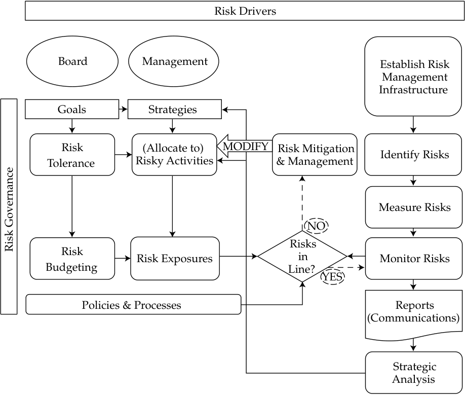

# Tập 9: Quản lý Danh mục Đầu tư (Portfolio Management)
## Learning Module 6 Introduction to Risk Management (Trang PDF 249–300)

---

# Tập 9: Quản lý Danh mục Đầu tư (Volume 9: Portfolio Management)
## Học phần 6: Giới thiệu về Quản trị Rủi ro (Learning Module 6: Introduction to Risk Management)
### Phần 1/4: Giới thiệu (Introduction) (Trang PDF 249–263)

---

<!-- PDF Page 249 -->

#### H Ọ C P H Ầ N (L E A R N I N G M O D U L E)

# **<mark>6</mark>** 

### **Giới thiệu về Quản trị Rủi ro (Introduction to Risk Management)** 

###### **Tác giả: TS. Don M. Chance, CFA, và TS. Michael E. Edleson, CFA.** 

_TS. Don M. Chance, CFA, làm việc tại Đại học Bang Louisiana (Hoa Kỳ). TS. Michael E. Edleson, CFA, làm việc tại Đại học Chicago (Hoa Kỳ)._ 

###### **<mark>KẾT QUẢ HỌC TẬP (LEARNING OUTCOMES)</mark>** 

|**_Thành thạo_**|**_Ứng viên cần có khả năng:_**|
|---|---|
||Định nghĩa quản trị rủi ro (*risk management*)|
||Mô tả các đặc điểm của một khuôn khổ quản trị rủi ro (*risk management framework*)|
||Định nghĩa quản trị rủi ro cấp cao (*risk governance*) và mô tả các yếu tố của quản trị rủi ro cấp cao hiệu quả|
||Giải thích cách thức mức độ chấp nhận rủi ro (*risk tolerance*) ảnh hưởng đến quản trị rủi ro|
||Mô tả phân bổ ngân sách rủi ro (*risk budgeting*) và vai trò của nó trong quản trị rủi ro cấp cao|
||Xác định các nguồn rủi ro tài chính (*financial risks*) và phi tài chính (*non-financial risks*), đồng thời mô tả cách thức chúng có thể tương tác với nhau|
||Mô tả các phương pháp đo lường và điều chỉnh các mức phơi nhiễm rủi ro (*risk exposures*) cùng các yếu tố cần cân nhắc khi lựa chọn giữa các phương pháp đó|

##### **GIỚI THIỆU (INTRODUCTION)** 

**<mark>1</mark>**

Rủi ro — và quản trị rủi ro (*risk management*) — là một phần không thể tránh khỏi của hoạt động kinh tế. Con người nhìn chung quản lý công việc của mình để được hạnh phúc và an toàn nhất trong phạm vi môi trường và nguồn lực của họ cho phép. Nhưng bất kể những công việc này được quản lý cẩn thận đến đâu, rủi ro vẫn tồn tại bởi vì kết quả, dù tốt hay xấu, hiếm khi có thể dự đoán được với sự chắc chắn tuyệt đối. Rủi ro vốn dĩ tiềm ẩn trong gần như mọi thứ chúng ta làm, nhưng bài đọc này sẽ tập trung vào rủi ro kinh tế và tài chính, đặc biệt là trong mối liên hệ với hoạt động quản lý đầu tư. 

Tất cả các doanh nghiệp và nhà đầu tư đều quản trị rủi ro, dù có ý thức hay không, thông qua những lựa chọn mà họ đưa ra. Về cốt lõi, kinh doanh và đầu tư là việc phân bổ các nguồn lực và vốn vào những rủi ro đã được lựa chọn. Trong quy trình ra quyết định của mình, bên trong một môi trường bất định, các tổ chức này có thể thực hiện các bước để né tránh một số rủi ro, theo đuổi những rủi ro mang lại phần thưởng cao nhất, đồng thời đo lường và giảm thiểu mức độ phơi nhiễm (*exposure*) của họ trước những rủi ro này khi cần thiết. Các quy trình và công cụ quản trị rủi ro giúp giải quyết các bài toán kinh doanh và tài chính khó khăn một cách dễ dàng hơn trong một thế giới đầy bất định. Rủi ro không chỉ là vấn đề 

<!-- PDF Page 250 -->

của số phận; đó là thứ mà các tổ chức có thể chủ động quản lý bằng các quyết định của mình, trong một khuôn khổ quản trị rủi ro (*risk management framework*). Rủi ro là một phần không thể tách rời của quy trình kinh doanh hoặc đầu tư. Ngay cả trong những mô hình sơ khai nhất của lý thuyết danh mục đầu tư hiện đại (*modern portfolio theory*), chẳng hạn như tối ưu hóa danh mục đầu tư theo kỳ vọng – phương sai (*mean–variance portfolio optimization*) và mô hình định giá tài sản vốn (*capital asset pricing model* – CAPM), tỷ suất sinh lợi đầu tư được liên kết trực tiếp với rủi ro nhưng đòi hỏi rủi ro đó phải được quản lý một cách tối ưu. Việc xác định và đo lường rủi ro một cách hợp lý, đồng thời giữ cho các rủi ro luôn gắn kết chặt chẽ với các mục tiêu của doanh nghiệp, là những yếu tố then chốt trong việc quản lý doanh nghiệp và các khoản đầu tư. Quản trị rủi ro tốt dẫn đến cơ hội đạt được kết quả mong muốn cao hơn — tạo ra nhiều giá trị hơn cho công ty hoặc danh mục đầu tư, hoặc mang lại mức hữu dụng (*utility*) cao hơn cho cá nhân. 

Các nhà quản lý danh mục đầu tư cần phải thông thạo về quản trị rủi ro không chỉ để cải thiện kết quả rủi ro – tỷ suất sinh lợi của danh mục đầu tư, mà còn vì hai cách thức khác mà họ sử dụng quản trị rủi ro ở cấp độ toàn doanh nghiệp (*enterprise level*). Thứ nhất, họ giúp quản lý chính công ty của mình, vốn có các vấn đề rủi ro doanh nghiệp riêng. Thứ hai, nhiều tài sản trong danh mục đầu tư là các quyền đòi nợ hoặc quyền sở hữu (*claims*) đối với các công ty đang gánh chịu rủi ro. Các nhà quản lý danh mục đầu tư cần đánh giá rủi ro của các công ty đó và cách thức các công ty đó đang giải quyết chúng. 

Bài đọc này áp dụng một cách tiếp cận rộng bao quát cả việc quản trị rủi ro của các doanh nghiệp nói chung lẫn quản trị rủi ro danh mục đầu tư. Các nguyên tắc nền tảng của quản trị rủi ro danh mục đầu tư nhìn chung cũng có thể áp dụng cho việc quản trị rủi ro của các định chế tài chính và phi tài chính. 

Khái niệm quản trị rủi ro cũng có liên quan mật thiết đến các cá nhân. Mặc dù nhiều tổ chức lớn thực hành quản trị rủi ro một cách chính thức, nhưng hầu hết các cá nhân lại thực hành nó một cách phi chính thức hơn và một số người thực hành một cách tùy tiện, thường chỉ phản ứng với các sự kiện rủi ro sau khi chúng đã xảy ra. Mặc dù nhiều cá nhân có thực hiện các biện pháp phòng ngừa hợp lý trước những rủi ro không mong muốn, nhưng các biện pháp phòng ngừa này thường chỉ nhắm vào những rủi ro hiển nhiên. Những rủi ro tinh vi, khó nhận biết hơn thường bị phớt lờ. Thật không may, nhiều cá nhân không xem quản trị rủi ro như một quy trình chính thức, có hệ thống giúp họ đạt được không chỉ các mục tiêu tài chính mà còn cả mục tiêu tối hậu — hay mức hữu dụng tối đa (*maximum utility*) như cách gọi ưa thích của các nhà kinh tế học — dù lẽ ra họ nên làm như vậy. 

Mặc dù trọng tâm chính của bài đọc này là về các định chế, chúng tôi cũng sẽ đề cập đến quản trị rủi ro khi áp dụng cho các cá nhân. Chúng tôi sẽ chỉ ra rằng có nhiều chủ đề chung làm nền tảng cho quản trị rủi ro — những chủ đề có thể áp dụng cho cả các tổ chức lẫn các cá nhân. 

Mặc dù thường được nhìn nhận như một biện pháp phòng thủ, quản trị rủi ro thực chất là một vũ khí tấn công có giá trị trong kho vũ khí của nhà quản lý. Trong hành trình tìm kiếm các kết quả mong muốn, chẳng hạn như lợi nhuận, tỷ suất sinh lợi hoặc giá cổ phiếu cao hơn, ban quản lý thường không được quyền chọn lựa kết quả đầu ra nhưng lại được quyền chọn lựa những rủi ro mà mình sẽ chấp nhận để theo đuổi các kết quả đó. Việc lựa chọn chấp nhận những rủi ro nào thông qua việc phân bổ các nguồn lực khan hiếm chính là công cụ chủ chốt sẵn có đối với ban quản lý. Một tổ chức có văn hóa quản trị rủi ro (*risk management culture*) toàn diện được thiết lập, trong đó rủi ro là một phần không thể tách rời của mọi chiến lược và quyết định then chốt, sẽ có thành quả hoạt động tốt hơn trong dài hạn, cả trong thời kỳ thuận lợi lẫn khó khăn, nhờ việc ra quyết định tốt hơn. 

Thực tế là tất cả các doanh nghiệp và nhà đầu tư đều tham gia vào các hoạt động có rủi ro (tức là các hoạt động có kết quả không chắc chắn) làm nảy sinh một số câu hỏi quan trọng. Các câu hỏi mà bài đọc này sẽ giải quyết bao gồm: 

- Quản trị rủi ro là gì, và tại sao nó lại quan trọng? 

- Một tổ chức (hoặc cá nhân) phải đối mặt với những rủi ro nào khi theo đuổi các mục tiêu của mình? 

- Các mục tiêu của một tổ chức bị ảnh hưởng bởi rủi ro như thế nào, và tổ chức đó đưa ra các quyết định quản trị rủi ro bằng cách nào để tạo ra kết quả tốt hơn? 

- Quản trị rủi ro cấp cao (*risk governance*) định hướng cho quy trình quản trị rủi ro và phân bổ ngân sách rủi ro (*risk budgeting*) như thế nào nhằm tích hợp các mục tiêu của tổ chức với các hoạt động của nó? 

- Một tổ chức đo lường và đánh giá các rủi ro mà mình đối mặt như thế nào, và tổ chức đó có những công cụ gì để giải quyết các rủi ro này? 

<!-- PDF Page 251 -->

Câu trả lời cho những câu hỏi này hợp lại sẽ giúp định nghĩa quy trình quản trị rủi ro. Bài đọc này được tổ chức xoay quanh các câu hỏi đó. Phần 2 và Phần 3 mô tả quy trình quản trị rủi ro, và các Phần 4–6 thảo luận về quản trị rủi ro cấp cao (*risk governance*) và mức độ chấp nhận rủi ro (*risk tolerance*). Phần 7 và Phần 8 trình bày việc nhận diện các loại rủi ro khác nhau, và các Phần 9–11 giải quyết việc đo lường và quản lý rủi ro. 

##### **QUY TRÌNH QUẢN TRỊ RỦI RO (RISK MANAGEMENT PROCESS)** 

## **<mark>2</mark>** 

*Định nghĩa quản trị rủi ro (risk management)*

**Rủi ro (*Risk*)**, nói một cách rộng rãi, là sự phơi nhiễm trước sự bất định (*exposure to uncertainty*). Rủi ro cũng là khái niệm được sử dụng để mô tả tất cả các biến số môi trường không chắc chắn dẫn đến sự biến thiên và tính không thể dự đoán được của các kết quả. Theo cách nói thông thường hơn, rủi ro là khả năng xảy ra một khoản thua lỗ hoặc kết quả bất lợi do một hành động, sự không hành động, hoặc một sự kiện bên ngoài. 

Cách nhìn nhận cuối cùng này có thể khiến người ta nghe có vẻ như rủi ro là thứ cần phải né tránh. Nhưng thực tế hoàn toàn không phải vậy. Rủi ro là một nguyên liệu then chốt trong công thức dẫn đến thành công trong kinh doanh hoặc đầu tư; tỷ suất sinh lợi mà không có rủi ro nhìn chung là một hy vọng hão huyền và thường là công thức dẫn đến việc không đạt được mục tiêu của một người. Những rủi ro được chấp nhận phải được lựa chọn cẩn thận, được thấu hiểu và được quản lý tốt để có cơ hội gia tăng giá trị thông qua các quyết định. Rủi ro và tỷ suất sinh lợi là hai lực lượng gắn kết chặt chẽ với nhau của vũ trụ tài chính. Nhiều người ra quyết định tập trung vào tỷ suất sinh lợi — vốn không phải là thứ dễ dàng kiểm soát được — thay vì tập trung vào rủi ro, hay mức độ phơi nhiễm rủi ro (*exposure to risk*), vốn thực sự có thể được quản lý hoặc kiểm soát. 

**Mức độ phơi nhiễm rủi ro (*Risk exposure*)** là phạm vi mà các rủi ro môi trường hoặc rủi ro thị trường cơ sở dẫn đến rủi ro thực tế phải gánh chịu bởi một doanh nghiệp hoặc nhà đầu tư đang nắm giữ các tài sản hoặc nợ phải trả nhạy cảm với những rủi ro đó. Đó là trạng thái bị phơi nhiễm hoặc dễ bị tổn thương trước một rủi ro. Mức độ phơi nhiễm rủi ro bắt nguồn từ các quyết định của một tổ chức hoặc nhà đầu tư trong việc nắm giữ các tài sản và nợ phải trả nhạy cảm với rủi ro. 

Giả sử có một thông báo quan trọng tại Nhật Bản sẽ dẫn đến việc đồng yên tăng giá (*appreciating*) hoặc giảm giá (*depreciating*) 1%. Khoảng kết quả có thể xảy ra trong các tình huống thực tế rõ ràng không đơn giản như trường hợp tăng hoặc giảm 1% được sử dụng ở đây, nhưng chúng ta sẽ sử dụng một ví dụ đơn giản hóa để làm rõ một điểm quan trọng. Rủi ro là kết quả không chắc chắn của sự kiện này, và rủi ro tiền tệ (*currency risk*) đối với một doanh nghiệp ngoài Nhật Bản là tỷ suất sinh lợi không chắc chắn hoặc sự biến thiên trong tỷ suất sinh lợi tính theo đồng nội tệ bắt nguồn từ sự kiện đó. Rủi ro có thể được mô tả như khoảng kết quả phát sinh và thường được hình dung dưới dạng một phân phối xác suất của tỷ suất sinh lợi trong tương lai. Giả sử rằng giá trị cơ sở là ¥1.000.000. Mức độ phơi nhiễm rủi ro của một doanh nghiệp có thể bằng không hoặc có thể rất đáng kể, tùy thuộc vào việc liệu doanh nghiệp đó có các tài sản hoặc nợ phải trả gắn liền với rủi ro này hay không — trong trường hợp này là sự phơi nhiễm với đồng tiền đó. Một triệu yên, trong ví dụ này, sẽ dẫn đến mức phơi nhiễm rủi ro là ¥10.000 (1% của ¥1.000.000). Quản trị rủi ro sẽ bao gồm, cùng với những việc khác, việc lượng hóa và thấu hiểu mức độ phơi nhiễm rủi ro này, quyết định xem bằng cách nào và tại sao lại có mức phơi nhiễm đó cũng như mức độ rủi ro mà bên tham gia có thể gánh chịu là bao nhiêu, và có thể giảm thiểu rủi ro này bằng cách điều chỉnh mức phơi nhiễm theo một số cách. Quy trình quản trị rủi ro sẽ cung cấp thông tin cho quyết định có nên hoạt động hoặc đầu tư vào đồng tiền có rủi ro này hay không. 

Từ “rủi ro” (*risk*) có thể gây nhầm lẫn bởi vì nó được sử dụng bởi những người khác nhau vào những thời điểm khác nhau để chỉ rất nhiều thứ khác nhau. Ngay cả khi được sử dụng đúng cách, thuật ngữ này vẫn có ba ý nghĩa có liên quan nhưng khác biệt nhau, điều mà ví dụ này minh họa rất rõ. Rủi ro lần lượt có thể mang ý nghĩa là: sự bất định cơ sở bên dưới, quy mô của 

<!-- PDF Page 252 -->

hành động rủi ro được thực hiện, hoặc khoảng kết quả rủi ro phát sinh đối với tổ chức. Trong ví dụ này, ý nghĩa đầu tiên là sự biến động không chắc chắn $+1\%$ hoặc $-1\%$ của đồng tiền. Ý nghĩa thứ hai là lượng tiền tệ có rủi ro trị giá ¥1.000.000, tức vị thế được nắm giữ bởi doanh nghiệp. Ý nghĩa thứ ba là kết quả rủi ro $+¥10.000$ hoặc $-¥10.000$ có thể phát sinh cho doanh nghiệp do đã tham gia vào hoạt động có rủi ro này. Một cách phổ biến để phân biệt chính xác hơn giữa ba “rủi ro” này trong cách sử dụng là: *nhân tố dẫn dắt rủi ro* (*risk driver*) dùng cho rủi ro cơ sở bên dưới, *vị thế rủi ro* (*risk position*) dùng để mô tả hoặc lượng hóa hành động rủi ro được thực hiện, và *mức độ phơi nhiễm rủi ro* (*risk exposure*) dùng cho sự thay đổi định giá tiềm tàng có thể xảy ra. Trong ví dụ được đơn giản hóa quá mức ở trên, mức độ phơi nhiễm rủi ro chỉ đơn giản là vị thế rủi ro nhân với nhân tố dẫn dắt rủi ro. Trong thực tế, thuật ngữ “rủi ro” được sử dụng thay thế cho nhau cho cả ba ý nghĩa trên. 

**_Quản trị rủi ro (Risk management)_** _là quy trình mà qua đó một tổ chức hoặc cá nhân xác định mức độ rủi ro sẽ chấp nhận, đo lường mức độ rủi ro đang thực sự gánh chịu, và điều chỉnh mức độ rủi ro thực tế hướng về mức độ rủi ro mục tiêu, với mục đích tối đa hóa giá trị của công ty hoặc danh mục đầu tư hay sự thỏa mãn tổng thể (mức hữu dụng – utility) của cá nhân._ 

Nói một cách khác, quản trị rủi ro bao gồm tất cả các quyết định và hành động cần thiết để đạt được *tốt nhất* các mục tiêu của tổ chức hoặc cá nhân trong khi gánh chịu một mức độ rủi ro có thể chấp nhận được (*tolerable level of risk*). Quản trị rủi ro *không* phải là việc tối thiểu hóa rủi ro (*minimizing risk*); đó là việc chủ động thấu hiểu và đón nhận những rủi ro giúp cân bằng tốt nhất giữa việc đạt được các mục tiêu với một xác suất thất bại có thể chấp nhận được, lượng hóa mức độ phơi nhiễm, và liên tục giám sát cũng như điều chỉnh nó. Một công ty né tránh mọi rủi ro sẽ thấy rằng mình không thể hoạt động được. Trong nỗ lực tạo ra của cải, tất cả các tổ chức sẽ thấy mình đang “kinh doanh rủi ro” (*in the risk business*). Quản trị rủi ro không phải là việc né tránh rủi ro, cũng giống như một chế độ ăn kiêng thực tế không phải là việc né tránh hoàn toàn calo. Quản trị rủi ro thậm chí cũng không phải là việc dự đoán rủi ro. “Học thuyết Không Bất ngờ” (*“The Doctrine of No Surprises”*) là một câu thần chú chủ chốt giữa nhiều nhà quản trị rủi ro, nhưng điều đó không có nghĩa là họ được kỳ vọng phải dự đoán được những gì sẽ xảy ra. Thay vào đó, nó có nghĩa là nếu một sự kiện không thể dự đoán được, dù tích cực hay tiêu cực, xảy ra trong một thế giới bất định, thì *tác động* (*impact*) của sự kiện đó lên tổ chức hoặc danh mục đầu tư sẽ không phải là một sự bất ngờ mà đã được lượng hóa và xem xét từ trước. 

Ví dụ, một nhà quản trị rủi ro của một ngân hàng sẽ không được kỳ vọng là phải biết trước rằng một cuộc khủng hoảng bất động sản sắp xảy ra và gây ra tình trạng vỡ nợ hàng loạt đối với các chứng khoán bất động sản của ngân hàng. Nhưng một nhà quản trị rủi ro giỏi sẽ giúp ban quản lý của ngân hàng quyết định xem ngân hàng nên có mức độ phơi nhiễm bao nhiêu vào các chứng khoán này bằng cách lượng hóa tác động tài chính tiềm tàng của một cuộc khủng hoảng như vậy có thể hủy hoại, giả sử, 60% vốn của ngân hàng. Một quy trình quản trị rủi ro tốt sẽ bao gồm một cuộc thảo luận sâu sắc ở cấp quản trị cao nhất (*governance level*) về sự cân bằng giữa tỷ suất sinh lợi có khả năng xảy ra và các khoản thua lỗ ít có khả năng xảy ra — nhưng có quy mô rất lớn — và liệu những khoản lỗ như vậy có thể chịu đựng được hay không. Ban quản lý sẽ đảm bảo rằng việc phân tích và thảo luận về rủi ro có tác động tích cực đến các quyết định đầu tư của họ, rằng khoản lỗ tiềm tàng được lượng hóa và truyền đạt liên tục, và rằng họ sẽ thực hiện các hành động để giảm thiểu hoặc chuyển giao bất kỳ phần phơi nhiễm rủi ro nào không thể chịu đựng được.1 Sự bất ngờ duy nhất ở đây lẽ ra chỉ là bản thân cú sốc thị trường; nhà quản trị rủi ro lẽ ra đã phải chuẩn bị sẵn sàng cho tổ chức thông qua kiểm định sức chịu đựng (*stress-testing*) và phân tích kịch bản (*scenario analysis*), liên tục báo cáo trước về tác động tiềm tàng của mức độ phơi nhiễm rủi ro lớn này. 

Một quy trình quản trị rủi ro yếu kém sẽ phớt lờ khả năng xảy ra, dù nhỏ, của một sự kiện thị trường nghiêm trọng như vậy và không lượng hóa khoản lỗ tiềm tàng từ việc phơi nhiễm với một cuộc khủng hoảng bất động sản. Do đó, ban quản lý của ngân hàng sẽ hoàn toàn không biết rằng hơn một nửa số vốn của ngân hàng có thể đang gặp nguy hiểm, không giải quyết rủi ro này trong bất kỳ cuộc thảo luận nào về quản trị cấp cao/khẩu vị rủi ro (*risk appetite*), phớt lờ những rủi ro này trong các quyết định đầu tư của mình, và không thực hiện bất kỳ hành động nào để giảm thiểu rủi ro này. Trong một quy trình quản trị rủi ro tốt, 

> 1 “Truyền đạt” (*communicate*) trong bối cảnh này đề cập đến trao đổi thông tin nội bộ; tuy nhiên, cũng có thể có các yêu cầu pháp lý và kế toán đối với việc công bố thông tin ra bên ngoài về mức độ phơi nhiễm rủi ro hoặc các khoản lỗ tiềm tàng.

<!-- PDF Page 253 -->

phần lớn công việc được thực hiện trước khi một sự kiện bất lợi xảy ra; trong một quy trình quản trị rủi ro yếu kém, có lẽ khối lượng công việc phải làm cũng tương đương như vậy, nhưng tất cả đều diễn ra sau sự kiện, tức là sau khi thiệt hại đã xảy ra rồi. 

Quản trị rủi ro tốt không ngăn chặn được các khoản thua lỗ, nhưng cung cấp một khuôn khổ toàn diện từ trên xuống dưới (*top-to-bottom framework*) giúp cung cấp thông tin một cách chặt chẽ cho quy trình ra quyết định — trước, trong và sau một sự kiện rủi ro. Bởi vì các rủi ro và mức độ phơi nhiễm luôn biến động (*dynamic*), quản trị rủi ro là một quy trình liên tục luôn được đánh giá lại và sửa đổi. Nếu quy trình này được thực hiện tốt, nó sẽ trang bị cho ban quản lý và nhân viên kiến thức để điều hướng một cách hiệu quả nhất có thể tới các mục tiêu do cơ quan quản trị cao nhất đề ra. Đến lượt mình, nỗ lực này làm gia tăng giá trị *tiền nghiệm / trước khi sự việc xảy ra* (*ex ante*) của các quyết định kinh doanh hoặc đầu tư được thực hiện. Quản trị rủi ro tốt có thể cho phép các nhà quản lý hành động nhanh chóng hơn hoặc hiệu quả hơn khi đối mặt với khủng hoảng. Nhưng *hậu nghiệm / sau khi sự việc đã xảy ra* (*ex post*), ngay cả hệ thống quản trị rủi ro tốt nhất cũng có thể không ngăn được việc một danh mục đầu tư bị mất tiền trong một đợt sụp đổ thị trường, cũng như không ngăn được việc một doanh nghiệp bị sụt giảm lợi nhuận trong một đợt suy thoái kinh tế. 

##### **KHUÔN KHỔ QUẢN TRỊ RỦI RO (RISK MANAGEMENT FRAMEWORK)** 

## **<mark>3</mark>** 

*Mô tả các đặc điểm của một khuôn khổ quản trị rủi ro (risk management framework)*

*Định nghĩa quản trị rủi ro cấp cao (risk governance) và mô tả các yếu tố của quản trị rủi ro cấp cao hiệu quả*

Một **khuôn khổ quản trị rủi ro (*risk management framework*)** xuất phát một cách logic từ định nghĩa về quản trị rủi ro đã được đưa ra trước đó: Đó là cơ sở hạ tầng (*infrastructure*), quy trình (*process*), và các công cụ phân tích (*analytics*) cần thiết để hỗ trợ hoạt động quản trị rủi ro hiệu quả trong một tổ chức. Quy trình này phải tích hợp đầy đủ các khía cạnh “rủi ro” và “tỷ suất sinh lợi” của doanh nghiệp vào các quyết định nhằm hỗ trợ việc đạt được tốt nhất các mục tiêu của doanh nghiệp trong phạm vi mức độ chấp nhận rủi ro của nó. Quản trị rủi ro không phải là một giải pháp “một kích cỡ vừa cho tất cả” (*“one size fits all”*); nó gắn liền mật thiết với các mục tiêu và nhu cầu của từng doanh nghiệp. Do đó, nó đạt được tốt nhất thông qua một giải pháp tùy chỉnh riêng. Bất chấp sự tùy chỉnh đó, mọi hệ thống hoặc khuôn khổ quản trị rủi ro đều phải giải quyết các yếu tố then chốt sau đây: 

- Quản trị rủi ro cấp cao (*Risk governance*) 

- Nhận diện và đo lường rủi ro (*Risk identification and measurement*) 

- Cơ sở hạ tầng rủi ro (*Risk infrastructure*) 

- Các chính sách và quy trình được xác định rõ (*Defined policies and processes*) 

- Giám sát, giảm thiểu và quản lý rủi ro (*Risk monitoring, mitigation, and management*) 

- Truyền thông / Giao tiếp thông tin (*Communications*) 

- Phân tích chiến lược hoặc tích hợp (*Strategic analysis or integration*) 

Không có gì đáng ngạc nhiên khi các yếu tố này thường giao thoa với nhau trong thực tế. Chúng được định nghĩa và thảo luận dưới đây. 

Quản trị cấp cao (*Governance*) là hệ thống cấp cao nhất gồm các cấu trúc, quyền hạn và nghĩa vụ mà qua đó các tổ chức được định hướng và kiểm soát. Thường được thực hiện ở cấp hội đồng quản trị (*board level*), quản trị cấp cao là cách thức các mục tiêu được xác định, quyền hạn được trao, và các quyết định cấp cao nhất được đưa ra. Nền tảng cho quản trị rủi ro trong tổ chức cũng được thiết lập ở cấp hội đồng quản trị. **Quản trị rủi ro cấp cao (*Risk governance*)** là quy trình và sự định hướng từ trên xuống (*top-down process and guidance*) nhằm chỉ đạo các hoạt động quản trị rủi ro gắn kết chặt chẽ và hỗ trợ cho toàn bộ doanh nghiệp, và sẽ được trình bày chi tiết hơn trong các Phần 4–6. Quản trị cấp cao tốt phải bao gồm việc xác định mức độ chấp nhận rủi ro (*risk tolerance*) của tổ chức và cung cấp sự giám sát rủi ro (*risk oversight*). Quản trị cấp cao thường được thúc đẩy bởi các mối quan ngại về mặt pháp lý, cũng như bởi vai trò ủy thác (*fiduciary role*) của cơ quan quản trị cao nhất. 

<!-- PDF Page 254 -->

Ủy ban quản trị rủi ro (*risk management committee*) là một khía cạnh khác của quản trị cấp cao; nó cung cấp cho những người ra quyết định hàng đầu một diễn đàn để thường xuyên xem xét các vấn đề quản trị rủi ro. Để đạt được kết quả tốt nhất cho một tổ chức, quản trị rủi ro cấp cao nên áp dụng góc nhìn toàn doanh nghiệp (*enterprise-wide view*). **Quản trị rủi ro doanh nghiệp (*Enterprise risk management* – ERM)** là một cách tiếp cận quản trị cấp cao bao trùm được áp dụng xuyên suốt tổ chức và nhất quán với chiến lược của tổ chức đó, định hướng cho khuôn khổ quản trị rủi ro tập trung các hoạt động rủi ro vào các mục tiêu, sức khỏe tài chính và giá trị của *toàn bộ* tổ chức. 

*Nhận diện và đo lường rủi ro* (*Risk identification and measurement*) là hạt nhân định lượng chính của quản trị rủi ro; nhưng hơn thế nữa, nó phải bao gồm việc đánh giá và thẩm định định tính đối với tất cả các nguồn rủi ro tiềm tàng và các mức độ phơi nhiễm rủi ro của tổ chức. Công việc diễn ra liên tục này bao gồm việc phân tích môi trường để tìm ra các nhân tố dẫn dắt rủi ro (*risk drivers*) có liên quan — đây là thuật ngữ phổ biến được sử dụng cho bất kỳ yếu tố cơ sở nền tảng nào dẫn đến một rủi ro có liên quan hoặc quan trọng đối với một tổ chức — phân tích doanh nghiệp hoặc danh mục đầu tư để xác định rõ các mức độ phơi nhiễm rủi ro, theo dõi những thay đổi trong các mức độ phơi nhiễm rủi ro đó, và tính toán các thước đo rủi ro (*risk metrics*) để định lượng quy mô của những rủi ro này dưới các kịch bản và trạng thái căng thẳng khác nhau. 

Các rủi ro không chỉ giới hạn ở những gì đang diễn ra trên thị trường tài chính. Có rất nhiều loại rủi ro có tiềm năng tác động đến một doanh nghiệp, danh mục đầu tư hoặc cá nhân. 

Sức mạnh của công nghệ đã cho phép hoạt động quản trị rủi ro mang tính định lượng cao hơn và kịp thời hơn. Ban quản lý có thể đo lường và giám sát rủi ro, chạy các kịch bản, tiến hành phân tích thống kê, làm việc với các mô hình phức tạp hơn, và kiểm tra nhiều chiều cạnh cũng như nhiều nhân tố dẫn dắt rủi ro hơn, đồng thời thực hiện việc đó nhanh hơn. Việc sử dụng công nghệ này cần phải được cân bằng và bổ trợ — chứ không phải thay thế (*supplement—not supplant*) — cho sự phán đoán kinh doanh dày dạn kinh nghiệm. Công nghệ đã làm cho cơ sở hạ tầng rủi ro trở nên quan trọng và hữu ích hơn bao giờ hết trong việc quản lý rủi ro. 

*Cơ sở hạ tầng rủi ro* (*Risk infrastructure*) đề cập đến con người và các hệ thống cần thiết để theo dõi các mức độ phơi nhiễm rủi ro và thực hiện phần lớn các phân tích rủi ro định lượng nhằm cho phép đánh giá hồ sơ rủi ro (*risk profile*) của tổ chức. Cơ sở hạ tầng sẽ bao gồm việc thu thập dữ liệu rủi ro (*risk capture* — quy trình vận hành quan trọng mà qua đó một mức độ phơi nhiễm rủi ro được đưa vào hệ thống rủi ro), cơ sở dữ liệu và mô hình dữ liệu, các mô hình và hệ thống phân tích, công cụ chạy kịch bản hoặc kiểm định sức chịu đựng (*stress or scenario engine*), và khả năng tạo lập báo cáo, cũng như một lượng nguồn nhân lực có kỹ năng và được trao quyền chuyên trách việc xây dựng và thực thi khuôn khổ rủi ro. Với sự phụ thuộc ngày càng tăng vào công nghệ, cần phải phân bổ nhiều thời gian và công sức hơn để kiểm thử dữ liệu, mô hình và kết quả nhằm tránh kết quả trớ trêu là rủi ro sai sót lại xuất phát từ ngay bên trong các hệ thống rủi ro. 

Hiển nhiên, phạm vi của cơ sở hạ tầng rủi ro sẽ liên quan đến các nguồn lực, hoặc các khoản lỗ tiềm tàng, của tổ chức. Các cá nhân và các doanh nghiệp nhỏ hơn có thể dựa nhiều vào một đối tác hoặc nhà cung cấp bên ngoài cho phần lớn cơ sở hạ tầng và phân tích rủi ro của họ. 

*Các chính sách và quy trình* (*Policies and processes*) là sự mở rộng của quản trị rủi ro cấp cao vào cả hoạt động hàng ngày lẫn các quy trình ra quyết định của tổ chức. Có thể có các hạn mức (*limits*), yêu cầu (*requirements*), ràng buộc (*constraints*), và hướng dẫn (*guidelines*) — một số mang tính định lượng, một số mang tính thủ tục — để đảm bảo các hoạt động có rủi ro luôn phù hợp với mức độ chấp nhận rủi ro đã được xác định trước của tổ chức và các yêu cầu pháp lý. Phần lớn những điều này chỉ là thông lệ kinh doanh hợp lẽ thường: cập nhật và bảo vệ dữ liệu, kiểm soát dòng tiền, tiến hành thẩm định chuyên sâu (*due diligence*) đối với các khoản đầu tư, xử lý các trường hợp ngoại lệ và báo cáo vượt cấp (*escalations*), cũng như lập các danh sách kiểm tra (*checklists*) để hỗ trợ các quyết định quan trọng. Trong một khuôn khổ rủi ro tốt, các quy trình sẽ phát triển một cách tự nhiên để xem xét rủi ro tại tất cả các điểm ra quyết định then chốt, chẳng hạn như các quyết định đầu tư và phân bổ tài sản. Quản trị rủi ro nên trở thành một phần tích hợp của hoạt động kinh doanh chứ không chỉ là một chức năng tuần tra giám sát hay tuân thủ quy định. 

Quy trình *giám sát, giảm thiểu và quản lý rủi ro* (*risk monitoring, mitigation, and management*) là khía cạnh dễ thấy nhất của một khuôn khổ rủi ro, nhưng cũng là một trong những khía cạnh khó khăn nhất. Việc chủ động giám sát và quản lý rủi ro đòi hỏi phải kết nối quản trị rủi ro cấp cao, nhận diện và đo lường, cơ sở hạ tầng, cùng các chính sách và quy trình lại với nhau, đồng thời liên tục rà soát 

<!-- PDF Page 255 -->

và đánh giá lại khi đối mặt với các mức độ phơi nhiễm rủi ro và các nhân tố dẫn dắt rủi ro đang thay đổi. Nó đòi hỏi phải nhận biết được khi nào mức độ phơi nhiễm rủi ro không còn phù hợp với mức độ chấp nhận rủi ro và sau đó thực hiện hành động để đưa chúng trở lại trạng thái cân bằng gắn kết.2 

*Truyền thông / Giao tiếp thông tin* (*Communication*) về các vấn đề rủi ro trọng yếu phải diễn ra liên tục và xuyên suốt mọi cấp độ của tổ chức. Các tham số quản trị cấp cao, chẳng hạn như mức độ chấp nhận rủi ro và các ràng buộc đi kèm, phải được truyền đạt rõ ràng tới các nhà quản lý và được họ thấu hiểu. Các thước đo rủi ro phải được báo cáo một cách rõ ràng và kịp thời. Các vấn đề rủi ro phải được rà soát và thảo luận như một phần tiêu chuẩn của việc ra quyết định. Những thay đổi trong mức độ phơi nhiễm phải được thảo luận để có thể thực hiện hành động thích hợp. Cũng cần phải có một vòng lặp phản hồi (*feedback loop*) với cơ quan quản trị cao nhất để các định hướng rủi ro cấp cao nhất có thể được xác thực hoặc cập nhật và truyền đạt ngược trở lại cho phần còn lại của tổ chức. 

*Phân tích chiến lược và tích hợp* (*Strategic analysis and integration*) giúp biến quản trị rủi ro thành một vũ khí tấn công để cải thiện thành quả hoạt động. Quản trị rủi ro tốt là chìa khóa để gia tăng giá trị của toàn bộ doanh nghiệp hoặc danh mục đầu tư. Một khuôn khổ quản trị rủi ro cần cung cấp các công cụ để hiểu rõ hơn về cách thức và lý do đằng sau thành quả hoạt động, đồng thời giúp phân loại xem những hoạt động nào đang gia tăng giá trị và những hoạt động nào thì không. Trong đầu tư, việc phân tích chặt chẽ có thể hỗ trợ các quyết định đầu tư tốt hơn và cải thiện chiến lược cũng như tỷ suất sinh lợi đã điều chỉnh theo rủi ro (*risk-adjusted returns*). 

**Minh họa 1: Khuôn khổ Quản trị Rủi ro trong Bối cảnh Doanh nghiệp (Exhibit 1: The Risk Management Framework in an Enterprise Context)** 

<!-- Picture Text: Risk Drivers Board Management Establish Risk Management Infrastructure Goals Strategies Risk  (Allocate to)  MODIFY Risk Mitigation Identify Risks Tolerance Risky Activities & Management Measure Risks NO Risks Risk Risk Exposures in Monitor Risks Budgeting Line? YES Policies & Processes Reports (Communications) Strategic Analysis Risk Governance  -->

> **Chú thích hình ảnh:**
> - **Risk Drivers:** Các nhân tố dẫn dắt rủi ro
> - **Risk Governance (Board):** Quản trị rủi ro cấp cao (Hội đồng quản trị): *Goals* (Mục tiêu) $\rightarrow$ *Risk Tolerance* (Mức độ chấp nhận rủi ro) $\rightarrow$ *Risk Budgeting* (Phân bổ ngân sách rủi ro) $\rightarrow$ *Policies & Processes* (Chính sách & Quy trình).
> - **Management:** Ban quản lý: *Strategies* (Chiến lược) $\rightarrow$ *(Allocate to) Risky Activities* (Phân bổ vào các hoạt động có rủi ro) $\rightarrow$ *Risk Exposures* (Các mức độ phơi nhiễm rủi ro) $\rightarrow$ *Policies & Processes* (Chính sách & Quy trình).
> - **Các bước thực thi bên phải:** *Establish Risk Management Infrastructure* (Thiết lập cơ sở hạ tầng quản trị rủi ro) $\rightarrow$ *Identify Risks* (Nhận diện rủi ro) $\rightarrow$ *Measure Risks* (Đo lường rủi ro) $\rightarrow$ *Monitor Risks* (Giám sát rủi ro) $\rightarrow$ *Risks in Line?* (Rủi ro có nằm trong giới hạn phù hợp không?):
>   - Nếu **NO (Không):** *Risk Mitigation & Management* (Giảm thiểu & Quản lý rủi ro) $\rightarrow$ *MODIFY* (Điều chỉnh lại các hoạt động có rủi ro).
>   - Nếu **YES (Có):** *Reports (Communications)* (Báo cáo / Truyền thông) $\rightarrow$ *Strategic Analysis* (Phân tích chiến lược) $\rightarrow$ Phản hồi ngược lại cho Hội đồng quản trị và Ban quản lý.

Minh họa 1 minh họa quy trình quản trị rủi ro cho một doanh nghiệp, kết nối tất cả các yếu tố đã được mô tả của khuôn khổ rủi ro lại với nhau. Mặc dù có một số lượng rất lớn các rủi ro mà mọi tổ chức phải đối mặt, nhưng hầu hết các tổ chức chủ yếu bị ảnh hưởng bởi một số lượng nhỏ các nhân tố dẫn dắt rủi ro (*risk drivers*) then chốt, hay các yếu tố cơ sở chính tạo ra rủi ro. Dọc theo phía bên trái là quản trị rủi ro cấp cao (*risk governance*), đại diện cho các quyết định ở cấp hội đồng quản trị và bao hàm cũng như tác động đến các ô nằm ngay bên phải nó. Cơ quan quản trị cao nhất, 

> 2 Lưu ý rằng “không phù hợp” (*not aligned*) cũng có thể có nghĩa là mức độ rủi ro hiện đang quá thấp.

<!-- PDF Page 256 -->

thường được gọi là hội đồng quản trị (*board*), xác định các mục tiêu của tổ chức và, đến lượt mình, quyết định mức độ chấp nhận rủi ro (*risk tolerance*) của tổ chức đó. Cơ quan này có thể cung cấp thêm hướng dẫn về cách thức hoặc nơi thức mà rủi ro đó được chấp nhận (phân bổ ngân sách rủi ro – *risk budgeting*). Hội đồng quản trị cũng tham gia vào việc thiết lập các chính sách cấp cao sẽ ảnh hưởng đến hầu hết các quy trình quản trị rủi ro. Những hoạt động quản trị rủi ro cấp cao này là viên đá tảng cực kỳ quan trọng của khuôn khổ rủi ro và sẽ được thảo luận chi tiết trong phần tiếp theo. Khi phần còn lại của khuôn khổ rủi ro xoay quanh các yếu tố quản trị từ trên xuống này và tập trung vào các mục tiêu của toàn bộ doanh nghiệp (như được hiển thị ở đây), kết quả cuối cùng sẽ là hoạt động quản trị rủi ro doanh nghiệp (*enterprise risk management*) hiệu quả. 

Vai trò của ban quản lý (*management*), được hiển thị ở cột giữa, là lập kế hoạch và thực thi các chiến lược tối đa hóa giá trị nhất quán với định hướng quản trị cấp cao của họ. Mỗi hoạt động quản lý trong khuôn khổ không chỉ xuất phát từ ban quản lý (được biểu thị bằng các mũi tên) mà còn từ các hoạt động quản trị cấp cao ở bên trái. Do đó, các chiến lược của ban quản lý không chỉ được thiết kế để đạt được các mục tiêu của hội đồng quản trị, mà ban quản lý còn phân bổ vốn vào các hoạt động có rủi ro (các lựa chọn kinh doanh hoặc đầu tư của mình) để thực thi các chiến lược một cách nhất quán với mức độ chấp nhận rủi ro đã được xác định. Các mức độ phơi nhiễm rủi ro phát sinh từ sự lựa chọn các hoạt động của ban quản lý cũng phải gắn kết phù hợp với ngân sách rủi ro (*risk budget*) của cơ quan quản trị cao nhất. Ngoài ra, ban quản lý tham gia tích cực vào việc thiết lập hoặc triển khai các chính sách và xây dựng các thủ tục liên quan đến thời điểm, cách thức, mức độ và người thực hiện từng yếu tố khác của khuôn khổ rủi ro.3 

Phần còn lại của khuôn khổ quản trị rủi ro bao gồm một số hoạt động rủi ro quan trọng nhằm giúp doanh nghiệp đạt được tất cả các mục tiêu và nhiệm vụ chiến lược cũng như quản trị cấp cao của mình. Các yếu tố khác này để triển khai quản trị rủi ro được hiển thị ở cột ngoài cùng bên phải của hình minh họa. Được thúc đẩy bởi nhu cầu thiết lập một chương trình quản trị rủi ro nhằm hỗ trợ các mục tiêu của doanh nghiệp, ban quản lý sẽ cung cấp các nguồn lực cần thiết cho các hoạt động quản trị rủi ro bằng cách thiết lập một cơ sở hạ tầng quản trị rủi ro (*risk management infrastructure*). Khi các quy trình rủi ro đã được xác định và cơ sở hạ tầng rủi ro đã sẵn sàng, các rủi ro sau đó sẽ được nhận diện và đo lường — đây là một quy trình thường xuyên và liên tục nhằm chuyển dịch các mức độ phơi nhiễm rủi ro (được tạo ra bởi các hoạt động có rủi ro) thành các thước đo rủi ro (*risk metrics*) có ý nghĩa và nhìn chung mang tính định lượng. 

Các bước lớn tiếp theo — giám sát, giảm thiểu và quản lý rủi ro — là nơi tập trung phần lớn hoạt động quản trị rủi ro hàng ngày của một công ty. Những hoạt động này được chia thành ba ô trong hình minh họa. Các mức độ rủi ro được giám sát liên tục ngay sau khi vừa được đo lường.4 Có một quyết định quan trọng tại giai đoạn giám sát: Ban quản lý phải kiểm tra xem tất cả các rủi ro có đang nằm trong giới hạn phù hợp và không vượt ra ngoài các hạn mức của mức độ chấp nhận rủi ro hoặc ngân sách rủi ro đã xác định hay không.5 Quy trình này bao gồm việc đánh giá các mức độ phơi nhiễm rủi ro thực tế so với các chính sách và thủ tục rủi ro của tổ chức để đảm bảo rằng mọi thứ đều đang tuân thủ (*in compliance*). Nếu câu trả lời là “không” (*NO*), thì các hành động giảm thiểu và quản lý rủi ro cần phải được thực hiện để điều chỉnh (*modify*) các mức độ rủi ro và đưa chúng trở lại trạng thái tuân thủ. Có nhiều phương pháp đa dạng để hoàn thành nhiệm vụ này, sẽ được giải quyết trong các Phần 9–11. Dù sử dụng phương pháp nào, việc phân bổ ngân sách rủi ro của ban quản lý vào các hoạt động có rủi ro cũng sẽ bị thay đổi bởi sự điều chỉnh này, bao gồm việc thay đổi các mức độ phơi nhiễm rủi ro của tổ chức, bắt đầu lại vòng tuần hoàn qua các bước ở bên phải, và kiểm tra lại để xem liệu các mức độ rủi ro hiện đã nhất quán với các chính sách rủi ro hay chưa. 

> 3 Về bản chất, có thể có một mũi tên đi từ ô chính sách và quy trình đến mọi ô khác ở bên phải, nhưng những mối quan hệ khá hiển nhiên này đã được cố tình lược bỏ trong sơ đồ để tránh gây rối mắt. Tương tự như vậy, các mức độ phơi nhiễm rủi ro cung cấp thông tin cho gần như tất cả các ô ở bên phải. Quản trị rủi ro vốn dĩ có tính liên kết qua lại rất chặt chẽ. 

> 4 Liên tục (*continuous*) thường không có nghĩa là theo thời gian thực (*real-time*); tần suất giám sát dựa trên các nguồn lực sẵn có, mức độ hỗ trợ của hệ thống, và nhu cầu về thông tin rủi ro trong quy trình ra quyết định. Tại các công ty tài chính lớn, việc giám sát này nhìn chung sẽ diễn ra hàng ngày; đối với các doanh nghiệp nhỏ và cá nhân, nó có thể diễn ra hàng quý. 

> 5 Nhiệm vụ này nhìn chung được giao cho một nhà quản trị rủi ro (*risk manager*); nhưng bất kể chức danh là gì, phải có một người chịu trách nhiệm giải trình cho bước kiểm tra quan trọng này. 

<!-- PDF Page 257 -->

Khi các rủi ro *đã* nằm trong giới hạn phù hợp với các hạn mức, chính sách, mức độ chấp nhận, ủy thác đầu tư, v.v., thì quy trình sẽ quay trở lại việc giám sát liên tục, theo sau là việc truyền đạt thông tin về các mức độ rủi ro.6 Việc truyền đạt này, ở mức tối thiểu, bao gồm việc báo cáo các thước đo rủi ro then chốt một cách định kỳ và kịp thời trên khắp tổ chức để hỗ trợ ban quản lý trong quy trình ra quyết định và hỗ trợ hội đồng quản trị trong việc hoàn thành các nghĩa vụ quản trị cấp cao của mình. Cuối cùng, phân tích chiến lược (*strategic analysis*) được hỗ trợ bởi việc đo lường rủi ro, báo cáo và các bước khác của quy trình quản trị rủi ro doanh nghiệp. Bằng cách phân tích tất cả các chiến lược và hoạt động có rủi ro của doanh nghiệp qua lăng kính đo lường rủi ro, ban quản lý có thể cải thiện quy trình ra quyết định của mình và xác định rõ nơi để đầu tư nguồn vốn và ngân sách rủi ro hữu hạn của mình một cách hiệu quả nhất. Bước này nhìn chung thường bị đánh giá thấp dưới mức giá trị thực và là một sản phẩm phụ ít tốn kém nhưng mang lại nhiều lợi ích của việc đã xây dựng được một khuôn khổ rủi ro. Hai ô hoặc hai bước cuối cùng (báo cáo và phân tích chiến lược) đại diện cho các vòng lặp phản hồi quan trọng nhằm cung cấp thông tin và cải thiện cả hoạt động quản trị cấp cao lẫn danh mục các hoạt động có rủi ro cấu thành nên doanh nghiệp. 

Có rất nhiều vòng lặp phản hồi trong hoạt động quản trị rủi ro được thực thi đúng cách. Trong thực tế, hầu hết các bước này đều giao thoa với nhau trong phần lớn thời gian và được thực hiện đồng thời. Quản trị rủi ro tốt gắn kết tất cả các bước này lại với nhau, từ những quyết định quản trị cấp cao nhất cho đến các chi tiết cụ thể ở cấp thấp hơn, chẳng hạn như các mô hình, báo cáo và danh sách kiểm tra vận hành. Môi trường rủi ro luôn biến động, và nhiều quan niệm của chúng ta về xác suất cũng như các kết quả rủi ro có khả năng xảy ra sẽ thay đổi theo những cách mà có lẽ chúng ta không thể dự đoán được. Khuôn khổ quản trị rủi ro phải đủ vững chắc (*robust*) để lường trước sự biến động này — để kỳ vọng cả những điều bất ngờ (*expect the unexpected*). Nó phải mang tính tiến hóa (*evolutionary*) — đủ linh hoạt để phát triển cùng với một công ty hoặc cá nhân và những thách thức mới của họ. 

Mức độ phức tạp của khuôn khổ quản trị rủi ro phụ thuộc vào mức độ phức tạp trong các mức độ phơi nhiễm rủi ro của một tổ chức và các nguồn lực của họ. Nhưng điều đó không có nghĩa là các tổ chức nhỏ hơn hoặc các cá nhân nên bỏ qua quy trình quản trị rủi ro; họ có thể chỉ đơn giản là làm ở quy mô nhỏ hơn, hoặc phải làm việc với các đối tác bên ngoài để hỗ trợ phần lớn khuôn khổ, hoặc thực hiện quy trình một cách ít trang trọng/chính thức hơn. Suy cho cùng, các nguyên tắc then chốt vừa được trình bày vẫn rất quan trọng ngay cả đối với tổ chức nhỏ nhất, ngay cả khi các thành phần cụ thể không được lắp ghép đầy đủ như đã mô tả. 

###### **QUY TRÌNH QUẢN TRỊ RỦI RO ĐỐI VỚI MỘT CÁ NHÂN (THE RISK MANAGEMENT PROCESS FOR AN INDIVIDUAL)** 

Mặc dù một cá nhân không có cả nguồn lực lẫn bộ máy tổ chức của một doanh nghiệp lớn, nhưng tầm quan trọng của quản trị rủi ro không hề giảm sút và khuôn khổ quản trị rủi ro vẫn được áp dụng, dù nhiều khả năng là dưới một hình thức thu nhỏ (*scaled-down form*). Mặc dù gần như tất cả các yếu tố thiết yếu của quy trình được minh họa trong Minh họa 1 vẫn hữu ích, nhưng cá nhân có thể rút gọn công thức xuống còn sáu thành phần thiết yếu, nhất quán với phạm vi phơi nhiễm rủi ro thu hẹp của cá nhân đó. 

Bước đầu tiên đối với một cá nhân rất giống với bước được hiển thị trong Minh họa 1 đối với tổ chức phức tạp nhất: xác định các mục tiêu (*determination of goals or objectives*). Bước này sẽ bao gồm hầu hết các yếu tố gắn liền với quản trị rủi ro cấp cao, chỉ là không có tất cả sự phức tạp về mặt tổ chức. 

Bước chức năng tiếp theo bao gồm việc lựa chọn các khoản đầu tư (hoặc các tài sản khác) và nhận diện rủi ro của chúng. Do thiếu cơ sở hạ tầng rủi ro, cá nhân ở giai đoạn này có thể đã cần đến dịch vụ của một chuyên gia đầu tư hoặc cố vấn tài chính. Bước này và các bước tiếp theo có lẽ sẽ được thực thi bởi người cố vấn, mặc dù bản thân cá nhân ủy thác (*individual principal*) vẫn cần phải nắm bắt thông tin và tham gia vào quá trình. Trong bối cảnh của hình minh họa tại Minh họa 1, cá nhân thực chất là cơ quan quản trị cao nhất của chính mình và người cố vấn đóng vai trò là ban quản lý. 

> 6 Mặc dù không thể hiện rõ trong hình minh họa, việc truyền thông và báo cáo phải diễn ra bất kể mức độ rủi ro có đang tuân thủ hay không; những hoạt động truyền thông như vậy thậm chí còn quan trọng hơn khi mức độ rủi ro bị lệch khỏi mức độ chấp nhận rủi ro. 

<!-- PDF Page 258 -->

Các bước tiếp theo đối với cá nhân tương đương với trái tim của quy trình quản trị rủi ro: giám sát rủi ro cùng với giảm thiểu và quản lý rủi ro. Trước hết, cá nhân sẽ đánh giá mức độ phơi nhiễm rủi ro của mình (giống như hình thoi hay bước ra quyết định trong hình minh họa), sau đó xem xét các cách tiếp cận thay thế khác nhau để điều chỉnh rủi ro nếu cần thiết, tiếp theo là triển khai giải pháp quản trị rủi ro (mua bảo hiểm, phòng vệ giá [*hedging*], giao dịch, v.v.). 

Bước chức năng cuối cùng đối với quy trình quản trị rủi ro của một cá nhân sẽ là đánh giá và rà soát lại (*evaluation and review*). Bước này song song với phần cuối của hình minh họa quản trị rủi ro, tức các ô ở góc dưới bên phải. Quy trình này có thể diễn ra với tần suất ít hơn nhiều đối với một cá nhân — nhưng nó không hề kém phần quan trọng. 

Mỗi cá nhân nên đơn giản hóa quy trình quản trị rủi ro khi cần thiết để không rơi vào tình trạng coi nó là “quá cao siêu và phức tạp để phải bận tâm” và từ đó phớt lờ hoàn toàn việc quản trị rủi ro. Chi phí tiềm tàng của việc né tránh quản trị rủi ro về cơ bản là giống nhau đối với một cá nhân cũng như đối với một tập đoàn lớn hay một quỹ phòng hộ, mặc dù có lẽ số tiền liên quan ít hơn. 

Về cốt lõi, kinh doanh và đầu tư là việc phân bổ các nguồn lực và vốn vào những rủi ro đã được lựa chọn. Việc thấu hiểu những rủi ro nào thúc đẩy các kết quả tốt hơn phải là một trong những mục tiêu của quản trị rủi ro, và điều đó làm cho quản trị *rủi ro* tốt gắn kết không thể tách rời với quản trị tốt nói chung. Khi hoạt động quản trị rủi ro hiệu quả thực sự được tích hợp ở mọi cấp độ của quy trình ra quyết định và quy trình quản lý tổng thể, tổ chức đó đã phát triển được một *văn hóa rủi ro* (*risk culture*) hiệu quả. Văn hóa này nhìn chung tạo ra kết quả tốt hơn so với việc chỉ xem xét các vấn đề rủi ro như một suy nghĩ riêng rẽ muộn màng sau đó (*separate afterthought*), và đến lượt nó, tạo ra kết quả tốt hơn *rất nhiều* so với việc phớt lờ hoàn toàn các vấn đề rủi ro trong quy trình ra quyết định. Đối với các cá nhân, việc áp dụng văn hóa rủi ro sẽ dẫn đến nhận thức cá nhân về nhiều loại rủi ro, phần thưởng của chúng, chi phí, mối quan hệ giữa chúng, và các phương pháp gắn kết những rủi ro phải gánh chịu với những rủi ro và kết quả mong muốn. Nhận thức này sẽ dẫn đến tỷ suất sinh lợi đầu tư tốt hơn và/hoặc các khoản thua lỗ nhỏ hơn ứng với mức rủi ro đã chấp nhận, mang lại sự thỏa mãn cao hơn. 

Có một số lợi ích khác từ việc thiết lập hệ thống quản trị rủi ro tốt: (1) Rõ ràng nhất là ít gặp phải những điều bất ngờ hơn và có hình dung tốt hơn về mức độ thiệt hại sẽ là bao nhiêu trong trường hợp xảy ra sự cố bất ngờ; (2) kỷ luật ra quyết định cao hơn dẫn đến việc cân nhắc tốt hơn các sự đánh đổi (*trade-offs*) và mối quan hệ rủi ro – tỷ suất sinh lợi tốt hơn; (3) khả năng phản ứng và giảm thiểu rủi ro tốt hơn bắt nguồn từ nhận thức cao hơn và việc giám sát chủ động, giúp cắt giảm bớt một số khoản thua lỗ tồi tệ nhất; (4) hiệu suất cao hơn và ít lỗi vận hành hơn nhờ các chính sách và thủ tục, tính minh bạch và nhận thức về rủi ro; (5) mối quan hệ tốt đẹp hơn, với sự tin tưởng nhiều hơn, giữa cơ quan quản trị cao nhất và ban quản lý, điều nhìn chung dẫn đến việc phân quyền (*delegation*) hiệu quả hơn; (6) hình ảnh hoặc danh tiếng tốt hơn bởi vì các chuyên gia phân tích và nhà đầu tư nhìn nhận công ty là thận trọng và tập trung vào giá trị. Hợp lại cùng nhau, tất cả những lợi ích này sẽ dẫn đến giá trị cao hơn cho doanh nghiệp. 

###### **VÍ DỤ 1 (EXAMPLE 1)** 

###### **Quản trị Rủi ro và Khuôn khổ Quản trị Rủi ro (Risk Management and Risk Management Framework)** 

1. Điều nào sau đây *không* phải là mục tiêu của quản trị rủi ro? 
   - **A.** Đo lường các mức độ phơi nhiễm rủi ro (*Measuring risk exposures*) 
   - **B.** Tối thiểu hóa mức độ phơi nhiễm với rủi ro (*Minimizing exposure to risk*) 
   - **C.** Xác định mức độ khẩu vị rủi ro (*Defining the level of risk appetite*) 

   - **Lời giải** 

B là đáp án đúng. Định nghĩa về quản trị rủi ro bao gồm cả việc xác định mức độ rủi ro mong muốn và đo lường mức độ rủi ro đang thực sự gánh chịu. Quản trị rủi ro 

<!-- PDF Page 259 -->

có nghĩa là chủ động chấp nhận rủi ro theo cách thức tốt nhất và gia tăng nhiều giá trị nhất có thể chứ không phải là việc tối thiểu hóa rủi ro. 

2. Yếu tố nào của một khuôn khổ quản trị rủi ro thiết lập bối cảnh tổng thể cho hoạt động quản trị rủi ro trong một tổ chức? 

   - **A.** Quản trị cấp cao (*Governance*) 

   - **B.** Cơ sở hạ tầng rủi ro (*Risk infrastructure*) 

   - **C.** Các chính sách và quy trình (*Policies and processes*) 

   - **Lời giải** 

A là đáp án đúng. Quản trị cấp cao (*governance*) là yếu tố của khuôn khổ quản trị rủi ro đóng vai trò là nền tảng cấp cao nhất cho quản trị rủi ro. Mặc dù các chính sách, thủ tục và cơ sở hạ tầng là cần thiết để triển khai một khuôn khổ quản trị rủi ro, nhưng chính quản trị cấp cao mới là yếu tố cung cấp bối cảnh tổng thể cho hoạt động quản trị rủi ro của một tổ chức. 

3. Yếu tố nào của quản trị rủi ro cấu thành nên hợp phần phân tích định lượng của quy trình? 

   - **A.** Truyền thông (*Communication*) 

   - **B.** Quản trị rủi ro cấp cao (*Risk governance*) 

   - **C.** Nhận diện và đo lường rủi ro (*Risk identification and measurement*) 

   - **Lời giải** 

C là đáp án đúng. Nhận diện và đo lường rủi ro (*risk identification and measurement*) là phần định lượng của quy trình. Nó bao gồm việc xác định các rủi ro và tóm tắt tác động định lượng tiềm tàng của chúng. Truyền thông và quản trị rủi ro cấp cao phần lớn mang tính định tính. 

4. Yếu tố nào của quản trị rủi ro bao gồm việc thực hiện hành động khi các mức độ phơi nhiễm rủi ro được phát hiện là lệch khỏi mức độ chấp nhận rủi ro? 

   - **A.** Quản trị rủi ro cấp cao (*Risk governance*) 

   - **B.** Nhận diện và đo lường rủi ro (*Risk identification and measurement*) 

   - **C.** Giám sát, giảm thiểu và quản lý rủi ro (*Risk monitoring, mitigation, and management*) 

   - **Lời giải** 

C là đáp án đúng. Giám sát, giảm thiểu và quản lý rủi ro đòi hỏi phải nhận biết và thực hiện hành động khi những yếu tố này (mức độ phơi nhiễm rủi ro và mức độ chấp nhận rủi ro) không nằm trong giới hạn phù hợp, như được hiển thị ở phần giữa của Minh họa 1. Quản trị rủi ro cấp cao bao gồm việc thiết lập mức độ chấp nhận rủi ro. Nhận diện và đo lường rủi ro bao gồm việc nhận diện và đo lường các mức độ phơi nhiễm rủi ro. 

## **<mark>4</mark>**

##### **QUẢN TRỊ RỦI RO CẤP CAO (RISK GOVERNANCE)**

*Định nghĩa quản trị rủi ro cấp cao (risk governance) và mô tả các yếu tố của quản trị rủi ro cấp cao hiệu quả*

<!-- PDF Page 260 -->

Quản trị rủi ro cấp cao (*risk governance*) là nền tảng cho quản trị rủi ro. Như đã định nghĩa trước đó, đây là quy trình và sự định hướng từ trên xuống nhằm chỉ đạo các hoạt động quản trị rủi ro gắn kết chặt chẽ và hỗ trợ cho các mục tiêu của toàn bộ doanh nghiệp. Nó thường xuất phát từ hội đồng quản trị (*board of directors*) — những người có nghĩa vụ ủy thác (*fiduciary obligations*) và trách nhiệm giám sát rủi ro, đồng thời là những người quy định các mục tiêu và quyền hạn. Khi tham chiếu lại định nghĩa về quản trị rủi ro, hãy lưu ý rằng quản trị rủi ro tập trung sâu sắc vào rủi ro và giá trị của toàn bộ doanh nghiệp. 

###### **Góc nhìn Toàn Doanh nghiệp về Quản trị Rủi ro Cấp cao (An Enterprise View of Risk Governance)** 

Ngoài trách nhiệm giám sát rủi ro, còn có hai lĩnh vực quan trọng khác mà trong đó cơ quan quản trị cao nhất dẫn dắt khuôn khổ rủi ro. Thứ nhất, cơ quan này xác định các mục tiêu, phương hướng và các ưu tiên của tổ chức — những yếu tố kết hợp lại đóng vai trò là nền tảng then chốt cho quản trị rủi ro doanh nghiệp (*enterprise risk management* – ERM). Hãy nhớ lại rằng quản trị rủi ro doanh nghiệp là một cách tiếp cận quản trị bao trùm được áp dụng trên toàn bộ tổ chức nhằm tập trung các hoạt động rủi ro vào các mục tiêu, sức khỏe tài chính và giá trị của toàn bộ tổ chức. Thứ hai, cơ quan này quy định rõ khẩu vị rủi ro (*risk appetite*) hay mức độ chấp nhận rủi ro (*risk tolerance*), nghĩa là những rủi ro nào có thể chấp nhận được, những rủi ro nào cần phải được giảm thiểu và giảm thiểu ở mức độ nào, và những rủi ro nào là không thể chấp nhận được. Quản trị rủi ro cấp cao cũng nên cung cấp một hình dung về những khoản thua lỗ tồi tệ nhất có thể chịu đựng được trong các kịch bản khác nhau, và ban quản lý phải quản lý rủi ro tương ứng theo đó. Những yếu tố cân nhắc này sẽ chảy một cách tự nhiên vào các quyết định về phân bổ ngân sách rủi ro (*risk budgeting*) nhằm hướng dẫn việc triển khai một chương trình tối ưu nhất quán với mức độ chấp nhận rủi ro đó. 

Quản trị rủi ro cấp cao là tác động của cơ quan quản trị cao nhất của một tổ chức lên khuôn khổ quản trị rủi ro. Nó cung cấp bối cảnh và sự rõ ràng về các nhân tố tạo giá trị (*value drivers*) và khẩu vị rủi ro của một tổ chức, quy định thẩm quyền rõ ràng cho ban quản lý để thực thi quản trị rủi ro, và đảm bảo sự giám sát rủi ro nhằm liên tục xác định xem hoạt động quản trị rủi ro có đang vận hành tốt và nhất quán với việc tối đa hóa giá trị của tổ chức hay không. Công việc của cơ quan quản trị cao nhất là gắn kết các mục tiêu của tổ chức và khuôn khổ rủi ro lại với nhau; do đó, quản trị rủi ro cấp cao diễn ra trong bối cảnh toàn doanh nghiệp. Quản trị rủi ro cấp cao và giám sát rủi ro cũng kéo theo việc tuân thủ các yêu cầu pháp lý. Quản trị rủi ro cấp cao là một nguyên tắc kỷ luật khó khăn và đòi hỏi khắt khe, và nếu muốn nó phát triển mạnh mẽ trong một tổ chức, nó cần có sự cam kết rõ ràng từ cấp lãnh đạo cao nhất. 

Việc cung cấp sự định hướng rõ ràng đi kèm với khoảng không gian tự chủ (*leeway*) đủ rộng để thực thi chiến lược thường là một sự cân bằng khó khăn. Thậm chí còn thách thức hơn nữa là việc chuẩn bị cho các cuộc thảo luận trước và đưa ra một quyết định cũng như tuyên bố rõ ràng về khẩu vị rủi ro của tổ chức. Thông thường có rất nhiều cuộc thảo luận sôi nổi về khẩu vị rủi ro này *sau* một cuộc khủng hoảng, nhưng lại quá thường xuyên có rất ít cuộc thảo luận trong những giai đoạn bình thường, thời điểm mà việc thảo luận đó sẽ mang lại lợi ích lớn hơn rất nhiều. Bởi vì rủi ro là một trong những công cụ chiến lược chính mà ban quản lý có thể điều tiết, nên điều đặc biệt quan trọng đối với các cơ quan quản trị cao nhất là phải thảo luận cởi mở về rủi ro, xem xét các kịch bản, thấu hiểu tác động của các kết quả tiêu cực lên tổ chức, và làm rõ những lĩnh vực mà họ không sẵn lòng mạo hiểm dấn thân vào. Rất giống với một chiếc ô tô có vạch vùng đỏ (*red zone*) trên một số mặt đồng hồ để thiết lập ranh giới cho việc vận hành an toàn, các cơ quan quản trị rủi ro cấp cao cũng nên thiết lập các vùng đỏ giả định tương tự để đảm bảo sự vận hành an toàn cho doanh nghiệp của mình. 

Quản trị rủi ro doanh nghiệp (tập trung các hoạt động rủi ro vào các mục tiêu, sức khỏe tài chính và giá trị của *toàn bộ* tổ chức) đòi hỏi phải xem xét toàn bộ bảng cân đối kế toán kinh tế (*economic balance sheet*) của doanh nghiệp, chứ không chỉ riêng phần tài sản hay một bộ phận của doanh nghiệp một cách tách biệt. Một góc nhìn hẹp hơn về quản trị rủi ro ít có khả năng đáp ứng được mục tiêu tối đa hóa giá trị của toàn bộ doanh nghiệp. 

Quản lý quỹ hưu trí (*pension fund management*) cung cấp một ví dụ kinh điển về tầm quan trọng của việc xem xét quản trị rủi ro doanh nghiệp: “Quỹ” (*Funds*) là tài sản và “lương hưu” (*pension*) là nợ phải trả. Nhưng một góc nhìn toàn doanh nghiệp thực sự đòi hỏi một tầm nhìn thậm chí còn rộng hơn thế. Nhà quản lý quỹ hưu trí của một công ty có thể cố gắng chỉ tối đa hóa phần tài sản của quỹ, nhưng điều này nhìn chung sẽ gây hại cho công ty đó. Cả tài sản và nợ phải trả của một quỹ hưu trí đều nhạy cảm với các biến số thị trường, vì vậy việc phớt lờ các khoản nợ phải trả sẽ đồng nghĩa với việc phớt lờ một nửa rủi ro. Với các khoản nợ phải trả có đặc tính rất giống trái phiếu (*bond-like*), việc một nhà quản lý quỹ hưu trí sử dụng toàn bộ cổ phiếu 

<!-- PDF Page 261 -->

để đạt mức tăng trưởng tối đa sẽ tiềm ẩn nguy cơ làm cho toàn bộ quỹ mất khả năng thanh toán (*insolvent*) trong một đợt sụp đổ thị trường đi kèm với lãi suất sụt giảm bởi vì, trong tình huống như vậy, các khoản nợ phải trả sẽ tăng mạnh về giá trị trong khi các tài sản lại sụt giảm. Mức độ chấp nhận rủi ro đối với riêng phần tài sản khi xét tách biệt sẽ khác xa so với mức độ chấp nhận rủi ro của toàn bộ doanh nghiệp. Người ta cần phải nhìn xa hơn cả các khoản nợ phải trả hưu trí, vốn nhiều khả năng chỉ là một phần nhỏ của toàn bộ doanh nghiệp. Rộng hơn nữa, một góc nhìn rủi ro doanh nghiệp thực sự trong trường hợp này *cũng* sẽ xem xét đến hồ sơ rủi ro kinh doanh của công ty mẹ chứ không chỉ riêng tài sản và nợ phải trả của quỹ hưu trí. Trong một đợt sụp đổ thị trường, toàn bộ hoạt động kinh doanh của công ty mẹ có thể đang ở trong giai đoạn suy thoái, khiến cho việc tăng mức đóng góp từ công ty vào quỹ hưu trí của nó trở nên vô cùng đau đớn và khó khăn. Việc đưa hồ sơ rủi ro của công ty vào chiến lược đầu tư của quỹ hưu trí có thể làm cho mức độ chấp nhận rủi ro trở nên thấp hơn trong trường hợp này. 

Quản trị rủi ro cấp cao tập trung vào toàn bộ doanh nghiệp sẽ dẫn đến hoạt động quản trị rủi ro ít có khả năng mâu thuẫn với các mục tiêu của tổ chức hơn nhiều và có nhiều khả năng nâng cao giá trị dài hạn hơn. Tương tự như vậy, việc xem xét một dải phổ đầy đủ các rủi ro, chứ không chỉ riêng những rủi ro định lượng hiển nhiên nhất, sẽ dẫn đến quản trị rủi ro cấp cao tốt hơn. 

Góc nhìn toàn doanh nghiệp của quản trị rủi ro cũng có thể áp dụng và quan trọng ngang bằng đối với một cá nhân, ngay cả khi thuật ngữ “doanh nghiệp” (*enterprise*) không thường được sử dụng trong bối cảnh cá nhân.7 Tập hợp các rủi ro phù hợp đối với một cá nhân phải được nhìn nhận không phải một cách tách biệt, mà trong sự cân nhắc tới các mục tiêu và đặc điểm của cá nhân đó dưới một góc nhìn tổng thể (*holistic view*). Ví dụ, một cố vấn có thể đang thiết kế một danh mục đầu tư để tối đa hóa tài sản của khách hàng và tối ưu hóa sự đánh đổi giữa rủi ro và tỷ suất sinh lợi ở một mức độ rủi ro được cảm nhận là thoải mái nào đó.8 Nhưng người khách hàng — mà tổng tài sản (*wealth*) của cô ấy không chỉ bao gồm các tài sản tài chính (*financial assets*) mà còn bao gồm cả **vốn nhân lực (*human capital*)** có giá trị — có thể muốn các quyết định phân bổ rủi ro được đưa ra có xét đến cả hai dạng vốn này, nhằm tối ưu hóa tổng tài sản (*total wealth*) của cô. Ví dụ, một khách hàng có sự nghiệp trong ngành bất động sản rất có thể sẽ hưởng lợi nếu danh mục đầu tư tài chính của cô được đầu tư theo cách thức có tính đến mức độ phơi nhiễm thu nhập tiền lương của cô với các rủi ro liên quan đến bất động sản. Việc nắm giữ các chứng khoán bất động sản vượt quá một mức độ nhất định, ngay cả khi là tối ưu từ góc độ danh mục đầu tư tài chính tách biệt, có thể làm cho cá nhân này chưa đạt được sự đa dạng hóa tối ưu từ góc độ tổng tài sản. Trong một ví dụ khác, Nhà đầu tư X, người có khoản phúc lợi lương hưu được điều chỉnh theo lạm phát (*inflation-adjusted pension benefits*) rất lớn, sẽ khác với Nhà đầu tư Y, người có khoản phúc lợi lương hưu cố định, và càng khác hơn nữa so với Nhà đầu tư Z, người không có phúc lợi lương hưu và nghỉ hưu hoàn toàn chỉ dựa vào danh mục đầu tư của riêng mình. Ba nhà đầu tư này sẽ đòi hỏi các giải pháp đầu tư khác nhau rõ rệt, không chỉ để đối phó với lạm phát mà còn để đối phó với sự bất định xoay quanh tuổi thọ (*lifespans*). Những cá nhân có các mục tiêu và đặc điểm khác nhau sẽ cần các giải pháp đầu tư và rủi ro khác nhau phù hợp nhất với hoàn cảnh riêng của họ. Trên thực tế, bởi vì vòng đời cực kỳ biến thiên của một cá nhân và bản chất rời rạc của nhiều mục tiêu cá nhân, góc nhìn toàn doanh nghiệp (tổng thể) thậm chí còn quan trọng đối với quản trị rủi ro cho các cá nhân hơn là cho các định chế. 

Quản trị rủi ro cấp cao mở rộng sang ban quản lý để bao gồm các cách thức đảm bảo rằng khuôn khổ rủi ro của một tổ chức luôn duy trì sự nhất quán với định hướng cấp cao nhất. Một cách tiếp cận hữu ích là cung cấp một diễn đàn thường xuyên để thảo luận về khuôn khổ rủi ro và các vấn đề rủi ro then chốt ở cấp độ ban quản lý. Nói cách khác, một ủy ban quản trị rủi ro (*risk management committee*) sẽ là một yếu tố then chốt của quản trị rủi ro cấp cao tốt. Các hoạt động của ủy ban này có thể song hành với các cuộc thảo luận cân nhắc về rủi ro của cơ quan quản trị cao nhất, nhưng ở cấp độ vận hành (*operational level*) thay vì giám sát cấp cao. Tại diễn đàn này, quản trị cấp cao giao thoa với nhiều khía cạnh khác thuộc khuôn khổ rủi ro của tổ chức như đã thảo luận trong Phần 2 và Phần 3. Trên thực tế, nếu được thực hiện tốt, nó sẽ tích hợp tất cả các khía cạnh đó lại với nhau. 

Cùng theo mạch tư duy đó, một yếu tố khác của quản trị rủi ro cấp cao tốt là việc bổ nhiệm chính thức một giám đốc điều hành có trách nhiệm làm giám đốc quản trị rủi ro (*chief risk officer* – CRO). Vị giám đốc này phải chịu trách nhiệm xây dựng và triển khai khuôn khổ rủi ro cho doanh nghiệp và 

> 7 Quản trị rủi ro doanh nghiệp là một khái niệm dễ hiểu hơn đối với một cá nhân; so với một tổ chức nơi mà việc quyết định, phối hợp và truyền đạt các mục tiêu có thể là một thách thức lớn, phạm vi của các nỗ lực quản trị rủi ro đối với một cá nhân nhỏ hơn và dễ quản lý hơn. 

> 8 Ở đây, cá nhân đóng vai trò là cơ quan quản trị cao nhất, thiết lập các mục tiêu cá nhân và khẩu vị rủi ro; chuyên gia tài chính hoặc nhà quản lý gia sản là “đội ngũ quản lý” thực thi phần lớn phần còn lại của khuôn khổ rủi ro. 

<!-- PDF Page 262 -->

quản lý nhiều hoạt động bên trong đó. Theo cùng cách thức mà các rủi ro gắn liền không thể tách rời với các hoạt động kinh doanh cốt lõi, CRO cũng là một người tham gia chủ chốt vào các quyết định chiến lược của doanh nghiệp — vị trí này không chỉ đơn thuần là một vai trò tuần tra giám sát (*policing role*). Mặc dù giám đốc điều hành (CEO) chịu trách nhiệm về rủi ro cũng như tất cả các khía cạnh khác của một doanh nghiệp, nhưng việc để CEO kiêm nhiệm vai trò của CRO cũng vô lý chẳng khác nào việc để CEO kiêm nhiệm vai trò của giám đốc tài chính (CFO). Nhiều công ty tài chính hiện nay đã có một CRO trong ban quản lý điều hành,9 điều đã trở thành thông lệ tốt nhất (*best practice*) ngay cả trong những năm trước cuộc khủng hoảng năm 2008. 

## **<mark>5</mark>** 

##### **MỨC ĐỘ CHẤP NHẬN RỦI RO (RISK TOLERANCE)** 

*Giải thích cách thức mức độ chấp nhận rủi ro (risk tolerance) ảnh hưởng đến quản trị rủi ro*

Có lẽ yếu tố quan trọng nhất của quản trị rủi ro cấp cao tốt là cuộc thảo luận và quyết định về **mức độ chấp nhận rủi ro (*risk tolerance*)** bên trong cơ quan quản trị cao nhất. Chiến lược kinh doanh và đầu tư xoay quanh việc lựa chọn một danh mục các hoạt động có rủi ro có thể chấp nhận được nhằm tối đa hóa giá trị và tạo ra tỷ suất sinh lợi cao nhất có thể ứng với mức độ rủi ro nhất định. Ở cấp độ quản trị cao nhất, nhiệm vụ nhìn chung không phải là đi chọn lựa các hoạt động cụ thể này — một công việc thường thuộc về ban quản lý — mà là thiết lập khẩu vị rủi ro (*risk appetite*) của tổ chức. Một số rủi ro hoặc mức độ rủi ro nhất định có thể được coi là có thể chấp nhận được, những rủi ro khác được coi là không thể chấp nhận được, và ở khoảng giữa là những rủi ro có thể được theo đuổi theo cách thức có giới hạn rủi ro. Nói một cách khác, mức độ chấp nhận rủi ro xác định phạm vi mà tổ chức sẵn lòng trải qua các khoản thua lỗ hoặc chi phí cơ hội (*opportunity costs*) và thất bại trong việc đáp ứng các mục tiêu của mình. 

Quyết định về mức độ chấp nhận rủi ro *đối với một cá nhân* tương tự, nhưng không hoàn toàn giống hệt, với quyết định của một doanh nghiệp kinh doanh. Trong lý thuyết tài chính truyền thống, cá nhân tập trung vào việc tối đa hóa mức hữu dụng không thể quan sát được (*unobservable utility*), trong khi doanh nghiệp tối đa hóa một giá trị nhìn chung có thể quan sát được — giá trị thị trường hoặc giá cổ phiếu của công ty. Mặc dù các cá nhân đang đối mặt với cuộc sống và cái chết chắc chắn trên một lịch trình thời gian không chắc chắn, nhưng hầu hết các doanh nghiệp có xu hướng là những tổ chức có tuổi thọ thực tế tương đối ngắn, song lại hoạt động với kỳ vọng về sự bất tử (*hoạt động liên tục – going concern*). Các quyết định về mức độ chấp nhận rủi ro từ hai góc nhìn rất khác nhau đó có thể được kỳ vọng là sẽ khác nhau — ví dụ, mức độ chấp nhận rủi ro trong các tổ chức thường coi sự tiếp tục tồn tại của tổ chức là một yếu tố cân nhắc trọng yếu. Xét trên nhiều phương diện, quyết định về mức độ chấp nhận rủi ro của cá nhân là quyết định khó khăn hơn. 

Góc nhìn quản trị rủi ro doanh nghiệp là lăng kính đúng đắn để nhìn nhận câu hỏi về khẩu vị rủi ro. Quyết định về mức độ chấp nhận rủi ro bắt đầu bằng hai phân tích khác nhau cần phải được tích hợp lại — một góc nhìn “bên trong” (*“inside” view*) và một góc nhìn “bên ngoài” (*“outside” view*). Thứ nhất, những sự thiếu hụt/suy giảm (*shortfalls*) nào bên trong một tổ chức sẽ khiến nó thất bại, hoặc ít nhất là thất bại trong việc đạt được một số mục tiêu sống còn? Thứ hai, tổ chức đang bị phơi nhiễm trước những lực lượng bất định nào? Nghĩa là, các nhân tố dẫn dắt rủi ro (*risk drivers*) của nó là gì? Với câu trả lời cho hai câu hỏi khó khăn này trong tay, hội đồng quản trị có thể bắt đầu xác định các chiều cạnh và mức độ rủi ro mà họ cảm thấy quá bất an khi phải gánh chịu. Mức độ chấp nhận rủi ro này cần được lựa chọn chính thức và truyền đạt *trước* khi xảy ra khủng hoảng, đồng thời sẽ đóng vai trò là định hướng cấp cao cho ban quản lý trong việc lựa chọn chiến lược 

> 9 Mặc dù điều này là phổ biến đối với các công ty tài chính hoặc các tổ chức lớn khác, nhưng nhiều công ty ít phức tạp hơn sẽ bỏ qua một cấu trúc rủi ro chính thức. Hội đồng quản trị vẫn duy trì các trách nhiệm quản trị rủi ro cấp cao của mình; và tùy thuộc vào họ trong việc làm việc với ban quản lý về cách thức, cũng như mức độ, để đáp ứng những trách nhiệm này. 

<!-- PDF Page 263 -->

đối với các rủi ro. Nhiều tổ chức sẽ làm việc này *sau* một cuộc khủng hoảng, điều mà tuy vẫn tốt hơn là không làm gì cả nhưng lại rất giống với việc mua bảo hiểm sau khi tổn thất đã xảy ra. Tốt nhất là nên giải quyết việc này khi dường như chưa có lý do nào đặc biệt cấp bách buộc phải làm như vậy. Tương tự, một số cá nhân có thể không suy nghĩ nhiều về mức độ chấp nhận rủi ro của chính mình cho đến sau khi một cuộc khủng hoảng xảy ra, khi họ muộn màng quyết định rằng rủi ro đó không đáng để đánh đổi. 

Ví dụ, giả sử hội đồng quản trị của một công ty sản xuất thiết bị xây dựng tại Tây Ban Nha đang xác định mức độ chấp nhận rủi ro của mình. Từ góc nhìn bên trong (*inside perspective*), công ty có hai mối quan tâm chính: doanh thu và thanh khoản. Hội đồng quản trị xác định rằng công ty có thể chịu đựng được mức sụt giảm 5%–10% về doanh thu, nhưng mức sụt giảm 20% sẽ kích hoạt các điều khoản ràng buộc nợ (*debt covenants*) và đặt việc ra mắt sản phẩm chủ lực mới của công ty vào tình thế nguy hiểm. Liên quan đến chiến lược này, công ty cần €40 triệu dòng tiền hàng năm trong ba năm tới cho các khoản chi tiêu vốn (*capital expenditures*) thiết yếu và hầu như không thể để bất kỳ phần nào của dòng tiền này gặp rủi ro. Từ góc nhìn bên ngoài (*outside perspective*), hội đồng quản trị nhận ra rằng có ba sự bất định chính hay ba nhân tố dẫn dắt rủi ro mà công ty không có quyền kiểm soát: những thay đổi trong giá trị của đồng đô la Mỹ, những thay đổi về lãi suất, và tỷ suất sinh lợi thị trường của các cổ phiếu thuộc lĩnh vực công nghiệp. Cả kết quả kinh doanh lẫn giá cổ phiếu của chính công ty đều có tương quan mạnh mẽ với ba rủi ro này và có thể bị ảnh hưởng bất lợi bởi bất kỳ rủi ro nào trong số đó. 

Thay vì áp dụng một cách tiếp cận thụ động như một người quan sát rủi ro, hội đồng quản trị trong ví dụ này sử dụng một phân tích cấp cao để xây dựng mức độ chấp nhận rủi ro của mình. Trong trường hợp này, hội đồng quản trị có thể quyết định giới hạn mức biến thiên dòng tiền tối đa ở mức €10 triệu hàng năm và mức phơi nhiễm doanh thu ở mức $-10\%$ trong một cuộc suy thoái toàn cầu. Ngoài ra, họ có thể quy định các hạn mức được công bố khác, chẳng hạn như mức độ phơi nhiễm tối đa với rủi ro tiền tệ hoặc các rủi ro khác. Định hướng này có thể ảnh hưởng đến mức độ rủi ro của các chiến lược sản phẩm khác mà ban quản lý có thể theo đuổi. Công ty có thể đòi hỏi các phương án tài trợ đắt đỏ hơn để giảm bớt sự bất định của dòng tiền. Các hạn chế về quản trị cấp cao có thể thúc đẩy các chương trình giảm thiểu rủi ro, chẳng hạn như một chiến lược phòng vệ giá (*hedging strategy*), đặc biệt là đối với các nhân tố dẫn dắt rủi ro chính vốn là những lĩnh vực đáng quan ngại đã được nêu rõ. 

Định hướng quản trị cấp cao đóng vai trò quan trọng trong việc giúp một doanh nghiệp nhắm mục tiêu vào nơi mà nó nên chủ động theo đuổi rủi ro và nơi mà nó nên giảm thiểu hoặc điều chỉnh rủi ro. Các mục tiêu chiến lược xoay quanh các năng lực cốt lõi (*core competencies*) cần được theo đuổi, điều này dẫn dắt công ty đi vào việc chấp nhận những rủi ro giúp định vị doanh nghiệp ở vị thế tốt nhất để thành công và tạo ra giá trị. Các công ty đôi khi chấp nhận rủi ro ở những lĩnh vực mà họ không có chuyên môn, điều đặt việc tạo ra giá trị cốt lõi và toàn bộ tổ chức của họ vào tình thế nguy hiểm. Một chương trình rủi ro vận hành tốt sẽ giới hạn hoặc phòng vệ giá đối với những rủi ro phi cốt lõi (*non-core risks*) ở những lĩnh vực mà họ không có lợi thế so sánh (*comparative advantage*). Việc điều chỉnh rủi ro sẽ được trình bày chi tiết trong các Phần 9–11. 

Làm thế nào để một công ty xác định được mức độ chấp nhận rủi ro của mình? Chắc chắn là không có một công thức cố định nào cả. Quan trọng nhất là, các mục tiêu của công ty, chuyên môn của công ty trong những lĩnh vực nhất định, và các chiến lược của công ty sẽ giúp hội đồng quản trị xác định xem công ty có thể theo đuổi những rủi ro nào và với cường độ bao nhiêu. Khả năng của một công ty trong việc phản ứng linh hoạt (*respond dynamically*) trước các sự kiện bất lợi có thể cho phép một mức độ chấp nhận rủi ro cao hơn. Quy mô khoản lỗ mà một công ty có thể gánh chịu mà không làm tổn hại đến vị thế hoạt động liên tục (*going concern*) của nó phải được tính đến trong mức độ chấp nhận rủi ro; một số công ty mong manh dễ vỡ hơn những công ty khác. Bối cảnh cạnh tranh cũng rất quan trọng bởi vì kỳ vọng của cả hội đồng quản trị lẫn các nhà đầu tư thường được hình thành trong bối cảnh công ty được định vị như thế nào trong ngành của mình. Bối cảnh chính phủ và pháp lý cũng quan trọng không kém, cả trong những yêu cầu *tiền nghiệm* (*ex ante*) của họ về cách các công ty tiếp cận rủi ro lẫn trong phản ứng *hậu nghiệm* (*ex post*) có khả năng xảy ra trong trường hợp có thảm họa. Các phân tích định lượng như phân tích kịch bản, các mô hình kinh tế, và độ nhạy đối với các nhân tố dẫn dắt rủi ro vĩ mô có thể được sử dụng để đánh giá xem vùng an toàn thoải mái (*zone of comfort*) của hội đồng quản trị được giới hạn ở đâu. Có những yếu tố khác *không* nên quyết định mức độ chấp nhận rủi ro, nhưng trong nhiều trường hợp chúng lại có tác động. Động cơ cá nhân, niềm tin và nghị trình riêng của các thành viên hội đồng quản trị (vấn đề đại diện – *agency problem*); quy mô công ty; việc môi trường thị trường có vẻ ổn định hay không; những áp lực ngắn hạn; và chế độ đãi ngộ của ban quản lý thường ảnh hưởng đến mức độ chấp nhận rủi ro theo những cách thức có thể không phù hợp với lợi ích tốt nhất của những người chủ sở hữu. 

Một khi mức độ chấp nhận rủi ro đã được xác định, khuôn khổ rủi ro tổng thể phải được hướng tới việc đo lường, quản lý và truyền đạt sự tuân thủ đối với mức độ chấp nhận rủi ro này — đưa mức độ phơi nhiễm rủi ro vào đúng giới hạn phù hợp với khẩu vị rủi ro của doanh nghiệp. 

---

# Tập 9: Quản lý Danh mục Đầu tư (Volume 9: Portfolio Management)
## Học phần 6: Giới thiệu về Quản trị Rủi ro (Learning Module 6: Introduction to Risk Management)
### Phần 2/4: Phân bổ Ngân sách Rủi ro (Risk Budgeting) (Trang PDF 264–275)

---

<!-- PDF Page 264 -->

Hoạt động quản trị cấp cao kiểu này không chỉ giúp đảm bảo rằng tổ chức sống sót qua những thời kỳ tồi tệ nhất, mà còn giúp đảm bảo một sự đánh đổi chiến lược (*strategic trade-off*) giữa rủi ro và tỷ suất sinh lợi trong quy trình ra quyết định, điều đến lượt nó sẽ cải thiện tỷ suất sinh lợi tiềm năng ứng với mức độ rủi ro và giá trị nhất định. Rất dễ tìm thấy các chiến lược kinh doanh và phương pháp tiếp cận đầu tư tạo ra tỷ suất sinh lợi có vẻ vượt trội quy mô lớn, nhưng chúng có thể phải trả giá bằng việc đặt tổ chức vào tình thế rủi ro cực đoan. Một ví dụ có phần cực đoan sẽ là việc một công ty bán quyền chọn bán (*selling put options*) trên chính cổ phiếu của mình, điều có thể tạo ra lợi nhuận ngắn hạn cao hơn nhưng sẽ làm tăng mạnh nguy cơ công ty sụp đổ trong một đợt suy giảm sâu của thị trường. Đòn bẩy quá mức (*excessive leverage*) là một chiến lược rủi ro khác nhằm thúc đẩy lợi nhuận ngắn hạn nhưng có thể làm giảm giá trị hoặc dẫn đến sự sụp đổ trong dài hạn. Một quy trình quản trị rủi ro cấp cao chính thức với mức độ chấp nhận rủi ro được tuyên bố rõ ràng sẽ dẫn đến một hệ quả tự nhiên là né tránh được nhiều chiến lược dễ dàng hơn nhưng kém lập luận chặt chẽ hơn vốn kéo theo rủi ro quá mức so với mức độ chấp nhận rủi ro của công ty. Thay vào đó, nó sẽ dẫn dắt cuộc thảo luận chiến lược đi vào các chiến lược thay thế có nhiều khả năng gia tăng giá trị hơn trong khi vẫn chấp nhận rủi ro hợp lý bên trong mức độ chấp nhận rủi ro của doanh nghiệp chứ không đơn giản là đánh đổi sự hủy diệt lấy tỷ suất sinh lợi (*trade ruin for return*). Quản trị rủi ro cấp cao và văn hóa rủi ro chân chính, tốt đẹp có thể tránh được các chiến lược rủi ro quá mức có nguy cơ đặt giá trị doanh nghiệp dài hạn vào vòng nguy hiểm. Cách tiếp cận này sẽ tạo ra giá trị gia tăng cao hơn cho doanh nghiệp. 

# **<mark>6</mark>** 

## **PHÂN BỔ NGÂN SÁCH RỦI RO (RISK BUDGETING)** 

*Mô tả phân bổ ngân sách rủi ro (risk budgeting) và vai trò của nó trong quản trị rủi ro cấp cao*

**Phân bổ ngân sách rủi ro (*Risk budgeting*)** tiếp nối tại nơi mà mức độ chấp nhận rủi ro (*risk tolerance*) dừng lại. Trong khi mức độ chấp nhận rủi ro tập trung vào khẩu vị đối với rủi ro cùng những gì có thể và không thể chấp nhận được, thì phân bổ ngân sách rủi ro có trọng tâm cụ thể hơn vào cách thức mà rủi ro đó được chấp nhận và thực thi. Phân bổ ngân sách rủi ro lượng hóa và phân bổ mức rủi ro có thể chịu đựng được bằng các thước đo cụ thể; nó mở rộng và hướng dẫn việc triển khai quyết định về mức độ chấp nhận rủi ro. 

Phân bổ ngân sách rủi ro áp dụng cho cả quản trị kinh doanh lẫn quản lý danh mục đầu tư. Nền tảng của nó là góc nhìn cho rằng quản trị kinh doanh hoặc quản lý danh mục đầu tư bao gồm việc tập hợp một số hoạt động có rủi ro hoặc chứng khoán có rủi ro, vốn có thể được đối chiếu tổng hợp thành một tập hợp gồm nhiều đặc điểm rủi ro khác nhau. Ví dụ, một góc nhìn truyền thống về một danh mục đầu tư có thể là danh mục đó được phân bổ 20% vào các quỹ phòng hộ (*hedge funds*), 30% vào vốn cổ phần tư nhân (*private equity*), và 50% còn lại được chia giữa cổ phiếu và trái phiếu. Một góc nhìn rủi ro thay thế đối với cùng danh mục đầu tư đó có thể là 70% bị chi phối bởi tỷ suất sinh lợi cổ phiếu toàn cầu, 20% bởi tỷ suất sinh lợi cổ phiếu trong nước, với 10% còn lại bị chi phối bởi lãi suất. Hợp phần cổ phiếu có thể được phân bổ 65% vào cổ phiếu giá trị (*value*) và 35% vào cổ phiếu tăng trưởng (*growth*). Danh mục đầu tư đó cũng có thể có 45% là chứng khoán kém thanh khoản (*illiquid securities*) và phần còn lại có tính thanh khoản cao (*liquid*). Các cách phân bổ khác có thể được trình bày dưới dạng mức độ phơi nhiễm với lạm phát, lãi suất dài hạn, tiền tệ, v.v. Những chiều cạnh đa dạng này để nhìn nhận sự phân bổ của một danh mục đầu tư không loại trừ lẫn nhau (*not mutually exclusive*): chúng cùng tồn tại song song. Nếu một người đang đánh giá mức độ phơi nhiễm rủi ro của một danh mục đầu tư và cố gắng giữ cho nó phù hợp với mức độ chấp nhận rủi ro đã nêu, người đó sẽ quan tâm nhiều hơn đến các đặc điểm rủi ro của các tài sản đầu tư và danh mục đầu tư thay vì các cách phân loại thông thường của chúng như cổ phiếu, quỹ phòng hộ, bất động sản, vốn cổ phần tư nhân, v.v. Những thuật ngữ này cho chúng ta biết một chút về rủi ro nhưng chưa đủ. Cổ phiếu theo truyền thống rủi ro hơn quỹ phòng hộ, nhưng một số cổ phiếu lại có rủi ro khá thấp và một số quỹ phòng hộ lại có rủi ro khá cao. Góc nhìn rủi ro có thể có ý nghĩa hơn và hữu ích hơn trong việc thấu hiểu rủi ro danh mục đầu tư so với góc nhìn phân bổ tài sản truyền thống. 

Phân bổ ngân sách rủi ro là bất kỳ phương thức nào nhằm phân bổ một danh mục đầu tư dựa trên một số đặc điểm rủi ro của các khoản đầu tư. Theo nghĩa thuần túy nhất, thuật ngữ “ngân sách” (*budget*) hàm ý rằng có một tổng hạn mức rủi ro (*total risk limit*) cho tổ chức. Mặc dù cách tiếp cận này không bắt buộc một cách chính thức,10 

<!-- PDF Page 265 -->

nhưng chắc chắn sẽ là một thông lệ tốt khi có một ngân sách rủi ro nhất quán với mức độ chấp nhận rủi ro của tổ chức. Ngân sách rủi ro cung cấp một phương tiện để triển khai mức độ chấp nhận rủi ro ở cấp độ chiến lược, hay nói cách khác, một phương tiện bắc cầu nối từ quyết định rủi ro quản trị cấp cao đến vô số các quyết định quản lý lớn nhỏ dẫn đến các mức độ phơi nhiễm rủi ro thực tế. 

Một ngân sách rủi ro có thể phức tạp và đa chiều (*multi-dimensional*), hoặc có thể là một thước đo rủi ro đơn giản, một chiều (*one-dimensional*). Ngay cả thước đo đơn giản nhất cũng có thể mang lại những lợi ích đáng kể trong việc phát triển một văn hóa rủi ro hiệu quả. Bốn thước đo một chiều nổi tiếng thường được sử dụng là độ lệch chuẩn (*standard deviation*), hệ số beta ($\beta$), giá trị có rủi ro (*value at risk* – VaR), và mức lỗ theo kịch bản (*scenario loss*), ngoài ra còn có nhiều thước đo khác. Thông thường, một số quỹ phòng hộ phân bổ ngân sách rủi ro bằng cách sử dụng độ lệch chuẩn, quản lý theo một mục tiêu quỹ có rủi ro cố định, và đánh giá từng khoản đầu tư riêng lẻ dựa trên tỷ suất sinh lợi và rủi ro của chúng khi chúng tác động đến độ lệch chuẩn *tiền nghiệm* (*ex ante standard deviation*). 

Các hình thức phân bổ ngân sách rủi ro phức tạp hơn sử dụng nhiều chiều cạnh của rủi ro. Một cách tiếp cận phổ biến đánh giá các rủi ro theo các nhóm rủi ro (*risk classes*) cơ sở của chúng, chẳng hạn như rủi ro cổ phiếu, thu nhập cố định, hàng hóa, v.v., và sau đó phân bổ các khoản đầu tư theo nhóm rủi ro của chúng. Cũng rất phổ biến là các cách tiếp cận nhân tố rủi ro (*risk factor approaches*) đối với việc phân bổ ngân sách rủi ro, trong đó mức độ phơi nhiễm với các nhân tố khác nhau được sử dụng để cố gắng nắm bắt các phần bù rủi ro (*risk premiums*) đi kèm. Một ví dụ sẽ là phân bổ ngân sách để chú trọng nhiều hơn vào các cổ phiếu giá trị dựa trên niềm tin rằng chúng có thể mang lại tỷ suất sinh lợi đã điều chỉnh theo rủi ro cao hơn so với cổ phiếu tăng trưởng. Chiến thuật này có thể được xếp chồng lên trên một ngân sách chiến lược với một hệ số “beta” nhất định làm mức rủi ro cổ phiếu tổng thể, được bổ sung thêm bằng sự nghiêng lệch theo nhân tố giá trị và các nhân tố bổ sung khác (*factor tilts*) được quy định tối đa đến một mức độ nào đó. 

Phân bổ ngân sách rủi ro, mặc dù là một yếu tố đáng mong muốn của quản trị rủi ro cấp cao, lại cắt ngang qua toàn bộ khuôn khổ quản trị rủi ro, cung cấp một tiêu điểm hội tụ (*focal point*) cho từng khía cạnh của quản trị rủi ro đã được mô tả trong Phần 2 và Phần 3. Và mặc dù đúng là trong thực tế nhiều tổ chức hoạt động mà không có ngân sách rủi ro, nhưng điều đó nhìn chung là do chưa có một tuyên bố cụ thể nào về mức độ chấp nhận rủi ro của họ. Nếu một hội đồng quản trị có sự thấu hiểu rõ ràng về khẩu vị rủi ro của mình, cả hội đồng quản trị lẫn ban quản lý sẽ đều muốn có một phương tiện nào đó để triển khai sự phân bổ chiến lược nhất quán với khẩu vị đó. Do vậy, ngân sách rủi ro trở thành một cấu trúc bao trùm mang tính sống còn đối với khuôn khổ rủi ro của tổ chức. 

Một số cá nhân có thể, thường là thông qua sự hỗ trợ của một nhà hoạch định tài chính, tham gia vào một hình thức phân bổ ngân sách rủi ro nào đó, nhưng nhiều người không thực thi nó tốt hoặc không đi đủ xa. Một ví dụ kinh điển về sự thất bại này là xu hướng của nhiều cá nhân đầu tư danh mục tài chính của họ vào chính công ty nơi họ đang làm việc. Ngân sách rủi ro cho tổng tài sản của họ — bao gồm vốn tài chính và vốn nhân lực — bị tập trung cực độ vào một công ty và/hoặc một ngành duy nhất. Không có gì đáng ngạc nhiên khi các ngân sách rủi ro như vậy thường xảy ra không phải thông qua việc hoạch định chính thức (bởi vì hầu hết các kế hoạch chính thức sẽ nhận ra vấn đề này), mà thông qua sự không hành động hoặc thiếu chú ý. 

Một lợi ích lớn của ngay cả việc phân bổ ngân sách rủi ro cơ bản nhất là nó buộc phải thực hiện các sự đánh đổi rủi ro (*risk trade-offs*) và hỗ trợ một văn hóa trong đó rủi ro được xem xét như một phần của tất cả các quyết định then chốt. Giả sử rằng tất cả các hoạt động mà một doanh nghiệp muốn theo đuổi đều vượt quá ngân sách rủi ro. Việc phân bổ ngân sách rủi ro sẽ dẫn đến một cách tiếp cận, dù tường minh hay ngầm định, là chọn đầu tư vào nơi mà tỷ suất sinh lợi trên mỗi đơn vị rủi ro (*return per unit of risk*) là cao nhất. Tốt hơn nữa, nó cũng sẽ dẫn đến một sự lựa chọn được đối chiếu với thị trường chuẩn (*market-benchmarked choice*) về cường độ rủi ro, giữa việc có thể thực hiện ít đi đối với mỗi khoản đầu tư có rủi ro hoặc thực hiện nhiều hơn nhưng đi kèm với một biện pháp phòng vệ giảm thiểu rủi ro (*risk-mitigating hedge*). Lợi ích này cực kỳ quan trọng. Bằng cách lựa chọn giữa một biện pháp phòng vệ thị trường hoặc giảm bớt quy mô của một khoản đầu tư có rủi ro, người ta rốt cuộc sẽ đánh giá khoản đầu tư đó trực tiếp so với chỉ số chuẩn rủi ro – tỷ suất sinh lợi của thị trường. Do đó, người ta không chỉ so sánh mối quan hệ rủi ro – tỷ suất sinh lợi giữa các lựa chọn đầu tư của mình, mà còn so sánh các chiến lược chủ động so với thụ động (*active versus passive strategies*); nghĩa là, đánh giá các lựa chọn đầu tư như một chỉnh thể so với “tỷ suất sinh lợi thị trường” trên cơ sở rủi ro tương đương (*risk-equivalent basis*). Nói cách khác, người ta rốt cuộc sẽ nỗ lực gia tăng giá trị chủ động (*active value*) trong từng quyết định của mình trong khi vẫn nằm trong phạm vi giới hạn của mức độ chấp nhận rủi ro của tổ chức. Kết quả này thậm chí còn mạnh mẽ hơn nhiều so với việc chỉ đơn thuần đảm bảo rằng doanh nghiệp 

> 10 Ví dụ, các định hướng phân bổ tài sản được thiết lập bởi hội đồng quản trị của một tổ chức theo truyền thống được mô tả như một ngân sách rủi ro, ngay cả khi nó hoàn toàn không quy định bất kỳ thước đo rủi ro nào.

<!-- PDF Page 266 -->

được đền đáp xứng đáng cho những rủi ro mà họ quyết định chấp nhận. Chỉ riêng việc có sẵn một ngân sách rủi ro đã buộc những người ra quyết định phải cố gắng gia tăng giá trị cho doanh nghiệp trong mọi quyết định có rủi ro mà họ đưa ra. Khuôn khổ phân bổ ngân sách rủi ro làm cho sự cân nhắc này trở thành bản chất tự nhiên gắn liền với quy trình ra quyết định. 

#### **VÍ DỤ 2 (EXAMPLE 2)** 

### **Quản trị Rủi ro Cấp cao (Risk Governance)** 

1. Cách tiếp cận nào sau đây *nhất quán nhất* với góc nhìn toàn doanh nghiệp về quản trị rủi ro cấp cao? 

   - **A.** Các quy trình hoạch định chiến lược riêng biệt cho từng bộ phận của doanh nghiệp 

   - **B.** Xem xét mức độ chấp nhận rủi ro của một tổ chức khi xây dựng sự phân bổ tài sản của nó 

   - **C.** Cố gắng đạt được tỷ suất sinh lợi đã điều chỉnh theo rủi ro cao nhất có thể trên tài sản quỹ hưu trí của công ty 

#### **Lời giải** 

B là đáp án đúng. Góc nhìn toàn doanh nghiệp được đặc trưng bởi sự tập trung vào tổ chức như một chỉnh thể thống nhất — các mục tiêu, giá trị và mức độ chấp nhận rủi ro của toàn tổ chức. Nó không phải là về các chiến lược hay rủi ro ở cấp độ từng mảng kinh doanh riêng lẻ. 

2. Phát biểu nào sau đây về mức độ chấp nhận rủi ro (*risk tolerance*) là *chính xác nhất*? 

   - **A.** Mức độ chấp nhận rủi ro được thảo luận tốt nhất là sau một cuộc khủng hoảng, khi nhận thức về rủi ro được nâng cao. 

   - **B.** Cuộc thảo luận về mức độ chấp nhận rủi ro xoay quanh các hành động mà ban quản lý sẽ thực hiện để tối thiểu hóa các khoản thua lỗ. 

   - **C.** Mức độ chấp nhận rủi ro của tổ chức mô tả phạm vi mà tổ chức đó sẵn lòng trải qua các khoản thua lỗ. 

#### **Lời giải** 

C là đáp án đúng. Mức độ chấp nhận rủi ro xác định phạm vi mà tổ chức sẵn lòng trải qua các khoản thua lỗ hoặc chi phí cơ hội và thất bại trong việc đáp ứng các mục tiêu của mình. Nó được thảo luận tốt nhất là trước khi xảy ra khủng hoảng và chủ yếu là một vấn đề quản trị rủi ro cấp cao hoặc giám sát ở cấp hội đồng quản trị, chứ không phải là vấn đề quản lý điều hành hay chiến thuật. 

3. Điều nào sau đây *không* nhất quán với cách tiếp cận phân bổ ngân sách rủi ro (*risk-budgeting approach*) đối với quản lý danh mục đầu tư? 

   - **A.** Giới hạn hệ số beta của danh mục đầu tư ở mức 0,75 

   - **B.** Phân bổ các khoản đầu tư theo quy mô của các nguồn rủi ro hoặc các nhân tố rủi ro cơ sở của chúng 

   - **C.** Giới hạn số tiền sẵn có được phép chi tiêu cho các chiến lược phòng vệ giá (*hedging strategies*) bởi mỗi nhà quản lý danh mục đầu tư 

#### **Lời giải** 

C là đáp án đúng. Phân bổ ngân sách rủi ro là bất kỳ phương thức nào nhằm phân bổ một danh mục đầu tư theo một số đặc điểm rủi ro của các khoản đầu tư. Cách tiếp cận này có thể là một hạn mức nghiêm ngặt đối với hệ số beta hoặc một thước đo rủi ro nào khác, hoặc là một cách tiếp cận sử dụng các nhóm rủi ro hay các nhân tố rủi ro để phân bổ các khoản đầu tư. Phân bổ ngân sách rủi ro không bắt buộc cũng không cấm đoán việc phòng vệ giá (*hedging*), mặc dù phòng vệ giá luôn sẵn có như một công cụ thực thi để hỗ trợ việc phân bổ ngân sách rủi ro và quản trị rủi ro cấp cao tổng thể. 

<!-- PDF Page 267 -->

4. Ai sẽ là người *kém phù hợp nhất* để kiểm soát chức năng quản trị rủi ro trong một tổ chức lớn? 

   - **A.** Giám đốc quản trị rủi ro (*Chief risk officer* – CRO) 

   - **B.** Giám đốc tài chính (*Chief financial officer* – CFO) 

   - **C.** Ủy ban quản trị rủi ro (*Risk management committee*) 

#### **Lời giải** 

B là đáp án đúng. Giám đốc quản trị rủi ro (CRO) hoặc ủy ban quản trị rủi ro là một cá nhân hoặc một nhóm chuyên trách về quản trị rủi ro. Giám đốc tài chính (CFO) có thể có kiến thức đáng kể về quản trị rủi ro, có thể giám sát một CRO, và nhiều khả năng sẽ có sự tham gia nhất định trong ủy ban quản trị rủi ro, nhưng CFO có những trách nhiệm rộng hơn và không thể cung cấp sự chuyên môn hóa cũng như sự chú ý chuyên sâu vào quản trị rủi ro ở mức độ cần thiết trong một tổ chức lớn. 

## **NHẬN DIỆN RỦI RO – RỦI RO TÀI CHÍNH SO VỚI RỦI RO PHI TÀI CHÍNH (IDENTIFICATION OF RISK - FINANCIAL VS. NON-FINANCIAL RISK)** 

# **<mark>7</mark>** 

*Xác định các nguồn rủi ro tài chính (financial risks) và phi tài chính (non-financial risks), đồng thời mô tả cách thức chúng có thể tương tác với nhau*

Sau khi đã đặt nền móng cho việc thấu hiểu khái niệm quản trị rủi ro và quản trị rủi ro cấp cao, bây giờ chúng ta chuyển sang phần triển khai quy trình. Một trong những phần quan trọng đầu tiên của quy trình là nhận diện các rủi ro (*identification of risks*). Trong bài đọc này, chúng ta xác định hai cách phân loại rủi ro tổng quát. Nhóm thứ nhất là tập hợp các rủi ro bắt nguồn từ các thị trường tài chính. Theo đó, chúng ta gọi loại rủi ro này là **rủi ro tài chính (*financial risks*)**. Nhóm rủi ro thứ hai bao gồm những rủi ro xuất phát từ bên ngoài các thị trường tài chính. Do đó, chúng ta gọi những rủi ro này là **rủi ro phi tài chính (*non-financial risks*)**. Mặc dù hầu hết các rủi ro suy cho cùng đều có các hệ quả về mặt tiền tệ, nhưng chúng ta dành riêng thuật ngữ “rủi ro tài chính” để đề cập đến những rủi ro phát sinh từ các sự kiện diễn ra trên thị trường tài chính, chẳng hạn như những thay đổi về giá cả hoặc lãi suất.11 Trong bài đọc này, chúng ta sẽ xem xét các loại rủi ro tài chính và phi tài chính mà các tổ chức và cá nhân phải đối mặt. 

### **Rủi ro Tài chính (Financial Risks)** 

Ngành quản trị rủi ro đã đi đến việc phân loại ba loại rủi ro mang bản chất chủ yếu là tài chính. Ba loại rủi ro tài chính chính là rủi ro thị trường (*market risk*), rủi ro tín dụng (*credit risk*), và rủi ro thanh khoản (*liquidity risk*). **Rủi ro thị trường (*Market risk*)** là rủi ro phát sinh từ những biến động trong lãi suất (*interest rates*), giá cổ phiếu (*stock prices*), tỷ giá hối đoái (*exchange rates*), và giá hàng hóa (*commodity prices*). Cách phân loại này không có nghĩa là bốn yếu tố chính đó là các nhân tố dẫn dắt cơ sở của rủi ro thị trường. Rủi ro thị trường thường phát sinh từ một số điều kiện kinh tế cơ bản hoặc các sự kiện trong nền kinh tế hay ngành hoặc những diễn biến tại các công ty cụ thể. Đó mới là các nhân tố dẫn dắt rủi ro (*underlying risk drivers*) cơ sở, mà chúng ta sẽ đề cập ở phần sau. 

> 11 Chúng tôi sử dụng thuật ngữ “thị trường tài chính” theo một nghĩa rất rộng. Một công ty cũng có thể bị phơi nhiễm với rủi ro giá hàng hóa (*commodity price risk*), điều mà chúng tôi sẽ gộp chung vào nhóm rủi ro tài chính. 

<!-- PDF Page 268 -->

Rủi ro thị trường nằm trong số những rủi ro hiển nhiên và dễ thấy nhất mà hầu hết các tổ chức và nhiều cá nhân phải đối mặt. Các thị trường tài chính nhận được sự chú ý đáng kể trên các phương tiện truyền thông, và thông tin về hoạt động của thị trường tài chính vô cùng dồi dào. Các nhà đầu tư định chế và nhiều tập đoàn dành những nguồn lực đáng kể để xử lý lượng thông tin này với mục tiêu tối ưu hóa thành quả hoạt động. Nhiều cá nhân cũng dành sự chú ý đáng kể cho rủi ro thị trường, và các ấn phẩm tài chính cũng như các chương trình truyền hình và phát thanh được theo dõi rộng rãi trong công chúng. Trình độ kiến thức trong lĩnh vực quản trị rủi ro có lẽ đạt mức cao nhất ở mảng rủi ro thị trường. 

Rủi ro tài chính chính thứ hai là rủi ro tín dụng. **Rủi ro tín dụng (*Credit risk*)** là rủi ro thua lỗ nếu một bên không thanh toán một khoản tiền nợ theo một nghĩa vụ tài chính, chẳng hạn như trái phiếu, khoản vay hoặc công cụ phái sinh, cho một bên khác. Trong một khoản vay, chỉ có một bên nợ tiền bên kia. Trong một số loại công cụ phái sinh, chỉ có một bên nợ tiền bên kia, và trong các loại công cụ phái sinh khác, bất kỳ bên nào cũng có thể trở thành con nợ của bên kia. Loại rủi ro này đôi khi còn được gọi là rủi ro vỡ nợ (*default risk*) và đôi khi được gọi là rủi ro đối tác (*counterparty risk*). Giống như rủi ro thị trường, nguồn gốc sâu xa của rủi ro này có thể phát sinh từ các điều kiện cơ bản trong nền kinh tế, ngành, hoặc sự suy yếu trên thị trường tiêu thụ sản phẩm của một công ty. Suy cho cùng, vỡ nợ là một rủi ro đặc thù theo tài sản (*asset-specific risk*). Các nhà đầu tư trái phiếu và công cụ phái sinh phải xem xét rủi ro tín dụng như một trong những công cụ ra quyết định chính của mình.12 Tương tự như rủi ro thị trường, rủi ro tín dụng cũng là một rủi ro rất dễ nhận thấy với sự chú ý đáng kể được dành cho các vụ vỡ nợ, phá sản và những căng thẳng phát sinh từ việc dòng tiền không đủ đáp ứng so với mức đòn bẩy nợ. Rủi ro tín dụng là một rủi ro đặc biệt nghiêm trọng ở chỗ mặc dù giá thị trường có thể đi xuống rồi bật tăng trở lại, nhưng việc vỡ nợ và phá sản lại mang những hệ lụy cực kỳ dài hạn đối với bên đi vay. 

Mặc dù rủi ro thị trường và rủi ro tín dụng là những rủi ro cực kỳ phổ biến đối với các định chế, chúng cũng được gánh chịu bởi các cá nhân trong các khoản đầu tư cá nhân của họ. Tuy nhiên, có một rủi ro tài chính khác phổ biến hơn nhiều đối với các định chế, mặc dù các cá nhân cũng có thể phải đối mặt với nó, thường là một cách vô tình không hay biết. Rủi ro thứ ba này là **rủi ro thanh khoản (*liquidity risk*)**, tức rủi ro phải chịu một sự điều chỉnh giảm giá trị đáng kể (*significant downward valuation adjustment*) khi bán một tài sản tài chính. Để bán được một tài sản, một bên có thể cần phải giảm giá xuống mức thấp hơn giá trị hạch toán theo thị trường (*marked value*) hoặc thấp hơn đánh giá của người bán về giá trị thực của tài sản dựa trên các yếu tố cơ bản của tài sản đó. Trong những điều kiện thị trường nhất định, người bán phải thực hiện một sự nhượng bộ lớn về giá (*significant price concession*). Việc phải nhượng bộ về giá không nhất thiết là điều bất thường và không hàm ý rằng thị trường đang vận hành kém hiệu quả. Quả thực, khi cầu không dịch chuyển, việc đường cung dịch chuyển sang phải để bán một khối lượng lớn hơn hoàn toàn nhất quán với quan niệm rằng người bán phải hạ giá để bán được số lượng nhiều hơn. 

Tất cả các tài sản đều có chi phí giao dịch trên thị trường, chẳng hạn như chênh lệch giá mua – giá bán (*bid–ask spread*). Tuy nhiên, sự tồn tại của một mức giá bán thấp hơn mức giá mua không phải là một rủi ro mà chỉ đơn giản là một khoản chi phí. Chính *sự bất định* (*uncertainty*) của mức chênh lệch định giá đó mới tạo ra loại rủi ro này. Do đó, rủi ro thanh khoản cũng có thể được gọi là “rủi ro chi phí giao dịch” (*“transaction cost risk”*). Rủi ro thanh khoản của một cổ phiếu giá $10 được mua với giá $10 không phải là rủi ro người ta sẽ chỉ nhận được mức giá “chào mua” (*bid price*) là $9,99 ngay sau khi vừa mua nó. Khoản chênh lệch $0,01 đó là một chi phí đã biết trước khi mua cổ phiếu, vì vậy nó không phải là một rủi ro. Rủi ro nằm ở chỗ chi phí chênh lệch (*spread cost*) này có thể tăng vọt một cách dữ dội do điều kiện thị trường thay đổi hoặc do cố gắng duy trì một vị thế lớn hơn đáng kể so với khối lượng giao dịch thông thường của cổ phiếu đó. Vấn đề này trở thành một vấn đề nghiêm trọng đối với quản trị rủi ro khi giá thanh lý (*liquidation price*) giảm xuống thấp hơn mức ước tính của người bán về giá trị cơ bản của tài sản. Mặc dù rủi ro này thường gắn liền với các tài sản kém thanh khoản,13 nhưng thực chất nó bắt nguồn từ một vài nguồn. Thứ nhất, thanh khoản thị trường biến thiên theo thời gian và thị trường cho các tài sản cụ thể có thể trở nên kém 

> 12 Với một số công cụ phái sinh nhất định (hợp đồng hoán đổi [*swaps*] và hợp đồng kỳ hạn [*forwards*]), bất kỳ bên nào cũng có thể bị buộc phải thanh toán cho bên kia, vì vậy mỗi bên đều lo ngại về việc liệu đối tác của mình có thanh toán hay không, nghĩa là đối với một số sản phẩm, rủi ro tín dụng có tính chất song phương (*bilateral*). 

> 13 Bản chất kém thanh khoản của một tài sản tự thân nó không phải là rủi ro bởi vì đó là một chi phí trực tiếp phải gánh chịu ngay lập tức khi mua. Tuy nhiên, sự bất định xoay quanh việc định giá các tài sản kém thanh khoản là một vấn đề lan tỏa phổ biến, vì vậy việc liên kết rủi ro thanh khoản với các đặc điểm thanh khoản là điều tự nhiên. Quan trọng hơn, thuật ngữ *rủi ro thanh khoản* cũng thường đề cập đến một tập hợp các rủi ro rộng hơn nhiều đối với tổ chức, sẽ được giải quyết trong phần tiếp theo. 

<!-- PDF Page 269 -->

thanh khoản hơn; thứ hai, khi quy mô của một vị thế tăng lên, chi phí và sự bất định gắn liền với việc thanh lý vị thế đó sẽ tăng lên. Trong một số trường hợp cực đoan, có thể không có bất kỳ mức giá nào lớn hơn 0 mà tại đó người bán có thể bán được tài sản. 

Tất nhiên, người ta có thể lập luận rằng chi phí của sự kém thanh khoản, và rủi ro thanh khoản, do đó phải là một phần trong đánh giá của nhà đầu tư về giá trị cơ bản, và quả thực đúng là như vậy đối với nhiều chuyên gia phân tích. Nếu không, rủi ro thanh khoản đôi khi có thể bị nhầm lẫn với một dạng chối bỏ định giá (*valuation denial*) trong đó các nhà đầu tư tin rằng họ đã trả một mức giá hợp lý và rằng thị trường vẫn chưa hội tụ về giá trị thực của nó. Nhưng thanh khoản thấp hơn đồng nghĩa với một thị trường mỏng (*thin market*) và thiếu sự quan tâm của nhà đầu tư, điều lại có thể là mảnh đất màu mỡ cho các cơ hội đầu tư. Mặc dù sự thiếu thanh khoản có thể mang lại những lợi ích, chẳng hạn như cơ hội mua được một tài sản từ rất lâu trước khi tất cả những người khác nhận ra rằng đó là một khoản đầu tư hấp dẫn, nhưng rủi ro thanh khoản nhìn chung được coi là một yếu tố tiêu cực mà các nhà quản trị rủi ro và quả thực là tất cả các nhà đầu tư đều phải đương đầu giải quyết. 

### **Rủi ro Phi Tài chính (Non-Financial Risks)** 

Hãy nhớ lại rằng chúng ta gọi rủi ro tài chính là những rủi ro phát sinh chủ yếu từ các sự kiện diễn ra trên thị trường tài chính. Mặc dù hầu hết các rủi ro đều có hệ quả về mặt tiền tệ, nhưng có một số rủi ro thường được phân loại là mang bản chất phi tài chính. Những rủi ro này phát sinh từ nhiều nguồn khác nhau, chẳng hạn như từ các hành động bên trong tổ chức hoặc từ các nguồn gốc bên ngoài như môi trường tự nhiên, cũng như từ mối quan hệ giữa tổ chức với các đối tác, cơ quan quản lý, chính phủ, nhà cung cấp và khách hàng. 

Một rủi ro quan trọng thuộc loại này có liên quan mật thiết đến rủi ro vỡ nợ nhưng liên quan nhiều hơn đến việc thanh toán bù trừ các khoản chi trả diễn ra ngay trước khi xảy ra vỡ nợ. Rủi ro này được gọi là **rủi ro thanh toán (*settlement risk*)**. Lấy ví dụ, giả sử Bên A tham gia vào một hợp đồng kỳ hạn (*forward contract*) để mua ¥200 triệu trái phiếu chính phủ Nhật Bản từ Bên B. Khi đáo hạn, nếu mọi việc diễn ra suôn sẻ, Bên A sẽ chuyển tiền điện tử và Bên B sẽ chuyển giao trái phiếu. Mỗi bên hoàn thành nghĩa vụ của mình với kỳ vọng rằng bên kia cũng sẽ làm như vậy. Tuy nhiên, giả sử Bên A chuyển tiền nhưng Bên B lại không gửi trái phiếu bởi vì Bên B vừa tuyên bố phá sản. Tại thời điểm này, Bên A không thể lấy lại được tiền, ngoại trừ khả năng lấy lại được sau đó rất lâu thông qua quy trình giải quyết phá sản tiềm ẩn nhiều sự chậm chạp và rườm rà.14 Mặc dù các hệ quả tài chính là rất cao, nhưng nguồn gốc sâu xa của rủi ro này là sự lệch pha về thời gian (*timing*) của chính quy trình thanh toán. 

Các tổ chức phải đối mặt với hai loại rủi ro liên quan đến pháp luật, và do đó, rủi ro này được gọi là **rủi ro pháp lý (*legal risk*)**. Một rủi ro chỉ đơn giản là rủi ro bị khởi kiện vì một giao dịch hoặc vì bất cứ điều gì mà một tổ chức làm hoặc không làm. Tuy nhiên, trong quản trị rủi ro tài chính, mối quan ngại pháp lý lớn nhất là việc các điều khoản của một hợp đồng sẽ không được hệ thống pháp luật bảo vệ và thực thi (*upheld*). Ví dụ, giả sử Ngân hàng E ký kết một hợp đồng phái sinh với Bên F. Giả sử rằng khi tài sản cơ sở thay đổi về giá, Bên F gánh chịu một khoản lỗ, trong khi Ngân hàng E có một khoản lãi tương ứng. Nhưng giả sử rằng Bên F sau đó tìm ra một vấn đề pháp lý mà họ diễn giải là trao cho họ quyền từ chối thanh toán. Nếu tòa án ủng hộ quan điểm của Bên F, Ngân hàng E có thể phải gánh chịu một khoản tổn thất. Việc kiện tụng (*litigation*) luôn hàm chứa sự bất định bởi vì ngay cả một vụ kiện có vẻ yếu thế vẫn có thể giành phần thắng trước tòa. 

Ba rủi ro phi tài chính sau đây có liên quan với nhau: **rủi ro quy định quản lý (*regulatory risk*)**, **rủi ro kế toán (*accounting risk*)**, và **rủi ro thuế (*tax risk*)**. Chúng thậm chí có thể được gọi chung là **rủi ro tuân thủ (*compliance risk*)** bởi vì tất cả chúng đều giải quyết vấn đề tuân thủ các chính sách, luật lệ, quy tắc và quy định do các chính phủ và các cơ quan có thẩm quyền (chẳng hạn như các hội đồng chuẩn mực kế toán) ban hành. Hiển nhiên là môi trường pháp lý, kế toán và thuế luôn có thể thay đổi, nhưng sự mở rộng nhanh chóng của các sản phẩm và chiến lược tài chính trong mối tương quan với cách thức phản ứng tương đối chậm chạp của các cơ quan quản lý nhà nước và tư nhân 

> 14 Loại rủi ro này thường phát sinh do sự chênh lệch múi giờ đáng kể. Rủi ro thanh toán còn được gọi là rủi ro Herstatt (*Herstatt risk*); Herstatt là tên của một ngân hàng Đức đã sụp đổ vào năm 1974 sau khi nhận các khoản thanh toán “qua đêm” rồi sau đó tuyên bố vỡ nợ trước khi hoàn tất phần thanh toán đối ứng bằng đồng USD tại múi giờ New York. 

<!-- PDF Page 270 -->

đồng nghĩa với việc luật pháp và các quy định gần như luôn ở trong tình trạng đuổi theo sau thế giới tài chính. Khi những bộ luật và quy định này được cập nhật, nó có thể dẫn đến các khoản chi phí bất ngờ đáng kể, truy thu thuế (*back taxes*), điều chỉnh hồi tố báo cáo tài chính (*financial restatements*), và các khoản tiền phạt. 

Một loại rủi ro phi tài chính khác là **rủi ro mô hình (*model risk*)**, tức rủi ro xảy ra sai sót định giá do sử dụng một mô hình không đúng cách. Rủi ro này phát sinh khi một tổ chức sử dụng sai mô hình hoặc sử dụng đúng mô hình nhưng theo cách không chính xác. Một ví dụ đơn giản có thể áp dụng cho cả nhà quản lý danh mục đầu tư lẫn chuyên gia phân tích doanh nghiệp là giả định tăng trưởng cổ tức không đổi trong mô hình chiết khấu cổ tức (*dividend discount model*) trong khi trên thực tế, tốc độ tăng trưởng không hề cố định. 

Có liên quan mật thiết đến rủi ro mô hình là **rủi ro đuôi (*tail risk*)** — tức có nhiều sự kiện xảy ra ở phần đuôi của phân phối hơn so với mức được kỳ vọng bởi các mô hình xác suất. Rủi ro này là một khía cạnh của rủi ro thị trường, nhưng nó cũng làm sai lệch các định giá và mô hình khi bị phớt lờ hoặc xử lý sai cách. Rủi ro đuôi được biết đến là đặc biệt nghiêm trọng đối với phân phối chuẩn (*normal distribution*), vốn có xu hướng bị lạm dụng quá mức trong việc lập mô hình. Lấy ví dụ, hãy xem xét tỷ suất sinh lợi hàng tháng của Chỉ số S&P 500 từ tháng 1 năm 1950 đến tháng 10 năm 2018. Tỷ suất sinh lợi trung bình hàng tháng là $0,70\%$, và độ lệch chuẩn hàng tháng là $4,10\%$. Nếu chúng ta xếp hạng các mức tỷ suất sinh lợi hàng tháng, chúng ta sẽ thấy rằng mức tỷ suất sinh lợi âm lớn nhất là $-21,76\%$, xảy ra trong đợt sụp đổ thị trường nổi tiếng vào tháng 10 năm 1987. Với phân phối chuẩn, chúng ta sẽ thấy rằng một mức tỷ suất sinh lợi thấp đến như vậy sẽ chỉ xảy ra một lần trong mỗi $2.199.935$ năm.15 Các mức tỷ suất sinh lợi hàng tháng tồi tệ thứ hai và thứ ba là $-16,94\%$ (tháng 10 năm 2008) và $-14,58\%$ (tháng 8 năm 1998) sẽ chỉ xảy ra tương ứng một lần trong mỗi $6.916$ năm và $654$ năm. Nếu phân phối chuẩn là một công cụ mô tả thực tế về tỷ suất sinh lợi, thì các kết quả có độ lớn như thế này lẽ ra *không bao giờ* được xảy ra trong lịch sử thị trường từng được ghi nhận, ấy vậy mà chúng ta đã chứng kiến tới ba trường hợp như vậy. Thú vị thay, theo phân phối chuẩn, mức tỷ suất sinh lợi dương lớn nhất là $16,30\%$ vào tháng 10 năm 1974 sẽ chỉ xảy ra một lần trong mỗi $888$ năm. Về mặt kỹ thuật, người ta có thể lập luận rằng nếu chúng ta đi tiếp thêm $2.199.935$ năm nữa và không quan sát thấy một mức tỷ suất sinh lợi hàng tháng nào thấp tới $-21,76\%$, thì giả định phân phối chuẩn có vẻ hợp lý, nhưng có vẻ an toàn khi bác bỏ giả định phân phối chuẩn trong ít nhất hai triệu năm nữa. Những nhận xét tương tự có thể áp dụng cho các mức tỷ suất sinh lợi tồi tệ thứ hai và thứ ba dù trong khoảng thời gian ngắn hơn. 

Nhiều mô hình định lượng (ví dụ: các mô hình định giá quyền chọn) và các mô hình ra quyết định (ví dụ: xây dựng danh mục đầu tư và phân bổ tài sản dựa trên phương sai và hiệp phương sai trong phân tích và ra quyết định) phớt lờ sự tồn tại của hiện tượng đuôi béo (*fat tails*) trong phân phối tỷ suất sinh lợi; kết quả là, rủi ro thị trường thường được xem xét và xử lý theo một cách thức đơn giản hóa quá mức. Rủi ro đuôi, như cách thuật ngữ này được sử dụng trong thực tế, rất quan trọng và được thảo luận riêng biệt bởi vì các chuyên gia tài chính nhận thức được sự thất bại ngầm định của việc mô hình hóa rủi ro thị trường. Nói một cách thẳng thắn hơn, việc phớt lờ rủi ro đuôi là một dạng của rủi ro mô hình (*model risk*). Và mặc dù rủi ro đuôi có vẻ giống một rủi ro tài chính hơn là một rủi ro phi tài chính, nhưng sai lầm lại xảy ra ở nội bộ bên trong, phát sinh từ những lựa chọn kém cỏi được thực hiện trong quá trình lập mô hình. 

Hầu hết các rủi ro nội bộ mà một tổ chức phải đối mặt thường được gộp chung lại với nhau và được gọi là rủi ro hoạt động / rủi ro vận hành (*operational risk*). **Rủi ro hoạt động (*Operational risk*)** là rủi ro phát sinh từ sự yếu kém hoặc thất bại của con người, hệ thống, cùng các chính sách, thủ tục và quy trình nội bộ, cũng như từ các sự kiện bên ngoài nằm ngoài tầm kiểm soát của tổ chức nhưng có ảnh hưởng đến hoạt động vận hành của tổ chức đó. Mặc dù các yếu tố làm phát sinh những rủi ro như vậy có thể xuất phát từ bên ngoài, nhưng bản thân các rủi ro đó phần lớn mang tính nội bộ đối với một tổ chức bởi vì tổ chức đó được kỳ vọng phải có con người, hệ thống cùng các chính sách, thủ tục và quy trình nội bộ vận hành hiệu quả bất chấp những áp lực đè nặng lên nó từ các lực lượng bên ngoài. 

Chính bản thân các nhân viên là những nguồn lớn gây ra các rủi ro nội bộ tiềm tàng. Các ngân hàng nhận thức rất rõ về sự dễ bị tổn thương trước hành vi trộm cắp của nhân viên, xét đến sự dễ dàng mà rất nhiều nhân viên có quyền truy cập vào các tài khoản và hệ thống để thực hiện các bút toán. Nhưng ngay cả những nhân viên hoàn toàn trung thực cũng mắc sai lầm, và một số sai lầm có thể gây thiệt hại rất lớn. Người nhân viên ghi có vào tài khoản của ai đó $100.000 cho một khoản tiền gửi $100 có thể đã mắc một lỗi vô tình trung thực (*honest mistake*), nhưng đó là một sai lầm có thể nhanh chóng dẫn đến sự biến mất nhanh chóng của 

> 15 Lưu ý rằng $-21,76\%$ thấp hơn mức trung bình $0,70\%$ là $22,46\%$, tương đương khoảng $5,48$ độ lệch chuẩn dưới mức trung bình. Trong phân phối chuẩn, xác suất xảy ra biến cố từ $-5,48$ độ lệch chuẩn trở xuống là cực kỳ nhỏ, tương ứng với chu kỳ lặp lại khoảng 2,2 triệu năm một lần khi xét theo dữ liệu hàng tháng.

<!-- PDF Page 271 -->

tiền bạc. Trong quá khứ, các nhân viên cho đến tận cấp quản lý cao cấp đã từng phạm tội thực hiện gian lận kế toán (*accounting fraud*), không nhất thiết vì lợi ích trực tiếp của riêng họ mà là để làm cho công ty trông có vẻ tốt đẹp hơn. 

Tại các ngân hàng và các công ty khác tham gia giao dịch trên thị trường tài chính, có rủi ro là một nhà giao dịch hoặc nhà quản lý danh mục đầu tư sẽ không tuân thủ luật pháp, quy tắc hoặc hướng dẫn và đặt công ty vào tình thế rủi ro tài chính cực lớn. Cá nhân này thường được mô tả là một “nhà giao dịch bất hảo / vượt rào” (*“rogue trader”*). Được hiện thân bởi Nick Leeson của Ngân hàng Barings — người vào năm 1995 đã hủy hoại ngân hàng có lịch sử 200 năm tuổi này bằng cách tham gia vào một loạt các giao dịch đầu cơ cao độ để che giấu các khoản thua lỗ — nhà giao dịch bất hảo đã trở thành mối lo ngại tiêu chuẩn của các nhà quản trị rủi ro. Mặc dù chưa bao giờ rõ ràng liệu các giao dịch của Leeson có thực sự là không được phép hay không, nhưng di sản của ông đã để lại nỗi lo sợ rằng các định chế phải gánh chịu rủi ro là chỉ một nhà giao dịch đơn lẻ cũng có thể gây nguy hiểm cho toàn bộ tổ chức bằng cách thực hiện các giao dịch lớn và mang tính đầu cơ cao độ đặt toàn bộ nền tảng vốn của ngân hàng vào vòng nguy hiểm. Về bản chất, một nhà giao dịch bất hảo (*rogue trader*) là một nhà giao dịch tham gia vào các giao dịch có rủi ro mà không màng đến các hạn mức của tổ chức hoặc không tuân thủ các biện pháp kiểm soát của tổ chức đó. 

Các tổ chức cũng bị đe dọa bởi sự gián đoạn kinh doanh (*business interruptions*), chẳng hạn như những gián đoạn gây ra bởi thời tiết khắc nghiệt và thảm họa thiên nhiên. Các sự kiện như lũ lụt, động đất hoặc bão lớn có thể gây ra thiệt hại đáng kể và làm đóng cửa tạm thời một tổ chức. Mặc dù thời tiết khắc nghiệt và thảm họa thiên nhiên là các lực lượng bên ngoài hoàn toàn nằm ngoài tầm kiểm soát của một tổ chức, nhưng điều đó không miễn trừ cho tổ chức khỏi trách nhiệm phải có các thủ tục nội bộ phù hợp để quản lý các vấn đề do môi trường bên ngoài gây ra. Những hành động đơn giản và có chi phí khá thấp, chẳng hạn như trang bị máy phát điện, cơ sở dự phòng (*backup facilities*), hoặc cung cấp cho nhân viên lựa chọn làm việc từ xa, có thể đóng góp một chặng đường dài trong việc duy trì cho nhân viên tiếp tục làm việc trong các sự kiện thời tiết khắc nghiệt và khi thảm họa thiên nhiên ập đến. Ấy vậy mà, một số tổ chức đã không lưu tâm đến các bản tin dự báo thời tiết khắc nghiệt. Việc không phản ứng trước các cảnh báo có thể dẫn đến tổn thất đáng kể. 

Trong một thế giới ngày càng số hóa, rủi ro an ninh mạng (*cyber risk*) là một rủi ro hoạt động lớn không chừa một tổ chức nào và có thể gây ra những hậu quả nghiêm trọng. Các tổ chức được kỳ vọng phải thấu hiểu và quản lý rủi ro gắn liền với sự gián đoạn hoặc sự cố liên quan đến các hệ thống công nghệ thông tin (CNTT – *IT*) của mình. Ví dụ, việc một tin tặc (*hacker*) đột nhập vào hệ thống CNTT của một công ty và đánh cắp dữ liệu khách hàng là một mối đe dọa từ bên ngoài. Tuy nhiên, việc tấn công mạng không chỉ đơn giản là một hành động phá hoại ngẫu nhiên. Các công ty đều nhận thức được mối đe dọa từ tin tặc, và tin tặc chỉ có thể đột nhập vào một hệ thống nếu hệ thống đó có lỗ hổng dễ bị tổn thương. Một tổ chức có trách nhiệm đảm bảo an ninh mạng và thiết lập các biện pháp bảo vệ CNTT đủ vững chắc, chẳng hạn như mã hóa dữ liệu (*data encryption*), để ngăn chặn tin tặc đột nhập vào đánh cắp dữ liệu hoặc gây gián đoạn hoạt động. Các cuộc tấn công mạng và rò rỉ dữ liệu (*data breaches*) có thể gây ra những hậu quả nghiêm trọng về danh tiếng và tuân thủ. Ví dụ, tất cả các tổ chức nhắm mục tiêu đến công dân châu Âu đều phải tuân thủ Quy định Chung về Bảo vệ Dữ liệu (*General Data Protection Regulation* – GDPR) và phải thông báo cho cơ quan quản lý cũng như chủ thể dữ liệu về bất kỳ vụ rò rỉ dữ liệu nào liên quan đến thông tin cá nhân nhạy cảm trong vòng 72 giờ. Việc không thực hiện đúng quy định này có thể dẫn đến các khoản tiền phạt lên tới hàng triệu euro, kể cả đối với các tổ chức có trụ sở bên ngoài Liên minh Châu Âu. Ngoài các mối đe dọa từ tin tặc và vi-rút máy tính, ngay cả bản thân các hệ thống CNTT an toàn cũng là một nguồn rủi ro đặc thù. Các lỗi lập trình (*programming errors*) và lỗi phần mềm (*bugs*) có thể tạo ra khả năng xảy ra những sai lầm đắt giá. 

Khủng bố (*Terrorism*) là một dạng khác của rủi ro hoạt động đặt ra mối đe dọa đối với các tổ chức và cá nhân. Các vụ tấn công năm 1993 vào Trung tâm Thương mại Thế giới (*World Trade Center*) đã khiến nhiều công ty nhận ra rằng khu tài chính Thành phố New York là một mục tiêu khủng bố lớn và do đó, hoạt động của họ có thể bị tê liệt bởi những hành vi bạo lực này. Khi các vụ tấn công có sức tàn phá khủng khiếp hơn vào ngày 11 tháng 9 năm 2001 xảy ra, nhiều tổ chức đã thiết lập sẵn các cơ sở dự phòng ở khoảng cách đủ xa khỏi khu vực đó. Tất nhiên, rủi ro như vậy không chỉ giới hạn ở các trung tâm tài chính lớn, và quả thực, các tổ chức trên toàn thế giới đã bắt đầu thực hiện các biện pháp an ninh nhằm giải quyết rủi ro hoạt động này. 

<!-- PDF Page 272 -->

Một số rủi ro hoạt động này có thể được bảo hiểm (*insurable*), ít nhất là ở một mức độ khiêm tốn. Chúng ta sẽ thảo luận ngắn gọn về bảo hiểm ở phần sau, nhưng hầu hết các công ty đều muốn thực hiện các bước chủ động hướng tới việc phòng ngừa hơn là phải gánh chịu sự bất tiện của các khoản tổn thất rồi sau đó mới để một tổ chức bên ngoài bồi thường cho những tổn thất đó của mình. 

**Rủi ro mất khả năng thanh toán / Rủi ro kiệt quệ tiền mặt (*Solvency risk*)** là rủi ro mà tổ chức không thể sống sót hoặc thành công bởi vì nó cạn kiệt tiền mặt (*runs out of cash*), ngay cả khi xét trên các khía cạnh khác (tổng tài sản so với tổng nợ) thì nó vẫn có khả năng thanh toán.16 Đây có lẽ là hợp phần rủi ro bị đánh giá thấp nhất trước cuộc khủng hoảng tài chính năm 2008.17 Sự sụp đổ của Lehman Brothers thường được gắn liền với việc sử dụng đòn bẩy quá mức, điều chắc chắn là một yếu tố then chốt dẫn đến sự thất bại của ngân hàng này. Nhưng chính rủi ro kiệt quệ tiền mặt (*solvency risk*) mới là thứ đã buộc công ty phải đệ đơn phá sản. Gần như chỉ sau một đêm, thanh khoản của Lehman biến mất bởi vì hầu hết các nguồn cấp vốn không còn sẵn lòng gánh chịu rủi ro đối tác (*counterparty risk*) của Lehman nữa. Ngay cả khi ngân hàng này có đạt được những khoản lãi thị trường lớn vào đúng ngày nó sụp đổ, thì nó thực chất cũng đã bị hủy hoại từ trước đó bởi rủi ro mất khả năng thanh toán. Trên khắp toàn bộ ngành tài chính, từ các quỹ phòng hộ cho đến các quỹ hưu trí, những bài học đau đớn nhưng vô cùng giá trị đã được rút ra về tầm quan trọng sống còn của sự sẵn có nguồn vốn (*funds availability*) và rủi ro khả năng thanh toán, ngay cả khi tất cả các rủi ro khác đều được sắp xếp cân đối tốt. Rủi ro khả năng thanh toán hiện được nhìn nhận là một trong những yếu tố then chốt trong việc điều hành một quỹ phòng hộ thành công bởi vì các nhà đầu tư cực kỳ nhạy cảm với việc không thu hồi được khoản đầu tư của mình trong trường hợp xảy ra hiện tượng “rút vốn ồ ạt khỏi quỹ” (*“run on the fund”*). 

Khả năng thanh toán (*Solvency*), theo nghĩa cá nhân hoặc định chế, là sự sẵn có của nguồn vốn tài trợ để tiếp tục hoạt động mà không phải thanh lý tài sản — hoặc ở mức độ ít cực đoan hơn, là khả năng thực hiện đầy đủ các khoản nợ phải trả và đáp ứng các yêu cầu về dòng tiền của một chủ thể. Rủi ro khả năng thanh toán là ví dụ tối hậu về tầm quan trọng của việc áp dụng góc nhìn toàn doanh nghiệp đối với quản trị rủi ro. Ví dụ, giám đốc đầu tư của một trường đại học có thể có một tập hợp các rủi ro được cân bằng hoàn hảo trong danh mục quỹ hiến tặng (*endowment portfolio*) khi được nhìn nhận một cách tách biệt. Nhưng với tư cách là một bộ phận của trường đại học, danh mục đầu tư này có thể bị ảnh hưởng bởi một cuộc suy thoái sâu bởi vì doanh thu từ các chương trình đào tạo chuyên nghiệp, tiền tài trợ nghiên cứu và các khoản quyên góp của trường đại học sẽ sụt giảm cùng lúc với việc giá trị đầu tư và các khoản phân phối tiền mặt của danh mục đang đi xuống. Mặc dù quỹ hiến tặng và trường đại học có thể sống sót, nhưng quỹ hiến tặng có thể buộc phải thực hiện nhiều hành động khẩn cấp làm suy giảm giá trị của nó, chỉ đơn giản là do rủi ro khả năng thanh toán tổng thể và nhu cầu tối hậu của doanh nghiệp là không được phép cạn kiệt tiền mặt. 

Rủi ro khả năng thanh toán dễ dàng được giảm thiểu, mặc dù không bao giờ có thể loại bỏ hoàn toàn, bằng một số lượng lớn các biện pháp bảo vệ khả thi, mà không có biện pháp nào trong số đó là miễn phí cả. Nhiều doanh nghiệp tạo ra tỷ suất sinh lợi cao hơn trong ngắn hạn bằng cách về cơ bản là phớt lờ rủi ro khả năng thanh toán, nhưng khi làm như vậy, họ đang không quản trị rủi ro tốt. Kể từ sau cuộc khủng hoảng năm 2008, hầu hết các doanh nghiệp đều nhận thức sâu sắc về những hậu quả của việc quản lý khả năng thanh toán tồi tệ, và đã thực hiện các bước đi như sử dụng ít đòn bẩy hơn, đảm bảo các nguồn tài trợ ổn định hơn, đầu tư vào các mô hình nhằm cung cấp sự minh bạch cao hơn về rủi ro khả năng thanh toán, kết hợp rủi ro khả năng thanh toán ở cấp độ toàn doanh nghiệp trong quản trị rủi ro cấp cao, cũng như nắm giữ nhiều khoản tương đương tiền (*cash equivalents*) và các tài sản có ít rủi ro thanh khoản hơn. 

Các cá nhân cũng có thể phải đối mặt với một số rủi ro mang bản chất hoạt động/vận hành. Những rủi ro này bao gồm việc tin tặc đột nhập vào máy tính cá nhân và mối đe dọa bị trộm đột nhập hoặc cướp giật. Một trong những rủi ro thường được nhắc đến nhiều nhất đối với các cá nhân là hành vi đánh cắp danh tính (*identity theft*). Tuy nhiên, đối với các cá nhân, chúng ta coi các rủi ro phi tài chính chính của họ là những rủi ro liên quan đến tính mạng và sức khỏe cũng như các sự kiện làm thay đổi cuộc đời khác. 

Hiển nhiên, sức khỏe của một cá nhân là một rủi ro cực kỳ quan trọng. Sức khỏe kém có thể bắt nguồn từ những lựa chọn tồi trong cuộc sống, nhưng nó cũng có thể phát sinh từ những yếu tố nằm ngoài tầm kiểm soát của cá nhân đó. Những rủi ro này có thể dẫn đến các khoản chi phí chăm sóc y tế trực tiếp, thu nhập bị sụt giảm do mất khả năng lao động (*disability*), và giảm tuổi thọ hoặc giảm chất lượng cuộc sống. Con người rất khác nhau trong các chiến lược quản trị rủi ro mà họ thực hiện để kiểm soát sức khỏe của mình, 

> 16 Rủi ro khả năng thanh toán (*solvency risk*) thường được các chuyên gia trong ngành gọi là rủi ro thanh khoản (*liquidity risk* – hay cụ thể hơn là rủi ro thanh khoản nguồn vốn [*funding liquidity risk*]), mặc dù thuật ngữ *rủi ro thanh khoản* đã được sử dụng trước đó để đề cập đến rủi ro cú sốc định giá khi bán một chứng khoán (rủi ro thanh khoản thị trường/giao dịch). Mặc dù thuật ngữ “rủi ro thanh khoản” được sử dụng trong thực tế ở cả hai bối cảnh, nhưng trong bài đọc này chúng ta sẽ gọi rủi ro liên quan đến vị thế tiền mặt của một tổ chức là “rủi ro khả năng thanh toán” (*“solvency risk”*). 

> 17 Hiện tượng rút tiền hàng loạt tại ngân hàng (*bank runs*) có lẽ là ví dụ đơn giản nhất về rủi ro khả năng thanh toán. Một ngân hàng vốn dĩ có tổng tài sản lớn hơn tổng nợ vẫn có thể dễ dàng bị sụp đổ bởi một đợt rút tiền hàng loạt làm xóa sổ khả năng đáp ứng các khoản nợ phải trả ngắn hạn của nó. 

<!-- PDF Page 273 -->

chẳng hạn như trong các lựa chọn về chế độ ăn uống, tập thể dục, chăm sóc sức khỏe dự phòng, và tránh né các rủi ro sức khỏe không đáng có. Một số cá nhân chỉ giải quyết mức độ phơi nhiễm tài chính của họ trước các rủi ro sức khỏe (ví dụ: mua bảo hiểm y tế), và vẫn có những người khác hoàn toàn không thực hiện bất kỳ bước chủ động nào để giải quyết rủi ro này. 

Có liên quan mật thiết đến rủi ro sức khỏe là **rủi ro tử vong sớm (*mortality risk*)** — rủi ro qua đời khi còn tương đối trẻ — và **rủi ro trường thọ (*longevity risk*)** — rủi ro sống lâu hơn các nguồn lực tài chính của một người (*outliving one’s financial resources*). Những rủi ro này không chỉ là yếu tố quyết định chính đối với chất lượng cuộc sống, mà chúng còn là những yếu tố sống còn trong việc hoạch định đầu tư. Mặc dù có lẽ ai cũng mong muốn không biết trước khi nào mình sẽ qua đời, nhưng việc hoạch định tài chính cho những năm tháng nghỉ hưu của một người lại phụ thuộc rất lớn vào giả định về tuổi thọ/tử vong của người đó. Các công ty bảo hiểm, các chương trình hưu trí phúc lợi xác định (*defined benefit pension plans*), và các nhà cung cấp sản phẩm niên kim hưu trí (*retirement annuities*) chỉ cần biết tỷ lệ tử vong trung bình của cả nhóm (*group average mortality*). Các bảng tỷ lệ tử vong (*mortality tables*) có độ chính xác khá cao, vì vậy các định chế này có những ước tính tương đối chính xác về tỷ lệ tử vong cho các nhóm nói chung. Tuy nhiên, bản thân từng cá nhân riêng lẻ rõ ràng không biết mình sẽ sống được bao lâu. Do đó, những người sử dụng các chương trình hưu trí đóng góp xác định (*defined contribution plans*) phải tự xây dựng danh mục đầu tư và kiểm soát các khoản rút tiền chi tiêu khi nghỉ hưu sao cho tài sản của họ tồn tại lâu hơn tuổi thọ của họ, một việc rất khó thực hiện khi họ không biết khi nào mình sẽ qua đời. Không ai muốn sống lâu hơn số tiền của mình (tức hết sạch tiền khi vẫn còn sống), nhưng với dân số ngày càng già hóa và dịch vụ chăm sóc sức khỏe tốt, vấn đề này đang trở thành một mối quan ngại ngày càng lớn hơn. 

Có một số rủi ro phi tài chính lớn khác mà các cá nhân phải đối mặt, nhìn chung có liên quan đến một loại thảm họa làm thay đổi cuộc đời nào đó. Những rủi ro lớn nhất — hỏa hoạn, thảm họa thiên nhiên, hoặc khoản nợ trách nhiệm pháp lý khổng lồ phát sinh từ việc gây thiệt hại cho người khác, chẳng hạn như trong một vụ tai nạn ô tô — nhìn chung được coi là rủi ro “tài sản và thiệt hại” (*“property and casualty” risks*) và được bảo hiểm dưới hình thức đó. 

## **SỰ TƯƠNG TÁC GIỮA CÁC RỦI RO (INTERACTIONS BETWEEN RISKS)** 

# **<mark>8</mark>** 

*Xác định các nguồn rủi ro tài chính và phi tài chính, đồng thời mô tả cách thức chúng có thể tương tác với nhau*

Trong một số trường hợp, một rủi ro được phân loại vào nhóm này cũng có thể dễ dàng được phân loại vào một nhóm khác. Quả thực, sự tương tác giữa các rủi ro là vô cùng nhiều. Người ta từng nói rằng rủi ro thị trường sinh ra rủi ro tín dụng, và rủi ro tín dụng lại sinh ra rủi ro hoạt động (*market risk begets credit risk, which begets operational risk*). Nghĩa là, trước những biến động thị trường bất ngờ, một bên sau đó sẽ mắc nợ tiền bên kia. Xét theo bản chất con nợ – chủ nợ của mối quan hệ này, hai bên phải có các hoạt động vận hành nội bộ để xử lý giao dịch và thanh toán hoặc thu hồi tiền. Do đó, bất cứ khi nào có rủi ro tín dụng thì đều có rủi ro thanh toán (*settlement risk*). Nếu không có rủi ro thị trường, các rủi ro khác trong chuỗi mắt xích này nhiều khả năng sẽ tương đối nhỏ. Rủi ro pháp lý (*legal risk*) thường phát sinh từ rủi ro thị trường hoặc rủi ro tín dụng. Những biến động lớn của thị trường tạo ra các khoản thua lỗ cho một bên. Đã có một lịch sử lâu dài về việc các bên tìm kiếm những kẽ hở (*loopholes*) trong hợp đồng và khởi kiện ra tòa nhằm tránh phải gánh chịu khoản lỗ đó. 

Một ví dụ đơn giản về sự tương tác rủi ro bất lợi là rủi ro đối tác (*counterparty risk*). Khi giao dịch một hợp đồng phái sinh, điều quan trọng là phải xem xét chi phí của rủi ro đối tác. Giả sử Bên A mua một quyền chọn bán đang kiệt giá (*out-of-the-money put option*) với giá thực hiện (*strike price*) là ¥1.000 — một hợp đồng về mặt lý thuyết trị giá ¥100 trao cho anh ta quyền nhận tới ¥1.000 từ Đối tác C nếu chỉ số cổ phiếu cơ sở đi xuống. Nhưng có 2% khả năng là C có thể bị vỡ nợ; và giả sử rằng khả năng vỡ nợ được coi là độc lập với thành quả hoạt động của thị trường cổ phiếu. Giao dịch này, với các khoản thanh toán nhận về (*payoffs*) đã được điều chỉnh theo khả năng vỡ nợ, có thể được định giá ở mức, giả sử, ¥98 đối với A. Nhưng trên thực tế, rủi ro tín dụng của việc C vỡ nợ nhiều khả năng lại phụ thuộc vào tỷ suất sinh lợi của thị trường cổ phiếu. Nếu phân phối xác suất của rủi ro vỡ nợ trùng lặp đáng kể với phân phối xác suất của việc thị trường đi xuống — vốn là một kịch bản rất có khả năng xảy ra — thì các rủi ro sẽ tương tác với nhau, và chi phí của rủi ro sẽ cao hơn. Trong ví dụ này, có lẽ xác suất để C vỡ nợ là 10% hoặc cao hơn khi quyền chọn bán 

<!-- PDF Page 274 -->

đang ở trạng thái có giá (*in the money*). Vì vậy, khoản thanh toán kỳ vọng mà A nhận được sẽ thấp hơn do phải đối mặt với một rủi ro tín dụng bị cộng hưởng trầm trọng thêm (*compounded*) bởi rủi ro thị trường. Trên thực tế, rất có khả năng là trong sự kiện cực đoan — một đợt sụt giảm sâu trên thị trường cổ phiếu khi A theo lý thuyết sẽ nhận được ¥1.000 — thì Bên A gần như chắc chắn sẽ không nhận được gì cả. Do đó, nhà đầu tư phải gánh chịu rủi ro nhiều hơn rất nhiều so với suy nghĩ ban đầu do đã không xem xét đến sự tương tác của hai rủi ro này. Và khi làm như vậy, Bên A đã trả giá quá đắt (*overpaid*) cho hợp đồng đó. Kiểu tương tác rủi ro này phổ biến trên thị trường đến mức những người hành nghề đã đặt cho nó một thuật ngữ rất xác đáng — **“rủi ro ngược chiều / rủi ro sai hướng” (*“wrong-way risk”*)**. Trên thực tế, nó đã cực kỳ phổ biến trong cuộc khủng hoảng tài chính năm 2008, khi những người nắm giữ nhiều chứng khoán dựa trên tín dụng thế chấp tin rằng các rủi ro đã được đa dạng hóa tốt trong khi sự thật là các rủi ro đó mang tính hệ thống (*systematic*) rất cao. 

Một ví dụ khác về các rủi ro tương tác lẫn nhau đã được trải nghiệm bởi nhiều ngân hàng, quỹ đầu tư và các công ty hợp danh đầu tư tư nhân vào năm 2008, cũng như quỹ phòng hộ Long-Term Capital Management (LTCM) vào năm 1998. Đòn bẩy nợ (*leverage*), vốn biểu hiện thành rủi ro thị trường cao hơn, đã tương tác theo một cách thức cực kỳ độc hại với rủi ro thanh khoản và rủi ro khả năng thanh toán, làm suy yếu hoặc buộc phải đóng cửa nhiều công ty đầu tư.18 

Trong hầu hết các tương tác rủi ro tài chính bất lợi, tổng thể tồi tệ hơn rất nhiều so với tổng số học của từng bộ phận riêng lẻ; rủi ro kết hợp làm trầm trọng thêm các rủi ro riêng lẻ theo một cách thức phi tuyến tính (*non-linear manner*). Đối với ví dụ này, một tổ chức sử dụng đòn bẩy gấp 2 lần ($2\times$) có thể tạo ra khoản lỗ 2% khi bản sao không vay nợ của nó (hoặc mức rủi ro cơ sở) chịu khoản lỗ 1%. Nếu thanh khoản là một vấn đề nghiêm trọng đối với tổ chức đó, thì ở mức lỗ cơ sở 10%, tổ chức có thể phải đối mặt với một số căng thẳng vừa phải từ các vấn đề thanh khoản hoặc nguồn vốn khiến cho rốt cuộc nó bị lỗ tới 25% thay vì 20%. Sẽ không có gì đáng ngạc nhiên nếu tổ chức này sụp đổ hoàn toàn ở mức lỗ cơ sở 30% do sự tương tác độc hại giữa rủi ro đòn bẩy và các vấn đề thanh khoản. Phản ứng phi tuyến tính phát sinh này đối với các nhân tố dẫn dắt rủi ro tồn tại xuyên suốt nhiều sự tương tác rủi ro trên nhiều thị trường, làm cho việc hoạch định kịch bản từ trước (*up-front scenario planning*) càng trở nên có giá trị hơn đối với quy trình rủi ro, một điểm mà chúng ta sẽ quay lại ở phần sau. 

Trước đó, chúng ta đã mô tả ngắn gọn một ví dụ phổ biến về các rủi ro tương tác lẫn nhau đối với các cá nhân. Giả sử một cá nhân làm việc cho một công ty đại chúng có cổ phiếu giao dịch trên sàn và, thông qua một chương trình khuyến khích, nhận được cổ phiếu của công ty trong danh mục hưu trí tại công ty hoặc trong tài khoản nắm giữ cá nhân của cô ấy. Chính sách của công ty có thể yêu cầu nhân viên phải giữ lại những cổ phiếu này trong một số năm nhất định. Tuy nhiên, khi khoảng thời gian đó đã trôi qua, nhiều cá nhân lại không nhận ra mức độ rủi ro tập trung khủng khiếp mà họ đang gánh chịu, vì vậy họ vẫn tiếp tục nắm giữ số cổ phiếu đó. Lập luận của một nhân viên cho việc không bán cổ phiếu thường là công ty nơi cô làm việc đã là một công ty hoạt động vững chắc trong nhiều năm, vì vậy cô cảm thấy không có lý do gì phải lo lắng. Hơn nữa, tinh thần đồng đội thường được truyền vào các nhân viên tạo ra niềm tự hào có thể khiến nhân viên tin rằng không có nơi nào tốt hơn để làm việc và để đầu tư tiền bạc của họ. Nhưng nếu có điều gì đó tồi tệ xảy ra tại công ty hoặc trong ngành, người nhân viên đó có thể mất cả việc làm *lẫn* tiền tiết kiệm của mình — một sự tương tác cực kỳ bất lợi giữa rủi ro thị trường và rủi ro vốn nhân lực (*human capital risk*). Sự sụp đổ năm 2001–2003 của Enron vẫn là một ví dụ lịch sử đầy sức nặng, với nhiều nhân viên trung thành và lương thiện đã mất trắng gần như toàn bộ tiền tiết kiệm hưu trí của mình do không nhận diện được rủi ro này. 

Tóm lại, điều quan trọng là phải nhận thức được rằng các rủi ro thường không phát sinh một cách độc lập, mà nhìn chung tương tác qua lại với nhau, một vấn đề thậm chí còn trở nên nghiêm trọng hơn trong các điều kiện thị trường căng thẳng (*stressed market conditions*). Rủi ro kết hợp phát sinh hầu như luôn luôn mang tính phi tuyến tính ở chỗ tổng rủi ro phải đối mặt tồi tệ hơn tổng các rủi ro của từng thành phần riêng rẽ. Hầu hết các mô hình và hệ thống rủi ro không tính đến trực tiếp sự tương tác giữa các rủi ro, điều làm cho hệ quả của sự tương tác rủi ro càng trở nên tồi tệ hơn. Các cơ quan quản trị cao nhất, ban quản lý công ty và các chuyên gia phân tích tài chính cần phải nhận thức sâu sắc về rủi ro và thiệt hại tiềm tàng của các rủi ro khi kết hợp lại với nhau, đồng thời phải cảnh giác với những mối nguy hiểm của việc coi các rủi ro là tách biệt và không liên quan đến nhau. 

> 18 Ví dụ này minh họa thêm một rủi ro khác nữa, đó là **rủi ro hệ thống toàn ngành (*systemic risk*)**, vốn là một mối quan ngại lớn đối với các cơ quan quản lý và chính phủ. Những căng thẳng và sự sụp đổ trong một khu vực/ngành truyền dẫn sang những căng thẳng và sự sụp đổ ở các khu vực/ngành khác, điều mà suy cho cùng có thể tác động đến toàn bộ nền kinh tế. Rủi ro hệ thống toàn ngành (*systemic risk*) là ví dụ tối hậu về sự tương tác giữa các rủi ro. 

<!-- PDF Page 275 -->

#### **VÍ DỤ 3 (EXAMPLE 3)**

### **Các Nguồn Rủi ro Tài chính và Phi Tài chính (Financial and Non-Financial Sources of Risk)**

1. Rủi ro nào sau đây *không* phải là một rủi ro tài chính?
   - **A.** Rủi ro tín dụng (*Credit risk*)
   - **B.** Rủi ro thị trường (*Market risk*)
   - **C.** Rủi ro hoạt động (*Operational risk*)

#### **Lời giải**

C là đáp án đúng. Rủi ro hoạt động (*operational risk*) là rủi ro duy nhất được liệt kê được coi là rủi ro phi tài chính, mặc dù nó có thể dẫn đến các hệ quả về mặt tài chính. Rủi ro tín dụng và rủi ro thị trường bắt nguồn tương ứng từ khả năng vỡ nợ và những biến động của thị trường, và cùng với rủi ro thanh khoản, được coi là các rủi ro tài chính.

2. Điều nào sau đây mô tả *đúng nhất* một ví dụ về sự tương tác giữa các rủi ro? 
   - **A.** Một cổ phiếu tại Nga sụt giảm cùng lúc với việc một cổ phiếu tại Nhật Bản sụt giảm. 
   - **B.** Các sự kiện chính trị gây ra sự suy giảm trong các điều kiện kinh tế và làm tăng chênh lệch tín dụng (*credit spreads*). 
   - **C.** Một đợt suy giảm thị trường làm cho một đối tác hợp đồng phái sinh giảm mức độ tín nhiệm (*less creditworthy*) đồng thời khiến đối tác đó mắc nợ nhiều tiền hơn trên chính hợp đồng phái sinh đó. 

#### **Lời giải** 

C là đáp án đúng. Mặc dù hầu hết các rủi ro đều có khả năng liên kết với nhau theo một cách nào đó, nhưng trong một số trường hợp, các rủi ro mà một tổ chức bị phơi nhiễm sẽ *tương tác* (*interact*) theo cách mà một khoản lỗ (hoặc lãi) ở một vị thế phơi nhiễm này sẽ dẫn trực tiếp đến một khoản lỗ ở một vị thế phơi nhiễm khác, chẳng hạn như đối với nhiều hợp đồng có rủi ro đối tác. Các tình huống trong phương án A và B có mối liên kết trực tiếp theo chuỗi nhân quả thông thường hơn ở chỗ những người tham gia thị trường hoàn toàn kỳ vọng trước điều gì sẽ diễn ra tiếp theo — ví dụ, trong phương án B, sự bùng nổ chiến tranh ở một khu vực trên thế giới hoàn toàn có thể gây ra sự bất định lan rộng; dẫn đến làn sóng dịch chuyển vốn sang các tài sản an toàn chất lượng cao (*flight to quality*), chẳng hạn như các chứng khoán được chính phủ bảo lãnh; và làm nới rộng chênh lệch lợi suất (*spreads*) đối với các chứng khoán có rủi ro tín dụng. Ngược lại, trong phương án C, sự sụt giảm mức độ tín nhiệm sau đợt suy giảm của thị trường có thể được dự kiến, nhưng việc đối tác đó đồng thời lại mắc nợ nhiều tiền hơn trên một hợp đồng đã tồn tại sẵn từ trước là kết quả xuất phát từ sự tương tác giữa các rủi ro (rủi ro ngược chiều – *wrong-way risk*). 

3. Điều nào sau đây mô tả *đúng nhất* một rủi ro tài chính? 

   - **A.** Rủi ro tăng lãi suất. 

   - **B.** Rủi ro các quy định quản lý sẽ làm cho một giao dịch trở thành bất hợp pháp. 

   - **C.** Rủi ro một cá nhân giao dịch mà không có hạn mức hoặc biện pháp kiểm soát. 

   - **Lời giải** 

A là đáp án đúng bởi vì rủi ro này phát sinh từ các thị trường tài chính. 

4. Điều nào sau đây *không* phải là một ví dụ về rủi ro mô hình (*model risk*)? 

   - **A.** Giả định phần đuôi của một phân phối tỷ suất sinh lợi là mỏng (*thin*) trong khi trên thực tế chúng lại béo (*fat*). 

   - **B.** Sử dụng độ lệch chuẩn để đo lường rủi ro khi phân phối tỷ suất sinh lợi là bất đối xứng (*asymmetric*). 

---

# Tập 9: Quản lý Danh mục Đầu tư (Volume 9: Portfolio Management)
## Học phần 6: Giới thiệu về Quản trị Rủi ro (Learning Module 6: Introduction to Risk Management)
### Phần 3/4: Đo lường và Điều chỉnh Rủi ro: Các Nhân tố Dẫn dắt và Thước đo (Measuring and Modifying Risk: Drivers and Metrics) (Trang PDF 276–291)

---

<!-- PDF Page 276 -->

   - **C.** Sử dụng lãi suất phi rủi ro kỳ hạn một năm để chiết khấu mệnh giá của một trái phiếu chính phủ kỳ hạn một năm. 

   - **Lời giải** 

C là đáp án đúng. Lãi suất phi rủi ro nhìn chung là mức lãi suất phù hợp để sử dụng trong việc chiết khấu trái phiếu chính phủ. Mặc dù trái phiếu chính phủ nhìn chung không có rủi ro vỡ nợ (*default free*), nhưng tỷ suất sinh lợi của chúng chắc chắn có rủi ro (khi bán trước hạn hoặc xét theo kỳ hạn khác). Việc giả định một phân phối tỷ suất sinh lợi có phần đuôi mỏng trong khi thực tế không phải vậy và việc giả định tính đối xứng trong một phân phối bất đối xứng đều là các dạng của rủi ro mô hình (*model risk*). 

5. Rủi ro nào sau đây phát sinh khi việc bán một chứng khoán trở nên khó khăn trong một thị trường đang chịu áp lực căng thẳng cao độ? 

   - **A.** Rủi ro thanh khoản (*Liquidity risk*) 

   - **B.** Rủi ro hệ thống toàn ngành (*Systemic risk*) 

   - **C.** Rủi ro ngược chiều (*Wrong-way risk*) 

   - **Lời giải** 

A là đáp án đúng. Các chứng khoán rất khác nhau về mức độ thanh khoản của chúng. Những chứng khoán có tính thanh khoản thấp là những chứng khoán mà số lượng các chủ thể sẵn lòng đầu tư hoặc lượng vốn mà các chủ thể này sẵn lòng đầu tư bị hạn chế. Khi thị trường rơi vào trạng thái căng thẳng, số lượng nhà đầu tư hạn chế này hoặc lượng vốn nhỏ nhoi này sẽ cạn kiệt, dẫn đến việc không có khả năng bán được chứng khoán ở bất kỳ mức giá nào mà người bán cảm thấy là hợp lý. Rủi ro hệ thống toàn ngành (*systemic risk*) là rủi ro sụp đổ của toàn bộ hệ thống tài chính và là một rủi ro rộng hơn nhiều so với rủi ro thanh khoản. Rủi ro ngược chiều (*wrong-way risk*) là mức độ mà phơi nhiễm rủi ro của một bên đối với một đối tác có mối quan hệ cùng chiều (dương) với rủi ro tín dụng của đối tác đó. 

6. Các rủi ro mà cá nhân phải đối mặt dựa trên tỷ lệ tử vong tạo ra vấn đề nào sau đây? 

   - **A.** Rủi ro mất nguồn thu nhập đối với gia đình của họ. 

   - **B.** Rủi ro hiệp phương sai (*covariance risk*) gắn liền với vốn nhân lực và danh mục đầu tư của họ. 

   - **C.** Tác động tương tác của rủi ro khả năng thanh toán và rủi ro bị lợi dụng bởi một cố vấn tài chính vô đạo đức. 

   - **Lời giải** 

A là đáp án đúng. Sự bất định về cái chết tạo ra hai rủi ro: rủi ro tử vong sớm (*mortality risk*) và rủi ro trường thọ (*longevity risk*). Rủi ro tử vong sớm (rủi ro qua đời khi còn tương đối trẻ) được biểu hiện bằng sự chấm dứt của dòng thu nhập do người đó tạo ra. Ngược lại, rủi ro trường thọ là rủi ro sống lâu hơn các nguồn lực tài chính của một người. 

# **<mark>9</mark>** 

## **ĐO LƯỜNG VÀ ĐIỀU CHỈNH RỦI RO: CÁC NHÂN TỐ DẪN DẮT VÀ THƯỚC ĐO (MEASURING AND MODIFYING RISK: DRIVERS AND METRICS)** 

*Mô tả các phương pháp đo lường và điều chỉnh các mức phơi nhiễm rủi ro (risk exposures) cùng các yếu tố cần cân nhắc khi lựa chọn giữa các phương pháp đó*

<!-- PDF Page 277 -->

Yếu tố cốt lõi của quản trị rủi ro là việc đo lường và điều chỉnh rủi ro (*measurement and modification of risk*). Người ta không thể điều chỉnh rủi ro mà không đo lường nó. Mục đích chính của việc đo lường rủi ro là để xác định xem mức rủi ro đang được gánh chịu, hoặc đang được xem xét, có nhất quán với mức độ chấp nhận rủi ro đã được xác định trước hay không. Để hiểu cách thức đo lường rủi ro, điều quan trọng là phải hiểu các yếu tố cơ bản dẫn dắt rủi ro (*risk drivers*). 

### **Các Nhân tố Dẫn dắt Rủi ro (Drivers)** 

Phần này minh họa nguồn gốc của rủi ro. Rủi ro là một phần của chính cuộc sống. Không ai trong chúng ta biết trước từ ngày hôm nay sang ngày mai tất cả mọi điều sẽ xảy ra với mình trong 24 giờ tới, chứ chưa nói đến một khoảng thời gian dài hơn. Chúng ta có thể nhận được một cuộc điện thoại báo tin một người thân đang ốm rất nặng, hoặc chúng ta có thể được một chuyên gia săn đầu người (*head-hunter*) liên hệ về một cơ hội việc làm hấp dẫn. Chúng ta có thể biết tin mình sắp được trao tặng một giải thưởng từ một tổ chức uy tín, hoặc chúng ta có thể phát hiện ra danh tính của mình đã bị đánh cắp. Tất cả chúng ta gần như chắc chắn đều có thể kể tên một điều gì đó đã xảy ra vào ngày hôm trước mà không hề được lường trước. Hầu hết những sự việc này đều nhỏ nhặt và thường nhanh chóng bị lãng quên. Những sự việc khác lại nghiêm trọng. Có việc tốt. Có việc xấu. Một số là những kết quả không thể dự đoán được của những sự kiện đã biết, chẳng hạn như việc liệu chúng ta có nhận được lời mời làm việc sau một cuộc phỏng vấn xin việc hay không, hoặc liệu một xét nghiệm y tế sẽ cho thấy chúng ta khỏe mạnh hay mắc bệnh. Một số sự kiện lại hoàn toàn không được lường trước, chẳng hạn như nhận được cuộc gọi từ một người bạn cũ mà chúng ta đã nhiều năm không trò chuyện hoặc bị xẹp lốp xe trên đường lái về nhà. May mắn thay, đại đa số các rủi ro trong cuộc sống đều là rủi ro nhỏ. Tuy nhiên, những rủi ro không nhỏ lại có tiềm năng cực kỳ khó dự đoán và gây tốn kém rất lớn về mặt tài chính, và đôi khi cả về mặt thể chất lẫn tinh thần. 

Xét về mặt khái niệm, các rủi ro tài chính không có gì khác biệt so với những rủi ro khác mà chúng ta đối mặt trong cuộc sống. Tất cả các rủi ro đều phát sinh từ thực tế là tương lai là điều chưa biết. Các rủi ro tài chính phần lớn xuất phát từ các rủi ro kinh tế, và các rủi ro kinh tế xuất phát từ những sự bất định của cuộc sống. 

Các thị trường tài chính tạo ra các mức giá biến động khi nhà đầu tư hấp thụ thông tin về tình trạng của nền kinh tế toàn cầu và trong nước, ngành hoạt động của công ty, và các đặc điểm đặc thù (*idiosyncratic characteristics*) của chính bản thân công ty đó. Các nền kinh tế vĩ mô toàn cầu và trong nước được dẫn dắt bởi các công ty hoạt động bên trong chúng, nhưng phần lớn sắc thái chung cũng như các quy tắc nền tảng lại được thiết lập bởi các chính phủ và các cơ quan bán chính phủ (*quasi-governmental agencies*), chẳng hạn như các ngân hàng trung ương. Thuế, các quy định quản lý, luật pháp, cùng chính sách tiền tệ và tài khóa thiết lập nên một môi trường pháp lý và kinh tế cũng như một bộ quy tắc nền tảng có ảnh hưởng rất lớn đến mức độ và chất lượng của hoạt động kinh tế diễn ra. Nỗ lực của các chính phủ và ngân hàng trung ương thuộc các quốc gia khác nhau nhằm phối hợp các chính sách kinh tế có thể dẫn đến một số mức độ thành công nhất định nếu được hài hòa hóa, nhưng nếu không, chúng có thể tạo ra một môi trường trong đó các công ty tham gia vào các thông lệ được thiết kế để tìm kiếm sự đối xử ưu đãi ở một số quốc gia và né tránh sự đối xử bất lợi ở những quốc gia khác.19 

Đến lượt mình, tất cả các nền kinh tế đều được cấu thành từ các ngành (*industries*). Các chính sách của chính phủ cũng ảnh hưởng đến các ngành, trong một số trường hợp khuyến khích hoạt động kinh tế ở một số ngành trong khi làm nản lòng hoạt động kinh tế ở những ngành khác. Một số ngành có tính ổn định, chống chọi với những cơn bão kinh tế vĩ mô khá tốt, trong khi những ngành khác lại mang tính chu kỳ rất cao (*highly cyclical*). 

Những sự bất định của các chính sách kinh tế vĩ mô toàn cầu và trong nước cũng như chính sách của ngân hàng trung ương tạo ra các rủi ro cho các nền kinh tế và các ngành mà chúng ta thường coi là rủi ro hệ thống (*systematic risk*). Những sự kiện tưởng chừng như nhỏ nhặt, chẳng hạn như việc bổ nhiệm chức vụ chủ tịch ngân hàng trung ương, thường được các nhà đầu tư nhìn nhận là những sự kiện lớn, có khả năng phát tín hiệu về một sự thay đổi trong chính sách có thể ảnh hưởng sâu sắc đến nền kinh tế vĩ mô và có thể là một số ngành nhất định. 

> 19 Thông lệ này đôi khi được gọi là kinh doanh chênh lệch quy định pháp lý (*regulatory arbitrage*). Chính sách của một số quốc gia nhất định có thể thuận lợi hơn cho việc thiết lập hoạt động vận hành. Các ví dụ bao gồm dòng tiền chảy vào các quốc gia có luật ngân hàng ít hạn chế hơn và thuận lợi hơn cho việc bảo mật thông tin, cũng như việc thành lập công ty hoặc chuyển trụ sở công ty sang một quốc gia có các quy định quản lý nhẹ nhàng hơn hoặc có chế độ thuế ưu đãi hơn. 

<!-- PDF Page 278 -->

Đi xuống một cấp độ cơ bản hơn, các nhà đầu tư phải đối mặt với các rủi ro phi hệ thống hay rủi ro đặc thù (*unsystematic or idiosyncratic risks*) của từng công ty riêng lẻ. Phân tích đầu tư hiện đại quy định rằng các danh mục đầu tư đã đa dạng hóa không phải gánh chịu rủi ro phi hệ thống. Từ đó chúng ta được dẫn dắt để tin rằng rủi ro phi hệ thống không có ý nghĩa quan trọng trong một danh mục đầu tư được đa dạng hóa tốt. Nhưng rủi ro phi hệ thống lại rất quan trọng đối với ban quản lý của một công ty. Nó cũng rất quan trọng đối với các nhà đầu tư kém đa dạng hóa. Và nó chắc chắn quan trọng đối với các chuyên gia phân tích tài chính phụ trách theo dõi các công ty cụ thể. Và những gì bề ngoài có vẻ là rủi ro phi hệ thống đôi khi trên thực tế lại có thể biến thành rủi ro hệ thống. Ví dụ, việc quản trị rủi ro tín dụng yếu kém của một ngân hàng lớn có thể biến thành một cuộc khủng hoảng tài chính toàn cầu nếu ngân hàng đó thuộc diện “quá lớn để có thể sụp đổ” (*“too big to fail”*). 

Tóm lại, các nhân tố dẫn dắt cơ bản của rủi ro phát sinh từ các nền kinh tế vĩ mô toàn cầu và trong nước, các ngành, và từng công ty riêng lẻ. Quản trị rủi ro có thể kiểm soát được một số phần của rủi ro này, nhưng không thể kiểm soát được tất cả. Ví dụ, nhà quản trị rủi ro của một công ty có thể làm giảm khả năng công ty mình bị vỡ nợ, nhưng ông ta không thể kiểm soát được các biến động của lãi suất. Đối với rủi ro thứ hai này, ông ta phải chấp nhận rằng độ biến động lãi suất (*interest rate volatility*) là một yếu tố khách quan cho trước và ông ta chỉ có thể định vị công ty để có thể đảm bảo rằng mức độ phơi nhiễm rủi ro của nó phù hợp với mục tiêu và mức độ chấp nhận rủi ro của công ty. Để làm được điều đó, trước hết ông ta phải có khả năng đo lường được rủi ro đó. 

### **Các Thước đo Rủi ro (Metrics)** 

Khái niệm thước đo (*metrics*) trong bối cảnh rủi ro đề cập đến các phép đo định lượng về mức độ phơi nhiễm rủi ro. Thước đo cơ bản nhất gắn liền với rủi ro là **xác suất (*probability*)**. Xác suất là một thước đo về tần suất tương đối (*relative frequency*) mà người ta kỳ vọng một kết quả, một chuỗi các kết quả, hoặc một khoảng kết quả sẽ xảy ra. Người ta có thể nói về xác suất tung được mặt sáu chấm trong một lần tung xúc xắc là $1/6$, khả năng trời mưa trong 24 giờ tới là $20\%$, hoặc khả năng ngân hàng trung ương thực hiện các hành động tăng lãi suất là $50\%$. Tất cả những con số này đều là xác suất, khác nhau về mặt khái niệm ở chỗ lần tung xúc xắc gắn liền với một thước đo xác suất khách quan (*objective probability*), trong khi hai ví dụ còn lại là các xác suất chủ quan (*subjective probabilities*). Điều quan trọng cần lưu ý là bản thân xác suất tự nó không phải là một thước đo đầy đủ về rủi ro. Khả năng xảy ra thua lỗ tài chính là $25\%$ không cho chúng ta biết mọi thứ mà chúng ta cần biết (chẳng hạn như sẽ lỗ bao nhiêu tiền). Có những thước đo rủi ro khác kết hợp xác suất nhưng mang lại cho chúng ta nhiều thông tin hơn. 

**Độ lệch chuẩn (*Standard deviation*)** là một thước đo về độ phân tán (*dispersion*) trong một phân phối xác suất. Mặc dù có một định nghĩa toán học chính thức về độ lệch chuẩn, nhưng tại thời điểm này chúng ta chỉ cần hiểu định nghĩa về mặt khái niệm. Độ lệch chuẩn đo lường một khoảng giá trị mà trên đó một tỷ lệ phần trăm nhất định của các kết quả được kỳ vọng sẽ xảy ra. Ví dụ, trong một phân phối chuẩn, khoảng $68\%$ thời gian các kết quả sẽ nằm trong phạm vi cộng hoặc trừ một độ lệch chuẩn tính từ giá trị kỳ vọng. Hai độ lệch chuẩn về cả hai phía sẽ bao phủ khoảng $95\%$ các kết quả, trong khi ba độ lệch chuẩn sẽ bao hàm $99\%$ (chính xác hơn là $99,7\%$) các kết quả. Mặc dù độ lệch chuẩn, hay độ biến động (*volatility*), được sử dụng rộng rãi trong thế giới tài chính, nhưng nó có những hạn chế đáng kể. Đặc biệt, độ lệch chuẩn có thể không phải là một thước đo rủi ro phù hợp đối với các phân phối không chuẩn (*non-normal distributions*). Độ lệch chuẩn thậm chí có thể không tồn tại (hữu hạn) đối với các phân phối tỷ suất sinh lợi có phần đuôi béo (*fat tails*). 

Hơn nữa, theo lý thuyết danh mục đầu tư hiện đại, rủi ro được phản ánh bởi độ lệch chuẩn của một tài sản sẽ phóng đại rủi ro tỷ suất sinh lợi của tài sản đó khi đặt trong bối cảnh của một danh mục đầu tư đã đa dạng hóa. Các nhà đầu tư có thể dễ dàng đa dạng hóa các khoản nắm giữ của mình, qua đó loại bỏ một phần rủi ro trong danh mục đầu tư bằng cách đa dạng hóa triệt tiêu rủi ro đặc thù của từng chứng khoán (*security-specific risk*). Kết quả là, hầu hết các lý thuyết định giá tài chính đều khẳng định rằng khả năng của các nhà đầu tư trong việc loại bỏ rủi ro đặc thù của chứng khoán, hay rủi ro phi hệ thống (*non-systematic risk*), đồng nghĩa với việc các nhà đầu tư không nên kỳ vọng kiếm được một phần bù (*premium*) để đền đáp cho họ vì đã gánh chịu rủi ro này. Do đó, rủi ro của một chứng khoán có thể được đo lường tốt hơn bằng hệ số **beta ($\beta$)** của nó — một thước đo 

<!-- PDF Page 279 -->

về độ nhạy của tỷ suất sinh lợi của một chứng khoán đối với tỷ suất sinh lợi của danh mục đầu tư thị trường (*market portfolio*). Beta đo lường rủi ro tương đối, nghĩa là mức độ rủi ro thị trường mà một tài sản đóng góp vào một danh mục đầu tư được đa dạng hóa tốt.20 

Beta mô tả tốt rủi ro cho một danh mục cổ phiếu, nhưng các nguồn rủi ro khác có thể đòi hỏi các thước đo rủi ro mô tả khác. Rủi ro gắn liền với các công cụ phái sinh (*derivatives*) là một ví dụ về điều này. Mặc dù các công cụ phái sinh được sử dụng rộng rãi để quản lý rủi ro, nhưng chúng làm điều đó bằng cách nhận lấy các rủi ro khác. Ngay cả khi công cụ phái sinh đang được sử dụng để thiết lập một vị thế phòng vệ giá (*hedge*) cho một mức độ phơi nhiễm rủi ro hiện có, nó vẫn sẽ dẫn đến việc gánh chịu thêm rủi ro bởi vì rủi ro mới nhận lấy đang được sử dụng để bù trừ (*offset*) với một rủi ro hiện có. Ví dụ, nếu một người mua một quyền chọn mua (*call option*) định danh bằng đồng euro để mua đồng rúp Nga, người đó sẽ đang nhận lấy rủi ro của tỷ giá hối đoái rúp/euro. Bởi vì hầu hết các vị thế phơi nhiễm phái sinh đều có đòn bẩy rất cao, nên việc đo lường đúng đắn rủi ro của các công cụ phái sinh là vô cùng quan trọng. Có một số thước đo chuyên biệt cho rủi ro phái sinh. 

Độ nhạy của giá công cụ phái sinh đối với một thay đổi nhỏ trong giá trị của tài sản cơ sở được gọi là **delta ($\Delta$)**. Đây có lẽ là thước đo quan trọng nhất của rủi ro phái sinh. Tuy nhiên, delta bị giới hạn ở việc chỉ nắm bắt các thay đổi nhỏ trong giá trị của tài sản cơ sở. Các thay đổi lớn được nắm bắt bởi khái niệm **gamma ($\Gamma$)**. Trong khi delta là một thước đo rủi ro bậc một (*first-order risk*), thì gamma được coi là một thước đo rủi ro bậc hai (*second-order risk*) bởi vì nó phản ánh rủi ro của những thay đổi trong chính delta.21 Một số công cụ phái sinh, chẳng hạn như quyền chọn (*options*), cũng nhạy cảm với những thay đổi trong độ biến động (*volatility*) của tài sản cơ sở. Rủi ro này được nắm bắt bởi một khái niệm gọi là **vega ($\nu$)**, vốn là một thước đo bậc một về sự thay đổi trong giá công cụ phái sinh ứng với một sự thay đổi trong độ biến động của tài sản cơ sở. Các công cụ phái sinh cũng nhạy cảm với những thay đổi của lãi suất, được phản ánh trong một thước đo gọi là **rho ($\rho$)**. Hầu hết các quyền chọn có độ nhạy tương đối thấp đối với lãi suất.22 Những thước đo này, cùng với các thước đo phái sinh được suy ra bằng toán học khác, được gọi chung là **“các chữ cái Hy Lạp” (*“the Greeks”*)**. 

Các nhóm tài sản (*asset classes*) khác có thể có các thước đo đặc biệt của riêng chúng để mô tả rủi ro. Một ví dụ nổi tiếng là **thời lượng (*duration*)**, vốn là một thước đo về độ nhạy lãi suất của một công cụ thu nhập cố định (*fixed-income instrument*). Tương tự như delta, duration là một thước đo rủi ro bậc một. Sự đa dạng phong phú của các loại công cụ tài chính và các nhóm tài sản dẫn đến sự nở rộ của các thuật ngữ và thước đo rủi ro, mà hầu hết trong số đó không có ý nghĩa gì bên ngoài nhóm tài sản của chúng. Khi các tổ chức tài chính và việc lập mô hình rủi ro tài sản trở nên tinh vi hơn cùng với sức mạnh máy tính ngày càng tăng, người ta cần đến một cách tiếp cận để đo lường và mô tả rủi ro tài chính xuyên suốt dải phổ rộng lớn của các nhóm tài sản. Được thúc đẩy bởi sự ra đời của các quy định quản lý vốn ngân hàng toàn cầu, điều này đã dẫn đến sự phát triển của thước đo giá trị có rủi ro (*value at risk*). 

**Giá trị có rủi ro (*Value at risk*)** hay **VaR** là một thước đo về quy mô phần đuôi (*tail*) của phân phối lợi nhuận trên một danh mục đầu tư hoặc đối với một tổ chức. Một thước đo VaR bao gồm ba yếu tố: một số tiền được trình bày bằng đơn vị tiền tệ, một khoảng thời gian (*time period*), và một mức xác suất (*probability*). Ví dụ, giả sử một ngân hàng ở London xác định rằng mức VaR của mình là £3 triệu ở mức 5% trong một ngày. Phát biểu này có nghĩa là ngân hàng dự kiến sẽ lỗ tối thiểu (*minimum*) £3 triệu trong một ngày với tần suất 5% thời gian. Một từ tối quan trọng, nhưng thường bị bỏ sót, là *tối thiểu* (*minimum*). Trong ví dụ này, ngân hàng dự kiến rằng các khoản thua lỗ của mình sẽ là ít nhất £3 triệu trong một ngày với xác suất 5%. Trong một thước đo VaR, không có mức lỗ tối đa cuối cùng nào có thể được nêu ra từ riêng con số VaR đó. Do vậy, VaR là một thước đo mức lỗ cực đoan tối thiểu (*minimum extreme loss metric*). Với xác suất 5% và kỳ đo lường là một ngày, chúng ta có thể diễn giải mức VaR của ngân hàng là dự kiến một khoản lỗ tối thiểu £3 

> 20 Trước đó, chúng ta đã thảo luận về thực tế rằng rủi ro phi hệ thống có ý nghĩa quan trọng đối với một số bên. Ở đây dường như chúng ta lại đang nói rằng nó không quan trọng đối với bất kỳ ai. Các mô hình thị trường vốn hầu như luôn giả định rằng các nhà đầu tư có thể đa dạng hóa khá dễ dàng và, kết quả là, họ không nên kỳ vọng kiếm được một phần bù cho việc gánh chịu rủi ro có thể đa dạng hóa được (*diversifiable risk*). Giả định này không có nghĩa là tài sản của tất cả mọi người đều được đa dạng hóa tốt. Những nhà đầu tư không đa dạng hóa có lẽ không thể kỳ vọng kiếm được tỷ suất sinh lợi bù đắp cho việc gánh chịu rủi ro có thể đa dạng hóa, nhưng điều đó không có nghĩa là những nhà đầu tư này không cần quan tâm đến việc đo lường rủi ro mà họ chọn gánh chịu do không thực hiện đa dạng hóa. 

> 21 Khái niệm rủi ro bậc một so với rủi ro bậc hai có thể được hiểu bằng cách xem xét ví dụ sau. Giả sử A tác động đến B và B, đến lượt nó, tác động đến C. A không tác động trực tiếp đến C mà chỉ tác động gián tiếp. Khi đó A là rủi ro bậc một đối với B và là rủi ro bậc hai đối với C (hoặc tốc độ thay đổi của độ nhạy bậc một là bậc hai). 

> 22 Tuy nhiên, các quyền chọn dựa trên lãi suất (*options on interest rates*) lại có độ nhạy cao đối với lãi suất, nhưng chỉ bởi vì lãi suất chính là tài sản cơ sở, và do đó là nguồn gốc của rủi ro thị trường (tức là đóng vai trò delta đối với quyền chọn lãi suất). 

<!-- PDF Page 280 -->

triệu xảy ra trung bình một lần trong mỗi 20 ngày làm việc ($1 / 0,05 = 20$). VaR cũng có thể được sử dụng để đo lường các khoản lỗ tín dụng, mặc dù việc xây dựng thước đo này khó khăn hơn đáng kể do tính bất đối xứng cực đoan của rủi ro tín dụng. 

VaR là một thước đo đơn giản nhưng gây nhiều tranh cãi. Có một số cách để ước tính VaR, mỗi cách đều có những ưu điểm và nhược điểm riêng. Các phương pháp đo lường khác nhau có thể dẫn đến các kết quả ước tính rất khác nhau. Hơn nữa, VaR cũng phải chịu cùng loại rủi ro mô hình (*model risk*) giống như các mô hình định giá công cụ phái sinh. VaR dựa trên một giả định cụ thể về phân phối xác suất của tỷ suất sinh lợi hoặc lợi nhuận. Nếu giả định đó không chính xác, ước tính VaR sẽ không chính xác. VaR cũng đòi hỏi một số dữ liệu đầu vào nhất định. Nếu các dữ liệu đầu vào đó không chính xác, ước tính VaR sẽ không chính xác. Nhiều người chỉ trích VaR đã lập luận rằng những người sử dụng VaR một cách ngây thơ có thể bị ru ngủ trong một cảm giác an toàn giả tạo (*false sense of security*). Một mức VaR có vẻ như có thể chịu đựng được có thể tạo ra ảo tưởng rằng rủi ro đang nằm trong tầm kiểm soát, trong khi trên thực tế lại không phải vậy. Tuy nhiên, VaR vẫn được chấp nhận như một thước đo rủi ro bởi hầu hết các cơ quan quản lý ngân hàng và được phê chuẩn cho mục đích công bố thông tin trong các chuẩn mực kế toán thông thường. Giống như bất kỳ thước đo rủi ro nào, người ta nên bổ sung cho VaR bằng các thước đo khác. 

Như đã nhấn mạnh trước đó, VaR không cho biết mức lỗ tối đa. Mức lỗ tối đa là toàn bộ vốn chủ sở hữu của một tổ chức hoặc toàn bộ giá trị của một danh mục đầu tư (nếu không dùng đòn bẩy/bán khống), nhưng các số liệu thống kê được sử dụng để ước tính VaR có thể được dùng để đánh giá mức lỗ cực đoan trung bình. **VaR có điều kiện (*Conditional VaR*)** hay **CVaR** (còn gọi là *Expected Shortfall* – Tổn thất kỳ vọng vượt ngưỡng) là một thước đo tổn thất đuôi phổ biến, được định nghĩa là giá trị trung bình có trọng số của tất cả các kết quả thua lỗ trong phân phối thống kê vượt quá mức lỗ VaR. Một thước đo rủi ro đuôi khác trong không gian rủi ro tín dụng có tính chất tương tự như CVaR là **tổn thất kỳ vọng khi vỡ nợ (*expected loss given default* – LGD)**, giúp trả lời câu hỏi đối với một chứng khoán nợ: “Nếu công ty hoặc tài sản cơ sở bị vỡ nợ, trung bình chúng ta sẽ mất bao nhiêu?” 

VaR tập trung vào phần đuôi bên trái (*left tail*) của phân phối và nhằm cho chúng ta biết tần suất kỳ vọng của các mức tỷ suất sinh lợi âm cực đoan, nhưng nó có thể đánh giá thấp rủi ro thực tế. Ví dụ, phân phối chuẩn cung cấp cho chúng ta một thước đo được xác định rõ ràng về các mức tỷ suất sinh lợi âm cực đoan, vốn được cân bằng đối xứng bởi các mức tỷ suất sinh lợi dương cực đoan. Tuy nhiên, các phân phối tỷ suất sinh lợi lịch sử thực tế đã chỉ ra rằng có nhiều mức tỷ suất sinh lợi âm cực đoan hơn so với mức được kỳ vọng dưới phân phối chuẩn. Trước đó chúng ta đã mô tả mối quan ngại này dưới dạng rủi ro đuôi (*tail risk*). Để phản hồi lại mối quan ngại này, các nhà thống kê học đã phát triển một nhánh nghiên cứu tập trung chủ yếu vào các kết quả cực đoan, được gọi là **lý thuyết giá trị cực trị (*extreme value theory* – EVT)**, dẫn đến các thước đo về đặc điểm thống kê của các kết quả xảy ra ở phần đuôi của phân phối. Có những quy tắc toán học xác định các đặc tính thống kê của những kết quả lớn như vậy, và những quy tắc này đã được sử dụng rộng rãi trong nhiều năm trong ngành kinh doanh bảo hiểm. Trong khoảng 20 năm trở lại đây, các nhà quản trị rủi ro đã bắt đầu sử dụng chúng để giúp đánh giá khả năng xảy ra của các kết quả vượt quá những gì thông thường được kỳ vọng. 

Hai phương pháp đo lường cụ thể thường được sử dụng để bổ trợ cho VaR là **phân tích kịch bản (*scenario analysis*)** và **kiểm định sức chịu đựng (*stress testing*)**. Đây là những cách tiếp cận hợp lẽ thường đặt ra câu hỏi: “Nếu điều này xảy ra, thì chúng ta sẽ bị ảnh hưởng như thế nào?” Phân tích kịch bản có thể được hình dung như một gói gồm nhiều bài kiểm định sức chịu đựng, thường xoay quanh một chủ đề cơ sở chung nào đó. Một kịch bản xác định một tập hợp các điều kiện hoặc biến động thị trường có thể xảy ra và sẽ gây ra áp lực nhất định lên danh mục đầu tư. Một ví dụ có thể là sự tăng vọt của lãi suất đi kèm với sự sụt giảm đáng kể trong giá trị của một đồng tiền. Danh mục đầu tư sau đó được đánh giá để xác định mức lỗ kỳ vọng của nó dưới các kịch bản này. Một phương thức khác để đặt ra phân tích kịch bản là kiểm định sức chịu đựng (*stress testing*), được thực hiện bằng cách đề xuất các mức biến động giá tài sản cụ thể, nhìn chung bao gồm các kịch bản có quy mô cực lớn và áp lực cực cao vốn chỉ hiếm khi xảy ra nhưng lại có tiềm năng gây mất ổn định cho toàn bộ tổ chức. Cục Dự trữ Liên bang Hoa Kỳ (Fed) và các ngân hàng trung ương khác đã bắt đầu yêu cầu các ngân hàng lớn phải thực hiện kiểm định sức chịu đựng đối với danh mục của mình. Mặc dù phân tích kịch bản và kiểm định sức chịu đựng có thể cung cấp một số thông tin hữu ích, nhưng giống như đã lưu ý trước đó đối với các thước đo khác, chúng cũng chịu ảnh hưởng của rủi ro mô hình (*model risk*). 

Tất nhiên, các thước đo vừa được đề cập tập trung chủ yếu vào rủi ro thị trường. Rủi ro tín dụng — vốn được trình bày chi tiết hơn trong các bài đọc về phân tích thu nhập cố định — từ lâu đã dựa rất nhiều vào xếp hạng tín nhiệm (*credit ratings*) do các công ty tư nhân cung cấp, chẳng hạn như Moody’s 

<!-- PDF Page 281 -->

Analytics, Standard & Poor’s, và Fitch Ratings. Trên thực tế, một phần lớn công việc phân tích tín dụng của nhiều bên cho vay đã được thuê ngoài (*outsourced*) kể từ đầu thế kỷ 20. Tuy nhiên, hầu hết các bên cho vay không chỉ dựa độc quyền vào các công ty xếp hạng tín nhiệm này. Họ tự thực hiện phân tích của riêng mình, tập trung vào tính thanh khoản, khả năng sinh lời và đòn bẩy của con nợ. Các thước đo thanh khoản, chẳng hạn như tỷ số thanh toán hiện hành (*current ratio*), có thể chỉ ra mức độ mà bên đi vay có thể trang trải các nghĩa vụ nợ ngắn hạn tốt đến đâu. Các tỷ số khả năng thanh toán (*solvency ratios*), chẳng hạn như tỷ số trang trải dòng tiền (*cash flow coverage*) hoặc tỷ số trang trải lãi vay (*interest coverage*), có thể tiết lộ xem liệu bên đi vay có tạo ra đủ tiền mặt hoặc lợi nhuận để thực hiện các khoản thanh toán lãi vay đã cam kết hay không. Các thước đo khả năng sinh lời, chẳng hạn như tỷ suất sinh lợi trên tổng tài sản (ROA), ước tính xem liệu một công ty có đủ khả năng sinh lời để dễ dàng đáp ứng các khoản nợ hay không. Các thước đo đòn bẩy, chẳng hạn như tỷ số nợ trên tổng tài sản (*debt to total assets*), phản ánh xem liệu một công ty có đủ vốn chủ sở hữu tương ứng với khoản nợ của mình để hấp thụ các khoản thua lỗ và dòng tiền âm mà không bị vỡ nợ hay không. Phân tích tín dụng cũng kiểm tra sức mạnh và tính chu kỳ của nền kinh tế vĩ mô cũng như ngành hoạt động của công ty. Các thước đo rủi ro tín dụng được sử dụng rộng rãi khác bao gồm VaR tín dụng (*credit VaR*), xác suất vỡ nợ (*probability of default*), tổn thất kỳ vọng khi vỡ nợ (*expected loss given default*), và xác suất thay đổi xếp hạng tín nhiệm. 

Một trong những vấn đề của việc đo lường rủi ro tín dụng là các sự kiện tín dụng, chẳng hạn như việc bị hạ bậc xếp hạng tín nhiệm hoặc vỡ nợ, tương đối hiếm khi xảy ra đối với một tổ chức cụ thể. Chắc chắn rằng xét trên tổng thể thì có rất nhiều khoản tổn thất tín dụng, nhưng rất ít công ty bị vỡ nợ lại có sẵn một lịch sử từng vỡ nợ nhiều lần trước đó. Khi không có lịch sử để dựa vào, việc ước tính khả năng xảy ra của một sự kiện chưa bao giờ thực sự diễn ra là vô cùng khó khăn. Hãy tưởng tượng thách thức của việc gán một xác suất vỡ nợ cho Lehman Brothers vào năm 2007. Ngân hàng này đã hoạt động từ năm 1850 và chưa bao giờ vỡ nợ. Ấy vậy mà vào năm 2008, Lehman Brothers, một trong những công ty tài chính thành công nhất mọi thời đại, đã đệ đơn xin phá sản. Do tính không thường xuyên của việc vỡ nợ, các nhà quản trị rủi ro thông thường cố gắng đánh giá xác suất vỡ nợ bằng cách gộp chung (*aggregating*) các công ty có những đặc điểm tương tự lại với nhau.23 

Một nguồn thông tin hữu ích khác cho các nhà quản trị rủi ro về những sự kiện hiếm gặp này là chi phí rủi ro *tiền nghiệm* (*ex ante risk cost*) được hàm ý bởi việc định giá trên thị trường của các công cụ phái sinh. Một **hợp đồng hoán đổi rủi ro vỡ nợ tín dụng (*credit default swap* – CDS)** dựa trên một công ty phát hành có một mức giá có thể quan sát được đóng vai trò như một tín hiệu cho trái chủ về chi phí rủi ro của việc vỡ nợ. Quyền chọn bán, các quyền chọn ngoại lai (*exotic options*), hợp đồng bảo hiểm, và các công cụ tài chính khác có thể chứa đựng những tín hiệu có giá trị về chi phí của các sự kiện bất lợi hiếm gặp, hoặc ít nhất là mức giá của việc phòng vệ giá (*hedging*) trước chúng. 

Rủi ro hoạt động (*operational risk*) là một trong những rủi ro khó đo lường nhất. Hãy xem xét sự kiện rủi ro hoạt động được báo cáo vào năm 2014 trong đó tin tặc đã đột nhập vào cơ sở dữ liệu thẻ tín dụng của Home Depot. Việc đánh giá khả năng xảy ra của một sự kiện như vậy và ước tính các khoản tổn thất tiềm tàng gần như là điều bất khả thi. Chỉ riêng mối đe dọa kiện tụng kéo dài nhiều năm sau đó đã rất khó để lượng hóa. Giống như rủi ro tín dụng, các sự kiện rủi ro hoạt động nghiêm trọng rất hiếm khi xảy ra nhưng thường gây thiệt hại cực kỳ đắt đỏ nếu chúng thực sự xảy ra. Do đó, những nỗ lực nhằm lượng hóa rủi ro này thường bao gồm việc một bên thứ ba thu thập tổng hợp các sự kiện rủi ro hoạt động từ rất nhiều công ty khác nhau và công bố số liệu thống kê. 

Như đã đề cập, có vô số các rủi ro khác cũng khó đo lường tương tự. Ví dụ, luôn có khả năng xảy ra những thay đổi trong các quy tắc kế toán, luật pháp, thuế suất và các yêu cầu pháp lý có thể dẫn đến những khoản chi phí đáng kể khi các công ty điều chỉnh chính sách và hành động của mình từ môi trường pháp lý cũ sang môi trường mới. Làm thế nào người ta có thể đo lường những rủi ro như vậy? Hơn nữa, khoảng thời gian mà những rủi ro này trải dài là cực kỳ lâu, và trên thực tế, về mặt lý thuyết là vô hạn. Những thay đổi trong các quy tắc và luật lệ này thường được thúc đẩy bởi động cơ chính trị. Làm thế nào để lượng hóa những rủi ro như vậy khi không có các thước đo bằng số thực sự? Phân tích tất yếu phải quay về với việc đánh giá chủ quan (*subjective evaluation*) về khả năng xảy ra của những mối đe dọa đó cùng các khoản tổn thất tiềm tàng của chúng. 

> 23 Ở một khía cạnh nào đó, việc gộp chung các công ty có những đặc điểm tương tự lại với nhau chính là việc mà các tổ chức xếp hạng tín nhiệm vẫn làm. Các công ty được xếp hạng BAA/Baa+ có thể rất đa dạng nhưng tất cả đều được coi là tương đồng xét về khả năng thanh toán các khoản nợ của chúng. 

<!-- PDF Page 282 -->

Như chúng ta đã mô tả, nhiều rủi ro có thể đo lường được, ít nhất là trên cơ sở *hậu nghiệm* (*ex post basis*). Các rủi ro liên quan đến thị trường có may mắn là sở hữu khối lượng dữ liệu khổng lồ, vì vậy chúng tương đối dễ đo lường. Rủi ro tín dụng, rủi ro hoạt động và các rủi ro khác là những sự kiện có phần hiếm gặp. Mặc dù việc những sự kiện như vậy thực sự hiếm gặp có lẽ là một điều tốt, nhưng tính không thường xuyên của chúng lại làm cho việc đo lường trở nên khó khăn hơn. Tuy nhiên, hầu như bất kỳ nhà quản trị rủi ro nào cũng sẽ cố gắng có được ít nhất một cảm nhận chủ quan về tần suất kỳ vọng, khả năng xảy ra và chi phí của những sự kiện này. Với các phép đo khách quan hoặc chủ quan trong đầu, các nhà quản trị rủi ro sau đó có thể tiến hành điều chỉnh (*modify*) các rủi ro này một cách tương ứng. 

# **<mark>10</mark>** 

## **ĐIỀU CHỈNH RỦI RO: PHÒNG NGỪA, NÉ TRÁNH VÀ CHẤP NHẬN (RISK MODIFICATION: PREVENTION, AVOIDANCE, AND ACCEPTANCE)** 

*Mô tả các phương pháp đo lường và điều chỉnh các mức phơi nhiễm rủi ro cùng các yếu tố cần cân nhắc khi lựa chọn giữa các phương pháp đó*

Khái niệm điều chỉnh rủi ro (*risk modification*) giả định trước rằng một phân tích đã được tiến hành ở giai đoạn quản trị rủi ro cấp cao nhằm xác định xem mức độ rủi ro bao nhiêu là có thể chấp nhận được. Kết hợp với các phép đo về rủi ro thực tế như đã thảo luận trong phần trước, nhà quản trị rủi ro sau đó tiến hành gắn kết rủi ro thực tế sao cho phù hợp với mức rủi ro có thể chấp nhận được. 

Tuy nhiên, điều quan trọng cần hiểu là việc điều chỉnh rủi ro không chỉ bó hẹp nghiêm ngặt trong việc cắt giảm rủi ro (*risk reduction*). Ví dụ, một danh mục đầu tư có mục tiêu chiến lược là duy trì tỷ lệ phân chia 50/50 giữa cổ phiếu và tiền mặt sẽ thấy một cách tự nhiên rằng trong một thị trường mà tiền mặt có thành quả vượt trội hơn cổ phiếu (tức cổ phiếu giảm giá), tỷ lệ phân chia giữa cổ phiếu và tiền mặt sẽ nghiêng dần về phía tiền mặt. Do đó, danh mục đầu tư trở nên ít rủi ro hơn. Vượt quá một điểm nhất định, rủi ro của danh mục đầu tư sẽ trở nên thấp đến mức không thể chấp nhận được xét theo mục tiêu tỷ suất sinh lợi. Khi đó, việc điều chỉnh rủi ro sẽ mang hình thức tái cân bằng (*rebalancing*) bằng cách làm tăng rủi ro lên. Tuy nhiên, trong phần lớn trường hợp, quản trị rủi ro tập trung nhiều hơn vào việc làm giảm rủi ro. Việc giảm rủi ro thường được gọi là phòng vệ giá (*hedging*). Một giao dịch phòng vệ (*hedge*) là một giao dịch được thiết lập để làm giảm rủi ro. Một số giao dịch phòng vệ được thiết kế để dẫn đến mức giảm rủi ro tối đa — loại bỏ hoàn toàn rủi ro. Những giao dịch khác chỉ đơn giản được thiết kế để hạ thấp rủi ro xuống một mức độ có thể chấp nhận được.24 Đối với một số công ty, quản trị rủi ro chủ yếu quan tâm đến việc giữ cho tổ chức duy trì được khả năng thanh toán (*solvent*). Bất kể trọng tâm là gì, phần lớn những gì được thực hiện để quản lý rủi ro đều giống nhau. Trong phần này, chúng ta sẽ xem xét bốn nhóm điều chỉnh rủi ro lớn: phòng ngừa và né tránh rủi ro (*risk prevention and avoidance*), chấp nhận rủi ro (*risk acceptance*), chuyển giao rủi ro (*risk transfer*), và dịch chuyển rủi ro (*risk shifting*). 

### **Phòng ngừa và Né tránh Rủi ro (Risk Prevention and Avoidance)** 

Một phương pháp quản lý rủi ro là thực hiện các bước để né tránh nó hoàn toàn; tuy nhiên, việc né tránh rủi ro có thể không đơn giản như vẻ bề ngoài của nó. Rất khó để né tránh hoàn toàn rủi ro, nhưng quan trọng hơn, không có gì rõ ràng rằng mọi rủi ro đều nên được né tránh hoàn toàn, đặc biệt là nếu có những khoản chi phí cao gắn liền với việc loại bỏ rủi ro đó. Thay vào đó, chúng ta lựa chọn một sự đánh đổi (*trade-off*) giữa chi phí và lợi ích. Sự đánh đổi thực tế có thể là chủ đề gây tranh luận bởi vì việc đánh giá rủi ro và quản trị rủi ro có sự khác biệt từ người này sang người khác. 

Chúng ta gần như có thể loại bỏ rủi ro bị thương hoặc thiệt mạng trong một vụ tai nạn ô tô nếu chúng ta chọn không bao giờ lái xe hoặc ngồi trên xe ô tô. Tuy nhiên, giống như bất kỳ chiến lược né tránh rủi ro nào, gần như chắc chắn sẽ có một sự đánh đổi dưới dạng việc đánh mất đi những lợi ích 

> 24 Ví dụ, trong trường hợp danh mục đầu tư có mục tiêu chiến lược là 50/50 cổ phiếu và tiền mặt, nếu cổ phiếu có thành quả vượt trội hơn tiền mặt, danh mục đầu tư sẽ nghiêng về phía cổ phiếu. Đến một thời điểm nào đó, một chiến lược làm giảm rủi ro sẽ cần được thực hiện. Loại phòng vệ này sẽ làm giảm rủi ro nhưng không loại bỏ hoàn toàn nó. 

<!-- PDF Page 283 -->

do hoạt động đó mang lại. Chúng ta có thể cố gắng bảo vệ con cái mình khỏi mọi tổn hại, nhưng điều đó có thể phải trả giá bằng việc chuẩn bị hành trang kém cỏi cho chúng khi bước vào cuộc sống trưởng thành. Chúng ta có thể đầu tư toàn bộ tiền tiết kiệm hưu trí của mình vào tiền mặt, nhưng rất có thể sẽ phải từ bỏ sự bảo vệ trước lạm phát và đánh mất cơ hội hưởng lợi từ sự tăng trưởng kinh tế dài hạn cũng như thành quả của các tài sản có thể đầu tư được hưởng lợi từ sự tăng trưởng đó. 

Các công ty bảo hiểm dựa rất nhiều vào các kỹ thuật phòng ngừa và né tránh rủi ro. Một công ty bảo hiểm ô tô sẽ thích việc những chủ hợp đồng bảo hiểm của họ không bao giờ lái xe. Mặc dù không thể cấm họ lái xe, nhưng công ty bảo hiểm có thể thưởng cho họ mức phí bảo hiểm thấp hơn nếu họ lái xe ít hơn và có hồ sơ lái xe an toàn. Một công ty bảo hiểm nhân thọ sẽ thích việc những chủ hợp đồng bảo hiểm của họ không hút thuốc lá, và có thể thưởng cho những người không hút thuốc mức phí thấp hơn. 

Gần như mọi rủi ro mà chúng ta chấp nhận đều có một mặt lợi ích tích cực (*upside*), ít nhất là theo cảm nhận của người chấp nhận rủi ro đó. Một số phản ví dụ có vẻ như mâu thuẫn với quan điểm này, nhưng thực chất lại không phải vậy nếu được nhìn nhận từ góc độ của người chấp nhận rủi ro. Người ta có thể lập luận rằng không có lợi ích nào từ việc hút thuốc lá, nhưng những người hút thuốc có thể có quan điểm rằng sự khoái cảm mà họ nhận được vượt quá những chi phí bỏ ra. Việc đánh bạc tại sòng bạc kéo theo rủi ro thua lỗ tài chính đáng kể và chứng nghiện cờ bạc, nhưng đó là rủi ro có thể chấp nhận được đối với những người tiêu dùng gánh chịu nó khi so với những lợi ích giải trí mà họ cảm nhận được. Rủi ro của các môn thể thao mạo hiểm, chẳng hạn như nhảy dù (*skydiving*), dường như lớn hơn lợi ích mà người tham gia thu được, ấy vậy mà những người tham gia vẫn dấn thân vào chúng với sự thích thú rõ rệt. Con người thực hiện đủ mọi loại hành vi có rủi ro bởi vì họ thu được những lợi ích tương xứng theo đánh giá của họ. Những ví dụ này chỉ đơn giản là các trường hợp trong đó người ra quyết định chọn gánh chịu một mức độ rủi ro nhất định. Về mặt khái niệm, họ giống hệt như một nhà đầu tư chọn chấp nhận một mức độ rủi ro tương đối cao. Tương tự như vậy, những người sống cuộc đời mình mà tham gia vào rất ít hoạt động có rủi ro thì về mặt khái niệm cũng giống như nhà đầu tư chỉ giữ một mức độ phơi nhiễm khiêm tốn với các tài sản rủi ro. 

Trong các tổ chức, quyết định né tránh rủi ro nhìn chung được đưa ra ở cấp độ quản trị cao nhất (*governance level*) như một phần của việc thiết lập mức độ chấp nhận rủi ro. Các hội đồng quản trị thường sẽ quyết định rằng có một số hoạt động kinh doanh hoặc đầu tư đơn giản là không đáng để theo đuổi dựa trên các mục tiêu của tổ chức hoặc sự đánh đổi rủi ro – tỷ suất sinh lợi theo cảm nhận. Đây là những quyết định mang tính chiến lược. Hội đồng quản trị có thể loại trừ một số lĩnh vực hoặc hoạt động để cho phép ban quản lý tập trung vào việc lựa chọn các rủi ro ở những lĩnh vực khác nơi họ được cho là có cơ hội gia tăng giá trị tốt hơn. 

Chúng ta tóm tắt phần này bằng cách lưu ý rằng việc phòng ngừa và né tránh rủi ro chỉ đơn giản là một yếu tố của quyết định nên chấp nhận bao nhiêu rủi ro, xét theo sự đánh đổi giữa rủi ro thua lỗ và lợi ích của phần thu lời. Đây có thể là một lợi ích trực tiếp hoặc một lợi ích gián tiếp của việc né tránh hoặc loại bỏ một rủi ro. Hầu hết các quyết định trong cuộc sống đều bao hàm sự đánh đổi giữa lợi ích và chi phí, mà không có yếu tố nào trong hai yếu tố đó là dễ dàng đo lường cả. Do vậy, quản trị rủi ro là một quy trình diễn ra liên tục nhằm tinh chỉnh (*fine-tuning*) mức độ phơi nhiễm để đạt được mức độ rủi ro mong muốn trong mối tương quan với các lợi ích. 

Nếu quy trình đo lường rủi ro cho thấy rằng rủi ro vượt quá mức độ có thể chấp nhận được, có ba cách tiếp cận để quản lý rủi ro đó: tự bảo hiểm (*self-insuring*), chuyển giao rủi ro (*risk transfer*), và dịch chuyển rủi ro (*risk shifting*). 

### **Chấp nhận Rủi ro: Tự Bảo hiểm và Đa dạng hóa (Risk Acceptance: Self-Insurance and Diversification)** 

Trong nhiều trường hợp, từ cả góc độ mức độ chấp nhận rủi ro lẫn góc độ chiến lược, việc giữ lại một mức độ phơi nhiễm rủi ro là hoàn toàn hợp lý — nhưng phải thực hiện điều đó theo cách thức hiệu quả nhất có thể. **Tự bảo hiểm (*Self-insurance*)** là khái niệm về việc tự gánh chịu một rủi ro vốn được coi là không mong muốn nhưng lại quá đắt đỏ để loại bỏ bằng các phương tiện bên ngoài. Trong một số trường hợp, tự bảo hiểm chỉ đơn giản có nghĩa là tự gánh chịu rủi ro đó. Trong các trường hợp khác, nó có thể bao gồm việc thiết lập một quỹ dự phòng (*reserve*) để bù đắp cho các khoản tổn thất. Việc chọn không mua bảo hiểm y tế có thể là một lựa chọn tối ưu đối với một số người trưởng thành trẻ tuổi, khỏe mạnh và không có trách nhiệm nuôi dưỡng con cái. Việc để dành ra một khoản tiền để trang trải các chi phí y tế tiềm tàng sẽ hoàn thiện bức tranh về một cá nhân thực hiện tự bảo hiểm hoàn toàn. Tương tự như vậy, một cá nhân trẻ tuổi khỏe mạnh không mua bảo hiểm nhân thọ nhưng tham gia vào một kế hoạch tiết kiệm và đầu tư có hệ thống, được suy tính kỹ lưỡng là đang thực hiện tự bảo hiểm. 

<!-- PDF Page 284 -->

Tuy nhiên, người ta phải cẩn trọng với cách tiếp cận này, bởi vì có một ranh giới rất mong manh giữa tự bảo hiểm và sự chối bỏ thực tại (*denial*). Ở mức độ mà việc tự bảo hiểm dẫn đến các rủi ro hoàn toàn nằm trong giới hạn phù hợp với mức độ chấp nhận rủi ro của doanh nghiệp, thì đó sẽ là một ví dụ về quản trị cấp cao tốt. Nhưng nếu có một rủi ro nằm ngoài mức độ chấp nhận rủi ro của doanh nghiệp, và ban quản lý vẫn cứ quyết định gánh chịu rủi ro đó bằng cách nói rằng họ đang tự bảo hiểm, thì về cơ bản ban quản lý đang phớt lờ rủi ro đó, coi thường và vi phạm mức độ chấp nhận rủi ro của mình, cũng như đang thực hành quản trị rủi ro cấp cao tồi tệ. Ví dụ, một công ty quản lý đầu tư, thông qua quyết định về mức độ chấp nhận rủi ro của mình, có thể quyết định rằng họ không thể gánh chịu bất kỳ khoản thua lỗ đầu tư nào vượt quá €1 tỷ và có thể áp dụng nhiều công cụ quản trị rủi ro khác nhau để giới hạn rủi ro thị trường và rủi ro tín dụng của mình một cách tương ứng. Nhưng giả sử rằng công ty đó không thực hiện bất kỳ động thái nào để giới hạn hoặc mua bảo hiểm cho các rủi ro từ hành vi gian lận hoặc từ một nhà giao dịch bất hảo (*rogue trader*) với lý do là họ đang “tự bảo hiểm” cho rủi ro này — một rủi ro có thể dẫn đến khoản tổn thất cao tới €3 tỷ. Bằng cách để bản thân phơi nhiễm trước một khoản lỗ vượt xa mức độ chấp nhận rủi ro đã tuyên bố, ban quản lý đang vi phạm quản trị rủi ro cấp cao của công ty. 

Từ góc độ của một tổ chức kinh doanh, việc tự bảo hiểm đạt được bằng cách trích lập đủ vốn dự phòng để bù đắp cho các khoản tổn thất. Ngành ngân hàng là một ví dụ kinh điển về tự bảo hiểm. Mặc dù ở nhiều quốc gia, bảo hiểm tiền gửi của chính phủ có thể bảo vệ người gửi tiền, nhưng các ngân hàng vẫn tự bảo hiểm ở một mức độ nhất định bằng cách duy trì vốn tự có và dự phòng rủi ro tín dụng (*loan loss reserves*). 

# **<mark>11</mark>** 

Một hình thức khác của việc chấp nhận rủi ro, nhưng thực hiện theo cách thức hiệu quả nhất có thể, là **đa dạng hóa (*diversification*)**. Về mặt kỹ thuật, đây là một kỹ thuật giảm thiểu rủi ro (*risk-mitigation technique*). Nhưng đa dạng hóa và “đường biên hiệu quả” (*“the efficient frontier”*) giữ vị trí trung tâm đến mức trong phân tích danh mục đầu tư hiện đại, việc nắm bắt trọn vẹn những lợi ích của đa dạng hóa dường như là điều hiển nhiên mà tất cả các tổ chức đều phải theo đuổi — một điểm khởi đầu mà tại đó các biện pháp điều chỉnh rủi ro khác có thể được ghép nối thêm vào. Mặc dù đa dạng hóa là một hình thức quản trị rủi ro, nhưng nó thường không đủ hiệu quả nếu chỉ được sử dụng một cách đơn độc tách biệt. 

Trong hai tiểu mục tiếp theo, chúng ta thảo luận về cách thức rủi ro không mong muốn có thể được điều chỉnh hoặc loại bỏ bằng cách bán rủi ro đó cho một bên khác. Chúng ta đưa ra hai cách phân loại tinh tế cho các phương pháp này: chuyển giao rủi ro (*risk transfer*) và dịch chuyển rủi ro (*risk shifting*). 

## **ĐIỀU CHỈNH RỦI RO: CHUYỂN GIAO, DỊCH CHUYỂN VÀ CÁCH LỰA CHỌN (RISK MODIFICATION: TRANSFERRING, SHIFTING, AND HOW TO CHOOSE)** 

*Mô tả các phương pháp đo lường và điều chỉnh các mức phơi nhiễm rủi ro cùng các yếu tố cần cân nhắc khi lựa chọn giữa các phương pháp đó*

**Chuyển giao rủi ro (*Risk transfer*)** là quy trình chuyển tiếp một rủi ro sang cho một bên khác, thường (nhưng không phải luôn luôn) dưới hình thức một hợp đồng bảo hiểm (*insurance policy*). Bảo hiểm là một hợp đồng pháp lý trong đó một bên — công ty bảo hiểm (*the insurer*) — đồng ý chi trả một tỷ lệ phần trăm nào đó của khoản tổn thất phát sinh cho một bên khác — người được bảo hiểm (*the insured*) — từ một sự kiện cụ thể để đổi lấy việc người được bảo hiểm thanh toán một khoản phí bảo hiểm (*premium*). Bảo hiểm với tư cách là một phương pháp điều chỉnh rủi ro đã tồn tại từ rất lâu đời, và trên thực tế, thậm chí đã được đề cập trong Bộ luật Hammurabi cách đây gần 4.000 năm. Bảo hiểm đã được sử dụng rộng rãi trong các ngành vận tải biển thương mại và nông nghiệp từ hàng trăm năm trước. Bảo hiểm gần như lâu đời ngang với chính hoạt động thương mại.25 

Từ góc độ của công ty bảo hiểm, bảo hiểm hầu như luôn hoạt động trên cơ sở đa dạng hóa hoặc gộp chung các rủi ro (*pooling of risks*). Một công ty bảo hiểm cố gắng bán nhiều hợp đồng bảo hiểm có các rủi ro có độ tương quan thấp. Công ty bảo hiểm đánh giá các rủi ro được gộp chung và thu một mức phí bảo hiểm đủ trang trải các khoản tổn thất tổng hợp kỳ vọng cùng chi phí hoạt động của công ty bảo hiểm, 

> 25 Đáng lưu ý là ngành bảo hiểm từ lâu đã tự gọi mình bằng thuật ngữ “quản trị rủi ro” (*“risk management”*). Phòng quản trị rủi ro trong một tổ chức lớn thường là bộ phận quản lý các hợp đồng bảo hiểm của tổ chức đó. Nhưng kể từ khoảng năm 1990 trở đi, thuật ngữ “quản trị rủi ro” ngày càng được dùng để đề cập đến những nội dung rộng hơn rất nhiều so với chỉ riêng bảo hiểm. 

<!-- PDF Page 285 -->

cũng như để lại một khoản lợi nhuận. Các công ty bảo hiểm cần có số liệu thống kê chính xác về các rủi ro tổng hợp, nhưng những dữ liệu này thường không khó để thu thập. Những dữ liệu tính toán bảo hiểm (*actuarial data*) này có sẵn rất rộng rãi về các vụ tai nạn, bệnh tật, thiệt hại tài sản và tai nạn, cũng như tử vong. Về nguyên tắc, một công ty bảo hiểm đã đa dạng hóa tốt không bận tâm nếu một bên được bảo hiểm đơn lẻ có các yêu cầu bồi thường (*claims*) lớn hơn đáng kể so với mức trung bình miễn là không có lý do gì để tin rằng các yêu cầu bồi thường đó có tương quan với nhau. Sẽ có những bên khác có các yêu cầu bồi thường nhỏ hơn mức trung bình. 

Các công ty bảo hiểm thực sự phải quản lý rủi ro của mình một cách cẩn thận. Một số rủi ro có thể có tương quan với nhau. Tại khu vực Duyên hải Vịnh Mexico của Hoa Kỳ (*US Gulf Coast*), bảo hiểm tài sản bao gồm phạm vi bảo hiểm cho tổn thất do bão lớn (*hurricanes*) thường đắt hơn so với bảo hiểm tài sản ở các khu vực khác. Ngay cả khi thu phí bảo hiểm cao hơn, một công ty bảo hiểm vẫn phải tránh cung cấp quá nhiều bảo hiểm tài sản trong cùng một khu vực nơi một sự kiện mang tính hệ thống, chẳng hạn như một cơn bão lớn, có thể xảy ra nhằm đa dạng hóa mức độ phơi nhiễm rủi ro của mình. 

Mặc dù các công ty bảo hiểm đánh giá cẩn thận rủi ro của họ và thu mức phí bảo hiểm mà họ tin là phản ánh chính xác các khoản tổn thất kỳ vọng, nhưng họ vẫn phải chịu trách nhiệm đối với các yêu cầu bồi thường có tiềm năng rất lớn. Các công ty bảo hiểm cũng quản lý rủi ro của mình bằng cách tránh ký phát hành quá nhiều hợp đồng bảo hiểm có các rủi ro tương tự và có tiềm năng tương quan với nhau, đồng thời bằng cách bán lại một phần rủi ro đó cho một công ty bảo hiểm khác — một thông lệ được gọi là **tái bảo hiểm (*reinsurance*)**. Một công ty chủ yếu bảo hiểm tài sản ở vùng Trung Tây Hoa Kỳ (*US Midwest*), nơi chịu rủi ro lốc xoáy (*tornado risk*) rất cao, có thể sẵn lòng nhận một phần rủi ro bão lớn ở vùng Duyên hải Vịnh Mexico để đổi lấy một mức phí hợp lý. Các công ty bảo hiểm thường đưa các điều khoản vào hợp đồng để loại trừ phạm vi bảo hiểm đối với những trường hợp đặc biệt. Ví dụ, chiến tranh có thể làm vô hiệu hóa hiệu lực bảo hiểm tại một khu vực. Hầu hết các hợp đồng bảo hiểm cũng chứa các điều khoản nhằm đề phòng rủi ro đạo đức (*moral hazards*), chẳng hạn như tự tử hoặc tự hủy hoại tài sản của chính mình. Trong khoảng 20 năm trở lại đây, một số công ty bảo hiểm đã phát hành các trái phiếu cho phép họ tránh phải thanh toán nợ gốc và/hoặc tiền lãi một cách hợp pháp nếu các yêu cầu bồi thường bảo hiểm vượt quá một mức tiền nhất định. Những công cụ này, được gọi là **trái phiếu thảm họa (*catastrophe bonds*)**, về bản chất chuyển tiếp một phần rủi ro bảo hiểm sang cho các nhà đầu tư mua trái phiếu đó. 

Hầu hết các hợp đồng bảo hiểm không chi trả *toàn bộ* rủi ro được bảo hiểm. Thông thường các hợp đồng có chứa một điều khoản được gọi là **mức khấu trừ / mức miễn thường (*deductible*)**. Mức khấu trừ là một số tiền tổn thất mà người được bảo hiểm sẽ phải tự chi trả trước khi bất kỳ khoản bồi thường bảo hiểm nào được thanh toán. Do đó, cả người được bảo hiểm lẫn công ty bảo hiểm đều gánh chịu một phần rủi ro, mặc dù công ty bảo hiểm thường gánh chịu phần lớn hơn. Mức khấu trừ phục vụ một số mục đích. Bởi vì các công ty bảo hiểm phải chịu chi phí cố định để xử lý từng yêu cầu bồi thường, mức khấu trừ giúp làm giảm số lượng các yêu cầu bồi thường nhỏ lẻ. Mức khấu trừ cũng khuyến khích việc quản trị rủi ro tốt từ phía các bên được bảo hiểm. Cuối cùng, mức khấu trừ mang lại cho người được bảo hiểm cơ hội kết hợp giữa chuyển giao rủi ro với tự bảo hiểm (*self-insurance*) và qua đó đạt được sự đánh đổi tiềm năng tốt hơn giữa rủi ro và phần thưởng (giảm phí bảo hiểm). 

Như đã lưu ý, khái niệm bảo hiểm dựa trên sự đa dạng hóa hoặc gộp chung các rủi ro. Tuy nhiên, trong một vài trường hợp, các rủi ro không dễ để gộp chung. Ví dụ, giả sử một diễn viên có tính khí thất thường nhưng cực kỳ thành công được ký hợp đồng đóng vai chính trong một bộ phim. Công ty sản xuất phim biết rằng họ đang đối mặt với rủi ro là nam diễn viên đó sẽ có những hành vi làm tổn hại đến khả năng hoàn thành bộ phim của công ty. Số lượng các diễn viên vừa có tính khí thất thường vừa cực kỳ thành công mà các hợp đồng bảo hiểm có thể được ký phát hành cùng một lúc là khá hạn chế. Do đó, một công ty bảo hiểm sẽ phải gánh chịu rủi ro đó mà không có được lợi ích của sự đa dạng hóa trực tiếp trong cùng nhóm. 

Lấy ví dụ khác, giả sử một mạng lưới truyền hình có kế hoạch phát sóng Thế vận hội Olympic nhưng lại lo ngại về khả năng sự kiện bị hủy bỏ hoặc bị tẩy chay (*boycott*). Họ có thể muốn có một hợp đồng bảo hiểm để bảo vệ mình trước tổn thất. Phạm vi bảo hiểm chuyên biệt này có thể thực hiện được thông qua các tổ chức như Lloyd’s of London. Tổ chức Lloyd’s có lịch sử khoảng 350 năm tuổi này nổi tiếng với việc bảo hiểm cho những rủi ro khác thường. Họ làm điều đó bằng cách tổ chức các nhóm nhà đầu tư sẵn lòng gánh chịu một rủi ro để đổi lấy phí bảo hiểm. Những nhóm này, được gọi là các tổ hợp bảo hiểm (*syndicates*), phải chịu trách nhiệm đối với toàn bộ quy mô của các khoản tổn thất. Trong nhiều trường hợp, các nhà đầu tư trong các tổ hợp này đã bị yêu cầu phải trả những khoản tiền khổng lồ để trang trải tổn thất.26 Những ví dụ này minh họa cách thức hoạt động của các tổ hợp bảo hiểm. 

> 26 Đài NBC đã mua bảo hiểm cho Thế vận hội Mùa hè năm 1980 tại Moscow thông qua Lloyd’s of London ở mức độ mà nếu xảy ra việc Hoa Kỳ tẩy chay Thế vận hội, Lloyd’s sẽ thanh toán cho NBC các khoản tổn thất mà đài này phải gánh chịu do đã trả trước tiền bản quyền phát sóng cho Liên Xô. Hoa Kỳ thực sự đã tẩy chay Thế vận hội năm đó và NBC đã thu được tiền bồi thường từ hợp đồng bảo hiểm của mình. 

<!-- PDF Page 286 -->

Mặc dù chỉ có một kỳ Thế vận hội Olympic để bảo hiểm, nhưng cũng có thể chỉ có một diễn viên để bảo hiểm. Bởi vì hai rủi ro này không có tương quan với nhau (*uncorrelated*), một công ty có thể ký hợp đồng bảo hiểm cho cả hai rủi ro và sẽ đạt được một mức độ đa dạng hóa nhất định. Hơn nữa, có những rủi ro khác thường khác cũng có thể được bảo hiểm sao cho quỹ gộp chung tổng hợp (*aggregate pool*) sẽ đại diện cho một tập hợp cực kỳ đa dạng gồm các rủi ro có độ tương quan thấp. 

Một biến thể rất nhỏ của bảo hiểm là **bảo lãnh thực hiện hợp đồng / trái phiếu bảo lãnh (*surety bond*)**. Với một bảo lãnh thực hiện hợp đồng (*surety bond*), một công ty bảo hiểm hứa sẽ trả cho bên được bảo hiểm một số tiền nhất định nếu một bên thứ ba không hoàn thành nghĩa vụ của mình. Ví dụ, nếu một bên thuê dịch vụ của một bên khác, bên thứ nhất sẽ được bồi thường nếu bên có nghĩa vụ cung cấp dịch vụ không thực hiện công việc đến mức độ thỏa đáng. Bảo lãnh thực hiện hợp đồng được sử dụng rộng rãi trong hoạt động thương mại khi một bên phải gánh chịu rủi ro chi phí tiềm tàng rất cao nếu bên kia không thực hiện đúng hợp đồng (*non-performance*). Một biến thể nhỏ của bảo lãnh thực hiện hợp đồng là **bảo hiểm lòng trung thành (*fidelity bond*)**, thường được sử dụng để bảo vệ trước các khoản tổn thất phát sinh từ hành vi không trung thực của nhân viên (*employee dishonesty*). Các loại cam kết bảo lãnh thuộc nhóm này hoạt động rất giống với bảo hiểm và dựa trên việc gộp chung các rủi ro không có tương quan.27 Các thỏa thuận tương tự khác bao gồm các điều khoản bồi thường (*indemnity clauses*) và thỏa thuận miễn trừ trách nhiệm (*hold harmless arrangements*), chẳng hạn như khi hai bên ký kết một hợp đồng và một bên đồng ý miễn trừ trách nhiệm cho bên kia và/hoặc bồi thường cho bên kia trong trường hợp xảy ra tổn thất. 

Việc rất nhiều chủ thể sử dụng bảo hiểm như một công cụ quản trị rủi ro gợi ý rằng chi phí kinh tế của rủi ro vượt quá chi phí tính toán bảo hiểm (*actuarial cost*) đối với nhiều cá nhân và doanh nghiệp. Việc xem xét *tiền nghiệm* (*ex ante*) chi phí của một rủi ro xét theo giá trị của tổ chức hoặc mức hữu dụng của cá nhân sẽ gắn kết việc giảm thiểu rủi ro quay trở lại với quyết định về mức độ chấp nhận rủi ro và những quyết định quản trị cấp cao nền tảng nhất về việc nên theo đuổi các chiến lược gia tăng giá trị nào. Với tư cách là một phương án thay thế cho việc *phớt lờ* chi phí của rủi ro, tác động của nó lên giá trị doanh nghiệp sẽ rất tích cực. 

### **Dịch chuyển Rủi ro (Risk Shifting)** 

Trong khi chuyển giao rủi ro (*risk transfer*) đề cập đến các hành động được thực hiện nhằm chuyển tiếp rủi ro sang cho các bên khác, thì **dịch chuyển rủi ro (*risk shifting*)** đề cập đến các hành động làm thay đổi phân phối của các kết quả rủi ro (*change the distribution of risk outcomes*). Chuyển giao rủi ro thường gắn liền với bảo hiểm, trong khi dịch chuyển rủi ro nhìn chung sử dụng các công cụ phái sinh (*derivatives*) làm phương tiện điều chỉnh rủi ro. Mặc dù bảo hiểm là một hình thức quản trị rủi ro dựa trên việc gộp chung hoặc đa dạng hóa các rủi ro, nhưng dịch chuyển rủi ro lại chuyển hướng một phần phân phối rủi ro sang cho một người tham gia thị trường khác — người sẽ trực tiếp gánh chịu rủi ro đó hoặc làm trung gian (*intermediates*) cho rủi ro đó bằng cách chuyển nó sang cho một bên khác nữa. Tổ chức có thể muốn điều chỉnh phân phối xác suất tỷ suất sinh lợi của mình, về bản chất là điều chỉnh sơ đồ giá trị nhận về (*payoff diagram*) của các mức độ phơi nhiễm rủi ro của tổ chức. Một ví dụ là một công ty sẵn lòng kiếm ít lợi nhuận hơn một chút so với mức lẽ ra họ sẽ đạt được nếu thị trường chứng khoán đi lên, nhằm ngăn ngừa việc bị mất quá nhiều tiền nếu thị trường chứng khoán đi xuống, chẳng hạn giảm hơn 20% vào năm tới. Công ty này đang điều chỉnh các kết quả kinh tế tiềm tàng của mình bằng cách dịch chuyển phân phối xác suất lợi nhuận của nó có điều kiện theo thành quả hoạt động của thị trường. Dịch chuyển rủi ro đại diện cho phần lớn các hoạt động phòng vệ giá (*hedging*) và là hình thức điều chỉnh rủi ro phổ biến nhất đối với các tổ chức tài chính. 

Công cụ chính mà qua đó việc dịch chuyển rủi ro được thực hiện là **công cụ phái sinh (*derivative*)**. Chúng ta đã đề cập ngắn gọn đến các công cụ phái sinh ở phần trước của bài đọc này. Theo định nghĩa, công cụ phái sinh là một công cụ tài chính mà giá của nó bắt nguồn từ (*derives from*) giá của một tài sản hoặc lãi suất/tỷ giá cơ sở (*underlying asset or rate*). Bởi vì giá của tài sản cơ sở và giá của công cụ phái sinh có mối liên hệ vô cùng chặt chẽ, nên các công cụ phái sinh có thể cung cấp mức độ phơi nhiễm về bản chất là tương đương với tài sản cơ sở nhưng có thể thực hiện điều đó với chi phí và yêu cầu vốn thấp hơn. Do vậy, các công cụ phái sinh cho phép dịch chuyển rủi ro một cách hiệu quả ngang qua phân phối xác suất và từ bên này sang bên khác. Người ta có thể nắm giữ tài sản cơ sở và thực hiện một vị thế bù trừ ngược chiều (*offsetting position*) trong công cụ phái sinh hoặc ngược lại. Trong khi bảo hiểm có thể được thiết kế để thực hiện chức năng tương tự, thì bảo hiểm vận hành 

> 27 Trong bối cảnh bảo lãnh thực hiện hợp đồng (*surety bond*) và bảo hiểm lòng trung thành (*fidelity bond*), từ “bond” không có nghĩa là một công cụ nợ (trái phiếu) được phát hành bởi bên đi vay và được mua bởi bên cho vay. Trong bối cảnh này, từ “bond” đề cập đến cam kết bảo lãnh đảm bảo cho một bên rằng họ không phải chịu rủi ro từ hành động của một bên cụ thể khác. 

<!-- PDF Page 287 -->

chủ yếu thông qua việc gộp chung các rủi ro đa dạng. Với các công cụ phái sinh, rủi ro được dịch chuyển ngang qua các phân phối xác suất hoặc các cấu trúc thanh toán (*payoffs*) và giữa các bên với nhau, nhằm để lại các kết quả cụ thể của phân phối xác suất có điều kiện cho những bên sẵn lòng gánh chịu rủi ro đó nhất. 

Có một số loại công cụ phái sinh, và cách thức mà chúng cung cấp sự dịch chuyển rủi ro thay đổi tùy theo từng loại. Các công cụ phái sinh được phân loại thành hai nhóm: **các cam kết kỳ hạn (*forward commitments*)** hoặc **các quyền đòi nợ có điều kiện / công cụ phái sinh tùy chọn (*contingent claims*)**. Các cam kết kỳ hạn (*forward commitments*) là những thỏa thuận ràng buộc nghĩa vụ của hai bên phải thực hiện một giao dịch vào một ngày trong tương lai tại một mức giá hoặc lãi suất/tỷ giá đã được thỏa thuận ngay khi cam kết được xác lập. Các cam kết kỳ hạn bao gồm những công cụ như hợp đồng kỳ hạn (*forward contracts*), hợp đồng tương lai (*futures contracts*), và hợp đồng hoán đổi (*swaps*). Các cam kết kỳ hạn có thể được sử dụng để khóa chặt (*lock in*) một mức lãi suất tương lai cho bên đi vay hoặc bên cho vay, mức giá mua hoặc giá bán của một tài sản, hoặc một tỷ giá hối đoái cho một đồng tiền. Các bên tham gia vào các cam kết kỳ hạn không phải trả bất kỳ khoản tiền nào tại thời điểm khởi tạo hợp đồng. Thay cho bất kỳ khoản thanh toán trả trước nào từ bên này cho bên kia, hai bên thỏa thuận về các điều khoản của giao dịch sẽ được hoàn tất vào lúc kết thúc hợp đồng. Tùy thuộc vào những biến động trong giá hoặc lãi suất/tỷ giá của tài sản cơ sở, một bên suy cho cùng sẽ thu lời từ giao dịch trong khi bên kia sẽ chịu lỗ hoặc, trong trường hợp ít có khả năng xảy ra hơn, cả hai bên có thể hòa vốn (*breakeven*). Ví dụ, một giám đốc ngân quỹ doanh nghiệp (*corporate treasurer*) có thể sử dụng một hợp đồng kỳ hạn để khóa chặt tỷ giá mà tại đó một dòng tiền ngoại tệ sẽ được chuyển đổi sang đồng nội tệ của công ty. Bất kể những biến động của tỷ giá hối đoái trong suốt vòng đời của hợp đồng, dòng tiền ngoại tệ sẽ được chuyển đổi sang đồng nội tệ tại mức tỷ giá đã được khóa chặt khi hợp đồng được khởi tạo. Ở phía đối ứng của giao dịch, bên kia có thể là một nhà đầu cơ (*speculator*) chỉ đơn giản là nhận gánh chịu rủi ro, hoặc có thể là một nhà tạo lập thị trường / đại lý (*dealer*) làm trung gian phân phối rủi ro giữa người phòng vệ giá (*hedger*) và nhà đầu cơ. Chúng ta sẽ thảo luận chi tiết hơn về các nhà tạo lập thị trường trong một vài đoạn văn tới. 

#### **VÍ DỤ 4 (EXAMPLE 4)** 

### **Dịch chuyển Rủi ro: Rủi ro Tỷ giá Hối đoái và Các Cam kết Kỳ hạn (Risk Shifting: Foreign Exchange Risk and Forward Commitments)** 

Bạn là một nhà đầu tư tại Vương quốc Anh (UK), đầu tư 60% vào một quỹ chỉ số tại Anh mô phỏng chỉ số FTSE 100 (chỉ số hàng đầu của thị trường cổ phiếu Anh), và 40% vào Trái phiếu Kho bạc Hoa Kỳ (*US Treasuries*). Bạn kỳ vọng tỷ suất sinh lợi tính bằng đô la Mỹ (USD) trên Trái phiếu Kho bạc Hoa Kỳ là 1,5% (lưu ý: đoạn văn ghi 1,6% nhưng công thức tính bên dưới dùng 1,5%), và bởi vì bạn kỳ vọng tỷ suất sinh lợi 0% trên tỷ giá hối đoái USD/GBP, nên kỳ vọng tỷ suất sinh lợi này bằng đúng kỳ vọng tỷ suất sinh lợi của bạn tính bằng đồng bảng Anh (*sterling* – GBP). Bạn kỳ vọng tỷ suất sinh lợi 5,5% trên chỉ số FTSE 100. Do đó, tỷ suất sinh lợi kỳ vọng trên danh mục đầu tư của bạn là 3,9%. 

$$R_P = w_1 \times R_1 + (1 - w_1) \times [(1 + R_{lc}) \times (1 + R_{FX}) - 1]$$

$$R_P = 0,6 \times 0,055 + 0,4 \times [(1 + 0,015) \times (1 + 0,0) - 1] = 0,039 = 3,9\%$$

Rủi ro (độ lệch chuẩn của tỷ suất sinh lợi) đối với chỉ số FTSE 100 là 13,2% ($\sigma_1 = 0,132$), và rủi ro trên Trái phiếu Kho bạc Hoa Kỳ tính bằng đồng bảng Anh là 11,0% (trong đó độ lệch chuẩn của Trái phiếu Kho bạc Hoa Kỳ tính theo đồng nội tệ USD là $\sigma_2 = 4,0\% = 0,040$ và độ lệch chuẩn của tỷ giá USD/GBP là $\sigma_3 = 9,0\% = 0,090$). Hệ số tương quan giữa Trái phiếu Kho bạc Hoa Kỳ, chỉ số FTSE 100 và tỷ giá hối đoái USD/GBP được trình bày trong ma trận tương quan sau đây: 

||**FTSE 100**|**US Treasuries (Trái phiếu Kho bạc Mỹ)**|**USD/GBP**|
|---|---|---|---|
|**FTSE 100**|1,00|–0,32|–0,06|
|**US Treasuries**|–0,32|1,00|0,33|
|**USD/GBP**|–0,06|0,33|1,00|

Sử dụng thông tin được cung cấp ở trên, chúng ta có thể tính toán rủi ro của danh mục đầu tư gồm cổ phiếu vốn hóa lớn của Anh và Trái phiếu Kho bạc Hoa Kỳ như sau: 

<!-- PDF Page 288 -->

$$\sigma_p = \sqrt{w_1^2 \sigma_1^2 + w_2^2 \sigma_2^2 + w_3^2 \sigma_3^2 + 2 \rho_{1,2} w_1 w_2 \sigma_1 \sigma_2 + 2 \rho_{1,3} w_1 w_3 \sigma_1 \sigma_3 + 2 \rho_{2,3} w_2 w_3 \sigma_2 \sigma_3}$$

$$\sigma_p = \left( 0,6^2 \times 0,132^2 + 0,4^2 \times 0,040^2 + 0,4^2 \times 0,090^2 + 2 \times (-0,32) \times 0,6 \times 0,4 \times 0,132 \times 0,040 + 2 \times (-0,06) \times 0,6 \times 0,4 \times 0,132 \times 0,090 + 2 \times 0,33 \times 0,4 \times 0,4 \times 0,040 \times 0,090 \right)^{1/2}$$

$$\sigma_p = 0,0841 \approx 8,4\%$$

Rủi ro của danh mục đầu tư này là 8,4%. 

Với tư cách là một nhà đầu tư, bạn muốn xem xét các khả năng làm giảm rủi ro cho danh mục đầu tư này mà không phải từ bỏ quá nhiều tỷ suất sinh lợi, và bạn nghi ngờ rằng độ biến động của tỷ giá hối đoái USD/GBP đóng góp vào rủi ro trong khi không làm tăng thêm tỷ suất sinh lợi. Bạn muốn biết tác động của việc phòng vệ giá (*hedging*) cho mức độ phơi nhiễm tiền tệ của khoản đầu tư Trái phiếu Kho bạc Hoa Kỳ thông qua việc ký kết một hợp đồng kỳ hạn bán USD sang GBP kỳ hạn một năm tới. Bạn muốn phòng vệ giá 100% rủi ro tiền tệ của khoản đầu tư Trái phiếu Kho bạc Hoa Kỳ. 

Bạn được cho biết rằng giá kỳ hạn (*forward price*) của một đồng tiền được biểu thị bằng một đồng tiền khác thì bằng với giá giao ngay (*spot price*) hiện tại, được điều chỉnh cho phần chênh lệch giữa lãi suất tiền gửi của các quốc gia có liên quan trong khoảng thời gian kỳ hạn (“tenor”) của hợp đồng kỳ hạn. Giá giao ngay hiện tại của USD tính bằng bảng Anh là 0,7040 GBP. Giá kỳ hạn một năm là 0,7038 GBP, vì lãi suất tiền gửi kỳ hạn 12 tháng tại Vương quốc Anh và Hoa Kỳ rất sát nhau. 

1. Tác động lên rủi ro của danh mục đầu tư sẽ là gì nếu bạn phòng vệ giá 100% giá trị khoản đầu tư Trái phiếu Kho bạc Hoa Kỳ của mình bằng cách sử dụng hợp đồng kỳ hạn một năm này? 

#### **Lời giải** 

Trong một giao dịch phòng vệ hoàn hảo (*perfect hedge*), tác động sẽ giống hệt như việc bỏ qua hoàn toàn mức độ phơi nhiễm tiền tệ trong khoản đầu tư Trái phiếu Kho bạc Hoa Kỳ. Thay các độ lệch chuẩn và hệ số tương quan như ở trên vào công thức sau đây sẽ cho kết quả: 

$$\sigma_p = \sqrt{w_1^2 \sigma_1^2 + w_2^2 \sigma_2^2 + 2 w_1 w_2 \rho_{1,2} \sigma_1 \sigma_2}$$

$$\sigma_p = \sqrt{(0,6^2 \times 0,132^2) + (0,4^2 \times 0,040^2) + 2 \times 0,6 \times 0,4 \times (-0,32) \times 0,132 \times 0,040}$$

$$\sigma_p = 0,0757 \approx 7,6\%$$

Con số này được đặt cạnh mức rủi ro 8,4% trong danh mục đầu tư không phòng vệ giá (*unhedged portfolio*), tức là một mức giảm thiểu rủi ro đáng kể. 

2. Quyết định phòng vệ giá 100% mức độ phơi nhiễm ngoại hối có gây ra bất kỳ hệ quả nào đối với tỷ suất sinh lợi kỳ vọng trên danh mục đầu tư đã phòng vệ giá so với danh mục đầu tư không phòng vệ giá hay không? 

#### **Lời giải** 

Giá kỳ hạn của đồng tiền sẽ đóng một vai trò trong tỷ suất sinh lợi kỳ vọng trên danh mục đầu tư đã phòng vệ giá. Giá kỳ hạn của USD tính bằng GBP là 0,7038, thấp hơn khoảng $0,03\%$ so với giá giao ngay ngày hôm nay ($(0,7038 - 0,7040)/0,7040 \approx -0,0284\% \approx -0,03\%$). Bởi vì bạn phòng vệ giá cho 40% giá trị danh mục đầu tư hiện tại, tác động lên tỷ suất sinh lợi kỳ vọng của bạn là $40\% \times (-0,03\%)$ (hoặc làm tròn trực tiếp mức giảm danh mục khoảng $0,03\%$), làm giảm tỷ suất sinh lợi danh mục đầu tư đã phòng vệ giá xuống còn $3,87\% = 3,9\% - 0,03\%$. 

<!-- PDF Page 289 -->

3. Giao dịch được đề xuất có loại bỏ được toàn bộ rủi ro tiền tệ gắn liền với khoản đầu tư Trái phiếu Kho bạc Hoa Kỳ hay không? 

#### **Lời giải** 

Không, thật không may là không thể. Khi thời gian trôi qua, khoản đầu tư Trái phiếu Kho bạc Hoa Kỳ sẽ biến động về giá trị và đến thời điểm kết thúc kỳ hạn của hợp đồng kỳ hạn, nó sẽ có giá trị tính bằng USD thấp hơn hoặc cao hơn so với lượng USD mà bạn đã bán kỳ hạn. Rốt cuộc bạn sẽ rơi vào trạng thái phòng vệ dưới mức (*underhedged*) hoặc phòng vệ quá mức (*overhedged*). Trên thực tế, bởi vì bạn kỳ vọng giá trị khoản đầu tư của mình sẽ tăng lên theo tỷ suất sinh lợi kỳ vọng (trừ đi các khoản phân phối tiền mặt), nên hợp lý khi kỳ vọng rằng bạn sẽ bị phòng vệ dưới mức (*underhedged*). Phần giá trị chênh lệch mà bạn bị phòng vệ dưới mức hoặc quá mức đó vẫn phải chịu rủi ro tiền tệ. Rủi ro bị phòng vệ dưới mức hoặc quá mức có thể được quản lý bằng cách định kỳ so sánh giá trị danh nghĩa (*notional value*) của vị thế hợp đồng kỳ hạn với giá trị thực tế của khoản đầu tư và điều chỉnh lại giao dịch phòng vệ khi cần thiết (*dynamic hedging*). Quyết định về tần suất đánh giá điều này là một sự đánh đổi giữa chi phí (chi phí giám sát, chi phí giao dịch) và rủi ro. 

Loại công cụ phái sinh còn lại là **quyền đòi nợ có điều kiện / công cụ phái sinh tùy chọn (*contingent claim*)**, thường được biết đến với tên gọi **quyền chọn (*option*)**. Quyền chọn là một hợp đồng giữa hai bên trao cho một bên quyền (nhưng không phải nghĩa vụ) được mua hoặc bán một tài sản cơ sở hoặc được trả hay nhận một mức lãi suất cơ sở đã biết. Một quyền chọn mang hình thức là một **quyền chọn mua (*call option*)** — cung cấp quyền được mua tài sản cơ sở hoặc trả một mức lãi suất đã biết — hoặc một **quyền chọn bán (*put option*)** — cung cấp quyền được bán tài sản cơ sở hoặc nhận một mức lãi suất đã biết. 

Với một cam kết kỳ hạn (*forward commitment*), cả hai bên đều có nghĩa vụ ràng buộc lẫn nhau. Bởi vì một quyền chọn trao quyền, nhưng không bắt buộc nghĩa vụ, cho một bên, nên bên đó có lợi thế hơn so với bên kia. Do đó, bên đó — người mua quyền chọn (*option buyer*) — phải trả tiền mặt, được gọi là **phí quyền chọn (*premium*)**, cho người bán quyền chọn (*option seller*) ngay khi bắt đầu hợp đồng. Một khi phí quyền chọn đã được thanh toán, người mua quyền chọn không còn bất kỳ nghĩa vụ nào nữa. Anh ta có thể thực hiện quyền chọn (*exercise the option*) hoặc có thể để quyền chọn hết hạn mà không thực hiện (*expire unexercised*). Trong trường hợp thứ hai, người mua quyền chọn gánh chịu một khoản lỗ bằng đúng phí quyền chọn đã trả. Nếu quyền chọn là quyền chọn mua và được thực hiện, người mua sẽ trả mức giá hoặc lãi suất cố định và nhận về tài sản cơ sở. Nếu quyền chọn là quyền chọn bán và được thực hiện, người mua sẽ nhận mức giá hoặc lãi suất cố định và chuyển giao tài sản cơ sở.28 Nếu người mua quyền chọn thực sự thực hiện quyền, anh ta có thể đạt được một khoản thu lời vượt quá phí quyền chọn đã trả, nhưng khoản thu lời đó cũng có thể nhỏ hơn phí quyền chọn đã trả, qua đó vẫn dẫn đến một khoản lỗ ròng tổng thể. Người mua quyền chọn có thể đang sử dụng quyền chọn để đầu cơ (*speculate*) vào một đợt biến động tăng của tài sản cơ sở nếu là quyền chọn mua, hoặc biến động giảm nếu là quyền chọn bán. Ngoài ra, người mua quyền chọn cũng có thể đang thực hiện phòng vệ giá (*hedging*). Trong ví dụ được sử dụng trước đó cho các cam kết kỳ hạn, giám đốc ngân quỹ doanh nghiệp dự kiến có một dòng tiền thu vào bằng ngoại tệ có thể mua một quyền chọn bán (*put option*) để bán đồng ngoại tệ đó, qua đó chuyển đổi nó thành dòng tiền nội tệ tại một tỷ giá cố định đã biết. Quyền chọn mang lại cho giám đốc ngân quỹ sự linh hoạt (*flexibility*) là không thực hiện quyền chọn nếu đồng ngoại tệ cơ sở tăng giá trị. Sự linh hoạt này đi kèm với cái giá phải trả là phải thanh toán một khoản phí quyền chọn ngay khi bắt đầu giao dịch, từ đó dịch chuyển kết quả tài chính ngang qua toàn bộ phân phối xác suất của tỷ giá tiền tệ bất định đó. Ngược lại, với hợp đồng kỳ hạn, giám đốc ngân quỹ không phải trả tiền mặt lúc bắt đầu nhưng có nghĩa vụ bắt buộc phải chuyển đổi tại mức tỷ giá đã thỏa thuận (mất đi tiềm năng hưởng lợi nếu ngoại tệ tăng giá). 

Các công cụ phái sinh có thể được tạo lập trên các diễn đàn công khai, chẳng hạn như trên các sở giao dịch phái sinh (*derivatives exchanges*), hoặc một cách riêng tư giữa hai bên (thị trường phi tập trung – OTC). Trên các sở giao dịch phái sinh, có một số lượng lớn các nhà giao dịch cá nhân và định chế thực hiện việc tạo lập thị trường cho các công cụ phái sinh. Đối với các giao dịch phái sinh tư nhân, có một thị trường rộng lớn gồm các nhà tạo lập thị trường / đại lý (*dealers*) là các ngân hàng lớn và các tổ chức phi ngân hàng sẵn lòng mua và bán các công cụ phái sinh. Ở cả hai loại thị trường, những nhà tạo lập thị trường này nhận gánh chịu rủi ro được chuyển giao từ các bên khởi tạo giao dịch. Các nhà tạo lập thị trường này hầu như luôn luôn tái cấu trúc và chuyển giao một phần, nếu không muốn nói là toàn bộ, rủi ro đó bằng cách tìm kiếm 

> 28 Nhiều quyền chọn được thanh toán bằng tiền mặt (*cash settled*), nghĩa là thay vì giao nhận tài sản cơ sở và thanh toán mức giá cố định, bên bán quyền chọn chỉ đơn giản là chuyển cho bên mua quyền chọn khoản tiền mặt tương đương với giá trị thị trường của tài sản cơ sở trừ đi giá thực hiện đối với quyền chọn mua, hoặc giá thực hiện trừ đi giá trị thị trường của tài sản cơ sở đối với quyền chọn bán. 

<!-- PDF Page 290 -->

các bên khác sẵn lòng gánh chịu rủi ro đó. Suy cho cùng, rủi ro được gánh chịu bởi một bên nào đó sẵn lòng chấp nhận rủi ro, tạo ra một kết quả hiệu quả về mặt kinh tế cho tất cả các bên. 

### **Cách Lựa chọn Phương pháp Điều chỉnh Rủi ro (How to Choose Which Method for Modifying Risk)** 

Việc lựa chọn sử dụng phương pháp giảm thiểu rủi ro nào — phòng ngừa và né tránh rủi ro, tự bảo hiểm, chuyển giao rủi ro, hay dịch chuyển rủi ro — là một phần tối quan trọng của quy trình quản trị rủi ro. May mắn thay, các phương pháp này không loại trừ lẫn nhau, và nhiều tổ chức sử dụng tất cả các phương pháp ở một mức độ nhất định. Không có một phương pháp đơn lẻ nào mang lại lợi thế vượt trội tuyệt đối so với các phương pháp khác. Giống như mọi quyết định, sự đánh đổi ở đây là sự đánh đổi giữa chi phí và lợi ích được cân nhắc dưới ánh sáng của mức độ chấp nhận rủi ro của tổ chức hoặc cá nhân. 

Ví dụ, nhiều công ty có hoạt động kinh doanh rộng khắp ở nước ngoài và do đó bị phơi nhiễm cao với rủi ro tỷ giá hối đoái, đã phòng vệ rủi ro đó bằng cách sử dụng các công cụ phái sinh. Một số công ty thích hợp đồng kỳ hạn, một số thích hợp đồng hoán đổi, một số thích quyền chọn, và một số sử dụng kết hợp nhiều công cụ. Một số công ty cố gắng phòng vệ rủi ro tiền tệ bằng cách thiết lập các cơ sở hoạt động sản xuất ngay tại nước ngoài thay vì sản xuất trong nước rồi vận chuyển hàng hóa ra nước ngoài (phòng vệ tự nhiên / vận hành – *operational hedging*).29 Một số công ty quản lý rủi ro tiền tệ của mình bằng cách cố gắng cân bằng các tài sản và nợ phải trả bằng ngoại tệ. Một số hãng hàng không phòng vệ giá đối với rủi ro thay đổi giá dầu và những hãng khác thì không. Một số hãng hàng không có thực hiện phòng vệ rủi ro này lại làm ở mức độ lớn hơn rất nhiều so với các hãng khác. Ngoài ra, một số thích sự chắc chắn của hợp đồng kỳ hạn và hoán đổi, trong khi những người khác lại thích sự linh hoạt của quyền chọn, ngay cả khi phải chịu khoản chi phí trả trước mà quyền chọn đòi hỏi. Hầu hết các công ty bảo hiểm dựa vào kiến thức tính toán bảo hiểm (*actuarial knowledge*) của mình nhưng bổ sung cho nó bằng các biện pháp chủ động, chẳng hạn như bán bớt rủi ro cho các bên khác (tái bảo hiểm). 

Trong phạm vi có thể, hầu hết các tổ chức nên né tránh những rủi ro mang lại ít lợi ích nhưng có chi phí tiềm tàng cực lớn. Các biện pháp phòng ngừa hợp lý, chi phí thấp trước những rủi ro mang lại ít lợi ích luôn cần được thực hiện. Do đó, phòng ngừa rủi ro và né tránh rủi ro có lẽ là lựa chọn hàng đầu trong các biện pháp, đặc biệt là đối với những rủi ro nằm ngoài năng lực cốt lõi (*core competencies*) của tổ chức và có rất ít kỳ vọng hợp lý về việc gia tăng giá trị. Tuy nhiên, việc né tránh có thể không mang lại giá trị tốt nhất so với chi phí của nó. Hơn nữa, né tránh rủi ro có thể đồng nghĩa với việc né tránh cơ hội. Do đó, một tổ chức thường không thể chỉ đơn giản quyết định không chấp nhận rủi ro, ít nhất là không thể né tránh đối với tất cả mọi rủi ro không mong muốn. 

Các tổ chức có lượng dòng tiền tự do (*free cash flow*) lớn có thể chọn tự bảo hiểm cho một số rủi ro, nhưng rất ít tổ chức có nhiều tiền mặt đến mức có đủ khả năng tự bảo hiểm cho mọi rủi ro. Một số rủi ro có tiềm năng gây nguy hiểm cho toàn bộ nền tảng vốn của tổ chức. Tuy nhiên, hầu hết các công ty đều thích tự bảo hiểm trong phạm vi có thể bởi vì tự bảo hiểm làm giảm các chi phí gắn liền với sự giám sát từ bên ngoài và mang lại cho tổ chức sự linh hoạt lớn nhất. Tự bảo hiểm và né tránh rủi ro nhìn chung cần được giải quyết rõ ràng ở cấp độ quản trị cao nhất và phải nhất quán với mức độ chấp nhận rủi ro đã tuyên bố. 

Chuyển giao rủi ro, hay việc sử dụng bảo hiểm, là một chiến thuật quản trị rủi ro được sử dụng rộng rãi, nhưng nó có thể không phù hợp với nhiều loại rủi ro. Một số rủi ro đơn giản là không thể bảo hiểm được (*not insurable*), ít nhất là không thể theo một cách thức hiệu quả về mặt chi phí. Bảo hiểm hoạt động tốt nhất khi các rủi ro có thể được gộp chung (*pooled*), và điều đó lại không đúng với nhiều loại rủi ro, đặc biệt là những rủi ro có thể tác động đến một số lượng lớn các bên vào cùng một thời điểm. Việc sử dụng các công cụ dịch chuyển rủi ro, chẳng hạn như công cụ phái sinh, có thể không sẵn có cho tất cả các loại rủi ro, từ đó hạn chế việc sử dụng chúng trong giảm thiểu rủi ro. Đối với các rủi ro tài chính vượt quá khẩu vị rủi ro, dịch chuyển rủi ro là một lựa chọn rất phổ biến. 

Các phương pháp quản trị rủi ro khác nhau không ngang bằng nhau xét về mức độ cắt giảm rủi ro và hồ sơ rủi ro (*risk profile*) còn lại sau đó. Ví dụ, các công cụ phái sinh tùy chọn (*contingent claims*), cũng giống như bảo hiểm, cung cấp sự linh hoạt dưới hình thức mang lại cơ hội kiếm lời theo một chiều hướng 

> 29 Đây lại là một ví dụ khác về sự tương tác giữa các rủi ro. Quyết định sản xuất sản phẩm ở nước ngoài bao hàm sự đánh đổi giữa rủi ro tỷ giá hối đoái, rủi ro chính trị, và hàng loạt các rủi ro khác gắn liền với nền kinh tế của quốc gia đó, chưa kể đến một mức độ rủi ro hoạt động tiềm tàng rất khác biệt, trong quá trình theo đuổi lợi nhuận cao hơn. 

<!-- PDF Page 291 -->

và được giảm thiểu khoản lỗ theo chiều hướng ngược lại, nhưng chúng đòi hỏi phải thanh toán tiền mặt trả trước (*up front*). Ngược lại, các cam kết kỳ hạn (*forward commitments*) khóa chặt một kết quả đầu ra. Nói cách khác, chúng mang lại rất ít sự linh hoạt, nhưng chúng không đòi hỏi phải thanh toán tiền mặt trả trước. Hồ sơ rủi ro tồn tại khi một giao dịch phòng vệ bằng công cụ phái sinh tùy chọn (quyền chọn) được thiết lập sẽ khác biệt đáng kể so với hồ sơ rủi ro tồn tại khi một giao dịch phòng vệ bằng cam kết kỳ hạn (kỳ hạn/tương lai/hoán đổi) được thiết lập. Quy trình này đòi hỏi sự thấu hiểu và thảo luận sâu sắc ở mọi cấp độ của tổ chức. 

Tóm lại, những người chấp nhận rủi ro nên xác định các rủi ro mang lại ít phần thưởng xét theo các chi phí tiềm tàng và né tránh những rủi ro đó khi có thể. Họ nên tự bảo hiểm ở những nơi hợp lý và đa dạng hóa trong phạm vi có thể. Họ nên xem xét mua bảo hiểm khi các rủi ro có thể được gộp chung một cách hiệu quả nếu chi phí bảo hiểm nhỏ hơn lợi ích kỳ vọng. Nếu sử dụng các công cụ phái sinh, họ phải xem xét sự đánh đổi giữa việc khóa chặt kết quả đầu ra bằng các cam kết kỳ hạn so với sự linh hoạt tương ứng với chi phí tiền mặt trả trước của các công cụ phái sinh tùy chọn — vốn có thể thiết kế riêng các kết quả hoặc cấu trúc thanh toán mong muốn bằng cách dịch chuyển rủi ro. Suy cho cùng, quyết định luôn là việc cân bằng giữa chi phí và lợi ích trong khi tạo ra một hồ sơ rủi ro nhất quán với các mục tiêu quản trị rủi ro của tổ chức. 

#### **VÍ DỤ 5 (EXAMPLE 5)** 

### **Đo lường và Điều chỉnh Rủi ro (Measuring and Modifying Risk)** 

1. Từ góc độ của một tổ chức, điều nào sau đây mô tả *đúng nhất* các nhân tố dẫn dắt rủi ro (*risk drivers*)? 

   - **A.** Xác suất xảy ra của các sự kiện bất lợi 

   - **B.** Các phương pháp thống kê đo lường rủi ro 

   - **C.** Các yếu tố có ảnh hưởng đến các nền kinh tế vĩ mô và các ngành 

#### **Lời giải** 

C là đáp án đúng. Các rủi ro (và các nhân tố dẫn dắt rủi ro) phát sinh từ các yếu tố cơ bản trong các nền kinh tế vĩ mô và các ngành. 

2. Khái niệm nào sau đây đo lường trực tiếp rủi ro của các công cụ phái sinh? 

   - **A.** Xác suất (*Probability*) 

   - **B.** Delta và gamma 

   - **C.** Beta và độ lệch chuẩn (*standard deviation*) 

#### **Lời giải** 

B là đáp án đúng. Delta và gamma là các thước đo về sự biến động trong giá của một quyền chọn (hoặc công cụ phái sinh), ứng với một sự biến động trong tài sản cơ sở. Các phương án trả lời khác có thể phản ánh một số yếu tố của rủi ro phái sinh, nhưng chúng không phải là các thước đo trực tiếp của rủi ro phái sinh. 

3. Định nghĩa *đúng nhất* về giá trị có rủi ro (*value at risk* – VaR) là: 

   - **A.** mức lỗ kỳ vọng nếu một đối tác bị vỡ nợ. 

   - **B.** mức lỗ tối đa mà một tổ chức dự kiến sẽ gánh chịu trong một thời kỳ nắm giữ. 

   - **C.** mức lỗ tối thiểu dự kiến trong một thời kỳ nắm giữ với một tỷ lệ phần trăm thời gian nhất định. 

#### **Lời giải** 

C là đáp án đúng. VaR đo lường mức lỗ tối thiểu dự kiến trong một thời kỳ nắm giữ với một tỷ lệ phần trăm thời gian nhất định. Nó không phải là mức lỗ trung bình kỳ vọng khi vỡ nợ, cũng không phản ánh mức lỗ tối đa có thể xảy ra — vốn là toàn bộ vốn chủ sở hữu của tổ chức. 

---

# Tập 9: Quản lý Danh mục Đầu tư (Volume 9: Portfolio Management)
## Học phần 6: Giới thiệu về Quản trị Rủi ro (Learning Module 6: Introduction to Risk Management)
### Phần 4/4: Tóm tắt và Bài tập Thực hành (Summary and Practice Problems) (Trang PDF 292–300)

---

<!-- PDF Page 292 -->

4. Những phương pháp nào sau đây thường được sử dụng để bổ trợ cho VaR nhằm đo lường rủi ro của các sự kiện cực đoan? 

   - **A.** Độ lệch chuẩn (*Standard deviation*) 

   - **B.** Tổn thất khi vỡ nợ (*Loss given default*) 

   - **C.** Phân tích kịch bản và kiểm định sức chịu đựng (*Scenario analysis and stress testing*) 

   - **Lời giải** 

C là đáp án đúng. Cả phân tích kịch bản (*scenario analysis*) và kiểm định sức chịu đựng (*stress testing*) đều kiểm tra thành quả hoạt động của một danh mục đầu tư khi chịu tác động của các sự kiện cực đoan. Hai phương án trả lời còn lại là các thước đo được sử dụng trong phân tích danh mục đầu tư nhưng thường không gắn liền trực tiếp với việc bổ trợ VaR cho các sự kiện thị trường cực đoan theo kịch bản. 

5. Phát biểu nào sau đây là đúng về các rủi ro có thể bảo hiểm được (*insurable risks*)? 

   - **A.** Các rủi ro có thể bảo hiểm được thì ít tốn kém hơn. 

   - **B.** Các rủi ro có thể bảo hiểm được có hạn mức tổn thất nhỏ hơn. 

   - **C.** Các rủi ro có thể bảo hiểm được thường có thể đa dạng hóa được bởi công ty bảo hiểm. 

   - **Lời giải** 

C là đáp án đúng. Bảo hiểm hoạt động bằng cách gộp chung các rủi ro (*pooling risks*) để đa dạng hóa. Nó không nhất thiết ít tốn kém hơn so với các công cụ phái sinh, cũng không có hạn mức tổn thất thấp hơn. 

# **TÓM TẮT (SUMMARY)** 

Thành công trong kinh doanh và đầu tư đòi hỏi sự lựa chọn và quản lý khéo léo đối với các rủi ro. Một quy trình quản trị rủi ro được xây dựng tốt sẽ gắn kết các mục tiêu, năng lực chiến lược và các công cụ của một tổ chức lại với nhau để tạo ra giá trị nhằm giúp tổ chức vừa phát triển thịnh vượng vừa tồn tại bền vững. Quản trị rủi ro tốt dẫn đến việc ra quyết định tốt hơn và sự đánh giá sắc bén hơn đối với nhiều sự đánh đổi (*trade-offs*) quan trọng trong kinh doanh và đầu tư, giúp các nhà quản lý tối đa hóa giá trị. 

- Rủi ro và quản trị rủi ro có vai trò sống còn đối với hoạt động kinh doanh và đầu tư tốt. Quản trị rủi ro *không* chỉ là việc né tránh rủi ro. 

- Việc chấp nhận rủi ro là một sự lựa chọn chủ động của hội đồng quản trị và ban quản lý, các nhà quản lý đầu tư và các cá nhân. Các rủi ro phải được thấu hiểu và được lựa chọn cũng như quản lý một cách cẩn thận. 

- Mức độ phơi nhiễm rủi ro (*Risk exposure*) là phạm vi mà giá trị của một tổ chức có thể bị ảnh hưởng thông qua độ nhạy đối với các rủi ro cơ sở bên dưới. 

- Quản trị rủi ro (*Risk management*) là một quy trình xác định mức độ chấp nhận rủi ro và đo lường, giám sát cũng như điều chỉnh các rủi ro sao cho phù hợp với mức độ chấp nhận rủi ro đó. 

- Khuôn khổ quản trị rủi ro (*Risk management framework*) là cơ sở hạ tầng, các quy trình và công cụ phân tích cần thiết để hỗ trợ hoạt động quản trị rủi ro hiệu quả; nó bao gồm quản trị rủi ro cấp cao (*risk governance*), nhận diện và đo lường rủi ro (*risk identification and measurement*), cơ sở hạ tầng rủi ro (*risk infrastructure*), các chính sách và quy trình rủi ro (*risk policies and processes*), giảm thiểu và quản lý rủi ro (*risk mitigation and management*), truyền thông (*communication*), cùng phân tích và tích hợp rủi ro chiến lược (*strategic risk analysis and integration*). 

- Quản trị rủi ro cấp cao (*Risk governance*) là nền tảng cấp cao nhất cho quản trị rủi ro, bao gồm việc giám sát rủi ro (*risk oversight*) và thiết lập mức độ chấp nhận rủi ro (*risk tolerance*) cho tổ chức. 

- Nhận diện và đo lường rủi ro (*Risk identification and measurement*) là việc đánh giá định lượng và định tính đối với tất cả các nguồn rủi ro tiềm tàng và các mức độ phơi nhiễm rủi ro của tổ chức. 

<!-- PDF Page 293 -->

- Cơ sở hạ tầng rủi ro (*Risk infrastructure*) bao gồm các nguồn lực con người và hệ thống cần thiết để theo dõi và đánh giá hồ sơ rủi ro (*risk profile*) của tổ chức. 

- Các chính sách và quy trình rủi ro (*Risk policies and processes*) là sự bổ sung của ban quản lý cho quản trị rủi ro cấp cao ở cấp độ vận hành. 

- Giảm thiểu và quản lý rủi ro (*Risk mitigation and management*) là việc chủ động giám sát và điều chỉnh các mức độ phơi nhiễm rủi ro, tích hợp tất cả các yếu tố khác của khuôn khổ quản trị rủi ro. 

- Truyền thông (*Communication*) bao gồm việc báo cáo rủi ro và các vòng lặp phản hồi chủ động để quy trình rủi ro cải thiện việc ra quyết định. 

- Phân tích và tích hợp rủi ro chiến lược (*Strategic risk analysis and integration*) bao gồm việc sử dụng các công cụ rủi ro này để phân loại một cách chặt chẽ những yếu tố nào đang gia tăng giá trị và những yếu tố nào thì không, cũng như kết hợp phân tích này vào quy trình ra quyết định của ban quản lý với mục đích cải thiện kết quả đầu ra. 

- Việc sử dụng một ủy ban quản trị rủi ro (*risk management committee*), cùng với một giám đốc quản trị rủi ro (*chief risk officer* – CRO), là những dấu ấn đặc trưng của một khuôn khổ quản trị rủi ro cấp cao vững mạnh. 

- Quản trị cấp cao và toàn bộ quy trình rủi ro nên áp dụng góc nhìn quản trị rủi ro doanh nghiệp (*enterprise risk management* – ERM) để đảm bảo rằng giá trị của toàn bộ doanh nghiệp được tối đa hóa. 

- Mức độ chấp nhận rủi ro (*Risk tolerance*), một yếu tố then chốt của quản trị rủi ro cấp cao tốt, vạch rõ những rủi ro nào có thể chấp nhận được, những rủi ro nào là không thể chấp nhận được, và tổng mức độ rủi ro mà toàn bộ tổ chức có thể bị phơi nhiễm là bao nhiêu. 

- Phân bổ ngân sách rủi ro (*Risk budgeting*) là bất kỳ phương thức nào nhằm phân bổ các khoản đầu tư hoặc tài sản theo các đặc điểm rủi ro của chúng. 

- Rủi ro tài chính (*Financial risks*) là những rủi ro phát sinh từ hoạt động trên các thị trường tài chính. 

- Rủi ro phi tài chính (*Non-financial risks*) phát sinh từ các hành động bên trong một tổ chức hoặc từ các nguồn gốc bên ngoài, chẳng hạn như môi trường tự nhiên, cộng đồng, cơ quan quản lý, chính trị gia, nhà cung cấp và khách hàng. 

- Rủi ro tài chính bao gồm rủi ro thị trường (*market risk*), rủi ro tín dụng (*credit risk*), và rủi ro thanh khoản (*liquidity risk*). 

- Rủi ro thị trường (*Market risk*) phát sinh từ những biến động trong giá cổ phiếu, lãi suất, tỷ giá hối đoái và giá hàng hóa. 

- Rủi ro tín dụng (*Credit risk*) là rủi ro một đối tác sẽ không thanh toán khoản tiền đang nợ. 

- Rủi ro thanh khoản (*Liquidity risk*) là rủi ro mà, do sự xuống cấp trong các điều kiện thị trường hoặc sự thiếu vắng người tham gia thị trường, một chủ thể sẽ không thể bán được một tài sản nếu không hạ giá xuống mức thấp hơn giá trị cơ bản (*fundamental value*). 

- Rủi ro phi tài chính bao gồm nhiều loại rủi ro đa dạng, trong đó có rủi ro thanh toán (*settlement risk*), rủi ro pháp lý (*legal risk*), rủi ro quy định quản lý (*regulatory risk*), rủi ro kế toán (*accounting risk*), rủi ro thuế (*tax risk*), rủi ro mô hình (*model risk*), rủi ro đuôi (*tail risk*), và rủi ro hoạt động (*operational risk*). 

- Rủi ro hoạt động (*Operational risk*) là rủi ro phát sinh từ bên trong hoạt động vận hành của một tổ chức hoặc từ các sự kiện bên ngoài nằm ngoài tầm kiểm soát của tổ chức nhưng có ảnh hưởng đến hoạt động vận hành của nó. Rủi ro hoạt động có thể gây ra bởi nhân viên, thời tiết và thảm họa thiên nhiên, các lỗ hổng của hệ thống CNTT, hoặc khủng bố. 

- Rủi ro mất khả năng thanh toán / Rủi ro kiệt quệ tiền mặt (*Solvency risk*) là rủi ro mà tổ chức không thể sống sót hoặc thành công bởi vì nó cạn kiệt tiền mặt để đáp ứng các nghĩa vụ tài chính của mình. 

- Các cá nhân phải đối mặt với nhiều rủi ro tương tự như rủi ro của tổ chức đã được nêu ở đây, nhưng ngoài ra còn phải đối mặt với rủi ro sức khỏe (*health risk*), rủi ro tử vong sớm hoặc rủi ro trường thọ (*mortality or longevity risk*), và rủi ro tài sản và thiệt hại (*property and casualty risk*). 

- Các rủi ro không nhất thiết phải độc lập với nhau bởi vì nhiều rủi ro phát sinh như là hệ quả của các rủi ro khác; sự tương tác giữa các rủi ro (*risk interactions*) có thể mang tính phi tuyến tính cực độ và gây tác hại nghiêm trọng. 

<!-- PDF Page 294 -->

- Các nhân tố dẫn dắt rủi ro (*Risk drivers*) là các yếu tố kinh tế vĩ mô toàn cầu và trong nước cũng như các yếu tố ngành cơ bản tạo ra rủi ro. 

- Các thước đo rủi ro phổ biến bao gồm độ lệch chuẩn hay độ biến động (*standard deviation or volatility*); các thước đo đặc thù theo nhóm tài sản như hệ số beta ($\beta$) hoặc thời lượng (*duration*); các thước đo công cụ phái sinh như delta ($\Delta$), gamma ($\Gamma$), vega ($\nu$), và rho ($\rho$); và các thước đo rủi ro đuôi như giá trị có rủi ro (VaR), VaR có điều kiện (CVaR), và tổn thất kỳ vọng khi vỡ nợ (*expected loss given default* – LGD). 

- Rủi ro có thể được điều chỉnh bằng cách phòng ngừa và né tránh (*prevention and avoidance*), chuyển giao rủi ro (*risk transfer* – bảo hiểm), hoặc dịch chuyển rủi ro (*risk shifting* – công cụ phái sinh). 

- Rủi ro có thể được giảm thiểu nội bộ thông qua tự bảo hiểm (*self-insurance*) hoặc đa dạng hóa (*diversification*). 

- Các yếu tố quyết định chính đối với việc phương pháp nào là tốt nhất để điều chỉnh rủi ro là những lợi ích được đặt lên bàn cân so sánh với chi phí, có tính đến hồ sơ rủi ro cuối cùng tổng thể và sự tuân thủ các mục tiêu quản trị rủi ro cấp cao. 

<!-- PDF Page 295 -->

# **BÀI TẬP THỰC HÀNH (PRACTICE PROBLEMS)** 

**1.** Quản trị rủi ro trong trường hợp của các cá nhân được mô tả *đúng nhất* là quan tâm đến việc: 

   - **A.** phòng vệ giá cho các mức độ phơi nhiễm rủi ro (*hedging risk exposures*). 

   - **B.** tối đa hóa mức hữu dụng (*maximizing utility*) trong khi gánh chịu một mức độ rủi ro có thể chấp nhận được. 

   - **C.** tối đa hóa mức hữu dụng trong khi né tránh phơi nhiễm với các rủi ro không mong muốn. 

**2.** Yếu tố nào sau đây có thể được kiểm soát bởi một nhà đầu tư? 

   - **A.** Rủi ro (*Risk*) 

   - **B.** Tỷ suất sinh lợi thô (*Raw returns*) 

   - **C.** Tỷ suất sinh lợi đã điều chỉnh theo rủi ro (*Risk-adjusted returns*) 

**3.** Quy trình quản trị rủi ro bao gồm việc: 

   - **A.** tối thiểu hóa rủi ro (*minimizing risk*). 

   - **B.** tối đa hóa tỷ suất sinh lợi (*maximizing returns*). 

   - **C.** xác định và đo lường các rủi ro đang được gánh chịu (*defining and measuring risks being taken*). 

**4.** Các yếu tố mà một khuôn khổ quản trị rủi ro phải giải quyết bao gồm tất cả những điều sau đây, *ngoại trừ*: 

   - **A.** truyền thông (*communications*). 

   - **B.** các chính sách và quy trình (*policies and processes*). 

   - **C.** tên cụ thể của các cá nhân chịu trách nhiệm (*names of responsible individuals*). 

**5.** Điều nào sau đây mô tả *đúng nhất* các hoạt động được hỗ trợ bởi cơ sở hạ tầng quản trị rủi ro (*risk management infrastructure*)? 

   - **A.** Mức độ chấp nhận rủi ro, phân bổ ngân sách rủi ro, và báo cáo 

   - **B.** Mức độ chấp nhận rủi ro, đo lường, và giám sát 

   - **C.** Nhận diện, đo lường, và giám sát rủi ro (*Risk identification, measurement, and monitoring*) 

**6.** Quản trị rủi ro cấp cao (*Risk governance*): 

   - **A.** gắn kết các hoạt động quản trị rủi ro với các mục tiêu của toàn bộ doanh nghiệp. 

   - **B.** xác định việc đánh giá và thẩm định định tính đối với các nguồn rủi ro tiềm tàng trong một tổ chức. 

   - **C.** ủy quyền trách nhiệm quản trị rủi ro cho tất cả các cấp trong hệ thống phân cấp của tổ chức. 

**7.** Quản trị rủi ro cấp cao hiệu quả trong một doanh nghiệp cung cấp định hướng về tất cả những nội dung sau đây, *ngoại trừ*: 

   - **A.** các rủi ro không thể chấp nhận được (*unacceptable risks*). 

<!-- PDF Page 296 -->

   - **B.** các khoản thua lỗ tồi tệ nhất có thể chịu đựng được (*worst losses that may be tolerated*). 

   - **C.** các phương pháp cụ thể để giảm thiểu rủi ro cho từng công ty con trong doanh nghiệp. 

**8.** Ủy ban quản trị rủi ro (*risk management committee*) của một công ty được kỳ vọng sẽ thực hiện tất cả những việc sau đây, *ngoại trừ*: 

   - **A.** phê duyệt các chính sách rủi ro được đề xuất của cơ quan quản trị cao nhất (hội đồng quản trị). 

   - **B.** thảo luận cân nhắc các chính sách rủi ro của cơ quan quản trị cao nhất ở cấp độ vận hành. 

   - **C.** cung cấp cho những người ra quyết định hàng đầu một diễn đàn để xem xét các vấn đề quản trị rủi ro. 

**9.** Một khi mức độ chấp nhận rủi ro của doanh nghiệp đã được xác định, vai trò của quản trị rủi ro là: 

   - **A.** phân tích các nhân tố dẫn dắt rủi ro (*risk drivers*). 

   - **B.** gắn kết các mức độ phơi nhiễm rủi ro phù hợp với khẩu vị rủi ro (*align risk exposures with risk appetite*). 

   - **C.** xác định phạm vi mà doanh nghiệp sẵn lòng thất bại trong việc đáp ứng các mục tiêu của mình. 

**10.** Yếu tố nào *nên* có ảnh hưởng lớn nhất đến khả năng chịu đựng rủi ro (*ability to tolerate risk*) của một công ty? 

   - **A.** Một môi trường thị trường ổn định 

   - **B.** Niềm tin của từng thành viên hội đồng quản trị 

   - **C.** Khả năng phản ứng linh hoạt trước các sự kiện bất lợi (*The ability to dynamically respond to adverse events*) 

**11.** Đâu là trình tự đúng của các sự kiện đối với quản trị rủi ro cấp cao và quản lý rủi ro tập trung vào toàn bộ doanh nghiệp? Thiết lập: 

   - **A.** mức độ chấp nhận rủi ro (*risk tolerance*), sau đó đến phân bổ ngân sách rủi ro (*risk budgeting*), và sau đó đến các mức độ phơi nhiễm rủi ro (*risk exposures*). 

   - **B.** các mức độ phơi nhiễm rủi ro, sau đó đến mức độ chấp nhận rủi ro, và sau đó đến phân bổ ngân sách rủi ro. 

   - **C.** phân bổ ngân sách rủi ro, sau đó đến các mức độ phơi nhiễm rủi ro, và sau đó đến mức độ chấp nhận rủi ro. 

**12.** Phân bổ ngân sách rủi ro (*Risk budgeting*) bao gồm tất cả những việc sau đây, *ngoại trừ*: 

   - **A.** xác định tỷ suất sinh lợi mục tiêu (*determining the target return*). 

   - **B.** lượng hóa mức rủi ro có thể chịu đựng được bằng các thước đo cụ thể. 

   - **C.** phân bổ một danh mục đầu tư theo một số đặc điểm rủi ro của các khoản đầu tư. 

**13.** Một lợi ích của phân bổ ngân sách rủi ro là nó: 

   - **A.** xem xét các sự đánh đổi rủi ro (*considers risk tradeoffs*). 

   - **B.** thiết lập mức độ chấp nhận rủi ro của công ty. 

   - **C.** làm giảm sự bất định mà công ty phải đối mặt. 

**14.** Rủi ro nào sau đây được mô tả *đúng nhất* là một rủi ro tài chính (*financial risk*)? 

   - **A.** Rủi ro tín dụng (*Credit*) 

<!-- PDF Page 297 -->

   - **B.** Rủi ro khả năng thanh toán (*Solvency*) 

   - **C.** Rủi ro hoạt động (*Operational*) 

**15.** Rủi ro thanh khoản (*Liquidity risk*) có liên hệ mật thiết *nhất* với: 

   - **A.** xác suất vỡ nợ (*the probability of default*). 

   - **B.** chênh lệch giá mua – giá bán nới rộng (*a widening bid–ask spread*). 

   - **C.** một thị trường vận hành kém hiệu quả (*a poorly functioning market*). 

**16.** Một ví dụ về rủi ro phi tài chính (*non-financial risk*) là: 

   - **A.** rủi ro thị trường (*market risk*). 

   - **B.** rủi ro thanh khoản (*liquidity risk*). 

   - **C.** rủi ro thanh toán (*settlement risk*). 

**17.** Nếu một công ty có mức Giá trị có rủi ro (VaR) 5% trong một ngày là $1 triệu, điều này có nghĩa là: 

   - **A.** 5% thời gian công ty được dự kiến sẽ lỗ ít nhất $1 triệu trong một ngày. 

   - **B.** 95% thời gian công ty được dự kiến sẽ lỗ ít nhất $1 triệu trong một ngày. 

   - **C.** 5% thời gian công ty được dự kiến sẽ lỗ không quá $1 triệu trong một ngày. 

**18.** Một tổ chức chọn chấp nhận một mức độ phơi nhiễm rủi ro (*accept a risk exposure*) có thể: 

   - **A.** mua bảo hiểm (*buy insurance*). 

   - **B.** ký kết một hợp đồng phái sinh (*enter into a derivative contract*). 

   - **C.** thiết lập một quỹ dự phòng để trang trải các khoản tổn thất (*establish a reserve fund to cover losses*). 

**19.** Việc lựa chọn phương pháp điều chỉnh rủi ro (*risk-modification method*) dựa trên: 

   - **A.** việc tối thiểu hóa rủi ro ở mức chi phí thấp nhất. 

   - **B.** việc tối đa hóa tỷ suất sinh lợi ở mức chi phí thấp nhất. 

   - **C.** việc cân nhắc chi phí so với lợi ích dưới ánh sáng của mức độ chấp nhận rủi ro của tổ chức. 

<!-- PDF Page 298 -->

# **LỜI GIẢI (SOLUTIONS)** 

1. **B là đáp án đúng.** Đối với các cá nhân, quản trị rủi ro quan tâm đến việc tối đa hóa mức hữu dụng (*utility*) trong khi chấp nhận rủi ro một cách nhất quán với mức độ chấp nhận rủi ro của cá nhân đó. 

2. **A là đáp án đúng.** Nhiều người ra quyết định tập trung vào tỷ suất sinh lợi — vốn không phải là thứ dễ dàng kiểm soát được — thay vì tập trung vào rủi ro, hay mức độ phơi nhiễm rủi ro, vốn thực sự có thể được quản lý hoặc kiểm soát. 

3. **C là đáp án đúng.** Các rủi ro cần phải được xác định và đo lường để nhất quán với mức độ chấp nhận rủi ro đã chọn của tổ chức và mục tiêu về tỷ suất sinh lợi hoặc các kết quả khác. 

4. **C là đáp án đúng.** Mặc dù cơ sở hạ tầng rủi ro — yếu tố mà một khuôn khổ quản trị rủi ro phải giải quyết — đề cập đến con người và các hệ thống cần thiết để theo dõi các mức độ phơi nhiễm rủi ro, nhưng không có yêu cầu bắt buộc phải nêu đích danh tên của từng cá nhân chịu trách nhiệm trong định nghĩa khuôn khổ tổng quát. 

5. **C là đáp án đúng.** *Cơ sở hạ tầng rủi ro* (*Risk infrastructure*) đề cập đến con người và các hệ thống cần thiết để theo dõi các mức độ phơi nhiễm rủi ro và thực hiện phần lớn các phân tích rủi ro định lượng nhằm cho phép đánh giá hồ sơ rủi ro của tổ chức. Cơ sở hạ tầng quản trị rủi ro hỗ trợ việc nhận diện, đo lường và giám sát các rủi ro (cùng với những hoạt động khác). (Lưu ý: Mức độ chấp nhận rủi ro và phân bổ ngân sách rủi ro thuộc về phần Quản trị rủi ro cấp cao – *Risk governance*). 

6. **A là đáp án đúng.** Quản trị rủi ro cấp cao (*risk governance*) là quy trình từ trên xuống nhằm xác định mức độ chấp nhận rủi ro, cung cấp sự giám sát rủi ro và định hướng để gắn kết rủi ro phù hợp với các mục tiêu của doanh nghiệp. 

7. **C là đáp án đúng.** Quản trị rủi ro cấp cao không phải là việc quy định các phương pháp cụ thể để giảm thiểu rủi ro ở cấp độ từng mảng kinh doanh hay công ty con. Thay vào đó, nó là việc thiết lập một mức độ rủi ro phù hợp cho toàn bộ doanh nghiệp. Các chi tiết cụ thể của việc xử lý rủi ro thuộc về phần quản lý rủi ro vận hành và khuôn khổ cơ sở hạ tầng rủi ro. 

8. **A là đáp án đúng.** Ủy ban quản trị rủi ro (*risk management committee*) là một bộ phận của cấu trúc quản trị rủi ro ở cấp độ vận hành — do đó, ủy ban này không phải là cấp phê duyệt các chính sách của cơ quan quản trị cao nhất (hội đồng quản trị). 

9. **B là đáp án đúng.** Khi mức độ chấp nhận rủi ro đã được xác định, khuôn khổ rủi ro phải được hướng tới việc đo lường, quản lý và tuân thủ mức độ chấp nhận rủi ro đó, hay gắn kết mức độ phơi nhiễm rủi ro phù hợp với mức độ chấp nhận rủi ro (khẩu vị rủi ro). Quyết định về mức độ chấp nhận rủi ro bắt đầu bằng việc xem xét những sự suy giảm/thiếu hụt nào bên trong một tổ chức sẽ khiến nó thất bại trong việc đạt được một số mục tiêu sống còn và đâu là các nhân tố dẫn dắt rủi ro của tổ chức đó. 

10. **C là đáp án đúng.** Nếu một công ty có khả năng thích ứng nhanh chóng trước các sự kiện bất lợi, điều đó có thể cho phép một mức độ chấp nhận rủi ro cao hơn. Có những yếu tố khác, chẳng hạn như niềm tin cá nhân của các thành viên hội đồng quản trị và một môi trường thị trường có vẻ ổn định, trên thực tế có thể tác động nhưng *không nên* tác động đến mức độ chấp nhận rủi ro. 

11. **A là đáp án đúng.** Khi thiết lập một hệ thống quản trị rủi ro, việc xác định mức độ chấp nhận rủi ro (*risk tolerance*) phải diễn ra trước khi các rủi ro cụ thể có thể được chấp nhận hoặc cắt giảm. Mức độ chấp nhận rủi ro xác định khẩu vị đối với rủi ro. Phân bổ ngân sách rủi ro (*risk budgeting*) xác định cách thức hoặc nơi thức mà rủi ro được chấp nhận và lượng hóa mức rủi ro có thể chịu đựng được bằng các thước đo cụ thể. Các mức độ phơi nhiễm rủi ro (*risk exposures*) sau đó có thể được thiết lập, đo lường và so sánh với mức rủi ro có thể chấp nhận được. 

12. **A là đáp án đúng.** Phân bổ ngân sách rủi ro không bao gồm việc xác định tỷ suất sinh lợi mục tiêu. Phân bổ ngân sách rủi ro lượng hóa và phân bổ mức rủi ro có thể chịu đựng được bằng các thước đo cụ thể. 

13. **A là đáp án đúng.** Quy trình phân bổ ngân sách rủi ro buộc công ty phải xem xét các sự đánh đổi rủi ro (*risk tradeoffs*). Kết quả là, công ty sẽ chọn đầu tư vào nơi mà tỷ suất sinh lợi trên mỗi đơn vị 

<!-- PDF Page 299 -->

rủi ro là cao nhất. 

14. **A là đáp án đúng.** Một rủi ro tài chính bắt nguồn từ các thị trường tài chính. Rủi ro tín dụng (*credit risk*) là một trong ba rủi ro tài chính được xác định trong bài đọc: Rủi ro tín dụng là khả năng xảy ra thua lỗ do một bên đối tác bên ngoài vỡ nợ đối với một nghĩa vụ tài chính. Rủi ro khả năng thanh toán (*solvency risk*) phụ thuộc ít nhất một phần vào các yếu tố nội bộ của tổ chức, và rủi ro hoạt động (*operational risk*) là một rủi ro *nội bộ* phát sinh từ con người và các quy trình bên trong tổ chức (được phân loại vào nhóm rủi ro phi tài chính trong bài đọc này). 

15. **B là đáp án đúng.** Rủi ro thanh khoản còn được gọi là rủi ro chi phí giao dịch (*transaction cost risk*). Khi chênh lệch giá mua – giá bán (*bid–ask spread*) nới rộng ra, các giao dịch mua và bán trở nên ngày càng đắt đỏ hơn. Rủi ro này phát sinh từ sự bất định của mức chênh lệch đó. 

16. **C là đáp án đúng.** Rủi ro thanh toán (*settlement risk*) có liên quan đến rủi ro vỡ nợ nhưng giải quyết vấn đề thời điểm thanh toán bù trừ hơn là bản thân rủi ro vỡ nợ, và được phân loại là rủi ro phi tài chính (trong khi rủi ro thị trường và rủi ro thanh khoản là các rủi ro tài chính). 

17. **A là đáp án đúng.** Thước đo VaR chỉ ra xác suất xảy ra một khoản thua lỗ tối thiểu ở một mức độ nhất định trong một khoảng thời gian xác định. 

18. **C là đáp án đúng.** Việc chấp nhận rủi ro (*risk acceptance*) tương tự như tự bảo hiểm (*self-insurance*). Một tổ chức chọn tự bảo hiểm có thể thiết lập một quỹ dự phòng (*reserve fund*) để trang trải các khoản tổn thất. Mua bảo hiểm là một hình thức chuyển giao rủi ro (*risk transfer*) và sử dụng công cụ phái sinh là một hình thức dịch chuyển rủi ro (*risk-shifting*), chứ không phải chấp nhận rủi ro. 

19. **C là đáp án đúng.** Trong số các phương pháp điều chỉnh rủi ro gồm né tránh rủi ro, chấp nhận rủi ro, chuyển giao rủi ro và dịch chuyển rủi ro, không có phương pháp nào có lợi thế tuyệt đối rõ ràng trong mọi trường hợp. Người ta phải cân nhắc giữa lợi ích và chi phí dưới ánh sáng của mức độ chấp nhận rủi ro của công ty khi lựa chọn phương pháp sử dụng. 

<!-- PDF Page 300 -->
