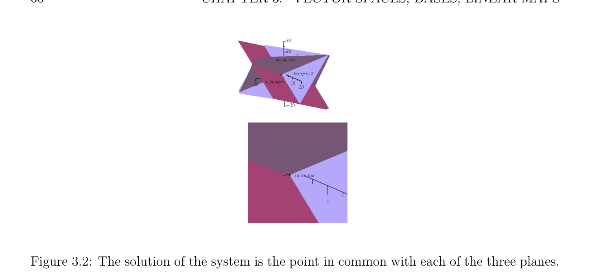
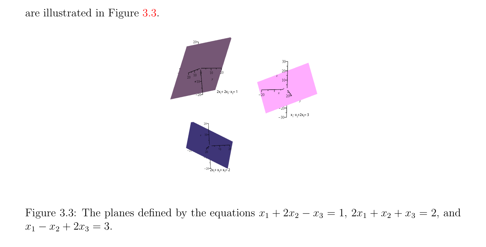
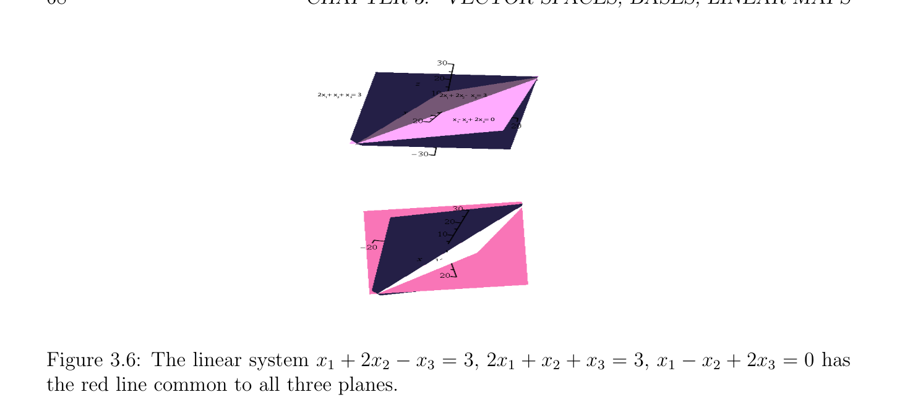

# Motivations: Linear Combinations, Linear Independence, Rank

<!-- PAGE 57 -->
Chapter $3$ Vector Spaces, Bases, Linear Maps

## 3.1 Motivations: Linear Combinations, Linear Inde-

$$pendence and Rank$$
In linear optimization problems, we often encounter systems of linear equations. For example, consider the problem of solving the following system of three linear equations in the three variables $x_{1}, x_{2}, x_{3} \in \mathbb{R}$:
$$x_{1} + 2x_{2} -x_{3} = 1$$
$$2x_{1} + x_{2} + x_{3} = 2$$
$$x_{1} -2x_{2} -2x_{3} = 3.$$
One way to approach this problem is introduce the “vectors” $u, v, w$, and $b$, given by
$$u = \begin{pmatrix} 1 \\ 2 \\ 1 \end{pmatrix} v = \begin{pmatrix} 2 \\ 1 \\ 2 \end{pmatrix} w = \begin{pmatrix} -1 \\ 1 \\ 2 \end{pmatrix} b = \begin{pmatrix} 1 \\ 2 \\ 3 \end{pmatrix}$$
$$--$$
and to write our linear system as
$$x_{1}u + x_{2}v + x_{3}w = b.$$
In the above equation, we used implicitly the fact that a vector $z$ can be multiplied by a scalar $\lambda  \in \mathbb{R}$, where
$$\lambda z = \lambda \begin{pmatrix} z_{1} \\ z_{2} \\ z_{3} \end{pmatrix} = \begin{pmatrix} \lambda z_{1} \\ \lambda z_{2} \\ \lambda z_{3} \end{pmatrix} ,$$
and two vectors $y$ and and $z$ can be added, where
$$y + z = \begin{pmatrix} y_{1} \\ y_{2} \\ y_{3} \end{pmatrix} + \begin{pmatrix} z_{1} \\ z_{2} \\ z_{3} \end{pmatrix} = \begin{pmatrix} y_{1} + z_{1} \\ y_{2} + z_{2} \\ y_{3} + z_{3} \end{pmatrix} .$$
$$57$$

<!-- PAGE 58 -->
Also, given a vector
$$x = \begin{pmatrix} x_{1} \\ x_{2} \\ x_{3} \end{pmatrix} ,$$
we define the additive inverse $-x$ of $x$ (pronounced minus $x)$ as
$$-x = \begin{pmatrix} -x_{1} \\ -x_{2} \\ x_{3} \end{pmatrix} .$$
$$-$$
Observe that $-x =$ (-1)x, the scalar multiplication of $x$ by $-1$. The set of all vectors with three components is denoted by $\mathbb{R}^{3\times1}$. The reason for using
$$\mathbb{R}^{3\times1}  \mathbb{R}^{3}$$
the notation rather than the more conventional notation is that the elements of $\mathbb{R}^{3\times1}$ are column vectors; they consist of three rows and a single column, which explains the
$$\mathbb{R}^{3}  \mathbb{R}\mathbb{R}\mathbb{R}$$
superscript $3 \times  1$. On the other hand, $=  \times  \times$  consists of all triples of the form $(x_{1}, x_{2}, x_{3})$, with $x_{1}, x_{2}, x_{3} \in \mathbb{R}$, and these are row vectors. However, there is an obvious
$$\mathbb{R}^{3\times1}  \mathbb{R}^{3}$$
bijection between and and they are usually identified. For the sake of clarity, in this introduction, we will denote the set of column vectors with $n$ components by $\mathbb{R}^{n\times1}$. An expression such as
$$x_{1}u + x_{2}v + x_{3}w$$
where $u, v, w$ are vectors and the $x_{i}s$ are scalars (in $\mathbb{R})$ is called a linear combination. Using this notion, the problem of solving our linear system
$$x_{1}u + x_{2}v + x_{3}w = b.$$
is equivalent to determining whether $b$ can be expressed as a linear combination of $u, v, w$. Now if the vectors $u, v, w$ are linearly independent, which means that there is no triple $(x_{1}, x_{2}, x_{3}) \neq  (0, 0, 0)$ such that
$$x_{1}u + x_{2}v + x_{3}w = 0_{3},$$
$$\mathbb{R}^{3\times1}$$
it can be shown that every vector in can be written as a linear combination of $u, v, w$. Here, $0_{3}$ is the zero vector
$$0_{3} = \begin{pmatrix} 0 \\ 0 \\ 0 \end{pmatrix} .$$
It is customary to abuse notation and to write $0$ instead of $0_{3}$. This rarely causes a problem because in most cases, whether $0$ denotes the scalar zero or the zero vector can be inferred from the context.
$$\mathbb{R}^{3\times1}$$
In fact, every vector $z \in$ can be written in a unique way as a linear combination
$$z = x_{1}u + x_{2}v + x_{3}w.$$

<!-- PAGE 59 -->
This is because if
$$z = x_{1}u + x_{2}v + x_{3}w = y_{1}u + y_{2}v + y_{3}w,$$
then by using our (linear!) operations on vectors, we get
$$(y_{1} -x_{1})u + (y_{2} -x_{2})v + (y_{3} -x_{3})w = 0,$$
which implies that
$$y_{1} -x_{1} = y_{2} -x_{2} = y_{3} -x_{3} = 0,$$
by linear independence. Thus,
$$y_{1} = x_{1},y_{2} = x_{2},y_{3} = x_{3},$$
which shows that $z$ has a unique expression as a linear combination, as claimed. Then our equation
$$x_{1}u + x_{2}v + x_{3}w = b$$
has a unique solution, and indeed, we can check that
$$x_{1} = 1.4$$
$$x_{2} = -0.4$$
$$x_{3} = -0.4$$
is the solution. But then, how do we determine that some vectors are linearly independent? One answer is to compute a numerical quantity det(u, $v, w)$, called the determinant of $(u, v, w)$, and to check that it is nonzero. In our case, it turns out that
$$12-1$$
$$\det(u, v, w) =211= 15,$$
$$1-2-2$$
which confirms that $u, v, w$ are linearly independent. Other methods, which are much better for systems with a large number of variables, consist of computing an LU-decomposition or a QR-decomposition, or an SVD of the matrix consisting of the three columns $u, v, w$,
$$A = \begin{pmatrix} u & v & w \end{pmatrix} = \begin{pmatrix} 1 & 2 & -1 \\ 2 & 1 & 1 \\ 1 & 2 & 2 \end{pmatrix} .$$
$$--$$
If we form the vector of unknowns
$$x = \begin{pmatrix} x_{1} \\ x_{2} \\ x_{3} \end{pmatrix} ,$$

<!-- PAGE 60 -->
then our linear combination $x_{1}u + x_{2}v + x_{3}w$ can be written in matrix form as
$$x_{1}u + x_{2}v + x_{3}w = \begin{pmatrix} 1 & 2 & -1 \\ 2 & 1 & 1 \\ 1 & 2 & 2 \end{pmatrix} \begin{pmatrix} x_{1} \\ x_{2} \\ x_{3} \end{pmatrix} ,$$
$$--$$
so our linear system is expressed by
$$\begin{pmatrix} 1 & 2 & -1 \\ 2 & 1 & 1 \\ 1 & 2 & 2 \end{pmatrix} \begin{pmatrix} x_{1} \\ x_{2} \\ x_{3} \end{pmatrix} = \begin{pmatrix} 1 \\ 2 \\ 3 \end{pmatrix} ,$$
$$--$$
or more concisely as
$$Ax = b.$$
Now what if the vectors $u, v, w$ are linearly dependent? For example, if we consider the vectors
$$u = \begin{pmatrix} 1 \\ 2 \\ 1 \end{pmatrix} v = \begin{pmatrix} 2 \\ 1 \\ 1 \end{pmatrix} w = \begin{pmatrix} -1 \\ 1 \\ 2 \end{pmatrix} ,$$
$$-$$
we see that
$$u -v = w,$$
a nontrivial linear dependence. It can be verified that $u$ and $v$ are still linearly independent. Now for our problem
$$x_{1}u + x_{2}v + x_{3}w = b$$
it must be the case that $b$ can be expressed as linear combination of $u$ and $v$. However, it turns out that $u, v, b$ are linearly independent (one way to see this is to compute the determinant det(u, $v, b) = -6)$, so $b$ cannot be expressed as a linear combination of $u$ and $v$ and thus, our system has no solution. If we change the vector $b$ to
$$b = \begin{pmatrix} 3 \\ 3 \\ 0 \end{pmatrix} ,$$
then
$$b = u + v,$$
and so the system
$$x_{1}u + x_{2}v + x_{3}w = b$$
has the solution
$$x_{1} = 1,x_{2} = 1,x_{3} = 0.$$

<!-- PAGE 61 -->
Actually, since $w = u$ - $v$, the above system is equivalent to
$$(x_{1} + x_{3})u + (x_{2} -x_{3})v = b,$$
and because $u$ and $v$ are linearly independent, the unique solution in $x_{1} + x_{3}$ and $x_{2}$ - $x_{3}$ is
$$x_{1} + x_{3} = 1$$
$$x_{2} -x_{3} = 1,$$
which yields an infinite number of solutions parameterized by $x_{3}$, namely
$$x_{1} = 1 -x_{3}$$
$$x_{2} = 1 + x_{3}.$$
In summary, a $3 \times  3$ linear system may have a unique solution, no solution, or an infinite number of solutions, depending on the linear independence (and dependence) or the vectors $u, v, w, b$. This situation can be generalized to any $n \times  n$ system, and even to any $n \times  m$ system $(n$ equations in $m$ variables), as we will see later. The point of view where our linear system is expressed in matrix form as Ax $= b$ stresses the fact that the map $x \mapsto$ Ax is a linear transformation. This means that
$$A(\lambda x) = \lambda (Ax)$$
$$\mathbb{R}^{3\times1} \mathbb{R}$$
for all $x \in$ and all $\lambda  \in$  and that
$$A(u + v) = Au + Av,$$
for all $u, v \in \mathbb{R}^{3\times1}$. We can view the matrix $A$ as a way of expressing a linear map $from\mathbb{R}^{3\times1} \mathbb{R}^{3\times1}$ to and solving the system Ax $= b$ amounts to determining whether $b$ belongs to the image of this linear map. Given a $3 \times  3$ matrix
$$A = \begin{pmatrix} a_{11} & a_{12} & a_{13} \\ a_{21} & a_{22} & a_{23} \\ a_{31} & a_{32} & a_{33} \end{pmatrix} ,$$
whose columns are three vectors denoted $A^{1}, A^{2}, A^{3}$, and given any vector $x = (x_{1}, x_{2}, x_{3})$, we defined the product Ax as the linear combination
$$Ax = x_{1}A^{1} + x_{2}A^{2} + x_{3}A^{3} = \begin{pmatrix} a_{11}x_{1} + a_{12}x_{2} + a_{13}x_{3} \\ a_{21}x_{1} + a_{22}x_{2} + a_{23}x_{3} \\ a_{31}x_{1} + a_{32}x_{2} + a_{33}x_{3} \end{pmatrix} .$$
The common pattern is that the ith coordinate of Ax is given by a certain kind of product called an inner product, of a row vector, the ith row of $A$, times the column vector $x$:
$$\begin{pmatrix} a_{i1} & a_{i2} & a_{i3} \end{pmatrix} \cdot \begin{pmatrix} x_{1} \\ x_{2} \\ x_{3} \end{pmatrix} = a_{i1}x_{1} + a_{i2}x_{2} + a_{i3}x_{3}.$$

<!-- PAGE 62 -->
More generally, given any two vectors $x = (x_{1}, \dots  , x_{n})$ and $y = (y_{1}, \dots  , y_{n}) \in \mathbb{R}^{n}$, their inner product denoted $x \cdot  y$, or $\langle x, y\rangle$ , is the number
$$x \cdot  y = \begin{pmatrix} x_{1} & x_{2} & \cdots & x_{n} \end{pmatrix} \cdot \begin{pmatrix} y_{1} \\ y_{2} \\ \vdots \\ y_{n} \end{pmatrix} = \sum_{i=1}^{n}  x_{i}y_{i}.$$
Inner products play a very important role. First, we quantity
$$\sqrt$$
$$\|x\|_{2} =\overline{x}\overline{\cdot}\overline{x} = (x_{1}^{2} + \cdots  + x_{n}^{2})^{1/2}$$
is a generalization of the length of a vector, called the Euclidean norm, or $\ell^{2}$ -norm. Second, it can be shown that we have the inequality
$$|x \cdot  y| \le \|x\|\|y\|,$$
so if $x, y \neq  0$, the ratio $(x \cdot  y)/(\|x\|\|y\|)$ can be viewed as the cosine of an angle, the angle between $x$ and $y$. In particular, if $x \cdot  y = 0$ then the vectors $x$ and $y$ make the angle $\pi /2$, that is, they are orthogonal. The (square) matrices $Q$ that preserve the inner product, in the sense that $\langle$ Qx, $Qy\rangle = \langle x, y\rangle$ for all $x, y \in \mathbb{R}^{n}$, also play a very important role. They can be thought of as generalized rotations. Returning to matrices, if $A$ is an $m \times  n$ matrix consisting of $n$ columns $A^{1}, \dots  , A^{n}$ (in $\mathbb{R}^{m}   \mathbb{R}^{n}$ ), and $B$ is a $n \times  p$ matrix consisting of $p$ columns $B^{1}, \dots  , B^{p}$ (in ) we can form the $p$ vectors (in $\mathbb{R}^{m})$
$$AB^{1}, \dots  , AB^{p}.$$
These $p$ vectors constitute the $m \times  p$ matrix denoted AB, whose jth column is $AB^{j}$. But we know that the ith coordinate of $AB^{j}$ is the inner product of the ith row of $A$ by the jth column of $B$,
$$\begin{pmatrix} a_{i1} & a_{i2} & \cdots & a_{in} \end{pmatrix} \cdot \begin{pmatrix} b_{1j} \\ b_{2j} \\ \vdots \\ b_{nj} \end{pmatrix} = \sum_{k=1}^{n}  a_{ik}b_{kj}.$$
Thus we have defined a multiplication operation on matrices, namely if $A = (a_{ik})$ is a $m \times  n$ matrix and if $B = (b_{jk})$ if $n \times  p$ matrix, then their product $AB$ is the $m \times  n$ matrix whose entry on the ith row and the jth column is given by the inner product of the ith row of $A$ by the jth column of $B$,
$$(AB)_{ij} = \sum_{k=1}^{n}  a_{ik}b_{kj}.$$
Beware that unlike the multiplication of real (or complex) numbers, if $A$ and $B$ are two $n\times n$ matrices, in general, AB $\neq$  BA.

<!-- PAGE 63 -->
Suppose that $A$ is an $n \times  n$ matrix and that we are trying to solve the linear system
$$Ax = b,$$
with $b \in \mathbb{R}^{n}$. Suppose we can find an $n \times  n$ matrix $B$ such that
$$BA^{i}= e_{i},i = 1, \dots  , n,$$
with $e_{i} = (0, \dots  , 0, 1, 0 \dots  , 0)$, where the only nonzero entry is $1$ in the ith slot. If we form the $n \times  n$ matrix
$$I_{n} = \begin{pmatrix} 1 & 0 & 0 & \cdots & 0 & 0 \\ 0 & 1 & 0 & \cdots & 0 & 0 \\ 0 & 0 & 1 & \cdots & 0 & 0 \\ \vdots & \vdots & \vdots & \ddots & \vdots & \vdots \\ 0 & 0 & 0 & \cdots & 1 & 0 \\ 0 & 0 & 0 & \cdots & 0 & 1 \end{pmatrix} ,$$
called the identity matrix, whose ith column is $e_{i}$, then the above is equivalent to
$$BA = I_{n}.$$
If Ax $= b$, then multiplying both sides on the left by $B$, we get
$$B(Ax) = Bb.$$
But is is easy to see that B(Ax) $=$ (BA)x $= I_{n}x = x$, so we must have
$$x = Bb.$$
We can verify that $x =$ Bb is indeed a solution, because it can be shown that
$$A(Bb) = (AB)b = I_{n}b = b.$$
What is not obvious is that $BA = I_{n}$ implies $AB = I_{n}$, but this is indeed provable. The matrix $B$ is usually denoted $A^{-1}$ and called the inverse of $A$. It can be shown that it is the unique matrix such that
$$AA^{-1}= A^{-1}A = I_{n}.$$
If a square matrix $A$ has an inverse, then we say that it is invertible or nonsingular, otherwise we say that it is singular. We will show later that a square matrix is invertible iff its columns are linearly independent iff its determinant is nonzero. In summary, if $A$ is a square invertible matrix, then the linear system Ax $= b$ has the unique solution $x = A^{-1}b$. In practice, this is not a good way to solve a linear system because computing $A^{-1}$ is too expensive. A practical method for solving a linear system is Gaussian elimination, discussed in Chapter $8$. Other practical methods for solving a linear system

<!-- PAGE 64 -->
Ax $= b$ make use of a factorization of $A$ (QR decomposition, SVD decomposition), using orthogonal matrices defined next. Given an $m \times  n$ matrix $A = (a_{kl})$, the $n \times  m$ matrix $A^{\top} = (a_{ij}^{\top})$ whose ith row is the ith column of $A$, which means that $a_{ij}^{\top} = a_{ji}$ for $i = 1, \dots  , n$ and $j = 1, \dots  , m$, is called the transpose of $A$. An $n \times  n$ matrix $Q$ such that
$$QQ^{\top}= Q^{\top}Q = I_{n}$$
is called an orthogonal matrix. Equivalently, the inverse $Q^{-1}$ of an orthogonal matrix $Q$ is equal to its transpose $Q^{\top}$. Orthogonal matrices play an important role. Geometrically, they correspond to linear transformation that preserve length. A major result of linear algebra states that every $m \times  n$ matrix $A$ can be written as
$$A = V \Sigma U^{\top} ,$$
where $V$ is an $m\times m$ orthogonal matrix, $U$ is an $n\times n$ orthogonal matrix, and $\Sigma$  is an $m\times n$ matrix whose only nonzero entries are nonnegative diagonal entries $\sigma_{1}  \ge \sigma_{2}  \ge \cdots  \ge \sigma_{p}$ , where $p =$ min(m, $n)$, called the singular values of $A$. The factorization $A = V \Sigma U^{\top}$ is called a singular decomposition of $A$, or SVD. The SVD can be used to “solve” a linear system Ax $= b$ where $A$ is an $m \times  n$ matrix, even when this system has no solution. This may happen when there are more equations that variables $(m > n)$ , in which case the system is overdetermined. Of course, there is no miracle, an unsolvable system has no solution. But we can look for a good approximate solution, namely a vector $x$ that minimizes some measure of the error Ax - $b$. Legendre and Gauss used $\|Ax$ - $b\|_{2}^{2}$, which is the squared Euclidean norm of the error. This quantity is differentiable, and it turns out that there is a unique vector $x^{+}$ of minimum Euclidean norm that minimizes $\|Ax$ - $b\|_{2}^{2}$. Furthermore, $x^{+}$ is given by the expression $x^{+} = A^{+}b$, where $A^{+}$ is the pseudo-inverse of $A$, and $A^{+}$ can be computed from an SVD $A = V \Sigma U^{\top}$ of $A$. Indeed, $A^{+} = U\Sigma^{+} V^{\top}$, where $\Sigma^{+}$ is the matrix obtained from $\Sigma$ by replacing every positive singular value $\sigma_{i}$  by its inverse $\sigma_{i}^{-1}$  , leaving all zero entries intact, and transposing. Instead of searching for the vector of least Euclidean norm minimizing $\|Ax$ - $b\|_{2}^{2}$, we can add the penalty term $K \|x\|_{2}^{2}$ (for some positive $K > 0)$ to $\|Ax$ - $b\|_{2}^{2}$ and minimize the quantity $\|Ax$ - $b\|_{2}^{2} + K \|x\|_{2}^{2}$. This approach is called ridge regression. It turns out that there is a unique minimizer $x^{+}$ given by $x^{+} = (A^{\top}A + KI_{n})^{-1}A^{\top}b$, as shown in the second volume. Another approach is to replace the penalty term $K \|x\|_{2}^{2}$ by $K \|x\|_{1}$, where $\|x\|_{1} = |x_{1}| + \cdots  + |x_{n}|$ (the $\ell^{1}$ -norm of $x)$. The remarkable fact is that the minimizers $x$ of $\|Ax$ - $b\|_{2}^{2} + K \|x\|_{1}$ tend to be sparse, which means that many components of $x$ are equal to zero. This approach known as lasso is popular in machine learning and will be discussed in the second volume.

<!-- PAGE 65 -->
Another important application of the SVD is principal component analysis (or PCA), an important tool in data analysis. Yet another fruitful way of interpreting the resolution of the system Ax $= b$ is to view this problem as an intersection problem. Indeed, each of the equations
$$x_{1} + 2x_{2} -x_{3} = 1$$
$$2x_{1} + x_{2} + x_{3} = 2$$
$$x_{1} -2x_{2} -2x_{3} = 3$$
$$\mathbb{R}^{3}$$
defines a subset of which is actually a plane. The first equation
$$x_{1} + 2x_{2} -x_{3} = 1$$
defines the plane $H_{1}$ passing through the three points $(1, 0, 0), (0, 1/2, 0), (0, 0, -1)$, on the coordinate axes, the second equation
$$2x_{1} + x_{2} + x_{3} = 2$$
defines the plane $H_{2}$ passing through the three points $(1, 0, 0), (0, 2, 0), (0, 0, 2)$, on the coordinate axes, and the third equation
$$x_{1} -2x_{2} -2x_{3} = 3$$
defines the plane $H_{3}$ passing through the three points $(3, 0, 0), (0, -3/2, 0), (0, 0, -3/2)$, on the coordinate axes. See Figure 3.1.
$$2x + 2x - x = 1123$$
$$x -2x -2x = 3123$$
$$2x + x + x = 223$$
$$1$$
$$Figure 3.1: The planes defined by the preceding linear equations.$$
The intersection $H_{i}\cap H_{j}$ of any two distinct planes $H_{i}$ and $H_{j}$ is a line, and the intersection $H_{1} \cap H_{2} \cap H_{3}$ of the three planes consists of the single point (1.4, -0.4, -0.4), as illustrated in Figure 3.2.

<!-- PAGE 66 -->
$$2x + 2x - x = 1123$$
$$2x + x + x = 2123$$
$$x -2x -2x = 3123$$
$$(1.4, -0.4, -0.4)$$

**Figure 3.2:** The solution of the system is the point in common with each of the three planes. The planes corresponding to the system
$$x_{1} + 2x_{2} -x_{3} = 1$$
$$2x_{1} + x_{2} + x_{3} = 2$$
$$x_{1} -x_{2} + 2x_{3} = 3,$$
are illustrated in Figure 3.3.
$$2x + 2x - x = 1123$$
$$x - x +2x = 3123$$
$$123$$
$$2x + x + x = 2123$$

**Figure 3.3:** The planes defined by the equations $x_{1} + 2x_{2}$ - $x_{3} = 1, 2x_{1} + x_{2} + x_{3} = 2$, and $x_{1}$ - $x_{2} + 2x_{3} = 3$. This system has no solution since there is no point simultaneously contained in all three planes; see Figure 3.4.

<!-- PAGE 67 -->
$$2x + x + x = 22x + x + x = 2112233$$
$$2x + 2x - x = 1123$$
$$x - x +2x = 3123$$

**Figure 3.4:** The linear system $x_{1} + 2x_{2}$ - $x_{3} = 1, 2x_{1} + x_{2} + x_{3} = 2, x_{1}$ - $x_{2} + 2x_{3} = 3$ has no solution. Finally, the planes corresponding to the system
$$x_{1} + 2x_{2} -x_{3} = 3$$
$$2x_{1} + x_{2} + x_{3} = 3$$
$$x_{1} -x_{2} + 2x_{3} = 0,$$
are illustrated in Figure 3.5.
$$2x + 2x -  x = 3123$$
$$x - x + 2x = 0123$$
$$123$$
$$2x + x + x = 31123$$

**Figure 3.5:** The planes defined by the equations $x_{1} + 2x_{2}$ - $x_{3} = 3, 2x_{1} + x_{2} + x_{3} = 3$, and $x_{1}$ - $x_{2} + 2x_{3} = 0$. This system has infinitely many solutions, given parametrically by $(1$ - $x_{3}, 1 + x_{3}, x_{3})$. Geometrically, this is a line common to all three planes; see Figure 3.6.

<!-- PAGE 68 -->
$$2x + x + x = 31232x + 2x -  x = 3123$$
$$x - x + 2x = 0123$$

**Figure 3.6:** The linear system $x_{1} + 2x_{2}$ - $x_{3} = 3, 2x_{1} + x_{2} + x_{3} = 3, x_{1}$ - $x_{2} + 2x_{3} = 0$ has the red line common to all three planes. Under the above interpretation, observe that we are focusing on the rows of the matrix $A$, rather than on its columns, as in the previous interpretations. Another great example of a real-world problem where linear algebra proves to be very effective is the problem of data compression, that is, of representing a very large data set using a much smaller amount of storage. Typically the data set is represented as an $m \times  n$ matrix $A$ where each row corresponds to an $n$-dimensional data point and typically, $m \ge n$. In most applications, the data are not independent so the rank of $A$ is a lot smaller than $min{m, n}$, and the the goal of low-rank decomposition is to factor $A$ as the product of two matrices $B$ and $C$, where $B$ is a $m \times  k$ matrix and $C$ is a $k \times n$ matrix, with $k \ll min{m, n}$ (here, $\ll$ means “much smaller than”):
$$\begin{pmatrix} A \\ m \times  n \end{pmatrix} = \begin{pmatrix} B \\ m \times  k \end{pmatrix} \begin{pmatrix} C \\ k & n \end{pmatrix}$$
$$\times$$
Now it is generally too costly to find an exact factorization as above, so we look for a low-rank matrix A' which is a “good” approximation of $A$. In order to make this statement precise, we need to define a mechanism to determine how close two matrices are. This can be done using matrix norms, a notion discussed in Chapter $9$. The norm of a matrix $A$ is a nonnegative real number $\|A\|$ which behaves a lot like the absolute value |x| of a real number $x$. Then our goal is to find some low-rank matrix A' that minimizes the norm
$$\|A -A'\|^{2},$$
