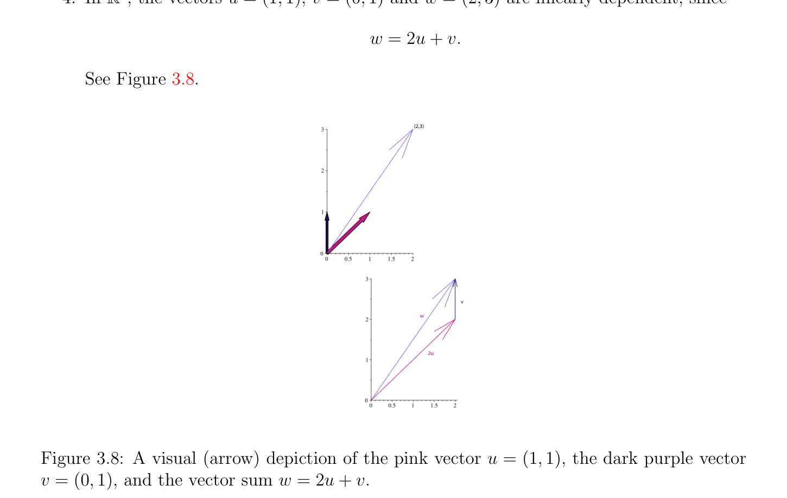
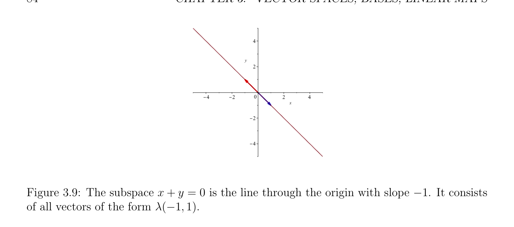
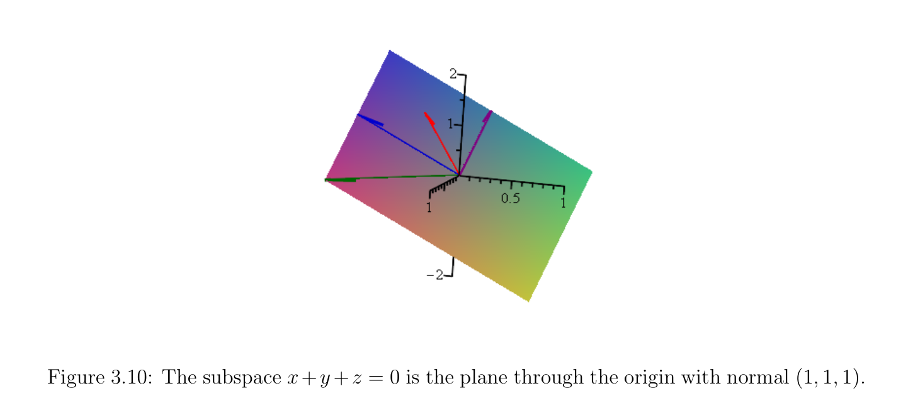

# Linear Independence, Subspaces

<!-- PAGE 78 -->

## 3.4 Linear Independence, Subspaces

One of the most useful properties of vector spaces is that they possess bases. What this means is that in every vector space $E$, there is some set of vectors, ${e_{1}, \dots  , e_{n}}$, such that every vector $v \in E$ can be written as a linear combination,
$$v = \lambda_{1} e_{1} + \cdots  + \lambda_{n} e_{n},$$
of the $e_{i}$, for some scalars, $\lambda_{1} , \dots  , \lambda_{n}  \in \mathbb{R}$. Furthermore, the $n$-tuple, $(\lambda_{1} , \dots  , \lambda_{n}$ ), as above is unique. This description is fine when $E$ has a finite basis, ${e_{1}, \dots  , e_{n}}$, but this is not always the case! For example, the vector space of real polynomials, $\mathbb{R}[X]$, does not have a finite basis but instead it has an infinite basis, namely
$$1, X, X^{2}, \dots  , X^{n}, \dots$$
One might wonder if it is possible for a vector space to have bases of different sizes, or even to have a finite basis as well as an infinite basis. We will see later on that this is not possible; all bases of a vector space have the same number of elements (cardinality), which is called the dimension of the space. However, we have the following problem: If a vector space has an infinite basis, ${e_{1}, e_{2}, \dots$  , }, how do we define linear combinations? Do we allow linear combinations
$$\lambda_{1} e_{1} + \lambda_{2} e_{2} + \cdots$$
with infinitely many nonzero coefficients? If we allow linear combinations with infinitely many nonzero coefficients, then we have to make sense of these sums and this can only be done reasonably if we define such a sum as the limit of the sequence of vectors, $s_{1}, s_{2}, \dots  , s_{n}, \dots$ , with $s_{1} = \lambda_{1} e_{1}$ and
$$s_{n+1} = s_{n} + \lambda_{n+1} e_{n+1}.$$
But then, how do we define such limits? Well, we have to define some topology on our space, by means of a norm, a metric or some other mechanism. This can indeed be done and this is what Banach spaces and Hilbert spaces are all about but this seems to require a lot of machinery. A way to avoid limits is to restrict our attention to linear combinations involving only finitely many vectors. We may have an infinite supply of vectors but we only form linear combinations involving finitely many nonzero coefficients. Technically, this can be done by introducing families of finite support. This gives us the ability to manipulate families of scalars indexed by some fixed infinite set and yet to be treat these families as if they were finite. With these motivations in mind, given a set $A$, recall that an I-indexed family $(a_{i})_{i\in I}$ of elements of $A$ (for short, a family) is a function a: I $\to A$, or equivalently a set of pairs ${(i, a_{i})$ | $i \in I}$. We agree that when $I = \emptyset , (a_{i})_{i\in I} = \emptyset$ . A family $(a_{i})_{i\in I}$ is finite if I is finite.

<!-- PAGE 79 -->
Remark: When considering a family $(a_{i})_{i\in I}$, there is no reason to assume that I is ordered. The crucial point is that every element of the family is uniquely indexed by an element of I. Thus, unless specified otherwise, we do not assume that the elements of an index set are ordered. If $A$ is an abelian group with identity $0$, we say that a family $(a_{i})_{i\in I}$ has finite support if $a_{i} = 0$ for all $i \in$ I - $J$, where $J$ is a finite subset of I (the support of the family). Given two disjoint sets I and $J$, the union of two families $(u_{i})_{i\in I}$ and $(v_{j})_{j\in J}$, denoted as $(u_{i})_{i\in I} \cup (v_{j})_{j\in J}$, is the family $(w_{k})_{k\in(I\cup J)}$ defined such that $w_{k} = u_{k}$ if $k \in$ I, and $w_{k} = v_{k}$ if $k \in J$. Given a family $(u_{i})_{i\in I}$ and any element $v$, we denote by $(u_{i})_{i\in I} \cup_{k}  (v)$ the family $(w_{i})_{i\in I\cup {k}}$ defined such that, $w_{i} = u_{i}$ if $i \in$ I, and $w_{k} = v$, where $k$ is any index such that $k \in /$ I. Given a family $(u_{i})_{i\in I}$, a subfamily of $(u_{i})_{i\in I}$ is a family $(u_{j})_{j\in J}$ where $J$ is any subset of I. In this chapter, unless specified otherwise, is assumed that all families of scalars have finite support.

> **Definition 3.3.** Let $E$ be a vector space. A vector $v \in E$ is a linear combination of a family $(u_{i})_{i\in I}$ of elements of $E$ iff there is a family $(\lambda_{i} )_{i\in I}$ of scalars in $K$ such that
$$v = \sum_{i\in I}  \lambda_{i} u_{i}.$$
$$When I = \emptyset , we stipulate that v = 0. (By Proposition 3.3, sums of the form \sum_{i}  \in I \lambda_{i} u_{i} are$$
well defined.) We say that a family $(u_{i})_{i\in I}$ is linearly independent iff for every family $(\lambda_{i} )_{i\in I}$ of scalars in $K$,
$$\sum_{i\in I}  \lambda_{i} u_{i} = 0implies that\lambda_{i}  = 0 for all i \in I.$$
Equivalently, a family $(u_{i})_{iI}$ is linearly dependent iff there is some family $(\lambda_{i} )_{i\in I}$ of scalars in $K$ such that
$$\sum_{i\in I}^{\in}  \lambda_{i} u_{i} = 0and\lambda_{j}  \neq  0 for some j \in I.$$
We agree that when $I = \emptyset$ , the family $\emptyset$ is linearly independent. Observe that defining linear combinations for families of vectors rather than for sets of vectors has the advantage that the vectors being combined need not be distinct. For example, for $I = {1, 2, 3}$ and the families $(u, v, u)$ and $(\lambda_{1} , \lambda_{2} , \lambda_{1}$ ), the linear combination
$$\sum_{i\in I}  \lambda_{i} u_{i} = \lambda_{1} u + \lambda_{2} v + \lambda_{1} u$$
makes sense. Using sets of vectors in the definition of a linear combination does not allow such linear combinations; this is too restrictive.

<!-- PAGE 80 -->
Unravelling Definition 3.3, a family $(u_{i})_{i\in I}$ is linearly dependent iff either I consists of a single element, say $i$, and $u_{i} = 0$, or |I| $\ge 2$ and some $u_{j}$ in the family can be expressed as a linear combination of the other vectors in the family. Indeed, in the second case, there is some family $(\lambda_{i} )_{i\in I}$ of scalars in $K$ such that
$$\sum_{i\in I}  \lambda_{i} u_{i} = 0and\lambda_{j}  \neq  0 for some j \in I,$$
and since |I| $\ge 2$, the set $I -{j}$ is nonempty and we get
$$u_{j} = \sum_{\in(I-{j}  -\lambda_{j}^{-1}  \lambda_{i} u_{i}.$$
$$i})$$
Observe that one of the reasons for defining linear dependence for families of vectors rather than for sets of vectors is that our definition allows multiple occurrences of a vector. This is important because a matrix may contain identical columns, and we would like to say that these columns are linearly dependent. The definition of linear dependence for sets does not allow us to do that. The above also shows that a family $(u_{i})_{i\in I}$ is linearly independent iff either $I = \emptyset$ , or I consists of a single element $i$ and $u_{i} \neq  0$, or |I| $\ge 2$ and no vector $u_{j}$ in the family can be expressed as a linear combination of the other vectors in the family. To be precise we have the following result.

> **Proposition 3.4.** Let $E$ be a vector space. A family $(v_{i})_{i\in I}$ of vectors in $E$ with |I| $\ge 2$ is linearly independent iff for every $k \in$ I, the vector $v_{k}$ cannot be expressed as a linear combination of the vectors in the family $(v_{j})_{j\in I-{k}}$ obtained by removing $v_{k}$ from the family $(v_{i})_{i\in I}$.

*Proof.* First assume that the family $(v_{i})_{i\in I}$ is linearly independent. If any vector $v_{k}$ can be expressed as a linear combination of the vectors in the family $(v_{j})_{j\in I-{k}}$, then $v_{k} =$
$$\sum_{j}  \in I-{k} \lambda_{j} v_{j} for some scalars \lambda_{j} , so we obtain a nontrivial linear combination$$
$$v_{k} - \sum_{\in I-{k}  \lambda_{j} v_{j} = 0,$$
$$j}$$
contradicting the linear independence of the family $(v_{i})_{i\in I}$. Conversely, assume that for every $k \in$ I, the vector $v_{k}$ cannot be expressed as a linear combination of the vectors in the family $(v_{j})_{j\in I-{k}}$ obtained by removing $v_{k}$. If the family $(v )_{i\in I}$ is not linearly independent, then there are some scalars $\lambda_{i}$  not all zero such that
$$\sum_{i}^{i}  \in I \lambda_{i} v_{i} = 0. Suppose \lambda_{k}  \neq  0. Then we obtain$$
$$v_{k} = - \sum_{\in I-{k}  (\lambda_{j} /\lambda_{k} )v_{j},$$
$$j}$$
contradicting the hypothesis.

<!-- PAGE 81 -->
When I is nonempty, if the family $(u_{i})_{i\in I}$ is linearly independent, note that $u_{i} \neq  0$ for all $i \in$ I. Otherwise, if $u_{i} = 0$ for some $i \in$ I, then we get a nontrivial linear dependence
$$\sum_{ii}  \lambda_{i} u_{i} = 0 by picking any nonzero \lambda_{i}  and letting \lambda_{k}  = 0 for all k \in I with k \neq  i, since$$
$\lambda^{\in I} 0 = 0$. If |I| $\ge 2$, we must also have $u_{i} \neq  u_{j}$ for all $i, j \in$ I with $i \neq  j$, since otherwise we get a nontrivial linear dependence by picking $\lambda_{i}  = \lambda$  and $\lambda_{j}  = -\lambda$  for any nonzero $\lambda$ , and letting $\lambda_{k}  = 0$ for all $k \in$ I with $k \neq  i, j$. Thus, the definition of linear independence implies that a nontrivial linearly independent family is actually a set. This explains why certain authors choose to define linear independence for sets of vectors. The problem with this approach is that linear dependence, which is the logical negation of linear independence, is then only defined for sets of vectors. However, as we pointed out earlier, it is really desirable to define linear dependence for families allowing multiple occurrences of the same vector. In the special case where the vectors that we are considering are the columns $A^{1}, \dots  , A^{n}$ of an $n \times  n$ matrix $A$ (with coefficients in $K = \mathbb{R}$ or $K = \mathbb{C})$, linear independence has a simple characterization in terms of the solutions of the linear system Ax $= 0$. Recall that $A^{1}, \dots  , A^{n}$ are linearly independent iff for any scalars $x_{1}, \dots  , x_{n} \in K$,
$$if x_{1}A^{1}+ \cdots  + x_{n}A^{n}= 0, thenx_{1} = \cdots  = x_{n} = 0.(*_{1})$$
If we form the column vector $x$ whose coordinates are $x_{1}, \dots  , x_{n} \in K$, then by definition of Ax,
$$x_{1}A^{1}+ \cdots  + x_{n}A^{n}= Ax,$$
so $(*_{1})$ is equivalent to
$$if Ax = 0, thenx = 0.(*_{2})$$
In other words, the columns $A^{1}, \dots  , A^{n}$ of the matrix $A$ are linearly independent iff the linear system Ax $= 0$ has the unique solution $x = 0$ (the trivial solution). The above can typically be demonstrated by solving the system Ax $= 0$ by variable elimination, and verifying that the only solution obtained is $x = 0$. Another way to prove that the linear system Ax $= 0$ only has the trivial solution $x = 0$ is to show that $A$ is invertible by by finding explicity the inverse $A^{-1}$ of $A$. Indeed, if $A$ has an inverse $A^{-1}$, we have $A^{-1}A = AA^{-1} =$ I, so multiplying both sides of the equation Ax $= 0$ on the left by $A^{-1}$, we obtain
$$A^{-1}Ax = A^{-1}0 = 0,$$
and since $A^{-1}Ax =$ Ix $= x$, we get $x = 0$. The first method can be applied to show linear independence in $(2)$ and $(3)$ of the following example.

> **Example 3.2.** $1$. Any two distinct scalars $\lambda , \mu  \neq  0$ in $K$ are linearly dependent.

<!-- PAGE 82 -->

**Figure 3.7:** A visual (arrow) depiction of the red vector $(1, 0, 0)$, the green vector $(0, 1, 0)$, and the blue vector $(0, 0, 1)$ in $\mathbb{R}^{3}. 2$. In $\mathbb{R}^{3}$, the vectors $(1, 0, 0), (0, 1, 0)$, and $(0, 0, 1)$ are linearly independent. See Figure 3.7. $3$. In $\mathbb{R}^{4}$, the vectors $(1, 1, 1, 1), (0, 1, 1, 1), (0, 0, 1, 1)$, and $(0, 0, 0, 1)$ are linearly independent. $4$. In $\mathbb{R}^{2}$, the vectors $u = (1, 1), v = (0, 1)$ and $w = (2, 3)$ are linearly dependent, since
$$w = 2u + v.$$
See Figure 3.8.
$$(2,3)$$
$$v$$
$$w$$
$$2u$$

**Figure 3.8:** A visual (arrow) depiction of the pink vector $u = (1, 1)$, the dark purple vector $v = (0, 1)$, and the vector sum $w =$ 2u $+ v$.

<!-- PAGE 83 -->
When I is finite, we often assume that it is the set $I = {1, 2, \dots  , n}$. In this case, we denote the family $(u_{i})_{i\in I}$ as $(u_{1}, \dots  , u_{n})$. The notion of a subspace of a vector space is defined as follows.

> **Definition 3.4.** Given a vector space $E$, a subset $F$ of $E$ is a linear subspace (or subspace) of $E$ iff $F$ is nonempty and $\lambda  \cdot_{E}  u +_{E} \mu  \cdot_{E}  v \in F$ for all $u, v \in F$, and all $\lambda , \mu  \in K$. It is easy to see that a subspace $F$ of $E$ is indeed a vector space, since the restriction of $+_{E}$ : $E \times  E \to E$ to $F \times  F$ is indeed a function $+_{F}$ : $F \times  F \to F$, and the restriction of $\cdot_{E}$  : $K \times  E \to E$ to $K \times  F$ is indeed a function $\cdot_{F}$  : $K \times  F \to F$. It is customary to drop the subscript $E$ and simply write $\lambda u + \mu v$ instead of $\lambda  \cdot_{E}  u +_{E} \mu  \cdot_{E}  v$. Since a subspace $F$ is nonempty, if we pick any vector $u \in F$ and if we let $\lambda  = \mu  = 0$, then $\lambda u+\mu u = 0u+0u = 0_{E} +0_{E} = 0_{E}$, so every subspace contains the zero vector $0_{E}$. Note that $0_{F} = 0_{E}$. The following facts also hold. The proof is left as an exercise.

> **Proposition 3.5.**
$(1)$ The intersection of any family (even infinite) of subspaces of a vector space $E$ is a subspace.
$(2)$ Let $F$ be any subspace of a vector space $E$. For any nonempty finite index set $I$, if $(u_{i})_{i\in I}$ is any family of vectors $u_{i} \in F$ and $(\lambda_{i} )_{i\in I}$ is any family of scalars, then
$$\sum_{i}  \in I \lambda_{i} u_{i} \in F.$$
The subspace ${0_{E}}$ will be denoted by $(0_{E})$, or even $(0)$ (with a mild abuse of notation).

> **Example 3.3.** $1$. In $\mathbb{R}^{2}$, the set of vectors $u = (x, y)$ such that
$$x + y = 0$$
is the subspace illustrated by Figure 3.9. $2$. In $\mathbb{R}^{3}$, the set of vectors $u = (x, y, z)$ such that
$$x + y + z = 0$$
is the subspace illustrated by Figure 3.10. $3$. For any $n \ge 0$, the set of polynomials f(X) $\in \mathbb{R}[X]$ of degree at most $n$ is a subspace of $\mathbb{R}[X]. 4$. The set of upper triangular $n\times n$ matrices is a subspace of the space of $n\times n$ matrices.

<!-- PAGE 84 -->

**Figure 3.9:** The subspace $x + y = 0$ is the line through the origin with slope $-1$. It consists of all vectors of the form $\lambda (-1, 1)$.

**Figure 3.10:** The subspace $x+y +z = 0$ is the plane through the origin with normal $(1, 1, 1)$.

> **Proposition 3.6.** Given any vector space $E$, if $S$ is any nonempty subset of $E$, then the smallest subspace $\langle S\rangle$ (or Span(S)) of $E$ containing $S$ is the set of all (finite) linear combinations of elements from $S$.

*Proof.* We prove that the set Span(S) of all linear combinations of elements of $S$ is a subspace of $E$, leaving as an exercise the verification that every subspace containing $S$ also contains Span(S).
$$First, Span(S) is nonempty since it contains S (which is nonempty). If u = \sum_{i}  \in I \lambda_{i} u_{i}$$

<!-- PAGE 85 -->
$$and v = \sum_{j}  \in J \mu_{j} v_{j} are any two linear combinations in Span(S), for any two scalars \lambda , \mu  \in K,$$
$$\lambda u + \mu v = \lambda \sum_{i\in I}  \lambda_{i} u_{i} + \mu \sum_{j\in J}  \mu_{j} v_{j}$$
$$= \sum_{i\in I}  \lambda \lambda_{i} u_{i} + \sum_{j\in J}  \mu \mu_{j} v_{j}$$
$$= \sum_{i\in I-J}  \lambda \lambda_{i} u_{i} + \sum_{i\in I\cap J}  (\lambda \lambda_{i}  + \mu \mu_{i} )u_{i} + \sum_{j\in J-I}  \mu \mu_{j} v_{j},$$
which is a linear combination with index set $I \cup J$, and thus $\lambda u + \mu v \in$ Span(S), which proves that Span(S) is a subspace. One might wonder what happens if we add extra conditions to the coefficients involved in forming linear combinations. Here are three natural restrictions which turn out to be important (as usual, we assume that our index sets are finite):
$$(1) Consider combinations \sum_{i}  \in I \lambda_{i} u_{i} for which$$
$$\sum_{i\in I}  \lambda_{i}  = 1.$$
These are called affine combinations. One should realize that every linear combination
$$\sum_{i}  \lambda_{i} u_{i} can be viewed as an affine combination. For example, if k is an index not$$
$$in^{\in I} I, if we let J = I \cup {k}, u_{k} = 0, and \lambda_{k}  = 1 - \sum_{i}  \in I \lambda_{i} , then \sum_{j}  \in J \lambda_{j} u_{j} is an affine$$
combination and
$$\sum_{i\in I}  \lambda_{i} u_{i} = \sum_{j\in J}  \lambda_{j} u_{j}.$$
However, we get new spaces. For example, in $\mathbb{R}^{3}$, the set of all affine combinations of the three vectors $e_{1} = (1, 0, 0), e_{2} = (0, 1, 0)$, and $e_{3} = (0, 0, 1)$, is the plane passing through these three points. Since it does not contain $0 = (0, 0, 0)$, it is not a linear subspace.
$$(2) Consider combinations \sum_{i}  \in I \lambda_{i} u_{i} for which$$
$$\lambda_{i}  \ge 0,for all i \in I.$$
These are called positive (or conic) combinations. It turns out that positive combinations of families of vectors are cones. They show up naturally in convex optimization.
$$(3) Consider combinations \sum_{i}  \in I \lambda_{i} u_{i} for which we require (1) and (2), that is$$
$$\sum_{i\in I}  \lambda_{i}  = 1,and\lambda_{i}  \ge 0for all i \in I.$$
These are called convex combinations. Given any finite family of vectors, the set of all convex combinations of these vectors is a convex polyhedron. Convex polyhedra play a very important role in convex optimization.
