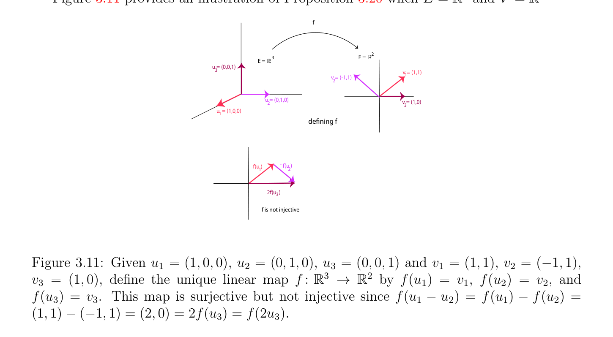
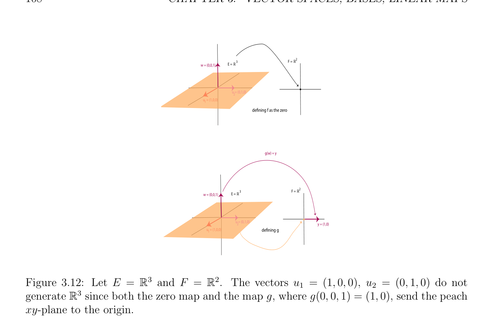

# Linear Maps

<!-- PAGE 101 -->

> **Example 3.5.** For example, letting $A, B$ be the $2 \times$  2-matrices
$$A = \begin{pmatrix} 1 & 0 \\ 0 & 0 \end{pmatrix} ,B = \begin{pmatrix} 0 & 0 \\ 1 & 0 \end{pmatrix} ,$$
then
$$AB = \begin{pmatrix} 1 & 0 \\ 0 & 0 \end{pmatrix} \begin{pmatrix} 0 & 0 \\ 1 & 0 \end{pmatrix} = \begin{pmatrix} 0 & 0 \\ 0 & 0 \end{pmatrix} ,$$
and
$$BA = \begin{pmatrix} 0 & 0 \\ 1 & 0 \end{pmatrix} \begin{pmatrix} 1 & 0 \\ 0 & 0 \end{pmatrix} = \begin{pmatrix} 0 & 0 \\ 1 & 0 \end{pmatrix} .$$
Thus AB $\neq$  BA, and $AB = 0$, even though both $A, B \neq  0$.

## 3.7 Linear Maps

Now that we understand vector spaces and how to generate them, we would like to be able to transform one vector space $E$ into another vector space $F$. A function between two vector spaces that preserves the vector space structure is called a homomorphism of vector spaces, or linear map. Linear maps formalize the concept of linearity of a function. Keep in mind that linear maps, which are transformations of
$$space, are usually far more important than the spaces$$
$$themselves.$$
In the rest of this section, we assume that all vector spaces are over a given field $K$ (say $\mathbb{R})$.

> **Definition 3.18.** Given two vector spaces $E$ and $F$, a linear map between $E$ and $F$ is a function $f$ : $E \to F$ satisfying the following two conditions:
$$f(x +_{E} y) = f(x) +_{F} f(y)for all x, y \in E;$$
$$f(\lambda  \cdot_{E}  x) = \lambda  \cdot_{F}  f(x)for all \lambda  \in K, x \in E.$$
Setting $x = y = 0_{E}$ in the first identity, we get $f(0_{E}) = 0_{F}$. The basic property of linear maps is that they transform linear combinations into linear combinations. Given any finite family $(u_{i})_{i\in I}$ of vectors in $E$, given any family $(\lambda_{i} )_{i\in I}$ of scalars in $K$, we have
$$f \begin{pmatrix} \lambda_{i}  \cdot_{E} u_{i} \end{pmatrix} \sum_{i\in I}  = \sum_{i\in I}  \lambda_{i}  \cdot_{F}  f(u_{i}).$$
$$The sum \sum_{i}  \in  \lambda_{i}  \cdot_{E}  u_{i} uses addition +_{E} in E, and the sum \sum_{i}  \lambda_{i}  \cdot_{F}  f(u_{i}) uses addition in$$
$F$. The $above^{I}$ identity is shown by induction on |I| using $the^{\in I}$ properties of Definition 3.18. As we did when defining vector spaces, for notational simplicity, we usually drop the subscripts $E$ and $F$ in the notations $+_{E}, +_{F}$ and $\cdot_{E} , \cdot_{F}$ .

<!-- PAGE 102 -->

> **Example 3.6.**
$$\mathbb{R}^{2} \mathbb{R}^{2}$$
$1$. The map $f$ : $\to$ defined such that
$$x'=x -y$$
$$y'=x + y$$
is a linear map. The reader should check that it is the composition of a rotation by
$$\sqrt$$
$\pi /4$ with a magnification of ratio $\overline{2.} 2$. For any vector space $E$, the identity map id: $E \to E$ given by
$$id(u) = ufor all u \in E$$
is a linear map. When we want to be more precise, we write $id_{E}$ instead of id. $3$. The map $D: \mathbb{R}[X] \to \mathbb{R}[X]$ defined such that
$$(DP)(X) = P' (X),$$
where P' $(X)$ is the derivative of the polynomial P(X), is a linear map. More explicitly, if
$$\mathbb{R}$$
$$P(X) = a_{0}X^{n}+ a_{1}X^{n-1}+ \cdots  + a_{n-2}X^{2}+ a_{n-1}X + a_{n},a_{i} \in$$
is a polynomial of degree $n$, then
$$(DP)(X) = na_{0}X^{n-1}+ (n -1)a_{1}X^{n-2}+ \cdots  + 2a_{n-2}X + a_{n-1}.$$
$4$. The map $\Phi$ : $\mathcal{C}([a, b]) \to \mathbb{R}$ given by
$$\Phi (f) = \int_{a}^{}  bf(t)dt,$$
$where\mathcal{C}([a, b])$ is the set of continuous functions defined on the interval [a, $b]$, is a linear map. $5$. The function $\langle$ -, $-\rangle$ : $\mathcal{C}([a, b]) \times$  C([a, $b]) \to \mathbb{R}$ given by
$$\langle f, g\rangle = \int_{a}^{}  bf(t)g(t)dt,$$
is linear in each of the variable $f, g$. It also satisfies the properties $\langle f, g\rangle = \langle g, f\rangle$ and $\langle f, f\rangle = 0$ iff $f = 0$. It is an example of an inner product.

> **Definition 3.19.** Given a linear map $f$ : $E \to F$, we define its image (or range) Im $f =$ f(E), as the set
$$\mathrm{Im} f = {y \in F | (\exists x \in E)(y = f(x))},$$
and its Kernel (or nullspace) Ker $f = f^{-1} (0_{F})$, as the set
$$\mathrm{Ker} f = {x \in E | f(x) = 0_{F}}.$$

<!-- PAGE 103 -->
The derivative map $D: \mathbb{R}[X] \to \mathbb{R}[X]$ from Example 3.6(3) has kernel the constant polynomials, so Ker $D =\mathbb{R}$. If we consider the second derivative $D \circ D: \mathbb{R}[X] \to \mathbb{R}[X]$, then the kernel of $D \circ D$ consists of all polynomials of degree $\le 1$. The image of $D: \mathbb{R}[X] \to \mathbb{R}[X]$
$$\mathbb{R}$$
is actually $[X]$ itself, because every polynomial P(X) $= a_{0}X^{n} + \cdots  + a_{n-1}X + a_{n}$ of degree $n$ is the derivative of the polynomial Q(X) of degree $n + 1$ given by
$$Q(X) = a_{0} \frac{X^{n+1}}{n + 1} + \cdots  + a_{n-1} \frac{X^{2}}{2} + a_{n}X.$$
On the other hand, if we consider the restriction of $D$ to the vector space $\mathbb{R}[X]_{n}$ of polynomials of degree $\le n$, then the kernel of $D$ is still $\mathbb{R}$, but the image of $D$ is the $\mathbb{R}[X]_{n-1}$, the vector space of polynomials of degree $\le n$ - $1$.

> **Proposition 3.19.** Given a linear map $f$ : $E \to F$, the following properties hold.
$(1)$ The set Im $f$ is a subspace of $F$.
$(2)$ the set Ker $f$ is a subspace of $E$.
$(3)$ The linear map $f$ : $E \to F$ is injective iff Ker $f = (0_{E})$ (where $(0_{E})$ is the trivial subspace ${0_{E}})$.

*Proof.* Given any $x, y \in$ Im $f$, there are some $u, v \in E$ such that $x =$ f(u) and $y =$ f(v), and for all $\lambda , \mu  \in \mathbb{R}$, we have
$$f(\lambda u +_{E} \mu v) = \lambda f(u) +_{F} \mu f(v) = \lambda x +_{F} \mu y,$$
and thus, $\lambda x +_{F} \mu y \in$ Im $f$, showing that Im $f$ is a subspace of $F$. Given any $x, y \in$ Ker $f$, we have f(x) $= 0_{F}$ and f(y) $= 0_{F}$, and thus,
$$f(\lambda x +_{E} \mu y) = \lambda f(x) +_{F} \mu f(y) = 0_{F},$$
that is, $\lambda x +_{E} \mu y \in$ Ker $f$, showing that Ker $f$ is a subspace of $E$. First, assume that Ker $f = (0_{E})$. We need to prove that f(x) $=$ f(y) implies that $x = y$. However, if f(x) $=$ f(y), then f(x) $-_{F}$ f(y) $= 0_{F}$, and by linearity of $f$ we get f(x $-_{E} y) = 0_{F}$. Because Ker $f = (0_{E})$, we must have $x -_{E} y = 0_{E}$, that is $x = y$, so $f$ is injective. Conversely, assume that $f$ is injective. If $x \in$ Ker $f$, that is f(x) $= 0_{F}$, since $f(0_{E}) = 0_{F}$ we have f(x) $= f(0_{E})$, and by injectivity, $x = 0_{E}$, which proves that Ker $f = (0_{E})$. Therefore, $f$ is injective iff Ker $f = (0_{E})$. Since by Proposition 3.19, the image Im $f$ of a linear map $f$ is a subspace of $F$, we can define the rank rk(f) of $f$ as the dimension of Im $f$.

> **Definition 3.20.** Given a linear map $f$ : $E \to F$, the rank rk(f) of $f$ is the dimension of the image Im $f$ of $f$.

<!-- PAGE 104 -->
A fundamental property of bases in a vector space is that they allow the definition of linear maps as unique homomorphic extensions, as shown in the following proposition.

> **Proposition 3.20.** Given any two vector spaces $E$ and $F$, given any basis $(u_{i})_{i\in I}$ of $E$, given any other family of vectors $(v_{i})_{i\in I}$ in $F$, the following properties hold.
$(1)$ There is a unique linear map $f$ : $E \to F$ such that $f(u_{i}) = v_{i}$ for all $i \in$ I.
$(2)$ The map $f$ is injective iff $(v_{i})_{i\in I}$ is linearly independent.
$(3)$ The map $f$ is surjective iff $(v_{i})_{i\in I}$ generates $F$.

*Proof.* If such a linear map $f$ : $E \to F$ exists, since $(u_{i})_{i\in I}$ is a basis of $E$, every vector $x \in E$ can written uniquely as a linear combination
$$x = \sum_{i\in I}  x_{i}u_{i},$$
and by linearity, we must have
$$f(x) = \sum_{i\in I}  x_{i}f(u_{i}) = \sum_{i\in I}  x_{i}v_{i}.$$
Define the function $f$ : $E \to F$, by letting
$$f(x) = \sum_{i\in I}  x_{i}v_{i},x = \sum_{i\in I}  x_{i}u_{i},(\dagger )$$
for some unique coordinates $(x_{i})_{i\in I}$ of $x$. To prove that $f$ as defined by $(\dagger$ ) is linear it suffices to prove that
$$f(\lambda x + \mu y) = \lambda f(x) + \mu f(y)$$
for all $x, y \in E$ and all $\lambda , \mu  \in \mathbb{R}$. Since $(u_{i})_{i\in I}$ is a basis of $E$, we have
$$x = \sum_{i\in I}  x_{i}u_{i},y = \sum_{i\in I}  y_{i}u_{i},$$
for some unique coordinates $(x_{i})_{i\in I}$ of $x$ and $(y_{i})_{i\in I}$ of $y$, and by $(\dagger$ ) we have
$$f(x) = \sum_{i\in I}  x_{i}v_{i},f(y) = \sum_{i\in I}  y_{i}v_{i},$$
$$and since \sum_{i\in I}  \sum_{i\in I}$$
$$\lambda x + \mu y = \lambda \begin{pmatrix} x_{i}u_{i} \end{pmatrix} + \mu \begin{pmatrix} y_{i}u_{i} \end{pmatrix} = \sum_{i\in I}  (\lambda x_{i} + \mu y_{i})u_{i},$$

<!-- PAGE 105 -->
by $(\dagger$ ),
$$f(\lambda x + \mu y) = f \begin{pmatrix} (\lambda x_{i} + \mu y_{i})u_{i} \end{pmatrix} \sum_{i\in I}  = \sum_{i\in I}  (\lambda x_{i} + \mu y_{i})v_{i}$$
$$= \lambda \begin{pmatrix} x_{i}v_{i} \end{pmatrix} \sum_{i\in I}  + \mu \begin{pmatrix} y_{i}v_{i} \end{pmatrix} \sum_{i\in I}  = \lambda f(x) + \mu f(y),$$
proving that $f$ is linear. The map $f$ is unique by $(\dagger$ ), and obviously, $f(u_{i}) = v_{i}$. Now assume that $f$ is injective. Let $(\lambda )_{i\in I}$ be any family of scalars, and assume that
$$\sum_{i\in I}^{i}  \lambda_{i} v_{i} = 0.$$
Since $v_{i} = f(u_{i})$ for every $i \in$ I, we have
$$f \begin{pmatrix} \lambda_{i} u_{i} \end{pmatrix} \sum_{i\in I}  = \sum_{i\in I}  \lambda_{i} f(u_{i}) = \sum_{i\in I}  \lambda_{i} v_{i} = 0.$$
Since $f$ is injective iff Ker $f = (0)$, we have
$$\sum_{i\in I}  \lambda_{i} u_{i} = 0,$$
and since $(u_{i})_{i\in I}$ is a basis, we have $\lambda_{i}  = 0$ for all $i \in$ I, which shows that $(v_{i})_{i\in I}$ is linearly independent. Conversely, assume that $(v_{i})_{i\in I}$ is linearly independent. Since $(u_{i})_{i\in I}$ is a basis
$$of E, every vector x \in E is a linear combination x = \sum_{i}  \in I \lambda_{i} u_{i} of (u_{i})_{i\in I}. If$$
$$f(x) = f \begin{pmatrix} \lambda_{i} u_{i} \end{pmatrix} \sum_{i\in I}  = 0,$$
$$then \sum_{i\in I}$$
$$\sum_{i\in I}  \lambda_{i} v_{i} = \sum_{i\in I}  \lambda_{i} f(u_{i}) = f \begin{pmatrix} \lambda_{i} u_{i} \end{pmatrix} = 0,$$
and $\lambda_{i}  = 0$ for all $i \in$ I because $(v_{i})_{i\in I}$ is linearly independent, which means that $x = 0$. Therefore, Ker $f = (0)$, which implies that $f$ is injective. The part where $f$ is surjective is left as a simple exercise. In the special case where $E = K^{n}$ and $F = K^{m}$, there is another proof of Proposition 3.20 in terms of matrices using Proposition 3.16. In this case, the vectors $u_{1}, \dots  , u_{n}$ in $K^{n}$ define an $n \times  n$ matrix $U = (u_{1} \cdots  u_{n})$ whose $j$-th column is $u_{j}$ and the vectors $v_{1}, \dots  , v_{n}$ in $K^{m}$ define an $m \times  n$ matrix $V = (v_{1} \cdots  v_{n})$ whose $j$-th column is $v_{j}$. If $A$ is the matrix of the linear map $f$ : $K^{n} \to K^{m}$ (with respect to the canonical bases of $K^{n}$ and $K^{m})$ which must satisfy the conditions $f(u_{j}) = v_{j}$ for $j = 1, \dots  , n$, then we must have
$$Au_{j} = v_{j},1 \le j \le n,$$

<!-- PAGE 106 -->
which is equivalent to
$$AU = V,$$
and since $(u_{1}, \dots  , u_{n})$ are linearly independent, they form a basis of $K^{n}$, so by Proposition 3.16 the matrix $U$ is invertible and we deduce that $A$ is determined by the equation
$$A = V U^{-1} .$$
$$\mathbb{R}^{3} \mathbb{R}^{2}$$
Figure 3.11 provides an illustration of Proposition 3.20 when $E =$ and $V =$
$$f$$
$$3F =R2$$
$$E = R$$
$$u = (0,0,1)3$$
$$v = (1,1)1$$
$$v = (-1,1)2$$
$$\overline{u = (0,1,0)} 2\overline{v = (1,0)}$$
$$3$$
$$u  = (1,0,0)1$$
$$defining f$$
$$f(u )-f(u )$$
$$12$$
$$\overline{2f(u  )} 3$$
$$f is not injective$$

**Figure 3.11:** Given $u_{1} = (1, 0, 0), u_{2} = (0, 1, 0), u_{3} = (0, 0, 1)$ and $v_{1} = (1, 1), v_{2} = (-1, 1)$,
$$\mathbb{R}^{3} \mathbb{R}^{2}$$
$v_{3} = (1, 0)$, define the unique linear map $f$ : $\to$ by $f(u_{1}) = v_{1}, f(u_{2}) = v_{2}$, and $f(u_{3}) = v_{3}$. This map is surjective but not injective since $f(u_{1}$ - $u_{2}) = f(u_{1})$ - $f(u_{2}) = (1, 1)$ - $(-1, 1) = (2, 0) = 2f(u_{3}) = f(2u_{3})$. By the second part of Proposition 3.20, an injective linear map $f$ : $E \to F$ sends a basis $(u_{i})_{i\in I}$ to a linearly independent family $(f(u_{i}))_{i\in I}$ of $F$, which is also a basis when $f$ is bijective. Also, when $E$ and $F$ have the same finite dimension $n, (u_{i})_{i\in I}$ is a basis of $E$, and $f$ : $E \to F$ is injective, then $(f(u_{i}))_{i\in I}$ is a basis of $F$ (by Proposition 3.9). We can now show that the vector space $K^{(I)}$ of Definition 3.11 has a universal property that amounts to saying that $K^{(I)}$ is the vector space freely generated by I. Recall that $\iota$ : I $\to K^{(I)}$, such that $\iota (i) = e_{i}$ for every $i \in$ I, is an injection from I to $K^{(I)}$.

> **Proposition 3.21.** Given any set $I$, for any vector space $F$, and for any function $f$ : I $\to F$, there is a unique linear map $\overline{f}\overline{:} K^{(I)} \to F$, such that
$$f =\overline{f} \circ \iota ,$$
as in the following diagram:
$$I\overline{C} K^{(I)}$$
$$\overline{C}^{\iota}\overline{C}$$
$$CC$$
$$CC$$
$$CC^{f}$$
$$f!$$
$$F$$

<!-- PAGE 107 -->

*Proof.* If such a linear map $\overline{f}\overline{:} K^{(I)} \to F$ exists, since $f =\overline{f} \circ \iota$ , we must have
$$f(i) =\overline{f}(\iota (i)) =\overline{f}(e_{i}),$$
$$for every i \in I. However, the family (e_{i})_{i\in I} is a basis of K^{(I)}, and \frac{(}{f :} f(i))_{i\in I}  is a family of$$
vectors in $F$, and by Proposition 3.20, there is a unique linear map  $K^{(I)} \to F$ such that
$$\overline{f}(e_{i}) = f(i) \frac{for}{f} every i \in I, which proves the existence and uniqueness of a linear map \overline{f}$$
such that $f =  \circ \iota$ . The following simple proposition is also useful.

> **Proposition 3.22.** Given any two vector spaces $E$ and $F$, with $F$ nontrivial, given any family $(u_{i})_{i\in I}$ of vectors in $E$, the following properties hold:
$(1)$ The family $(u_{i})_{i\in I}$ generates $E$ iff for every family of vectors $(v_{i})_{i\in I}$ in $F$, there is at most one linear map $f$ : $E \to F$ such that $f(u_{i}) = v_{i}$ for all $i \in$ I.
$(2)$ The family $(u_{i})_{i\in I}$ is linearly independent iff for every family of vectors $(v_{i})_{i\in I}$ in $F$, there is some linear map $f$ : $E \to F$ such that $f(u_{i}) = v_{i}$ for all $i \in$ I.

*Proof.* $(1)$ If there is any linear map $f$ : $E \to F$ such that $f(u_{i}) = v_{i}$ for all $i \in$ I, since $(u_{i})_{i\in I}$ generates $E$, every vector $x \in E$ can be written as some linear combination
$$x = \sum_{i\in I}  x_{i}u_{i},$$
and by linearity, we must have
$$f(x) = \sum_{i\in I}  x_{i}f(u_{i}) = \sum_{i\in I}  x_{i}v_{i}.$$
This shows that $f$ is unique if it exists. Conversely, assume that $(u_{i})_{i\in I}$ does not generate $E$. Since $F$ is nontrivial, there is some some vector $y \in F$ such that $y \neq  0$. Since $(u_{i})_{i\in I}$ does not generate $E$, there is some vector $w \in E$ that is not in the subspace generated by $(u_{i})_{i\in I}$. By Theorem 3.12, there is a linearly independent subfamily $(u_{i})_{i\in I0}$ of $(u_{i})_{i\in I}$ generating the same subspace. Since by hypothesis, $w \in E$ is not in the subspace generated by $(u_{i})_{i\in I0}$, by Lemma 3.7 and by Theorem 3.12 again, there is a basis $(e_{j})_{j\in I0\cup J}$ of $E$, such that $e_{i} = u_{i}$ for all $i \in I_{0}$, and $w = e_{j0}$ for some $j_{0} \in J$. Letting $(v_{i})_{i\in I}$ be the family in $F$ such that $v_{i} = 0$ for all $i \in$ I, defining $f$ : $E \to F$ to be the constant linear map with value $0$, we have a linear map such that $f(u_{i}) = 0$ for all $i \in$ I. By Proposition 3.20, there is a unique linear map $g: E \to F$ such that g(w) $= y$, and $g(e_{j}) = 0$ for all $j \in (I_{0} \cup J) -{j_{0}}$. By definition of the basis $(e_{j})_{j\in I0\cup J}$ of $E$, we have $g(u_{i}) = 0$ for all $i \in$ I, and since $f \neq  g$, this contradicts the fact that there is at most one such map. See Figure 3.12.
$(2)$ If the family $(u_{i})_{i\in I}$ is linearly independent, then by Theorem 3.12, $(u_{i})_{i\in I}$ can be extended to a basis of $E$, and the conclusion follows by Proposition 3.20. Conversely, assume

<!-- PAGE 108 -->
$$3F =R2$$
$$w = (0,0,1)E = R$$
$$\overline{u = (0,1,0)} 2$$
$$u  = (1,0,0)1$$
$$defining f as the zero$$
$$g(w) = y$$
$$3F =R2$$
$$w = (0,0,1)E = R$$
$$\overline{u = (0,1,0)} 2\overline{y = (1,0)}$$
$$u  = (1,0,0)1defining g$$
$$\mathbb{R}^{3}  \mathbb{R}^{2}$$

**Figure 3.12:** Let $E =$ and $F =$ . The vectors $u_{1} = (1, 0, 0), u_{2} = (0, 1, 0)$ do not
$$\mathbb{R}^{3}$$
generate since both the zero map and the map $g$, where g(0, $0, 1) = (1, 0)$, send the peach xy-plane to the origin. that $(u_{i})_{i\in I}$ is linearly dependent. Then there is some family $(\lambda_{i} )_{i\in I}$ of scalars (not all zero) such that
$$\sum_{i\in I}  \lambda_{i} u_{i} = 0.$$
By the assumption, for any nonzero vector $y \in F$, for every $i \in$ I, there is some linear map $f_{i}$ : $E \to F$, such that $f_{i}(u_{i}) = y$, and $f_{i}(u_{j}) = 0$, for $j \in$ I $-{i}$. Then we would get
$$0 = f_{i}( \sum_{i\in I}  \lambda_{i} u_{i}) = \sum_{i\in I}  \lambda_{i} f_{i}(u_{i}) = \lambda_{i} y,$$
and since $y \neq  0$, this implies $\lambda_{i}  = 0$ for every $i \in$ I. Thus, $(u_{i})_{i\in I}$ is linearly independent. Given vector spaces $E, F$, and $G$, and linear maps $f$ : $E \to F$ and $g: F \to G$, it is easily verified that the composition $g \circ f$ : $E \to G$ of $f$ and $g$ is a linear map.

> **Definition 3.21.** A linear map $f$ : $E \to F$ is an isomorphism iff there is a linear map $g: F \to E$, such that
$$g \circ f = id_{E}andf \circ g = id_{F}.(*)$$

<!-- PAGE 109 -->
The map $g$ in Definition 3.21 is unique. This is because if $g$ and $h$ both satisfy $g\circ f = id_{E}, f \circ g = id_{F}, h \circ f = id_{E}$, and $f \circ h = id_{F}$, then
$$g = g \circ id_{F} = g \circ (f \circ h) = (g \circ f) \circ h = id_{E} \circ h = h.$$
The map $g$ satisfying (*) above is called the inverse of $f$ and it is also denoted by $f^{-1}$ . Observe that Proposition 3.20 shows that if $F =\mathbb{R}^{n}$, then we get an isomorphism between any vector space $E$ of dimension |J| $= n$ and $\mathbb{R}^{n}$. Proposition 3.20 also implies that if $E$ and $F$ are two vector spaces, $(u_{i})_{i\in I}$ is a basis of $E$, and $f$ : $E \to F$ is a linear map which is an isomorphism, then the family $(f(u_{i}))_{i\in I}$ is a basis of $F$. One can verify that if $f$ : $E \to F$ is a bijective linear map, then its inverse $f^{-1}: F \to E$, as a function, is also a linear map, and thus $f$ is an isomorphism. Another useful corollary of Proposition 3.20 is this:

> **Proposition 3.23.** Let $E$ be a vector space of finite dimension $n \ge 1$ and let $f$ : $E \to E$ be any linear map. The following properties hold:
$(1)$ If $f$ has a left inverse $g$, that is, if $g$ is a linear map such that $g \circ f =$ id, then $f$ is an isomorphism and $f^{-1} = g$.
$(2)$ If $f$ has a right inverse $h$, that is, if $h$ is a linear map such that $f \circ h =$ id, then $f$ is an isomorphism and $f^{-1} = h$.

*Proof.* $(1)$ The equation $g \circ f =$ id implies that $f$ is injective; this is a standard result about functions (if f(x) $=$ f(y), then g(f(x)) $=$ g(f(y)), which implies that $x = y$ since $g \circ f =$ id). Let $(u_{1}, \dots  , u_{n})$ be any basis of $E$. By Proposition 3.20, since $f$ is injective, $(f(u_{1}), \dots  , f(u_{n}))$ is linearly independent, and since $E$ has dimension $n$, by Proposition 3.13(3), it is a basis of $E$. Then $f$ is bijective, and by a previous observation its inverse is a linear map. We also have
$$g = g \circ id = g \circ (f \circ f^{-1}) = (g \circ f) \circ f^{-1}= id \circ f^{-1}= f^{-1}.$$
$(2)$ The equation $f \circ h =$ id implies that $f$ is surjective; this is a standard result about functions (for any $y \in E$, we have f(h(y)) $= y)$. Let $(u_{1}, \dots  , u_{n})$ be any basis of $E$. By Proposition 3.20, since $f$ is surjective, $(f(u_{1}), \dots  , f(u_{n}))$ spans $E$, and since $E$ has dimension $n$, by Proposition 3.13(4), it is a basis of $E$ Then $f$ is bijective, and by a previous observation its inverse is a linear map. We also have
$$h = id \circ h = (f^{-1}\circ f) \circ h = f^{-1}\circ (f \circ h) = f^{-1}\circ id = f^{-1}.$$
This completes the proof. For the reader’s convenience we compile the various criteria that we established (and a few more) for a square matrix to be invertible.

<!-- PAGE 110 -->

> **Proposition 3.24.** Let $A \in M_{n}(K)$ be a square matrix over a field $K$ (in most cases $K =\mathbb{R}$ or $K =\mathbb{C})$. The matrix $A$ is invertible iff any of the following properties hold.
$(1)$ The equation Ax $= 0$ only has the trivial solution $x = 0$.
$(2)$ For every $b \in K^{n}$, the equation Ax $= b$ has at least one solution $x \in K^{n}$.
$(3)$ There is a matrix $B \in M_{n}(K)$ such that $BA = I_{n}$ (a left inverse). In this case $A^{-1} = B$.
$(4)$ There is a matrix $C \in M_{n}(K)$ such that $AC = I_{n}$ (a right inverse). In this case $A^{-1} = C$.
$(5)$ The linear map $x \mapsto$ Ax is injective.
$(6)$ The linear map $x \mapsto$ Ax is surjective.
$(7)$ The columns of $A$ are linearly independent.
$(8)$ The columns of $A$ span $K^{n}$.
$(9)$ det(A) $\neq  0$ (see Proposition 7.10).
$(10)$ When Gaussian elimination is performed on $A$, all the pivots are nonzero (Theorem 8.1).
$(11)$ When converting $A$ to its rref (reduced row echelon form) using elementary row operations, the identity matrix is obtained (Proposition 8.18).
$(12)$ The transpose $A^{\top}$ of $A$ is invertible.

> **Definition 3.22.** The set of all linear maps between two vector spaces $E$ and $F$ is denoted by Hom(E, $F)$ or by $\mathcal{L}(E; F)$ (the notation $\mathcal{L}(E; F)$ is usually reserved to the set of continuous linear maps, where $E$ and $F$ are normed vector spaces). When we wish to be more precise and specify the field $K$ over which the vector spaces $E$ and $F$ are defined we write $Hom_{K}(E, F)$. The set Hom(E, $F)$ is a vector space under the operations defined in Example 3.1, namely
$$(f + g)(x) = f(x) + g(x)$$
for all $x \in E$, and
$$(\lambda f)(x) = \lambda f(x)$$
for all $x \in E$. The point worth checking carefully is that $\lambda f$ is indeed a linear map, which uses the commutativity of * in the field $K$ (typically, $K =\mathbb{R}$ or $K =\mathbb{C})$. Indeed, we have
$$(\lambda f)(\mu x) = \lambda f(\mu x) = \lambda \mu f(x) = \mu \lambda f(x) = \mu (\lambda f)(x).$$
When $E$ and $F$ have finite dimensions, the vector space Hom(E, $F)$ also has finite dimension, as we shall see shortly.
