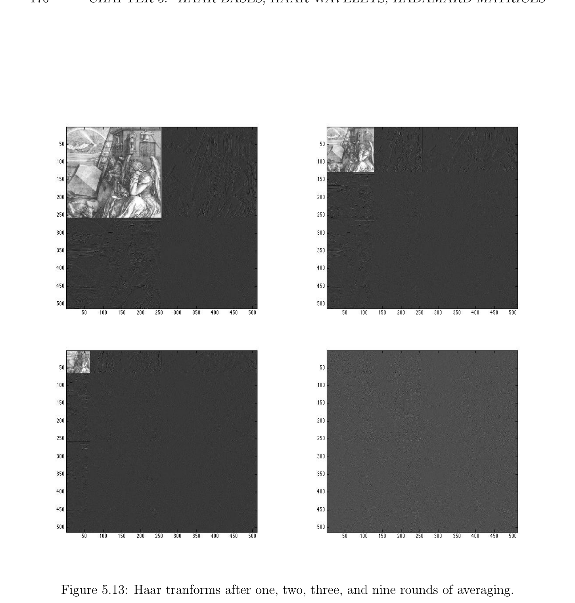

# Haar Transform for Digital Images

<!-- PAGE 164 -->
$$0.80.6$$
$$0.60.4$$
$$0.4$$
$$0.2$$
$$0.2$$
$$0$$
$$0$$
$$-0.2$$
$$-0.2$$
$$-0.4$$
$$-0.4$$
$$-0.6-0.6$$
$$-0.8\overline{0}\overline{1}\overline{2}\overline{3}\overline{4}\overline{5}\overline{6} 7-0.8$$
$$\overline{0}\overline{1}\overline{2}\overline{3}\overline{4}\overline{5}\overline{6} 7$$
$$x 104x 104$$
$$Figure 5.8: The signal “handel” and its Haar transform.$$
so first tuncate the tail of $y$ to get a vector of length $65536 = 2^{16}$. A plot of the signals corresponding to $y$ and $c$ is shown in Figure 5.8. Then run a program that sets all coefficients of $c$ whose absolute value is less that 0.05 to zero. This sets $37272$ coefficients to $0$. The resulting vector $c_{2}$ is converted to a signal $y_{2}$. A plot of the signals corresponding to $y_{2}$ and $c_{2}$ is shown in Figure 5.9. When you type sound(y2), you find that the music doesn’t differ
$$10.6$$
$$0.8$$
$$0.4$$
$$0.6$$
$$0.40.2$$
$$0.2$$
$$0$$
$$0$$
$$-0.2$$
$$-0.2$$
$$-0.4-0.4$$
$$-0.6$$
$$-0.6$$
$$-0.8$$
$$-1\overline{0}\overline{1}\overline{2}\overline{3}\overline{4}\overline{5}\overline{6} 7-0.8$$
$$\overline{0}\overline{1}\overline{2}\overline{3}\overline{4}\overline{5}\overline{6} 7$$
$$x 104x 104$$
$$Figure 5.9: The compressed signal “handel” and its Haar transform.$$
much from the original, although it sounds less crisp. You should play with other numbers greater than or less than 0.05. You should hear what happens when you type sound(c). It plays the music corresponding to the Haar transform $c$ of $y$, and it is quite funny.

## 5.5 Haar Transform for Digital Images

Another neat property of the Haar transform is that it can be instantly generalized to matrices (even rectangular) without any extra effort! This allows for the compression of

<!-- PAGE 165 -->
digital images. But first we address the issue of normalization of the Haar coefficients. As we observed earlier, the $2^{n} \times  2^{n}$ matrix $W_{n}$ of Haar basis vectors has orthogonal columns, but its columns do not have unit length. As a consequence, $W_{n}^{\top}$  is not the inverse of $W_{n}$, but rather the matrix
$$W_{n}^{-1} = D_{n}W_{n}^{\top}$$
$$with D_{n} = \mathrm{diag} \begin{pmatrix} 2^{-n},2^{-n}, 2^{-(n-1)}, 2^{-(n-1)}, 2^{-(n-2)}, \dots  , 2^{-(n-2)}, \dots  , 2^{-1}, \dots  , 2^{-1} \\ |{z}| & {z & }| & {z & } & | & {z & } \\ 20 & 21 & 22 & 2n-1 \end{pmatrix} .$$

> **Definition 5.5.** The orthogonal matrix
$$H_{n} = W_{n}\overline{D}_{n}^{21}$$
whose columns are the normalized Haar basis vectors, with
$$\overline{D}_{n}^{12} = \mathrm{diag} \begin{pmatrix} \overline{2}_{2}^{-n} ,\overline{2}_{2}^{-n},\overline{2}_{2}^{-n-1},\overline{2}_{2}^{-n-1},\overline{2}_{2}^{-n-2}, \dots  ,\overline{2}_{2}^{-n-2}, \dots  ,\overline{2}_{2}^{-1}, \dots  ,\overline{2}_{2}^{-1} \\ |{z}| & {z & }| & {z & } & | & {z & } \\ 20 & 21 & 22 & 2n-1 \end{pmatrix}$$
is called the normalized Haar transform matrix. Given a vector (signal) $u$, we call $c = H_{n}^{\top} u$ the normalized Haar coefficients of $u$. Because $H_{n}$ is orthogonal, $H_{n}^{-1} = H_{n}^{\top}$ . Then a moment of reflection shows that we have to slightly modify the algorithms to compute $H_{n}^{\top} u$ and $H_{n}c$ as follows: When computing the sequence of $u^{j}s$, use
$$\sqrt$$
$$u^{j+1}(2i -1) = (u^{j}(i) + u^{j}(2^{j}+ i))/\overline{2}$$
$$\sqrt$$
$$u^{j+1}(2i) = (u^{j}(i) -u^{j}(2^{j}+ i))/\overline{2},$$
and when computing the sequence of $c^{j}s$, use
$$\sqrt$$
$$c^{j}(i) = (c^{j+1}(2i -1) + c^{j+1}(2i))/\overline{2}$$
$$\sqrt$$
$$c^{j}(2^{j}+ i) = (c^{j+1}(2i -1) -c^{j+1}(2i))/\overline{2}.$$
$$\sqrt$$
Note that things are now more symmetric, at the expense of a division by $\overline{2.}$ However, for long vectors, it turns out that these algorithms are numerically more stable.
$$\sqrt$$
Remark: Some authors (for example, Stollnitz, Derose and Salesin $[174])$ rescale $c$ by $1/ \overline{2}^{n}$
$$\sqrt$$
and $u$ by $\overline{2}^{n}$. This is because the norm of the basis functions $\psi_{k}^{j}$  is not equal to $1$ (under
$$\sqrt \frac{the}{2^{j}} inner product \langle f, g\rangle =^{1} \int_{0}  f(t)g(t)dt). The normalized basis functions are the functions$$
$\psi_{k}^{j}$ . Let us now explain the 2D version of the Haar transform. We describe the version using the matrix $W_{n}$, the method using $H_{n}$ being identical (except that $H_{n}^{-1} = H_{n}^{\top}$ , but this does

<!-- PAGE 166 -->
$$\times$$
not hold for $W_{n}^{-1}$ ). Given a $2^{m}  2^{n}$ matrix $A$, we can first convert the rows of $A$ to their Haar coefficients using the Haar transform $W_{n}^{-1}$  , obtaining a matrix $B$, and then convert the columns of $B$ to their Haar coefficients, using the matrix $W_{m}^{-1}$  . Because columns and rows are exchanged in the first step,
$$B = A(W_{n}^{-1}  )^{\top},$$
and in the second step $C = W_{m}^{-1}  B$, thus, we have
$$C = W_{m}^{-1}  A(W_{n}^{-1} )^{\top}= D_{m}W_{m}^{\top}AW_{n} D_{n}.$$
In the other direction, given a $2^{m} \times  2^{n}$ matrix $C$ of Haar coefficients, we reconstruct the matrix $A$ (the image) by first applying $W_{m}$ to the columns of $C$, obtaining $B$, and then $W_{n}^{\top}$ to the rows of $B$. Therefore
$$A = W_{m}CW_{n}^{\top}  .$$
Of course, we don’t actually have to invert $W_{m}$ and $W_{n}$ and perform matrix multiplications. We just have to use our algorithms using averaging and differencing. Here is an example. If the data matrix (the image) is the $8 \times  8$ matrix
$$A = \begin{pmatrix} 64 & 2 & 3 & 61 & 60 & 6 & 7 & 57 \\ 9 & 55 & 54 & 12 & 13 & 51 & 50 & 16 \\ 17 & 47 & 46 & 20 & 21 & 43 & 42 & 24 \\ 40 & 26 & 27 & 37 & 36 & 30 & 31 & 33 \\ 32 & 34 & 35 & 29 & 28 & 38 & 39 & 25 \\ 41 & 23 & 22 & 44 & 45 & 19 & 18 & 48 \\ 49 & 15 & 14 & 52 & 53 & 11 & 10 & 56 \\ 8 & 58 & 59 & 5 & 4 & 62 & 63 & 1 \end{pmatrix} ,$$
then applying our algorithms, we find that
$$C = \begin{pmatrix} 32.5 & 0 & 0 & 0 & 0 & 0 & 0 & 0 \\ 0 & 0 & 0 & 0 & 0 & 0 & 0 & 0 \\ 0 & 0 & 0 & 0 & 4 & -4 & 4 & -4 \\ 0 & 0 & 0 & 0 & 4 & -4 & 4 & -4 \\ 0 & 0 & 0.5 & 0.5 & 27 & -25 & 23 & -21 \\ 0 & 0 & -0.5 & -0.5 & -11 & 9 & -7 & 5 \\ 0 & 0 & 0.5 & 0.5 & -5 & 7 & -9 & 11 \\ 0 & 0 & 0.5 & 0.5 & 21 & 23 & 25 & 27 \end{pmatrix} .$$
$$----$$
As we can see, $C$ has more zero entries than $A$; it is a compressed version of $A$. We can

<!-- PAGE 167 -->
further compress $C$ by setting to $0$ all entries of absolute value at most 0.5. Then we get
$$C_{2} = \begin{pmatrix} 32.5 & 0 & 0 & 0 & 0 & 0 & 0 & 0 \\ 0 & 0 & 0 & 0 & 0 & 0 & 0 & 0 \\ 0 & 0 & 0 & 0 & 4 & -4 & 4 & -4 \\ 0 & 0 & 0 & 0 & 4 & -4 & 4 & -4 \\ 0 & 0 & 0 & 0 & 27 & -25 & 23 & -21 \\ 0 & 0 & 0 & 0 & -11 & 9 & -7 & 5 \\ 0 & 0 & 0 & 0 & -5 & 7 & -9 & 11 \\ 0 & 0 & 0 & 0 & 21 & 23 & 25 & 27 \end{pmatrix} .$$
$$--$$
We find that the reconstructed image is
$$A_{2} = \begin{pmatrix} 63.5 & 1.5 & 3.5 & 61.5 & 59.5 & 5.5 & 7.5 & 57.5 \\ 9.5 & 55.5 & 53.5 & 11.5 & 13.5 & 51.5 & 49.5 & 15.5 \\ 17.5 & 47.5 & 45.5 & 19.5 & 21.5 & 43.5 & 41.5 & 23.5 \\ 39.5 & 25.5 & 27.5 & 37.5 & 35.5 & 29.5 & 31.5 & 33.5 \\ 31.5 & 33.5 & 35.5 & 29.5 & 27.5 & 37.5 & 39.5 & 25.5 \\ 41.5 & 23.5 & 21.5 & 43.5 & 45.5 & 19.5 & 17.5 & 47.5 \\ 49.5 & 15.5 & 13.5 & 51.5 & 53.5 & 11.5 & 9.5 & 55.5 \\ 7.5 & 57.5 & 59.5 & 5.5 & 3.5 & 61.5 & 63.5 & 1.5 \end{pmatrix} ,$$
which is pretty close to the original image matrix $A$. It turns out that Matlab has a wonderful command, image(X) (also imagesc(X), which often does a better job), which displays the matrix $X$ has an image in which each entry is shown as a little square whose gray level is proportional to the numerical value of that entry (lighter if the value is higher, darker if the value is closer to zero; negative values are treated as zero). The images corresponding to $A$ and $C$ are shown in Figure 5.10. The
$$Figure 5.10: An image and its Haar transform.$$
compressed images corresponding to $A_{2}$ and $C_{2}$ are shown in Figure 5.11. The compressed

<!-- PAGE 168 -->
$$Figure 5.11: Compressed image and its Haar transform.$$
versions appear to be indistinguishable from the originals! If we use the normalized matrices $H_{m}$ and $H_{n}$, then the equations relating the image matrix $A$ and its normalized Haar transform $C$ are
$$C = H_{m}^{\top}AH_{n}$$
$$A = H_{m}CH_{n}^{\top} .$$
The Haar transform can also be used to send large images progressively over the internet. Indeed, we can start sending the Haar coefficients of the matrix $C$ starting from the coarsest coefficients (the first column from top down, then the second column, etc.), and at the receiving end we can start reconstructing the image as soon as we have received enough data. Observe that instead of performing all rounds of averaging and differencing on each row and each column, we can perform partial encoding (and decoding). For example, we can perform a single round of averaging and differencing for each row and each column. The result is an image consisting of four subimages, where the top left quarter is a coarser version of the original, and the rest (consisting of three pieces) contain the finest detail coefficients. We can also perform two rounds of averaging and differencing, or three rounds, etc. The second round of averaging and differencing is applied to the top left quarter of the image. Generally, the kth round is applied to the $2^{m+1-k} \times  2^{n+1-k}$ submatrix consisting of the first $2^{m+1-k}$ rows and the first $2^{n+1-k}$ columns $(1 \le k \le n)$ of the matrix obtained at the end of the previous round. This process is illustrated on the image shown in Figure 5.12. The result of performing one round, two rounds, three rounds, and nine rounds of averaging is shown in Figure 5.13. Since our images have size $512 \times  512$, nine rounds of averaging yields the Haar transform, displayed as the image on the bottom right. The original image has completely disappeared! We leave it as a fun exercise to modify the algorithms involving averaging and differencing to perform $k$ rounds of $averaging/differencing$. The reconstruction algorithm is a little tricky.

<!-- PAGE 169 -->
$$Figure 5.12: Original drawing by Durer.$$
A nice and easily accessible account of wavelets and their uses in image processing and computer graphics can be found in Stollnitz, Derose and Salesin $[174]$. A very detailed account is given in Strang and and Nguyen $[178]$, but this book assumes a fair amount of background in signal processing. We can find easily a basis of $2^{n} \times  2^{n} = 2^{2n}$ vectors $w_{ij} (2^{n} \times  2^{n}$ matrices) for the linear map that reconstructs an image from its Haar coefficients, in the sense that for any $2^{n} \times  2^{n}$ matrix $C$ of Haar coefficients, the image matrix $A$ is given by
$$A = \sum_{i=1j}^{2n}  \sum_{=1}^{2n}  c_{ij}w_{ij}.$$
Indeed, the matrix $w_{ij}$ is given by the so-called outer product
$$w_{ij} = w_{i}(w_{j})^{\top}.$$
Similarly, there is a basis of $2^{n} \times  2^{n} = 2^{2n}$ vectors $h_{ij} (2^{n} \times  2^{n}$ matrices) for the 2D Haar transform, in the sense that for any $2^{n} \times  2^{n}$ matrix $A$, its matrix $C$ of Haar coefficients is given by
$$C = \sum_{i=1j}^{2n}  \sum_{=1}^{2n}  a_{ij}h_{ij}.$$

<!-- PAGE 170 -->

**Figure 5.13:** Haar tranforms after one, two, three, and nine rounds of averaging.
