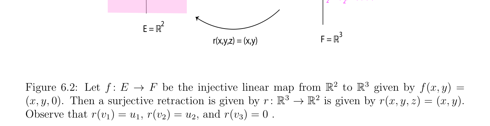

# Matrices of Linear Maps and Multiplication by Blocks

<!-- PAGE 189 -->
$$f(x,y) = (x,y,0)$$
$$u = (1,1)$$
$$2$$
$$v = (0,0,1)$$
$$3$$
$$\overline{u = (1,0)}$$
$$1$$
$$v = f(u ) = (1,0,0)$$
$$11v  = f(u ) = (1,1,0)$$
$$22$$
$$E = R^{2}$$
$$r(x,y,z) = (x,y)F = R^{3}$$
$$\mathbb{R}^{2}  \mathbb{R}^{3}$$

**Figure 6.2:** Let $f$ : $E \to F$ be the injective linear map from to given by f(x, $y) =$
$$\mathbb{R}^{3} \mathbb{R}^{2}$$
$(x, y, 0)$. Then a surjective retraction is given by $r: \to$ is given by r(x, $y, z) = (x, y)$. Observe that $r(v_{1}) = u_{1}, r(v_{2}) = u_{2}$, and $r(v_{3}) = 0$ .

## 6.2 Matrices of Linear Maps and Multiplication by

$$Blocks$$
Direct sums yield a fairly easy justification of matrix block multiplication. The key idea is that the representation of a linear map $f$ : $E \to F$ over a basis $(u_{1}, \dots  , u_{n})$ of $E$ and a basis $(v_{1}, \dots  , v_{m})$ of $F$ by a matrix $A = (a_{ij})$ of scalars (in $K)$ can be generalized to the representation of $f$ over a direct sum decomposition $E = E_{1} \oplus \cdots  \oplus E_{n}$ of $E$ and a direct sum decomposition $F = F_{1} \oplus \cdots  \oplus F_{m}$ of $F$ in terms of a matrix $(f_{ij})$ of linear maps $f_{ij}$ : $E_{j} \to F_{i}$. Futhermore, matrix multiplication of scalar matrices extends naturally to matrix multiplication of matrices of linear maps. We simply have to replace multiplication of scalars in $K$ by the composition of linear maps. Let $E$ and $F$ be two vector spaces and assume that they are expressed as direct sums
$$nm$$
$$E =ME_{j},F =MF_{i}.$$
$$j=1i=1$$

> **Definition 6.6.** Given any linear map $f$ : $E \to F$, we define the linear maps $f_{ij}$ : $E_{j} \to F_{i}$ as follows. Let $pr_{i}^{F}$ : $F \to F_{i}$ be the projection of $F = F_{1} \oplus \cdots  \oplus F_{m}$ onto $F_{i}$. If $f_{j}$ : $E_{j} \to F$ is the restriction of $f$ to $E_{j}$, which means that for every vector $x_{j} \in E_{j}$,
$$f_{j}(x_{j}) = f(x_{j}),$$
then we define the map $f_{ij}$ : $E_{j} \to F_{i}$ by
$$f_{ij} = pr_{i}^{F} \circ f_{j},$$

<!-- PAGE 190 -->
so that if $x_{j} \in E_{j}$, then
$$f(x_{j}) = f_{j}(x_{j}) = \sum_{i=1}^{m}  f_{ij}(x_{j}),with f_{ij}(x_{j}) \in F_{i}.(\dagger_{1} )$$
Observe that we are summing over the index $i$, which eventually corresponds to summing the entries in the jth column of the matrix representing $f$; see Definition 6.7. We see that for every vector $x = x_{1} + \cdots  + x_{n} \in E$, with $x_{j} \in E_{j}$, we have
$$f(x) = \sum_{j=1}^{n}  f_{j}(x_{j}) = \sum_{j=1}^{n}  \sum_{i=1}^{m}  f_{ij}(x_{j}) = \sum_{i=1j}^{m}  \sum_{=1}^{n}  f_{ij}(x_{j}).$$
Observe that conversely, given a family $(f_{ij})_{1\le i\le m,1\le j\le n}$ of linear maps $f_{ij}$ : $E_{j} \to F_{i}$, we obtain the linear map $f$ : $E \to F$ defined such that for every $x = x_{1} + \cdots  + x_{n} \in E$, with $x_{j} \in E_{j}$, we have
$$f(x) = \sum_{i=1j}^{m}  \sum_{=1}^{n}  f_{ij}(x_{j}).$$
As a consequence, it is easy to check that there is an isomorphism between the vector spaces
$$Hom(E, F)and \prod_{1\le i\le m}  Hom(E_{j}, F_{i}).$$
$$1\le j\le n$$

> **Example 6.1.** Suppose that $E = E_{1} \oplus E_{2}$ and $F = F_{1} \oplus F_{2} \oplus F_{3}$, and that we have six maps $f_{ij}$ : $E_{j} \to F_{i}$ for $i = 1, 2, 3$ and $j = 1, 2$. For any $x = x_{1} + x_{2}$, with $x_{1} \in E_{1}$ and $x_{2} \in E_{2}$, we have
$$y_{1} = f_{11}(x_{1}) + f_{12}(x_{2}) \in F_{1}$$
$$y_{2} = f_{21}(x_{1}) + f_{22}(x_{2}) \in F_{2}$$
$$y_{3} = f_{31}(x_{1}) + f_{32}(x_{2}) \in F_{3},$$
$$f_{1}(x_{1}) = f_{11}(x_{1}) + f_{21}(x_{1}) + f_{31}(x_{1})$$
$$f_{2}(x_{2}) = f_{12}(x_{2}) + f_{22}(x_{2}) + f_{32}(x_{2}),$$
and
$$f(x) = f_{1}(x_{1}) + f_{2}(x_{2}) = y_{1} + y_{2} + y_{3}$$
$$= f_{11}(x_{1}) + f_{12}(x_{2}) + f_{21}(x_{1}) + f_{22}(x_{2}) + f_{31}(x_{1}) + f_{32}(x_{2}).$$
These equations suggest the matrix notation
$$\begin{pmatrix} y_{1} \\ y_{2} \\ y_{3} \end{pmatrix} = \begin{pmatrix} f_{11} & f_{12} \\ f_{21} & f_{22} \\ f_{31} & f_{32} \end{pmatrix} \begin{pmatrix} x_{1} \\ x_{2} \end{pmatrix} .$$

<!-- PAGE 191 -->
In general we proceed as follows. For any $x = x_{1} + \cdots  + x_{n}$ with $x_{j} \in E_{j}$, if $y =$ f(x), since $F = F_{1} \oplus \cdots  \oplus F_{m}$, the vector $y \in F$ has a unique decomposition $y = y_{1} + \cdots  + y_{m}$
$$with y_{i} \in F_{i}, and since f_{ij} : E_{j} \to F_{i}, we have \sum_{j}  n f_{ij}(x_{j}) \in F_{i}, so \sum_{j}  n=1 f_{ij}(x_{j}) \in F_{i} is the$$
ith component of f(x) over the direct sum $F = F_{1}^{=1} \oplus \cdots  \oplus F_{m}$; equivalently
$$pr_{i}^{F} (f(x)) = \sum_{j=1}^{n}  f_{ij}(x_{j}),1 \le i \le m.$$
Consequently, we have
$$y_{i} = \sum_{j=1}^{n}  f_{ij}(x_{j}),1 \le i \le m.(\dagger_{2} )$$
This time we are summing over the index $j$, which eventually corresponds to multiplying the ith row of the matrix representing $f$ by the $n$-tuple $(x_{1}, \dots  , x_{n})$; see Definition 6.7. All this suggests a generalization of the matrix notation Ax, where $A$ is a matrix of scalars and $x$ is a column vector of scalars, namely to write
$$\begin{pmatrix} y_{1} \\ \vdots \\ y_{m} \end{pmatrix} = \begin{pmatrix} f_{1 1} & \dots & f_{1n} \\ \vdots & \ddots & \vdots \\ f_{m1} & \dots & f_{m n} \end{pmatrix} \begin{pmatrix} x_{1} \\ \vdots \\ x_{n} \end{pmatrix} ,(\dagger_{3} )$$
which is an abbreviation for the $m$ equations
$$y_{i} = \sum_{j=1}^{n}  f_{ij}(x_{j}),i = 1, \dots  , m.$$
The interpretation of the multiplication of an $m \times  n$ matrix of linear maps $f_{ij}$ by a column vector of $n$ vectors $x_{j} \in E_{j}$ is to apply each $f_{ij}$ to $x_{j}$ to obtain $f_{ij}(x_{j})$ and to sum over the index $j$ to obtain the ith output vector. This is the generalization of multiplying the scalar $a_{ij}$ by the scalar $x_{j}$. Also note that the jth column of the matrix $(f_{ij})$ consists of the maps $(f_{1j}, \dots  , f_{mj})$ such that $(f_{1j}(x_{j}), \dots  , f_{mj}(x_{j}))$ are the components of $f(x_{j}) = f_{j}(x_{j})$ over the direct sum $F = F_{1} \oplus \cdots  \oplus F_{m}$. In the special case in which each $E_{j}$ and each $F_{i}$ is one-dimensional, this is equivalent to choosing a basis $(u_{1}, \dots  , u_{n})$ in $E$ so that $E_{j}$ is the one-dimensional subspace $E_{j} = Ku_{j}$, and a basis $(v_{1}, \dots  , v_{m})$ in $F_{j}$ so that $F_{i}$ is the one-dimensional subspace $F_{i} = Kv_{i}$. In this case every vector $x \in E$ is expressed as $x = x_{1}u_{1} + \cdots  + x_{n}u_{n}$, where the $x_{i} \in K$ are scalars and similarly every vector $y \in F$ is expressed as $y = y_{1}v_{1} + \cdots  + y_{m}v_{m}$, where the $y_{i} \in K$ are scalars. Each linear map $f_{ij}$ : $E_{j} \to F_{i}$ is a map between the one-dimensional spaces $Ku_{j}$ and $Kv_{i}$, so it is of the form $f_{ij}(x_{j}u_{j}) = a_{ij}x_{j}v_{i}$, with $x_{j} \in K$, and so the matrix $(f_{ij})$ of linear maps $f_{ij}$ is in one-to-one correspondence with the matrix $(a_{ij})$ of scalars in $K$, and Equation $(\dagger_{3}$ ) where the $x_{j}$ and $y_{i}$ are vectors is equivalent to the same familar equation where the $x_{j}$ and $y_{i}$ are the scalar coordinates of $x$ and $y$ over the respective bases.

<!-- PAGE 192 -->

> **Definition 6.7.** Let $E$ and $F$ be two vector spaces and assume that they are expressed as direct sums
$$nm$$
$$E =ME_{j},F =MF_{i}.$$
$$j=1i=1$$
Given any linear map $f$ : $E \to F$, if $(f_{ij})_{1\le i\le m,1\le j\le n}$ is the familiy of linear maps $f_{ij}$ : $E_{j} \to F_{i}$ defined in Definition 6.6, the $m \times  n$ matrix of linear maps
$$M(f) = \begin{pmatrix} f_{1 1} & \dots & f_{1n} \\ \vdots & \ddots & \vdots \\ f_{m1} & \dots & f_{m n} \end{pmatrix}$$
is called the matrix of $f$ with respect to the decompositions $n  E_{j}$, and $m  F_{i}$ of $E$ and
$$as direct sums. \bigoplus_{j}  =1 \bigoplus_{i}  =1$$
$F$ For any $x = x_{1} + \cdots  + x_{n} \in E$ with $x_{j} \in E_{j}$ and any $y = y_{1} + \cdots  + y_{m} \in F$ with $y_{i} \in F_{i}$, we have $y =$ f(x) iff
$$\begin{pmatrix} y_{1} \\ \vdots \\ y_{m} \end{pmatrix} = \begin{pmatrix} f_{1 1} & \dots & f_{1n} \\ \vdots & \ddots & \vdots \\ f_{m1} & \dots & f_{m n} \end{pmatrix} \begin{pmatrix} x_{1} \\ \vdots \\ x_{n} \end{pmatrix} ,$$
where the matrix equation above means that the system of $m$ equations
$$y_{i} = \sum_{j=1}^{n}  f_{ij}(x_{j}),i = 1 \dots  , m,(\dagger )$$
holds. But now we can also promote matrix multiplication. Suppose we have a third space $G$ written as a direct sum. It is more convenient to write
$$pnm$$
$$E =ME_{k},F =MF_{j},G =MG_{i}.$$
$$k=1j=1i=1$$
Assume we also have two linear maps $f$ : $E \to F$ and $g: F \to G$. Now we have the $n \times  p$ matrix of linear maps $B = (f_{jk})$ and the $m \times  n$ matrix of linear maps $A = (g_{ij})$. We would like to find the $m \times  p$ matrix associated with $g \circ f$. By definition of $f_{k}$ : $E_{k} \to F$ and $f_{jk}$ : $E_{k} \to F_{j}$, if $x_{k} \in E_{k}$, then
$$f_{k}(x_{k}) = f(x_{k}) = \sum_{j=1}^{n}  f_{jk}(x_{k}),with f_{jk}(x_{k}) \in F_{j},(*_{1})$$
and similarly, by definition of $g_{j}$ : $F_{j} \to G$ and $g_{ij}$ : $F_{j} \to G_{i}$, if $y_{j} \in F_{j}$, then
$$g_{j}(y_{j}) = g(y_{j}) = \sum_{i=1}^{m}  g_{ij}(y_{j}),with g_{ij}(y_{j}) \in G_{i}.(*_{2})$$

<!-- PAGE 193 -->
If we write $h = g \circ f$, we need to find the maps $h_{k}$ : $E_{k} \to G$, with
$$h_{k}(x_{k}) = h(x_{k}) = (g \circ f)(x_{k}),$$
and $h_{ik}$ : $E_{k} \to G_{i}$ given by
$$h_{ik} = pr_{i}^{G} \circ h_{k}.$$
We have
$$h_{k}(x_{k}) = (g \circ f)(x_{k}) = g(f(x_{k})) = g(f_{k}(x_{k}))$$
$$= g \begin{pmatrix} f_{jk}(x_{k}) \end{pmatrix} \sum_{j=1}^{n}  by (*_{1})$$
$$= \sum_{j=1}^{n}  g(f_{jk}(x_{k})) = \sum_{j=1}^{n}  g_{j}(f_{jk}(x_{k}))since g is linear$$
$$= \sum_{j=1}^{n}  \sum_{i=1}^{m}  g_{ij}(f_{jk}(x_{k})) = \sum_{i=1j}^{m}  \sum_{=1}^{n}  g_{ij}(f_{jk}(x_{k})),by (*_{2})$$
$$and since \sum_{j}  n=1 g_{ij}(f_{jk}(x_{k})) \in G_{i}, we conclude that$$
$$h_{ik}(x_{k}) = \sum_{j=1}^{n}  g_{ij}(f_{jk}(x_{k})) = \sum_{j=1}^{n}  (g_{ij} \circ f_{jk})(x_{k}),(*_{3})$$
which can also be expressed as
$$h_{ik} = \sum_{j=1}^{n}  g_{ij} \circ f_{jk}.(*_{4})$$
Equation $(*_{4})$ is exactly the analog of the formula for the multiplication of matrices of scalars! We just have to replace multiplication by composition. The $m \times  p$ matrix of linear maps $(h_{ik})$ is the “product” AB of the matrices of linear maps $A = (g_{ij})$ and $B = (f_{jk})$, except that multiplication is replaced by composition. In summary we just proved the following result.

> **Proposition 6.12.** Let $E, F, G$ be three vector spaces expressed as direct sums
$$pnm$$
$$E =ME_{k},F =MF_{j},G =MG_{i}.$$
$$k=1j=1i=1$$
For any two linear maps $f$ : $E \to F$ and $g: F \to G$, let $B = (f_{jk})$ be the $n \times  p$ matrix of linear maps associated with $f$ (with respect to the decomposition of $E$ and $F$ as direct sums) and let $A = (g_{ij})$ be the $m \times  n$ matrix of linear maps associated with $g$ (with respect to the decomposition of $F$ and $G$ as direct sums). Then the $m \times  p$ matrix $C = (h_{ik})$ of linear maps

<!-- PAGE 194 -->
associated with $h = g \circ f$ (with respect to the decomposition of $E$ and $G$ as direct sums) is given by
$$C = AB,$$
with
$$h_{ik} = \sum_{j=1}^{n}  g_{ij} \circ f_{jk},1 \le i \le m, 1 \le k \le p.$$
We will use Proposition 6.12 to justify the rule for the block multiplication of matrices. The difficulty is mostly notational. Again suppose that $E$ and $F$ are expressed as direct sums
$$nm$$
$$E =ME_{j},F =MF_{i},$$
$$j=1i=1$$
and let $f$ : $E \to F$ be a linear map. Furthermore, suppose that $E$ has a finite basis $(u_{t})_{t\in T}$, where $T$ is the disjoint union $T = T_{1} \cup \cdots  \cup T_{n}$ of nonempty subsets $T_{j}$ so that $(u_{t})_{t\in Tj}$ is a basis of $E_{j}$, and similarly $F$ has a finite basis $(v_{s})_{s\in S}$, where $S$ is the disjoint union $S = S_{1} \cup \cdots  \cup S_{m}$ of nonempty subsets $S_{i}$ so that $(v_{s})_{s\in Si}$ is a basis of $F_{i}$. Let $M =$ |S|, $N =$ |T|, $s_{i} = |S_{i}|$, and let $t_{j} = |T_{j}|$. Since $s_{i}$ is the number of elements in the basis $(v_{s})_{s\in Si}$ of $F_{i}$ and $F = F_{1} \oplus \cdots  \oplus F_{m}$, we have $M =$ dim(F) $= s_{1} + \cdots  + s_{m}$. Similarly, since $t_{j}$ is the number of elements in the basis $(u_{t})_{t\in Tj}$ of $E_{j}$ and $E = E_{1} \oplus \cdots  \oplus E_{n}$, we have $N =$ dim(E) $= t_{1} + \cdots  + t_{n}$. Let $A = (a_{st})_{(s,t)\in S\times T}$ be the (ordinary) $M \times  N$ matrix of scalars (in $K)$ representing $f$ with respect to the basis $(u_{t})_{t\in T}$ of $E$ and the basis $(v_{s})_{s\in S}$ of $F$ with $M = r_{1} + \cdots  + r_{m}$ and $N = s_{1} + \cdots  + s_{n}$, which means that for any $t \in T$, the tth column of $A$ consists of the components $a_{st}$ of $f(u_{t})$ over the basis $(v_{s})_{s\in S}$, as in the beginning of Section 4.1. For any $i$ and any $j$ such that $1 \le i \le m$ and $1 \le j \le n$, we can form the $s_{i} \times  t_{j}$ matrix $A_{Si,Tj}$ obtained by deleting all rows in $A$ of index $s \in / S_{i}$ and all columns in $A$ of index $t \in / T_{j}$. The matrix $A_{Si,Tj}$ is the indexed family $(a_{st})_{(s,t)\in Si\times Tj}$, as explained at the beginning of Section 4.1. Observe that the matrix $A_{Si,Tj}$ is actually the matrix representing the linear map $f_{ij}$ : $E_{j} \to F_{i}$ of Definition 6.7 with respect to the basis $(u_{t})_{t\in Tj}$ of $E_{j}$ and the basis $(v_{s})_{s\in Si}$ of $F_{i}$, in the sense that for any $t \in T_{j}$, the tth column of $A_{Si,Tj}$ consists of the components $a_{st}$ of $f_{ij}(u_{t})$ over the basis $(v_{s})_{s\in Si}$.

> **Definition 6.8.** Given an $M \times  N$ matrix $A$ (with entries in $K)$, we define the $m \times  n$ matrix $(A_{ij})_{1\le i\le m,1\le j\le n}$ whose entry $A_{ij}$ is the matrix $A_{ij} = A_{Si,Tj}, 1 \le i \le m, 1 \le j \le n$, and we call it the block matrix of $A$ associated with the partitions $S = S_{1} \cup \cdots  \cup S_{m}$ and $T = T_{1} \cup \cdots \cup T_{n}$. The matrix $A_{Si,Tj}$ is an $s_{i} \times t_{j}$ matrix called the $(i$, j)th block of this block matrix. Here we run into a notational dilemma which does not seem to be addressed in the literature. Horn and Johnson $[98]$ (Section 0.7) define partitioned matrices as we do, but they do not propose a notation for block matrices.

<!-- PAGE 195 -->
The problem is that the block matrix $(A_{ij})_{1\le i\le m,1\le j\le n}$ is not equal to the original matrix $A$. First of all, the block matrix is $m \times  n$ and its entries are matrices, but the matrix $A$ is $M \times  N$ and its entries are scalars. But even if we think of the block matrix as an $M \times  N$ matrix of scalars, some rows and some columns of the original matrix $A$ may have been permuted due to the choice of the partitions $S = S_{1} \cup \cdots  \cup S_{m}$ and $T = T_{1} \cup \cdots  \cup T_{n}$; see

> **Example 6.3.** We propose to denote the block matrix $(A_{ij})_{1\le i\le m,1\le j\le n}$ by $[A]$. This is not entirely satisfactory since all information about the partitions of $S$ and $T$ are lost, but at least this allows us to distinguish between $A$ and a block matrix arising from $A$. To be completely rigorous we may proceed as follows. Let $[m] = {1, \dots  , m}$ and $[n] = {1, \dots  , n}$.

> **Definition 6.9.** For any two finite sets of indices $S$ and $T$, an $S \times  T$ matrix $A$ is an $S \times$  T-indexed family with values in $K$, that is, a function
$$A: S \times  T \to K.$$
Denote the space of $S \times  T$ matrices with entries in $K$ by $M_{S,T}(K)$. An $S \times T$ matrix $A$ is an $S \times$ T-indexed family $(a_{st})_{(s,t)\in S\times T}$, but the standard representation of a matrix by a rectangular array of scalars is not quite correct because it assumes that the rows are indexed by indices in the “canonical index set” $[m]$ and that the columns are indexed by indices in the “canonical index set” $[n]$. Also the index sets need not be ordered, but in practice they are, so if $S = {s_{1}, \dots  , s_{m}}$ and $T = {t_{1}, \dots  , t_{n}}$, we denote an $S \times  T$ matrix $A$ by the rectangular array
$$A = \begin{pmatrix} a_{s1t1} & \cdots & a_{s1tn} \\ \vdots & \ddots & \vdots \\ a_{smt1} & \cdots & a_{smtn} \end{pmatrix} .$$
Even if the index sets are not ordered, the product of an $R\times S$ matrix $A$ and of an $S \times T$ matrix $B$ is well defined and $C = AB$ is an $R \times  T$ matrix (where $R, S, T$ are finite index sets); see Proposition 6.13. Then an $m \times  n$ block matrix $X$ induced by two partitions $S = S_{1} \cup \cdots  \cup S_{m}$ and $T = T_{1} \cup \cdots  \cup T_{n}$ is an $[m] \times$  [n]-indexed family
$$X : [m] \times  [n] \to \prod_{)\in[m]\times}  M_{Si,Tj}(K),$$
$$(i,j[n]$$
such that X(i, $j) \in M_{Si,Tj}(K)$, which means that X(i, $j)$ is an $S_{i} \times  T_{j}$ matrix with entries in $K$. The map $X$ also defines the $M \times  N$ matrix $A = (a_{st})_{s\in S,t\in T}$, with
$$a_{st} = X(i, j)_{st},$$

<!-- PAGE 196 -->
for any $s \in S_{i}$ and any $j \in T_{j}$, so in fact $X = [A]$ and X(i, $j) = A_{Si,Tj}$. But remember that we abbreviate X(i, $j)$ as $X_{ij}$, so the $(i$, j)th entry in the block matrix $[A]$ of $A$ associated with the partitions $S = S_{1} \cup \cdots  \cup S_{m}$ and $T = T_{1} \cup \cdots  \cup T_{n}$ should be denoted by $[A]_{ij}$. To minimize notation we will use the simpler notation $A_{ij}$. Schematically we represent the block matrix $[A]$ as
$$[A] = \begin{pmatrix} A_{S1,T1} & \cdots & A_{S1,Tn} \\ \vdots & \ddots & \vdots \\ A_{Sm,T1} & \cdots & A_{Sm,Tn} \end{pmatrix} or simply as[A] = \begin{pmatrix} A_{11} & \cdots & A_{1n} \\ \vdots & \ddots & \vdots \\ A_{m1} & \cdots & A_{mn} \end{pmatrix} .$$
In the simplified notation we lose the information about the index sets of the blocks.
Remark: It is easy to check that the set of $m \times  n$ block matrices induced by two partitions $S = S_{1} \cup \cdots  \cup S_{m}$ and $T = T_{1} \cup \cdots  \cup T_{n}$ is a vector space. In fact, it is isomorphic to the direct sum
$$MM_{Si,Tj}(K).$$
$$(i,j)\in [m]\times [n]$$
Addition and rescaling are performed blockwise.

> **Example 6.2.** Let $S = {1, 2, 3, 4, 5, 6}$, with $S_{1} = {1, 2}, S_{2} = {3}, S_{3} = {4, 5, 6}$, and $T = {1, 2, 3, 4, 5}$, with $T_{1} = {1, 2}, T_{2} = {3, 4}, T_{3} = {5}$, and Then $s_{1} = 2, s_{2} = 1, s_{3} = 3$ and $t_{1} = 2, t_{2} = 2, t_{3} = 1$. The original matrix is a $6 \times  5$ matrix $A = (a_{ij})$. Schematically we obtain a $3 \times  3$ matrix of nine blocks. where $A_{11}, A_{12}, A_{13}$ are respectively $2 \times  2, 2 \times  2$ and $2 \times  1, A_{21}, A_{22}, A_{23}$ are respectively $1 \times  2, 1 \times  2$ and $1 \times  1$, and $A_{31}, A_{32}, A_{33}$ are respectively $3 \times  2, 3 \times  2$ and $3 \times  1$, as illustrated below.
$$[A] = \begin{pmatrix} A_{11} & A_{12} & A_{13} \\ A_{21} & A_{22} & A_{23} \\ A_{31} & A_{32} & A_{33} \end{pmatrix} = \begin{pmatrix} a_{11} & a_{12} & a_{13} & a_{14} & a_{15} \\ a_{21} & a_{22} & a_{23} & a_{24} & a_{25} \\ a_{31} & a_{32} & a_{33} & a_{34} & a_{35} \\ a_{41} & a_{42} & a_{43} & a_{44} & a_{45} \\ a_{51} & a_{52} & a_{53} & a_{54} & a_{55} \\ a_{61} & a_{62} & a_{63} & a_{64} & a_{65} \end{pmatrix} .$$
Technically, the blocks are obtained from $A$ in terms of the subsets $S_{i}, T_{j}$. For example,
$$a_{13}a_{14}$$
$$A_{12} = A_{{1,2},{3,4}} =.$$
$$a_{23}a_{24}$$

> **Example 6.3.** Let $S = {1, 2, 3}$, with $S_{1} = {1, 3}, S_{2} = {2}$, and $T = {1, 2, 3}$, with $T_{1} = {1, 3}, T_{2} = {2}$. Then $s_{1} = 2, s_{2} = 1$, and $t_{1} = 2, t_{2} = 1$. The block $2 \times  2$ matrix $[A]$ associated with above partitions is
$$[A] = \begin{pmatrix} A_{{1,3},{1,3}} & A_{{1,3},{2}} \\ A_{{2},{1,3}} & A_{{2},{2}} \end{pmatrix} = \begin{pmatrix} a_{11} & a_{13} & a_{12} \\ a_{31} & a_{33} & a_{32} \\ a_{21} & a_{23} & a_{22} \end{pmatrix} .$$
$$\begin{bmatrix}\end{bmatrix} \begin{bmatrix}\end{bmatrix}$$

<!-- PAGE 197 -->
Observe that $[A]$ viewed as a $3 \times  3$ scalar matrix is definitely different from
$$A = \begin{pmatrix} a_{11} & a_{12} & a_{13} \\ a_{21} & a_{22} & a_{23} \\ a_{31} & a_{32} & a_{33} \end{pmatrix} .$$
In practice, $S = {1, \dots  , M}$ and $T = {1, \dots  , N}$, so there are bijections $\alpha_{i}$  : ${1, \dots  , s_{i}} \to S_{i}$ and $\beta_{j}$  : ${1, \dots  , t_{j}} \to T_{j}, 1 \le i \le m, 1 \le j \le n$. Each $s_{i} \times  t_{j}$ matrix $A_{Si,Tj}$ is considered as a submatrix of $A$, this is why the rows are indexed by $S_{i}$ and the columns are indexed by
$$T_{j}, but this matrix can also be viewed as an s_{i} \times  t_{j} matrix A_{ij}' = \begin{pmatrix} (a_{ij}')_{st} \\ },with \end{pmatrix} by itself, with the$$
rows indexed by ${1, \dots  , s_{i}}$ and the columns indexed by ${1, \dots  , t_{j}$
$$(a_{ij}')_{st} = a_{\alpha(s)\beta(t)},1 \le s \le s_{i}, 1 \le t \le t_{j}.$$
Symbolic systems like Matlab have commands to construct such matrices. But be careful that to put a matrix such as $A_{ij}'$ back into $A$ at the correct row and column locations requires viewing this matrix as $A_{Si,Tj}$. Symbolic systems like Matlab also have commands to assign row vectors and column vectors to specific rows or columns of a matrix. Technically, to be completely rigorous, the matrices $A_{Si,Tj}$ and $A_{ij}'$ are different, even though they contain the same entries. The reason they are different is that in $A_{Si,Tj}$ the entries are indexed by the index sets $S_{i}$ and $T_{j}$, but in $A_{ij}'$ they are indexed by the index sets ${1, \dots  , s_{i}}$ and ${1, \dots  , t_{j}}$. This depends whether we view $A_{Si,Tj}$ as a submatrix of $A$ or as a matrix on its own. In most cases, the partitions $S = S_{1} \cup \cdots  \cup S_{m}$ and $T = T_{1} \cup \cdots  \cup T_{n}$ are chosen so that
$$S_{i} = {s | s_{1} + \cdots  + s_{i-1} + 1 \le s \le s_{1} + \cdots  + s_{i}}$$
$$T_{j} = {t | t_{1} + \cdots  + t_{i-1} + 1 \le t \le t_{1} + \cdots  + t_{j}},$$
with $s_{i} = |S_{i}| \ge 1, t_{j} = |T_{j}| \ge 1, 1 \le i \le m, 1 \le j \le n$. For $i = 1$, we have $S_{1} = {1, \dots  , s_{1}}$ and $T_{1} = {1, \dots  , t_{1}}$. This means that we partition into consecutive subsets of consecutive integers and we preserve the order of the bases. In this case, $[A]$ can be viewed as $A$. But the results about block multiplication hold in the general case. Finally we tackle block multiplication. But first we observe that the computation made in Section 4.2 can be immediately adapted to matrices indexed by arbitrary finite index sets I, $J, K$, not necessary of the form ${1, \dots  , p}, {1, \dots  , n}, {1, \dots  , m}$. We need this to deal with products of matrices occurring as blocks in other matrices, since such matrices are of the form $A_{Si,Tj}$, etc. We can prove immediately the following result generalizing Equation $(4)$ proven in Section 4.2 (also see the fourth equation of Proposition 4.2).

> **Proposition 6.13.** Let I, $J, K$ be any nonempty finite index sets. If the I $\times  J$ matrix $A = (a_{ij})_{(i,j)\in I\times J}$ represents the linear map $g: F \to G$ with respect to the basis $(v_{j})_{j\in J}$ of $F$ and the basis $(w_{i})_{i\in I}$ of $G$ and if the $J \times  K$ matrix $B = (b_{jk})_{(j,k)\in J\times K}$ represents the linear map $f$ : $E \to F$ with respect to the basis $(u_{k})_{k\in K}$ of $E$ and the basis $(v_{j})_{j\in J}$ of $F$, then the

<!-- PAGE 198 -->
I $\times  K$ matrix $C = (c_{ik})_{(i,k)\in I\times K}$ representing the linear map $g \circ f$ : $E \to G$ with respect to the basis $(u_{k})_{k\in K}$ of $E$ and the basis $(w_{i})_{i\in I}$ of $G$ is given by
$$C = AB,$$
where for all $i \in$ I and all $k \in K$,
$$c_{ik} = \sum_{j\in J}  a_{ij}b_{jk}.$$
Let $E, F, G$ be three vector spaces expressed as direct sums
$$pnm$$
$$E =ME_{k},F =MF_{j},G =MG_{i},$$
$$k=1j=1i=1$$
and let $f$ : $E \to F$ and $g: F \to G$ be two linear maps. Furthermore, assume that $E$ has a finite basis $(u_{t})_{t\in T}$, where $T$ is the disjoint union $T = T_{1} \cup \cdots  \cup T_{p}$ of nonempty subsets $T_{k}$ so that $(u_{t})_{t\in Tk}$ is a basis of $E_{k}, F$ has a finite basis $(v_{s})_{s\in S}$, where $S$ is the disjoint union $S = S_{1} \cup \cdots  \cup S_{n}$ of nonempty subsets $S_{j}$ so that $(v_{s})_{s\in Sj}$ is a basis of $F_{j}$, and $G$ has a finite basis $(w_{r})_{r\in R}$, where $R$ is the disjoint union $R = R_{1} \cup \cdots  \cup R_{m}$ of nonempty subsets $R_{i}$ so that $(w_{r})_{r\in Ri}$ is a basis of $G_{i}$. Also let $M =$ |R|, $N =$ |S|, $P =$ |T|, $r_{i} = |R_{i}|, s_{j} = |S_{j}|, t_{k} = |T_{k}|$, so that $M =$ dim(G) $= r_{1} + \cdots  + r_{m}, N =$ dim(F) $= s_{1} + \cdots  + s_{n}$, and $P =$ dim(E) $= t_{1} + \cdots  + t_{p}$. Let $B$ be the $N \times  P$ matrix representing $f$ with respect to the basis $(u_{t})_{t\in T}$ of $E$ and the basis $(v_{s})_{s\in S}$ of $F$, let $A$ be the $M \times N$ matrix representing $g$ with respect to the basis $(v_{s})_{s\in S}$ of $F$ and the basis $(w_{r})_{r\in R}$ of $G$, and let $C$ be the $M \times  P$ matrix representing $h = g \circ f$ with respect to the basis basis $(u_{t})_{t\in T}$ of $E$ and the basis $(w_{r})_{r\in R}$ of $G$. The matrix $[A]$ is an $m \times  n$ block matrix of $r_{i} \times  s_{j}$ matrices $A_{ij} (1 \le i \le m, 1 \le j \le n)$, the matrix $[B]$ is an $n \times  p$ block matrix of $s_{j} \times  t_{k}$ matrices $B_{jk} (1 \le j \le n, 1 \le k \le p)$, and the matrix $[C]$ is an $m \times  p$ block matrix of $r_{i} \times  t_{k}$ matrices $C_{ik} (1 \le i \le m, 1 \le k \le p)$. Furthermore, to be precise, $A_{ij} = A_{Ri,Sj}, B_{jk} = B_{Sj,Tk}$, and $C_{ik} = C_{Ri,Tk}$. Now recall that the matrix $A_{Ri,Sj}$ represents the linear map $g_{ij}$ : $F_{j} \to G_{i}$ with respect to the basis $(v_{s})_{s\in Sj}$ of $F_{j}$ and the basis $(w_{r})_{r\in Ri}$ of $G_{i}$, the matrix $B_{Sj,Tk}$ represents the linear map $f_{jk}$ : $E_{k} \to F_{j}$ with respect to the basis $(u_{t})_{t\in Tk}$ of $E_{k}$ and the basis $(v_{s})_{s\in Sj}$ of $F_{j}$, and the matrix $C_{Ri,Tk}$ represents the linear map $h_{ik}$ : $E_{k} \to G_{i}$ with respect to the basis $(u_{t})_{t\in Tk}$ of $E_{k}$ and the basis $(w_{r})_{r\in Ri}$ of $G_{i}$. By Proposition 6.12, $h_{ik}$ is given by the formula
$$h_{ik} = \sum_{j=1}^{n}  g_{ij} \circ f_{jk},1 \le i \le m, 1 \le k \le p,(*_{5})$$

<!-- PAGE 199 -->
and since the matrix $A_{Ri,Sj}$ represents $g_{ij}$ : $F_{j} \to G_{i}$, the matrix $B_{Sj,Tk}$ represents $f_{jk}$ : $E_{k} \to F_{j}$, and the matrix $C_{Ri,Tk}$ represents $h_{ik}$ : $E_{k} \to G_{i}$, so $(*_{5})$ implies the matrix equation
$$C_{ik} = \sum_{j=1}^{n}  A_{ij}B_{jk},1 \le i \le m, 1 \le k \le p,(*_{6})$$
establishing (when combined with Proposition 6.13) the fact that $[C] =$ [A][B], namely the product $C = AB$ of the matrices $A$ and $B$ can be performed by blocks, using the same product formula on matrices that is used on scalars. We record the above fact in the following proposition.

> **Proposition 6.14.** Let $M, N, P$ be any positive integers, and let ${1, \dots  , M} = R_{1}\cup \cdots \cup R_{m}, {1, \dots  , N} = S_{1} \cup \cdots  \cup S_{n}$, and ${1, \dots  , P} = T_{1} \cup \cdots  \cup T_{p}$ be any partitions into nonempty subsets $R_{i}, S_{j}, T_{k}$, and write $r_{i} = |R_{i}|, s_{j} = |S_{j}|$ and $t_{k} = |T_{k}| (1 \le i \le m, 1 \le j \le n, 1 \le k \le p)$. Let $A$ be an $M \times  N$ matrix, let $[A]$ be the corresponding $m \times  n$ block matrix of $r_{i} \times  s_{j}$ matrices $A_{ij} (1 \le i \le m, 1 \le j \le n)$, and let $B$ be an $N \times  P$ matrix and $[B]$ be the corresponding $n \times  p$ block matrix of $s_{j} \times  t_{k}$ matrices $B_{jk} (1 \le j \le n, 1 \le k \le p)$. Then the $M \times  P$ matrix $C = AB$ corresponds to an $m \times  p$ block matrix $[C]$ of $r_{i} \times  t_{k}$ matrices $C_{ik} (1 \le i \le m, 1 \le k \le p)$, and we have
$$[C] = [A][B],$$
which means that
$$C_{ik} = \sum_{j=1}^{n}  A_{ij}B_{jk},1 \le i \le m, 1 \le k \le p.$$
Remark: The product $A_{ij}B_{jk}$ of the blocks $A_{ij}$ and $B_{jk}$, which are really the matrices $A_{Ri,Sj}$ and $B_{Sj,Tk}$, can be computed using the matrices $A_{ij}'$ and $B_{jk}'$ (discussed after Example 6.3) that are indexed by the “canonical” index sets ${1, \dots  , r_{i}}, {1, \dots  , s_{j}}$ and ${1, \dots  , t_{k}}$. But after computing $A_{ij}'B_{jk}'$, we have to remember to insert it as a block in $[C]$ using the correct index sets $R_{i}$ and $T_{k}$. This is easily achieved in Matlab.

> **Example 6.4.** Consider the partition of the index set $R = {1, 2, 3, 4, 5, 6}$ given by $R_{1} = {1, 2}, R_{2} = {3}, R_{3} = {4, 5, 6}$; of the index set $S = {1, 2, 3}$ given by $S_{1} = {1, 2}, S_{2} = {3}$; and of the index set $T = {1, 2, 3, 4, 5, 6}$ given by $T_{1} = {1}, T_{2} = {2, 3}, T_{3} = {4, 5, 6}$. Let $[A]$ be the $3 \times  2$ block matrix
$$[A] = \begin{pmatrix} A_{11} & A_{12} \\ A_{21} & A_{22} \\ A_{31} & A_{32} \end{pmatrix} = \begin{pmatrix}  &  &  \\  &  &  \\  &  &  \\  &  &  \end{pmatrix} \begin{bmatrix}\end{bmatrix} \begin{bmatrix}\end{bmatrix}$$
$$\begin{bmatrix}\end{bmatrix} \begin{bmatrix}\end{bmatrix}$$

<!-- PAGE 200 -->
where $A_{11}, A_{12}$ are $2 \times  2, 2 \times  1; A_{21}, A_{22}$ are $1 \times  2, 1 \times  1$; and $A_{31}, A_{32}$ are $3 \times  2, 3 \times  1$, and $[B]$ be the $2 \times  3$ block matrix
$$[B] = \begin{pmatrix} B_{11} & B_{12} & B_{13} \\ B_{21} & B_{22} & B_{23} \end{pmatrix} = \begin{pmatrix}  &  &  &  &  \\  &  &  &  &  \end{pmatrix} ,$$
$$\begin{bmatrix}\end{bmatrix} \begin{bmatrix}\end{bmatrix} \begin{bmatrix}\end{bmatrix}$$
where $B_{11}, B_{12}, B_{13}$ are $2 \times  1, 2 \times  2, 2 \times  3$; and $B_{21}, B_{22}, B_{23}$ are $1 \times  1, 1 \times  2, 1 \times  3$. Then $[C] =$ [A][B] is the $3 \times  3$ block matrix
$$[C] = \begin{pmatrix} C_{11} & C_{12} & C_{13} \\ C_{21} & C_{22} & C_{23} \\ C_{31} & C_{32} & C_{33} \end{pmatrix} = \begin{pmatrix}  &  &  &  &  \\  &  &  &  &  \\  &  &  &  &  \\  &  &  &  &  \end{pmatrix} \begin{bmatrix}\end{bmatrix} \begin{bmatrix}\end{bmatrix} \begin{bmatrix}\end{bmatrix} ,$$
$$\begin{bmatrix}\end{bmatrix} \begin{bmatrix}\end{bmatrix} \begin{bmatrix}\end{bmatrix}$$
where $C_{11}, C_{12}, C_{13}$ are $2\times 1, 2\times 2, 2\times 3; C_{21}, C_{22}, C_{23}$ are $1\times 1, 1\times 2, 1\times 3$; and $C_{31}, C_{32}, C_{33}$ are $3 \times  1, 3 \times  2, 3 \times  3$. For example,
$$C_{32} = A_{31}B_{12} + A_{32}B_{22}.$$

> **Example 6.5.** This example illustrates some of the subtleties having to do with the partitioning of the index sets. Consider the $1 \times  3$ matrix
$$A = \begin{pmatrix} a_{11} & a_{12} & a_{13} \end{pmatrix}$$
and the $3 \times  2$ matrix
$$B = \begin{pmatrix} b_{11} & b_{12} \\ b_{21} & b_{22} \\ b_{31} & b_{32} \end{pmatrix} .$$
Consider the partition of the index set $R = {1}$ given by $R_{1} = {1}$; of the index set $S = {1, 2, 3}$ given by $S_{1} = {1, 3}, S_{2} = {2}$; and of the index set $T = {1, 2}$ given by $T_{1} = {2}, T_{2} = {1}$. The corresponding block matrices are the $1 \times  2$ block matrix
$$[A] = \begin{pmatrix} A_{{1},{1,3}} & A_{{1},{2}} \end{pmatrix} = \begin{pmatrix} a_{11} & a_{13} \end{pmatrix} \begin{bmatrix} a_{12} \end{bmatrix} \begin{bmatrix}\end{bmatrix} ,$$
and the $2 \times  2$ block matrix
$$[B] = \begin{pmatrix} B_{{1,3},{2}} & B_{{1,3},{1}} \\ B_{{2},{2}} & B_{{2},{1}} \end{pmatrix} = \begin{pmatrix} b_{12} & b_{11} \\ b_{32} & b_{31} \\ b_{22} & b_{21} \end{pmatrix} .$$
$$\begin{bmatrix}\end{bmatrix} \begin{bmatrix}\end{bmatrix}$$

<!-- PAGE 201 -->
The product of the $1 \times  2$ block matrix $[A]$ and the $2 \times  2$ block matrix $[B]$ is the $1 \times  2$ block matrix $[C]$ given by
$$[C] = [A][B] = \begin{pmatrix} a_{11} & a_{13} \end{pmatrix} \begin{bmatrix} a_{12} \end{bmatrix} \begin{bmatrix}\end{bmatrix} \begin{pmatrix} b_{12} & b_{11} \\ b_{32} & b_{31} \\ b_{22} & b_{21} \end{pmatrix}$$
$$\begin{bmatrix}\end{bmatrix} \begin{bmatrix}\end{bmatrix}$$
$$= \begin{pmatrix}  & b_{12} & b_{11} \\ a_{11} & a_{13} b_{32} & +a_{12}b_{22} & a_{11} & a_{13} b_{31} & +a_{12}b_{21} \\ a_{11}b_{12} + a_{13}b_{32} + a_{12}b_{22} & a_{11}b_{11} + a_{13}b_{31} + a_{12}b_{21} \end{pmatrix} \begin{bmatrix}\end{bmatrix} \begin{bmatrix}\end{bmatrix} \begin{bmatrix}\end{bmatrix} \begin{bmatrix}\end{bmatrix} \begin{bmatrix}\end{bmatrix} \begin{bmatrix}\end{bmatrix}$$
$$= \begin{pmatrix} a_{11}b_{12} + a_{12}b_{22} + a_{13}b_{32} \end{pmatrix} \begin{bmatrix} a_{11}b_{11} + a_{12}b_{21} + a_{13}b_{31} \end{bmatrix} \begin{bmatrix}\end{bmatrix}$$
$$= \begin{pmatrix}\end{pmatrix} \begin{bmatrix}\end{bmatrix} \begin{bmatrix}\end{bmatrix} .$$
The block matrix $[C]$ is obtained from the $1 \times  2$ matrix $C = AB$ using the partitions of $R = {1}$ given by $R_{1} = {1}$ and of $T = {1, 2}$ given by $T_{1} = {2}, T_{2} = {1}$, so
$$[C] = \begin{pmatrix} C_{{1},{2}} & C_{{1},{1}} \end{pmatrix} ,$$
which means that $[C]$ is obtained from $C$ by permuting its two columns. Since
$$C = AB = \begin{pmatrix} a_{11} & a_{12} & a_{13} \end{pmatrix} \begin{pmatrix} b_{11} & b_{12} \\ b_{21} & b_{22} \\ b_{31} & b_{32} \end{pmatrix}$$
$$= \begin{pmatrix} a_{11}b_{11} + a_{12}b_{21} + a_{13}b_{31} & a_{11}b_{12} + a_{12}b_{22} + a_{13}b_{32} \end{pmatrix} ,$$
we have confirmed that $[C]$ is correct.

> **Example 6.6.** Matrix block multiplication is a very effective method to prove that if an upper-triangular matrix $A$ is invertible, then its inverse is also upper-triangular. We proceed by induction on the dimensiopn $n$ of $A$. If $n = 1$, then $A = (a)$, where a is a scalar, so $A$ is invertible iff $a \neq  0$, and $A^{-1} = (a^{-1})$, which is trivially upper-triangular. For the induction step we can write an $(n + 1) \times  (n + 1)$ upper triangular matrix $A$ in block form as
$$A = \begin{pmatrix} T & U \\ 0_{1,n} & \alpha \end{pmatrix} ,$$
where $T$ is an $n \times  n$ upper triangular matrix, $U$ is an $n \times  1$ matrix and $\alpha  \in \mathbb{R}$. Assume that $A$ is invertible and let $B$ be its inverse, written in block form as
$$B = \begin{pmatrix} C & V \\ W & \beta \end{pmatrix} ,$$
where $C$ is an $n \times  n$ matrix, $V$ is an $n \times  1$ matrix, $W$ is a $1 \times  n$ matrix, and $\beta  \in \mathbb{R}$. Since $B$ is the inverse of $A$, we have $AB = I_{n+1}$, which yields
$$\begin{pmatrix} T & U \\ 0_{1,n-1} & \alpha \end{pmatrix} \begin{pmatrix} C & V \\ W & \beta \end{pmatrix} = \begin{pmatrix} I_{n} & 0_{n,1} \\ 0_{1,n} & 1 \end{pmatrix} .$$
