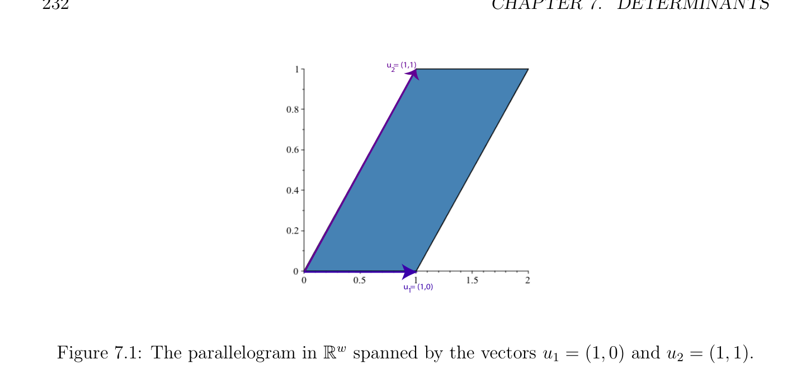
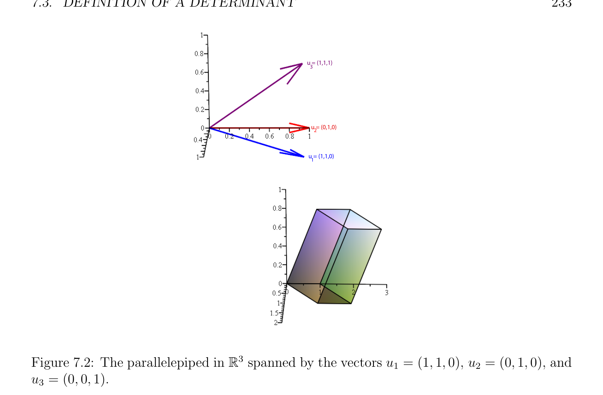

# Definition of a Determinant

<!-- PAGE 227 -->
is in fact the value of the determinant of $A$ (which, as we shall see shortly, is also equal to the determinant of $A^{\top})$. However, working directly with the above definition is quite awkward, and we will proceed via a slightly indirect route
Remark: The reader might have been puzzled by the fact that it is the transpose matrix $A^{\top}$ rather than $A$ itself that appears in Lemma 7.4. The reason is that if we want the generic term in the determinant to be
$$\epsilon (\pi )a_{\pi(1) 1} \cdots  a_{\pi(n)n},$$
where the permutation applies to the first index, then we have to express the $v_{j}s$ in terms of the $u_{i}s$ in terms of $A^{\top}$ as we did. Furthermore, since
$$v_{j} = a_{1j}u_{1} + \cdots  + a_{i j}u_{i} + \cdots  + a_{n j}u_{n},$$
we see that $v_{j}$ corresponds to the jth column of the matrix $A$, and so the determinant is viewed as a function of the columns of $A$. The literature is split on this point. Some authors prefer to define a determinant as we did. Others use $A$ itself, which amounts to viewing det as a function of the rows, in which case we get the expression
$$\sum_{\sigma\in Sn}  \epsilon (\sigma )a_{1\sigma(1)} \cdots  a_{n \sigma(n)}.$$
Corollary 7.7 show that these two expressions are equal, so it doesn’t matter which is chosen. This is a matter of taste.

## 7.3 Definition of a Determinant

Recall that the set of all square $n \times n$-matrices with coefficients in a field $K$ is denoted by $M_{n}(K)$.

> **Definition 7.4.** A determinant is defined as any map
$$D: M_{n}(K) \to K,$$
which, when viewed as a map on $(K^{n})^{n}$, i.e., a map of the $n$ columns of a matrix, is $n$-linear alternating and such that $D(I_{n}) = 1$ for the identity matrix $I_{n}$. Equivalently, we can consider a vector space $E$ of dimension $n$, some fixed basis $(e_{1}, \dots  , e_{n})$, and define
$$D: E^{n}\to K$$
as an $n$-linear alternating map such that $D(e_{1}, \dots  , e_{n}) = 1$.

<!-- PAGE 228 -->
First we will show that such maps $D$ exist, using an inductive definition that also gives a recursive method for computing determinants. Actually, we will define a family $(\mathcal{D}_{n})_{n\ge1}$ of (finite) sets of maps $D: M_{n}(K) \to K$. Second we will show that determinants are in fact uniquely defined, that is, we will show that $each\mathcal{D}_{n}$ consists of a single map. This will show the equivalence of the direct definition det(A) of Lemma 7.4 with the inductive definition D(A). Finally, we will prove some basic properties of determinants, using the uniqueness theorem. Given a matrix $A \in M_{n}(K)$, we denote its $n$ columns by $A^{1}, \dots  , A^{n}$. In order to describe the recursive process to define a determinant we need the notion of a minor.

> **Definition 7.5.** Given any $n\times n$ matrix with $n \ge 2$, for any two indices $i, j$ with $1 \le i, j \le n$, let $A_{ij}$ be the $(n$ - $1) \times  (n$ - $1)$ matrix obtained by deleting Row $i$ and Column $j$ from $A$ and called a minor:
$$A_{ij} = \begin{pmatrix} \times \\ \times \\ \times & \times & \times & \times & \times & \times & \times \\ \times \\ \times \\ \times \end{pmatrix} .$$
$$\times$$
For example, if
$$A = \begin{pmatrix} 2 & -1 & 0 & 0 & 0 \\ -1 & 2 & -1 & 0 & 0 \\ 0 & -1 & 2 & -1 & 0 \\ 0 & 0 & -1 & 2 & -1 \\ 0 & 0 & 0 & 1 & 2 \end{pmatrix}$$
$$-$$
then
$$A_{2 3} = \begin{pmatrix} 2 & -1 & 0 & 0 \\ 0 & -1 & -1 & 0 \\ 0 & 0 & 2 & -1 \\ 0 & 0 & 1 & 2 \end{pmatrix} .$$
$$-$$

> **Definition 7.6.** For every $n \ge 1$, we define a finite set $\mathcal{D}_{n}$ of maps $D: M_{n}(K) \to K$ inductively as follows: When $n = 1, \mathcal{D}_{1}$ consists of the single map $D$ such that, D(A) $= a$, where $A = (a)$, with $a \in K$. Assume that $\mathcal{D}_{n-1}$ has been defined, where $n \ge 2$. Then $\mathcal{D}_{n}$ consists of all the maps $D$ such that, for some $i, 1 \le i \le n$,
$$D(A) = (-1)^{i+1}a_{i1}D(A_{i1}) + \cdots  + (-1)^{i+n}a_{i n}D(A_{i n}),$$
where for every $j, 1 \le j \le n, D(A_{i j})$ is the result of applying any $D$ in $\mathcal{D}_{n-1}$ to the minor $A_{i j}$.

<!-- PAGE 229 -->
 We confess that the use of the same letter $D$ for the member of $\mathcal{D}_{n}$ being defined, and for members of $\mathcal{D}_{n-1}$, may be slightly confusing. We considered using subscripts to distinguish, but this seems to complicate things unnecessarily. One should not worry too much anyway, since it will turn out that each $\mathcal{D}_{n}$ contains just one map. Each $(-1)^{i+j}D(A_{i j})$ is called the cofactor of $a_{i j}$, and the inductive expression for D(A) is called a Laplace expansion of $D$ according to the $i$-th Row. Given a matrix $A \in M_{n}(K)$, each D(A) is called a determinant of $A$. We can think of each member $of\mathcal{D}_{n}$ as an algorithm to evaluate “the” determinant of $A$. The main point is that these algorithms, which recursively evaluate a determinant using all possible Laplace row expansions, all yield the same result, det(A). We will prove shortly that D(A) is uniquely defined (at the moment, it is not clear that $\mathcal{D}_{n}$ consists of a single map). Assuming this fact, given a $n \times n$-matrix $A = (a_{i j})$,
$$A = \begin{pmatrix} a_{1 1} & a_{1 2} & \dots & a_{1n} \\ a_{2 1} & a_{2 2} & \dots & a_{2n} \\ \vdots & \vdots & \ddots & \vdots \\ a_{n1} & a_{n2} & \dots & a_{n n} \end{pmatrix} ,$$
its determinant is denoted by D(A) or det(A), or more explicitly by
$$a_{1 1}a_{1 2}\dots a_{1n}$$
$$a_{2 1}a_{2 2}\dots a_{2n}$$
$$\det(A) =\vdots \vdots \ddots \vdots .$$
$$a_{n1}a_{n2}\dots a_{n n}$$
Let us first consider some examples.

> **Example 7.1.** $1$. When $n = 2$, if
$$A = \begin{pmatrix} a & b \\ c & d \end{pmatrix} ,$$
then by expanding according to any row, we have
$$D(A) = ad -bc.$$
$2$. When $n = 3$, if
$$A = \begin{pmatrix} a_{1 1} & a_{1 2} & a_{1 3} \\ a_{2 1} & a_{2 2} & a_{2 3} \\ a_{3 1} & a_{3 2} & a_{3 3} \end{pmatrix} ,$$

<!-- PAGE 230 -->
then by expanding according to the first row, we have
$$a_{2 2}a_{2 3}

$a_{2 1}a_{2 3}$

$a_{2 1}a_{2 2}$$$
$$D(A) = a_{1 1} -a_{1 2} + a_{1 3} ,$$
$$a_{3 2}a_{3 3}a_{3 1}a_{3 3}a_{3 1}a_{3 2}$$
that is,
$$D(A) = a_{1 1}(a_{2 2}a_{3 3} -a_{3 2}a_{2 3}) -a_{1 2}(a_{2 1}a_{3 3} -a_{3 1}a_{2 3}) + a_{1 3}(a_{2 1}a_{3 2} -a_{3 1}a_{2 2}),$$
which gives the explicit formula
$$D(A) = a_{1 1}a_{2 2}a_{3 3} + a_{2 1}a_{3 2}a_{1 3} + a_{3 1}a_{1 2}a_{2 3} -a_{1 1}a_{3 2}a_{2 3} -a_{2 1}a_{1 2}a_{3 3} -a_{3 1}a_{2 2}a_{1 3}.$$
We now show that each $D \in D_{n}$ is a determinant (map).

> **Lemma 7.5.** For every $n \ge 1$, for every $D \in D_{n}$ as defined in Definition 7.6, $D$ is an alternating multilinear map such that $D(I_{n}) = 1$.

*Proof.* By induction on $n$, it is obvious that $D(I_{n}) = 1$. Let us now prove that $D$ is multilinear. Let us show that $D$ is linear in each column. Consider any Column $k$. Since D(A) $= (-1)^{i+1}a_{i1}D(A_{i1}) + \cdots  + (-1)^{i+j}a_{i j}D(A_{i j}) + \cdots  + (-1)^{i+n}a_{i n}D(A_{i n})$, if $j \neq  k$, then by induction, $D(A_{i j})$ is linear in Column $k$, and $a_{i j}$ does not belong to Column $k$, so $(-1)^{i+j}a_{i j}D(A_{i j})$ is linear in Column $k$. If $j = k$, then $D(A_{i j})$ does not depend on Column $k = j$, since $A_{i j}$ is obtained from $A$ by deleting Row $i$ and Column $j = k$, and $a_{i j}$ belongs to Column $j = k$. Thus, $(-1)^{i+j}a_{i j}D(A_{i j})$ is linear in Column $k$. Consequently, in all cases, $(-1)^{i+j}a_{i j}D(A_{i j})$ is linear in Column $k$, and thus, D(A) is linear in Column $k$. Let us now prove that $D$ is alternating. Assume that two adjacent columns of $A$ are equal, say $A^{k} = A^{k+1}$. Assume that j̸ $= k$ and j̸ $= k + 1$. Then the matrix $A_{i j}$ has two identical adjacent columns, and by the induction hypothesis, $D(A_{i j}) = 0$. The remaining terms of D(A) are
$$(-1)^{i+k}a_{i k}D(A_{i k}) + (-1)^{i+k+1}a_{i k+1}D(A_{i k+1}).$$
However, the two matrices $A_{i k}$ and $A_{i k+1}$ are equal, since we are assuming that Columns $k$ and $k + 1$ of $A$ are identical and $A_{i k}$ is obtained from $A$ by deleting Row $i$ and Column $k$ while $A_{i k+1}$ is obtained from $A$ by deleting Row $i$ and Column $k + 1$. Similarly, $a_{i k} = a_{i k+1}$, since Columns $k$ and $k + 1$ of $A$ are equal. But then, $(-1)^{i+k}a_{i k}D(A_{i k}) + (-1)^{i+k+1}a_{i k+1}D(A_{i k+1}) = (-1)^{i+k}a_{i k}D(A_{i k})$ - $(-1)^{i+k}a_{i k}D(A_{i k}) = 0$. This shows that $D$ is alternating and completes the proof. Lemma 7.5 shows the existence of determinants. We now prove their uniqueness.

<!-- PAGE 231 -->

> **Theorem 7.6.** For every $n \ge 1$, for every $D \in D_{n}$, for every matrix $A \in M_{n}(K)$, we have
$$D(A) = \sum_{\pi\in Sn}  \epsilon (\pi )a_{\pi(1) 1} \cdots  a_{\pi(n)n},$$
where the sum ranges over all permutations $\pi$  on ${1, \dots  , n}$. As a consequence, $\mathcal{D}_{n}$ consists of a single map for every $n \ge 1$, and this map is given by the above explicit formula.

*Proof.* Consider the standard basis $(e_{1}, \dots  , e_{n})$ of $K^{n}$, where $(e_{i})_{i} = 1$ and $(e_{i})_{j} = 0$, for j̸ $= i$. Then each column $A^{j}$ of $A$ corresponds to a vector $v_{j}$ whose coordinates over the basis $(e_{1}, \dots  , e_{n})$ are the components of $A^{j}$, that is, we can write
$$v_{1} = a_{1 1}e_{1} + \cdots  + a_{n1}e_{n},$$
$$\dots$$
$$v_{n} = a_{1n}e_{1} + \cdots  + a_{n n}e_{n}.$$
Since by Lemma 7.5, each $D$ is a multilinear alternating map, by applying Lemma 7.4, we get
$$D(A) = D(v_{1}, \dots  , v_{n}) = \begin{pmatrix} \epsilon (\pi )a_{\pi(1) 1} \cdots  a_{\pi(n)n} \\ \pi \end{pmatrix} \sum_{\in Sn}  D(e_{1}, \dots  , e_{n}),$$
where the sum ranges over all permutations $\pi$  on ${1, \dots  , n}$. But $D(e_{1}, \dots  , e_{n}) = D(I_{n})$, and by Lemma 7.5, we have $D(I_{n}) = 1$. Thus,
$$D(A) = \sum_{\pi\in Sn}  \epsilon (\pi )a_{\pi(1) 1} \cdots  a_{\pi(n)n},$$
where the sum ranges over all permutations $\pi$  on ${1, \dots  , n}$. From now on we will favor the notation det(A) over D(A) for the determinant of a square matrix.
Remark: There is a geometric interpretation of determinants which we find quite illuminating. Given $n$ linearly independent vectors $(u_{1}, \dots  , u_{n})$ in $\mathbb{R}^{n}$, the set
$$P_{n} = {\lambda_{1} u_{1} + \cdots  + \lambda_{n} u_{n} | 0 \le \lambda_{i}  \le 1, 1 \le i \le n}$$
is called a parallelotope. If $n = 2$, then $P_{2}$ is a parallelogram and if $n = 3$, then $P_{3}$ is a parallelepiped, a skew box having $u_{1}, u_{2}, u_{3}$ as three of its corner sides. See Figures 7.1 and 7.2. Then it turns out that $det(u_{1}, \dots  , u_{n})$ is the signed volume of the parallelotope $P_{n}$ (where volume means $n$-dimensional volume). The sign of this volume accounts for the orientation of $P_{n}$ in $\mathbb{R}^{n}$. We can now prove some properties of determinants.

<!-- PAGE 232 -->
$$u = (1,1)$$
$$2$$
$$u = (1,0)1$$
$$\mathbb{R}^{w}$$

**Figure 7.1:** The parallelogram in spanned by the vectors $u_{1} = (1, 0)$ and $u_{2} = (1, 1)$.

> **Corollary 7.7.** For every matrix $A \in M_{n}(K)$, we have det(A) $= det(A^{\top})$.

*Proof.* By Theorem 7.6, we have
$$\det(A) = \sum_{\pi\in Sn}  \epsilon (\pi )a_{\pi(1) 1} \cdots  a_{\pi(n)n},$$
where the sum ranges over all permutations $\pi$  on ${1, \dots  , n}$. Since a permutation is invertible, every product
$$a_{\pi(1) 1} \cdots  a_{\pi(n)n}$$
can be rewritten as
$$a_{1\pi-1(1)} \cdots  a_{n \pi-1(n)},$$
and since $\epsilon (\pi^{-1}$ ) $= \epsilon (\pi$ ) and the sum is taken over all permutations on ${1, \dots  , n}$, we have
$$\sum_{\pi\in Sn}  \epsilon (\pi )a_{\pi(1) 1} \cdots  a_{\pi(n)n} = \sum_{\sigma\in Sn}  \epsilon (\sigma )a_{1\sigma(1)} \cdots  a_{n \sigma(n)},$$
where $\pi$  and $\sigma$  range over all permutations. But it is immediately verified that
$$\det(A^{\top}) = \sum_{\sigma\in Sn}  \epsilon (\sigma )a_{1\sigma(1)} \cdots  a_{n \sigma(n)}.$$
A useful consequence of Corollary 7.7 is that the determinant of a matrix is also a multilinear alternating map of its rows. This fact, combined with the fact that the determinant of a matrix is a multilinear alternating map of its columns, is often useful for finding short-cuts in computing determinants. We illustrate this point on the following example which shows up in polynomial interpolation.

<!-- PAGE 233 -->
$$u = (1,1,1)$$
$$3$$
$$u = (0,1,0)$$
$$2$$
$$u = (1,1,0)$$
$$1$$
$$\mathbb{R}^{3}$$

**Figure 7.2:** The parallelepiped in spanned by the vectors $u_{1} = (1, 1, 0), u_{2} = (0, 1, 0)$, and $u_{3} = (0, 0, 1)$.

> **Example 7.2.** Consider the so-called Vandermonde determinant
$$11\dots 1$$
$$x_{1}x_{2}\dots x_{n}$$
$$V (x_{1}, \dots  , x_{n}) =x_{1}^{2}x_{2}^{2}\dots x_{n}^{2}.$$
$$\vdots \vdots \ddots \vdots$$
$$x_{1}^{n-1}x_{2}^{n-1}\dots x_{n}^{n-1}$$
We claim that
$$V (x_{1}, \dots  , x_{n}) = \prod_{\le i<j\le}  (x_{j} -x_{i}),$$
$$1n$$
with $V (x_{1}, \dots  , x_{n}) = 1$, when $n = 1$. We prove it by induction on $n \ge 1$. The case $n = 1$ is obvious. Assume $n \ge 2$. We proceed as follows: multiply Row $n$ - $1$ by $x_{1}$ and subtract it from Row $n$ (the last row), then multiply Row $n$ - $2$ by $x_{1}$ and subtract it from Row $n$ - $1$, etc, multiply Row $i$ - $1$ by $x_{1}$ and subtract it from row $i$, until we reach Row $1$. We obtain

<!-- PAGE 234 -->
the following determinant:
$$11\dots 1$$
$$0x_{2} -x_{1}\dots x_{n} -x_{1}$$
$$V (x_{1}, \dots  , x_{n}) =0x_{2}(x_{2} -x_{1})\dots x_{n}(x_{n} -x_{1}).$$
$$\vdots \vdots \ddots \vdots$$
$$0x_{2}^{n-2}(x_{2} -x_{1})\dots x_{n}^{n-2}(x_{n} -x_{1})$$
Now expanding this determinant according to the first column and using multilinearity, we can factor $(x_{i}$ - $x_{1})$ from the column of index $i$ - $1$ of the matrix obtained by deleting the first row and the first column, and thus
$$V (x_{1}, \dots  , x_{n}) = (x_{2} -x_{1})(x_{3} -x_{1}) \cdots  (x_{n} -x_{1})V (x_{2}, \dots  , x_{n}),$$
which establishes the induction step.

> **Example 7.3.** The determinant of upper triangular matrices and more generally of block matrices that are block upper triangular has a remarkable form. Recall that an $n\times n$ matrix $A = (a_{ij})$ is upper-triangular if it is of the form
$$A = \begin{pmatrix} a_{11} & \times & \times & \cdots & \times \\ 0 & a_{22} & \times & \cdots & \times \\ 0 & 0 & \ddots & \cdots & \vdots \\ \vdots & \vdots & \ddots & \ddots & \vdots \\ 0 & 0 & 0 & 0 & a_{nn} \end{pmatrix} ,$$
that is, $a_{ij} = 0$ for all $i > j, 1 \le i, j \le n$. Using $n$ - $1$ times Laplace expansion with respect to the first column we obain
$$\det(A) = a_{11}a_{22} \cdots  a_{nn}.$$
Similarly, if $A$ is an $n \times  n$ block matrix which is block upper triangular,
$$A = \begin{pmatrix} A_{11} & \times & \times & \cdots & \times \\ 0 & A_{22} & \times & \cdots & \times \\ 0 & 0 & \ddots & \ddots & \vdots \\ \vdots & \vdots & \ddots & \ddots & \vdots \\ 0 & 0 & 0 & 0 & A_{pp} \end{pmatrix} ,$$
where each $A_{ii}$ is an $n_{i} \times  n_{i}$ matrix, with $n_{1} + \cdots  + n_{p} = n$, each block $\times$  above the diagonal in position $(i, j)$ for $i < j$ is an $n_{i} \times  n_{j}$ matrix, and each block in position $(i, j)$ for $i > j$ is the $n_{i} \times  n_{j}$ zero matrix, then it can be shown by induction on $p \ge 1$ that
$$\det(A) = \det(A_{11}) \det(A_{22}) \cdots  \det(A_{pp}).$$

<!-- PAGE 235 -->
Lemma 7.4 can be reformulated nicely as follows.

> **Proposition 7.8.** Let $f$ : $E \times  \dots  \times  E \to F$ be an $n$-linear alternating map. Let $(u_{1}, \dots  , u_{n})$ and $(v_{1}, \dots  , v_{n})$ be two families of $n$ vectors, such that
$$v_{1} = a_{1 1}u_{1} + \cdots  + a_{1n}u_{n},$$
$$\dots$$
$$v_{n} = a_{n1}u_{1} + \cdots  + a_{n n}u_{n}.$$
Equivalently, letting
$$A = \begin{pmatrix} a_{1 1} & a_{1 2} & \dots & a_{1n} \\ a_{2 1} & a_{2 2} & \dots & a_{2n} \\ \vdots & \vdots & \ddots & \vdots \\ a_{n1} & a_{n2} & \dots & a_{n n} \end{pmatrix} ,$$
assume that we have
$$\begin{pmatrix} v_{1} \\ v_{2} \\ \vdots \\ v_{n} \end{pmatrix} = A \begin{pmatrix} u_{1} \\ u_{2} \\ \vdots \\ u_{n} \end{pmatrix} .$$
Then,
$$f(v_{1}, \dots  , v_{n}) = \det(A)f(u_{1}, \dots  , u_{n}).$$

*Proof.* The only difference with Lemma 7.4 is that here we are using $A^{\top}$ instead of $A$. Thus, by Lemma 7.4 and Corollary 7.7, we get the desired result. As a consequence, we get the very useful property that the determinant of a product of matrices is the product of the determinants of these matrices.

> **Proposition 7.9.** For any two $n\times n$-matrices $A$ and $B$, we have det(AB) $=$ det(A) det(B).

*Proof.* We use Proposition 7.8 as follows: let $(e_{1}, \dots  , e_{n})$ be the standard basis of $K^{n}$, and let
$$\begin{pmatrix} w_{1} \\ w_{2} \\ \vdots \\ w_{n} \end{pmatrix} = AB \begin{pmatrix} e_{1} \\ e_{2} \\ \vdots \\ e_{n} \end{pmatrix} .$$
Then we get
$$\det(w_{1}, \dots  , w_{n}) = \det(AB) \det(e_{1}, \dots  , e_{n}) = \det(AB),$$
