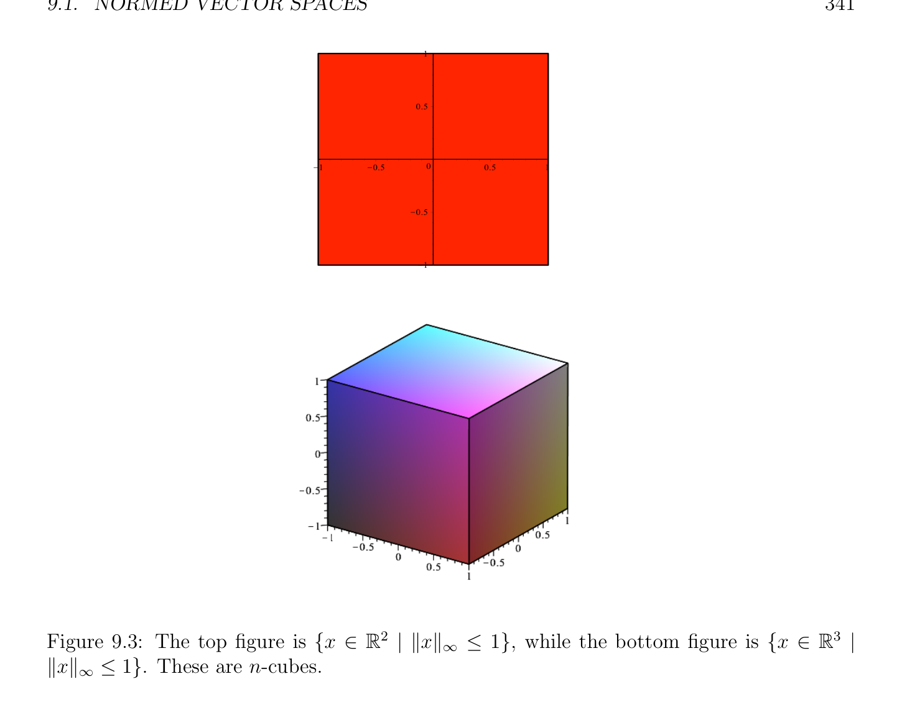
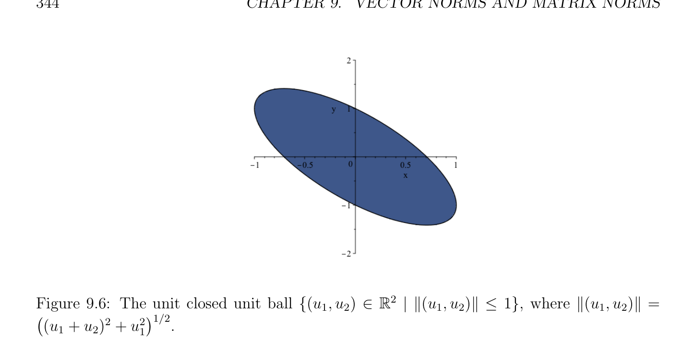

# Normed Vector Spaces

<!-- PAGE 337 -->
Chapter $9$ Vector Norms and Matrix Norms

## 9.1 Normed Vector Spaces

In order to define how close two vectors or two matrices are, and in order to define the convergence of sequences of vectors or matrices, we can use the notion of a norm. Recall that $\mathbb{R}_{+} = {x \in \mathbb{R}$ | $x \ge 0}$. Also  that    $a +$ ib $\in \mathbb{C}$ is a complex number, with
$$a, b \in \mathbb{R}, then \overline{z} = a -ib and |z| =\sqrt \frac{recall}{\overline{zz}} =\sqrt \frac{ifz=}{a^{2}+ b^{2}} (|z| is the modulus of z).$$

> **Definition 9.1.** Let $E$ be a vector space over a field $K$, where $K$ is either the field $\mathbb{R}$ of reals, or the $field\mathbb{C}$ of complex numbers. A norm on $E$ is a function $\|\|: E \to \mathbb{R}_{+}$, assigning a nonnegative real number $\|u\|$ to any vector $u \in E$, and satisfying the following conditions for all $x, y \in E$ and $\lambda  \in K$:
(N1) $\|x\|\ge 0$, and $\|x\| = 0$ iff $x = 0$. (positivity)
(N2) $\|\lambda x\| = |\lambda$ | $\|x\|$. (homogeneity (or scaling))
(N3) $\|x + y\|\le \|x\| + \|y\|$. (triangle inequality) $A$ vector space $E$ together with a norm $\|\|$ is called a normed vector space. By (N2), setting $\lambda  = -1$, we obtain
$$\|-x\|= \|(-1)x\|= | -1| \|x\|= \|x\|;$$
that is, $\|-x\| = \|x\|$. From (N3), we have
$$\|x\|= \|x -y + y\|\le \|x -y\|+ \|y\|,$$
which implies that
$$\|x\|-\|y\|\le \|x -y\|.$$
By exchanging $x$ and $y$ and using the fact that by (N2),
$$\|y -x\|= \|-(x -y)\|= \|x -y\|,$$
$$337$$

<!-- PAGE 338 -->
we also have
$$\|y\|-\|x\|\le \|x -y\|.$$
Therefore,
$$|\|x\|-\|y\|| \le \|x -y\|,for all x, y \in E.(*)$$
Observe that setting $\lambda  = 0$ in (N2), we deduce that $\|0\| = 0$ without assuming (N1). Then by setting $y = 0$ in (*), we obtain
$$|\|x\|| \le \|x\|,for all x \in E.$$
Therefore, the condition $\|x\|\ge 0$ in (N1) follows from (N2) and (N3), and (N1) can be replaced by the weaker condition (N1’) For all $x \in E$, if $\|x\| = 0$, then $x = 0, A$ function $\|\|$ : $E \to \mathbb{R}$ satisfying Axioms (N2) and (N3) is called a seminorm. From the above discussion, a seminorm also has the properties $\|x\|\ge 0$ for all $x \in E$, and $\|0\| = 0$. However, there may be nonzero vectors $x \in E$ such that $\|x\| = 0$. Let us give some examples of normed vector spaces.

> **Example 9.1.** $1$. Let $E =\mathbb{R}$, and $\|x\| =$ |x|, the absolute value of $x. 2$. Let $E =\mathbb{C}$, and $\|z\| =$ |z|, the modulus of $z$.
$$\mathbb{R}^{n} \mathbb{C}^{n}$$
$3$. Let $E =$ (or $E =$ ). There are three standard norms. For every $(x_{1}, \dots  , x_{n}) \in E$, we have the norm $\|x\|_{1}$, defined such that,
$$\|x\|_{1} = |x_{1}| + \cdots  + |x_{n}|,$$
we have the Euclidean norm $\|x\|_{2}$, defined such that,
$$\|x\|_{2} = \begin{pmatrix} |x_{1}|^{2}+ \cdots  + |x_{n}\overline{|}^{212} \end{pmatrix} ,$$
$$and the \sup-norm \|x\|_{\infty}, defined such that,$$
$$\|x\|_{\infty}= \max{|x_{i}| | 1 \le i \le n}.$$
More generally, we define the $\ell^{p}$ -norm (for $p \ge 1)$ by
$$\|x\|_{p} = (|x_{1}|^{p}+ \cdots  + |x_{n}|^{p})^{1/p}.$$
See Figures 9.1 through 9.4.

<!-- PAGE 339 -->
$$1$$
$$0.5$$
$$\overline{K}\overline{1}\overline{K}\overline{0.5}\overline{0}\overline{0.5}\overline{1}$$
$$K0.5$$
$$K1$$
$$\mathbb{R}^{2} \mathbb{R}^{3}$$

**Figure 9.1:** The top figure is ${x \in$ | $\|x\|_{1} \le 1}$, while the bottom figure is ${x \in$ | $\|x\|_{1} \le 1}$. These are cross-polytopes. There are other norms besides the $\ell^{p}$ -norms. Here are some examples. $1$. For $E =\mathbb{R}^{2}$,
$$\|(u_{1}, u_{2})\|= |u_{1}| + 2|u_{2}|.$$
See Figure 9.5. $2$. For $E =\mathbb{R}^{2}$,
$$\|(u_{1}, u_{2})\|= \begin{pmatrix} (u_{1} + u_{2})^{2}+ \end{pmatrix} u_{1}^{21/2}.$$
See Figure 9.6. $3$. For $E =\mathbb{C}^{2}$,
$$\|(u_{1}, u_{2})\|= |u_{1} + iu_{2}| + |u_{1} -iu_{2}|.$$
The reader should check that they satisfy all the axioms of a norm. Some work is required to show the triangle inequality for the $\ell^{p}$ -norm.

<!-- PAGE 340 -->
$$1$$
$$0.5$$
$$\overline{K}\overline{1}\overline{K}\overline{0.5}\overline{0}\overline{0.5}\overline{1}$$
$$K0.5$$
$$K1$$
$$\mathbb{R}^{2} \mathbb{R}^{3}$$

**Figure 9.2:** The top figure is ${x \in$ | $\|x\|_{2} \le 1}$, while the bottom figure is ${x \in$ | $\|x\|_{2} \le 1}$. These are n-spheres.
$$\mathbb{C}^{n} \mathbb{R}^{n}$$

> **Proposition 9.1.** If $E =$ or $E =$ , for every real number $p \ge 1$, the $\ell^{p}$ -norm is indeed a norm.

*Proof.* The cases $p = 1$ and $p = \infty$ are easy and left to the reader. If $p > 1$, then let $q > 1$ such that
$$\frac{1}{p} + \frac{1}{q} = 1.$$
We will make use of the following fact: for all $\alpha , \beta  \in \mathbb{R}$, if $\alpha , \beta  \ge 0$, then
$$\alpha \beta  \le \frac{\alpha^{p}}{p} + \frac{\beta^{q}}{q} .(*)$$
To prove the above inequality, we use the fact that the exponential function $t \mapsto e^{t}$ satisfies the following convexity inequality:
$$e^{\theta x+(1-\theta)y}\le \theta e^{x}+ (1 -\theta )e^{y},$$
for all $x, y \in \mathbb{R}$ and all $\theta$  with $0 \le \theta  \le 1$.

<!-- PAGE 341 -->
$$1$$
$$0.5$$
$$\overline{K}\overline{1}\overline{K}\overline{0.5}\overline{0}\overline{0.5}\overline{1}$$
$$K0.5$$
$$K1$$
$$\mathbb{R}^{2} \mathbb{R}^{3}$$

**Figure 9.3:** The top figure is ${x \in$ | $\|x\|_{\infty} \le 1}$, while the bottom figure is ${x \in$ | $\|x\|_{\infty} \le 1}$. These are n-cubes. Since the case $\alpha \beta  = 0$ is trivial, let us assume that $\alpha  > 0$ and $\beta  > 0$. If we replace $\theta$  by $1/p, x$ by $p$ log $\alpha$  and $y$ by $q$ log $\beta$ , then we get
$$+$$
$$\overline{e}^{p1plog\alpha+1qqlog\beta} \le \frac{1}{p} e^{plog\alpha} \frac{1}{q} e^{qlog\beta},$$
which simplifies to
$$\alpha \beta  \le \frac{\alpha^{p}}{p} + \frac{\beta^{q}}{q} ,$$
as claimed. We will now prove that for any two vectors $u, v \in E$, (where $E$ is of dimension $n)$, we have
$$\sum_{i=1}^{n}  |u_{i}v_{i}| \le \|u\|_{p} \|v\|_{q} .(**)$$

<!-- PAGE 342 -->
$$1$$
$$0.5$$
$$\overline{K}\overline{1}\overline{K}\overline{0.5}\overline{0}\overline{0.5}\overline{1}$$
$$K0.5$$
$$K1$$

**Figure 9.4:** The relationships between the closed unit balls from the $\ell^{1}$ -norm, the Euclidean norm, and the sup-norm. Since the above is trivial if $u = 0$ or $v = 0$, let us assume that $u \neq  0$ and v̸ $= 0$. Then Inequality (*) with $\alpha  = |u_{i}|/ \|u\|_{p}$ and $\beta  = |v_{i}|/ \|v\|_{q}$ yields
$$||||^{p} ||^{q}$$
$$\frac{u_{i}v_{i}}{\|u\|_{p} \|v\|_{q}} \le \frac{u_{i}}{p \|u\|_{p}^{p}} + \frac{v_{i}}{q \|v\|_{q}^{q}} ,$$
for $i = 1, \dots  , n$, and by summing up these inequalities, we get
$$\sum_{i=1}^{n}  |u_{i}v_{i}| \le \|u\|_{p} \|v\|_{q} ,$$
as claimed. To finish the proof, we simply have to prove that property (N3) holds, since
(N1) and (N2) are clear. For $i = 1, \dots  , n$, we can write
$$(|u_{i}| + |v_{i}|)^{p}= |u_{i}|(|u_{i}| + |v_{i}|)^{p-1}+ |v_{i}|(|u_{i}| + |v_{i}|)^{p-1},$$

<!-- PAGE 343 -->
$$\mathbb{R}^{2}$$

**Figure 9.5:** The unit closed unit ball ${(u_{1}, u_{2}) \in$ | $\|(u_{1}, u_{2})\|\le 1}$, where $\|(u_{1}, u_{2})\| = |u_{1}| + 2|u_{2}|$. so that by summing up these equations we get
$$\sum_{i=1}^{n}  (|u_{i}| + |v_{i}|)^{p}= \sum_{i=1}^{n}  |u_{i}|(|u_{i}| + |v_{i}|)^{p-1}+ \sum_{i=1}^{n}  |v_{i}|(|u_{i}| + |v_{i}|)^{p-1},$$
and using Inequality (**), with $V \in E$ where $V_{i} = (|u_{i}| + |v_{i}|)^{p-1}$, we get
$$1/q$$
$$\sum_{i=1}^{n}  (|u_{i}| + |v_{i}|)^{p}\le \|u\|_{p} \|V \|_{q} + \|v\|_{p} \|V \|_{q} = (\|u\|_{p} + \|v\|_{p}) \begin{pmatrix} (|u_{i}| + |v_{i}|)^{(p-1)q} \end{pmatrix} \sum_{i=1}^{n}  .$$
However, $1/p + 1/q = 1$ implies pq $= p + q$, that is, $(p$ - 1)q $= p$, so we have
$$1/q$$
$$\sum_{i=1}^{n}  (|u_{i}| + |v_{i}|)^{p}\le (\|u\|_{p} + \|v\|_{p}) \begin{pmatrix} (|u_{i}| + |v_{i}|)^{p} \end{pmatrix} \sum_{i=1}^{n}  ,$$
which yields
$$1-1/q1/p$$
$$\begin{pmatrix} (|u_{i}| + |v_{i}|)^{p} \end{pmatrix} \sum_{i=1}^{n}  = \begin{pmatrix} (|u_{i}| + |v_{i}|)^{p} \end{pmatrix} \sum_{i=1}^{n}  \le \|u\|_{p} + \|v\|_{p} .$$
Since $|u_{i} + v_{i}| \le |u_{i}| + |v_{i}|$, the above implies the triangle inequality $\|u + v\|_{p} \le \|u\|_{p} + \|v\|_{p}$, as claimed. For $p > 1$ and $1/p + 1/q = 1$, the inequality
$$1/p1/q$$
$$\sum_{i=1}^{n}  |u_{i}v_{i}| \le \begin{pmatrix} |u_{i}|^{p} \end{pmatrix} \sum_{i=1}^{n}  \begin{pmatrix} |v_{i}|^{q} \end{pmatrix} \sum_{i=1}^{n}$$

<!-- PAGE 344 -->
$$\mathbb{R}^{2}$$

**Figure 9.6:** The unit closed unit ball ${(u_{1}, u_{2}) \in$ | $\|(u_{1}, u_{2})\|\le 1}$, where $\|(u_{1}, u_{2})\| =$
$$\begin{pmatrix} (u_{1} + u_{2})^{2}+ \end{pmatrix} u_{1}^{21/2}.$$
is known as H¨older’s inequality. For $p = 2$, it is the Cauchy–Schwarz inequality.
$$\mathbb{C}^{n}$$
Actually, if we define the Hermitian inner product $\langle$ -, $-\rangle$ on by
$$\langle u, v\rangle = \sum_{i=1}^{n}  u_{i}\overline{v}_{i},$$
where $u = (u_{1}, \dots  , u_{n})$ and $v = (v_{1}, \dots  , v_{n})$, then
$$|\langle u, v\rangle | \le \sum_{i=1}^{n}  |u_{i}\overline{v}_{i}| = \sum_{i=1}^{n}  |u_{i}v_{i}|,$$
so H¨older’s inequality implies the following inequalities.

> **Corollary 9.2.** (H¨older’s inequalities) For any real numbers $p, q$, such that $p, q \ge 1$ and
$$\frac{1}{p} + \frac{1}{q} = 1,$$
(with $q = +\infty$ if $p = 1$ and $p = +\infty$ if $q = 1)$, we have the inequalities
$$1/p1/q$$
$$\sum_{i=1}^{n}  |u_{i}v_{i}| \le \begin{pmatrix} |u_{i}|^{p} \end{pmatrix} \sum_{i=1}^{n}  \begin{pmatrix} |v_{i}|^{q} \end{pmatrix} \sum_{i=1}^{n}$$
and
$$|\langle u, v\rangle | \le \|u\|_{p} \|v\|_{q} ,u, v \in \mathbb{C}^{n}.$$

<!-- PAGE 345 -->
For $p = 2$, this is the standard Cauchy–Schwarz inequality. The triangle inequality for the $\ell^{p}$ -norm,
$$1/p1/p1/p$$
$$\begin{pmatrix} (|u_{i} + v_{i}|)^{p} \end{pmatrix} \sum_{i=1}^{n}  \le \begin{pmatrix} |u_{i}|^{p} \end{pmatrix} \sum_{i=1}^{n}  + \begin{pmatrix} |v_{i}|^{p} \end{pmatrix} \sum_{i=1}^{n}  ,$$
is known as Minkowski’s inequality. When we restrict the Hermitian inner product to real vectors, $u, v \in \mathbb{R}^{n}$, we get the Euclidean inner product
$$\langle u, v\rangle = \sum_{i=1}^{n}  u_{i}v_{i}.$$
It is very useful to observe that if we represent (as usual) $u = (u_{1}, \dots  , u_{n})$ and $v = (v_{1}, \dots  , v_{n})$ (in $\mathbb{R}^{n})$ by column vectors, then their Euclidean inner product is given by
$$\langle u, v\rangle = u^{\top}v = v^{\top}u,$$
and when $u, v \in \mathbb{C}^{n}$, their Hermitian inner product is given by
$$\langle u, v\rangle = v^{*}u =\overline{u}^{*}\overline{v.}$$
where $v^{*}$ is the row vector whose components are $\overline{v}_{1}\overline{, \dots  , v}_{n}$ (and similarly for $u^{*})$. In particular, when $u = v$, in the complex case we get
$$\|u\|_{2}^{2} = u^{*}u,$$
and in the real case this becomes
$$\|u\|_{2}^{2} = u^{\top}u.$$
As convenient as these notations are, we still recommend that you do not abuse them; the notation $\langle u, v\rangle$ is more intrinsic and still “works” when our vector space is infinite dimensional.
Remark: If $0 < p < 1$, then $x \mapsto \|x\|_{p}$ is not a norm because the triangle inequality fails. For example, consider $x = (2, 0)$ and $y = (0, 2)$. Then $x + y = (2, 2)$, and we have $\|x\|_{p} = (2^{p} + 0^{p})^{1/p} = 2, \|y\|_{p} = (0^{p} + 2^{p})^{1/p} = 2$, and $\|x + y\|_{p} = (2^{p} + 2^{p})^{1/p} = 2^{(p+1)/p}$. Thus
$$\|x + y\|_{p} = 2^{(p+1)/p},\|x\|_{p} + \|y\|_{p} = 4 = 2^{2}.$$
Since $0 < p < 1$, we have 2p $< p + 1$, that is, $(p + 1)/p > 2$, so $2^{(p+1)/p} > 2^{2} = 4$, and the triangle inequality $\|x + y\|_{p} \le \|x\|_{p} + \|y\|_{p}$ fails. Observe that $\|(1/2)x\|_{p} = (1/2) \|x\|_{p} = \|(1/2)y\|_{p} = (1/2) \|y\|_{p} = 1, \|(1/2)(x + y)\|_{p} = 2^{1/p}$,

<!-- PAGE 346 -->
and since $p < 1$, we have $2^{1/p} > 2$, so
$$\|(1/2)(x + y)\|_{p} = 2^{1/p}> 2 = (1/2) \|x\|_{p} + (1/2) \|y\|_{p} ,$$
and the map $x \mapsto \|x\|_{p}$ is not convex. For $p = 0$, for any $x \in \mathbb{R}^{n}$, we have
$$\|x\|_{0} = |{i \in {1, \dots  , n} | x_{i} \neq  0}|,$$
the number of nonzero components of $x$. The map $x \mapsto \|x\|_{0}$ is not a norm this time because Axiom (N2) fails. For example,
$$\|(1, 0)\|_{0} = \|(10, 0)\|_{0} \neq  1 = 10 = 10 \|(1, 0)\|_{0} .$$
The map $x \mapsto \|x\|_{0}$ is also not convex. For example,
$$\|(1/2)(2, 2)\|_{0} = \|(1, 1)\|_{0} = 2,$$
and
$$\|(2, 0)\|_{0} = \|(0, 2)\|_{0} = 1,$$
but
$$\|(1/2)(2, 2)\|_{0} = 2 > 1 = (1/2) \|(2, 0)\|_{0} + (1/2) \|(0, 2)\|_{0} .$$
Nevertheless, the “zero-norm” $x \mapsto \|x\|_{0}$ is used in machine learning as a regularizing term which encourages sparsity, namely increases the number of zero components of the vector $x$. The following proposition is easy to show.
$$\mathbb{R}^{n} \mathbb{C}^{n}$$

> **Proposition 9.3.** The following inequalities hold for all $x \in$ (or $x \in$ ):
$$\|x\|_{\infty}\le \|x\|_{1} \le n\|x\|_{\infty},$$
$$\sqrt$$
$$\|x\|_{\infty}\le \|x\|_{2} \le \overline{n}\|x\|_{\infty},$$
$$\sqrt$$
$$\|x\|_{2} \le \|x\|_{1} \le \overline{n}\|x\|_{2}.$$
Proposition 9.3 is actually a special case of a very important result: in a finite-dimensional vector space, any two norms are equivalent.

> **Definition 9.2.** Given any (real or complex) vector space $E$, two norms $\|\|_{a}$ and $\|\|_{b}$ are equivalent iff there exists some positive reals $C_{1}, C_{2} > 0$, such that
$$\|u\|_{a} \le C_{1} \|u\|_{b}and\|u\|_{b} \le C_{2} \|u\|_{a} , for all u \in E.$$

<!-- PAGE 347 -->
There is an illuminating interpretation of Definition 9.2 in terms of open balls. For any radius $\rho  > 0$ and any $x \in E$, consider the open a-ball of center $x$ and radius $\rho$  (with respect the norm $\|\|_{a})$,
$$B_{a}(x, \rho ) = {z \in E | \|z -x\|_{a} < \rho }.$$
We claim that there is some open b-ball $B_{b}(x, r)$ of radius $r > 0$ and center $x$,
$$B_{b}(x, r) = {z \in E | \|z -x\|_{b} < r},$$
such that
$$B_{b}(x, r) \subseteq B_{a}(x, \rho ).$$
Indeed, if we pick $r = \rho /C_{1}$, for any $z \in E$, if $\|z$ - $x\|_{b} < \rho /C_{1}$, then
$$\|z -x\|_{a} \le C_{1} \|z -x\|_{b} < C_{1}(\rho /C_{1}) = \rho ,$$
which means that
$$B_{b}(x, \rho /C_{1}) \subseteq B_{a}(x, \rho ).$$
Similarly, for any radius $\rho  > 0$ and any $x \in E$, we have
$$B_{a}(x, \rho /C_{2}) \subseteq B_{b}(x, \rho ).$$

> **Definition 9.3.** Given a normed vector space $(E, \|\|)$, a subset $U$ of $E$ is said to be open (with respect to the norm $\|\|)$ if either $U = \emptyset$ or if for every $x \in U$, there is some open ball B(x, $\rho$ ) (for some $\rho  > 0)$ such that B(x, $\rho$ ) $\subseteq U$. The $collection\mathcal{U}$ of open sets defined by the norm $\|\|$ is called the topology on $E$ induced by the norm $\|\|$. What we just showed implies the following result.

> **Proposition 9.4.** Let $\|\|_{a}$ and $\|\|_{b}$ be two norms on a space $E$ with the property $\|u\|_{a} \le C_{1} \|u\|_{b}$ for all $u \in E (C_{1} > 0)$. For every subset $U$ of $E$, if $U$ is open for the a-norm, then $U$ is open for the b-norm. As a consequence, if the norms $\|\|_{a}$ and $\|\|_{b}$ on $E$ are equivalent, then the families of open sets induced by the two norms are identical.

*Proof.* By definition of an open subset with respect to a norm, it suffices to prove that if $U$ is any nonempty subset of $E$, for every $x \in U$, if $B_{a}(x, \rho$ ) is an a-ball such that $B_{a}(x, \rho$ ) $\subseteq U$, then there is a b-ball $B_{b}(x, r)$ such that $B_{b}(x, r) \subseteq B_{a}(x, \rho$ ) $\subseteq U$. However, this is the fact that we just established. If the two norms are equivalent, every subset open for the a-norm is open for the b-norm and conversely, so the the families of open sets induced by the two norms are identical. The above proposition implies that two equivalent norms induce the same topology on $E$. This is the reason why the notion of equivalent norms is important.

<!-- PAGE 348 -->
Given any norm $\|\|$ on a vector space of dimension $n$, for any basis $(e_{1}, \dots  , e_{n})$ of $E$, observe that for any vector $x = x_{1}e_{1} + \cdots  + x_{n}e_{n}$, we have $\|x\| = \|x_{1}e_{1} + \cdots  + x_{n}e_{n}\|\le |x_{1}| \|e_{1}\| + \cdots  + |x_{n}| \|e_{n}\|\le C(|x_{1}| + \cdots  + |x_{n}|) = C \|x\|_{1}$ , with $C = max_{1\le i\le n} \|e_{i}\|$ and with the norm $\|x\|_{1}$ defined as
$$\|x\|_{1} = \|x_{1}e_{1} + \cdots  + x_{n}e_{n}\|= |x_{1}| + \cdots  + |x_{n}|.$$
The above implies that
$$| \|u\|-\|v\|| \le \|u -v\|\le C \|u -v\|_{1} ,$$
and this implies the following corollary.

> **Corollary 9.5.** For any norm $u \mapsto \|u\|$ on a finite-dimensional (complex or real) vector space $E$, the map $u \mapsto \|u\|$ is continuous with respect to the norm $\|\|_{1}$. Let $S_{1}^{n-1}$ be the unit sphere with respect to the norm $\|\|_{1}$, namely
$$S_{1}^{n-1}= {x \in E | \|x\|_{1} = 1}.$$
Now $S_{1}^{n-1}$ is a closed and bounded subset of a finite-dimensional vector space, so by Heine– Borel (or equivalently, by Bolzano–Weiertrass), $S_{1}^{n-1}$ is compact. On the other hand, it is a well known result of analysis that any continuous real-valued function on a nonempty compact set has a minimum and a maximum, and that they are achieved. Using these facts, we can prove the following important theorem:

> **Theorem 9.6.** If $E$ is any real or complex vector space of finite dimension, then any two norms on $E$ are equivalent.

*Proof.* It is enough to prove that any norm $\|\|$ is equivalent to the 1-norm. We already proved that the function $x \mapsto \|x\|$ is continuous with respect to the norm $\|\|_{1}$, and we observed that the unit sphere $S_{1}^{n-1}$ is compact. Now we just recalled that because the function $f$ : $x \mapsto \|x\|$ is continuous and because $S_{1}^{n-1}$ is compact, the function $f$ has a minimum $m$ and a maximum $M$, and because $\|x\|$ is never zero on $S_{1}^{n-1}$, we must have $m > 0$. Consequently, we just proved that if $\|x\|_{1} = 1$, then
$$0 < m \le \|x\|\le M,$$
so for any $x \in E$ with $x \neq  0$, we get
$$m \le \|x/ \|x\|_{1}\|\le M,$$
which implies
$$m \|x\|_{1} \le \|x\|\le M \|x\|_{1} .$$
Since the above inequality holds trivially if $x = 0$, we just proved that $\|\|$ and $\|\|_{1}$ are equivalent, as claimed.
