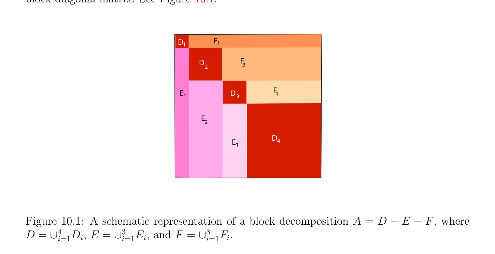

# Convergence of the Methods

<!-- PAGE 402 -->
$2$. Find if there exist some optimal value $\omega_{0}$  of $\omega  \in$ I, so that
$$\rho (\mathcal{L}_{\omega0}) = \inf \rho (\mathcal{L}_{\omega}).$$
$$\omega \in I$$
We will give partial answers to the above questions in the next section. It is also possible to extend the methods of this section by using block decompositions of the form $A = D$ - $E$ - $F$, where $D, E$, and $F$ consist of blocks, and $D$ is an invertible block-diagonal matrix. See Figure 10.1.
$$DF$$
$$11$$
$$DF$$
$$22$$
$$EDF$$
$$133$$
$$E$$
$$2$$
$$D$$
$$E4$$
$$3$$

**Figure 10.1:** A schematic representation of a block decomposition $A = D$ - $E$ - $F$, where $D = \cup_{i=1}^{4} D_{i}, E = \cup_{i=1}^{3} E_{i}$, and $F = \cup_{i=1}^{3} F_{i}$.

## 10.4 Convergence of the Methods of Gauss–Seidel and

$$Relaxation$$
We begin with a general criterion for the convergence of an iterative method associated with a (complex) Hermitian positive definite matrix, $A = M$ - $N$. Next we apply this result to the relaxation method.

> **Proposition 10.5.** Let $A$ be any Hermitian positive definite matrix, written as
$$A = M -N,$$
with $M$ invertible. Then $M^{*} + N$ is Hermitian, and if it is positive definite, then
$$\rho (M^{-1} N) < 1,$$
so that the iterative method converges.

<!-- PAGE 403 -->

*Proof.* Since $M = A + N$ and $A$ is Hermitian, $A^{*} = A$, so we get
$$M^{*} + N = A^{*}+ N^{*} + N = A + N + N^{*} = M + N^{*} = (M^{*} + N)^{*},$$
which shows that $M^{*} + N$ is indeed Hermitian. Because $A$ is Hermitian positive definite, the function
$$v \mapsto (v^{*}Av)^{1/2}$$
$\mathbb{C}^{n}  \mathbb{R}$ from to  is a vector norm $\|\|$, and let $\|\|$ also denote its subordinate matrix norm. We prove that
$$\|M^{-1} N\|< 1,$$
which by Theorem 10.1 proves that $\rho (M^{-1} N) < 1$. By definition
$$\|M^{-1} N\|= \|I -M^{-1} A\|= \sup\|v -M^{-1} Av\|,$$
$$\|v\|=1$$
which leads us to evaluate $\|v$ - $M^{-1} Av\|$ when $\|v\| = 1$. If we write $w = M^{-1}$ Av, using the facts that $\|v\| = 1, v = A^{-1}Mw, A^{*} = A$, and $A = M$ - $N$, we have
$$\|v -w\|^{2}= (v -w)^{*}A(v -w)$$
$$= \|v\|^{2}-v^{*}Aw -w^{*}Av + w^{*}Aw$$
$$= 1 -w^{*}M^{*} w -w^{*}Mw + w^{*}Aw$$
$$= 1 -w^{*}(M^{*} + N)w.$$
Now since we assumed that $M^{*} + N$ is positive definite, if $w \neq  0$, then $w^{*}(M^{*} +$ N)w $> 0$, and we conclude that
$$if\|v\|= 1,then\|v -M^{-1} Av\|< 1.$$
Finally, the function
$$v \mapsto \|v -M^{-1} Av\|$$
is continuous as a composition of continuous functions, therefore it achieves its maximum
$$\mathbb{C}^{n}$$
on the compact subset ${v \in$ | $\|v\| = 1}$, which proves that
$$\sup\|v -M^{-1} Av\|< 1,$$
$$\|v\|=1$$
and completes the proof. Now as in the previous sections, we assume that $A$ is written as $A = D$ - $E$ - $F$, with $D$ invertible, possibly in block form. The next theorem provides a sufficient condition (which turns out to be also necessary) for the relaxation method to converge (and thus, for the method of Gauss–Seidel to converge). This theorem is known as the Ostrowski-Reich theorem.

<!-- PAGE 404 -->

> **Theorem 10.6.** If $A = D$ - $E$ - $F$ is Hermitian positive definite, and if $0 < \omega  < 2$, then the relaxation method converges. This also holds for a block decomposition of $A$.

*Proof.* Recall that for the relaxation method, $A = M$ - $N$ with
$$M = \frac{D}{\omega} -E$$
$$-$$
$$N = \frac{1\omega}{\omega} D + F,$$
and because $D^{*} = D, E^{*} = F$ (since $A$ is Hermitian) and $\omega  \neq  0$ is real, we have
$$-  -$$
$$M^{*} + N = \frac{D^{*}}{\omega} -E^{*}+ \frac{1\omega}{\omega} D + F = \frac{2\omega}{\omega} D.$$
If $D$ consists of the diagonal entries of $A$, then we know from Section 8.8 that these entries are all positive, and since $\omega  \in (0, 2)$, we see that the matrix $((2-\omega )/\omega )D$ is positive definite. If $D$ consists of diagonal blocks of $A$, because $A$ is positive, definite, by choosing vectors $z$ obtained by picking a nonzero vector for each block of $D$ and padding with zeros, we see that each block of $D$ is positive definite, and thus $D$ itself is positive definite. Therefore, in all cases, $M^{*} + N$ is positive definite, and we conclude by using Proposition 10.5.
Remark: What if we allow the parameter $\omega$  to be a nonzero complex number $\omega  \in \mathbb{C}$? In this case, we get
$$-$$
$$M^{*} + N = \frac{D^{*}}{\overline{\omega}} -E^{*}+ \frac{1\omega}{\omega} D + F = \begin{pmatrix} 1 \\ 1 \\ + & -1 \\ \omega & \overline{\omega} \end{pmatrix} D.$$
But,
$$-  - - -  -| -|^{2}$$
$$\frac{1}{\omega} + \frac{1}{\overline{\omega}} -1 = \frac{\omega  +\overline{\omega}\overline{\omega \omega}}{\overline{\omega \omega}} = \frac{1(\omega 1)(\overline{\omega} 1)}{|\omega |^{2}} = \frac{1\omega 1}{|\omega |^{2}} ,$$
so the relaxation method also converges for $\omega  \in \mathbb{C}$, provided that
$$|\omega  -1| < 1.$$
This condition reduces to $0 < \omega  < 2$ if $\omega$  is real. Unfortunately, Theorem 10.6 does not apply to Jacobi’s method, but in special cases, Proposition 10.5 can be used to prove its convergence. On the positive side, if a matrix is strictly column (or row) diagonally dominant, then it can be shown that the method of Jacobi and the method of Gauss–Seidel both converge. The relaxation method also converges if $\omega  \in (0, 1]$, but this is not a very useful result because the speed-up of convergence usually occurs for $\omega  > 1$. We now prove that, without any assumption on $A = D$ - $E$ - $F$, other than the fact that $A$ and $D$ are invertible, in order for the relaxation method to converge, we must have $\omega  \in (0, 2)$.
