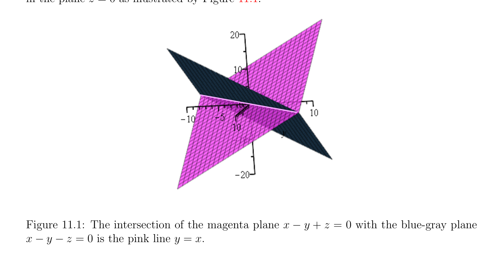

# The Dual Space E* and Linear Forms

<!-- PAGE 415 -->
Chapter $11$ The Dual Space and Duality In this chapter all vector spaces are defined over an arbitrary field $K$. For the sake of concreteness, the reader may safely assume that $K =\mathbb{R}$.

## 11.1 The Dual Space E* and Linear Forms

In Section 3.9 we defined linear forms, the dual space $E^{*} =$ Hom(E, $K)$ of a vector space $E$, and showed the existence of dual bases for vector spaces of finite dimension. In this chapter we take a deeper look at the connection between a space $E$ and its dual space $E^{*}$. As we will see shortly, every linear map $f$ : $E \to F$ gives rise to a linear map $f^{\top}$ : $F^{*} \to E^{*}$, and it turns out that in a suitable basis, the matrix of $f^{\top}$ is the transpose of the matrix of $f$. Thus, the notion of dual space provides a conceptual explanation of the phenomena associated with transposition. But it does more, because it allows us to view a linear equation as an element of the dual space $E^{*}$, and thus to view subspaces of $E$ as solutions of sets of linear equations and vice-versa. The relationship between subspaces and sets of linear forms is the essence of duality, a term which is often used loosely, but can be made precise as a bijection between the set of subspaces of a given vector space $E$ and the set of subspaces of its dual $E^{*}$. In this correspondence, a subspace $V$ of $E$ yields the subspace $V^{0}$ of $E^{*}$ consisting of all linear forms that vanish on $V$ (that is, have the value zero for all input in $V$ ). Consider the following set of two “linear equations” in $\mathbb{R}^{3}$,
$$x -y + z = 0$$
$$x -y -z = 0,$$
and let us find out what is their set $V$ of common solutions $(x, y, z) \in \mathbb{R}^{3}$. By subtracting the second equation from the first, we get 2z $= 0$, and by adding the two equations, we find
$$415$$

<!-- PAGE 416 -->
that 2(x - $y) = 0$, so the set $V$ of solutions is given by
$$y = x$$
$$z = 0.$$
This is a one dimensional subspace of $\mathbb{R}^{3}$. Geometrically, this is the line of equation $y = x$ in the plane $z = 0$ as illustrated by Figure 11.1.

**Figure 11.1:** The intersection of the magenta plane $x$ - $y + z = 0$ with the blue-gray plane $x$ - $y$ - $z = 0$ is the pink line $y = x$. Now why did we say that the above equations are linear? Because as functions of $(x, y, z)$, both maps $f_{1}$ : $(x, y, z) \mapsto x$ - $y + z$ and $f_{2}$ : $(x, y, z) \mapsto x$ - $y$ - $z$ are linear. The set of
$$\mathbb{R}^{3}  \mathbb{R}$$
all such linear functions from to  is a vector space; we used this fact to form linear combinations of the “equations” $f_{1}$ and $f_{2}$. Observe that the dimension of the subspace $V$ is $1$. The ambient space has dimension $n = 3$ and there are two “independent” equations $f_{1}, f_{2}$, so it appears that the dimension dim(V ) of the subspace $V$ defined by $m$ independent equations is
$$\dim(V ) = n -m,$$
which is indeed a general fact (proven in Theorem 11.4). More generally, in $\mathbb{R}^{n}$, a linear equation is determined by an $n$-tuple $(a_{1}, \dots  , a_{n}) \in \mathbb{R}^{n}$,
$$\mathbb{R}^{n}$$
and the solutions of this linear equation are given by the $n$-tuples $(x_{1}, \dots  , x_{n}) \in$ such that
$$a_{1}x_{1} + \cdots  + a_{n}x_{n} = 0;$$
these solutions constitute the kernel of the linear map $(x_{1}, \dots  , x_{n}) \mapsto a_{1}x_{1} + \cdots  + a_{n}x_{n}$. The above considerations assume that we are working in the canonical basis $(e_{1}, \dots  , e_{n})$ of $\mathbb{R}^{n}$, but we can define “linear equations” independently of bases and in any dimension, by

<!-- PAGE 417 -->
viewing them as elements of the vector space Hom(E, $K)$ of linear maps from $E$ to the field $K$.

> **Definition 11.1.** Given a vector space $E$, the vector space Hom(E, $K)$ of linear maps from $E$ to the field $K$ is called the dual space (or dual) of $E$. The space Hom(E, $K)$ is also denoted by $E^{*}$, and the linear maps in $E^{*}$ are called the linear forms, or covectors. The dual space $E^{**}$ of the space $E^{*}$ is called the bidual of $E$. As a matter of notation, linear forms $f$ : $E \to K$ will also be denoted by starred symbol, such as $u^{*}, x^{*}$, etc. Given a vector space $E$ and any basis $(u_{i})_{i\in I}$ for $E$, we can associate to each $u_{i}$ a linear form $u_{i}^{*} \in E^{*}$, and the $u_{i}^{*}$ have some remarkable properties.

> **Definition 11.2.** Given a vector space $E$ and any basis $(u_{i})_{i\in I}$ for $E$, by Proposition 3.20, for every $i \in$ I, there is a unique linear form $u_{i}^{*}$ such that
$$1if i = j$$
$$u_{i}^{*} (u_{j}) =$$
$$0if i \neq  j,$$
for every $j \in$ I. The linear form $u_{i}^{*}$ is called the coordinate form of index $i$ w.r.t. the basis $(u_{i})_{i\in I}$. The reason for the terminology coordinate form was explained in Section 3.9. We proved in Theorem 3.26 that if $(u_{1}, \dots  , u_{n})$ is a basis of $E$, then $(u_{1}^{*}, \dots  , u_{n}^{*})$ is a basis of $E^{*}$ called the dual basis.
$$\mathbb{R}^{n}$$
If $(u_{1}, \dots  , u_{n})$ is a basis of (more generally $K^{n})$, it is possible to find explicitly the dual basis $(u_{1}^{*}, \dots  , u_{n}^{*})$, where each $u_{i}^{*}$ is represented by a row vector.

> **Example 11.1.** For example, consider the columns of the B´ezier matrix
$$B_{4} = \begin{pmatrix} 1 & -3 & 3 & -1 \\ 0 & 3 & -6 & 3 \\ 0 & 0 & 3 & -3 \\ 0 & 0 & 0 & 1 \end{pmatrix} .$$
In other words, we have the basis
$$u_{1} = \begin{pmatrix} 1 \\ 0 \\ 0 \\ 0 \end{pmatrix} u_{2} = \begin{pmatrix} -3 \\ 3 \\ 0 \\ 0 \end{pmatrix} u_{3} = \begin{pmatrix} 3 \\ -6 \\ 3 \\ 0 \end{pmatrix} u_{4} = \begin{pmatrix} -1 \\ 3 \\ -3 \\ 1 \end{pmatrix} .$$

<!-- PAGE 418 -->
Since the form $u_{1}^{*}$ is defined by the conditions $u_{1}^{*}(u_{1}) = 1, u_{1}^{*}(u_{2}) = 0, u_{1}^{*}(u_{3}) = 0, u_{1}^{*}(u_{4}) = 0$, it is represented by a row vector $(\lambda_{1}  \lambda_{2}  \lambda_{3}  \lambda_{4}$ ) such that
$$\begin{pmatrix} \lambda_{1} & \lambda_{2} & \lambda_{3} & \lambda_{4} \end{pmatrix} \begin{pmatrix} 1 & -3 & 3 & -1 \\ 0 & 3 & -6 & 3 \\ 0 & 0 & 3 & -3 \\ 0 & 0 & 0 & 1 \end{pmatrix} = \begin{pmatrix} 1 & 0 & 0 & 0 \end{pmatrix} .$$
This implies that $u_{1}^{*}$ is the first row of the inverse of $B_{4}$. Since
$$B_{4}^{-1}= \begin{pmatrix} 1 & 1 & 1 & 1 \\ 0 & 1/3 & 2/3 & 1 \\ 0 & 0 & 1/3 & 1 \\ 0 & 0 & 0 & 1 \end{pmatrix} ,$$
the linear forms $(u_{1}^{*}, u_{2}^{*}, u_{3}^{*}, u_{4}^{*})$ correspond to the rows of $B_{4}^{-1}$ . In particular, $u_{1}^{*}$ is represented by $(1 1 1 1)$. The above method works for any $n$. Given any basis $(u_{1}, \dots  , u_{n})$ of $\mathbb{R}^{n}$, if $P$ is the $n \times  n$ matrix whose jth column is $u_{j}$, then the dual form $u_{i}^{*}$ is given by the ith row of the matrix $P^{-1}$ . When $E$ is of finite dimension $n$ and $(u_{1}, \dots  , u_{n})$ is a basis of $E$, by Theorem 11.4 $(1)$, the family $(u_{1}^{*}, \dots  , u_{n}^{*})$ is a basis of the dual space $E^{*}$. Let us see how the coordinates of a linear form $\phi^{*} \in E^{*}$ over the dual basis $(u_{1}^{*}, \dots  , u_{n}^{*})$ vary under a change of basis. Let $(u_{1}, \dots  , u_{n})$ and $(v_{1}, \dots  , v_{n})$ be two bases of $E$, and let $P = (a_{i j})$ be the change of basis matrix from $(u_{1}, \dots  , u_{n})$ to $(v_{1}, \dots  , v_{n})$, so that
$$v_{j} = \sum_{i=1}^{n}  a_{i j}u_{i},$$
and let $P^{-1} = (b_{i j})$ be the inverse of $P$, so that
$$u_{i} = \sum_{j=1}^{n}  b_{j i}v_{j}.$$
For fixed $j$, where $1 \le j \le n$, we want to find scalars $(c_{i})_{i=1}^{n}$ such that
$$v_{j}^{*} = c_{1}u_{1}^{*} + c_{2}u_{2}^{*} + \cdots  + c_{n}u_{n}^{*}.$$
To find each $c_{i}$, we evaluate the above expression at $u_{i}$. Since $u_{i}^{*} (u_{j}) = \delta_{i j}$  and $v_{i}^{*} (v_{j}) = \delta_{i j}$ , we get
$$v_{j}^{*}(u_{i}) = (c_{1}u^{*} + c_{2}u_{2}^{*} + \cdots  + c_{n}u_{n}^{*})(u_{i}) = c_{i}$$
$$v_{j}^{*}(u_{i}) = v_{j}^{*}( \sum_{k=1}^{1n}  b_{k i}v_{k}) = b_{j i},$$

<!-- PAGE 419 -->
and thus
$$v_{j}^{*} = \sum_{i=1}^{n}  b_{j i}u_{i}^{*} .$$
Similar calculations show that
$$u_{i}^{*} = \sum_{j=1}^{n}  a_{i j}v_{j}^{*}.$$
This means that the change of basis from the dual basis $(u_{1}^{*}, \dots  , u_{n}^{*})$ to the dual basis $(v_{1}^{*}, \dots  , v_{n}^{*})$ is $(P^{-1})^{\top}$. Since
$$\phi^{*} = \sum_{i=1}^{n}  \phi_{i} u_{i}^{*} = \sum_{i=1}^{n}  \phi \sum_{ij=1}^{n}  a_{ij}v_{j}^{*} = \sum_{j=1}^{n}  \sum_{i=1}^{n}  a_{ij}\phi_{i} !v_{j} = \sum_{i=1}^{n}  \phi_{i}' v_{i}^{*} ,$$
we get
$$\phi_{j}'  = \sum_{i=1}^{n}  a_{i j}\phi_{i} ,$$
so the new coordinates $\phi_{j}'$  are expressed in terms of the old coordinates $\phi_{i}$  using the matrix $P^{\top}$ . If we use the row vectors $(\phi_{1} , \dots  , \phi_{n}$ ) and $(\phi_{1}' , \dots  , \phi_{n}'$ ), we have
$$(\phi_{1}' , \dots  , \phi_{n}' ) = (\phi_{1} , \dots  , \phi_{n} )P.$$
These facts are summarized in the following proposition.

> **Proposition 11.1.** Let $(u_{1}, \dots  , u_{n})$ and $(v_{1}, \dots  , v_{n})$ be two bases of $E$, and let $P = (a_{i j})$ be the change of basis matrix from $(u_{1}, \dots  , u_{n})$ to $(v_{1}, \dots  , v_{n})$, so that
$$v_{j} = \sum_{i=1}^{n}  a_{i j}u_{i}.$$
Then the change of basis from the dual basis $(u_{1}^{*}, \dots  , u_{n}^{*})$ to the dual basis $(v_{1}^{*}, \dots  , v_{n}^{*})$ is $(P^{-1} )^{\top}$, and for any linear form $\phi$ , the new coordinates $\phi_{j}'$ of $\phi$  are expressed in terms of the old coordinates $\phi_{i}$  of $\phi$  using the matrix $P^{\top}$ ; that is,
$$(\phi_{1}' , \dots  , \phi_{n}' ) = (\phi_{1} , \dots  , \phi_{n} )P.$$
To best understand the preceding paragraph, recall Example 3.1, in which $E = \mathbb{R}^{2}, u_{1} = (1, 0), u_{2} = (0, 1)$, and $v_{1} = (1, 1), v_{2} = (-1, 1)$. Then $P$, the change of basis matrix from $(u_{1}, u_{2})$ to $(v_{1}, v_{2})$, is given by
$$P = \begin{pmatrix} 1 & -1 \\ 1 & 1 \end{pmatrix} ,$$
with $(v_{1}, v_{2}) = (u_{1}, u_{2})P$, and $(u_{1}, u_{2}) = (v_{1}, v_{2})P^{-1}$ , where
$$P^{-1}= \begin{pmatrix} 1/2 & 1/2 \\ -1/2 & 1/2 \end{pmatrix} .$$

<!-- PAGE 420 -->
Let $(u_{1}^{*}, u_{2}^{*})$ be the dual basis for $(u_{1}, u_{2})$ and $(v_{1}^{*}, v_{2}^{*})$ be the dual basis for $(v_{1}, v_{2})$. We claim that
$$(v_{1}^{*}, v_{2}^{*}) = (u_{1}^{*}, u_{2}^{*}) \begin{pmatrix} 1/2 & -1/2 \\ 1/2 & 1/2 \end{pmatrix} = (u_{1}^{*}, u_{2}^{*})(P^{-1})^{\top},$$
Indeed, since $v_{1}^{*} = c_{1}u_{1}^{*} + c_{2}u_{2}^{*}$ and $v_{2}^{*} = C_{1}u_{1}^{*} + C_{2}u_{2}^{*}$ we find that $c_{1} = v_{1}^{*}(u_{1}) = v_{1}^{*}(1/2v_{1}$ - $1/2v_{2}) = 1/2 c_{2} = v_{1}^{*}(u_{2}) = v_{1}^{*}(1/2v_{1} + 1/2v_{2}) = 1/2 C_{1} = v_{2}^{*}(u_{1}) = v_{2}^{*}(1/2v_{1}$ - $1/2v_{2}) = -1/2 C_{2} = v_{2}^{*}(u_{2}) = v_{1}^{*}(1/2v_{1} + 1/2v_{2}) = 1/2$. Furthermore, since $(u_{1}^{*}, u_{2}^{*}) = (v_{1}^{*}, v_{2}^{*})P^{\top}$ (since $(v_{1}^{*}, v_{2}^{*}) = (u_{1}^{*}, u_{2}^{*})(P^{\top})^{-1})$, we find that $\phi^{*} = \phi_{1} u_{1}^{*} + \phi_{2} u_{2}^{*} = \phi_{1} (v_{1}^{*}$ - $v_{2}^{*}) + \phi_{(} v_{1}^{*} + v_{2}^{*}) = (\phi_{1}  + \phi_{2} )v_{1}^{*} + (-\phi_{1}  + \phi_{2} )v_{2}^{*} = \phi_{1}' v_{1}^{*} + \phi_{2}' v_{2}^{.}$ Hence
$$\begin{pmatrix} 1 & 1 \\ -1 & 1 \end{pmatrix} \begin{pmatrix} \phi_{1} \\ \phi_{2} \end{pmatrix} = \begin{pmatrix} \phi_{1}' \\ \phi_{2}' \end{pmatrix} ,$$
where
$$P^{\top} = \begin{pmatrix} 1 & 1 \\ -1 & 1 \end{pmatrix} .$$
Comparing with the change of basis
$$v_{j} = \sum_{i=1}^{n}  a_{i j}u_{i},$$
we note that this time, the coordinates $(\phi_{i}$ ) of the linear form $\phi^{*}$ change in the same direction as the change of basis. For this reason, we say that the coordinates of linear forms are covariant. By abuse of language, it is often said that linear forms are covariant, which explains why the term covector is also used for a linear form. Observe that if $(e_{1}, \dots  , e_{n})$ is a basis of the vector space $E$, then, as a linear map from $E$ to $K$, every linear form $f \in E^{*}$ is represented by a $1 \times  n$ matrix, that is, by a row vector
$$(\lambda_{1}  \cdots  \lambda_{n} ),$$
with respect to the basis $(e_{1}, \dots  , e_{n})$ of $E$, and $1$ of $K$, where $f(e_{i}) = \lambda_{i}$ . A vector $u =$
$$\sum_{i}  n=1 u_{i}e_{i} \in E is represented by a n \times  1 matrix, that is, by a column vector$$
$$\begin{pmatrix} u_{1} \\ \vdots \\ u_{n} \end{pmatrix} ,$$
and the action of $f$ on $u$, namely f(u), is represented by the matrix product
$$\begin{pmatrix} \lambda_{1} & \cdots & \lambda_{n} \end{pmatrix} \begin{pmatrix} u_{1} \\ \vdots \\ u_{n} \end{pmatrix} = \lambda_{1} u_{1} + \cdots  + \lambda_{n} u_{n}.$$

<!-- PAGE 421 -->
On the other hand, with respect to the dual basis $(e_{1}^{*}, \dots  , e_{n}^{*})$ of $E^{*}$, the linear form $f$ is represented by the column vector
$$\begin{pmatrix} \lambda_{1} \\ \vdots \\ \lambda_{n} \end{pmatrix} .$$
Remark: In many texts using tensors, vectors are often indexed with lower indices. If so, it is more convenient to write the coordinates of a vector $x$ over the basis $(u_{1}, \dots  , u_{n})$ as $(x^{i})$, using an upper index, so that
$$x = \sum_{i=1}^{n}  x^{i}u_{i},$$
and in a change of basis, we have
$$v_{j} = \sum_{i=1}^{n}  a_{j}^{i}u_{i}$$
and
$$x^{i} = \sum_{j=1}^{n}  a_{j}^{i}x^{'j}.$$
Dually, linear forms are indexed with upper indices. Then it is more convenient to write the coordinates of a covector $\phi^{*}$ over the dual basis $(u^{*1}, \dots  , u^{*n})$ as $(\phi_{i}$ ), using a lower index, so that
$$\phi^{*} = \sum_{i=1}^{n}  \phi_{i} u^{*i}$$
and in a change of basis, we have
$$u^{*i} = \sum_{j=1}^{n}  a_{j}^{i}v^{*j}$$
and
$$\phi_{j}'  = \sum_{i=1}^{n}  a_{j}^{i}\phi_{i} .$$
With these conventions, the index of summation appears once in upper position and once in lower position, and the summation sign can be safely omitted, a trick due to Einstein. For example, we can write
$$\phi_{j}'  = a_{j}^{i}\phi_{i}$$
as an abbreviation for
$$\phi_{j}'  = \sum_{i=1}^{n}  a_{j}^{i}\phi_{i} .$$
