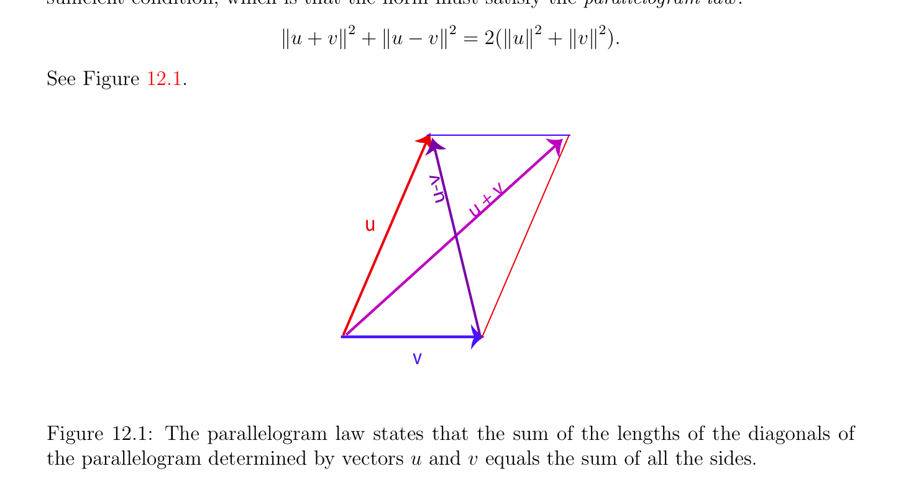

# Inner Products, Euclidean Spaces

<!-- PAGE 453 -->
Chapter $12$ Euclidean Spaces Rien n’est beau que le vrai. —Hermann Minkowski

## 12.1 Inner Products, Euclidean Spaces

So far the framework of vector spaces allows us to deal with ratios of vectors and linear combinations, but there is no way to express the notion of angle or to talk about orthogonality of vectors. A Euclidean structure allows us to deal with metric notions such as angles, orthogonality, and length (or distance). This chapter covers the bare bones of Euclidean geometry. Deeper aspects of Euclidean geometry are investigated in Chapter $13$. One of our main goals is to give the basic properties of the transformations that preserve the Euclidean structure, rotations and reflections, since they play an important role in practice. Euclidean geometry is the study of properties invariant under certain affine maps called rigid motions. Rigid motions are the maps that preserve the distance between points. We begin by defining inner products and Euclidean spaces. The Cauchy–Schwarz inequality and the Minkowski inequality are shown. We define orthogonality of vectors and of subspaces, orthogonal bases, and orthonormal bases. We prove that every finite-dimensional Euclidean space has orthonormal bases. The first proof uses duality and the second one the Gram–Schmidt orthogonalization procedure. The QR-decomposition for invertible matrices is shown as an application of the Gram–Schmidt procedure. Linear isometries (also called orthogonal transformations) are defined and studied briefly. We conclude with a short section in which some applications of Euclidean geometry are sketched. One of the most important applications, the method of least squares, is discussed in Chapter $23$. For a more detailed treatment of Euclidean geometry see Berger $[11, 12]$, Snapper and Troyer $[168]$, or any other book on geometry, such as Pedoe $[141]$, Coxeter $[44]$, Fresnel $[66]$, Tisseron $[181]$, or Cagnac, Ramis, and Commeau $[32]$. Serious readers should consult Emil
$$453$$

<!-- PAGE 454 -->
Artin’s famous book $[6]$, which contains an in-depth study of the orthogonal group, as well as other groups arising in geometry. It is still worth consulting some of the older classics, such as Hadamard $[87, 88]$ and Rouch´e and de Comberousse $[144]$. The first edition of $[87]$ was published in $1898$ and finally reached its thirteenth edition in $1947$! In this chapter it is assumed that all vector spaces are defined over the field $\mathbb{R}$ of real numbers unless specified otherwise (in a few cases, over the complex numbers $\mathbb{C})$. First we define a Euclidean structure on a vector space. Technically, a Euclidean structure over a vector space $E$ is provided by a symmetric bilinear form on the vector space satisfying some extra properties. Recall that a bilinear form $\phi$ : $E \times  E \to \mathbb{R}$ is definite if for every $u \in E, u \neq  0$ implies that $\phi (u, u) \neq  0$, and positive if for every $u \in E, \phi (u, u) \ge 0$.

> **Definition 12.1.** A Euclidean space is a real vector space $E$ equipped with a symmetric bilinear form $\phi$ : $E \times E \to \mathbb{R}$ that is positive definite. More explicitly, $\phi$ : $E \times E \to \mathbb{R}$ satisfies the following axioms:
$$\phi (u_{1} + u_{2}, v)=\phi (u_{1}, v) + \phi (u_{2}, v),$$
$$\phi (u, v_{1} + v_{2})=\phi (u, v_{1}) + \phi (u, v_{2}),$$
$$\phi (\lambda u, v)=\lambda \phi (u, v),$$
$$\phi (u, \lambda v)=\lambda \phi (u, v),$$
$$\phi (u, v)=\phi (v, u),$$
$$u=0 implies that \phi (u, u) > 0.$$
The real number $\phi (u, v)$ is also called the inner product (or scalar product) of $u$ and $v$. We also define the quadratic form associated with $\phi$  as the function $\Phi$ : $E \to \mathbb{R}_{+}$ such that
$$\Phi (u) = \phi (u, u),$$
for all $u \in E$. Since $\phi$  is bilinear, we have $\phi (0, 0) = 0$, and since it is positive definite, we have the stronger fact that
$$\phi (u, u) = 0iffu = 0,$$
that is, $\Phi (u) = 0$ iff $u = 0$. Given an inner product $\phi$ : $E \times  E \to \mathbb{R}$ on a vector space $E$, we also denote $\phi (u, v)$ by
$$u \cdot  vor\langle u, v\rangle or(u|v),$$
and $p\overline{\Phi (}\overline{u}\overline{)}$ by $\|u\|$.

> **Example 12.1.** The standard example of a Euclidean space is $\mathbb{R}^{n}$, under the inner product $\cdot$  defined such that
$$(x_{1}, \dots  , x_{n}) \cdot  (y_{1}, \dots  , y_{n}) = x_{1}y_{1} + x_{2}y_{2} + \cdots  + x_{n}y_{n}.$$
This Euclidean space is denoted by $\mathbb{E}^{n}$.

<!-- PAGE 455 -->
There are other examples.

> **Example 12.2.** For instance, let $E$ be a vector space of dimension $2$, and let $(e_{1}, e_{2})$ be a basis of $E$. If a $> 0$ and $b^{2}$ - ac $< 0$, the bilinear form defined such that
$$\phi (x_{1}e_{1} + y_{1}e_{2}, x_{2}e_{1} + y_{2}e_{2}) = ax_{1}x_{2} + b(x_{1}y_{2} + x_{2}y_{1}) + cy_{1}y_{2}$$
yields a Euclidean structure on $E$. In this case,
$$\Phi (xe_{1} + ye_{2}) = ax^{2}+ 2bxy + cy^{2}.$$

> **Example 12.3.** Let $\mathcal{C}[a, b]$ denote the set of continuous functions $f$ : [a, $b] \to \mathbb{R}$. It is easily checked that $\mathcal{C}[a, b]$ is a vector space of infinite dimension. Given any two functions $f, g \in$ C[a, $b]$, let
$$\langle f, g\rangle = \int_{a}^{}  bf(t)g(t)dt.$$
We leave it as an easy exercise that $\langle$ -, $-\rangle$ is indeed an inner product on $\mathcal{C}[a, b]$. In the case where $a = -\pi$  and $b = \pi$  (or $a = 0$ and $b = 2\pi$ , this makes basically no difference), one should compute
$$\langle \sin px, \sin qx\rangle ,\langle \sin px, \cos qx\rangle ,and\langle \cos px, \cos qx\rangle ,$$
for all natural numbers $p, q \ge 1$. The outcome of these calculations is what makes Fourier analysis possible!

> **Example 12.4.** Let $E = M_{n}(\mathbb{R})$ be the vector space of real $n \times  n$ matrices. If we view a matrix $A \in M_{n}(\mathbb{R})$ as a “long” column vector obtained by concatenating together its columns, we can define the inner product of two matrices $A, B \in M_{n}(\mathbb{R})$ as
$$\langle A, B\rangle = \sum_{i,j=1}^{n}  a_{ij}b_{ij},$$
which can be conveniently written as
$$\langle A, B\rangle = \mathrm{tr}(A^{\top}B) = \mathrm{tr}(B^{\top}A).$$
Since this can be viewed as the Euclidean product on $\mathbb{R}^{n2}$, it is an inner product on $M_{n}(\mathbb{R})$. The corresponding norm
$$\|A\|_{F} =p\overline{\mathrm{tr}(}\overline{A}^{\top}\overline{A}\overline{)}$$
is the Frobenius norm (see Section 9.2). Let us observe that $\phi$  can be recovered from $\Phi$ .

<!-- PAGE 456 -->

> **Proposition 12.1.** We have
$$\phi (u, v) = \frac{1}{2} [\Phi (u + v) -\Phi (u) -\Phi (v)]$$
for all $u, v \in E$. We say that $\phi$  is the polar form of $\Phi$ .

*Proof.* By bilinearity and symmetry, we have
$$\Phi (u + v) = \phi (u + v, u + v)$$
$$= \phi (u, u + v) + \phi (v, u + v)$$
$$= \phi (u, u) + 2\phi (u, v) + \phi (v, v)$$
$$= \Phi (u) + 2\phi (u, v) + \Phi (v).$$
If $E$ is finite-dimensional and if $\phi$ : $E \times  E \to \mathbb{R}$ is a bilinear form on $E$, given any basis
$$(e_{1}, \dots  , e_{n}) of E, we can write x = \sum_{ni}  n=1 x_{i}e_{i} and y = \sum_{n}  nj=1 y_{j}e_{j}, and we have$$
$$\phi (x, y) = \phi \begin{pmatrix} x_{i}e_{i}, & y_{j}e_{j} \end{pmatrix} \sum_{i=1}^{}  \sum_{j=1}^{n}  = \sum_{i,j=1}  x_{i}y_{j}\phi (e_{i}, e_{j}).$$
If we let $G$ be the matrix $G = (\phi (e_{i}, e_{j}))$, and if $x$ and $y$ are the column vectors associated with $(x_{1}, \dots  , x_{n})$ and $(y_{1}, \dots  , y_{n})$, then we can write
$$\phi (x, y) = x^{\top}Gy = y^{\top}G^{\top}x.$$
$$Note that we are committing an abuse of notation since x = \sum_{i}  n=1 x_{i}e_{i} is a vector in E, but$$
the column vector associated with $(x_{1}, \dots  , x_{n})$ belongs $to\mathbb{R}^{n}$. To avoid this minor abuse, we could denote the column vector associated with $(x_{1}, \dots  , x_{n})$ by $x$ (and similarly $y$ for the column vector associated with $(y_{1}, \dots  , y_{n}))$, in wich case the “correct” expression for $\phi (x, y)$ is
$$\phi (x, y) = x^{\top}Gy.$$
However, in view of the isomorphism between $E$ and $\mathbb{R}^{n}$, to keep notation as simple as possible, we will use $x$ and $y$ instead of $x$ and $y$. Also observe that $\phi$  is symmetric iff $G = G^{\top}$, and $\phi$  is positive definite iff the matrix $G$ is positive definite, that is,
$$x^{\top}Gx > 0for all x \in \mathbb{R}^{n}, x \neq  0.$$
The matrix $G$ associated with an inner product is called the Gram matrix of the inner product with respect to the basis $(e_{1}, \dots  , e_{n})$. Conversely, if $A$ is a symmetric positive definite $n\times n$ matrix, it is easy to check that the bilinear form
$$\langle x, y\rangle = x^{\top}Ay$$

<!-- PAGE 457 -->
is an inner product. If we make a change of basis from the basis $(e_{1}, \dots  , e_{n})$ to the basis $(f_{1}, \dots  , f_{n})$, and if the change of basis matrix is $P$ (where the jth column of $P$ consists of the coordinates of $f_{j}$ over the basis $(e_{1}, \dots  , e_{n}))$, then with respect to coordinates x' and y' over the basis $(f_{1}, \dots  , f_{n})$, we have
$$x^{\top}Gy = x^{'\top}P^{\top} GPy',$$
so the matrix of our inner product over the basis $(f_{1}, \dots  , f_{n})$ is $P^{\top}$ GP. We summarize these facts in the following proposition.

> **Proposition 12.2.** Let $E$ be a finite-dimensional vector space, and let $(e_{1}, \dots  , e_{n})$ be a basis of $E. 1$. For any inner product $\langle$ -, $-\rangle$ on $E$, if $G = (\langle e_{i}, e_{j}\rangle$ ) is the Gram matrix of the inner product $\langle$ -, $-\rangle$ w.r.t. the basis $(e_{1}, \dots  , e_{n})$, then $G$ is symmetric positive definite. $2$. For any change of basis matrix $P$, the Gram matrix of $\langle$ -, $-\rangle$ with respect to the new basis is $P^{\top}$ GP. $3$. If $A$ is any $n \times  n$ symmetric positive definite matrix, then
$$\langle x, y\rangle = x^{\top}Ay$$
is an inner product on $E$. We will see later that a symmetric matrix is positive definite iff its eigenvalues are all positive. One of the very important properties of an inner product $\phi$  is that the map $u \mapsto p\overline{\Phi (}\overline{u}\overline{)}$ is a norm.

> **Proposition 12.3.** Let $E$ be a Euclidean space with inner product $\phi$ , and let $\Phi$  be the corresponding quadratic form. For all $u, v \in E$, we have the Cauchy–Schwarz inequality
$$\phi (u, v)^{2}\le \Phi (u)\Phi (v),$$
the equality holding iff $u$ and $v$ are linearly dependent. We also have the Minkowski inequality
$$p\overline{\Phi (}\overline{u}\overline{+}\overline{v}\overline{)} \le p\overline{\Phi (}\overline{u}\overline{) +} p\overline{\Phi (}\overline{v}\overline{)},$$
the equality holding iff $u$ and $v$ are linearly dependent, where in addition if $u \neq  0$ and $v \neq  0$, then $u = \lambda v$ for some $\lambda  > 0$.

<!-- PAGE 458 -->

*Proof.* For any vectors $u, v \in E$, we define the function $T$ : $\mathbb{R} \to \mathbb{R}$ such that
$$T(\lambda ) = \Phi (u + \lambda v),$$
for all $\lambda  \in \mathbb{R}$. Using bilinearity and symmetry, we have
$$\Phi (u + \lambda v)=\phi (u + \lambda v, u + \lambda v)$$
$$=\phi (u, u + \lambda v) + \lambda \phi (v, u + \lambda v)$$
$$=\phi (u, u) + 2\lambda \phi (u, v) + \lambda^{2} \phi (v, v)$$
$$=\Phi (u) + 2\lambda \phi (u, v) + \lambda^{2} \Phi (v).$$
Since $\phi$  is positive definite, $\Phi$  is nonnegative, and thus $T(\lambda$ ) $\ge 0$ for all $\lambda  \in \mathbb{R}$. If $\Phi (v) = 0$, then $v = 0$, and we also have $\phi (u, v) = 0$. In this case, the Cauchy–Schwarz inequality is trivial, and $v = 0$ and $u$ are linearly dependent. Now assume $\Phi (v) > 0$. Since $T(\lambda$ ) $\ge 0$, the quadratic equation
$$\lambda^{2} \Phi (v) + 2\lambda \phi (u, v) + \Phi (u) = 0$$
cannot have distinct real roots, which means that its discriminant
$$\Delta = 4(\phi (u, v)^{2}-\Phi (u)\Phi (v))$$
is null or negative, which is precisely the Cauchy–Schwarz inequality
$$\phi (u, v)^{2}\le \Phi (u)\Phi (v).$$
Let us now consider the case where we have the equality
$$\phi (u, v)^{2}= \Phi (u)\Phi (v).$$
There are two cases. If $\Phi (v) = 0$, then $v = 0$ and $u$ and $v$ are linearly dependent. If $\Phi (v) \neq  0$, then the above quadratic equation has a double root $\lambda_{0}$ , and we have $\Phi (u + \lambda_{0} v) = 0$. Since $\phi$  is positive definite, $\Phi (u + \lambda_{0} v) = 0$ implies that $u + \lambda_{0} v = 0$, which shows that $u$ and $v$ are linearly dependent. Conversely, it is easy to check that we have equality when $u$ and $v$ are linearly dependent. The Minkowski inequality
$$p\overline{\Phi (}\overline{u}\overline{+}\overline{v}\overline{)} \le p\overline{\Phi (}\overline{u}\overline{) +} p\overline{\Phi (}\overline{v}\overline{)}$$
is equivalent to
$$\Phi (u + v) \le \Phi (u) + \Phi (v) + 2p\overline{\Phi (}\overline{u}\overline{)\Phi (}\overline{v}\overline{)}.$$
However, we have shown that
$$2\phi (u, v) = \Phi (u + v) -\Phi (u) -\Phi (v),$$

<!-- PAGE 459 -->
and so the above inequality is equivalent to
$$\phi (u, v) \le p\overline{\Phi (}\overline{u}\overline{)\Phi (}\overline{v}\overline{)},$$
which is trivial when $\phi (u, v) \le 0$, and follows from the Cauchy–Schwarz inequality when $\phi (u, v) \ge 0$. Thus, the Minkowski inequality holds. Finally assume that $u \neq  0$ and $v \neq  0$, and that
$$p\overline{\Phi (}\overline{u}\overline{+}\overline{v}\overline{) =} p\overline{\Phi (}\overline{u}\overline{) +} p\overline{\Phi (}\overline{v}\overline{)}.$$
When this is the case, we have
$$\phi (u, v) =p\overline{\Phi (}\overline{u}\overline{)\Phi (}\overline{v}\overline{)},$$
and we know from the discussion of the Cauchy–Schwarz inequality that the equality holds iff $u$ and $v$ are linearly dependent. The Minkowski inequality is an equality when $u$ or $v$ is null. Otherwise, if $u \neq  0$ and $v \neq  0$, then $u = \lambda v$ for some $\lambda  \neq  0$, and since
$$\phi (u, v) = \lambda \phi (v, v) =p\overline{\Phi (}\overline{u}\overline{)\Phi (}\overline{v}\overline{)},$$
by positivity, we must have $\lambda  > 0$. Note that the Cauchy–Schwarz inequality can also be written as
$$|\phi (u, v)| \le p\overline{\Phi (}\overline{u}\overline{)} p\overline{\Phi (}\overline{v}\overline{)}.$$
Remark: It is easy to prove that the Cauchy–Schwarz and the Minkowski inequalities still hold for a symmetric bilinear form that is positive, but not necessarily definite (i.e., $\phi (u, v) \ge 0$ for all $u, v \in E)$. However, $u$ and $v$ need not be linearly dependent when the equality holds. The Minkowski inequality
$$p\overline{\Phi (}\overline{u}\overline{+}\overline{v}\overline{)} \le p\overline{\Phi (}\overline{u}\overline{) +} p\overline{\Phi (}\overline{v}\overline{)}$$
shows that the map $u \mapsto p\overline{\Phi (}\overline{u}\overline{)}$ satisfies the convexity inequality (also known as triangle inequality), condition (N3) of Definition 9.1, and since $\phi$  is bilinear and positive definite, it also satisfies conditions (N1) and (N2) of Definition 9.1, and thus it is a norm on $E$. The norm induced by $\phi$  is called the Euclidean norm induced by $\phi$ . The Cauchy–Schwarz inequality can be written as
$$|u \cdot  v| \le \|u\|\|v\|,$$
and the Minkowski inequality as
$$\|u + v\|\le \|u\|+ \|v\|.$$

<!-- PAGE 460 -->
If $u$ and $v$ are nonzero vectors then the Cauchy–Schwarz inequality implies that
$$\cdot$$
$$-1 \le \frac{u v}{\|u\|\|v\|} \le +1.$$
Then there is a unique $\theta  \in [0, \pi$ ] such that
$$\cdot$$
$$\cos \theta  = \frac{u v}{\|u\|\|v\|} .$$
We have $u = v$ iff $\theta  = 0$ and $u = -v$ iff $\theta  = \pi$ . For $0 < \theta  < \pi$ , the vectors $u$ and $v$ are linearly independent and there is an orientation of the plane spanned by $u$ and $v$ such that $\theta$  is the angle between $u$ and $v$. See Problem 12.8 for the precise notion of orientation. If $u$ is a unit vector (which means that $\|u\| = 1)$, then the vector
$$(\|v\|\cos \theta )u = (u \cdot  v)u = (v \cdot  u)u$$
is called the orthogonal projection of $v$ onto the space spanned by $u$.
Remark: One might wonder if every norm on a vector space is induced by some Euclidean inner product. In general this is false, but remarkably, there is a simple necessary and sufficient condition, which is that the norm must satisfy the parallelogram law:
$$\|u + v\|^{2}+ \|u -v\|^{2}= 2(\|u\|^{2}+ \|v\|^{2}).$$
See Figure 12.1.
$$vv$$
$$-+$$
$$u$$
$$u$$
$$u$$
$$\overline{v}$$

**Figure 12.1:** The parallelogram law states that the sum of the lengths of the diagonals of the parallelogram determined by vectors $u$ and $v$ equals the sum of all the sides. If $\langle$ -, $-\rangle$ is an inner product, then we have
$$\|u + v\|^{2}= \|u\|^{2}+ \|v\|^{2}+ 2\langle u, v\rangle$$
$$\|u -v\|^{2}= \|u\|^{2}+ \|v\|^{2}-2\langle u, v\rangle ,$$

<!-- PAGE 461 -->
and by adding and subtracting these identities, we get the parallelogram law and the equation
$$-\|$$
$$\langle u, v\rangle = \frac{1}{4} (\|u + v\|^{2}u -v\|^{2}),$$
which allows us to recover $\langle$ -, $-\rangle$ from the norm. Conversely, if $\|\|$ is a norm satisfying the parallelogram law, and if it comes from an inner product, then this inner product must be given by
$$-\|$$
$$\langle u, v\rangle = \frac{1}{4} (\|u + v\|^{2}u -v\|^{2}).$$
We need to prove that the above form is indeed symmetric and bilinear. Symmetry holds because $\|u$ - $v\| = \|-(u$ - $v)\| = \|v$ - $u\|$. Let us prove additivity in the variable $u$. By the parallelogram law, we have
$$2(\|x + z\|^{2}+ \|y\|^{2}) = \|x + y + z\|^{2}+ \|x -y + z\|^{2}$$
which yields
$$\|x + y + z\|^{2}= 2(\|x + z\|^{2}+ \|y\|^{2}) -\|x -y + z\|^{2}$$
$$\|x + y + z\|^{2}= 2(\|y + z\|^{2}+ \|x\|^{2}) -\|y -x + z\|^{2},$$
where the second formula is obtained by swapping $x$ and $y$. Then by adding up these equations, we get
$$- .$$
$$\|x + y + z\|^{2}= \|x\|^{2}+ \|y\|^{2}+ \|x + z\|^{2}+ \|y + z\|^{2}- \frac{1}{2} \|x -y + z\|^{2} \frac{1}{2} \|y -x + z\|^{2}$$
Replacing $z$ by $-z$ in the above equation, we get
$$- ,$$
$$\|x + y -z\|^{2}= \|x\|^{2}+ \|y\|^{2}+ \|x -z\|^{2}+ \|y -z\|^{2}- \frac{1}{2} \|x -y -z\|^{2} \frac{1}{2} \|y -x -z\|^{2}$$
Since $\|x$ - $y + z\| = \|-(x$ - $y + z)\| = \|y$ - $x$ - $z\|$ and $\|y$ - $x + z\| = \|-(y$ - $x + z)\| = \|x$ - $y$ - $z\|$, by subtracting the last two equations, we get
$$-\|$$
$$\langle x + y, z\rangle = \frac{1}{4} (\|x + y + z\|^{2}x + y -z\|^{2})$$
$$-\|  -\|$$
$$= \frac{1}{4} (\|x + z\|^{2}x -z\|^{2}) + \frac{1}{4} (\|y + z\|^{2}y -z\|^{2})$$
$$= \langle x, z\rangle + \langle y, z\rangle ,$$
as desired. Proving that
$$\langle \lambda x, y\rangle = \lambda \langle x, y\rangle for all \lambda  \in \mathbb{R}$$
