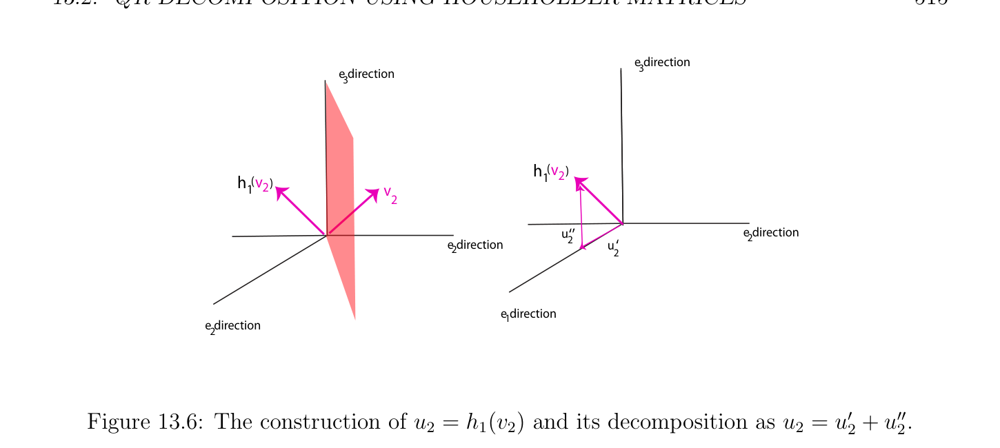

# QR-Decomposition Using Householder Matrices

<!-- PAGE 512 -->
$$s(u) = vu$$
$$H$$
$$v-u$$
$$Figure 13.3: In \mathbb{R}^{3}, the (hyper)plane perpendicular to v -u reflects u onto v.$$

## 13.2 QR-Decomposition Using Householder Matrices

First we state the result geometrically. When translated in terms of Householder matrices, we obtain the fact advertised earlier that every matrix (not necessarily invertible) has a QR-decomposition.

> **Proposition 13.3.** Let $E$ be a nontrivial Euclidean space of dimension $n$. For any orthonormal basis $(e_{1}, \dots , e_{n})$ and for any $n$-tuple of vectors $(v_{1}, \dots , v_{n})$, there is a sequence of $n$ isometries $h_{1}, \dots  , h_{n}$ such that $h_{i}$ is a hyperplane reflection or the identity, and if $(r_{1}, \dots  , r_{n})$ are the vectors given by
$$r_{j} = h_{n} \circ \cdots  \circ h_{2} \circ h_{1}(v_{j}),$$
then every $r_{j}$ is a linear combination of the vectors $(e_{1}, \dots  , e_{j}), 1 \le j \le n$. Equivalently, the matrix $R$ whose columns are the components of the $r_{j}$ over the basis $(e_{1}, \dots  , e_{n})$ is an upper triangular matrix. Furthermore, the $h_{i}$ can be chosen so that the diagonal entries of $R$ are nonnegative.

*Proof.* We proceed by induction on $n$. For $n = 1$, we have $v_{1} = \lambda e_{1}$ for some $\lambda  \in \mathbb{R}$. If $\lambda  \ge 0$, we let $h_{1} =$ id, else if $\lambda  < 0$, we let $h_{1} =$ -id, the reflection about the origin. For $n \ge 2$, we first have to find $h_{1}$. Let
$$r_{1,1} = \|v_{1}\|.$$

<!-- PAGE 513 -->
If $v_{1} = r_{1,1}e_{1}$, we let $h_{1} =$ id. Otherwise, there is a unique hyperplane reflection $h_{1}$ such that
$$h_{1}(v_{1}) = r_{1,1} e_{1},$$
defined such that
$$2  \cdot$$
$$h_{1}(u) = u - \frac{(u w_{1})}{\|w_{1}\|^{2}} w_{1}$$
for all $u \in E$, where
$$w_{1} = r_{1,1} e_{1} -v_{1}.$$
The map $h_{1}$ is the reflection about the hyperplane $H_{1}$ orthogonal to the vector $w_{1} = r_{1,1} e_{1}$ - $v_{1}$. See Figure 13.4. Letting
$$vH$$
$$11$$
$$e$$
$$2$$
$$re$$
$$1,11$$
$$Figure 13.4: The construction of h_{1} in Proposition 13.3.$$
$$r_{1} = h_{1}(v_{1}) = r_{1,1} e_{1},$$
it is obvious that $r_{1}$ belongs to the subspace spanned by $e_{1}$, and $r_{1,1} = \|v_{1}\|$ is nonnegative. Next assume that we have found $k$ linear maps $h_{1}, \dots  , h_{k}$, hyperplane reflections or the identity, where $1 \le k \le n$ - $1$, such that if $(r_{1}, \dots  , r_{k})$ are the vectors given by
$$r_{j} = h_{k} \circ \cdots  \circ h_{2} \circ h_{1}(v_{j}),$$
then every $r_{j}$ is a linear combination of the vectors $(e_{1}, \dots  , e_{j}), 1 \le j \le k$. See Figure 13.5. The vectors $(e_{1}, \dots  , e_{k})$ form a basis for the subspace denoted by $U_{k}'$ , the vectors $(e_{k+1}, \dots  , e_{n})$ form a basis for the subspace denoted by $U_{k}''$  , the subspaces $U_{k}'$ and $U_{k}''$ are orthogonal, and $E = U_{k}'  \oplus U_{k}''$ . Let
$$u_{k+1} = h_{k} \circ \cdots  \circ h_{2} \circ h_{1}(v_{k+1}).$$
We can write
$$u_{k+1} = u_{k+1}' + u_{k+1}'',$$

<!-- PAGE 514 -->
$$e directione direction$$
$$33$$
$$h$$
$$1$$
$$v$$
$$2$$
$$\overline{v}\overline{e direction}\overline{v}\overline{e direction}$$
$$\overline{1}\overline{2} r1\overline{2}$$
$$1$$
$$e direction1e direction$$
$$1$$
$$Figure 13.5: The construction of r_{1} = h_{1}(v_{1}) in Proposition 13.3.$$
where $u_{k+1}' \in U_{k}'$ and $u_{k+1}'' \in U_{k}''$ . See Figure 13.6. Let
$$r_{k+1,k+1} = \|u_{k+1}''\|.$$
If $u_{k+1}'' = r_{k+1,k+1} e_{k+1}$, we let $h_{k+1} =$ id. Otherwise, there is a unique hyperplane reflection $h_{k+1}$ such that
$$h_{k+1}(u_{k+1}'') = r_{k+1,k+1} e_{k+1},$$
defined such that
$$2  \cdot$$
$$h_{k+1}(u) = u - \frac{(u w_{k+1})}{\|w_{k+1}\|^{2}} w_{k+1}$$
for all $u \in E$, where
$$w_{k+1} = r_{k+1,k+1} e_{k+1} -u_{k+1}''.$$
The map $h_{k+1}$ is the reflection about the hyperplane $H_{k+1}$ orthogonal to the vector $w_{k+1} = r_{k+1,k+1} e_{k+1}-u_{k+1}''$. However, since $u_{k+1}'', e_{k+1} \in U_{k}''$ and $U_{k}'$ is orthogonal to $U_{k}''$ , the subspace $U_{k}'$  is contained in $H_{k+1}$, and thus, the vectors $(r_{1}, \dots  , r_{k})$ and $u_{k+1}'$, which belong to $U_{k}'$, are invariant under $h_{k+1}$. This proves that
$$h_{k+1}(u_{k+1}) = h_{k+1}(u_{k+1}') + h_{k+1}(u_{k+1}'') = u_{k+1}' + r_{k+1,k+1} e_{k+1}$$
is a linear combination of $(e_{1}, \dots  , e_{k+1})$. Letting
$$r_{k+1} = h_{k+1}(u_{k+1}) = u_{k+1}' + r_{k+1,k+1} e_{k+1},$$
since $u_{k+1} = h_{k} \circ \cdots  \circ h_{2} \circ h_{1}(v_{k+1})$, the vector
$$r_{k+1} = h_{k+1} \circ \cdots  \circ h_{2} \circ h_{1}(v_{k+1})$$
is a linear combination of $(e_{1}, \dots  , e_{k+1})$. See Figure 13.7. The coefficient of $r_{k+1}$ over $e_{k+1}$ is $r_{k+1,k+1} = \|u_{k+1}''\|$, which is nonnegative. This concludes the induction step, and thus the proof.

<!-- PAGE 515 -->
$$e direction$$
$$e direction3$$
$$3$$
$$h(v)$$
$$h(v12$$
$$12)v$$
$$2$$
$$\overline{u}\overline{‘’}\overline{e direction}\overline{2}$$
$$\overline{e direction} 2u‘$$
$$\overline{2} 2$$
$$e direction1$$
$$e direction$$
$$2$$

**Figure 13.6:** The construction of $u_{2} = h_{1}(v_{2})$ and its decomposition as $u_{2} = u_{2}' + u_{2}''$.
Remarks:
$(1)$ Since every $h_{i}$ is a hyperplane reflection or the identity,
$$\rho  = h_{n} \circ \cdots  \circ h_{2} \circ h_{1}$$
is an isometry.
$(2)$ If we allow negative diagonal entries in $R$, the last isometry $h_{n}$ may be omitted.
$(3)$ Instead of picking $r_{k,k} = \|u_{k}''\|$, which means that
$$w_{k} = r_{k,k} e_{k} -u_{k}'',$$
where $1 \le k \le n$, it might be preferable to pick $r_{k,k} = -\|u_{k}''\|$ if this makes $\|w_{k}\|^{2}$ larger, in which case
$$w_{k} = r_{k,k} e_{k} + u_{k}''.$$
Indeed, since the definition of $h_{k}$ involves division by $\|w_{k}\|^{2}$, it is desirable to avoid division by very small numbers.
$(4)$ The method also applies to any $m$-tuple of vectors $(v_{1}, \dots  , v_{m})$, with $m \le n$. Then $R$ is an upper triangular $m \times  m$ matrix and $Q$ is an $n \times  m$ matrix with orthogonal columns $(Q^{\top}Q = I_{m})$. We leave the minor adjustments to the method as an exercise to the reader Proposition 13.3 directly yields the QR-decomposition in terms of Householder transformations (see Strang $[175, 176]$, Golub and Van Loan $[83]$, Trefethen and Bau $[182]$, Kincaid and Cheney $[105]$, or Ciarlet $[41])$.

<!-- PAGE 516 -->
$$e direction3$$
$$u‘’$$
$$2$$
$$\overline{h}\overline{(u}\overline{‘’}\overline{)}\overline{e direction} 2$$
$$e direction22$$
$$2$$
$$e direction1$$
$$e direction3$$
$$h(v2)$$
$$1$$
$$\overline{u}\overline{‘}\overline{e direction}$$
$$e direction\overline{2} 2$$
$$2h h(v2)$$
$$21$$
$$e direction1$$
$$Figure 13.7: The construction of h_{2} and r_{2} = h_{2} \circ h_{1}(v_{2}) in Proposition 13.3.$$

> **Theorem 13.4.** For every real $n \times  n$ matrix $A$, there is a sequence $H_{1}, \dots , H_{n}$ of matrices, where each $H_{i}$ is either a Householder matrix or the identity, and an upper triangular matrix $R$ such that
$$R = H_{n} \cdots  H_{2}H_{1}A.$$
As a corollary, there is a pair of matrices $Q, R$, where $Q$ is orthogonal and $R$ is upper triangular, such that $A = QR$ (a QR-decomposition of $A)$. Furthermore, $R$ can be chosen so that its diagonal entries are nonnegative.

*Proof.* The jth column of $A$ can be viewed as a vector $v_{j}$ over the canonical basis $(e_{1}, \dots  , e_{n}) \mathbb{E}^{n}$ of (where $(e_{j})_{i} = 1$ if $i = j$, and $0$ otherwise, $1 \le i, j \le n)$. Applying Proposition 13.3 to $(v_{1}, \dots  , v_{n})$, there is a sequence of $n$ isometries $h_{1}, \dots  , h_{n}$ such that $h_{i}$ is a hyperplane reflection or the identity, and if $(r_{1}, \dots  , r_{n})$ are the vectors given by
$$r_{j} = h_{n} \circ \cdots  \circ h_{2} \circ h_{1}(v_{j}),$$
then every $r_{j}$ is a linear combination of the vectors $(e_{1}, \dots  , e_{j}), 1 \le j \le n$. Letting $R$ be the matrix whose columns are the vectors $r_{j}$, and $H_{i}$ the matrix associated with $h_{i}$, it is clear that
$$R = H_{n} \cdots  H_{2}H_{1}A,$$

<!-- PAGE 517 -->
where $R$ is upper triangular and every $H_{i}$ is either a Householder matrix or the identity. However, $h_{i} \circ h_{i} =$ id for all $i, 1 \le i \le n$, and so
$$v_{j} = h_{1} \circ h_{2} \circ \cdots  \circ h_{n}(r_{j})$$
for all $j, 1 \le j \le n$. But $\rho  = h_{1} \circ h_{2} \circ \cdots  \circ h_{n}$ is an isometry represented by the orthogonal matrix $Q = H_{1}H_{2} \cdots  H_{n}$. It is clear that $A = QR$, where $R$ is upper triangular. As we noted in Proposition 13.3, the diagonal entries of $R$ can be chosen to be nonnegative.
Remarks:
$(1)$ Letting
$$A_{k+1} = H_{k} \cdots  H_{2}H_{1}A,$$
with $A_{1} = A, 1 \le k \le n$, the proof of Proposition 13.3 can be interpreted in terms of the computation of the sequence of matrices $A_{1}, \dots  , A_{n+1} = R$. The matrix $A_{k+1}$ has the shape
$$A_{k+1} = \begin{pmatrix} \times & \times & \times & u_{1}^{k+1} & \times & \times & \times & \times \\ 0 & \times & \vdots & \vdots & \vdots & \vdots & \vdots & \vdots \\ 0 & 0 & \times & u_{k}^{k+1} & \times & \times & \times & \times \\ 0 & 0 & 0 & u^{k+1} & \times & \times & \times & \times \\ 0 & 0 & 0 & u_{k}^{kk+1+1} & \times & \times & \times & \times \\ \vdots & \vdots & \vdots & \ddots & \vdots & \vdots & \vdots & \vdots \\ 0 & 0 & 0 & u_{n1}^{k+1} & \times & \times & \times & \times \\ 0 & 0 & 0 & u_{n}^{k+1-} & \times & \times & \times & \times \end{pmatrix} ,$$
where the $(k +$ 1)th column of the matrix is the vector
$$u_{k+1} = h_{k} \circ \cdots  \circ h_{2} \circ h_{1}(v_{k+1}),$$
and thus
$$u_{k+1}' = \begin{pmatrix} u_{1}^{k+1}, \dots  , u_{k}^{k+1} \end{pmatrix}$$
and
$$u_{k+1}'' = \begin{pmatrix} u_{k+1}^{k+1}, u_{k+2}^{k+1}, \dots  , u_{n}^{k+1} \\ k + 1areallzero, \end{pmatrix} .$$
If the last $n -k -1$ entries in column     there is nothing to do, and we let $H_{k+1} =$ I. Otherwise, we kill these $n$ - $k$ - $1$ entries by multiplying $A_{k+1}$ on the left by the Householder matrix $H_{k+1}$ sending
$$\begin{pmatrix} 0, \dots  , 0, u_{k+1}^{k+1}, \dots  , u_{n}^{k+1} \end{pmatrix} to(0, \dots  , 0, r_{k+1,k+1}, 0, \dots  , 0),$$
where $r_{k+1,k+1} = \|(u_{k+1}^{k+1}, \dots  , u_{n}^{k+1})\|$.

<!-- PAGE 518 -->
$(2)$ If $A$ is invertible and the diagonal entries of $R$ are positive, it can be shown that $Q$ and $R$ are unique.
$(3)$ If we allow negative diagonal entries in $R$, the matrix $H_{n}$ may be omitted $(H_{n} =$ I).
$(4)$ The method allows the computation of the determinant of $A$. We have
$$\det(A) = (-1)^{m}r_{1,1} \cdots  r_{n,n},$$
where $m$ is the number of Householder matrices (not the identity) among the $H_{i}$.
$(5)$ The “condition number” of the matrix $A$ is preserved (see Strang $[176]$, Golub and Van Loan $[83]$, Trefethen and Bau $[182]$, Kincaid and Cheney $[105]$, or Ciarlet $[41])$. This is very good for numerical stability.
$(6)$ The method also applies to a rectangular $m \times  n$ matrix. If $m \ge n$, then $R$ is an $n \times  n$ upper triangular matrix and $Q$ is an $m \times  n$ matrix such that $Q^{\top}Q = I_{n}$. The following Matlab functions implement the QR-factorization method of a real square (possibly singular) matrix $A$ using Householder reflections The main function houseqr computes the upper triangular matrix $R$ obtained by applying Householder reflections to $A$. It makes use of the function house, which computes a unit vector $u$ such that given a vector $x \in \mathbb{R}^{p}$, the Householder transformation $P =$ I $-2uu^{\top}$ sets to zero all entries in $x$ but the first entry $x_{1}$. It only applies if $\|x(2$ : $p)\|_{1} = |x_{2}|+\cdots +|x_{p}| > 0$. Since computations are done in floating point, we use a tolerance factor tol, and if $\|x(2$ : $p)\|_{1} \le$ tol, then we return $u = 0$, which indicates that the corresponding Householder transformation is the identity. To make sure that $\|Px\|$ is as large as possible, we pick uu $= x + sign(x_{1}) \|x\|_{2} e_{1}$, where sign(z) $= 1$ if $z \ge 0$ and sign(z) $= -1$ if $z < 0$. Note that as a result, diagonal entries in $R$ may be negative. We will take care of this issue later. function $s =$ signe(x) % if $x >= 0$, then signe(x) $= 1$ % else if $x < 0$ then signe(x) $= -1$ % if $x < 0 s = -1$; else $s = 1$; end end

<!-- PAGE 519 -->
function [uu, $u] =$ house(x) % This constructs the unnormalized vector uu % defining the Householder reflection that % zeros all but the first entries in $x$. % $u$ is the normalized vector $uu/||uu||$ % tol $= 2*10^(-15)$; % tolerance uu $= x; p =$ size(x,1); % computes $l^1-norm$ of x(2:p,1) n1 $=$ sum(abs(x(2:p,1))); if n1 $<=$ tol $u =$ zeros(p,1); uu $= u$; else $l =$ sqrt(x’*x); % $l^2$ norm of $x$ uu(1) $=$ x(1) $+$ signe(x(1))*l; $u = uu/sqrt(uu’*uu)$; end end The Householder transformations are recorded in an array $u$ of $n$ - $1$ vectors. There are more efficient implementations, but for the sake of clarity we present the following version. function $[R, u] =$ houseqr(A) % This function computes the upper triangular $R$ in the QR factorization % of $A$ using Householder reflections, and an implicit representation % of $Q$ as a sequence of $n$ - $1$ vectors $u_i$ representing Householder % reflections $n =$ size(A, $1); R = A; u =$ zeros(n,n-1); for $i =$ 1:n-1 [~, u(i:n,i)] $=$ house(R(i:n,i)); if u(i:n,i) $==$ zeros(n - $i +$ 1,1)
$$R(i+1:n,i) = zeros(n - i,1);$$
else
$$R(i:n,i:n) = R(i:n,i:n) - 2*u(i:n,i)*(u(i:n,i)’*R(i:n,i:n));$$
end end end

<!-- PAGE 520 -->
If only $R$ is desired, then houseqr does the job. In order to obtain $R$, we need to compose the Householder transformations. We present a simple method which is not the most efficient (there is a way to avoid multiplying explicity the Householder matrices). The function buildhouse creates a Householder reflection from a vector $v$. function $P =$ buildhouse(v,i) % This function builds a Householder reflection % [I $0$ ] % $[0$ PP] % from a Householder reflection % $PP =$ I - 2uu*uu’ % where uu $=$ v(i:n) % If uu $= 0$ then $P$ - I % $n =$ size(v,1); if v(i:n) $==$ zeros(n - $i +$ 1,1) $P =$ eye(n); else $PP =$ eye(n - $i + 1)$ - 2*v(i:n)*v(i:n)’; $P =$ [eye(i-1) zeros(i-1, $n$ - $i + 1)$; zeros(n - $i + 1, i$ - $1)$ PP]; end end The function buildQ builds the matrix $Q$ in the QR-decomposition of $A$. function $Q =$ buildQ(u) % Builds the matrix $Q$ in the QR decomposition % of an nxn matrix $A$ using Householder matrices, % where $u$ is a representation of the $n$ - $1$ % Householder reflection by a list $u$ of vectors produced by % houseqr $n =$ size(u,1); $Q =$ buildhouse(u(:,1),1); for $i =$ 2:n-1 $Q =$ Q*buildhouse(u(:,i),i); end end The function buildhouseQR computes a QR-factorization of $A$. At the end, if some entries on the diagonal of $R$ are negative, it creates a diagonal orthogonal matrix $P$ such that $PR$ has nonnegative diagonal entries, so that $A =$ (QP)(PR) is the desired QR-factorization of $A$.

<!-- PAGE 521 -->
function [Q,R] $=$ buildhouseQR(A) % % Computes the QR decomposition of a square % matrix $A$ (possibly singular) using Householder reflections $n =$ size(A,1); [R,u] $=$ houseqr(A); $Q =$ buildQ(u); % Produces a matrix $R$ whose diagonal entries are % nonnegative $P =$ eye(n); for $i =$ 1:n if R(i,i) $< 0$
$$P(i,i) = -1;$$
end end $Q =$ Q*P; $R =$ P*R; end

> **Example 13.1.** Consider the matrix
$$A = \begin{pmatrix} 1 & 2 & 3 & 4 \\ 2 & 3 & 4 & 5 \\ 3 & 4 & 5 & 6 \\ 4 & 5 & 6 & 7 \end{pmatrix} .$$
Running the function buildhouseQR, we get
$$Q = \begin{pmatrix} 0.1826 & 0.8165 & 0.4001 & 0.3741 \\ 0.3651 & 0.4082 & -0.2546 & -0.7970 \\ 0.5477 & -0.0000 & -0.6910 & 0.4717 \\ 0.7303 & 0.4082 & 0.5455 & 0.0488 \end{pmatrix}$$
$$--$$
and
$$R = \begin{pmatrix} 5.4772 & 7.3030 & 9.1287 & 10.9545 \\ 0 & 0.8165 & 1.6330 & 2.4495 \\ 0 & -0.0000 & 0.0000 & 0.0000 \\ 0 & 0.0000 & 0 & 0.0000 \end{pmatrix} .$$
$$-$$
Observe that $A$ has rank $2$. The reader should check that $A = QR$.
Remark: Curiously, running Matlab built-in function qr, the same $R$ is obtained (up to column signs) but a different $Q$ is obtained (the last two columns are different).
