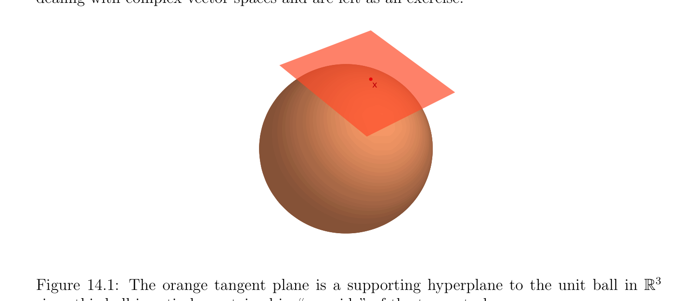

# Dual Norms

<!-- PAGE 556 -->

## 14.7 Dual Norms

In the remark following the proof of Proposition 9.11, we explained that if $(E, \|\|)$ and $(F, \|\|)$ are two normed vector spaces and if we let $\mathcal{L}(E; F)$ denote the set of all continuous (equivalently, bounded) linear maps from $E$ to $F$, then, we can define the operator norm (or subordinate norm) $\|\|$ on $\mathcal{L}(E; F)$ as follows: for every $f \in$ L(E; $F)$,
$$\|\|$$
$$\|f\|= \sup\in \frac{f(x)}{\|x\|} = \sup\in \|f(x)\|.$$
$$xExE$$
$$x\neq 0\|x\|=1$$
$$\mathbb{C}$$
In particular, if $F =$ , then $\mathcal{L}(E; F) =$ E' is the dual space of $E$, and we get the operator norm denoted by $\|\|_{*}$ given by
$$\|f\|_{*}= \sup|f(x)|.$$
$$x\in E$$
$$\|x\|=1$$
The norm $\|\|_{*}$ is called the dual norm of $\|\|$ on E'. Let us now assume that $E$ is a finite-dimensional Hermitian space, in which case E' $= E^{*}$. Theorem 14.6 implies that for every linear form $f \in E^{*}$, there is a unique vector $y \in E$ so that
$$f(x) = \langle x, y\rangle ,$$
for all $x \in E$, and so we can write
$$\|f\|_{*}= \sup|\langle x, y\rangle |.$$
$$x\in E$$
$$\|x\|=1$$
The above suggests defining a norm $\|\|^{D}$ on $E$.

> **Definition 14.13.** If $E$ is a finite-dimensional Hermitian space and $\|\|$ is any norm on $E$, for any $y \in E$ we let
$$\|y\|^{D}= \sup|\langle x, y\rangle |,$$
$$x\in E$$
$$\|x\|=1$$
be the dual norm of $\|\|$ (on $E)$. If $E$ is a real Euclidean space, then the dual norm is defined by
$$\|y\|^{D}= \sup\langle x, y\rangle$$
$$x\in E$$
$$\|x\|=1$$
for all $y \in E$. Beware that $\|\|$ is generally not the Hermitian norm associated with the Hermitian inner product. The dual norm shows up in convex programming; see Boyd and Vandenberghe $[29]$, Chapters $2, 3, 6, 9$. The fact that $\|\|^{D}$ is a norm follows from the fact that $\|\|_{*}$ is a norm and can also be checked directly. It is worth noting that the triangle inequality for $\|\|^{D}$ comes “for free,” in the sense that it holds for any function $p: E \to \mathbb{R}$.

<!-- PAGE 557 -->
$$\mathbb{R}$$

> **Proposition 14.26.** For any function $p: E \to$ , if we define $p^{D}$ by
$$p^{D}(x) = \sup|\langle z, x\rangle |,$$
$$p(z)=1$$
then we have
$$p^{D}(x + y) \le p^{D}(x) + p^{D}(y).$$

*Proof.* We have
$$p^{D}(x + y) = \sup|\langle z, x + y\rangle |$$
$$p(z)=1$$
$$= \sup(|\langle z, x\rangle + \langle z, y\rangle |)$$
$$p(z)=1$$
$$\le \sup(|\langle z, x\rangle | + |\langle z, y\rangle |)$$
$$p(z)=1$$
$$\le \sup|\langle z, x\rangle | + \sup|\langle z, y\rangle |$$
$$p(z)=1p(z)=1$$
$$= p^{D}(x) + p^{D}(y).$$

> **Definition 14.14.** If $p: E \to \mathbb{R}$ is a function such that
$(1)$ p(x) $\ge 0$ for all $x \in E$, and p(x) $= 0$ iff $x = 0$;
$(2) p(\lambda x) = |\lambda$ |p(x), for all $x \in E$ and all $\lambda  \in \mathbb{C}$;
$(3) p$ is continuous, in the sense that for some basis $(e_{1}, \dots  , e_{n})$ of $E$, the function
$$(x_{1}, \dots  , x_{n}) \mapsto p(x_{1}e_{1} + \cdots  + x_{n}e_{n})$$
$$\mathbb{C}^{n}  \mathbb{R}$$
from to  is continuous, then we say that $p$ is a pre-norm. Obviously, every norm is a pre-norm, but a pre-norm may not satisfy the triangle inequality.

> **Corollary 14.27.** The dual norm of any pre-norm is actually a norm.

> **Proposition 14.28.** For all $y \in E$, we have
$$\|y\|^{D}= \sup|\langle x, y\rangle | = \sup\mathfrak{R}\langle x, y\rangle .$$
$$x\in Ex\in E$$
$$\|x\|=1\|x\|=1$$

*Proof.* Since $E$ is finite dimensional, the unit sphere $S^{n-1} = {x \in E$ | $\|x\| = 1}$ is compact, so there is some $x_{0} \in S^{n-1}$ such that
$$\|y\|^{D}= |\langle x_{0}, y\rangle |.$$

<!-- PAGE 558 -->
If $\langle x_{0}, y\rangle = \rho e^{i\theta}$, with $\rho  \ge 0$, then
$$|\langle e^{-i\theta}x_{0}, y\rangle | = |e^{-i\theta}\langle x_{0}, y\rangle | = |e^{-i\theta}\rho e^{i\theta}| = \rho ,$$
so
$$\|y\|^{D}= \rho  = \langle e^{-i\theta}x_{0}, y\rangle ,(*)$$
with

$e^{-i\theta}x_{0}$

$= \|x_{0}\| = 1$. On the other hand,
$$\mathfrak{R}\langle x, y\rangle \le |\langle x, y\rangle |,$$
so by (*) we get
$$\|y\|^{D}= \sup|\langle x, y\rangle | = \sup\mathfrak{R}\langle x, y\rangle ,$$
$$x\in Ex\in E$$
$$\|x\|=1\|x\|=1$$
as claimed.

> **Proposition 14.29.** For all $x, y \in E$, we have
$$|\langle x, y\rangle | \le \|x\|\|y\|^{D}$$
$$|\langle x, y\rangle | \le \|x\|^{D}\|y\|.$$

*Proof.* If $x = 0$, then $\langle x, y\rangle = 0$ and these inequalities are trivial. If $x \neq  0$, since $\|x/ \|x\|\| = 1$, by definition of $\|y\|^{D}$, we have
$$|\langle x/ \|x\|, y\rangle | \le \sup|\langle z, y\rangle | = \|y\|^{D},$$
$$\|z\|=1$$
which yields
$$|\langle x, y\rangle | \le \|x\|\|y\|^{D}.$$
The second inequality holds because $|\langle x, y\rangle$ | $= |\langle y, x\rangle$ |. It is not hard to show that for all $y \in \mathbb{C}^{n}$,
$$\|y\|_{1}^{D} = \|y\|_{\infty}$$
$$\|y\|_{\infty}^{D}= \|y\|_{1}$$
$$\|y\|_{2}^{D} = \|y\|_{2} .$$
Thus, the Euclidean norm is autodual. More generally, the following proposition holds.

> **Proposition 14.30.** If $p, q \ge 1$ and $1/p + 1/q = 1$, or $p = 1$ and $q = \infty$ , or $p = \infty$ and $q = 1$, then for all $y \in \mathbb{C}^{n}$, we have
$$\|y\|_{p}^{D} = \|y\|_{q} .$$

<!-- PAGE 559 -->

*Proof.* By H¨older’s inequality (Corollary 9.2), for all $x, y \in \mathbb{C}^{n}$, we have
$$|\langle x, y\rangle | \le \|x\|_{p} \|y\|_{q} ,$$
so
$$\|y\|_{p}^{D} = \sup|\langle x, y\rangle | \le \|y\|_{q} .$$
$$x\in \mathbb{C} n$$
$$\|x\|=1$$
$$p$$
For the converse, we consider the cases $p = 1, 1 < p < +\infty$ , and $p = +\infty$ . First assume $p = 1$. The result is obvious for $y = 0$, so assume y̸ $= 0$. Given $y$, if we pick $x_{j} = 1$ for some index $j$ such that $\|y\|_{\infty} = max_{1\le i\le n} |y_{i}| = |y_{j}|$, and $x_{k} = 0$ for k̸ $= j$, then $|\langle x, y\rangle$ | $= |y_{j}| = \|y\|_{\infty}$, so $\|y\|_{1}^{D} = \|y\|_{\infty}$. Now we turn to the case $1 < p < +\infty$ . Then we also have $1 < q < +\infty$ , and the equation $1/p + 1/q = 1$ is equivalent to pq $= p + q$, that is, p(q - $1) = q$. Pick $z_{j} = y_{j}|y_{j}|^{q-2}$ for $j = 1, \dots  , n$, so that
$$!1/p !1/p !1/p$$
$$\|z\|_{p} = \sum_{j=1}^{n}  |z_{j}|^{p}= \sum_{j=1}^{n}  |y_{j}|^{(q-1)p}= \sum_{j=1}^{n}  |y_{j}|^{q}.$$
Then if $x = z/ \|z\|_{p}$, we have
$$\sum  nj=1 z_{j}\overline{y}_{j} \sum  nj=1 y_{j}\overline{y}_{j}|y_{j}|^{q-2} \sum_{nj}  n ||^{q} !1/q$$
$$|\langle x, y\rangle | =\overline{\|}\overline{z}\overline{\|}_{p}=\overline{\|}\overline{z}\overline{\|}_{p}= \frac{y_{j}}{|^{q1/p}} =1 = \sum_{j=1}^{n}  |y_{j}|^{q}= \|y\|_{q} .$$
$$\begin{pmatrix} =1|y_{j} \end{pmatrix} \sum_{j}$$
Thus $\|y\|_{p}^{D} = \|y\|_{q}$. Finally, if $p = \infty$ , then pick $x_{j} = y_{j}/|y_{j}|$ if $y_{j} \neq  0$, and $x_{j} = 0$ if $y_{j} = 0$. Then
$$|\langle x, y\rangle | = \sum_{yj\neq 0}^{n}  y_{j}\overline{y}_{j}/|y_{j}|= \sum_{yj\neq 0}  |y_{j}| = \|y\|_{1} .$$
Thus $\|y\|_{\infty}^{D} = \|y\|_{1}$. We can show that the dual of the spectral norm is the trace norm (or nuclear norm) also discussed in Section 22.5. Recall from Proposition 9.11 that the spectral norm $\|A\|_{2}$ of a matrix $A$ is the square root of the largest eigenvalue of $A^{*}A$, that is, the largest singular value of $A$.

> **Proposition 14.31.** The dual of the spectral norm is given by
$$\|A\|_{2}^{D} = \sigma_{1}  + \cdots  + \sigma_{r} ,$$
where $\sigma_{1}  > \cdots  > \sigma_{r}  > 0$ are the singular values of $A \in M_{n}(\mathbb{C})$ (which has rank $r)$.

<!-- PAGE 560 -->

*Proof.* In this case the inner product on $M_{n}(\mathbb{C})$ is the Frobenius inner product $\langle A, B\rangle = tr(B^{*}A)$, and the dual norm of the spectral norm is given by
$$\|A\|_{2}^{D} = \sup{|\mathrm{tr}(A^{*}B)| | \|B\|_{2} = 1}.$$
If we factor $A$ using an SVD as $A = V \Sigma U^{*}$ , where $U$ and $V$ are unitary and $\Sigma$  is a diagonal matrix whose $r$ nonzero entries are the singular values $\sigma_{1}  > \cdots  > \sigma_{r}  > 0$, where $r$ is the rank of $A$, then
$$|\mathrm{tr}(A^{*}B)| = |\mathrm{tr}(U\Sigma V^{*} B)| = |\mathrm{tr}(\Sigma V^{*} BU)|,$$
so if we pick $B = V U^{*}$ , a unitary matrix such that $\|B\|_{2} = 1$, we get
$$|\mathrm{tr}(A^{*}B)| = \mathrm{tr}(\Sigma ) = \sigma_{1}  + \cdots  + \sigma_{r} ,$$
and thus
$$\|A\|_{2}^{D} \ge \sigma_{1}  + \cdots  + \sigma_{r} .$$
Since $\|B\|_{2} = 1$ and $U$ and $V$ are unitary, by Proposition 9.11 we have $\|V^{*} BU\|_{2} = \|B\|_{2} = 1$. If $Z = V^{*}$ BU, by definition of the operator norm
$$1 = \|Z\|_{2} = \sup{\|Zx\|_{2} | \|x\|_{2} = 1},$$
so by picking $x$ to be the canonical vector $e_{j}$, we see that $\|Z^{j}\|_{2} \le 1$ where $Z^{j}$ is the jth column of $Z$, so $|z_{jj}| \le 1$, and since
$$|\mathrm{tr}(\Sigma V^{*} BU)| = |\mathrm{tr}(\Sigma Z)| = \sum_{j=1}^{r}  \sigma_{j} z_{jj} \le \sum_{j=1}^{r}  \sigma_{j} |z_{jj}| \le \sum_{j=1}^{r}  \sigma_{j} ,$$
and we conclude that
$$|\mathrm{tr}(\Sigma V^{*} BU)| \le \sum_{j=1}^{r}  \sigma_{j} .$$
The above implies that
$$\|A\|_{2}^{D} \le \sigma_{1}  + \cdots  + \sigma_{r} ,$$
and since we also have $\|A\|_{2}^{D} \ge \sigma_{1}  + \cdots  + \sigma_{r}$ , we conclude that
$$\|A\|_{2}^{D} = \sigma_{1}  + \cdots  + \sigma_{r} ,$$
proving our proposition.

> **Definition 14.15.** Given any complex matrix $n \times  n$ matrix $A$ of rank $r$, its nuclear norm (or trace norm) is given by
$$\|A\|_{N} = \sigma_{1}  + \cdots  + \sigma_{r} .$$

<!-- PAGE 561 -->
The nuclear norm can be generalized to $m \times  n$ matrices (see Section 22.5). The nuclear norm $\sigma_{1}  + \cdots  + \sigma_{r}$  of an $m \times  n$ matrix $A$ (where $r$ is the rank of $A)$ is denoted by $\|A\|_{N}$. The nuclear norm plays an important role in matrix completion. The problem is this. Given a matrix $A_{0}$ with missing entries (missing data), one would like to fill in the missing entries in $A_{0}$ to obtain a matrix $A$ of minimal rank. For example, consider the matrices
$$A_{0} = \begin{pmatrix} 1 & 2 \\ * & * \end{pmatrix} ,B_{0} = \begin{pmatrix} 1 & * \\ * & 4 \end{pmatrix} ,C_{0} = \begin{pmatrix} 1 & 2 \\ 3 & * \end{pmatrix} .$$
All can be completed with rank $1$. For $A_{0}$, use any multiple of $(1, 2)$ for the second row. For $B_{0}$, use any numbers $b$ and $c$ such that bc $= 4$. For $C_{0}$, the only possibility is $d = 6$. A famous example of this problem is the Netflix competition. The ratings of $m$ films by $n$ viewers goes into $A_{0}$. But the customers didn’t see all the movies. Many ratings were missing. Those had to be predicted by a recommender system. The nuclear norm gave a good solution that needed to be adjusted for human psychology. Since the rank of a matrix is not a norm, in order to solve the matrix completion problem we can use the following “convex relaxation.” Let $A_{0}$ be an incomplete $m \times  n$ matrix: Minimize $\|A\|_{N}$ subject to $A = A_{0}$ in the known entries. The above problem has been extensively studied, in particular by Cand`es and Recht. Roughly, they showed that if $A$ is an $n \times  n$ matrix of rank $r$ and $K$ entries are known in $A$, then if $K$ is large enough $(K > Cn^{5/4}r$ log $n)$, with high probability, the recovery of $A$ is perfect. See Strang $[177]$ for details (Section III.5). We close this section by stating the following duality theorem.

> **Theorem 14.32.** If $E$ is a finite-dimensional Hermitian space, then for any norm $\|\|$ on $E$, we have
$$\|y\|^{DD}= \|y\|$$
for all $y \in E$.

*Proof.* By Proposition 14.29, we have
$$|\langle x, y\rangle | \le \|x\|^{D}\|y\|,$$
so we get
$$\|y\|^{DD}=\sup|\langle x, y\rangle | \le \|y\|,for all y \in E.$$
$$\|x\|D=1$$
It remains to prove that
$$\|y\|\le \|y\|^{DD},for all y \in E.$$
Proofs of this fact can be found in Horn and Johnson $[98]$ (Section 5.5), and in Serre $[162]$ (Chapter $7)$. The proof makes use of the fact that a nonempty, closed, convex set has a supporting hyperplane through each of its boundary points, a result known as Minkowski’s

<!-- PAGE 562 -->
lemma. For a geometric interpretation of supporting hyperplane see Figure 14.1. This result is a consequence of the Hahn–Banach theorem; see Gallier $[73]$. We give the proof in the case where $E$ is a real Euclidean space. Some minor modifications have to be made when dealing with complex vector spaces and are left as an exercise.
$$x$$

**Figure 14.1:** The orange tangent plane is a supporting hyperplane to the unit ball in $\mathbb{R}^{3}$ since this ball is entirely contained in “one side” of the tangent plane. Since the unit ball $B = {z \in E$ | $\|z\|\le 1}$ is closed and convex, the Minkowski lemma says for every $x$ such that $\|x\| = 1$, there is an affine map $g$ of the form
$$g(z) = \langle z, w\rangle -\langle x, w\rangle$$
with $\|w\| = 1$, such that g(x) $= 0$ and g(z) $\le 0$ for all $z$ such that $\|z\|\le 1$. Then it is clear that
$$\sup\langle z, w\rangle = \langle x, w\rangle ,$$
$$\|z\|=1$$
and so
$$\|w\|^{D}= \langle x, w\rangle .$$
It follows that
$$\langle \rangle$$
$$\|x\|^{DD}\ge \langle w/ \|w\|^{D}, x\rangle = \frac{x, w}{\|w\|^{D}} = 1 = \|x\|$$
for all $x$ such that $\|x\| = 1$. By homogeneity, this is true for all $y \in E$, which completes the proof in the real case. When $E$ is a complex vector space, we have to view the unit ball $B$
$$\mathbb{R}^{2n}$$
as a closed convex set in and we use the fact that there is real affine map of the form
$$g(z) = \mathfrak{R}\langle z, w\rangle -\mathfrak{R}\langle x, w\rangle$$
such that g(x) $= 0$ and g(z) $\le 0$ for all $z$ with $\|z\| = 1$, so that $\|w\|^{D} = \mathfrak{R}\langle x, w\rangle$ . More details on dual norms and unitarily invariant norms can be found in Horn and Johnson $[98]$ (Chapters $5$ and $7)$.
