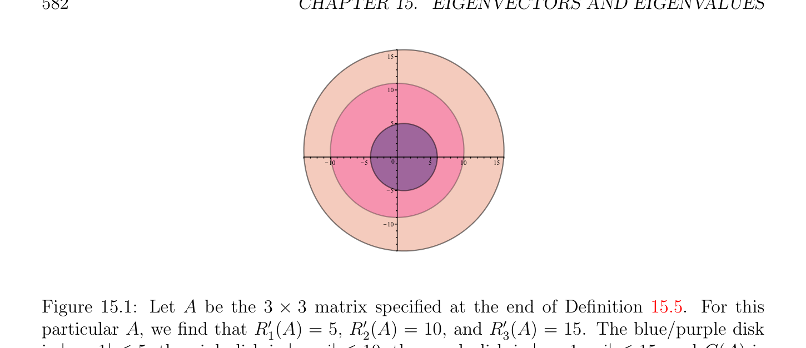
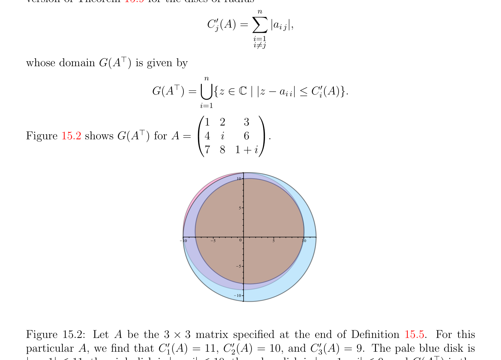

# Location of Eigenvalues

<!-- PAGE 581 -->
$t_{ii} = \overline{t}_{ii}$ for $i = 1, \dots  , n$, which means that the $t_{ii}$ are real, so $T$ is indeed a real diagonal matrix, say $D$. If we apply this result to a (real) symmetric matrix $A$, we obtain the fact that all the eigenvalues of a symmetric matrix are real, and by applying Theorem 15.6 again, we conclude that $A = QDQ^{\top}$, where $Q$ is orthogonal and $D$ is a real diagonal matrix. More general versions of Proposition 15.8 are proven in Chapter $17$. When a real matrix $A$ has complex eigenvalues, there is a version of Theorem 15.6 involving only real matrices provided that we allow $T$ to be block upper-triangular (the diagonal entries may be $2 \times  2$ matrices or real entries). Theorem 15.6 is not a very practical result but it is a useful theoretical result to cope with matrices that cannot be diagonalized. For example, it can be used to prove that every complex matrix is the limit of a sequence of diagonalizable matrices that have distinct eigenvalues!

## 15.3 Location of Eigenvalues

If $A$ is an $n \times  n$ complex (or real) matrix $A$, it would be useful to know, even roughly, where the eigenvalues of $A$ are located in the complex $plane\mathbb{C}$. The Gershgorin discs provide some precise information about this.

> **Definition 15.5.** For any complex $n \times  n$ matrix $A$, for $i = 1, \dots  , n$, let
$$R_{i}'(A) = \sum_{j=1}^{n}  |a_{i j}|$$
$$j\neq i$$
and let
$$G(A) = \bigcup_{i=1}^{n}  {z \in \mathbb{C} | |z -a_{i i}| \le R_{i}'(A)}.$$
Each disc ${z \in \mathbb{C}$ | |z - $a_{i i}| \le R_{i}'(A)}$ is called a Gershgorin disc and their union G(A) is
$$called the Gershgorin domain. An example of Gershgorin domain for A = \begin{pmatrix} 1 & 2 & 3 \\ 4 & i & 6 \\ 7 & 8 & 1 + i \end{pmatrix}$$
is illustrated in Figure 15.1. Although easy to prove, the following theorem is very useful:

> **Theorem 15.9.** (Gershgorin’s disc theorem) For any complex $n\times n$ matrix $A$, all the eigenvalues of $A$ belong to the Gershgorin domain G(A). Furthermore the following properties hold:

<!-- PAGE 582 -->
$$15$$
$$10$$
$$5$$
$$\overline{10}\overline{5}\overline{0}\overline{5}\overline{10}\overline{15}$$
$$5$$
$$10$$

**Figure 15.1:** Let $A$ be the $3 \times  3$ matrix specified at the end of Definition 15.5. For this particular $A$, we find that $R_{1}'(A) = 5, R_{2}'(A) = 10$, and $R_{3}'(A) = 15$. The $blue/purple$ disk is |z - 1| $\le 5$, the pink disk is |z - i| $\le 10$, the peach disk is |z - $1$ - i| $\le 15$, and G(A) is the union of these three disks.
$(1)$ If $A$ is strictly row diagonally dominant, that is
$$|a_{i i}| > \sum_{=1, j\neq}^{n}  |a_{i j}|,for i = 1, \dots  , n,$$
$$ji$$
then $A$ is invertible.
$(2)$ If $A$ is strictly row diagonally dominant, and if $a_{i i} > 0$ for $i = 1, \dots  , n$, then every eigenvalue of $A$ has a strictly positive real part.

*Proof.* Let $\lambda$  be any eigenvalue of $A$ and let $u$ be a corresponding eigenvector (recall that we must have $u \neq  0)$. Let $k$ be an index such that
$$|u_{k}| = \max |u_{i}|.$$
$$1\le i\le n$$
Since Au $= \lambda u$, we have
$$(\lambda  -a_{k k})u_{k} = \sum_{j=1}^{n}  a_{k j}u_{j},$$
$$j\neq k$$
which implies that
$$|\lambda  -a_{k k}||u_{k}| \le \sum_{j=1}^{n}  |a_{k j}||u_{j}| \le |u_{k}| \sum_{j=1}^{n}  |a_{k j}|.$$
$$j\neq kj\neq k$$
Since $u \neq  0$ and $|u_{k}| = max_{1\le i\le n} |u_{i}|$, we must have $|u_{k}|̸ = 0$, and it follows that
$$|\lambda  -a_{k k}| \le \sum_{j=1}^{n}  |a_{k j}| = R_{k}'(A),$$
$$j\neq k$$

<!-- PAGE 583 -->
and thus
$$\lambda  \in {z \in \mathbb{C} | |z -a_{k k}| \le R_{k}'(A)} \subseteq G(A),$$
as claimed.
$(1)$ Strict row diagonal dominance implies that $0$ does not belong to any of the Gershgorin discs, so all eigenvalues of $A$ are nonzero, and $A$ is invertible.
$(2)$ If $A$ is strictly row diagonally dominant and $a_{i i} > 0$ for $i = 1, \dots  , n$, then each of the Gershgorin discs lies strictly in the right half-plane, so every eigenvalue of $A$ has a strictly positive real part. In particular, Theorem 15.9 implies that if a symmetric matrix is strictly row diagonally dominant and has strictly positive diagonal entries, then it is positive definite. Theorem 15.9 is sometimes called the Gershgorin–Hadamard theorem. Since $A$ and $A^{\top}$ have the same eigenvalues (even for complex matrices) we also have a version of Theorem 15.9 for the discs of radius
$$C_{j}'(A) = \sum_{i=1}^{n}  |a_{i j}|,$$
$$i\neq j$$
whose domain $G(A^{\top})$ is given by
$$G(A^{\top}) = \bigcup_{i=1}^{n}  {z \in \mathbb{C} | |z -a_{i i}| \le C_{i}'(A)}.$$
$$Figure 15.2 shows G(A^{\top}) for A = \begin{pmatrix} 1 & 2 & 3 \\ 4 & i & 6 \\ 7 & 8 & 1 + i \end{pmatrix} .$$
$$10$$
$$5$$
$$\overline{10}\overline{5}\overline{0}\overline{5}\overline{10}$$
$$5$$
$$10$$

**Figure 15.2:** Let $A$ be the $3 \times  3$ matrix specified at the end of Definition 15.5. For this particular $A$, we find that $C_{1}'(A) = 11, C_{2}'(A) = 10$, and $C_{3}'(A) = 9$. The pale blue disk is |z - 1| $\le 11$, the pink disk is |z - i| $\le 10$, the ocher disk is |z - $1$ - i| $\le 9$, and $G(A^{\top})$ is the union of these three disks.

<!-- PAGE 584 -->
Thus we get the following:

> **Theorem 15.10.** For any complex $n \times  n$ matrix $A$, all the eigenvalues of $A$ belong to the intersection of the Gershgorin domains G(A) $\cap G(A^{\top})$. See Figure 15.3. Furthermore the following properties hold:
$(1)$ If $A$ is strictly column diagonally dominant, that is
$$|a_{i i}| > \sum_{=1, i\neq j}^{n}  |a_{i j}|,for j = 1, \dots  , n,$$
$$i$$
then $A$ is invertible.
$(2)$ If $A$ is strictly column diagonally dominant, and if $a_{i i} > 0$ for $i = 1, \dots  , n$, then every eigenvalue of $A$ has a strictly positive real part.
$$1515$$
$$1010$$
$$55$$
$$\overline{10}\overline{5}\overline{0}\overline{5}\overline{10}\overline{15}\overline{0}$$
$$\overline{10}\overline{5}\overline{5}\overline{10}\overline{15}$$
$$55$$
$$1010$$
$$G(A   ) Tg G(A)$$
$$G(A   ) Th G(A)$$

**Figure 15.3:** Let $A$ be the $3 \times  3$ matrix specified at the end of Definition 15.5. The colored region in the second figure is G(A) $\cap G(A^{\top})$. There are refinements of Gershgorin’s theorem and eigenvalue location results involving other domains besides discs; for more on this subject, see Horn and Johnson $[98]$, Sections 6.1 and 6.2.
Remark: Neither strict row diagonal dominance nor strict column diagonal dominance are necessary for invertibility. Also, if we relax all strict inequalities to inequalities, then row diagonal dominance (or column diagonal dominance) is not a sufficient condition for invertibility.
