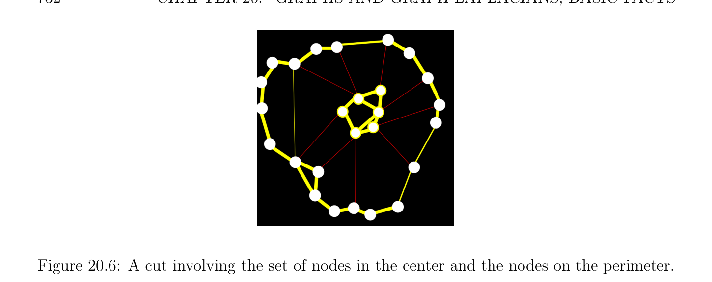

# Graph Clustering Using Normalized Cuts

<!-- PAGE 731 -->

> **Proposition 20.7.** Let $G = (V, W)$ be a weighted graph. The number $c$ of connected components $K_{1}, \dots  , K_{c}$ of the underlying graph of $G$ is equal to the dimension of the nullspace of both $L_{sym}$ and $L_{rw}$, which is equal to the multiplicity of the eigenvalue $0$. Furthermore, the nullspace of $L_{rw}$ has a basis consisting of indicator vectors of the connected components of $G$, that is, vectors $(f_{1}, \dots  , f_{m})$ such that $f_{j} = 1$ iff $v_{j} \in K_{i}$ and $f_{j} = 0$ otherwise. For $L_{sym}$, a basis of the nullpace is obtained by multiplying the above basis of the nullspace of $L_{rw}$ by $D^{1/2}$. A particularly interesting application of graph Laplacians is graph clustering.

## 20.4 Graph Clustering Using Normalized Cuts

In order to explain this problem we need some definitions.

> **Definition 20.20.** Given any subset of nodes $A \subseteq V$ , we define the volume vol(A) of $A$ as the sum of the weights of all edges adjacent to nodes in $A$:
$$vol(A) = \sum_{vi\in A}  \sum_{j=1}^{m}  w_{i j}.$$
Given any two subsets $A, B \subseteq V$ (not necessarily distinct), we define links(A, $B)$ by
$$links(A, B) = \sum_{\in A,vj\in}  w_{i j}.$$
$$viB$$
$$The quantity links(\overline{A, A}) = links(\overline{A, A}) (where \overline{A} \frac{=}{A} V -A denotes the complement of A in$$
$V$ ) measures how many links escape from $A$ (and ). We define the cut of $A$ as
$$cut(A) = links(\overline{A, A}).$$
The notion of volume is illustrated in Figure 20.5 and the notions of cut is illustrated in Figure 20.6.
$$Figure 20.5: Volume of a set of nodes.$$

<!-- PAGE 732 -->

**Figure 20.6:** A cut involving the set of nodes in the center and the nodes on the perimeter. The above concepts play a crucial role in the theory of normalized cuts. This beautiful and deeply original method first published in Shi and Malik $[166]$, has now come to be a “textbook chapter” of computer vision and machine learning. It was invented by Jianbo Shi and Jitendra Malik and was the main topic of Shi’s dissertation. This method was extended to $K \ge 3$ clusters by Stella Yu in her dissertation $[197]$ and is also the subject of Yu and Shi $[199]$. Given a set of data, the goal of clustering is to partition the data into different groups according to their similarities. When the data is given in terms of a similarity graph $G$, where the weight $w_{i j}$ between two nodes $v_{i}$ and $v_{j}$ is a measure of similarity of $v_{i}$ and $v_{j}$, the problem can be stated as follows: Find a partition $(A_{1}, \dots  , A_{K})$ of the set of nodes $V$ into different groups such that the edges between different groups have very low weight (which indicates that the points in different clusters are dissimilar), and the edges within a group have high weight (which indicates that points within the same cluster are similar). The above graph clustering problem can be formalized as an optimization problem, using the notion of cut mentioned earlier. If we want to partition $V$ into $K$ clusters, we can do so by finding a partition $(A_{1}, \dots  , A_{K})$ that minimizes the quantity
$$cut(A_{1}, \dots  , A_{K}) = \frac{1}{2} \sum_{i=1}^{K}  cut(A_{i}) = \frac{1}{2} \sum_{i=1}^{K}  links(A_{i}\overline{, A}_{i}).$$
For $K = 2$, the mincut problem is a classical problem that can be solved efficiently, but in practice, it does not yield satisfactory partitions. Indeed, in many cases, the mincut solution separates one vertex from the rest of the graph. What we need is to design our cost function in such a way that it keeps the subsets $A_{i}$ “reasonably large” (reasonably balanced). An example of a weighted graph and a partition of its nodes into two clusters is shown in Figure 20.7.
