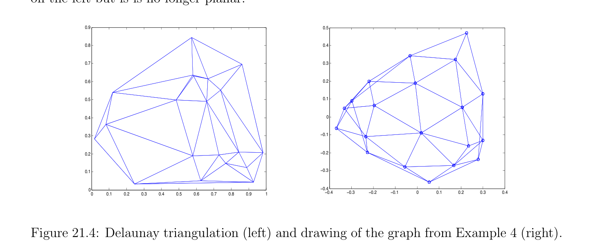

# Examples of Graph Drawings

<!-- PAGE 740 -->
first coordinate. This would mean that the drawing lives in a hyperplane in $\mathbb{R}^{n}$, which is undesirable, especially when $n = 2$, where all vertices would be collinear. This is why we omit the first eigenvector $u_{1}$. Observe that for any orthogonal $n \times  n$ matrix $Q$, since
$$\mathrm{tr}(R^{\top}LR) = \mathrm{tr}(Q^{\top}R^{\top}LRQ),$$
the matrix $RQ$ also yields a minimum orthogonal graph drawing. This amounts to applying the rigid motion $Q^{\top}$ to the rows of $R$.
$$\mathbb{R}^{2}$$
In summary, if $\lambda_{2}  > 0$, an automatic method for drawing a graph in is this: $1$. Compute the two smallest nonzero eigenvalues $\lambda_{2}  \le \lambda_{3}$  of the graph Laplacian $L$ (it is possible that $\lambda_{3}  = \lambda_{2}$  if $\lambda_{2}$  is a multiple eigenvalue); $2$. Compute two unit eigenvectors $u_{2}, u_{3}$ associated with $\lambda_{2}$  and $\lambda_{3}$ , and let $R = [u_{2} u_{3}]$ be the $m \times  2$ matrix having $u_{2}$ and $u_{3}$ as columns. $3$. Place vertex $v_{i}$ at the point whose coordinates is the ith row of $R$, that is, $(R_{i1}, R_{i2})$. This method generally gives pleasing results, but beware that there is no guarantee that distinct nodes are assigned distinct images since $R$ can have identical rows. This does not seem to happen often in practice.

## 21.2 Examples of Graph Drawings

We now give a number of examples using Matlab. Some of these are borrowed or adapted from Spielman $[169]$. Example $1$. Consider the graph with four nodes whose adjacency matrix is
$$A = \begin{pmatrix} 0 & 1 & 1 & 0 \\ 1 & 0 & 0 & 1 \\ 1 & 0 & 0 & 1 \\ 0 & 1 & 1 & 0 \end{pmatrix} .$$
We use the following program to compute $u_{2}$ and $u_{3}: A = [0 1 1 0; 1 0 0 1; 1 0 0 1; 0 1 1 0]; D =$ diag(sum(A)); $L = D$ - $A; [v, e] =$ eigs(L); gplot(A, v(:,[3 $2]))$ hold on; gplot(A, v(:,[3 2]),’o’)

<!-- PAGE 741 -->
$$0.8$$
$$0.6$$
$$0.4$$
$$0.2$$
$$0$$
$$-0.2$$
$$-0.4$$
$$-0.6$$
$$-0.8\overline{-0.8}\overline{-0.6}\overline{-0.4}\overline{-0.2}\overline{0}\overline{0.2}\overline{0.4}\overline{0.6}\overline{0.8}$$
$$Figure 21.1: Drawing of the graph from Example 1.$$
The graph of Example $1$ is shown in Figure 21.1. The function eigs(L) computes the six largest eigenvalues of $L$ in decreasing order, and corresponding eigenvectors. It turns out that $\lambda_{2}  = \lambda_{3}  = 2$ is a double eigenvalue. Example $2$. Consider the graph $G_{2}$ shown in Figure 20.3 given by the adjacency matrix
$$A = \begin{pmatrix} 0 & 1 & 1 & 0 & 0 \\ 1 & 0 & 1 & 1 & 1 \\ 1 & 1 & 0 & 1 & 0 \\ 0 & 1 & 1 & 0 & 1 \\ 0 & 1 & 0 & 1 & 0 \end{pmatrix} .$$
We use the following program to compute $u_{2}$ and $u_{3}: A = [0 1 1 0 0; 1 0 1 1 1; 1 1 0 1 0; 0 1 1 0 1; 0 1 0 1 0]; D =$ diag(sum(A)); $L = D$ - $A; [v, e] =$ eig(L); gplot(A, $v(:, [2 3]))$ hold on gplot(A, $v(:, [2$ 3]),’o’) The function eig(L) (with no $s$ at the end) computes the eigenvalues of $L$ in increasing order. The result of drawing the graph is shown in Figure 21.2. Note that node $v_{2}$ is assigned to the point $(0, 0)$, so the difference between this drawing and the drawing in Figure 20.3 is that the drawing of Figure 21.2 is not convex. Example $3$. Consider the ring graph defined by the adjacency matrix $A$ given in the Matlab program shown below:

<!-- PAGE 742 -->
$$0.6$$
$$0.4$$
$$0.2$$
$$0$$
$$-0.2$$
$$-0.4$$
$$-0.6$$
$$-0.8\overline{-0.8}\overline{-0.6}\overline{-0.4}\overline{-0.2}\overline{0}\overline{0.2}\overline{0.4}\overline{0.6}\overline{0.8}$$
$$Figure 21.2: Drawing of the graph from Example 2.$$
$A =$ diag(ones(1, 11),1); $A = A +$ A’; A(1, $12) = 1$; A(12, $1) = 1; D =$ diag(sum(A)); $L = D$ - $A; [v, e] =$ eig(L); gplot(A, $v(:, [2 3]))$ hold on gplot(A, $v(:, [2$ 3]),’o’)
$$0.5$$
$$0.4$$
$$0.3$$
$$0.2$$
$$0.1$$
$$0$$
$$-0.1$$
$$-0.2$$
$$-0.3$$
$$-0.4$$
$$-0.5\overline{-0.5}\overline{-0.4}\overline{-0.3}\overline{-0.2}\overline{-0.1}\overline{0}\overline{0.1}\overline{0.2}\overline{0.3}\overline{0.4}\overline{0.5}$$
$$Figure 21.3: Drawing of the graph from Example 3.$$
Observe that we get a very nice ring; see Figure 21.3. Again $\lambda_{2}  =$ 0.2679 is a double eigenvalue (and so are the next pairs of eigenvalues, except the last, $\lambda_{12}  = 4)$.

<!-- PAGE 743 -->
Example $4$. In this example adapted from Spielman, we generate $20$ randomly chosen points in the unit square, compute their Delaunay triangulation, then the adjacency matrix of the corresponding graph, and finally draw the graph using the second and third eigenvalues of the Laplacian. $A =$ zeros(20,20); xy $=$ rand(20, $2)$; trigs $=$ delaunay(xy(:,1), xy(:,2)); elemtrig $=$ ones(3) - eye(3); for $i =$ 1:length(trigs), A(trigs(i,:),trigs(i,:)) $=$ elemtrig; end $A =$ double(A $>0)$; gplot(A,xy) $D =$ diag(sum(A)); $L = D$ - $A; [v, e] =$ eigs(L, $3$, ’sm’); figure(2) gplot(A, $v(:, [2 1]))$ hold on gplot(A, $v(:, [2$ 1]),’o’) The Delaunay triangulation of the set of $20$ points and the drawing of the corresponding graph are shown in Figure 21.4. The graph drawing on the right looks nicer than the graph on the left but is is no longer planar.
$$0.90.5$$
$$0.80.4$$
$$0.70.3$$
$$0.60.2$$
$$0.50.1$$
$$0.40$$
$$0.3-0.1$$
$$0.2-0.2$$
$$0.1-0.3$$
$$0-0.4\overline{-0.4}\overline{-0.3}\overline{-0.2}\overline{-0.1}\overline{0}\overline{0.1}\overline{0.2}\overline{0.3}\overline{0.4}$$
$$\overline{0}\overline{0.1}\overline{0.2}\overline{0.3}\overline{0.4}\overline{0.5}\overline{0.6}\overline{0.7}\overline{0.8}\overline{0.9} 1$$

**Figure 21.4:** Delaunay triangulation (left) and drawing of the graph from Example $4$ (right). Example $5$. Our last example, also borrowed from Spielman $[169]$, corresponds to the skeleton of the “Buckyball,” a geodesic dome invented by the architect Richard Buckminster
