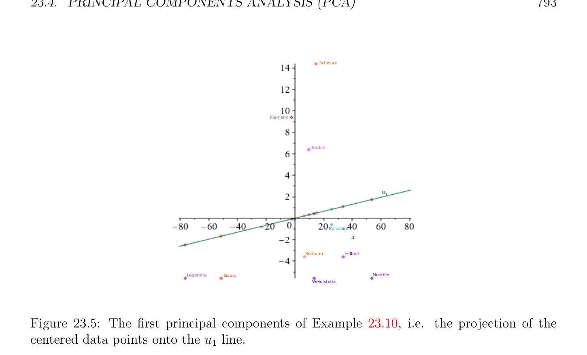
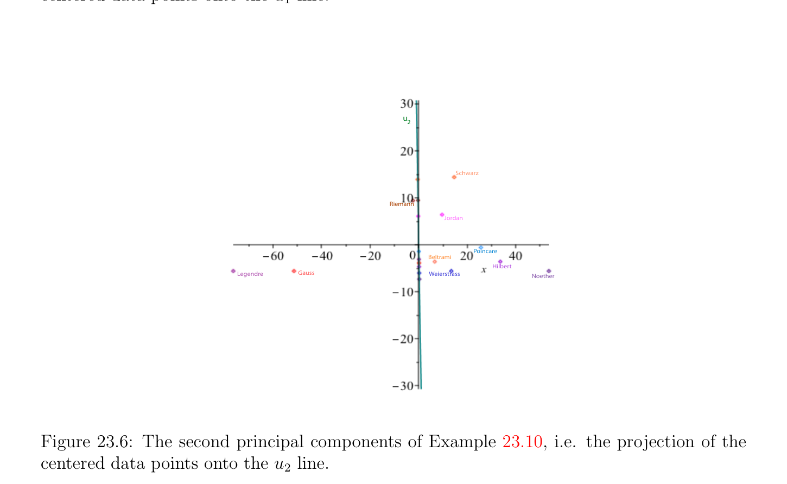

# Principal Components Analysis (PCA)

<!-- PAGE 783 -->
with
$$U = \begin{pmatrix} -0.5286 & -0.6149 & 0.3017 & -0.5016 \\ -0.3803 & -0.3963 & -0.0933 & 0.8304 \\ -0.5520 & 0.2716 & -0.7603 & -0.2086 \\ 0.5209 & 0.6254 & 0.5676 & 0.1237 \end{pmatrix} , D = \begin{pmatrix} 30.2887 & 0 & 0 & 0 \\ 0 & 3.8581 & 0 & 0 \\ 0 & 0 & 0.8431 & 0 \\ 0 & 0 & 0 & 0.0102 \end{pmatrix} .$$
$$-$$
If we set $\sigma_{3}  = \sigma_{4}  = 0$, we obtain the best rank $2$ approximation
$$A_{2} = U(:, 1 : 2) *D(:, 1 : 2) *U(:, 1 : 2)' = \begin{pmatrix} 9.9207 & 7.0280 & 8.1923 & 6.8563 \\ 7.0280 & 4.9857 & 5.9419 & 5.0436 \\ 8.1923 & 5.9419 & 9.5122 & 9.3641 \\ 6.8563 & 5.0436 & 9.3641 & 9.7282 \end{pmatrix} .$$
A nice example of the use of Proposition 23.9 in image compression is given in Demmel $[48]$, Chapter $3$, Section 3.2.3, pages 113–115; see the Matlab demo. Proposition 23.9 also holds for the Frobenius norm; see Problem 23.4. An interesting topic that we have not addressed is the actual computation of an SVD. This is a very interesting but tricky subject. Most methods reduce the computation of an SVD to the diagonalization of a well-chosen symmetric matrix which is not $A^{\top}A$; see
Problem 22.1 and Problem 22.3. Interested readers should read Section 5.4 of Demmel’s excellent book $[48]$, which contains an overview of most known methods and an extensive list of references.

## 23.4 Principal Components Analysis (PCA)

$$\mathbb{R}^{d}$$
Suppose we have a set of data consisting of $n$ points $X_{1}, \dots  , X_{n}$, with each $X_{i} \in$ viewed as a row vector. Think of the $X_{i}’s$ as persons, and if $X_{i} = (x_{i1}, \dots  , x_{i d})$, each $x_{i j}$ is the value of some feature (or attribute) of that person.

> **Example 23.5.** For example, the $X_{i}’s$ could be mathematicians, $d = 2$, and the first component, $x_{i1}$, of $X_{i}$ could be the year that $X_{i}$ was born, and the second component, $x_{i2}$, the length of the beard of $X_{i}$ in centimeters. Here is a small data set.

<!-- PAGE 784 -->
$$\frac{\overline{Name}\overline{year}\overline{length}}{CarlFriedrichGauss17770}$$
$$\frac{CamilleJordan183812}{Adrien-MarieLegendre17520}$$
$$\frac{BernhardRiemann182615}{DavidHilbert18622}$$
$$\frac{HenriPoincar´e18545}{EmmyNoether18820}$$
$$\frac{KarlWeierstrass18150}{EugenioBeltrami18352}$$
$$Hermann Schwarz184320$$
We usually form the $n \times  d$ matrix $X$ whose ith row is $X_{i}$, with $1 \le i \le n$. Then the jth column is denoted by $C_{j} (1 \le j \le d)$. It is sometimes called a feature vector, but this terminology is far from being universally accepted. In fact, many people in computer vision call the data points $X_{i}$ feature vectors! The purpose of principal components analysis, for short PCA, is to identify patterns in data and understand the variance–covariance structure of the data. This is useful for the following tasks: $1$. Data reduction: Often much of the variability of the data can be accounted for by a smaller number of principal components. $2$. Interpretation: PCA can show relationships that were not previously suspected. Given a vector (a sample of measurements) $x = (x_{1}, \dots  , x_{n}) \in \mathbb{R}^{n}$, recall that the mean (or average) $\overline{x}$ of $x$ is given by
$$\overline{x} = \sum_{i}  \frac{x_{i}}{n} n=1 .$$
We let $x$ - $\overline{x}$ denote the centered data point
$$x -\overline{x} = (x_{1} -\overline{x, \dots  , x}_{n} -\overline{x}).$$
In order to measure the spread of the $x_{i}’s$ around the mean, we define the sample variance (for short, variance) var(x) (or $s^{2})$ of the sample $x$ by
$$var(x) = \sum_{i}  \frac{(x_{i}\overline{x})^{2}}{n -1} n=1 -.$$

> **Example 23.6.** If $x = (1, 3, -1), \overline{x} =_{3}^{1+3-1} = 1, x$ - $\overline{x} = (0, 2, -2)$, and var(x) $= 02+22+(-2)2$
$$= 4. If y = (1, 2, 3),\overline{y} =^{1+2+3}= 2, y -\overline{y} = (-1, 0, 1), and var(y) =_{2}^{(-1)2+02+12}=$$
$\overline{2} \overline{3} 2$.

<!-- PAGE 785 -->
There is a reason for using $n$ - $1$ instead of $n$. The above definition makes var(x) an unbiased estimator of the variance of the random variable being sampled. However, we don’t need to worry about this. Curious readers will find an explanation of these peculiar definitions in Epstein $[58]$ (Chapter $14$, Section 14.5) or in any decent statistics book. Given two vectors $x = (x_{1}, \dots  , x_{n})$ and $y = (y_{1}, \dots  , y_{n})$, the sample covariance (for short, covariance) of $x$ and $y$ is given by
$$cov(x, y) = \sum_{i}  \frac{(x_{i}\overline{x})(y_{i}\overline{y})}{n -1} n=1 - -.$$

> **Example 23.7.** If we take $x = (1, 3, -1)$ and $y = (1, 2, 3)$, we know from Example 23.6 that $x$ - $\overline{x} = (0, 2, -2)$ and $y$ - $\overline{y} = (-1, 0, 1)$. Thus, cov(x, $y) =^{0(-1)+2(0)+(-2)(1)} = -1$.
$$\overline{2}$$
The covariance of $x$ and $y$ measures how $x$ and $y$ vary from the mean with respect to each other. Obviously, cov(x, $y) =$ cov(y, $x)$ and cov(x, $x) =$ var(x). Note that
$$cov(x, y) = \frac{(x\overline{x})^{\top}(y\overline{y})}{n -1} - -.$$
We say that $x$ and $y$ are uncorrelated iff cov(x, $y) = 0$. Finally, given an $n \times  d$ matrix $X$ of $n$ points $X_{i}$, for PCA to be meaningful, it will be necessary to translate the origin to the centroid (or center of gravity) $\mu$  of the $X_{i}’s$, defined by
$$\mu  = \frac{1}{n} (X_{1} + \cdots  + X_{n}).$$
Observe that if $\mu  = (\mu_{1} , \dots  , \mu_{d}$ ), then $\mu_{j}$  is the mean of the vector $C_{j}$ (the jth column of $X)$. We let $X$ - $\mu$  denote the matrix whose ith row is the centered data point $X_{i}$ - $\mu  (1 \le i \le n)$. Then the sample covariance matrix (for short, covariance matrix) of $X$ is the $d \times  d$ symmetric matrix
$$\Sigma  = \frac{1}{n -1} (X -\mu )^{\top}(X -\mu ) = (cov(C_{i}, C_{j})).$$
$$Example 23.8. Let X = \begin{pmatrix} 1 & 1 \\ 3 & 2 \\ 1 & 3 \end{pmatrix} , the 3 \times  2 matrix whose columns are the vector x and$$
$$-$$
$y$ of Example 23.6. Then
$$1$$
$$\mu  =3 [(1, 1) + (3, 2) + (-1, 3)] = (1, 2),$$
$$X -\mu  = \begin{pmatrix} 0 & -1 \\ 2 & 0 \\ 2 & 1 \end{pmatrix} ,$$
$$-$$

<!-- PAGE 786 -->
and
$$\Sigma  = \frac{1}{2} \begin{pmatrix} 0 & 2 & -2 \\ -1 & 0 & 1 \end{pmatrix} \begin{pmatrix} 0 & -1 \\ 2 & 0 \\ 2 & 1 \end{pmatrix} = \begin{pmatrix} 4 & -1 \\ -1 & 1 \end{pmatrix} .$$
$$-$$
Remark: The $factor_{n-1}^{1}$ is irrelevant for our purposes and can be ignored.

> **Example 23.9.** Here is the matrix $X -\mu$  in the case of our bearded mathematicians: since
$$\mu_{1}  = 1828.4,\mu_{2}  = 5.6,$$
we get the following centered data set.
$$\frac{\overline{Name}\overline{year}\overline{length}}{CarlFriedrichGauss-51.4-5.6}$$
$$\frac{CamilleJordan9.66.4}{Adrien-MarieLegendre-76.4-5.6}$$
$$\frac{BernhardRiemann2.49.4}{DavidHilbert33.6-3.6}$$
$$\frac{-}{HenriPoincar´e25.6-0.6}$$
$$\frac{EmmyNoether53.65.6}{KarlWeierstrass13.4-5.6}$$
$$\frac{-}{EugenioBeltrami6.6-3.6}$$
$$Hermann Schwarz14.614.4$$
See Figure 23.3. We can think of the vector $C_{j}$ as representing the features of $X$ in the direction $e_{j}$ (the jth canonical basis vector in $\mathbb{R}^{d}$, namely $e_{j} = (0, \dots  , 1, \dots  0)$, with a $1$ in the jth position).
$$\mathbb{R}^{d}$$
If $v \in$ is a unit vector, we wish to consider the projection of the data points $X_{1}, \dots  , X_{n}$
$$\mathbb{R}^{d}$$
onto the line spanned by $v$. Recall from Euclidean geometry that if $x \in$ is any vector
$$\mathbb{R}^{d}$$
and $v \in$ is a unit vector, the projection of $x$ onto the line spanned by $v$ is
$$\langle x, v\rangle v.$$
Thus, with respect to the basis $v$, the projection of $x$ has coordinate $\langle x, v\rangle$ . If $x$ is represented by a row vector and $v$ by a column vector, then
$$\langle x, v\rangle = xv.$$
$$\mathbb{R}^{n}$$
Therefore, the vector $Y \in$ consisting of the coordinates of the projections of $X_{1}, \dots  , X_{n}$ onto the line spanned by $v$ is given by $Y =$ Xv, and this is the linear combination
$$Xv = v_{1}C_{1} + \cdots  + v_{d}C_{d}$$

<!-- PAGE 787 -->
$$Schwarz$$
$$Riemann$$
$$Jordan$$
$$Poincare$$
$$BeltramiHilbert$$
$$LegendreGaussWeierstrass$$
$$Noether$$
$$Figure 23.3: The centered data points of Example 23.9.$$
of the columns of $X$ (with $v = (v_{1}, \dots  , v_{d}))$. Observe that because $\mu_{j}$  is the mean of the vector $C_{j}$ (the jth column of $X)$, we get
$$\overline{Y} =\overline{Xv} = v_{1}\mu_{1}  + \cdots  + v_{d}\mu_{d} ,$$
and so the centered point $Y$ - $\overline{Y}$ is given by
$$Y -\overline{Y} = v_{1}(C_{1} -\mu_{1} ) + \cdots  + v_{d}(C_{d} -\mu_{d} ) = (X -\mu )v.$$
Furthermore, if $Y =$ Xv and $Z =$ Xw, then
$$- -$$
$$cov(Y, Z)= \frac{((X\mu )v)^{\top}(X\mu )w}{n -1}$$
$$=v^{\top} \frac{1}{n -1} (X -\mu )^{\top}(X -\mu )w$$
$$=v^{\top}\Sigma w,$$
where $\Sigma$  is the covariance matrix of $X$. Since $Y$ - $\overline{Y}$ has zero mean, we have
$$var(Y ) = var(Y -\overline{Y}\overline{) =} v^{\top} \frac{1}{n -1} (X -\mu )^{\top}(X -\mu )v.$$
The above suggests that we should move the origin to the centroid $\mu$  of the $X_{i}’s$ and consider the matrix $X$ - $\mu$  of the centered data points $X_{i}$ - $\mu$ . From now on beware that we denote the columns of $X$ - $\mu$  by $C_{1}, \dots  , C_{d}$ and that $Y$
$$denotes the centered point Y = (X -\mu )v = \sum_{j}  d=1 v_{j}C_{j}, where v is a unit vector.$$

<!-- PAGE 788 -->
Basic idea of PCA: The principal components of $X$ are uncorrelated projections $Y$ of the data points $X_{1}, \dots , X_{n}$ onto some directions $v$ (where the v’s are unit vectors) such that var(Y ) is maximal. This suggests the following definition:

> **Definition 23.2.** Given an $n\times  d$ matrix $X$ of data points $X_{1}, \dots  , X_{n}$, if $\mu$  is the centroid of the $X_{i}’s$, then a first principal component of $X$ (first PC) is a centered point $Y_{1} = (X -\mu )v_{1}$, the projection of $X_{1}, \dots  , X_{n}$ onto a direction $v_{1}$ such that $var(Y_{1})$ is maximized, where $v_{1}$ is a unit vector (recall that $Y_{1} = (X$ - $\mu )v_{1}$ is a linear combination of the $C_{j}’s$, the columns of $X$ - $\mu$ ). More generally, if $Y_{1}, \dots  , Y_{k}$ are $k$ principal components of $X$ along some unit vectors $v_{1}, \dots  , v_{k}$, where $1 \le k < d$, a $(k+1)th$ principal component of $X ((k+1)th$ PC) is a centered point $Y_{k+1} = (X$ - $\mu )v_{k+1}$, the projection of $X_{1}, \dots  , X_{n}$ onto some direction $v_{k+1}$ such that $var(Y_{k+1})$ is maximized, subject to $cov(Y_{h}, Y_{k+1}) = 0$ for all $h$ with $1 \le h \le k$, and where $v_{k+1}$ is a unit vector (recall that $Y_{h} = (X$ - $\mu )v_{h}$ is a linear combination of the $C_{j}’s)$. The $v_{h}$ are called principal directions. The following proposition is the key to the main result about PCA. This result was already proven in Proposition 17.23 except that the eigenvalues were listed in increasing order. For the reader’s convenience we prove it again.

> **Proposition 23.10.** If $A$ is a symmetric $d \times  d$ matrix with eigenvalues $\lambda_{1}  \ge \lambda_{2}  \ge \cdots  \ge \lambda_{d}$  and if $(u_{1}, \dots  , u_{d})$ is any orthonormal basis of eigenvectors of $A$, where $u_{i}$ is a unit eigenvector associated with $\lambda_{i}$ , then
$$maxx\neq 0 \frac{x^{\top}Ax}{x^{\top}x} = \lambda_{1}$$
(with the maximum attained for $x = u_{1})$ and
$$x\neq 0,x\in {maxu,...,u}\perp \frac{x^{\top}Ax}{x^{\top}x} = \lambda_{k+1}$$
$$1k$$
(with the maximum attained for $x = u_{k+1})$, where $1 \le k \le d$ - $1$.

*Proof.* First observe that
$$maxx\neq 0 \frac{x^{\top}Ax}{x^{\top}x} = maxx {x^{\top}Ax | x^{\top}x = 1},$$
and similarly,
$$x\neq 0,x\in {maxu,...,u}\perp \frac{x^{\top}Ax}{x^{\top}x} = maxxx^{\top}Ax | (x \in {u_{1}, \dots  , u_{k}}^{\perp}) \wedge (x^{\top}x = 1).$$
$$1k$$

<!-- PAGE 789 -->
Since $A$ is a symmetric matrix, its eigenvalues are real and it can be diagonalized with respect to an orthonormal basis of eigenvectors, so let $(u_{1}, \dots  , u_{d})$ be such a basis. If we write
$$x = \sum_{i=1}^{d}  x_{i}u_{i},$$
a simple computation shows that
$$x^{\top}Ax = \sum_{i=1}^{d}  \lambda_{i} x_{i}^{2} .$$
$$If x^{\top}x = 1, then \sum_{i}  d=1 x_{i}^{2} = 1, and since we assumed that \lambda_{1}  \ge \lambda_{2}  \ge \cdots  \ge \lambda_{d} , we get$$
$$x^{\top}Ax = \sum_{i=1}^{d}  \lambda_{i} x_{i}^{2} \le \lambda_{1} \begin{pmatrix} x_{i}^{2} \end{pmatrix} \sum_{i=1}^{d}  = \lambda_{1} .$$
Thus,
$$\maxx^{\top}Ax | x^{\top}x = 1\le \lambda_{1} ,$$
$$x$$
and since this maximum is achieved for $e_{1} = (1, 0, \dots  , 0)$, we conclude that
$$\maxx^{\top}Ax | x^{\top}x = 1= \lambda_{1} .$$
$$x$$
$$Next observe that x \in {u_{1}, \dots  , u_{k}}^{\perp}and x^{\top}x = 1 iff x_{1} = \cdots  = x_{k} = 0 and \sum_{i}  d=1 x_{i} = 1.$$
Consequently, for such an $x$, we have
$$x^{\top}Ax = \sum_{i=k+1}^{d}  \lambda_{i} x_{i}^{2} \le \lambda_{k+1} \begin{pmatrix} x_{i}^{2} \end{pmatrix} \sum_{i=k+1}^{d}  = \lambda_{k+1} .$$
Thus,
$$\maxx^{\top}Ax | (x \in {u_{1}, \dots  , u_{k}}^{\perp}) \wedge (x^{\top}x = 1)\le \lambda_{k+1} ,$$
$$x$$
and since this maximum is achieved for $e_{k+1} = (0, \dots  , 0, 1, 0, \dots  , 0)$ with a $1$ in position $k+1$, we conclude that
$$\maxx^{\top}Ax | (x \in {u_{1}, \dots  , u_{k}}^{\perp}) \wedge (x^{\top}x = 1)= \lambda_{k+1} ,$$
$$x$$
as claimed. The quantity
$$\frac{x^{\top}Ax}{x^{\top}x}$$

<!-- PAGE 790 -->
is known as the Rayleigh ratio or Rayleigh–Ritz ratio (see Section 17.6 ) and Proposition 23.10 is often known as part of the Rayleigh–Ritz theorem. Proposition 23.10 also holds if $A$ is a Hermitian matrix and if we replace $x^{\top}Ax$ by $x^{*}Ax$ and $x^{\top}x$ by $x^{*}x$. The proof is unchanged, since a Hermitian matrix has real eigenvalues and is diagonalized with respect to an orthonormal basis of eigenvectors (with respect to the Hermitian inner product). We then have the following fundamental result showing how the SVD of $X$ yields the PCs:

> **Theorem 23.11.** (SVD yields PCA) Let $X$ be an $n \times  d$ matrix of data points $X_{1}, \dots  , X_{n}$, and let $\mu$  be the centroid of the $X_{i}’s$. If $X$ - $\mu  = V DU^{\top}$ is an SVD decomposition of $X$ - $\mu$ and if the main diagonal of $D$ consists of the singular values $\sigma_{1}  \ge \sigma_{2}  \ge \cdots  \ge \sigma_{d}$ , then the centered points $Y_{1}, \dots  , Y_{d}$, where
$$Y_{k} = (X -\mu )u_{k} = kth column of V D$$
and $u_{k}$ is the kth column of $U$, are $d$ principal components of $X$. Furthermore,
$$var(Y_{k}) = \frac{\sigma_{k}^{2}}{n -1}$$
and $cov(Y_{h}, Y_{k}) = 0$, whenever $h \neq  k$ and $1 \le k, h \le d$.

*Proof.* Recall that for any unit vector $v$, the centered projection of the points $X_{1}, \dots  , X_{n}$ onto the line of direction $v$ is $Y = (X$ - $\mu )v$ and that the variance of $Y$ is given by
$$var(Y ) = v^{\top} \frac{1}{n -1} (X -\mu )^{\top}(X -\mu )v.$$
Since $X$ - $\mu  = V DU^{\top}$ , we get
$$var(Y )=v^{\top} \frac{1}{(n -1)} (X -\mu )^{\top}(X -\mu )v$$
$$=v^{\top} \frac{1}{(n -1)} UDV^{\top} V DU^{\top}v$$
$$=v^{\top}U \frac{1}{(n -1)} D^{2}U^{\top}v.$$
Similarly, if $Y = (X$ - $\mu )v$ and $Z = (X$ - $\mu )w$, then the covariance of $Y$ and $Z$ is given by
$$cov(Y, Z) = v^{\top}U \frac{1}{(n -1)} D^{2}U^{\top}w.$$
Obviously, $U_{(n-1)}^{1}D^{2}U^{\top}$ is a symmetric matrix whose eigenvalues $are_{n-1}^{\sigma12} \ge \cdots  \ge_{n-1}^{\sigma d2}$ , and the columns of $U$ form an orthonormal basis of unit eigenvectors.

<!-- PAGE 791 -->
We proceed by induction on $k$. For the base case, $k = 1$, maximizing var(Y ) is equivalent to maximizing
$$v^{\top}U \frac{1}{(n -1)} D^{2}U^{\top}v,$$
where $v$ is a unit vector. By Proposition 23.10, the maximum of the above quantity is the largest eigenvalue of $U_{(n-1)}^{1}D^{2}U^{\top}, namely_{n-1}^{\sigma12}$, and it is achieved for $u_{1}$, the first columnn of $U$. Now we get
$$Y_{1} = (X -\mu )u_{1} = V DU^{\top} u_{1},$$
and since the columns of $U$ form an orthonormal basis, $U^{\top} u_{1} = e_{1} = (1, 0, \dots  , 0)$, and so $Y_{1}$ is indeed the first column of $V D$. By the induction hypothesis, the centered points $Y_{1}, \dots  , Y_{k}$, where $Y_{h} = (X$ - $\mu )u_{h}$ and $u_{1}, \dots  , u_{k}$ are the first $k$ columns of $U$, are $k$ principal components of $X$. Because
$$cov(Y, Z) = v^{\top}U \frac{1}{(n -1)} D^{2}U^{\top}w,$$
where $Y = (X$ - $\mu )v$ and $Z = (X$ - $\mu )w$, the condition $cov(Y_{h}, Z) = 0$ for $h = 1, \dots  , k$ is equivalent to the fact that $w$ belongs to the orthogonal complement of the subspace spanned by ${u_{1}, \dots  , u_{k}}$, and maximizing var(Z) subject to $cov(Y_{h}, Z) = 0$ for $h = 1, \dots  , k$ is equivalent to maximizing
$$w^{\top}U \frac{1}{(n -1)} D^{2}U^{\top}w,$$
where $w$ is a unit vector orthogonal to the subspace spanned by ${u_{1}, \dots  , u_{k}}$. By Proposition 23.10, the maximum of the above quantity is the $(k+1)th$ eigenvalue of $U_{(n-1)}^{1}D^{2}U^{\top}$, namely $\sigma 2 k+1$ , and it is achieved for $u_{k+1}$, the $(k +$ 1)th columnn of $U$. Now we get $\overline{n}\overline{-}\overline{1}$
$$Y_{k+1} = (X -\mu )u_{k+1} = V DU^{\top} u_{k+1},$$
and since the columns of $U$ form an orthonormal basis, $U^{\top} u_{k+1} = e_{k+1}$, and $Y_{k+1}$ is indeed the $(k +$ 1)th column of $V D$, which completes the proof of the induction step. The $d$ columns $u_{1}, \dots  , u_{d}$ of $U$ are usually called the principal directions of $X$ - $\mu$  (and $X)$. We note that not only do we have $cov(Y_{h}, Y_{k}) = 0$ whenever $h \neq  k$, but the directions $u_{1}, \dots  , u_{d}$ along which the data are projected are mutually orthogonal.

> **Example 23.10.** For the centered data set of our bearded mathematicians (Example 23.9) we have $X$ - $\mu  = V \Sigma U^{\top}$ , where $\Sigma$  has two nonzero singular values, $\sigma_{1}  =$ 116.9803, $\sigma_{2}  =$ 21.7812, and with
$$U = \begin{pmatrix} 0.9995 & 0.0325 \\ 0.0325 & -0.9995 \end{pmatrix} ,$$

<!-- PAGE 792 -->
so the principal directions are $u_{1} =$ (0.9995, 0.0325) and $u_{2} =$ (0.0325, -0.9995). Observe that $u_{1}$ is almost the direction of the x-axis, and $u_{2}$ is almost the opposite direction of the y-axis. We also find that the projections $Y_{1}$ and $Y_{2}$ along the principal directions are
$$V D = \begin{pmatrix} -51.5550 & 3.9249 \\ 9.8031 & -6.0843 \\ -76.5417 & 3.1116 \\ -2.0929 & -9.4731 \\ 33.4651 & 4.6912 \\ 25.5669 & 1.4325 \\ 53.3894 & 7.3408 \\ 13.2107 & 6.0330 \\ 6.4794 & 3.8128 \\ 15.0607 & 13.9174 \end{pmatrix} ,withX -\mu  = \begin{pmatrix} -51.4000 & -5.6000 \\ 9.6000 & 6.4000 \\ -76.4000 & -5.6000 \\ -2.4000 & 9.4000 \\ 33.6000 & -3.6000 \\ 25.6000 & -0.6000 \\ 53.6000 & -5.6000 \\ 13.4000 & -5.6000 \\ 6.6000 & -3.6000 \\ 14.6000 & 14.4000 \end{pmatrix} .$$
$$-$$
See Figures 23.4, 23.5, and 23.6.
$$u$$
$$2$$
$$Schwarz$$
$$Riemann$$
$$Jordan$$
$$u1$$
$$Poincaire$$
$$BeltramiHilbert$$
$$LegendreGaussWeierstrassNoether$$

**Figure 23.4:** The centered data points of Example 23.9 and the two principal directions of

> **Example 23.10.** We know from our study of SVD that $\sigma_{1}^{2} , \dots  , \sigma_{d}^{2}$  are the eigenvalues of the symmetric positive semidefinite matrix $(X$ - $\mu )^{\top}(X$ - $\mu$ ) and that $u_{1}, \dots  , u_{d}$ are corresponding eigenvectors. Numerically, it is preferable to use SVD on $X -\mu$  rather than to compute explicitly $(X$ - $\mu )^{\top}(X$ - $\mu$ ) and then diagonalize it. Indeed, the explicit computation of $A^{\top}A$ from a matrix $A$ can be numerically quite unstable, and good SVD algorithms avoid computing $A^{\top}A$ explicitly.

<!-- PAGE 793 -->
$$Schwarz$$
$$Riemann$$
$$Jordan$$
$$u1$$
$$Poincaire$$
$$BeltramiHilbert$$
$$LegendreGaussNoether$$
$$Weierstrass$$

**Figure 23.5:** The first principal components of Example 23.10, i.e. the projection of the centered data points onto the $u_{1}$ line.
$$u2$$
$$Schwarz$$
$$Riemann$$
$$Jordan$$
$$Poincare$$
$$Beltrami$$
$$Hilbert$$
$$LegendreGaussWeierstrassNoether$$

**Figure 23.6:** The second principal components of Example 23.10, i.e. the projection of the centered data points onto the $u_{2}$ line.
