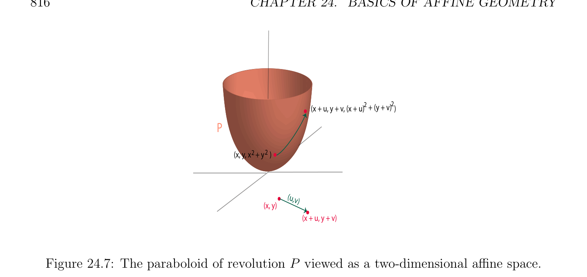

# Affine Combinations, Barycenters

<!-- PAGE 816 -->
$$2 + (y + v)2$$
$$(x + u, y + v, (x + u))$$
$$P$$
$$(x, y, x  2+ y2 )$$
$$(u,v$$
$$)$$
$$(x, y)$$
$$(x + u, y + v)$$

**Figure 24.7:** The paraboloid of revolution $P$ viewed as a two-dimensional affine space.
$$\longrightarrow$$
Since $a = a +$ aa and by (A1) $a = a + 0$, by (A3) we get
$$\longrightarrow$$
$$aa = 0.$$
Thus, letting $a = c$ in Chasles’s identity, we get
$$\longrightarrow \longrightarrow$$
$$ba = -ab.$$
Given any four points a, $b, c, d \in E$, since by Chasles’s identity
$$\longrightarrow  \longrightarrow  \longrightarrow  \longrightarrow  \longrightarrow$$
$$ab +bc =ad +dc =ac,$$
we have the parallelogram law
$$\longrightarrow  \longrightarrow \longrightarrow  \longrightarrow$$
$$ab =dciffbc =ad.$$

## 24.4 Affine Combinations, Barycenters

A fundamental concept in linear algebra is that of a linear combination. The corresponding concept in affine geometry is that of an affine combination, also called a barycenter. However, there is a problem with the naive approach involving a coordinate system, as we saw in Section 24.1. Since this problem is the reason for introducing affine combinations, at the risk of boring certain readers, we give another example showing what goes wrong if we are not careful in defining linear combinations of points.
$$\mathbb{R}^{2}$$
Consider as an affine space, under its natural coordinate system with origin $O = (0, 0)$
$$and basis vectors \begin{pmatrix} 1 \\ 0 \end{pmatrix} and \begin{pmatrix} 0 \\ 1 \end{pmatrix} . Given any two points a = (a_{1}, a_{2}) and b = (b_{1}, b_{2}), it is$$

<!-- PAGE 817 -->
$$\longrightarrow$$
$$EE$$
$$b$$
$$\longrightarrow$$
$$ab$$
$$ac \frac{\longrightarrow ac}{\longrightarrow}$$
$$bc$$
$$Figure 24.8: Points and corresponding vectors in affine geometry.$$
natural to define the affine combination $\lambda a + \mu b$ as the point of coordinates
$$(\lambda a_{1} + \mu b_{1}, \lambda a_{2} + \mu b_{2}).$$
Thus, when $a = (-1, -1)$ and $b = (2, 2)$, the point $a + b$ is the point $c = (1, 1)$. Let us now consider the new coordinate system with respect to the origin $c = (1, 1)$ (and the same basis vectors). This time, the coordinates of a are $(-2, -2)$, the coordinates of $b$ are $(1, 1)$, and the point $a+b$ is the point $d$ of coordinates $(-1, -1)$. However, it is clear that the point $d$ is identical to the origin $O = (0, 0)$ of the first coordinate system. This situation is illustrated in Figure 24.9.
$$b = (1,1)$$
$$b = (2,2)$$
$$c =  a + b = (1,1)$$
$$\overline{c}$$
$$\overline{O = (0,0)}\overline{d = a + b = (-1,-1)}$$
$$a = (-1,-1)a = (-2, -2)$$
$$Figure 24.9: The example from the beginning of Section 24.4.$$
Thus, $a + b$ corresponds to two different points depending on which coordinate system is used for its computation!

<!-- PAGE 818 -->
This shows that some extra condition is needed in order for affine combinations to make sense. It turns out that if the scalars sum up to $1$, the definition is intrinsic, as the following proposition shows.

> **Proposition 24.1.** Given an affine space $E$, let $(a_{i})_{i\in I}$ be a family of points in $E$, and let $(\lambda_{i} )_{i\in I}$ be a family of scalars. For any two points a, $b \in E$, the following properties hold:
$$(1) If \sum_{i}  \in I \lambda_{i}  = 1, then\longrightarrow \longrightarrow$$
$$a + \sum_{i\in I}  \lambda_{i} aa_{i} = b + \sum_{i\in I}  \lambda_{i} ba_{i}.$$
$$(2) If \sum_{i}  \in I \lambda_{i}  = 0, then\longrightarrow \longrightarrow$$
$$\sum_{i\in I}  \lambda_{i} aa_{i} = \sum_{i\in I}  \lambda_{i} ba_{i}.$$

*Proof.* $(1)$ By Chasles’s identity (see Section 24.3), we have
$$a + \sum_{i\in I}  \lambda_{i} \longrightarrow aa_{i} = a + \sum_{i\in I}  \lambda_{i} (\longrightarrow ab + \longrightarrow ba_{i})$$
$$= a + \sum_{i\in I}  \longrightarrow ab + \sum_{i\in I}  \lambda_{i} \longrightarrow ba_{i}$$
$$\begin{pmatrix} \lambda_{i} \end{pmatrix}$$
$$= a + \longrightarrow ab + \sum_{i\in I}  \lambda_{i} \longrightarrow ba_{i}since \sum_{i}  \lambda_{i}  = 1$$
$$\in I$$
$$= b + \sum_{i\in I}  \lambda_{i} \longrightarrow ba_{i}since b = a + \longrightarrow ab.$$
$$\mathbb{A}^{2}$$
An illustration of this calculation in is provided by Figure 24.10.
$(2)$ We also have
$$\sum_{i\in I}  \lambda_{i} \longrightarrow aa_{i}= \sum_{i\in I}  \lambda_{i} (\longrightarrow ab + \longrightarrow ba_{i})$$
$$= \sum_{i\in I}  \longrightarrow ab + \sum_{i\in I}  \lambda_{i} \longrightarrow ba_{i}$$
$$\begin{pmatrix} \lambda_{i} \\ \longrightarrow \end{pmatrix}$$
$$= \sum_{i\in I}  \lambda_{i} ba_{i},$$
$$since \sum_{i}  \in I \lambda_{i}  = 0.$$
Thus, by Proposition 24.1, for any family of points $(a_{i})_{i\in I}$ in $E$, for any family $(\lambda_{i} )_{i\in I}$ of
$$scalars such that \sum_{i}  \in I \lambda_{i}  = 1, the point$$
$$x = a + \sum_{i\in I}  \lambda_{i} \longrightarrow aa_{i}$$

<!-- PAGE 819 -->
$$a$$
$$a2$$
$$2$$
$$\overline{a}\overline{a}$$
$$2\overline{b} \overline{a}$$
$$2a$$
$$\overline{a} \overline{a} a3$$
$$33aa$$
$$a\overline{a}\overline{a} a$$
$$11$$
$$1$$
$$\overline{a}\overline{a}$$
$$\overline{i}\overline{ab}$$
$$a$$
$$i\overline{b}\overline{a}$$
$$a$$
$$\overline{ab} i\overline{b}\overline{a} 3$$
$$1$$
$$bb$$
$$Figure 24.10: Part (1) of Proposition 24.1.$$
is independent of the choice of the origin $a \in E$. This property motivates the following definition.

> **Definition 24.2.** For any family of points $(a_{i})_{i\in I}$ in $E$, for any family $(\lambda_{i} )_{i\in I}$ of scalars such
$$that \sum_{i}  \in I \lambda_{i}  = 1, and for any a \in E, the point$$
$$a + \sum_{i\in I}  \lambda_{i} \longrightarrow aa_{i}$$
(which is independent of $a \in E$, by Proposition 24.1) is called the barycenter (or barycentric combination, or affine combination) of the points $a_{i}$ assigned the weights $\lambda_{i}$ , and it is denoted by
$$\sum_{i\in I}  \lambda_{i} a_{i}.$$
In dealing with barycenters, it is convenient to introduce the notion of a weighted point, which is just a pair $(a, \lambda$ ), where $a \in E$ is a point, and $\lambda  \in \mathbb{R}$ is a scalar. Then, given a family
$$of weighted points ((a_{i}, \lambda_{i} ))_{i\in I}, where \sum_{i}  \lambda_{i}  = 1, we also say that the point \sum_{i}  \in I \lambda_{i} a_{i} is$$
the barycenter of the family of $weighted^{\in I}$ points $((a_{i}, \lambda_{i} ))_{i\in I}$. Note that the barycenter $x$ of the family of weighted points $((a_{i}, \lambda_{i} ))_{i\in I}$ is the unique point such that
$$\longrightarrow \longrightarrow$$
$$ax = \sum_{i\in I}  \lambda_{i} aa_{i}for every a \in E,$$
and setting $a = x$, the point $x$ is the unique point such that
$$\sum_{i\in I}  \lambda_{i} \longrightarrow xa_{i} = 0.$$

<!-- PAGE 820 -->
In physical terms, the barycenter is the center of mass of the family of weighted points
$$((a_{i}, \lambda_{i} ))_{i\in I} (where the masses have been normalized, so that \sum_{i}  \in I \lambda_{i}  = 1, and negative$$
masses are allowed).
Remarks:
$(1)$ Since the barycenter of a family $((a_{i}, \lambda_{i} ))_{i\in I}$ of weighted points is defined for families
$$(\lambda_{i} )_{i\in I} of scalars with finite support (and such that \sum_{i}  \lambda_{i}  = 1), we might as well$$
assume that I is finite. Then, for all $m \ge 2$, it is $easy^{\in I}$ to prove that the barycenter of $m$ weighted points can be obtained by repeated computations of barycenters of two weighted points.
$(2)$ This result still holds, provided that the field $K$ has at least three distinct elements, but the proof is trickier!
$$\longrightarrow$$
$$(3) When \sum_{i}  \lambda  = 0, the vector \sum  i\in I \lambda_{i} aa_{i} does not depend on the point a, and we may$$
$$denote it^{\in I} by \sum_{i}^{i}  \in I \lambda_{i} a_{i}. This observation will be used to define a vector space in which$$
linear combinations of both points and vectors make sense, regardless of the value of
$$\sum_{i}  \in I \lambda_{i} .$$
Figure 24.11 illustrates the geometric construction of the barycenters $g_{1}$ and $g_{2}$ of the
$$weighted points \begin{pmatrix} a,_{4}^{1} \\ can \end{pmatrix} , \begin{pmatrix} b,_{4}^{1} \end{pmatrix} , and \begin{pmatrix} c,_{2}^{1} \end{pmatrix} , and (a, -1), (b, 1), and (c, 1).$$
The point $g_{1}$  be constructed geometrically as the middle of the segment joining $c$ to the $middle_{2}^{1} a +_{2}^{1} b$ of the segment (a, $b)$, since
$$g_{1} = \frac{1}{2} \begin{pmatrix} 1 & 1 \\ a + & b \\ 2 & 2 \end{pmatrix} + \frac{1}{2} c.$$
The point $g_{2}$ can be constructed geometrically as the point such that the $middle_{2}^{1} b +_{2}^{1} c$ of the segment $(b, c)$ is the middle of the segment (a, $g_{2})$, since
$$g_{2} = -a + 2 \begin{pmatrix} 1 & 1 \\ b + & c \\ 2 & 2 \end{pmatrix} .$$
Later on, we will see that a polynomial curve can be defined as a set of barycenters of a fixed number of points. For example, let (a, $b, c, d)$ be a sequence of points in $\mathbb{A}^{2}$. Observe that
$$(1 -t)^{3}+ 3t(1 -t)^{2}+ 3t^{2}(1 -t) + t^{3}= 1,$$
since the sum on the left-hand side is obtained by expanding $(t + (1$ - $t))^{3} = 1$ using the binomial formula. Thus,
$$(1 -t)^{3}a + 3t(1 -t)^{2}b + 3t^{2}(1 -t) c + t^{3}d$$
