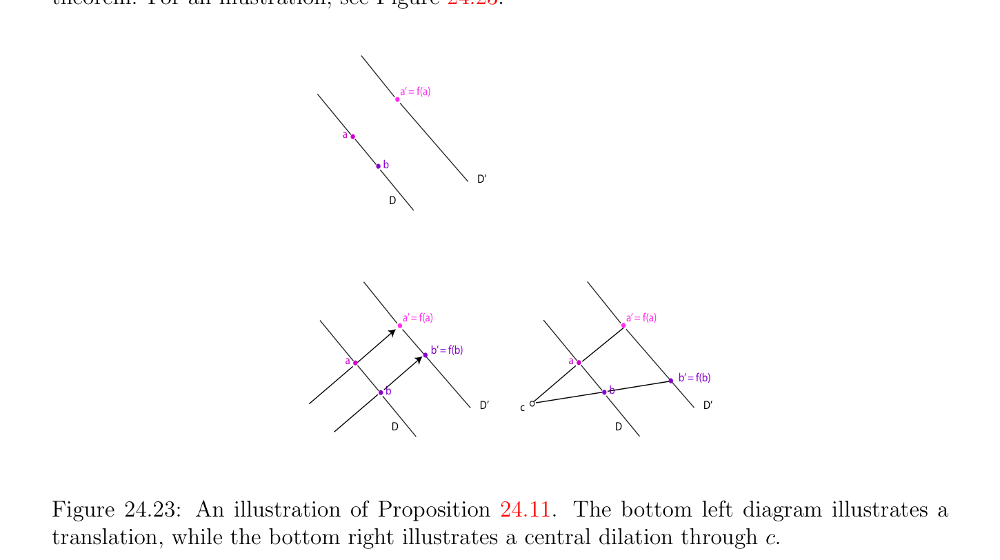

# Affine Geometry: A Glimpse

<!-- PAGE 843 -->
Another point worth mentioning is that affine bijections preserve the ratio of volumes of
$$\longrightarrow$$
parallelotopes. Indeed, given any basis $B = (u_{1}, \dots  , u_{m})$ of the vector space $E$ associated with the affine space $E$, given any $m + 1$ affinely independent points $(a_{0}, \dots  , a_{m})$, we can
$$-\longrightarrow  -\longrightarrow$$
compute the determinant $det_{B}(a_{0}a_{1}, \dots  ,a_{0}a_{m})$ w.r.t. the basis $B$. For any bijective affine map $f$ : $E \to E$, since
$$-\longrightarrow  -\longrightarrow$$
$$det_{B} \begin{pmatrix} \longrightarrow -\longrightarrow & \longrightarrow -\longrightarrow \\ f(a_{0}a_{1}), \dots  ,f(a_{0}a_{m}) \end{pmatrix} = \det \begin{pmatrix} \longrightarrow \\ f \end{pmatrix} det_{B}(a_{0}a_{1}, \dots  ,a_{0}a_{m})$$
$$\longrightarrow$$
and the determinant of a linear map is intrinsic (i.e., depends only on $f$ , and not on the particular basis $B)$, we conclude that the ratio
$$det_{B} \begin{pmatrix} \longrightarrow -\longrightarrow & \longrightarrow -\longrightarrow \\ f(a_{0}a_{1}), \dots  ,f(a_{0}a_{m}) \\ det_{B}(-\longrightarrow a_{0}a_{1}, \dots  ,-\longrightarrow a_{0}a_{m}) \end{pmatrix} = \det$$
$$\begin{pmatrix} \longrightarrow \\ f \end{pmatrix}$$
$$-\longrightarrow  -\longrightarrow$$
is independent of the basis $B$. Since $det_{B}(a_{0}a_{1}, \dots  ,a_{0}a_{m})$ is the volume of the parallelotope spanned by $(a_{0}, \dots  , a_{m})$, where the parallelotope spanned by any point a and the vectors $(u_{1}, \dots  , u_{m})$ has unit volume (see Berger $[11]$, Section 9.12), we see that affine bijections preserve the ratio of volumes of parallelotopes. In fact, this ratio is independent of the choice of the parallelotopes of unit volume. In particular, the affine bijections $f \in$ GA(E)
$$such that \det \begin{pmatrix} \longrightarrow \\ f \\ the \end{pmatrix} = 1 preserve volumes. These affine maps form a subgroup SA(E) of$$
GA(E) called  special affine group of $E$. We now take a glimpse at affine geometry.

## 24.9 Affine Geometry: A Glimpse

In this section we state and prove three fundamental results of affine geometry. Roughly speaking, affine geometry is the study of properties invariant under affine bijections. We now prove one of the oldest and most basic results of affine geometry, the theorem of Thales.

> **Proposition 24.10.** Given any affine space $E$, if $H_{1}, H_{2}, H_{3}$ are any three distinct parallel hyperplanes, and $A$ and $B$ are any two lines not parallel to $H_{i}$, letting $a_{i} = H_{i} \cap A$ and $b_{i} = H_{i} \cap B$, then the following ratios are equal:
$$\frac{-\longrightarrow a_{1}a_{3}}{a_{1}a_{2}} -\longrightarrow = \frac{-\longrightarrow b_{1}b_{3}}{b_{1}b_{2}} -\longrightarrow = \rho .$$
Conversely, for any point $d$ on the line $A, if_{a-\longrightarrow a}^{\longrightarrow a1d} = \rho$ , then $d = a_{3}$.
$$\overline{1}\overline{2}$$

*Proof.* Figure 24.22 illustrates the theorem of Thales. We sketch a proof, leaving the details
$$\longrightarrow$$
as an exercise. Since $H_{1}, H_{2}, H_{3}$ are parallel, they have the same direction $H$, a hyperplane $\longrightarrow \longrightarrow \longrightarrow$ in $E$ . Let $u \in E -H$ be any nonnull vector such that $A = a_{1}+\mathbb{R} u$. Since $A$ is not parallel to
$$\longrightarrow  \longrightarrow  \longrightarrow$$
$H$, we have $E = H \oplus \mathbb{R} u$, and thus we can define the linear map $p: E \to \mathbb{R} u$, the projection

<!-- PAGE 844 -->
$$b1$$
$$H_{1}a1$$
$$H_{2}$$
$$a2b2$$
$$H_{3}b3$$
$$a3$$
$$AB$$
$$Figure 24.22: The theorem of Thales.$$
$$\longrightarrow$$
on $\mathbb{R} u$ parallel to $H$. This linear map induces an affine map $f$ : $E \to A$, by defining $f$ such that
$$f(b_{1} + w) = a_{1} + p(w),$$
$$\longrightarrow  \longrightarrow$$
for all $w \in E$ . Clearly, $f(b_{1}) = a_{1}$, and since $H_{1}, H_{2}, H_{3}$ all have direction $H$, we also have $f(b_{2}) = a_{2}$ and $f(b_{3}) = a_{3}$. Since $f$ is affine, it preserves ratios, and thus
$$\frac{-\longrightarrow a_{1}a_{3}}{a_{1}a_{2}} -\longrightarrow = \frac{-\longrightarrow b_{1}b_{3}}{b_{1}b_{2}} -\longrightarrow .$$
The converse is immediate. We also have the following simple proposition, whose proof is left as an easy exercise.

> **Proposition 24.11.** Given any affine space $E$, given any two distinct points a, $b \in E$, and for any affine dilatation $f$ different from the identity, if a' $=$ f(a), $D = \langle$ a, $b\rangle$ is the line passing through a and $b$, and D' is the line parallel to $D$ and passing through a', the following are equivalent:
$(i)$ b' $=$ f(b);
(ii) If $f$ is a translation, then b' is the intersection of D' with the line parallel to $\langle$ a, $a'\rangle$ passing through $b$; If $f$ is a dilatation of center $c$, then b' $=$ D' $\cap \langle c, b\rangle$ .

<!-- PAGE 845 -->
The first case is the parallelogram law, and the second case follows easily from Thales’ theorem. For an illustration, see Figure 24.23.
$$a’ = f(a)$$
$$a$$
$$b$$
$$D’$$
$$D$$
$$a’ = f(a)a’ = f(a)$$
$$b’ = f(b)$$
$$aa$$
$$b’ = f(b)$$
$$bb$$
$$D’cD’$$
$$DD$$

**Figure 24.23:** An illustration of Proposition 24.11. The bottom left diagram illustrates a translation, while the bottom right illustrates a central dilation through $c$. We are now ready to prove two classical results of affine geometry, Pappus’s theorem and Desargues’s theorem. Actually, these results are theorems of projective geometry, and we are stating affine versions of these important results. There are stronger versions that are best proved using projective geometry.

> **Proposition 24.12.** Given any affine plane $E$, any two distinct lines $D$ and D', then for any distinct points a, $b, c$ on $D$ and a', b', c' on D', if a, $b, c$, a', b', c' are distinct from the intersection of $D$ and D' (if $D$ and D' intersect) and if the lines $\langle$ a, $b'\rangle$ and $\langle$ a', $b\rangle$ are parallel, and the lines $\langle b, c'\rangle$ and $\langle$ b', $c\rangle$ are parallel, then the lines $\langle$ a, $c'\rangle$ and $\langle$ a', $c\rangle$ are parallel.

*Proof.* Pappus’s theorem is illustrated in Figure 24.24. If $D$ and D' are not parallel, let $d$ be their intersection. Let $f$ be the dilatation of center $d$ such that f(a) $= b$, and let $g$ be the dilatation of center $d$ such that g(b) $= c$. Since the lines $\langle$ a, $b'\rangle$ and $\langle$ a', $b\rangle$ are parallel, and the lines $\langle b, c'\rangle$ and $\langle$ b', $c\rangle$ are parallel, by Proposition 24.11 we have a' $=$ f(b') and b' $=$ g(c'). However, we observed that dilatations with the same center commute, and thus $f \circ g = g \circ f$, and thus, letting $h = g \circ f$, we get $c =$ h(a) and a' $=$ h(c'). Again, by Proposition 24.11, the lines $\langle$ a, $c'\rangle$ and $\langle$ a', $c\rangle$ are parallel. If $D$ and D' are parallel, we use translations instead of dilatations.

<!-- PAGE 846 -->
$$c$$
$$D$$
$$b$$
$$a$$
$$c$$
$$b$$
$$D$$
$$a$$
$$Figure 24.24: Pappus’s theorem (affine version).$$
There is a converse to Pappus’s theorem, which yields a fancier version of Pappus’s theorem, but it is easier to prove it using projective geometry. It should be noted that in axiomatic presentations of projective geometry, Pappus’s theorem is equivalent to the commutativity of the ground field $K$ (in the present case, $K =\mathbb{R})$. We now prove an affine version of Desargues’s theorem.

> **Proposition 24.13.** Given any affine space $E$, and given any two triangles (a, $b, c)$ and (a', b', c'), where a, $b, c$, a', b', c' are all distinct, if $\langle$ a, $b\rangle$ and $\langle$ a', $b'\rangle$ are parallel and $\langle b, c\rangle$ and $\langle$ b', $c'\rangle$ are parallel, then $\langle$ a, $c\rangle$ and $\langle$ a', $c'\rangle$ are parallel iff the lines $\langle$ a, $a'\rangle , \langle b, b'\rangle$ , and $\langle c, c'\rangle$ are either parallel or concurrent (i.e., intersect in a common point).

*Proof.* We prove half of the proposition, the direction in which it is assumed that $\langle$ a, $c\rangle$ and $\langle$ a', $c'\rangle$ are parallel, leaving the converse as an exercise. Since the lines $\langle$ a, $b\rangle$ and $\langle$ a', $b'\rangle$ are parallel, the points a, $b$, a', b' are coplanar. Thus, either $\langle$ a, $a'\rangle$ and $\langle b, b'\rangle$ are parallel, or they have some intersection $d$. We consider the second case where they intersect, leaving the other case as an easy exercise. Let $f$ be the dilatation of center $d$ such that f(a) $=$ a'. By Proposition 24.11, we get f(b) $=$ b'. If f(c) $=$ c'', again by Proposition 24.11 twice, the lines $\langle b, c\rangle$ and $\langle$ b', $c''\rangle$ are parallel, and the lines $\langle$ a, $c\rangle$ and $\langle$ a', $c''\rangle$ are parallel. From this it follows that c'' $=$ c'. Indeed, recall that $\langle b, c\rangle$ and $\langle$ b', $c'\rangle$ are parallel, and similarly $\langle$ a, $c\rangle$ and $\langle$ a', $c'\rangle$ are parallel. Thus, the lines $\langle$ b', $c''\rangle$ and $\langle$ b', $c'\rangle$ are identical, and similarly the lines
$$\longrightarrow  \longrightarrow$$
$\langle$ a', $c''\rangle$ and $\langle$ a', $c'\rangle$ are identical. Since a'c' and b'c' are linearly independent, these lines have a unique intersection, which must be c'' $=$ c'. The direction where it is assumed that the lines $\langle$ a, $a'\rangle , \langle b, b'\rangle$ and $\langle c, c'\rangle$ , are either parallel or concurrent is left as an exercise (in fact, the proof is quite similar).
