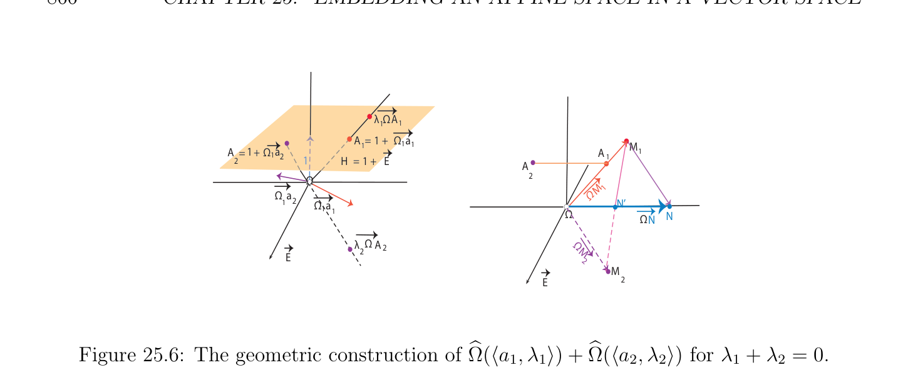

# Extending Affine Maps to Linear Maps

<!-- PAGE 866 -->
$$\lambda  \overline{\Omega}\overline{A}$$
$$11$$
$$A = 1 + \overline{\Omega}\overline{1}\overline{a}$$
$$A \overline{= 1+ \Omega}\overline{a} 11AM$$
$$\overline{1} 211$$
$$21H = 1 + \overline{E} A$$
$$\overline{\Omega} 2$$
$$M1$$
$$\overline{\Omega}\overline{a}\Omega$$
$$12\overline{\Omega}\overline{a}\overline{N’}$$
$$\overline{1} 1\overline{\Omega}\overline{N}$$
$$\overline{\Omega}\overline{N}$$
$$\overline{\lambda} \overline{\Omega} A\Omega$$
$$22M$$
$$\overline{E} 2$$
$$M$$
$$\overline{E} 2$$

**Figure 25.6:** The geometric construction of $\Omega (\langle a_{1}, \lambda_{1} \rangle$ ) $+ \Omega (\langle a_{2}, \lambda_{2} \rangle$ ) for $\lambda_{1}  + \lambda_{2}  = 0$.
$$b b$$

## 25.4 Extending Affine Maps to Linear Maps

$$\longrightarrow$$
Roughly, the vector space $E$ has the property that for any vector space $F$ and any affine
$$\longrightarrow  b\longrightarrow \longrightarrow$$
map $f$ : $E \to F$ , there is a unique linear map $f$ : $E \to F$ extending $f$ : $E \to F$ . As a
$$b b$$
consequence, given two affine spaces $E$ and $F$, every affine map $f$ : $E \to F$ extends uniquely to a linear map $f$ : $E \to F$. First, we define rigorously the notion of homogenization of an
$$b bb$$
affine space.
$$Definition \longrightarrow  25.2. Given any affine space \begin{pmatrix} \longrightarrow \\ E,E \\ vector \end{pmatrix} , a homogenization (or linearization) of$$
$(E, E$ ) is a triple $\langle E, j, \omega \rangle$ , where $\mathcal{E}$ is a  space, $j$ : $E \to E$ is an injective affine
$$\longrightarrow$$
map with associated injective linear map $i: E \to E, \omega$ : $\mathcal{E} \to \mathbb{R}$ is a linear form such
$$\longrightarrow$$
$$that \omega^{-1} (0)\longrightarrow  = i \begin{pmatrix} \longrightarrow \\ E \\ is \end{pmatrix} , \omega^{-1} (1) = j(E), and for every\longrightarrow  vector spaceF and every affine map$$
$f$ : $E \to F$ there  a unique linear map $f$ : $\mathcal{E} \to F$ extending $f$, i.e., $f = f \circ j$, as in the
$$b b$$
following diagram:
$$E\mathcal{E}$$
$$\overline{@}^{j}\overline{@}$$
$$\overline{@}@$$
$$@@$$
$$@@$$
$$f ^{fb}$$
$$\longrightarrow$$
$$F$$
$$Thus, j(E) = \omega^{-1} (1) is an affine hyperplane with direction \longrightarrow  i \begin{pmatrix} \longrightarrow \\ E \\ ), \end{pmatrix} = \omega^{-1} (0). Note that we$$
could have defined a homogenization of an affine space $(E, E$  as a triple $\langle E, j, H\rangle$ , where $\mathcal{E}$ is a vector space, $H$ is an affine hyperplane in $\mathcal{E}$, and $j$ : $E \to E$ is an injective affine map such that j(E) $= H$, and such that the universal property stated above holds. However, Definition 25.2 is more convenient for our purposes, since it makes the notion of weight more evident. The obvious candidate for $\mathcal{E}$ is the vector space $E$ that we just constructed. The next
$$b$$
proposition will show that $E$ indeed has the required extension property. As usual, objects
$$b$$

<!-- PAGE 867 -->
$$D\lambda  \overline{\Omega}\overline{A}= M 1$$
$$A = 1 + \overline{\Omega}\overline{1}\overline{a}$$
$$1H = 1 + \overline{E}$$
$$\overline{\Omega}\overline{u}$$
$$\overline{\Omega}\overline{1}\overline{a} M2$$
$$DM$$
$$1$$
$$\overline{E} A$$
$$1H = 1 + \overline{E}$$
$$\overline{\Omega}\overline{u}$$
$$M2$$
$$\overline{E}$$
$$DMN$$
$$1G$$
$$A$$
$$N’$$
$$\overline{\Omega}\overline{u}$$
$$M2$$
$$\overline{E}$$
$$Figure 25.7: The geometric construction of \langle a, \lambda \rangle + u.$$
defined by a universal property are unique up to isomorphism. This property is left as an exercise.
$$\longrightarrow$$
$$Proposition \longrightarrow 25.5. Given any affine space \begin{pmatrix} \longrightarrow \\ E,E \\ fb :Eb \end{pmatrix} and\longrightarrow  any vector spaceF , for any affine$$
map $f$ : $E \to F$ , there is a unique linear map  $\to F$ extending $f$ such that
$$\longrightarrow$$
$$f(u+ \lambda a) = \lambda f(a) +f (u)$$
$$b b$$
$$\longrightarrow  \longrightarrow$$
for all $a \in E$, all $u \in E$ , and all $\lambda  \in \mathbb{R}$, where $f$ is the linear map associated with $f$. In particular, when $\lambda  \neq  0$, we have
$$f(u+ \lambda a) = \lambda f(a + \lambda^{-1} u).$$
$$b b$$

*Proof.* Assuming that $f$ exists, recall that from Proposition 25.1, for every $a \in E$, every
$$b$$
element of $E$ can be written uniquely as $u+ \lambda$ a. By linearity of $f$ and since $f$ extends $f$, we
$$b b b b$$
have
$$f(u+ \lambda a) =f(u) + \lambda f(a) =f(u) + \lambda f(a) = \lambda f(a) +f(u).$$
$$b b b b b b$$
If $\lambda  = 1$, since $a + u$ and $a + u$ are identified, and since $f$ extends $f$, we must have
$$b b$$
$$\longrightarrow$$
$$f(a) +f(u) =f(a) +f(u) =f(a+ u) = f(a + u) = f(a) +f (u),$$
$$b b b b b$$

<!-- PAGE 868 -->
$$\longrightarrow \longrightarrow$$
and thus f(u) $= f (u)$ for all $u \in E$ . Then we have
$$b$$
$$\longrightarrow$$
$$f(u+ \lambda a) = \lambda f(a) +f (u),$$
$$b b$$
which proves the uniqueness of $f$. On the other hand, the map $f$ defined as above is clearly
$$b b$$
a linear map extending $f$. When $\lambda  \neq  0$, we have
$$f(u+ \lambda a) =f(\lambda (a + \lambda^{-1} u)) = \lambda f(a + \lambda^{-1} u) = \lambda f(a + \lambda^{-1} u).$$
$$b b b b$$
$$Proposition 25.5 shows that
bE, $j, \omega$ , is a homogenization of $\begin{pmatrix} \longrightarrow \\$ E,E $\end{pmatrix}$ . As a corollary, we$$ obtain the following proposition.

> **Proposition 25.6.** Given two affine spaces $E$ and $F$ and an affine map $f$ : $E \to F$, there is a unique linear map $f$ : $E \to F$ extending $f$, as in the diagram below,
$$b bb$$
$$f$$
$$EF$$
$$jj$$
$$E/F$$
$$b b$$
$$fb$$
such that
$$\longrightarrow$$
$$f(u+ \lambda a) =f (u)+ \lambda f(a),$$
$$b b b$$
$$\longrightarrow  \longrightarrow$$
for all $a \in E$, all $u \in E$ , and all $\lambda  \in \mathbb{R}$, where $f$ is the linear map associated with $f$. In particular, when $\lambda  \neq  0$, we have
$$f(u+ \lambda a) = \lambda f(a + \lambda^{-1} u).$$
$$b b$$

*Proof.* Consider the vector space $F$ and the affine map $j \circ f$ : $E \to F$. By Proposition 25.5,
$$bb$$
there is a unique linear map $f$ : $E \to F$ extending $j \circ f$, and thus extending $f$.
$$b bb$$
$$\longrightarrow$$
Note that $f$ : $E \to F$ has the property that $f \subseteq F$ . More generally, since
$$b bb b \begin{pmatrix} \longrightarrow \\ E \end{pmatrix}$$
$$\longrightarrow$$
$$f(u+ \lambda a) =f (u)+ \lambda f(a),$$
$$b b b$$
the linear map $f$ is weight-preserving. Also observe that we recover $f$ from $f$, by letting
$$b b$$
$\lambda  = 1$ in f(u $+ \lambda a) = \lambda$ f(a $+ \lambda^{-1} u)$, that is, we have
$$b b$$
$$f(a + u) =f(u+ a).$$
$$b b$$

<!-- PAGE 869 -->
From a practical point of view, Proposition 25.6 shows us how to homogenize an affine map to turn it into a linear map between the two homogenized spaces. Assume that $E$ and $F$ are of finite dimension, that $(a_{0}, (u_{1}, \dots  , u_{n}))$ is an affine frame of $E$ with origin $a_{0}$, and $(b_{0}, (v_{1}, \dots  , v_{m}))$ is an affine frame of $F$ with origin $b_{0}$. Then, with respect to the two bases $(u_{1}, \dots  , u_{n}, a_{0})$ in $E$ and $(v_{1}, \dots  , v_{m}, b_{0})$ in $F$, a linear map $h: E \to F$ is given by an
$$b b bb$$
$(m + 1) \times  (n + 1)$ matrix $A$. Assume that this linear map $h$ is equal to the homogenized version $f$ of an affine map $f$. Since
$$b$$
$$\longrightarrow$$
$$f(u+ \lambda a) =f (u)+ \lambda f(a),$$
$$b b b$$
and since over the basis $(u_{1}, \dots  , u_{n}, a_{0})$ in $E$, points are represented by vectors whose last
$$b$$
coordinate is $1$ and vectors are represented by vectors whose last coordinate is $0$, the following properties hold. $1$. The last row of the matrix $A =$ M(f) with respect to the given bases is
$$b$$
$$(0, 0, \dots  , 0, 1)$$
with $n$ occurrences of $0. 2$. The last column of $A$ contains the coordinates
$$(\mu_{1} , \dots  , \mu_{m} , 1)$$
of $f(a_{0})$ with respect to the basis $(v_{1}, \dots  , v_{m}, b_{0}). 3$. The submatrix of $A$ obtained by deleting the last row and the last column is the matrix
$$\longrightarrow$$
of the linear map $f$ with respect to the bases $(u_{1}, \dots  , u_{n})$ and $(v_{1}, \dots  , v_{m})$, Finally, since
$$f(a_{0} + u) =f(u+ a_{0}),$$
$$b b$$
given any $x \in E$ and $y \in F$ with coordinates $(x_{1}, \dots  , x_{n}, 1)$ and $(y_{1}, \dots  , y_{m}, 1)$, for $X = (x_{1}, \dots  , x_{n}, 1)^{\top}$ and $Y = (y_{1}, \dots  , y_{m}, 1)^{\top}$, we have $y =$ f(x) iff
$$Y = AX.$$
$$\mathbb{A}^{2} \mathbb{A}^{2}$$
For example, consider the following affine map $f$ : $\to$ defined as follows:
$$y_{1}=ax_{1} + bx_{2} + \mu_{1} ,$$
$$y_{2}=cx_{1} + dx_{2} + \mu_{2} .$$
The matrix of $f$ is
$$b$$
$$\begin{pmatrix} a & b & \mu_{1} \\ c & d & \mu_{2} \\ 0 & 0 & 1 \end{pmatrix} ,$$

<!-- PAGE 870 -->
and we have
$$\begin{pmatrix} y_{1} \\ y_{2} \\ 1 \end{pmatrix} = \begin{pmatrix} a & b & \mu_{1} \\ c & d & \mu_{2} \\ 0 & 0 & 1 \end{pmatrix} \begin{pmatrix} x_{1} \\ x_{2} \\ 1 \end{pmatrix} .$$
In $E$, we have $b$
$$\begin{pmatrix} y_{1} \\ y_{2} \\ y_{3} \end{pmatrix} = \begin{pmatrix} a & b & \mu_{1} \\ c & d & \mu_{2} \\ 0 & 0 & 1 \end{pmatrix} \begin{pmatrix} x_{1} \\ x_{2} \\ x_{3} \end{pmatrix} ,$$
which means that the homogeneous map $f$ is is obtained from $f$ by “adding the variable of
$$b$$
homogeneity $x_{3}:”$
$$y_{1}=ax_{1} + bx_{2} + \mu_{1} x_{3},$$
$$y_{2}=cx_{1} + dx_{2} + \mu_{2} x_{3},$$
$$y_{3}=x_{3}.$$
