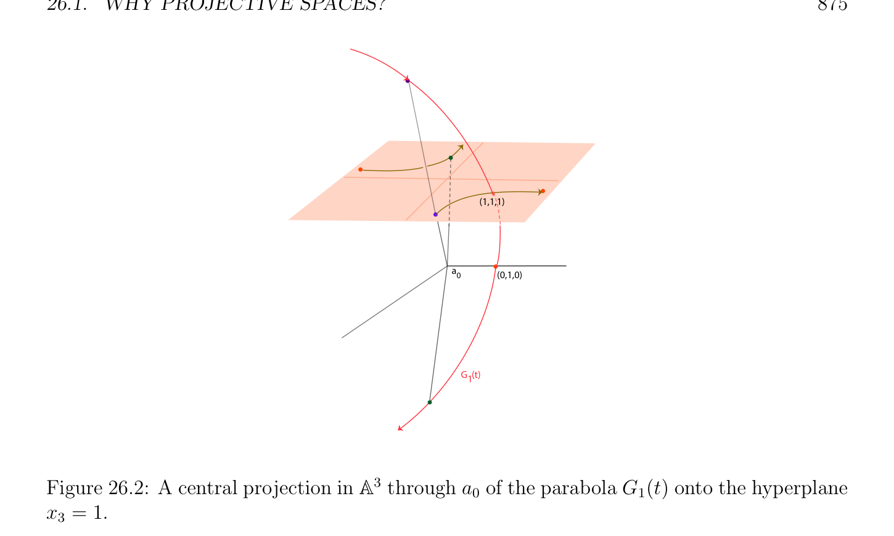

# Why Projective Spaces?

<!-- PAGE 871 -->
Chapter $26$ Basics of Projective Geometry Think geometrically, prove algebraically. —John Tate

## 26.1 Why Projective Spaces?

For a novice, projective geometry usually appears to be a bit odd, and it is not obvious to motivate why its introduction is inevitable and in fact fruitful. One of the main motivations arises from algebraic geometry. The main goal of algebraic geometry is to study the properties of geometric objects, such as curves and surfaces, defined implicitly in terms of algebraic equations. For instance, the equation
$$x^{2}+ y^{2}-1 = 0$$
defines a circle $in\mathbb{R}^{2}$. More generally, we can consider the curves defined by general equations
$$ax^{2}+ by^{2}+ cxy + dx + ey + f = 0$$
of degree $2$, known as conics. It is then natural to ask whether it is possible to classify these curves according to their generic geometric shape. This is indeed possible. Except for so-called singular cases, we get ellipses, parabolas, and hyperbolas. The same question can be asked for surfaces defined by quadratic equations, known as quadrics, and again, a classification is possible. However, these classifications are a bit artificial. For example, an ellipse and a hyperbola differ by the fact that a hyperbola has points at infinity, and yet, their geometric properties are identical, provided that points at infinity are handled properly. Another important problem is the study of intersection of geometric objects (defined algebraically). For example, given two curves $C_{1}$ and $C_{2}$ of degree $m$ and $n$, respectively, what is the number of intersection points of $C_{1}$ and $C_{2}$? (by degree of the curve we mean the total degree of the defining polynomial).
$$871$$

<!-- PAGE 872 -->
Well, it depends! Even in the case of lines (when $m = n = 1)$, there are three possibilities: either the lines coincide, or they are parallel, or there is a single intersection point. In general, we expect mn intersection points, but some of these points may be missing because they are at infinity, because they coincide, or because they are imaginary. What begins to transpire is that “points at infinity” cause trouble. They cause exceptions that invalidate geometric theorems (for example, consider the more general versions of the theorems of Pappus and Desargues), and make it difficult to classify geometric objects. Projective geometry is designed to deal with “points at infinity” and regular points in a uniform way, without making a distinction. Points at infinity are now just ordinary points, and many things become simpler. For example, the classification of conics and quadrics becomes simpler, and intersection theory becomes cleaner (although, to be honest, we need to consider complex projective spaces). Technically, projective geometry can be defined axiomatically, or by building upon linear algebra. Historically, the axiomatic approach came first (see Veblen and Young $[189, 190]$, Emil Artin $[6]$, and Coxeter $[45, 46, 43, 44])$. Although very beautiful and elegant, we believe that it is a harder approach than the linear algebraic approach. In the linear algebraic approach, all notions are considered up to a scalar. For example, a projective point is really a line through the origin. In terms of coordinates, this corresponds to “homogenizing.” For example, the homogeneous equation of a conic is
$$ax^{2}+ by^{2}+ cxy + dxz + eyz + fz^{2}= 0.$$
Now, regular points are points of coordinates $(x, y, z)$ with z̸ $= 0$, and points at infinity are points of coordinates $(x, y, 0)$ (with $x, y, z$ not all null, and up to a scalar). There is a useful model (interpretation) of plane projective geometry in terms of the central projection $\mathbb{R}^{3}$ in from the origin onto the plane $z = 1$. Another useful model is the spherical (or the half-spherical) model. In the spherical model, a projective point corresponds to a pair of antipodal points on the sphere. As affine geometry is the study of properties invariant under affine bijections, projective geometry is the study of properties invariant under bijective projective maps. Roughly speaking, projective maps are linear maps up to a scalar. In analogy with our presentation of affine geometry, we will define projective spaces, projective subspaces, projective frames, and projective maps. The analogy will fade away when we define the projective completion of an affine space, and when we define duality. One of the virtues of projective geometry is that it yields a very clean presentation of rational curves and rational surfaces. The general idea is that a plane rational curve is the projection of a simpler curve in a larger space, a polynomial curve in $\mathbb{R}^{3}$, onto the plane $z = 1$, as we now explain. Polynomial curves are curves defined parametrically in terms of polynomials. More specifically, $if\mathcal{E}$ is an affine space of finite dimension $n \ge 2$ and $(a_{0}, (e_{1}, \dots  , e_{n}))$ is an affine frame

<!-- PAGE 873 -->
for $\mathcal{E}$, a polynomial curve of degree $m$ is a map $F$ : $\mathbb{A} \to E$ such that
$$F(t) = a_{0} + F_{1}(t)e_{1} + \cdots  + F_{n}(t)e_{n},$$
for all $t \in \mathbb{A}$, where $F_{1}(t), \dots  , F_{n}(t)$ are polynomials of degree at most $m$. Although many curves can be defined, it is somewhat embarassing that a circle cannot be defined in such a way. In fact, many interesting curves cannot be defined this way, for example, ellipses and hyperbolas. A rather simple way to extend the class of curves defined parametrically is to allow rational functions instead of polynomials. A parametric rational curve of degree $m$ is a function $F$ : $\mathbb{A} \to E$ such that
$$F(t) = a_{0} + \frac{F_{1}(t)}{F_{n+1}(t)} e_{1} + \cdots  + \frac{F_{n}(t)}{F_{n+1}(t)} e_{n},$$
for all $t \in \mathbb{A}$, where $F_{1}(t), \dots  , F_{n}(t), F_{n+1}(t)$ are polynomials of degree at most $m$. For
$$\mathbb{A}^{2}$$
example, a circle in can be defined by the rational map
$$-$$
$$F(t) = a_{0} + \frac{1t^{2}}{1 + t^{2}} e_{1} + \frac{2t}{1 + t^{2}} e_{2}.$$
In terms of coordinates, the above curve is given by
$$-$$
$$x = \frac{1t^{2}}{1 + t^{2}}$$
$$y = \frac{2t}{1 + t^{2}} ,$$
and it is easily checked that $x^{2} + y^{2} = 1$. Note that the point $(-1, 0)$ is not achieved for any finite value of $t$, but it is for $t = \infty$ . In the above example, the denominator $F_{3}(t) = 1 + t^{2}$ never takes the value $0$ when $t$ ranges over $\mathbb{A}$, but consider the following curve in $\mathbb{A}^{2}$:
$$t^{2} 1$$
$$G(t) = a_{0} +t e_{1} +t e_{2}.$$
Observe that G(0) is undefined. In terms of coordinates, the above curve is given by
$$x = \frac{t^{2}}{t} = t$$
$$1$$
$$y =t ,$$
so we have $y = 1/x$. The curve defined above is a hyperbola, and for $t$ close to $0$, the point on the curve goes toward infinity in one of the two asymptotic directions.

<!-- PAGE 874 -->
A clean way to handle the situation in which the denominator vanishes is to work in a
$$\mathbb{A}^{n}$$
projective space. Intuitively, this means viewing a rational curve in as some appropriate projection of a polynomial curve in $\mathbb{A}^{n+1}$, back onto $\mathbb{A}^{n}$. Given an affine $space\mathcal{E}$, for any hyperplane $H in\mathcal{E}$ and any point $a_{0}$ not in $H$, the central projection (or conic projection, or perspective projection) of center $a_{0}$ onto $H$, is the partial map $p$ defined as follows: For every point $x$ not in the hyperplane passing through $a_{0}$ and parallel to $H$, we define p(x) as the intersection of the line defined by $a_{0}$ and $x$ with the hyperplane $H$; see Figure 26.1.
$$x$$
$$a0$$
$$p(x)$$
$$H$$
$$\mathbb{A}^{3}$$

**Figure 26.1:** A central projection in through $a_{0}$ onto the yellow hyperplane $H$. This central projection is not defined for any points in the peach hyperplane.
$$\mathbb{A}^{3}$$
For example, we can view $G$ as a rational curve in given by
$$G_{1}(t) = a_{0} + t^{2}e_{1} + e_{2} + te_{3}.$$
If we project this curve $G_{1}$ (in fact, a parabola $in\mathbb{A}^{3})$ using the central projection (perspective projection) of center $a_{0}$ onto the plane of equation $x_{3} = 1$, we get the previous hyperbola;
$$\mathbb{A}^{3}$$
see Figure 26.2. For $t = 0$, the point $G_{1}(0) = a_{0} +e_{2}$ in is in the plane of equation $x_{3} = 0$,
$$\mathbb{A}^{3}$$
and its projection is undefined. We can consider that $G_{1}(0) = a_{0} + e_{2}$ in is projected to infinity in the direction of $e_{2}$ in the plane $x_{3} = 0$. In the setting of projective spaces, this direction corresponds rigorously to a point at infinity; see Figure 26.2. Let us verify that the central projection used in the previous example has the desired effect. Let us assume that $\mathcal{E}$ has dimension $n + 1$ and that $(a_{0}, (e_{1}, \dots  , e_{n+1}))$ is an affine

<!-- PAGE 875 -->
$$(1,1,1)$$
$$\overline{a}\overline{0}\overline{(0,1,0)}$$
$$G  (t)1$$
$$\mathbb{A}^{3}$$

**Figure 26.2:** A central projection in through $a_{0}$ of the parabola $G_{1}(t)$ onto the hyperplane $x_{3} = 1$. frame for $\mathcal{E}$. We want to determine the coordinates of the central projection p(x) of a point $x \in E$ onto the hyperplane $H$ of equation $x_{n+1} = 1$ (the center of projection being $a_{0})$. If
$$x = a_{0} + x_{1}e_{1} + \cdots  + x_{n}e_{n} + x_{n+1}e_{n+1},$$
assuming that $x_{n+1}$ ̸ $= 0$; a point on the line passing through $a_{0}$ and $x$ has coordinates of the form $(\lambda x_{1}, \dots  , \lambda x_{n+1})$; and p(x), the central projection of $x$ onto the hyperplane $H$ of equation $x_{n+1} = 1$, is the intersection of the line from $a_{0}$ to $x$ and this hyperplane $H$. Thus we must have $\lambda x_{n+1} = 1$, and the coordinates of p(x) are
$$\begin{pmatrix} x_{1} & x_{n} \\ , \dots  , & , 1 \\ x_{n+1} & x_{n+1} \end{pmatrix} .$$
Note that p(x) is undefined when $x_{n+1} = 0$. In projective spaces, we can make sense of such points. The above calculation confirms that G(t) is a central projection of $G_{1}(t)$. Similarly, if we
$$\mathbb{A}^{3}$$
define the curve $F_{1}$ in by
$$F_{1}(t) = a_{0} + (1 -t^{2})e_{1} + 2te_{2} + (1 + t^{2})e_{3},$$
the central projection of the polynomial curve $F_{1}$ (again, a parabola in $\mathbb{A}^{3})$ onto the plane of equation $x_{3} = 1$ is the circle $F$.
