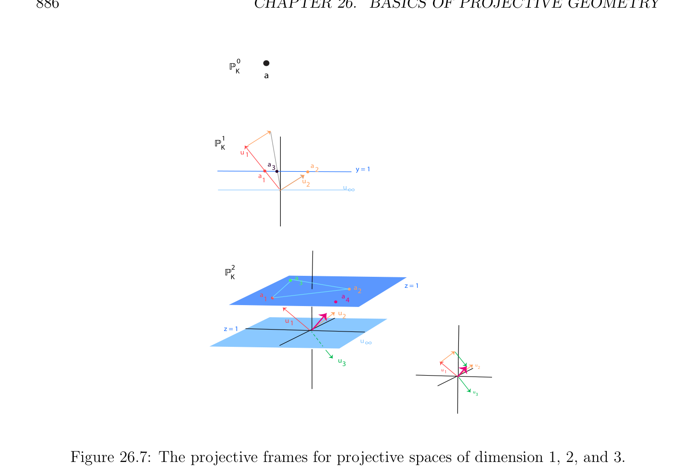
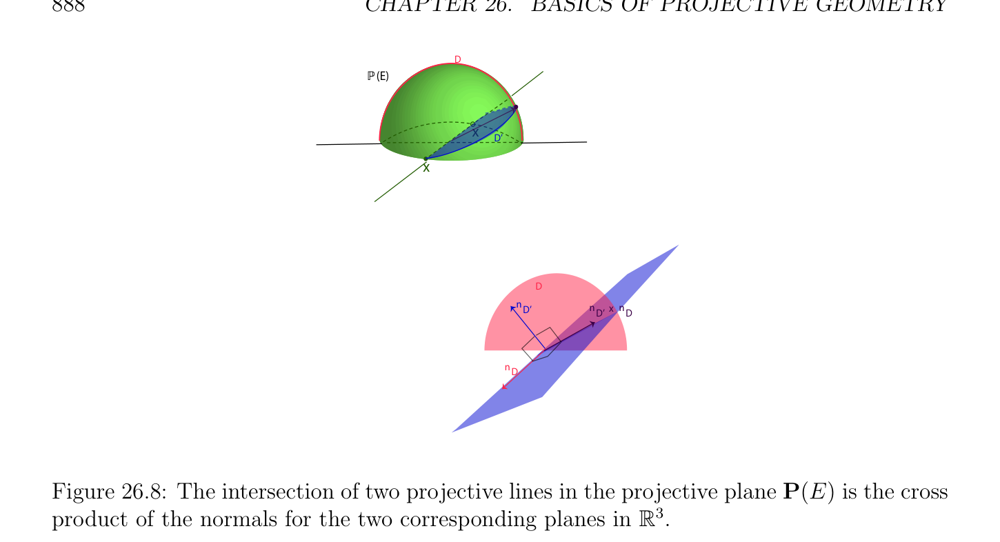
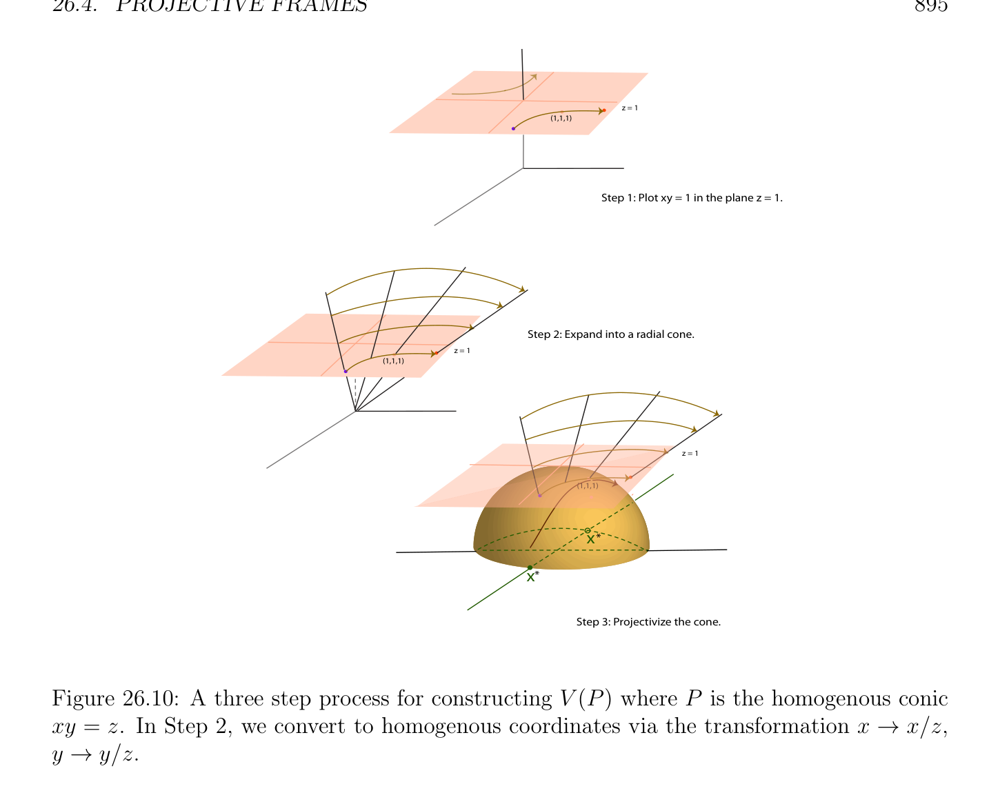

# Projective Frames

<!-- PAGE 884 -->
$$z = 1$$
$$c$$
$$D$$
$$1D 2$$
$$-$$
$$H$$
$$O2$$
$$H$$
$$1$$
$$H$$
$$Figure 26.6: A pencil of lines through c in the hyperplane model of \mathbb{RP}^{2}$$
P(E), i.e., the set of all hyperplanes containing some given projective subspace $W =$ p(V )
$$\mathbb{RP}^{3} \mathbb{R}^{4}$$
of dimension $n$ - $2$. For $n = 3$, a pencil of planes in $= P($ ) is the set of all planes (in $\mathbb{RP}^{3})$ containing some given line $W$. Other examples of unusual projective spaces and pencils will be given in Section 26.4. Next, we define the projective analogues of bases (or frames) and linear maps.

## 26.4 Projective Frames

As all good notions in projective geometry, the concept of a projective frame turns out to be uniquely defined up to a scalar.

> **Definition 26.3.** Given a nontrivial vector space $E$ of dimension $n+1$, a family $(a_{i})_{1\le i\le n+2}$ of $n + 2$ points of the projective space P(E) is a projective frame (or basis) of P(E) if there exists some basis $(e_{1}, \dots  , e_{n+1})$ of $E$ such that $a_{i} = p(e_{i})$ for $1 \le i \le n + 1$, and $a_{n+2} = p(e_{1} + \cdots  + e_{n+1})$. Any basis with the above property is said to be associated with the projective frame $(a_{i})_{1\le i\le n+2}$. The justification of Definition 26.3 is given by the following proposition.

> **Proposition 26.2.** If $(a_{i})_{1\le i\le n+2}$ is a projective frame of P(E), for any two bases $(u_{1}, \dots , u_{n+1}), (v_{1}, \dots  , v_{n+1})$ of $E$ such that $a_{i} = p(u_{i}) = p(v_{i})$ for $1 \le i \le n + 1$, and $a_{n+2} = p(u_{1} + \cdots  + u_{n+1}) = p(v_{1} + \cdots  + v_{n+1})$, there is a nonzero scalar $\lambda  \in K$ such that $v_{i} = \lambda u_{i}$, for all $i, 1 \le i \le n + 1$.

*Proof.* Since $p(u_{i}) = p(v_{i})$ for $1 \le i \le n + 1$, there exist some nonzero scalars $\lambda_{i}  \in K$ such that $v_{i} = \lambda_{i} u_{i}$ for all $i, 1 \le i \le n + 1$. Since we must have
$$p(u_{1} + \cdots  + u_{n+1}) = p(v_{1} + \cdots  + v_{n+1}),$$

<!-- PAGE 885 -->
there is some $\lambda  \neq  0$ such that
$$\lambda (u_{1} + \cdots  + u_{n+1}) = v_{1} + \cdots  + v_{n+1} = \lambda_{1} u_{1} + \cdots  + \lambda_{n+1} u_{n+1},$$
and thus we have
$$(\lambda  -\lambda_{1} )u_{1} + \cdots  + (\lambda  -\lambda_{n+1} )u_{n+1} = 0,$$
and since $(u_{1}, \dots  , u_{n+1})$ is a basis, we have $\lambda_{i}  = \lambda$  for all $i, 1 \le i \le n + 1$, which implies $\lambda_{1}  = \cdots  = \lambda_{n+1}  = \lambda$ . Proposition 26.2 shows that a projective frame determines a unique basis of $E$, up to a
(nonzero) scalar. This would not necessarily be the case if we did not have a point $a_{n+2}$ such that $a_{n+2} = p(u_{1} + \cdots  + u_{n+1})$. When $n = 0$, the projective space consists of a single point a, and there is only one projective frame, the pair (a, a). When $n = 1$, the projective space is a line, and a projective frame consists of any three pairwise distinct points a, $b, c$ on this line. When $n = 2$, the projective space is a plane, and a projective frame consists of any four distinct points a, $b, c, d$ such that a, $b, c$ are the vertices of a nondegenerate triangle and $d$ is not on any of the lines determined by the sides of this triangle. These examples of projective frames are illustrated in Figure 26.7. The reader can easily generalize to higher dimensions. Given a projective frame $(a_{i})_{1\le i\le n+2}$ of P(E), let $(u_{1}, \dots  , u_{n+1})$ be a basis of $E$ associated with $(a_{i})_{1\le i\le n+2}$. For every $a \in$ P(E), there is some $u \in E -{0}$ such that
$$a = [u]_{\sim}= {\lambda u | \lambda  \in K -{0}},$$
the equivalence class of $u$, and the set
$${(x_{1}, \dots  , x_{n+1}) \in K^{n+1}| v = x_{1}u_{1} + \cdots  + x_{n+1}u_{n+1}, v \in [u]_{\sim}= a}$$
of coordinates of all the vectors in the equivalence class $[u]_{\sim}$ is called the set of homogeneous coordinates of a over the basis $(u_{1}, \dots  , u_{n+1})$. Note that for each homogeneous coordinate $(x_{1}, \dots  , x_{n+1})$ we must have $x_{i} \neq  0$ for some $i, 1 \le i \le n + 1$, and any two homogeneous coordinates $(x_{1}, \dots  , x_{n+1})$ and $(y_{1}, \dots  , y_{n+1})$ for a differ by a nonzero scalar, i.e., there is some $\lambda$ ̸ $= 0$ such that $y_{i} = \lambda x_{i}, 1 \le i \le n + 1$. Homogeneous coordinates $(x_{1}, \dots  , x_{n+1})$ are sometimes denoted by $(x_{1}$ : $\cdots$  : $x_{n+1})$, for instance in algebraic geometry. By Proposition 26.2, any other basis $(v_{1}, \dots  , v_{n+1})$ associated with the projective frame $(a_{i})_{1\le i\le n+2}$ differs from $(u_{1}, \dots  , u_{n+1})$ by a nonzero scalar, which implies that the set of homogeneous coordinates of $a \in$ P(E) over the basis $(v_{1}, \dots  , v_{n+1})$ is identical to the set of homogeneous coordinates of $a \in$ P(E) over the basis $(u_{1}, \dots  , u_{n+1})$. Consequently, we can associate a unique set of homogeneous coordinates to every point $a \in$ P(E) with respect to the projective frame $(a_{i})_{1\le i\le n+2}$. With respect to this projective frame, note that $a_{n+2}$ has homogeneous coordinates $(1, \dots  , 1)$, and that $a_{i}$ has homogeneous coordinates $(0, \dots  , 1, \dots  , 0)$, where the $1$ is in the ith position, where $1 \le i \le n + 1$. We summarize the above discussion in the following definition.

<!-- PAGE 886 -->
$$0$$
$$P$$
$$Ka$$
$$1$$
$$PK$$
$$u1$$
$$a3a2$$
$$y = 1$$
$$\overline{a1}$$
$$u2$$
$$\overline{u}\overline{\infty}$$
$$2$$
$$PK$$
$$a3$$
$$a2z = 1$$
$$a1a4$$
$$u2$$
$$u1$$
$$z = 1$$
$$u\infty$$
$$u3$$
$$u2$$
$$u1$$
$$u3$$

**Figure 26.7:** The projective frames for projective spaces of dimension $1, 2$, and $3$.

> **Definition 26.4.** Given a nontrivial vector space $E$ of dimension $n + 1$, for any projective frame $(a_{i})_{1\le i\le n+2}$ of P(E) and for any point $a \in$ P(E), the set of homogeneous coordinates of a with respect to $(a_{i})_{1\le i\le n+2}$ is the set of $(n +$ 1)-tuples ${(\lambda x_{1}, \dots  , \lambda x_{n+1}) \in K^{n+1}$ | $x_{i} \neq  0$ for some $i, \lambda  \neq  0, a = p(x_{1}u_{1} + \cdots  + x_{n+1}u_{n+1})}$, where $(u_{1}, \dots  , u_{n+1})$ is any basis of $E$ associated with $(a_{i})_{1\le i\le n+2}$. Given a projective frame $(a_{i})_{1\le i\le n+2}$ for P(E), if $(x_{1}, \dots  , x_{n+1})$ are homogeneous coordinates of a point $a \in$ P(E), we write $a = (x_{1}, \dots  , x_{n+1})$, and with a slight abuse of language, we may even talk about a point $(x_{1}, \dots  , x_{n+1})$ in P(E) and write $(x_{1}, \dots  , x_{n+1}) \in$ P(E). The special case of the projective line $\mathbb{P}_{K}^{1}$ is worth examining. The projective line $\mathbb{P}_{K}^{1}$ consists of all equivalence classes $[x, y]$ of pairs $(x, y) \in K^{2}$ such that $(x, y) \neq  (0, 0)$, under the equivalence relation $\sim$ defined such that
$$(x_{1}, y_{1}) \sim (x_{2}, y_{2})iff x_{2} = \lambda x_{1}andy_{2} = \lambda y_{1},$$
for some $\lambda  \in K -{0}$. When $y \neq  0$, the equivalence class of $(x, y)$ contains the representative $(xy^{-1}, 1)$, and when $y = 0$, the equivalence class of $(x, 0)$ contains the representative $(1, 0)$.

<!-- PAGE 887 -->
Thus, there is a bijection between $K$ and the set of equivalence classes containing some representative of the form $(x, 1)$, and we denote the class $[x, 1]$ by $x$. The equivalence class $[1, 0]$ is denoted by $\infty$ and it is called the point at infinity. Thus, the projective line $\mathbb{P}_{K}^{1}$ is in bijection with $K \cup {\infty$ }. The three points $\infty = [1, 0], 0 = [0, 1]$, and $1 = [1, 1]$, form a projective frame for $\mathbb{P}_{K}^{1}$. The projective frame $(\infty , 0, 1)$ is often called the canonical frame of $\mathbb{P}_{K}^{1}$. Homogeneous coordinates are also very useful to handle hyperplanes in terms of equations. If $(a_{i})_{1\le i\le n+2}$ is a projective frame for P(E) associated with a basis $(u_{1}, \dots  , u_{n+1})$ for $E$, a nonnull linear form $f$ is determined by $n + 1$ scalars $\alpha_{1} , \dots  , \alpha_{n+1}$  (not all null), and a point $x \in$ P(E) of homogeneous coordinates $(x_{1}, \dots  , x_{n+1})$ belongs to the projective hyperplane P(H) of equation $f$ iff
$$\alpha_{1} x_{1} + \cdots  + \alpha_{n+1} x_{n+1} = 0.$$
In particular, if P(E) is a projective plane, a line is defined by an equation of the form $\alpha x + \beta y + \gamma z = 0$. If P(E) is a projective space, a plane is defined by an equation of the form $\alpha x + \beta y + \gamma z + \delta w = 0$. As an application, let us find the coordinates of the intersection point of two distinct lines in a projective plane P(E) (with respect to some projective frame $(a_{1}, a_{2}, a_{3}, a_{4}))$. If $D$ and D' are two lines of equations
$$\alpha x + \beta y + \gamma z = 0and\alpha' x + \beta' y + \gamma' z = 0,(*)$$
then $D$ and D' are distinct lines iff the matrix
$$\begin{pmatrix} \alpha & \beta & \gamma \\ \alpha' & \beta' & \gamma' \end{pmatrix}$$
has rank $2$. We claim that the intersection $Q$ of the lines $D$ and D' has homogeneous coordinates
$$(\beta \gamma' -\beta' \gamma  : \gamma \alpha' -\gamma' \alpha : \alpha \beta' -\alpha' \beta );(\dagger )$$
in other words, it is the projective point corresponding to the cross-product
$$\begin{pmatrix} \alpha \\ \beta \\ \gamma \end{pmatrix} \times \begin{pmatrix} \alpha' \\ \beta' \\ \gamma' \end{pmatrix} ,$$
as illustrated in Figure 26.8. Indeed, the homogeneous coordinates of the intersection $Q$ of $D$ and D' must satisfy simultaneously the two equations (*), and since the two determinants
$$\alpha \beta \gamma \alpha' \beta' \gamma'$$
$$\alpha \beta \gamma and\alpha \beta \gamma$$
$$\alpha' \beta' \gamma' \alpha' \beta' \gamma'$$

<!-- PAGE 888 -->
$$D$$
$$P(E)$$
$$x$$
$$\overline{D’}$$
$$x$$
$$D$$
$$nD’nD’ xnD$$
$$nD$$

**Figure 26.8:** The intersection of two projective lines in the projective plane P(E) is the cross product of the normals for the two corresponding planes in $\mathbb{R}^{3}$. are zero because they have two equal rows, and since by expanding these determinants with respect to their first row using the Laplace expansion formula we get
$$\alpha \beta \gamma$$
$$0 =\alpha \beta \gamma = \alpha (\beta \gamma' -\beta' \gamma ) + \beta (\gamma \alpha' -\gamma' \alpha ) + \gamma (\alpha \beta' -\alpha' \beta )$$
$$\alpha' \beta' \gamma'$$
and
$$\alpha' \beta' \gamma'$$
$$0 =\alpha \beta \gamma = \alpha' (\beta \gamma' -\beta' \gamma ) + \beta' (\gamma \alpha' -\gamma' \alpha ) + \gamma' (\alpha \beta' -\alpha' \beta ),$$
$$\alpha' \beta' \gamma'$$
which confirms that the point
$$Q = (\beta \gamma' -\beta' \gamma  : \gamma \alpha' -\gamma' \alpha : \alpha \beta' -\alpha' \beta )$$
satisfies both equations in (*), and thus belongs to both lines $D$ and D'. Since the matrix
$$\begin{pmatrix} \alpha & \beta & \gamma \\ \alpha' & \beta' & \gamma' \end{pmatrix}$$
has rank $2$, at least one of the coordinates of $Q$ is nonzero, so $Q$ is indeed a point in the projective plane, and it is the intersection of the lines $D$ and D'. The result that we just proved yields the following criterion for three lines $D$, D', D'' in a projective plane to pass through a common point (to be concurrent). In a projective plane,

<!-- PAGE 889 -->
three lines $D$, D', D'' of equations
$$\alpha x + \beta y + \gamma z = 0$$
$$\alpha' x + \beta' y + \gamma' z = 0$$
$$\alpha'' x + \beta'' y + \gamma'' z = 0$$
are concurrent iff
$$\alpha \beta \gamma$$
$$\alpha' \beta' \gamma' = 0.$$
$$\alpha'' \beta'' \gamma''$$
We can also find the equation of the unique line $D = \langle P$, P' $\rangle$ passing through two distinct points $P = (u: v: w)$ and P' $=$ (u': v': w') of a projective plane. This line is given by the equation
$$(vw'-v'w)x + (wu'-w'u) + (uv'-u'v)z = 0,(\dagger \dagger )$$
and since
$$\begin{pmatrix} u & v & w \\ u' & v' & w' \end{pmatrix}$$
has rank $2$ because P̸ $=$ P' , at least one of the coordinates of the equation $(\dagger \dagger$ ) is nonzero. Observe that the coefficients of the equation $(\dagger \dagger$ ) correspond to the cross-product
$$\begin{pmatrix} u \\ v \\ w \end{pmatrix} \times \begin{pmatrix} u' \\ v' \\ w'' \end{pmatrix} .$$
The equation of the line $D = \langle P$, P' $\rangle$ must be satisfied by the homogeneous coordinates of the points $P$ and P' . Equation $(\dagger \dagger$ ) can be written as
$$xyz$$
$$uvw= 0,$$
$$u'v'w'$$
and a reasoning as in the case of the intersection of lines shows that the equation of the line passing through $P$ and P' is given by equation $(\dagger \dagger$ ). Then, in a projective plane, three points $P = (u: v: w)$, P' $=$ (u': v': w') and P'' $=$ (u'': v'': w'') belong to a common line (are collinear) iff
$$uvw$$
$$u'v'w'= 0.$$
$$u''v''w''$$
More generally, in a projective space P(E) of dimension $n \ge 2$, if $n$ points $P_{1}, \dots  , P_{n}$ are projectively independent and if $P_{i}$ has homogeneous coordinates $(u_{1}^{i}$ : $\cdots$  : $u_{n+1}^{i})$ (with

<!-- PAGE 890 -->
respect to some projective frame $(a_{1}, \dots  , a_{n+2}))$, then the equation of the unique hyperplane $H$ containing $P_{1}, \dots  , P_{n}$ is given by the equation
$$x_{1}x_{2}\cdots x_{n}x_{n+1}$$
$$u_{1}^{1}u_{2}^{1}\cdots u_{n}^{1}u_{n+1}^{1}$$
$$\vdots \vdots \ddots \vdots \vdots$$
$$= 0.$$
$$u_{1}^{n-1}u_{2}^{n-1}\cdots u_{n}^{n-1}u_{n+1}^{n-1}$$
$$u_{1}^{n}u_{2}^{n}\cdots u_{n}^{n}u_{n+1}^{n}$$
We also have the following proposition giving another characterization of projective frames.

> **Proposition 26.3.** A family $(a_{i})_{1\le i\le n+2}$ of $n+2$ points is a projective frame of P(E) iff for every $i, 1 \le i \le n + 2$, the subfamily $(a_{j})_{j\neq i}$ is projectively independent.

*Proof.* We leave as an (easy) exercise the fact that if $(a_{i})_{1\le i\le n+2}$ is a projective frame, then each subfamily $(a_{j})_{j\neq i}$ is projectively independent. Conversely, pick some $u_{i} \in E -{0}$ such that $a_{i} = p(u_{i}), 1 \le i \le n + 2$. Since $(a_{j})_{j\neq n+2}$ is projectively independent, $(u_{1}, \dots  , u_{n+1})$ is a basis of $E$. Thus, we must have
$$u_{n+2} = \lambda_{1} u_{1} + \cdots  + \lambda_{n+1} u_{n+1},$$
for some $\lambda_{i}  \in K$. However, since for every $i, 1 \le i \le n + 1$, the family $(a_{j})_{j\neq i}$ is projectively independent, we must have $\lambda_{i}  \neq  0$, and thus $(\lambda_{1} u_{1}, \dots  , \lambda_{n+1} u_{n+1})$ is also a basis of $E$, and since
$$u_{n+2} = \lambda_{1} u_{1} + \cdots  + \lambda_{n+1} u_{n+1},$$
it induces the projective frame $(a_{i})_{1\le i\le n+2}$. Figure 26.9 shows a projective frame (a, $b, c, d)$ in a projective plane. With respect to this projective frame, the points a, $b, c, d$ have homogeneous coordinates $(1, 0, 0), (0, 1, 0), (0, 0, 1)$, and $(1, 1, 1)$. Let a' be the intersection of $\langle d, a\rangle$ and $\langle b, c\rangle$ , b' be the intersection of $\langle d, b\rangle$ and $\langle$ a, $c\rangle$ , and c' be the intersection of $\langle d, c\rangle$ and $\langle$ a, $b\rangle$ . Then the points a', b', c' have homogeneous coordinates $(0, 1, 1), (1, 0, 1)$, and $(1, 1, 0)$. The diagram formed by the line segments $\langle$ a, $c'\rangle , \langle$ a, $b'\rangle , \langle b, b'\rangle , \langle c, c'\rangle , \langle$ a, $d\rangle$ , and $\langle b, c\rangle$ is sometimes called a M¨obius net; see Hilbert and Cohn-Vossen $[95]$ (Chapter III, §15, page $96)$. Recall that the equation of a line (a hyperplane in a projective plane) in terms of homogeneous coordinates with respect to the projective frame (a, $b, c, d)$ is given by a homogeneous equation of the form
$$\alpha x + \beta y + \gamma z = 0,$$
where $\alpha , \beta , \gamma$  are not all zero. It is easily verified that the equations of the lines $\langle$ a, $b\rangle , \langle$ a, $c\rangle , \langle b, c\rangle$ , are $z = 0, y = 0$, and $x = 0$, and the equations of the lines $\langle$ a, $d\rangle , \langle b, d\rangle$ , and $\langle c, d\rangle$ ,

<!-- PAGE 891 -->
$$b(1,0,1)$$
$$x$$
$$=$$
$$z$$
$$(0,0,1)cz = x +$$
$$(1,0,-1)fy = y$$
$$x+$$
$$z$$
$$d(1,1,1)$$
$$,$$
$$a$$
$$0(0,1,1)x =$$
$$= y$$
$$y = z$$
$$y$$
$$z = 0$$
$$a\overline{g}\overline{b} c‘$$
$$(1,0,0)(-1,1,0)(0,1,0)(1,1,0)$$
$$x = 0$$
$$x +$$
$$y$$
$$+ z$$
$$=$$
$$0$$
$$x = y + z$$
$$e$$
$$(0,-1,1)$$
$$Figure 26.9: A projective frame (a, b, c, d).$$
are $y = z, x = z$, and $x = y$. The equations of the lines $\langle$ a', $b'\rangle , \langle$ a', $c'\rangle , \langle$ b', $c'\rangle$ are $z = x + y, y = x + z$, and $x = y + z$. If we let $e$ be the intersection of $\langle b, c\rangle$ and $\langle$ b', $c'\rangle , f$ be the intersection of $\langle$ a, $c\rangle$ and $\langle$ a', $c'\rangle$ , and $g$ be the intersection of $\langle$ a, $b\rangle$ and $\langle$ a', $b'\rangle$ , then it easily seen that $e, f, g$ have homogeneous coordinates $(0, -1, 1), (1, 0, -1)$, and $(-1, 1, 0)$. For example, since the equation of the line $\langle b, c\rangle$ is $x = 0$ and the equation of the line $\langle$ b', $c'\rangle$ is $x = y + z$, for $x = 0$, we get $z = -y$, which correspond to the homogeneous coordinates $(0, -1, 1)$ for $e$. The coordinates of the points $e, f, g$ satisfy the equation $x + y + z = 0$, which shows that they are collinear. As pointed out in Coxeter $[45]$ (Proposition 2.41), this is a special case of the projective version of Desargues’s theorem (Proposition 26.7) applied to the triangles (a, $b, c)$ and (a', b', c'). Indeed, by construction, the lines $\langle$ a, $a'\rangle , \langle b, b'\rangle$ , and $\langle c, c'\rangle$ intersect in the common point $d$. The line containing the points $e, f, g$ is called the polar line (or fundamental line) of $d$ with respect to the triangle (a, $b, c)$ (see Pedoe $[141])$. The diagram also shows the intersection $g$ of $\langle$ a, $b\rangle$ and $\langle$ a', $b'\rangle$ . The projective space of circles provides a nice illustration of homogeneous coordinates.

<!-- PAGE 892 -->
Let $E$ be the vector space $(over\mathbb{R})$ consisting of all homogeneous polynomials of degree $2$ in $x, y, z$ of the form
$$ax^{2}+ ay^{2}+ bxz + cyz + dz^{2}$$
(plus the null polynomial). The projective space P(E) consists of all equivalence classes
$$[P]_{\sim}= {\lambda P | \lambda  \neq  0},$$
where P(x, $y, z)$ is a nonnull homogeneous polynomial in $E$. We want to give a geometric interpretation of the points of the projective space P(E). In order to do so, pick some projective frame $(a_{1}, a_{2}, a_{3}, a_{4})$ for the projective plane $\mathbb{RP}^{2}$, and associate to every $[P] \in$
$$\mathbb{RP}^{2}$$
P(E) the subset of known as its its zero locus (or zero set, or variety) $V ([P])$, and defined such that
$$\mathbb{RP}^{2}$$
$$V ([P]) = {a \in | P(x, y, z) = 0},$$
where $(x, y, z)$ are homogeneous coordinates for a. As explained earlier, we also use the simpler notation
$$\mathbb{RP}^{2}$$
$$V ([P]) = {(x, y, z) \in | P(x, y, z) = 0}.$$
Actually, in order for $V ([P])$ to make sense, we have to check that $V ([P])$ does not depend on the representative chosen in the equivalence class $[P] = {\lambda P$ | $\lambda  \neq  0}$. This is because
$$P(x, y, z) = 0iff\lambda P(x, y, z) = 0when \lambda  \neq  0.$$
For simplicity of notation, we also denote $V ([P])$ by $V (P)$. We also have to check that if $(\lambda x, \lambda y, \lambda z)$ are other homogeneous coordinates for $a \in \mathbb{RP}^{2}$, where $\lambda  \neq  0$, then
$$P(x, y, z) = 0iffP(\lambda x, \lambda y, \lambda z) = 0.$$
However, since P(x, $y, z)$ is homogeneous of degree $2$, we have
$$P(\lambda x, \lambda y, \lambda z) = \lambda^{2} P(x, y, z),$$
and since $\lambda  \neq  0$,
$$P(x, y, z) = 0iff\lambda^{2} P(x, y, z) = 0.$$
The above argument applies to any homogeneous polynomial $P(x_{1}, \dots  , x_{n})$ in $n$ variables of any degree $m$, since
$$P(\lambda x_{1}, \dots  , \lambda x_{n}) = \lambda^{m} P(x_{1}, \dots  , x_{n}).$$
Thus, we can associate to every $[P] \in$ P(E) the curve $V (P)$ in $\mathbb{RP}^{2}$. One might wonder why we are considering only homogeneous polynomials of degree $2$, and not arbitrary polynomials of degree $2$? The first reason is that the polynomials in $x, y, z$ of degree $2$ do not form a vector space. For example, if $P = x^{2} + x$ and $Q = -x^{2} + y$, the polynomial $P + Q = x + y$ is not of degree $2$. We could consider the set of polynomials of degree $\le 2$,

<!-- PAGE 893 -->
which is a vector space, but now the problem is that $V (P)$ is not necessarily well defined!. For example, if P(x, $y, z) = -x^{2} + 1$, we have
$$P(1, 0, 0) = 0andP(2, 0, 0) = -3,$$
and yet $(2, 0, 0) =$ 2(1, $0, 0)$, so that P(x, $y, z)$ takes different values depending on the representative chosen in the equivalence class $[1, 0, 0]$. Thus, we are led to restrict ourselves to homogeneous polynomials. Actually, this is usually an advantage more than a disadvantage, because homogeneous polynomials tend to be well behaved. What are the curves $V (P)$? One way to “see” such curves is to go back to the hyperplane
$$\mathbb{RP}^{2}  \mathbb{R}^{3}$$
model of in terms of the plane $H$ of equation $z = 1$ in . Then the trace of $V (P)$ on $H$ is the circle of equation
$$ax^{2}+ ay^{2}+ bx + cy + d = 0.$$
Thus, we may think of P(E) as a projective space of circles. However, there are some problems. For example, $V (P)$ may be empty! This happens, for instance, for P(x, $y, z) = x^{2} + y^{2} + z^{2}$, since the equation
$$x^{2}+ y^{2}+ z^{2}= 0$$
has only the trivial solution $(0, 0, 0)$, which does not correspond to any point $in\mathbb{RP}^{2}$. Indeed,
$$\mathbb{R}^{3}  \mathbb{RP}^{2}$$
only nonnull vectors in yield points in . It is also possible that $V (P)$ is reduced to a single point, for instance when P(x, $y, z) = x^{2} + y^{2}$, since the only homogeneous solution of
$$x^{2}+ y^{2}= 0$$
is $(0, 0, 1)$. Also, note that the map
$$[P] \mapsto V (P)$$
is not injective. For instance, $P = x^{2} + y^{2}$ and $Q = x^{2} + 2y^{2}$ define the same degenerate circle reduced to the point $(0, 0, 1)$. We also accept as circles the union of two lines, as in the case
$$(bx + cy + dz)z = 0,$$
where $a = 0$, and even a double line, as in the case
$$z^{2}= 0,$$
where $a = b = c = 0$. A clean way to resolve most of these problems is to switch to homogeneous polynomials over the complex field $\mathbb{C}$ and to consider curves in $\mathbb{CP}^{2}$. This is what is done in algebraic geometry (see Fulton $[67]$ or Harris $[90])$. If P(x, $y, z)$ is a homogeneous polynomial $over\mathbb{C}$ of degree $2$ (plus the null polynomial), it is easy to show that $V (P)$ is always nonempty, and in fact infinite. It can also be shown that $V (P) = V (Q)$ implies that $Q = \lambda P$ for some $\lambda  \in \mathbb{C}$, with $\lambda  \neq  0$ (see Samuel $[148]$, Section 1.6, Theorem $10)$. Another advantage of switching to

<!-- PAGE 894 -->
the complex $field\mathbb{C}$ is that the theory of intersection is cleaner. Thus, any two circles that do not contain a common line always intersect in four points, some of which might be multiple points (as in the case of tangent circles). This may seem surprising, since in the real plane, two circles intersect in at most two points. Where are the other two points? They turn out to be the points $(1, i, 0)$ and $(1, -i, 0)$, as one can immediately verify. We can think of them as complex points at infinity! Not only are they at infinity, but they are not real. No wonder we cannot see them! We will come back to these points, called the circular points, in Section 26.14. Going back to the vector space $E$ of circles $over\mathbb{R}$, it is worth saying that it can be shown that if $V (P) = V (Q)$ contains at least two points (in which case, $V (P)$ is actually infinite), then $Q = \lambda P$ for some $\lambda  \in \mathbb{R}$ with $\lambda  \neq  0$ (see Tisseron $[181]$, Theorem 3.6.1 and Theorem 4.7). Thus, even over $\mathbb{R}$, the mapping
$$[P] \mapsto V (P)$$
is injective whenever $V (P)$ is neither empty nor reduced to a single point. Note that the projective space P(E) of circles has dimension $3$. In fact, it is easy to show that three distinct points that are not collinear determine a unique circle (see Samuel $[148]$, Section 1.6). In a similar vein, we can define the projective space of conics P(E) where $E$ is the vector space (over $\mathbb{R})$ consisting of all homogeneous polynomials of degree $2$ in $x, y, z$,
$$ax^{2}+ by^{2}+ cxy + dxz + eyz + fz^{2}$$
(plus the null polynomial). The curves $V (P)$ are indeed conics, perhaps degenerate. To see this, we can use the hyperplane model of $\mathbb{RP}^{2}$. The trace of $V (P)$ on the plane of equation $z = 1$ is the conic of equation
$$ax^{2}+ by^{2}+ cxy + dx + ey + f = 0.$$
Another way to see that $V (P)$ is a conic is to observe that in $\mathbb{R}^{3}$,
$$ax^{2}+ by^{2}+ cxy + dxz + eyz + fz^{2}= 0$$
defines a cone with vertex $(0, 0, 0)$, and since its section by the plane $z = 1$ is a conic, all of its sections by planes are conics. See Figure 26.10 for schematic illustration of a projective conic embedded in $\mathbb{RP}^{2}$. The mapping
$$[P] \mapsto V (P)$$
is still injective when $E$ is defined over the ground $field\mathbb{C}$ (Samuel $[148]$, Section 1.6, Theorem $10)$, or if $V (P)$ has at least two points when $E$ is defined over $\mathbb{R}$ (Tisseron $[181]$, Theorem 3.6.1 and Theorem 4.7). Note that the projective space P(E) of conics has dimension $5$. In fact, it can be shown that five distinct points, no four of which are collinear, determine a

<!-- PAGE 895 -->
$$z = 1$$
$$(1,1,1)$$
$$Step 1: Plot xy = 1 in the plane z = 1.$$
$$Step 2: Expand into a radial cone.$$
$$z = 1$$
$$(1,1,1)$$
$$z = 1$$
$$(1,1,1)$$
$$x*$$
$$x*$$
$$Step 3: Projectivize the cone.$$

**Figure 26.10:** A three step process for constructing $V (P)$ where $P$ is the homogenous conic xy $= z$. In Step $2$, we convert to homogenous coordinates via the transformation $x \to x/z, y \to y/z$. unique conic (among many sources, see Samuel $[148]$, Section 1.7, Theorem $17$, or Coxeter $[45]$, Theorem 6.56, where a geometric construction is given in Section 6.6).
$$\mathbb{CP}^{2} \mathbb{RP}^{2}$$
In fact, if we pick a projective frame $(a_{1}, a_{2}, a_{3}, a_{4})$ in (or ), and if the five points $p_{1}, p_{2}, p_{3}, p_{4}, p_{5}$ have homogeneous coordinates $p_{i} = (x_{i}, y_{i}, z_{i})$ for $i = 1, \dots  , 5$ and $(x, y, z)$ are variables, then it is an easy exercise to show that the equation of the unique conic $C$ passing through the points $p_{1}, p_{2}, p_{3}, p_{4}, p_{5}$ is given by
$$x^{2}xyy^{2}xzyzz^{2}$$
$$x_{1}^{2}x_{1}y_{1}y_{1}^{2}x_{1}z_{1}y_{1}z_{1}z_{1}^{2}$$
$$x_{2}^{2}x_{2}y_{2}y_{2}^{2}x_{2}z_{2}y_{2}z_{2}z_{2}^{2}$$
$$= 0.$$
$$x_{3}^{2}x_{3}y_{3}y_{3}^{2}x_{3}z_{3}y_{3}z_{3}z_{3}^{2}$$
$$x_{4}^{2}x_{4}y_{4}y_{4}^{2}x_{4}z_{4}y_{4}z_{4}z_{4}^{2}$$
$$x_{5}^{2}x_{5}y_{5}y_{5}^{2}x_{5}z_{5}y_{5}z_{5}z_{5}^{2}$$
The polynomial obtained by expanding the above determinant according to the first row is a homogeneous polynomial of degree $2$ in the variables $x, y, z$, and it is not the zero polynomial

<!-- PAGE 896 -->
because the $5 \times  6$ matrix obtained by deleting the first row in the matrix of the determinant has rank $5$. Indeed, this is the matrix of the linear system determining the six coefficients of the conic passign through $p_{1}, p_{2}, p_{3}, p_{4}, p_{5}$ (up to a scalar), and since this conic is unique, this matrix must have rank $5$. It is also interesting to see what are lines in the space of circles or in the space of conics. In both cases we get pencils (of circles and conics, respectively). For more details, see Samuel $[148]$, Sidler $[167]$, Tisseron $[181]$, Lehmann and Bkouche $[119]$, Pedoe $[141]$, Coxeter $[45, 46]$, and Veblen and Young $[189, 190]$. The generalization of the space of projective conics is the space of projective quadrics P(E), where $E$ is the vector space (over a field $K$, typically $K =\mathbb{R}$ or $K =\mathbb{C})$ consisting of all homogeneous polynomials $P(x_{1}, \dots  , x_{N+1})$ of degree $2$ in the variables $x_{1}, \dots  , x_{N+1}$, with $N \ge 3$ (plus the null polynomial). The zero locus $V (P)$ of $P$ is defined just as before as
$$V (P) = {(x_{1} : \cdots  : x_{N+1}) \in \mathbb{P}_{K}^{N} | P(x_{1}, \dots  , x_{N+1}) = 0}.$$
If the field $K$ is algebraically closed, in particular if $K = \mathbb{C}$, then $V (P) = V (Q)$ implies that there is some nonzero $\lambda  \in K$ such that $Q = \lambda P$; see Berger $[12]$ (Chapter $14$, Theorem 14.1.6.2). Another situation where the map $[P] \mapsto V (P)$ is injective involves the notion of simple (or regular) point of a quadric. For any $a = (a_{1}$ : $\cdots$  : $a_{N+1}) \in \mathbb{P}_{K}^{N}$, let $P_{xi}(a)$ be the partial derivative of $P$ at a given by
$$P_{xi}(a) = \frac{\partial P}{\partial x_{i}} (a_{1}, \dots  , a_{N+1}).$$
Strictly speaking, $P_{xi}(a)$ depends on the representative $(a_{1}, \dots  , a_{N+1}) \in K^{N+1}$ chosen for the point a, but since $P$ is homogeneous of degree $2$, for any nonzero $\lambda  \in K$,
$$\frac{\partial P}{\partial x_{i}} (\lambda a_{1}, \dots  , \lambda a_{N+1}) = \lambda \frac{\partial P}{\partial x_{i}} (a_{1}, \dots  , a_{N+1}).$$
Thus $P_{xi}(a)$ is defined up to a nonzero scalar. In particular, whether or not $P_{xi}(a) = 0$ depends only the point $a = (a_{1}$ : $\cdots$  : $a_{N+1}) \in \mathbb{P}_{K}^{N}$. Then the point $a \in V (P)$ is said to be simple (or regular) if
$$P_{xi}(a) \neq  0for some i, 1 \le i \le N + 1.$$
Otherwise, if $P_{x1}(a) = \cdots  = P_{xN+1}(a) = 0$, we say that $a \in V (P)$ is a singular point. If $a \in V (P)$ is a regular point, then the tangent hyperplane $T_{a}V (P)$ to $V (P)$ at a is the hyperplane given by the equation
$$P_{x1}(a)x_{1} + \cdots  + P_{xN+1}(a)x_{N+1} = 0.$$
It can be shown that if the field $K$ is not the field $F_{2} = {0, 1}$ and if the quadric $V (P)$ contains some regular point, then $V (P) = V (Q)$ implies that there is some nonzero $\lambda  \in K$ such that $Q = \lambda P$; see Samuel $[148]$ (Chapter $3$, Theorem $46)$.

<!-- PAGE 897 -->
Quadrics, projective, affine, and Euclidean, have been thoroughly investigated. Among many sources, the reader is referred to Berger $[11]$, Samuel $[148]$, Tisseron $[181]$, Fresnel $[66]$, and Vienne $[191]$. We could also investigate algebraic plane curves of any degree $m$, by letting $E$ be the vector space of homogeneous polynomials of degree $m$ in $x, y, z$ (plus the null polynomial). The zero locus $V (P)$ of $P$ is defined just as before as
$$\mathbb{RP}^{2}$$
$$V (P) = {(x: y: z) \in | P(x, y, z) = 0}.$$
Observe that when $m = 1$, since homogeneous polynomials of degree $1$ are linear forms, we are back to the case where $E = (\mathbb{R}^{3})^{*}$, the dual space $of\mathbb{R}^{3}$, and P(E) can be identified with the set of lines in $\mathbb{RP}^{2}$. But when $m \ge 3$, things are even worse regarding the injectivity of the map $[P] \mapsto V (P)$. For instance, both $P = xy^{2}$ and $Q = x^{2}y$ define the same union of two lines. It is necessary to consider irreducible curves, i.e., curves that are defined by irreducible polynomials, and to work over the field $\mathbb{C}$ of complex numbers (recall that a polynomial $P$ is irreducible if it cannot be written as the product $P = Q_{1}Q_{2}$ of two polynomials $Q_{1}, Q_{2}$ of degree $\ge 1)$. We refer the reader to Fischer’s book for a beautiful (and very clear) introduction to algebraic curves $[63]$. The next step is Fulton $[67]$.
$$\mathbb{RP}^{3}  \mathbb{CP}^{3}$$
We can also investigate algebraic surfaces in (or ), by letting $E$ be the vector space of homogeneous polynomials of degree $m$ in four variables $x, y, z, t$ (plus the null polynomial). We can also consider the zero locus of a set of equations
$$\mathcal{E} = {P_{1} = 0, P_{2} = 0, \dots  , P_{n} = 0},$$
where $P_{1}, \dots  , P_{n}$ are homogeneous polynomials of degree $m$ in $x, y, z, t$, defined as
$$\mathbb{RP}^{3}$$
$$V (\mathcal{E}) = {(x: y: z : t) \in | P_{i}(x, y, z, t) = 0, 1 \le i \le n}.$$
This way, we can also deal with space curves. Finally, we can consider homogeneous polynomials $P(x_{1}, \dots  , x_{N+1})$ in $N + 1$ variables
$$\mathbb{RP}^{N}  \mathbb{CP}^{N}$$
and of degree $m$ (plus the null polynomial), and study the subsets of or (or more generally of $\mathbb{P}_{K}^{N}$, for an arbitrary field $K)$, defined as the zero locus of a set of equations
$$\mathcal{E} = {P_{1} = 0, P_{2} = 0, \dots  , P_{n} = 0},$$
where $P_{1}, \dots  , P_{n}$ are homogeneous polynomials of degree $m$ in the variables $x_{1}, \dots , x_{N+1}$.
$$\mathbb{RP}^{3} \mathbb{RP}^{5}$$
For example, it turns out that the set of lines in forms a surface of degree $2$ in (the Klein quadric). However, all this would really take us too far into algebraic geometry, and we simply refer the interested reader to Hulek $[100]$, Fulton $[67]$, and Harris $[90]$. We now consider projective maps.
