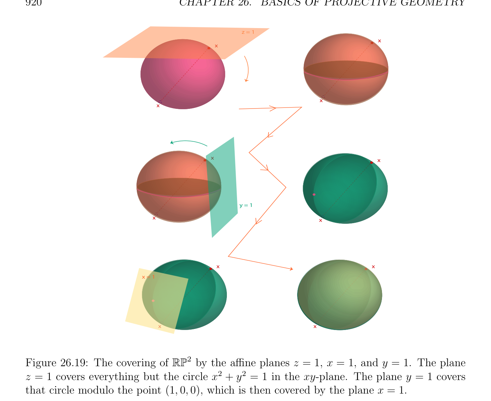

# Projective Completion of an Affine Space

<!-- PAGE 919 -->
An affine space of the form $E_{H}$ is called an affine patch on P(E). Proposition 26.16 allows us to view a projective space P(E) as the result of gluing some affine spaces together, at least when $E$ is of finite dimension. For example, when $E$ is of dimension $2$, a hyperplane in $E$ is just a line, and the complement of a point in the projective line P(E) can be viewed as an affine line. Thus, we can view P(E) as being covered by two affine lines glued together
$$\mathbb{R} \mathbb{RP}^{1}$$
as illustrated by When $K =$ , this shows that topologically, the projective line is equivalent to a circle. See Figure 26.18. When $E$ is of dimension $3$, a hyperplane in $E$ is
$$y = 1$$
$$y = 0$$
$$\mathbb{RP}^{1}$$
$$Figure 26.18: The covering ofby the affine lines y = 0 and y = 1.$$
just a plane, and the complement of a projective line in the projective plane P(E) can be viewed as an affine plane. Thus, we can view P(E) as being covered by three affine planes glued together as illustrated by Figure 26.19. However, even when $K = \mathbb{R}$, it is much more difficult to come up with a geometric
$$\mathbb{RP}^{2}  \mathbb{A}^{3}$$
embedding of the projective plane in , and in fact, this is impossible! Nevertheless,
$$\mathbb{RP}^{2}$$
there are some fascinating immersions of the projective space as 3D surfaces with selfintersection, one of which is known as the Boy surface. We urge our readers to consult the remarkable book by Hilbert and Cohn-Vossen $[95]$ for drawings of the Boy surface, and more. One should also consult Fischer’s books $[62, 61]$, where many beautiful models of surfaces are displayed, and the commentaries in Chapter $6$ of $[61]$ regarding models of $\mathbb{RP}^{2}$. More generally, when $E$ is of dimension $n + 1$, the projective space P(E) is covered by $n + 1$ affine patches (hyperplanes) glued together. This idea is very fruitful, since it allows the treatment of projective spaces as manifolds, and it is essential in algebraic geometry. We can now go back to the projective completion $E$ of an affine space $E$.
$$e$$

## 26.8 Projective Completion of an Affine Space

We begin by spelling out the universal property characterizing the projective completion of
$$\longrightarrow$$
an affine space $(E, E$ ). Then, we prove that eE, $P , i$ where $E = P$ is the projective
$$space obtained associated with the vector spaceE \begin{pmatrix} \longrightarrow \\ E \end{pmatrix} obtained from  eE by \begin{pmatrix} Eb \\ the \end{pmatrix} hat construction$$
$$b \longrightarrow$$
from Chapter $25$ is indeed a projective completion of $(E, E$ ).

<!-- PAGE 920 -->
$$z = 1$$
$$x$$
$$x$$
$$x$$
$$x$$
$$xx$$
$$y = 1$$
$$xx$$
$$xx$$
$$x = 1$$
$$xx$$
$$\mathbb{RP}^{2}$$

**Figure 26.19:** The covering of by the affine planes $z = 1, x = 1$, and $y = 1$. The plane $z = 1$ covers everything but the circle $x^{2} + y^{2} = 1$ in the xy-plane. The plane $y = 1$ covers that circle modulo the point $(1, 0, 0)$, which is then covered by the plane $x = 1$.
$$\longrightarrow$$

> **Definition 26.7.** Given any affine space $E$ with associated vector space $E$ , a projective completion of the affine space $E$ with hyperplane at infinity $P(\mathcal{H})$ is a triple $\langle P(\mathcal{E}), P(\mathcal{H}), i\rangle$ , where $\mathcal{E}$ is a vector space, $\mathcal{H}$ is a hyperplane in $\mathcal{E}, i: E \to P(\mathcal{E})$ is an injective map such that i(E) $= \mathcal{E}_{H}$ and $i$ is affine (where $\mathcal{E}_{H} = P(\mathcal{E})$ - $P(\mathcal{H})$ is an affine patch), and for every projective space P(F) (where $F$ is some vector space), every hyperplane $H$ in $F$, and every map $f$ : $E \to$ P(F) such that f(E) $\subseteq F_{H}$ and $f$ is affine (where $F_{H} =$ P(F) - P(H) is an affine patch), there is a unique projective map $f$ : $P(\mathcal{E}) \to$ P(F) such that
$$e$$
$$\longrightarrow$$
$$f =f \circ iandP=f \circ P(i )$$
$$e \begin{pmatrix} \longrightarrow \\ f \end{pmatrix} e$$
$$\longrightarrow  \longrightarrow  \longrightarrow  \longrightarrow$$
(where $i$ : $E \to H$ and $f$ : $E \to H$ are the linear maps associated with the affine maps $i: E \to P(\mathcal{E})$ and $f$ : $E \to$ P(F)), as in the following diagram:

<!-- PAGE 921 -->
$$-\to$$
$$E\mathcal{E}_{H} \subseteq P(\mathcal{E}) \supseteq P(\mathcal{H})^{P(i)}P$$
$$\overline{I}\overline{I}^{i}\overline{I} IIrrrrrrrrrrrrrrrrrr \begin{pmatrix} \longrightarrow \\ E \end{pmatrix}$$
$$II$$
$$II$$
$$II$$
$$II$$
$$Ife$$
$$fII$$
$$IIP$$
$$II$ry \begin{pmatrix} \longrightarrow f \end{pmatrix}$$
$$F_{H} \subseteq P(F) \supseteq P(H)$$
The points of $P(\mathcal{E})$ in $P(\mathcal{H})$ are called points at infinity, and the projective hyperplane $P(\mathcal{H})$ is called the hyperplane at infinity. We will also denote the point $[u]_{\sim}$ of $P(\mathcal{H})$ (where $u \neq  0)$ by $u_{\infty}$. As usual, objects defined by a universal property are unique up to isomorphism. We leave the proof as an exercise. The importance of the notion of projective completion stems from the fact that every affine map $f$ : $E \to F$ extends in a unique way to a projective map $f$ : $P(\mathcal{E}) \to P(\mathcal{F})$, where
$$e$$
$\langle P(\mathcal{E}), P(\mathcal{H}_{E}), i_{E}\rangle$ is a projective completion of $E$ and $\langle P(\mathcal{F}), P(\mathcal{H}_{F}), i_{F}\rangle$ is a projective completion of $F$, provided that the restriction of $f$ to $P$ agrees with $P$ , as illustrated
$$in the following commutative diagram: e \begin{pmatrix} \longrightarrow \\ E \end{pmatrix} \begin{pmatrix} \longrightarrow \\ f \end{pmatrix}$$
$$f$$
$$EF$$
$$iEiF$$
$$P(\mathcal{E}) P/(\mathcal{F}).$$
$$fe$$
We will now show that eE, $P , i$ is the projective completion of $E$, where $i: E \to E$
$$is the injection of E intoE = E \begin{pmatrix} \longrightarrow \\ E \\ \cup \end{pmatrix} P. For example, if E = \mathbb{A}_{K}^{1} is an affine line, itse$$
$$\mathbb{A}_{K}^{1} e \begin{pmatrix} \longrightarrow \\ E \\ to \end{pmatrix}$$
projective completion  is isomorphic  the projective line $P(K^{2})$, and they both can be
$$f$$
$$\mathbb{A}_{K}^{1}  \mathbb{A}_{K}^{1}$$
identified with  $\cup {\infty$ }, the result of adding a point at infinity $(\infty$ ) to . In general, the projective completion $\mathbb{A}_{K}^{m}$ of the affine space $\mathbb{A}_{K}^{m}$ is isomorphic to $P(K^{m+1})$. Thus, $\mathbb{A}_{m}$
$$f f$$
is isomorphic to $\mathbb{RP}^{m}$, and $\mathbb{A}_{C}^{m}$ is isomorphic to $\mathbb{CP}^{m}$.
$$f$$
First, let us observe that if $E$ is a vector space and $H$ is a hyperplane in $E$, then the homogenization $E_{H}$ of the affine patch $E_{H}$ (the complement of the projective hyperplane
$$c$$
P(H) in P(E)) is isomorphic to $E$. The proof is rather simple and uses the fact that there is an affine bijection between $E_{H}$ and the affine hyperplane $w + H$ in $E$, where $w \in E$ - $H$ is any fixed vector. Choosing $w$ as an origin in $E_{H}$, we know that $E_{H} = H +$ Kw, and since
$$c b$$
$E = H \oplus$ Kw, it is obvious how to define a linear bijection between $E_{H} = H +$ Kw and
$$c b$$
$E = H \oplus$ Kw. As a consequence the projective spaces $E_{H}$ and P(E) are isomorphic, i.e.,
$$f$$
there is a projectivity between them.
$$Proposition 26.17. Given any affine space \begin{pmatrix} \longrightarrow \\ E,E \\ inF, \end{pmatrix} , for every projective space P(F) (where$$
$F$ is some vector space), every hyperplane $H$   and every map $f$ : $E \to$ P(F) such that

<!-- PAGE 922 -->
f(E) $\subseteq F_{H}$ and $f$ is affine $(F_{H}$ being viewed as an affine patch), there is a unique projective map $f$ : $E \to$ P(F) such that $e  e$
$$\longrightarrow$$
$$f =f \circ iandP=f \circ P(i ),$$
$$e \begin{pmatrix} \longrightarrow \\ f \end{pmatrix} e$$
$$\longrightarrow  \longrightarrow \longrightarrow  \longrightarrow  \longrightarrow$$
(where $i$ : $E \to E$ and $f$ : $E \to H$ are the linear maps associated with the affine maps $i: E \to E$ and $f$ : $E \to$ P(F)), as in the following diagram:
$$e$$
$$-\to$$
$$E\mathcal{E}_{H} \subseteq P(\mathcal{E}) \supseteq P(\mathcal{H})^{P(i)}P$$
$$\overline{I}\overline{I}^{i}\overline{I} IIrrrrrrrrrrrrrrrrrr \begin{pmatrix} \longrightarrow \\ E \end{pmatrix}$$
$$II$$
$$II$$
$$II$$
$$II$$
$$Ife$$
$$fII$$
$$IIP$$
$$II$yr \begin{pmatrix} \longrightarrow f \end{pmatrix}$$
$$F_{H} \subseteq P(F) \supseteq P(H)$$

*Proof.* The existence of $f$ is a consequence of Proposition 25.6, where we observe that $F_{H}$ is
$$e c$$
isomorphic to $F$. Just take the projective map $P$ : $E \to$ P(F), where $f$ : $E \to F$ is the
$$unique linear map extending f. It remains to prove \begin{pmatrix} fb \end{pmatrix} its  uniqueness.e b b$$
As explained in the proof of Proposition 26.16, the affine patch $F_{H}$ is affinely isomorphic to some affine hyperplane of the form $w + H$ for some $w \in F$ - $H$. If we pick any $a \in E$, since by hypothesis f(a) $\in F_{H}$, we may assume that $w \in F -H$ is chosen so that f(a) $= [w]$,
$$\longrightarrow$$
and we have $F =$ Kw $\oplus H$. Since $f$ : $E \to F_{H}$ is affine, for any $a \in E$ and any $u \in E$ , we have
$$\longrightarrow  \longrightarrow$$
$$f(a + u) = f(a) +f (u) = w +f (u),$$
$\longrightarrow  \longrightarrow$ where $f$ : $E \to H$ is a linear map, and where f(a) is viewed as the vector $w$. Assume that $f$ : $E \to$ P(F) exists with the desired property. Then there is some linear
$$e e$$
map $g: E \to F$ such that $f =$ P(g). Our goal is to prove that $g = \mu f$ for some nonzero
$$b e \longrightarrow  b$$
$\mu  \in K$. First, we prove that $g$ vanishes on Ker $f$ . Since $f = f \circ i$, we must have f(a) $= [w] =$ [g(a)], and thus g(a) $= \mu w$, for some $\mu  \neq  0$.
$$e\longrightarrow$$
Also, for every $u \in E$ ,
$$\longrightarrow$$
$$f(a + u)=[w] +f (u) = \begin{bmatrix} \longrightarrow \\ w +f(u) \\ \mu w + g(u \end{bmatrix} = [g(a + u)]$$
$$=[g(a) + g(u)] = [)],$$
and thus we must have
$$\longrightarrow$$
$$\lambda (u)w + \lambda (u)f (u) = \mu w + g(u),(*_{1})$$
for some $\lambda (u) \neq  0$.
$$\longrightarrow  \longrightarrow  \longrightarrow$$
If Ker $f = E$ , the linear map $f$ is the null map, and since we are requiring that the restriction of $f$ to $P$ be equal to $P$ , the linear map $g$ must also be the null map
$$e \begin{pmatrix} \longrightarrow \\ E \end{pmatrix} \begin{pmatrix} \longrightarrow \\ f \end{pmatrix}$$

<!-- PAGE 923 -->
$\longrightarrow$ on $E$ . Thus, $f$ is unique, and the restriction of $f$ to $P$ is the partial map undefined
$$everywhere. e e \begin{pmatrix} \longrightarrow \\ E \end{pmatrix}$$
$\longrightarrow  \longrightarrow  \longrightarrow$ If $E$ - Ker f̸ $= \emptyset$ , by taking a basis of Im $f$ and some inverse image of this basis, we
$$\longrightarrow  \longrightarrow  \longrightarrow  \longrightarrow \longrightarrow  \longrightarrow  \longrightarrow \longrightarrow$$
obtain a basis $B$ of a subspace $G$ of $E$ such that $E =$ Ker $f \oplus G$. Since $E =$ Ker $f \oplus G$
$$\longrightarrow \longrightarrow$$
$$where \dim \begin{pmatrix} \longrightarrow \\ G \end{pmatrix} \ge 1, for any x \in Kerf and any nonnull vector y \in G, we have$$
$$\lambda (x)w=\mu w + g(x),$$
$$\longrightarrow$$
$$\lambda (y)w + \lambda (y)f (y)=\mu w + g(y),$$
and
$$\longrightarrow$$
$$\lambda (x + y)w + \lambda (x + y)f (x + y) = \mu w + g(x + y),$$
which by linearity yields
$$\longrightarrow$$
$$(\lambda (x + y) -\lambda (x) -\lambda (y) + \mu )w + (\lambda (x + y) -\lambda (y))f (y) = 0.$$
$$\longrightarrow  \longrightarrow$$
Since $F =$ Kw $\oplus H$ and $f$ : $E \to H$, we must have $\lambda (x + y) = \lambda (y)$ and $\lambda (x) = \mu$ . Then the equation
$$\lambda (x)w = \mu w + g(x)$$
$$\longrightarrow$$
yields $\mu w = \mu w +$ g(x), shows that $g$ vanishes on Ker $f$ .
$$\longrightarrow$$
$$If \dim \begin{pmatrix} \longrightarrow \\ G \end{pmatrix} = 1 then by (*_{1}), for any y \in G we have$$
$$\longrightarrow$$
$$\lambda (y)w + \lambda (y)f (y) = \mu w + g(y),$$
and for any $\nu  \neq  0$ we have
$$\longrightarrow$$
$$\lambda (\nu y)w + \lambda (\nu y)f (\nu y) = \mu w + g(\nu y),$$
which by linearity yields
$$\longrightarrow$$
$$(\lambda (\nu y) -\nu \lambda (y) -\mu  + \nu \mu )w + (\nu \lambda (\nu y) -\nu \lambda (y))f (y) = 0.$$
$$\longrightarrow  \longrightarrow$$
Since $F =$ Kw $\oplus H, f$ : $E \to H$, and $\nu  \neq  0$, we must have $\lambda (\nu y) = \lambda (y)$. Then we must also have $(\lambda (y)$ - $\mu )(1$ - $\nu$ ) $= 0$.
$$\longrightarrow$$
If $K = {0, 1}$, since the only nonzero scalar is $1$, it is immediate that g(y) $= f (y)$, and
$$\longrightarrow$$
we are done. Otherwise, for $\nu  \neq  0, 1$, we get $\lambda (y) = \mu$  for all $y \in G$. Then equation
$$\longrightarrow$$
$$\lambda (y)w + \lambda (y)f (y) = \mu w + g(y)$$
$$\longrightarrow  \longrightarrow \longrightarrow  \longrightarrow$$
yields $g = \mu f$ on $G$, and since $g$ vanishes on Ker $f$ we get $g = \mu f$ on $E$ and the restriction of $f =$ P(g) to $P$ is equal to $P$ . But now, by Proposition 25.6 and since $F_{H}$ is
$$isomorphic e to F, the \begin{pmatrix} \longrightarrow \\ E \end{pmatrix} linear mapf is completely \begin{pmatrix} \longrightarrow \\ f \end{pmatrix} determined by c$$
$$b$$
$$\longrightarrow  \longrightarrow$$
$$f(u+ \lambda a) = \lambda f(a) +f (u) = \lambda w +f (u),$$
$$b b$$

<!-- PAGE 924 -->
and $g$ is completely determined by
$$\longrightarrow$$
$$g(u+ \lambda a) = \lambda g(a) + g(u) = \lambda \mu w + \mu f (u).$$
$$b$$
Thus, we have $g = \mu f$.
$$b$$
$$Otherwise, if \dim \begin{pmatrix} \longrightarrow \\ G \end{pmatrix} \ge 2, then for any two distinct basis vectors u and v in B,$$
$$\longrightarrow$$
$$\lambda (u)w + \lambda (u)f (u)=\mu w + g(u),$$
$$\longrightarrow$$
$$\lambda (v)w + \lambda (v)f (v)=\mu w + g(v),$$
and
$$\longrightarrow$$
$$\lambda (u + v)w + \lambda (u + v)f (u + v) = \mu w + g(u + v),$$
and by linearity, we get
$$\longrightarrow \longrightarrow$$
$(\lambda (u + v)$ - $\lambda (u)$ - $\lambda (v) + \mu )w + (\lambda (u + v)$ - $\lambda (u)) f (u) + (\lambda (u + v)$ - $\lambda (v)) f (v) = 0$.
$$\longrightarrow  \longrightarrow  \longrightarrow  \longrightarrow  \longrightarrow$$
Since $F =$ Kw $\oplus H, f$ : $E \to H$, and $f (u)$ and $f (v)$ are linearly independent (because $f$
$$\longrightarrow$$
in injective on $G)$, we must have
$$\lambda (u + v) = \lambda (u) = \lambda (v) = \mu ,$$
$$\longrightarrow  \longrightarrow$$
which implies that $g = \mu f$ on $E$ , and the restriction of $f =$ P(g) to $P$ is equal to
$$P. As in the previous case, g is completely determined  eby \begin{pmatrix} \longrightarrow \\ E \end{pmatrix}$$
$$\begin{pmatrix} \longrightarrow \\ f \end{pmatrix}$$
$$\longrightarrow$$
$$g(u+ \lambda a) = \lambda g(a) + g(u) = \lambda \mu w + \mu f (u).$$
$$b$$
Again, we have $g = \mu f$, and thus $f$ is unique.
$$b e$$
 The requirement that the restriction of $f =$ P(g) to $P$ be equal to $P$ is
$$necessary for the uniqueness off. The problem comes up when e \begin{pmatrix} \longrightarrow \\ E \end{pmatrix} f is a constant map. \begin{pmatrix} \longrightarrow \\ f \end{pmatrix}$$
$$e$$
Indeed, if $f$ is the constant map defined such that f(a) $= [w]$ for some fixed vector $w \in F$, it can be shown that any linear map $g: E \to F$ defined such that g(a) $= \mu w$ and g(u) $= \phi$ (u)w
$$\longrightarrow  b \longrightarrow$$
for all $u \in E$ , for some $\mu  \neq  0$, and some linear form $\phi$ : $E \to F$ satisfies $f =$ P(g) $\circ i$.
$$Proposition 26.17 shows that
eE, $P \begin{pmatrix} \longrightarrow \\ E \end{pmatrix}$ , iis the projective completion of the affine space$$ $E$. The projective completion $E$ of an affine space $E$ is a very handy place in which to do
$$e$$
geometry in, mainly because the following facts can be easily established. There is a bijection between affine subspaces of $E$ and projective subspaces of $E$ not
$$e$$
$$contained in P \begin{pmatrix} \longrightarrow \\ E \end{pmatrix} . Two affine subspaces of E are parallel iff the corresponding projective$$
